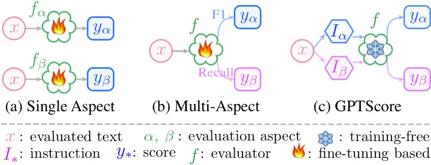

# GPTScore: Evaluate as You Desire

Jinlan Fu Affiliation: National University of Singapore Correspondence
to: <jinlanjonna@gmail.com>    See-Kiong Ng Affiliation: National
University of Singapore    Zhengbao Jiang Affiliation: Carnegie Mellon
University    Pengfei Liu Affiliation: Carnegie Mellon University
Correspondence to: <pliu3@cs.cmu.edu>

###### Abstract

Generative Artificial Intelligence (AI) has enabled the development of
sophisticated models that are capable of producing high-caliber text,
images, and other outputs through the utilization of large pre-trained
models. Nevertheless, assessing the quality of the generation is an even
more arduous task than the generation itself, and this issue has not
been given adequate consideration recently. This paper proposes a novel
evaluation framework, GPTScore, which utilizes the emergent abilities
(e.g., zero-shot instruction) of generative pre-trained models to score
generated texts. There are 19 pre-trained models explored in this paper,
ranging in size from 80M (e.g., FLAN-T5-small) to 175B (e.g., GPT3).
Experimental results on four text generation tasks, $`22`$ evaluation
aspects, and corresponding $`37`$ datasets demonstrate that this
approach can effectively allow us to achieve what one desires to
evaluate for texts simply by natural language instructions. This nature
helps us overcome several long-standing challenges in text
evaluation--how to achieve customized, multi-faceted evaluation without
the need for annotated samples. We make our code publicly available. ¹¹
1
[https://github.com/jinlanfu/GPTScore](https://github.com/jinlanfu/GPTScore)

###### Keywords: 

Machine Learning, ICML

## 1 Introduction

The advent of generative pre-trained models, such as GPT3 (Brown et al.,
2020), has precipitated a shift from analytical AI to generative AI
across multiple domains (Sequoia, 2022). Take text as an example: the
use of a large pre-trained model with appropriate prompts (Liu et al., 2021) has achieved superior performance in tasks defined both in
academia (Sanh et al., 2021) and scenarios from the real world (Ouyang
et al., 2022). While text generation technology is advancing rapidly,
techniques for evaluating the quality of these texts lag far behind.
This is especially evident in the following ways:



Figure 1: An overview of text evaluation approaches.

\(a\) Existing studies evaluate text quality with limited aspects (e.g.,
semantic equivalence, fluency) (Fig. 1-(a)), which are usually
customized prohibitively, making it harder for users to evaluate aspects
as they need (Freitag et al., 2021). (b) A handful of studies have
examined multi-aspect evaluation (Yuan et al., 2021; Scialom et al.,
2021; Zhong et al., 2022) but have not given adequate attention to the
definition of the evaluation aspect and the latent relationship among
them. Instead, the evaluation of an aspect is either empirically bound
with metric variants (Yuan et al., 2021) or learned by supervised
signals (Zhong et al., 2022). (c) Recently proposed evaluation
methods (Mehri & Eskénazi, 2020; Rei et al., 2020; Li et al., 2021;
Zhong et al., 2022) usually necessitate a complicated training procedure
or costly manual annotation of samples (Fig. 1-(a,b)), which makes it
hard to use these methods in industrial settings due to the amount of
time needed for annotation and training to accommodate a new evaluation
demand from the user.

Figure 2: The framework of GPTScore. We include two evaluation aspects
relevance (REL) and informative (INF) in this figure and use the
evaluation of relevance (REL) of the text summarization task to
exemplify our framework.

In this paper, we demonstrated the talent of the super large pre-trained
language model (e.g., GPT-3) in achieving multi-aspect, customized, and
training-free evaluation (Fig. 1-(c)). In essence, it skillfully uses
the pre-trained model’s zero-shot instruction (Chung et al., 2022), and
in-context learning (Brown et al., 2020; Min et al., 2022) ability to
deal with complex and ever-changing evaluation needs so as to solve
multiple evaluation challenges that have been plagued for many years at
the same time.

Specifically, given a text generated from a certain context, and
desirable evaluation aspects (e.g., fluency), the high-level idea of the
proposed framework is that the higher-quality text of a certain aspect
will be more likely generated than unqualified ones based on the given
context, where the “likely” can be measured by the conditional
generation probability. As illustrated in Fig. 2, to capture users’ true
desires, an evaluation protocol will be initially established based on
(a) the task specification, which typically outlines how the text is
generated (e.g., generate a response for a human based on the
conversation.) (b) aspect definition that documents the details of
desirable evaluation aspects (e.g., the response should be intuitive to
understand). Subsequently, each evaluation sample will be presented with
the evaluated protocol with optionally moderate exemplar samples, which
could facilitate the model’s learning. Lastly, a large generative
pre-trained model will be used to calculate how likely the text could be
generated based on the above evaluation protocol, thus giving rise to
our model’s name: GPTScore. Given the plethora of pre-trained models, we
instantiate our framework with different backbones: GPT2 (Radford
et al., 2019), OPT (Zhang et al., 2022b), FLAN (Chung et al., 2022), and
GPT3 (instruction-based (Ouyang et al., 2022)) due to their superior
capacity for zero-shot instruction and their aptitude for in-context
learning.

Experimentally, we ran through almost all common natural language
generation tasks in NLP, and the results showed the power of this new
paradigm. The main observations are listed as follows: (1) Evaluating
texts with generative pre-training models can be more reliable when
instructed by the definition of task and aspect, providing a degree of
flexibility to accommodate various evaluation criteria. Furthermore,
incorporating exemplified samples with in-context learning will further
enhance the process. (2) Different evaluation aspects exhibit certain
correlations. Combining definitions with other highly correlated aspects
can improve evaluation performance. (3) The performance of
GPT3-text-davinci-003, which is tuned based on human feedback, is
inferior to GPT3-text-davinci-001 in the majority of the evaluation
settings, necessitating deep explorations on the working mechanism of
human feedback-based instruction learning (e.g., when it will fail).

## 2 Preliminaries

### 2.1 Text Evaluation

Text evaluation aims to assess the quality of hypothesis text $`\bm{h}`$
in terms of certain aspect $`a`$ (e.g., fluency), which is either
measured manually with different protocols (Nenkova & Passonneau, 2004;
Bhandari et al., 2020; Fabbri et al., 2021; Liu et al., 2022) or
quantified by diverse automated metrics (Lin, 2004; Papineni et al.,
2002; Zhao et al., 2019; Zhang et al., 2020; Yuan et al., 2021).

```math
\displaystyle y=f(\bm{h},a,\mathcal{S}) \tag{1}
```

where (1) $`\bm{h}`$ represents the text to be evaluated (hypothesis
text, e.g., generated summary in text summarization task). (2) $`a`$
denotes the evaluation aspect (e.g., fluency). (3) $`\mathcal{S}`$ is a
collection of additional texts that are optionally used based on
different scenarios. For example, it could be a source document or a
reference summary in the text summarization task. (4) Function
$`f(\cdot)`$ could be instantiated as a human evaluation process or
automated evaluation metrics.

### 2.2 Meta Evaluation

Meta evaluation aims to evaluate the reliability of automated metrics by
calculating how well automated scores ($`y_{\text{auto}}`$) correlate
with human judgment ($`y_{\text{human}}`$) using correlation functions
$`g(y_{\text{auto}},y_{\text{human}})`$ such as spearman correlation. In
this work, we adopt two widely-used correlation measures: (1) Spearman
correlation ($`\rho`$) (Zar, 2005) measures the monotonic relationship
between two variables based on their ranked values. (2) Pearson
correlation ($`r`$) (Mukaka, 2012) measures the linear relationship
based on the raw data values of two variables.

### 2.3 Evaluation Strategy

Evaluation strategies define different aggregation methods when we
calculate the correlation scores. Specifically, suppose that for each
source text $`\bm{s}_{i},i\in[1,2,\cdots,n]`$ (e.g., documents in text
summarization task or dialogue histories for dialogue generation task),
there are $`J`$ system outputs $`\bm{h}_{i,j}`$, where
$`j\in[1,2,\cdots,J]`$. $`f_{\text{auto}}`$ is an automatic scoring
function (e.g., ROUGE (Lin, 2004)), and $`f_{\text{human}}`$ is the gold
human scoring function. For a given evaluation aspect $`a`$, the
meta-evaluation metric $`F`$ can be formulated as follows.

#### Sample-level

defines that a correlation value is calculated for each sample
separately based on outputs of multiple systems, then averaged across
all samples.

```math
\begin{split}F^{\text{sample}}_{f_{\text{auto}},f_{\text{human}}}=\frac{1}{n}\sum\limits_{i=1}^{n}\Big(g\big(\left[f_{\text{auto}}(\bm{h}_{i,1}),\cdots,f_{\text{auto}}(\bm{h}_{i,J})\right],\\
\left[f_{\text{human}}(\bm{h}_{i,1}),\cdots,f_{\text{human}}(\bm{h}_{i,J})\right]\big)\Big),\end{split}
```

where $`g`$ can be instantiated as Spearman or Pearson correlation.

#### Dataset-level

indicates that the correlation value is calculated on system outputs of
all $`n`$ samples.

```math
\begin{split}F^{\text{data}}_{f_{\text{auto}},f_{\text{human}}}=g\Big(\left[f_{\text{auto}}(\bm{h}_{1,1}),\cdots,f_{\text{auto}}(\bm{h}_{n,J})\right],\\
\left[f_{\text{human}}(\bm{h}_{1,1}),\cdots,f_{\text{human}}(\bm{h}_{n,J})\right]\Big)\end{split}
```

In this work, we select the evaluation strategy for a specific task
based on previous works (Yuan et al., 2021; Zhang et al., 2022a). We use
the sample-level evaluation strategy for text summarization,
data-to-text, and machine translation tasks. For the dialogue response
generation task, the dataset-level evaluation strategy is utilized.

## 3 GPTScore

### 3.1 Generative Pre-trained Language Models

Existing pre-trained language models could be classified into the
following three categories: (a) encoder-only models (e.g., BERT (Devlin
et al., 2019), RoBerta (Liu et al., 2019)) that encode inputs with
bidirectional attention; (b) encoder-decoder models (e.g., BART (Lewis
et al., 2020), T5 (Raffel et al., 2020)) that encode inputs with
bidirectional attention and generate outputs autoregressively; (c)
decoder-only models (e.g., GPT2 (Radford et al., 2019), GPT3 (Brown
et al., 2020), PaLM (Chowdhery et al., 2022)) that generate the entire
text sequence autoregressively, where pre-trained models with decoding
abilities (b, c) have caught much attention since they show impressive
performance on zero-shot instruction and in-context learning.
Specifically, given a prompt text
$`\bm{x}=\{x_{1},x_{2},\cdots,x_{n}\}`$, a generative pre-training
language model can generate a textual continuation
$`\bm{y}=\{y_{1},y_{2},\cdots,y_{m}\}`$ with the following generation
probability:

```math
p(\bm{y}|\bm{x},\theta)=\prod_{t=1}^{m}p(y_{t}|\bm{y}_{<t},\bm{x},\theta)
```

Emergent Ability Recent works progressively reveal a variety of emergent
abilities of generative pre-trained language models with appropriate
tuning or prompting methods, such as in-context learning (Min et al.,
2022), chain-of-thought reasoning (Wei et al., 2022), and zero-shot
instruction (Ouyang et al., 2022). One core commonality of these
abilities is to allow for handling customized requirements with a few or
even zero annotated examples. It’s the appearance of these abilities
that allows us to re-invent a new way for text evaluation–evaluating
from the textual description, which can achieve customizable,
multi-faceted, and train-free evaluation.

### 3.2 Generative Pretraining Score (GPTScore)

The core idea of GPTScore is that a generative pre-training model will
assign a higher probability of high-quality generated text following a
given instruction and context. In our method, the instruction is
composed of the task description $`d`$ and the aspect definition $`a`$.
Specifically, suppose that the text to be evaluated is
$`\bm{h}=\{h_{1},h_{2},\cdots,h_{m}\}`$, the context information is
$`\mathcal{S}`$ (e.g., source text or reference text), then GPTScore is
defined as the following conditional probability:

```math
\mathrm{GPTScore}(\bm{h}|d,a,\mathcal{S})=\sum_{t=1}^{m}w_{t}\log p(h_{t}|\bm{h}_{<t},T(d,a,\mathcal{S}),\theta),
```

where $`w_{t}`$ is the weight of the token at position $`t`$. In our
work, we treat each token equally. $`T(\cdot)`$ is a prompt template
that defines the evaluation protocol, which is usually task-dependent
and specified manually through prompt engineering.

| Aspect                  | Task                | Definition                                                                                 |
| ----------------------- | ------------------- | ------------------------------------------------------------------------------------------ |
| Semantic Coverage (COV) | Summ                | How many semantic content units from the reference text are covered by the generated text? |
| Factuality (FAC)        | Summ                | Does the generated text preserve the factual statements of the source text?                |
| Consistency (CON)       | Summ, Diag          | Is the generated text consistent in the information it provides?                           |
| Informativeness (INF)   | Summ, D2T, Diag     | How well does the generated text capture the key ideas of its source text?                 |
| Coherence (COH)         | Summ, Diag          | How much does the generated text make sense?                                               |
| Relevance (REL)         | Diag, Summ, D2T     | How well is the generated text relevant to its source text?                                |
| Fluency (FLU)           | Diag, Summ, D2T, MT | Is the generated text well-written and grammatical?                                        |
| Accuracy (ACC)          | MT                  | Are there inaccuracies, missing, or unfactual content in the generated text?               |
| Multidimensional        | MT                  | How is the overall quality of the generated text?                                          |
| Quality Metrics (MQM)   |                     |                                                                                            |
| Interest (INT)          | Diag                | Is the generated text interesting?                                                         |
| Engagement (ENG)        | Diag                | Is the generated text engaging?                                                            |
| Specific (SPE)          | Diag                | Is the generated text generic or specific to the source text?                              |
| Correctness (COR)       | Diag                | Is the generated text correct or was there a misunderstanding of the source text?          |
| Semantically            | Diag                | Is the generated text semantically appropriate?                                            |
| appropriate (SEM)       |                     |                                                                                            |
| Understandability (UND) | Diag                | Is the generated text understandable?                                                      |
| Error Recovery (ERR)    | Diag                | Is the system able to recover from errors that it makes?                                   |
| Diversity (DIV)         | Diag                | Is there diversity in the system responses?                                                |
| Depth (DEP)             | Diag                | Does the system discuss topics in depth?                                                   |
| Likeability (LIK)       | Diag                | Does the system display a likeable personality?                                            |
| Flexibility (FLE)       | Diag                | Is the system flexible and adaptable to the user and their interests?                      |
| Inquisitiveness (INQ)   | Diag                | Is the system inquisitive throughout the conversation?                                     |

Table 1: The definition of aspects evaluated in this work. Semantic App.
denotes semantically appropriate aspect. Diag, Summ, D2T, and MT denote
the dialogue response generation, text summarization, data to text and
machine translation, respectively.

Few-shot with Demonstration  The generative pre-trained language model
can better perform tasks when prefixed with a few annotated samples
(i.e., demonstrations). Our proposed framework is flexible in supporting
this by extending the prompt template $`T`$ with demonstrations.

Choice of Prompt Template  Prompt templates define how task description,
aspect definition, and context are organized. Minging desirable prompts
itself is a non-trivial task and there are extensive research works
there (Liu et al., 2021; Fu et al., 2022). In this work, for the
GPT3-based model, we opt for prompts that are officially provided by
OpenAI.²² 2
[https://beta.openai.com/examples](https://beta.openai.com/examples) For
instruction-based pre-trained models, we use prompts from
NaturalInstruction (Wang et al., 2022) since it’s the main training
source for those instruction-based pre-train models. Taking the
evaluation of the fluency of the text summarization task as an example,
based on the prompt provided by OpenAI,³³ 3
[https://beta.openai.com/examples/default-tldr-summary](https://beta.openai.com/examples/default-tldr-summary)
the task prompt is “{Text} Tl;dr {Summary}”, the definition of fluency
is “Is the generated text well-written and grammatical?” (in Tab. 1),
and then the final prompt template is “Generate a fluent and grammatical
summary for the following text: {Text} Tl;dr {Summary}”, where
demonstrations could be introduced by repeating instantiating “{Text}
Tl;dr {Summary}” In Appendix D, we list the prompts for various aspects
of all tasks studied in this work and leave a more comprehensive
exploration on prompt engineering as a future work.

Selection of Scoring Dimension  GPTScore exhibits different variants in
terms of diverse choices of texts being calculated. For example, given a
generated hypothesis, we can calculate GPTScore either based on the
source text (i.e., src-\>hypo, $`p(\text{hypo}|\text{src})`$) or based
on the gold reference (i.e., ref-\>hypo, $`p(\text{hypo}|\text{ref})`$).
In this paper, the criteria for choosing GPTScore variants are mainly
designed to align the protocol of human judgments (Liu et al., 2022)
that are used to evaluate the reliability of automated metrics. We will
detail this based on different human judgment datasets in the experiment
section.

## 4 Experimental Settings

### 4.1 Tasks, Datasets, and Aspects

To achieve a comprehensive evaluation, in this paper, we cover a broad
range of natural language generation tasks: Dialogue Response
Generation, Text Summarization, Data-to-Text, and Machine Translation,
which involves $`37`$ datasets and $`22`$ evaluation aspects in total.
Tab. 8 summarizes the tasks, datasets, and evaluation aspects considered
by each dataset. The definition of different aspects can be found in
Tab. 1. More detailed illustrations about the datasets can be found in
Appendix B.

\(1\) Dialogue Response Generation aims to automatically generate an
engaging and informative response based on the dialogue history. Here,
we choose to use the FED (Mehri & Eskénazi, 2020) datasets and consider
both turn-level and dialogue-level evaluations. (2) Text Summarization
is a task of automatically generating informative and fluent summary for
a given long text. Here, we consider the following four datasets,
SummEval (Bhandari et al., 2020), REALSumm (Bhandari et al., 2020),
NEWSROOM (Grusky et al., 2018), and QAGS_XSUM (Wang et al., 2020),
covering 10 aspects. (3) Data-to-Text aims to automatically generate a
fluent and factual description for a given table. Our work considered
BAGEL (Mairesse et al., 2010) and SFRES (Wen et al., 2015) datasets. (4)
Machine Translation aims to translate a sentence from one language to
another. We consider a subdatasets of Multidimensional Quality Metrics
(MQM) (Freitag et al., 2021), namely, MQM-2020 (Chinese-\>English).

### 4.2 Scoring Models

ROUGE (Lin, 2004) is a popular automatic generation evaluation metric.
We consider three variants ROUGE-1, ROUGE-2, and ROUGE-L.
PRISM (Thompson & Post, 2020) is a reference-based evaluation method
designed for machine translation with pre-trained paraphrase systems.
BERTScore (Zhang et al., 2020) uses contextual representation from BERT
to calculate the similarity between the generated text and the reference
text. MoverScore (Zhao et al., 2019) considers both contextual
representation and Word Mover’s Distance (WMD, (Kusner et al., 2015))
DynaEval (Zhang et al., 2021) is a unified automatic evaluation
framework for dialogue response generation tasks on the turn level and
dialogue level. BARTScore (Yuan et al., 2021) is a text-scoring model
based on BART (Lewis et al., 2020) without fine-tuning.
BARTScore+CNN (Yuan et al., 2021) is based on BART fine-tuned on the
CNNDM dataset (Hermann et al., 2015). BARTScore+CNN+Para (Yuan et al., 2021) is based on BART fine-tuned on CNNDM and Paraphrase2.0 (Hu et al.,
2019). GPTScore is our evaluation method, which is designed based on
different pre-trained language models. Specifically, we considered GPT3,
OPT, FLAN-T5, and GPT2 in this work. Five variants are explored for each
framework. For a fair comparison with the decoder-only model, such as
GPT3 and OPT, only four variant models of GPT2 with a parameter size of
at least 350M are considered. Tab. 2 shows all model variants we used in
this paper and their number of parameters.

| GPT3             | Param. | OPT      | Param. |
| ---------------- | ------ | -------- | ------ |
| text-ada-001     | 350M   | OPT350M  | 350M   |
| text-babbage-001 | 1.3B   | OPT-1.3B | 1.3B   |
| text-curie-001   | 6.7B   | OPT-6.7B | 6.7B   |
| text-davinci-001 | 175B   | OPT-13B  | 13B    |
| text-davinci-003 | 175B   | OPT-66B  | 66B    |
| FLAN-T5          | Param. | GPT2     | Param. |
| FT5-small        | 80M    | GPT2-M   | 355M   |
| FT5-base         | 250M   | GPT2-L   | 774M   |
| FT5-L            | 770M   | GPT2-XL  | 1.5B   |
| FT5-XL           | 3B     | GPT-J-6B | 6B     |
| FT5-XXL          | 11B    |          |        |

Table 2: Pre-trained backbones used in this work.

### 4.3 Scoring Dimension

Specifically, (1) For aspects INT, ENG, SPC, REL, COR, SEM, UND, and FLU
of FED-Turn datasets from the open domain dialogue generation task, we
choose the src-\>hypo variant since the human judgments of the evaluated
dataset (i.e., FED-Turn) are also created based on the source. (2) For
aspects COH, CON, and INF from SummEval and Newsroom, since data
annotators labeled the data based on source and hypothesis texts, we
chose src-\>hypo for these aspects. (3) For aspects INF, NAT, and QUA
from the data-to-text task, we choose src-\>hypo. Because the source
text of the data-to-text task is not in the standard text format, which
will be hard to handle by the scoring function. (4) For aspects ACC,
FLU, and MQM from the machine translation task, we also choose
src-\>hypo. Because the source text of the machine translation is a
different language from the translated text (hypo). In this work, we
mainly consider the evaluation of the English text. In the future, we
can consider designing a scoring function based on BLOOM (Scao et al., 2022) that can evaluate texts in a cross-lingual setting.

### 4.4 Evaluation Dataset Construction

Unlike previous works (Matiana et al., 2021; Xu et al., 2022a; Xu
et al., 2022b; Castricato et al., 2022) that only consider the overall
text quality, we focus on evaluating multi-dimensional text quality. In
this work, we studied 37 datasets according to 22 evaluation aspects.
Due to the expensive API cost of GPT3, we randomly extract and construct
sub-datasets for meta-evaluation. For the MQM dataset, since many
aspects of samples lack human scores, we extract samples with human
scores in ACC, MQM, and FLU as much as possible.

## 5 Experiment Results

In this work, we focus on exploring whether language models with
different structures and sizes can work in the following three
scenarios. (a) vanilla (VAL): with non-instruction and
non-demonstration; (b) instruction (IST): with instruction and
non-demonstration; (c) instruction+demonstration (IDM): with instruction
and demonstration.

Significance Tests To examine the reliability and validity of the
experiment results, we conducted the significance test based on
bootstrapping.⁴⁴ 4
[https://en.wikipedia.org/wiki/Bootstrapping\_(statistics)](<https://en.wikipedia.org/wiki/Bootstrapping_(statistics)>)
Our significance test is to check (1) whether the performance of IST
(IDM) is significantly better than VAL, and values achieved with the IST
(IDM) settings will be marked $`{\dagger}`$ if it passes the significant
test (p-value \<0.05). (2) whether the performance of IDM is
significantly better than IST, if yes, mark the value with IDM setting
with $`{\ddagger}`$.

Average Performance Due to space limitations, we keep the average
performance of GPT3-based, GPT2-based, OPT-based, and FT5-based models.
The full results of various variants can be found in Appendix E.

|           |          |                               |      |                               |      |                               |      |                               |       |                               |
| --------- | -------- | ----------------------------- | ---- | ----------------------------- | ---- | ----------------------------- | ---- | ----------------------------- | ----- | ----------------------------- |
| Model     | SummEval |                               |      |                               |      |                               |      |                               | RSumm |                               |
|           | COH      |                               | CON  |                               | FLU  |                               | REL  |                               | COV   |                               |
|           | VAL      | IST                           | VAL  | IST                           | VAL  | IST                           | VAL  | IST                           | VAL   | IST                           |
| ROUGE-1   | 14.1     | -                             | 20.8 | -                             | 14.8 | -                             | 26.2 | -                             | 46.4  | -                             |
| ROUGE-2   | 9.1      | -                             | 17.2 | -                             | 12.0 | -                             | 17.4 | -                             | 37.3  | -                             |
| ROUGE-L   | 12.9     | -                             | 19.8 | -                             | 17.6 | -                             | 24.7 | -                             | 45.1  | -                             |
| BERTSc    | 25.9     | -                             | 19.7 | -                             | 23.7 | -                             | 34.7 | -                             | 38.4  | -                             |
| MoverSc   | 11.5     | -                             | 18.0 | -                             | 15.7 | -                             | 24.8 | -                             | 34.4  | -                             |
| PRISM     | 26.5     | -                             | 29.9 | -                             | 26.1 | -                             | 25.2 | -                             | 32.3  | -                             |
| BARTSc    | 29.7     | -                             | 30.8 | -                             | 24.6 | -                             | 28.9 | -                             | 43.1  | -                             |
| +CNN      | 42.5     | -                             | 35.8 | -                             | 38.1 | -                             | 35.9 | -                             | 42.9  | -                             |
| +CNN+Pa   | 42.5     | -                             | 37.0 | -                             | 40.5 | -                             | 33.9 | -                             | 40.9  | -                             |
| GPT3-a01  | 39.3     | $`\text{39.8}^{{\dagger}}`$   | 39.7 | $`\text{40.5}^{{\dagger}}`$   | 36.1 | 35.9                          | 28.2 | 27.6                          | 29.5  | $`\text{29.8}^{{\dagger}}`$   |
| GPT3-b01  | 42.7     | $`\text{{45.2}}^{{\dagger}}`$ | 41.0 | $`\text{41.4}^{{\dagger}}`$   | 37.1 | $`\text{39.1}^{{\dagger}}`$   | 32.0 | $`\text{33.4}^{{\dagger}}`$   | 35.0  | $`\text{35.2}^{{\dagger}}`$   |
| GPT3-c01  | 41.3     | 40.8                          | 44.6 | $`\text{45.1}^{{\dagger}}`$   | 38.9 | $`\text{39.5}^{{\dagger}}`$   | 31.6 | $`\text{33.2}^{{\dagger}}`$   | 36.1  | $`\text{{45.1}}^{{\dagger}}`$ |
| GPT3-d01  | 40.0     | 40.1                          | 46.6 | $`\text{{47.5}}^{{\dagger}}`$ | 40.5 | $`\text{{41.0}}^{{\dagger}}`$ | 32.4 | $`\text{34.3}^{{\dagger}}`$   | 36.0  | 33.9                          |
| GPT3-d03  | 43.7     | 43.4                          | 45.2 | 44.9                          | 41.1 | 40.3                          | 36.3 | $`\text{{38.1}}^{{\dagger}}`$ | 35.2  | $`\text{38.0}^{{\dagger}}`$   |
| GPT2-M    | 36.0     | $`\text{39.2}^{{\dagger}}`$   | 34.6 | $`\text{35.3}^{{\dagger}}`$   | 28.1 | $`\text{30.7}^{{\dagger}}`$   | 28.3 | 28.3                          | 41.8  | $`\text{43.3}^{{\dagger}}`$   |
| GPT2-L    | 36.4     | $`\text{39.8}^{{\dagger}}`$   | 33.7 | $`\text{34.4}^{{\dagger}}`$   | 29.4 | $`\text{31.5}^{{\dagger}}`$   | 27.8 | $`\text{28.1}^{{\dagger}}`$   | 39.6  | $`\text{41.3}^{{\dagger}}`$   |
| GPT2-XL   | 35.3     | $`\text{{39.9}}^{{\dagger}}`$ | 35.9 | $`\text{36.1}^{{\dagger}}`$   | 31.2 | $`\text{33.1}^{{\dagger}}`$   | 28.1 | 28.0                          | 40.4  | $`\text{41.0}^{{\dagger}}`$   |
| GPT-J-6B  | 35.5     | $`\text{39.5}^{{\dagger}}`$   | 42.7 | $`\text{{42.8}}^{{\dagger}}`$ | 35.5 | $`\text{{37.4}}^{{\dagger}}`$ | 31.5 | $`\text{{31.9}}^{{\dagger}}`$ | 42.8  | $`\text{{43.7}}^{{\dagger}}`$ |
| OPT350m   | 33.4     | $`\text{37.6}^{{\dagger}}`$   | 34.9 | $`\text{35.5}^{{\dagger}}`$   | 29.6 | $`\text{31.4}^{{\dagger}}`$   | 29.5 | 28.6                          | 40.2  | $`\text{42.3}^{{\dagger}}`$   |
| OPT-1.3B  | 35.0     | $`\text{{37.8}}^{{\dagger}}`$ | 40.0 | $`\text{42.0}^{{\dagger}}`$   | 33.6 | $`\text{35.9}^{{\dagger}}`$   | 33.5 | $`\text{34.2}^{{\dagger}}`$   | 42.0  | 39.7                          |
| OPT-6.7B  | 35.7     | $`\text{36.8}^{{\dagger}}`$   | 42.1 | $`\text{{45.7}}^{{\dagger}}`$ | 35.5 | $`\text{37.6}^{{\dagger}}`$   | 35.4 | 35.4                          | 38.0  | $`\text{41.9}^{{\dagger}}`$   |
| OPT-13B   | 33.5     | $`\text{34.7}^{{\dagger}}`$   | 42.5 | $`\text{45.2}^{{\dagger}}`$   | 35.6 | $`\text{37.3}^{{\dagger}}`$   | 33.6 | 33.9                          | 37.6  | $`\text{41.0}^{{\dagger}}`$   |
| OPT-66B   | 32.0     | $`\text{35.9}^{{\dagger}}`$   | 44.0 | $`\text{45.3}^{{\dagger}}`$   | 36.3 | $`\text{{38.0}}^{{\dagger}}`$ | 33.4 | $`\text{33.7}^{{\dagger}}`$   | 40.3  | $`\text{41.3}^{{\dagger}}`$   |
| FT5-small | 35.0     | $`\text{35.4}^{{\dagger}}`$   | 37.0 | $`\text{38.0}^{{\dagger}}`$   | 35.6 | 34.7                          | 27.3 | $`\text{28.0}^{{\dagger}}`$   | 33.6  | $`\text{35.7}^{{\dagger}}`$   |
| FT5-base  | 39.2     | $`\text{39.9}^{{\dagger}}`$   | 36.7 | $`\text{37.2}^{{\dagger}}`$   | 37.3 | 36.5                          | 29.5 | $`\text{31.2}^{{\dagger}}`$   | 36.7  | $`\text{38.6}^{{\dagger}}`$   |
| FT5-L     | 42.3     | $`\text{45.1}^{{\dagger}}`$   | 41.0 | $`\text{42.5}^{{\dagger}}`$   | 39.3 | $`\text{41.6}^{{\dagger}}`$   | 31.2 | $`\text{{35.3}}^{{\dagger}}`$ | 31.4  | $`\text{39.3}^{{\dagger}}`$   |
| FT5-XL    | 42.8     | $`\text{{47.0}}^{{\dagger}}`$ | 41.0 | $`\text{43.6}^{{\dagger}}`$   | 39.7 | $`\text{42.1}^{{\dagger}}`$   | 31.4 | $`\text{34.4}^{{\dagger}}`$   | 34.8  | $`\text{{43.8}}^{{\dagger}}`$ |
| FT5-XXL   | 42.1     | $`\text{45.6}^{{\dagger}}`$   | 43.7 | 43.8                          | 39.8 | $`\text{{42.4}}^{{\dagger}}`$ | 32.8 | $`\text{34.3}^{{\dagger}}`$   | 40.2  | $`\text{41.1}^{{\dagger}}`$   |
| Avg.      | 38.0     | 40.2                          | 40.4 | 41.4                          | 35.8 | 37.2                          | 31.3 | 32.2                          | 37.4  | 39.8                          |

Table 3: Spearman correlation of different aspects on text summarization
datasets. VAL and IST is the abbreviation of vanilla and instruction,
respectively. Values with $`{\dagger}`$ denote the evaluator with
instruction significantly outperforms with vanilla. Values in bold are
the best performance in a set of variants (e.g., GPT3 family).

### 5.1 Text Summarization

The evaluation results of $`28`$ (9 baseline models (e.g., ROUGE-1) and
19 variants of GPTScore (e.g., GPT3-d01)) scoring functions for the text
summarization task on SummEval and RealSumm datasets are shown in
Tab. 3. Due to the space limitation, we move the performance of the
NEWSROOM and QXSUM datasets to the Appendix E. Fig. 3 shows the
evaluation results of five GPT3 variant models on four text
summarization datasets, where QXSUM uses the Pearson correlation and
other datasets use the Spearman correlation metric. The main
observations are summarized as follows:

\(1\) Evaluator with instruction significantly improves the performance
(values with $`{\dagger}`$ in Tab. 3). What’s more, small models with
instruction demonstrate comparable performance to supervised learning
models. For example, OPT350m, FT5-small, and FT5-base outperform
BARTScore+CNN on the CON aspect when using the instructions. (2) The
benefit from instruction is more stable for the decoder-only models. In
Tab. 3, the average Spearman score of both the GPT2 and OPT models, 9
out of 10 aspects are better than the vanilla setting (VAL) by using
instruction (IST), while the equipment of instruction (IST) to the
encoder-decoder model of FT5 on the NEWSROOM dataset fails to achieve
gains. (3) As for the GPT3-based models, (a) the performance of GPT3-d01
is barely significantly better than GPT3-c01, which tries to balance
power and speed. (b) GPT3-d03 performs better than GPT3-d01
significantly. We can observe these conclusions from Fig. 3, and both
conclusions have passed the significance test at $`p<0.05`$.

| SummEval |     |     |     | RSumm |
| -------- | --- | --- | --- | ----- |
| COH      | CON | FLU | REl | COV   |
|          |     |     |     |       |
| NEWSROOM |     |     |     | QXSUM |
| COH      | FLU | REL | INF | FAC   |
|          |     |     |     |       |

Figure 3: Experimental results for GPT3-based variants in text
summarization task. Here, blue, orange, green, pink, and cyan dot denote
that GPTScore is built based on a01 ( ), b01 ( ), c01 ( ), d01 ( ), and
d03 ( ), respectively. The red lines (—) denote the average performance
of GPT3-based variants.

### 5.2 Machine Translation

The average sample-level Spearman ($`\rho`$) scores of GPT3-based,
GPT2-based, OPT-based, and FT5-based models on the MQM-2020 machine
translation dataset are shown in Tab. 4, where values with $`{\dagger}`$
denote that the evaluator equipped with IST (or IDM) significantly
outperforms the VAL setting, and $`{\ddagger}`$ indicate that the
evaluator equipped with IDM (the combination of IST and DM)
significantly outperforms the IST setting. The Spearman correlations for
the GPT3-based variants are shown in Fig. 4. For the full evaluation
results of $`28`$ models (including $`9`$ baseline scoring models, such
as ROUGE-1) can be found in Tab. 14. Following Thompson & Post (2020)
and  Yuan et al. (2021), we treat the evaluation of machine translation
as the paraphrasing task. The main observations are listed as follows:

\(1\) The introduction of instruction (IST) significantly improve the
performance in three different aspects of ACC, FLU, and MQM. In Tab. 4,
the average performance of $`19`$ GPTScore based evaluators with
instruction (IST) significantly outperforms vanilla (VAL). (2) The
combination of instruction and demonstration (IDM) brings gains for the
evaluator with different model structures. In Tab. 4, the performance of
GPT3, GPT2, OPT, and FT5 improves a lot when instruction and
demonstration (IDM) are introduced. (3) The evaluator built based on
GPT3-c01 achieves comparable performance with GPT3-d01 and GPT3-d03.
This can be found in Fig. 4. Since the GPT3-d01 and GPT3-d03 are most
expensive variant of GPT3, the cheaper and comparative GPT3-c01 is a
good choice for machine translation task.

| Model | ACC  |                               |                                          | FLU  |                               |                                          | MQM  |                               |                                          |
| ----- | ---- | ----------------------------- | ---------------------------------------- | ---- | ----------------------------- | ---------------------------------------- | ---- | ----------------------------- | ---------------------------------------- |
|       | VAL  | IST                           | IDM                                      | VAL  | IST                           | IDM                                      | VAL  | IST                           | IDM                                      |
| GPT3  | 27.2 | 27.1                          | $`\text{29.7}^{{\dagger},{\ddagger}}`$   | 11.3 | 10.4                          | $`\text{{16.4}}^{{\dagger},{\ddagger}}`$ | 30.3 | $`\text{31.2}^{{\dagger}}`$   | $`\text{32.3}^{{\dagger},{\ddagger}}`$   |
| GPT2  | 25.8 | $`\text{27.0}^{{\dagger}}`$   | $`\text{{30.3}}^{{\dagger},{\ddagger}}`$ | 9.8  | $`\text{10.8}^{{\dagger}}`$   | $`\text{15.8}^{{\dagger},{\ddagger}}`$   | 30.1 | $`\text{30.3}^{{\dagger}}`$   | $`\text{33.5}^{{\dagger},{\ddagger}}`$   |
| OPT   | 28.7 | $`\text{{29.4}}^{{\dagger}}`$ | $`\text{30.3}^{{\dagger},{\ddagger}}`$   | 10.0 | $`\text{{12.2}}^{{\dagger}}`$ | $`\text{16.3}^{{\dagger},{\ddagger}}`$   | 32.5 | $`\text{{34.6}}^{{\dagger}}`$ | $`\text{{35.1}}^{{\dagger},{\ddagger}}`$ |
| FT5   | 27.7 | $`\text{27.8}^{{\dagger}}`$   | $`\text{28.3}^{{\dagger},{\ddagger}}`$   | 9.6  | $`\text{11.0}^{{\dagger}}`$   | $`\text{15.4}^{{\dagger},{\ddagger}}`$   | 31.0 | $`\text{32.3}^{{\dagger}}`$   | 32.3                                     |
| Avg.  | 27.4 | $`\text{27.8}^{{\dagger}}`$   | $`\text{29.7}^{{\dagger},{\ddagger}}`$   | 10.2 | $`\text{11.1}^{{\dagger}}`$   | $`\text{16.0}^{{\dagger},{\ddagger}}`$   | 31.0 | $`\text{32.1}^{{\dagger}}`$   | $`\text{33.3}^{{\dagger},{\ddagger}}`$   |

Table 4: The average Spearman correlation of the GPT3-based, GPT2-based,
OPT-based, and FT5-based models in machine translation task of MQM-2020
dataset.

| MQM-2020 |     |     |
| -------- | --- | --- |
| ACC      | FLU | MQM |
|          |     |     |

Figure 4: Experimental results for GPT3-based variants in the machine
translation task. Here, blue, orange, green, pink, and cyan dot denote
that GPTScore is built based on a01 ( ), b01 ( ), c01 ( ), d01 ( ), and
d03 ( ), respectively. The red lines (—) denote the average performance
of GPT3-based variants.

### 5.3 Data to Text

We consider the BAGEL and SFRES datasets for the evaluation of data to
text task. The average Spearman correlations of the GPT3-based,
GPT2-based, OPT-based, and FT5-based models are listed in Tab. 5. VAL,
IST, and IDM denote the vanilla, using instruction, and using both
instruction and demonstration settings, respectively. Due to the space
limitation, the detailed performance of each evaluator considered in
this work can be found in Tab. 15 and Tab. 16. The main observations are
listed as follows:

\(1\) Introducing instruction (IST) can significantly improve
performance, and introducing demonstration (DM) will further improve
performance. In Tab. 5, the average performance on the three aspects is
significantly improved when adapting to the instruction, and the
performance of using demonstration on NAT and FLU has further
significantly improved. (2) The decoder-only model is better at
utilizing demonstration to achieve high performance. In Tab. 5, compare
to the encoder-decoder model FT5, the performance has a more significant
improvement for the decoder-only model of GPT2 and OPT on NAT and FLU
aspects after introducing DM, which holds for both BAGEL and SFRES. (3)
GPT3 has strong compatibility with unformatted text. Named entities of
the BAGEL dataset are replaced with a special token (e.g, X and Y ). For
example, “X is a cafe restaurant”, where “X” denotes the name of the
cafe. When introducing IST and DM (IDM), the variants of GPT3 achieve
much higher average performance than GPT2, OPT, and FT5.

|       |      |                             |                                        |      |                             |                                        |      |                             |                                        |
| ----- | ---- | --------------------------- | -------------------------------------- | ---- | --------------------------- | -------------------------------------- | ---- | --------------------------- | -------------------------------------- |
| Model | INF  |                             |                                        | NAT  |                             |                                        | FLU  |                             |                                        |
|       | VAL  | IST                         | IDM                                    | VAL  | IST                         | IDM                                    | VAL  | IST                         | IDM                                    |
| BAGEL |      |                             |                                        |      |                             |                                        |      |                             |                                        |
| GPT3  | 35.4 | $`\text{38.3}^{{\dagger}}`$ | $`\text{43.6}^{{\dagger},{\ddagger}}`$ | 21.7 | $`\text{26.5}^{{\dagger}}`$ | $`\text{36.9}^{{\dagger},{\ddagger}}`$ | 30.5 | $`\text{32.9}^{{\dagger}}`$ | $`\text{43.4}^{{\dagger},{\ddagger}}`$ |
| GPT2  | 40.8 | $`\text{43.2}^{{\dagger}}`$ | 40.2                                   | 31.4 | $`\text{33.0}^{{\dagger}}`$ | $`\text{33.5}^{{\dagger},{\ddagger}}`$ | 36.7 | $`\text{39.3}^{{\dagger}}`$ | $`\text{41.3}^{{\dagger},{\ddagger}}`$ |
| OPT   | 38.7 | $`\text{39.3}^{{\dagger}}`$ | 38.6                                   | 31.4 | 30.0                        | $`\text{33.7}^{{\dagger},{\ddagger}}`$ | 37.7 | $`\text{37.1}^{{\dagger}}`$ | $`\text{41.5}^{{\dagger},{\ddagger}}`$ |
| FT5   | 41.5 | 41.5                        | 39.1                                   | 26.5 | $`\text{29.7}^{{\dagger}}`$ | $`\text{28.6}^{{\dagger}}`$            | 38.1 | $`\text{41.1}^{{\dagger}}`$ | $`\text{40.3}^{{\dagger}}`$            |
| Avg.  | 39.1 | $`\text{40.6}^{{\dagger}}`$ | $`\text{40.3}^{{\dagger}}`$            | 27.7 | $`\text{29.8}^{{\dagger}}`$ | $`\text{33.2}^{{\dagger},{\ddagger}}`$ | 35.8 | $`\text{37.6}^{{\dagger}}`$ | $`\text{41.6}^{{\dagger},{\ddagger}}`$ |
| SFRES |      |                             |                                        |      |                             |                                        |      |                             |                                        |
| GPT3  | 30.4 | 25.1                        | $`\text{31.5}^{{\dagger},{\ddagger}}`$ | 25.0 | $`\text{30.4}^{{\dagger}}`$ | $`\text{26.5}^{{\dagger}}`$            | 31.2 | 30.9                        | 26.1                                   |
| GPT2  | 22.5 | $`\text{25.1}^{{\dagger}}`$ | 20.5                                   | 31.0 | $`\text{31.9}^{{\dagger}}`$ | $`\text{37.0}^{{\dagger},{\ddagger}}`$ | 20.0 | $`\text{33.1}^{{\dagger}}`$ | $`\text{36.2}^{{\dagger},{\ddagger}}`$ |
| OPT   | 25.2 | $`\text{26.9}^{{\dagger}}`$ | 24.3                                   | 26.2 | $`\text{30.0}^{{\dagger}}`$ | $`\text{36.6}^{{\dagger},{\ddagger}}`$ | 21.3 | $`\text{25.6}^{{\dagger}}`$ | $`\text{30.6}^{{\dagger},{\ddagger}}`$ |
| FT5   | 24.0 | 21.9                        | 19.7                                   | 34.3 | $`\text{34.6}^{{\dagger}}`$ | $`\text{36.8}^{{\dagger},{\ddagger}}`$ | 22.0 | 17.8                        | $`\text{19.7}^{{\ddagger}}`$           |
| Avg.  | 25.5 | 24.7                        | 24.0                                   | 29.1 | $`\text{31.7}^{{\dagger}}`$ | $`\text{34.2}^{{\dagger},{\ddagger}}`$ | 23.6 | $`\text{26.8}^{{\dagger}}`$ | $`\text{28.2}^{{\dagger},{\ddagger}}`$ |

Table 5: The average of Spearman correlation the models based on GPT3,
GPT2, OPT, and FT5 on BAGEL and SFRES datasets in data-to-text task.

| BAGEL |     |     | SFRES |     |     |
| ----- | --- | --- | ----- | --- | --- |
| INF   | NAT | FLU | INF   | NAT | FLU |
|       |     |     |       |     |     |

Figure 5: Experimental results for GPT3-based variants in data-to-text
task. Here, blue, orange, green, pink, and cyan dot denote that GPTScore
is built based on a01 ( ), b01 ( ), c01 ( ), d01 ( ), and d03 ( ),
respectively. The red lines (—) denote the average performance of
GPT3-based variants.

### 5.4 Dialogue Response Generation

To test if GPTScore can generalize to more aspects, we choose the task
of dialogue response generation as a testbed, which usually requires
evaluating generated texts from a variety of dimensions (i.e.,
“interesting” and “fluent”). To reduce the computational cost, in this
experiment, we focus on GPT3-based metrics since they have achieved
superior performance as we observed in the previous experiments.

Tab. 6shows the Spearman correlation of different aspects on FED turn-
and dialogue-level datasets. The main observations are listed as
follows.

\(1\) The performance of GPT3-d01 is much better than GPT3-d03, even
though both of them have the same model size. The average Spearman
correlation of GPT3-d01 outperforms GPT3-d03 by 40.8 on the FED
Turn-level dataset, and 5.5 on the FED dialogue-level. (2) The
GPT3-based model demonstrate stronger generalization ability. BART-based
models failed in the evaluation of the dialogue generation task, while
the GPT3-a01 with 350M parameters achieved comparable performance to FED
and DE models on both the FED turn-level and dialogue-level datasets.

|                    |          |       |       |       |      |          |      |      |      |       |
| ------------------ | -------- | ----- | ----- | ----- | ---- | -------- | ---- | ---- | ---- | ----- |
| Aspect             | Baseline |       |       |       |      | GPTScore |      |      |      |       |
|                    | BT       | BTC   | BTCP  | FED   | DE   | a01      | b01  | c01  | d01  | d03   |
| FED dialogue-level |          |       |       |       |      |          |      |      |      |       |
| COH                | 1.7      | -14.9 | -18.9 | 25.7  | 43.7 | 18.7     | 15.0 | 22.5 | 56.9 | 13.4  |
| ERR                | 9.4      | -12.2 | -13.7 | 12.0  | 30.2 | 35.2     | 16.8 | 21.3 | 45.7 | 9.40  |
| CON                | 2.6      | -6.7  | -10.2 | 11.6  | 36.7 | 33.7     | 9.9  | 18.4 | 32.9 | 18.1  |
| DIV                | 13.3     | -2.5  | -13.9 | 13.7  | 37.8 | 14.9     | 5.20 | 21.5 | 62.8 | -6.6  |
| DEP                | 8.2      | -6.6  | -17.6 | 10.9  | 49.8 | 9.00     | 12.9 | 28.2 | 66.9 | 34.1  |
| LIK                | 9.9      | -6.3  | -11.8 | 37.4  | 41.6 | 26.2     | 22.0 | 32.1 | 63.4 | 18.4  |
| UND                | -11.5    | -17.6 | -18.2 | -0.3  | 36.5 | 31.2     | 40.0 | 40.0 | 52.4 | 19.6  |
| FLE                | 9.3      | -10.2 | -10.3 | 24.9  | 38.3 | 32.7     | 44.9 | 34.6 | 51.5 | 7.20  |
| INF                | 9.2      | -7.5  | -10.5 | 42.9  | 42.6 | 6.80     | 8.0  | 18.8 | 60.2 | 31.7  |
| INQ                | 6.2      | -0.6  | -14.8 | 24.7  | 41.0 | 44.2     | 38.7 | 49.2 | 50.3 | -10.1 |
| Avg.               | 5.8      | -8.5  | -14.0 | 20.4  | 39.8 | 25.3     | 21.3 | 28.6 | 54.3 | 13.5  |
| FED turn-level     |          |       |       |       |      |          |      |      |      |       |
| INT                | 15.9     | -3.3  | -10.1 | 32.4  | 32.7 | 16.6     | 6.4  | 30.8 | 50.1 | 22.4  |
| ENG                | 22.6     | 1.1   | -2.5  | 24.0  | 30.0 | 10.2     | 6.2  | 29.4 | 49.6 | 35.5  |
| SPE                | 8.3      | -7.9  | -16.2 | 14.1  | 34.6 | 33.7     | 16.1 | 31.7 | 21.4 | 15.1  |
| REL                | 11.9     | 10.0  | 19.4  | 19.9  | 26.3 | 8.6      | 10.3 | 23.8 | 45.2 | 38.0  |
| COR                | 7.6      | 1.8   | 12.4  | 26.2  | 24.2 | 29.7     | 11.2 | 27.0 | 43.4 | 42.8  |
| SEM                | 10.0     | 18.8  | 26.1  | -9.4  | 20.2 | 6.8      | 8.1  | 23.1 | 44.4 | 40.5  |
| UND                | 12.0     | 8.1   | 4.5   | 1.3   | 20.0 | 6.6      | 14.8 | 23.4 | 36.5 | 31.1  |
| FLU                | 14.0     | 17.2  | 28.4  | -13.4 | 17.1 | 16.5     | 5.7  | 14.0 | 16.0 | 36.7  |
| Avg.               | 12.8     | 5.7   | 7.7   | 11.9  | 25.6 | 16.1     | 9.9  | 25.4 | 38.3 | 32.8  |

Table 6: Spearman correlation of different aspects on the FED turn- and
dialogue-level datasets. BT, BTC, BTCP, and DE denote BARTSCORE,
BARTSCORE+CNN, BARTSCORE+CNN+Para, and DynaEval model, respectively.
Values in bold indicate the best performance.

## 6 Ablation Study

### 6.1 Effectiveness of Demonstration

To investigate the relationship between the demonstration sample size
(denote as K) and the evaluation performance, we choose the machine
translation task and the GPT3-based variants with model sizes ranging
from 350M to 175B for further study.

The change of Spearman correlation on the MQM-2020 dataset with
different demonstration sample size are shown in Fig. 6. The main
observations are summarized as follows: (1) The utilization of
demonstration significantly improves the evaluation performance, which
holds for these three aspects. (2) There is an upper bound on the
performance gains from the introduction of the demonstration. For
example, when K\>4, the performance of ACC is hard to improve further.
(3) When DM has only a few samples (such as K=1), small models (e.g.,
GPT3-a01) are prone to performance degradation due to the one-sidedness
of the given examples.

(a) ACC

(b) FLU

(c) MQM

Figure 6: Results of the GPT3 family models with different numbers of
examples (K) in the demonstration on the MQM-2020 dataset. Here, blue,
orange, green, red, and cyan lines denote that GPTScore is built based
on GPT3-a01 ($`\blacktriangle`$), GPT3-b01 ( ), GPT3-c01 ( ), GPT3-d01 (
), and GPT3-d03 (+), respectively.

### 6.2 Partial Order of Evaluation Aspect

To explore the correlation between aspects, we conducted an empirical
analysis with INT (interesting) on the dialogue response generation task
of the FED-Turn dataset. Specifically, take INT as the target aspect and
then combine the definitions of other aspects with the definition of INT
as the final evaluation protocols. The x-axis of Fig. 7-(a) is the
aspect order achieved based on the Spearman correlation between INT and
that aspect’s human score. Fig. 7-(b) is the Spearman correlation o INT
as the modification of the INT definition, and the scoring function is
GPT3-c01.

The following table illustrates the definition composition process,
where Sp denotes Spearman.

| X   | Aspect        | Aspect Definition                                              | Sp   |
| --- | ------------- | -------------------------------------------------------------- | ---- |
| 1   | INT           | Is this response interesting to the conversation?              | 30.8 |
| 3   | INT, ENG, SPE | Is this an interesting response that is specific and engaging? | 48.6 |

Specifically, the definition of INT is “Is this response interesting to
the conversation? ” at x=1 in Fig. 7-(b). When INT combines with ENG,
SPE (at x=3 in Fig. 7-(b)), its definition can be “Is this an
interesting response that is specific and engaging?”. And the new aspect
definition boosts the performance from 30.8 (at x=1 in Fig. 7-(b)) to
48.6 (at x=3 in Fig. 7-(b)). The best performance of 51.4 (x=5 in
Fig. 7-(b)) is achieved after combining five aspects (INT, ENG, SPE,
COR, REL), which already exceeded 50.1 of the most potent scoring model
GPT3-d01 with aspect definition built only on INT. Therefore, combining
definitions with other highly correlated aspects can improve evaluation
performance.

(a) Aspect order

(b) INT performance

Figure 7: (a) Descending order of Spearman correlation between INT and
other aspects’ human scoring. (b) The Spearman correlation of INT
changes as its aspect definition is modified in combination with other
aspects. The scoring model is GPT3-c01.

## 7 Conclusion

In this paper, we propose to leverage the emergent abilities from
generative pre-training models to address intricate and ever-changing
evaluation requirements. The proposed framework, GPTScore, is studied on
multiple pre-trained language models with different structures,
including the GPT3 with a model size of 175B. GPTScore has multiple
benefits: customizability, multi-faceted evaluation, and train-free,
which enable us to flexibly craft a metric that can support 22
evaluation aspects on 37 datasets without any learning process yet
attain competitive performance. This work opens a new way to audit
generative AI by utilizing generative AI.

## Acknowledgements

We thank Chen Zhang for helpful discussion and feedback. This research /
project is supported by the National Research Foundation, Singapore
under its Industry Alignment Fund – Pre-positioning (IAF-PP) Funding
Initiative. Any opinions, findings and conclusions or recommendations
expressed in this material are those of the author(s) and do not reflect
the views of National Research Foundation, Singapore. Pengfei Liu is
supported by a grant from the Singapore Defence Science and Technology
Agency.

## References

- Adiwardana et al. (2020) Adiwardana, D., Luong, M., So, D. R., Hall,
  J., Fiedel, N., Thoppilan, R., Yang, Z., Kulshreshtha, A., Nemade, G.,
  Lu, Y., and Le, Q. V. Towards a human-like open-domain chatbot.
  _CoRR_, abs/2001.09977, 2020. URL
  [https://arxiv.org/abs/2001.09977](https://arxiv.org/abs/2001.09977).
- Bhandari et al. (2020) Bhandari, M., Gour, P. N., Ashfaq, A., Liu, P.,
  and Neubig, G. Re-evaluating evaluation in text summarization. In
  Webber, B., Cohn, T., He, Y., and Liu, Y. (eds.), _Proceedings of the
  2020 Conference on Empirical Methods in Natural Language Processing,
  EMNLP 2020, Online, November 16-20, 2020_, pp. 9347–9359. Association
  for Computational Linguistics, 2020. doi:
  10.18653/v1/2020.emnlp-main.751. URL
  [https://doi.org/10.18653/v1/2020.emnlp-main.751](https://doi.org/10.18653/v1/2020.emnlp-main.751).
- Brown et al. (2020) Brown, T. B., Mann, B., Ryder, N., Subbiah, M.,
  Kaplan, J., Dhariwal, P., Neelakantan, A., Shyam, P., Sastry, G.,
  Askell, A., Agarwal, S., Herbert-Voss, A., Krueger, G., Henighan, T.,
  Child, R., Ramesh, A., Ziegler, D. M., Wu, J., Winter, C., Hesse, C.,
  Chen, M., Sigler, E., Litwin, M., Gray, S., Chess, B., Clark, J.,
  Berner, C., McCandlish, S., Radford, A., Sutskever, I., and Amodei, D.
  Language models are few-shot learners. _CoRR_, abs/2005.14165, 2020.
  URL
  [https://arxiv.org/abs/2005.14165](https://arxiv.org/abs/2005.14165).
- Castricato et al. (2022) Castricato, L., Havrilla, A., Matiana, S.,
  Pieler, M., Ye, A., Yang, I., Frazier, S., and Riedl, M. O. Robust
  preference learning for storytelling via contrastive reinforcement
  learning. _CoRR_, abs/2210.07792, 2022. doi:
  10.48550/arXiv.2210.07792. URL
  [https://doi.org/10.48550/arXiv.2210.07792](https://doi.org/10.48550/arXiv.2210.07792).
- Chowdhery et al. (2022) Chowdhery, A., Narang, S., Devlin, J., Bosma,
  M., Mishra, G., Roberts, A., Barham, P., Chung, H. W., Sutton, C.,
  Gehrmann, S., Schuh, P., Shi, K., Tsvyashchenko, S., Maynez, J., Rao,
  A., Barnes, P., Tay, Y., Shazeer, N., Prabhakaran, V., Reif, E., Du,
  N., Hutchinson, B., Pope, R., Bradbury, J., Austin, J., Isard, M.,
  Gur-Ari, G., Yin, P., Duke, T., Levskaya, A., Ghemawat, S., Dev, S.,
  Michalewski, H., Garcia, X., Misra, V., Robinson, K., Fedus, L., Zhou,
  D., Ippolito, D., Luan, D., Lim, H., Zoph, B., Spiridonov, A.,
  Sepassi, R., Dohan, D., Agrawal, S., Omernick, M., Dai, A. M., Pillai,
  T. S., Pellat, M., Lewkowycz, A., Moreira, E., Child, R., Polozov, O.,
  Lee, K., Zhou, Z., Wang, X., Saeta, B., Diaz, M., Firat, O., Catasta,
  M., Wei, J., Meier-Hellstern, K., Eck, D., Dean, J., Petrov, S., and
  Fiedel, N. Palm: Scaling language modeling with pathways. _CoRR_,
  abs/2204.02311, 2022. doi: 10.48550/arXiv.2204.02311. URL
  [https://doi.org/10.48550/arXiv.2204.02311](https://doi.org/10.48550/arXiv.2204.02311).
- Chung et al. (2022) Chung, H. W., Hou, L., Longpre, S., Zoph, B., Tay,
  Y., Fedus, W., Li, E., Wang, X., Dehghani, M., Brahma, S., et al.
  Scaling instruction-finetuned language models. _arXiv preprint
  arXiv:2210.11416_, 2022.
- Devlin et al. (2019) Devlin, J., Chang, M., Lee, K., and Toutanova, K.
  BERT: pre-training of deep bidirectional transformers for language
  understanding. In Burstein, J., Doran, C., and Solorio, T. (eds.),
  _Proceedings of the 2019 Conference of the North American Chapter of
  the Association for Computational Linguistics: Human Language
  Technologies, NAACL-HLT 2019, Minneapolis, MN, USA, June 2-7, 2019,
  Volume 1 (Long and Short Papers)_, pp. 4171–4186. Association for
  Computational Linguistics, 2019. doi: 10.18653/v1/n19-1423. URL
  [https://doi.org/10.18653/v1/n19-1423](https://doi.org/10.18653/v1/n19-1423).
- Fabbri et al. (2021) Fabbri, A. R., Kryscinski, W., McCann, B., Xiong,
  C., Socher, R., and Radev, D. R. Summeval: Re-evaluating summarization
  evaluation. _Trans. Assoc. Comput. Linguistics_, 9:391–409, 2021. doi:
  10.1162/tacl\\a\\00373. URL
  [https://doi.org/10.1162/tacl_a_00373](https://doi.org/10.1162/tacl_a_00373).
- Freitag et al. (2021) Freitag, M., Foster, G. F., Grangier, D.,
  Ratnakar, V., Tan, Q., and Macherey, W. Experts, errors, and context:
  A large-scale study of human evaluation for machine translation.
  _CoRR_, abs/2104.14478, 2021. URL
  [https://arxiv.org/abs/2104.14478](https://arxiv.org/abs/2104.14478).
- Fu et al. (2022) Fu, J., Ng, S.-K., and Liu, P. Polyglot prompt:
  Multilingual multitask promptraining. _arXiv preprint
  arXiv:2204.14264_, 2022.
- Grusky et al. (2018) Grusky, M., Naaman, M., and Artzi, Y. Newsroom: A
  dataset of 1.3 million summaries with diverse extractive strategies.
  In Walker, M. A., Ji, H., and Stent, A. (eds.), _Proceedings of the
  2018 Conference of the North American Chapter of the Association for
  Computational Linguistics: Human Language Technologies, NAACL-HLT
  2018, New Orleans, Louisiana, USA, June 1-6, 2018, Volume 1 (Long
  Papers)_, pp. 708–719. Association for Computational
  Linguistics, 2018. doi: 10.18653/v1/n18-1065. URL
  [https://doi.org/10.18653/v1/n18-1065](https://doi.org/10.18653/v1/n18-1065).
- Hermann et al. (2015) Hermann, K. M., Kociský, T., Grefenstette, E.,
  Espeholt, L., Kay, W., Suleyman, M., and Blunsom, P. Teaching machines
  to read and comprehend. In Cortes, C., Lawrence, N. D., Lee, D. D.,
  Sugiyama, M., and Garnett, R. (eds.), _Advances in Neural Information
  Processing Systems 28: Annual Conference on Neural Information
  Processing Systems 2015, December 7-12, 2015, Montreal, Quebec,
  Canada_, pp. 1693–1701, 2015. URL
  [https://proceedings.neurips.cc/paper/2015/hash/afdec7005cc9f14302cd0474fd0f3c96-Abstract.html](https://proceedings.neurips.cc/paper/2015/hash/afdec7005cc9f14302cd0474fd0f3c96-Abstract.html).
- Hu et al. (2019) Hu, J. E., Singh, A., Holzenberger, N., Post, M., and
  Durme, B. V. Large-scale, diverse, paraphrastic bitexts via sampling
  and clustering. In Bansal, M. and Villavicencio, A. (eds.),
  _Proceedings of the 23rd Conference on Computational Natural Language
  Learning, CoNLL 2019, Hong Kong, China, November 3-4, 2019_, pp.
  44–54. Association for Computational Linguistics, 2019. doi:
  10.18653/v1/K19-1005. URL
  [https://doi.org/10.18653/v1/K19-1005](https://doi.org/10.18653/v1/K19-1005).
- Kusner et al. (2015) Kusner, M. J., Sun, Y., Kolkin, N. I., and
  Weinberger, K. Q. From word embeddings to document distances. In Bach,
  F. R. and Blei, D. M. (eds.), _Proceedings of the 32nd International
  Conference on Machine Learning, ICML 2015, Lille, France, 6-11 July
  2015_, volume 37 of _JMLR Workshop and Conference Proceedings_, pp.
  957–966. JMLR.org, 2015. URL
  [http://proceedings.mlr.press/v37/kusnerb15.html](http://proceedings.mlr.press/v37/kusnerb15.html).
- Lewis et al. (2020) Lewis, M., Liu, Y., Goyal, N., Ghazvininejad, M.,
  Mohamed, A., Levy, O., Stoyanov, V., and Zettlemoyer, L. BART:
  denoising sequence-to-sequence pre-training for natural language
  generation, translation, and comprehension. In Jurafsky, D., Chai, J.,
  Schluter, N., and Tetreault, J. R. (eds.), _Proceedings of the 58th
  Annual Meeting of the Association for Computational Linguistics, ACL
  2020, Online, July 5-10, 2020_, pp. 7871–7880. Association for
  Computational Linguistics, 2020. doi: 10.18653/v1/2020.acl-main.703.
  URL
  [https://doi.org/10.18653/v1/2020.acl-main.703](https://doi.org/10.18653/v1/2020.acl-main.703).
- Li et al. (2021) Li, Z., Zhang, J., Fei, Z., Feng, Y., and Zhou, J.
  Conversations are not flat: Modeling the dynamic information flow
  across dialogue utterances. In Zong, C., Xia, F., Li, W., and
  Navigli, R. (eds.), _Proceedings of the 59th Annual Meeting of the
  Association for Computational Linguistics and the 11th International
  Joint Conference on Natural Language Processing, ACL/IJCNLP 2021,
  (Volume 1: Long Papers), Virtual Event, August 1-6, 2021_, pp.
  128–138. Association for Computational Linguistics, 2021. doi:
  10.18653/v1/2021.acl-long.11. URL
  [https://doi.org/10.18653/v1/2021.acl-long.11](https://doi.org/10.18653/v1/2021.acl-long.11).
- Lin (2004) Lin, C.-Y. Rouge: A package for automatic evaluation of
  summaries. In _Text summarization branches out_, pp. 74–81, 2004.
- Liu et al. (2021) Liu, P., Yuan, W., Fu, J., Jiang, Z., Hayashi, H.,
  and Neubig, G. Pre-train, prompt, and predict: A systematic survey of
  prompting methods in natural language processing. _arXiv preprint
  arXiv:2107.13586_, 2021.
- Liu et al. (2019) Liu, Y., Ott, M., Goyal, N., Du, J., Joshi, M.,
  Chen, D., Levy, O., Lewis, M., Zettlemoyer, L., and Stoyanov, V.
  Roberta: A robustly optimized BERT pretraining approach. _CoRR_,
  abs/1907.11692, 2019. URL
  [http://arxiv.org/abs/1907.11692](http://arxiv.org/abs/1907.11692).
- Liu et al. (2022) Liu, Y., Fabbri, A. R., Liu, P., Zhao, Y., Nan, L.,
  Han, R., Han, S., Joty, S., Wu, C.-S., Xiong, C., et al. Revisiting
  the gold standard: Grounding summarization evaluation with robust
  human evaluation. _arXiv preprint arXiv:2212.07981_, 2022.
- Mairesse et al. (2010) Mairesse, F., Gasic, M., Jurcícek, F., Keizer,
  S., Thomson, B., Yu, K., and Young, S. J. Phrase-based statistical
  language generation using graphical models and active learning. In
  Hajic, J., Carberry, S., and Clark, S. (eds.), _ACL 2010, Proceedings
  of the 48th Annual Meeting of the Association for Computational
  Linguistics, July 11-16, 2010, Uppsala, Sweden_, pp. 1552–1561. The
  Association for Computer Linguistics, 2010. URL
  [https://aclanthology.org/P10-1157/](https://aclanthology.org/P10-1157/).
- Matiana et al. (2021) Matiana, S., Smith, J. R., Teehan, R.,
  Castricato, L., Biderman, S., Gao, L., and Frazier, S. Cut the CARP:
  fishing for zero-shot story evaluation. _CoRR_, abs/2110.03111, 2021.
  URL
  [https://arxiv.org/abs/2110.03111](https://arxiv.org/abs/2110.03111).
- Mehri & Eskénazi (2020) Mehri, S. and Eskénazi, M. Unsupervised
  evaluation of interactive dialog with dialogpt. In Pietquin, O.,
  Muresan, S., Chen, V., Kennington, C., Vandyke, D., Dethlefs, N.,
  Inoue, K., Ekstedt, E., and Ultes, S. (eds.), _Proceedings of the 21th
  Annual Meeting of the Special Interest Group on Discourse and
  Dialogue, SIGdial 2020, 1st virtual meeting, July 1-3, 2020_, pp.
  225–235. Association for Computational Linguistics, 2020. URL
  [https://aclanthology.org/2020.sigdial-1.28/](https://aclanthology.org/2020.sigdial-1.28/).
- Min et al. (2022) Min, S., Lyu, X., Holtzman, A., Artetxe, M., Lewis,
  M., Hajishirzi, H., and Zettlemoyer, L. Rethinking the role of
  demonstrations: What makes in-context learning work? _CoRR_,
  abs/2202.12837, 2022. URL
  [https://arxiv.org/abs/2202.12837](https://arxiv.org/abs/2202.12837).
- Mukaka (2012) Mukaka, M. M. A guide to appropriate use of correlation
  coefficient in medical research. _Malawi medical journal_,
  24(3):69–71, 2012.
- Nenkova & Passonneau (2004) Nenkova, A. and Passonneau, R. Evaluating
  content selection in summarization: The pyramid method. In
  _Proceedings of the Human Language Technology Conference of the North
  American Chapter of the Association for Computational Linguistics:
  HLT-NAACL 2004_, pp. 145–152, Boston, Massachusetts, USA, May 2 - May
  7 2004. Association for Computational Linguistics. URL
  [https://aclanthology.org/N04-1019](https://aclanthology.org/N04-1019).
- Ouyang et al. (2022) Ouyang, L., Wu, J., Jiang, X., Almeida, D.,
  Wainwright, C. L., Mishkin, P., Zhang, C., Agarwal, S., Slama, K.,
  Ray, A., et al. Training language models to follow instructions with
  human feedback. _arXiv preprint arXiv:2203.02155_, 2022.
- Pang et al. (2020) Pang, B., Nijkamp, E., Han, W., Zhou, L., Liu, Y.,
  and Tu, K. Towards holistic and automatic evaluation of open-domain
  dialogue generation. In Jurafsky, D., Chai, J., Schluter, N., and
  Tetreault, J. R. (eds.), _Proceedings of the 58th Annual Meeting of
  the Association for Computational Linguistics, ACL 2020, Online, July
  5-10, 2020_, pp. 3619–3629. Association for Computational
  Linguistics, 2020. doi: 10.18653/v1/2020.acl-main.333. URL
  [https://doi.org/10.18653/v1/2020.acl-main.333](https://doi.org/10.18653/v1/2020.acl-main.333).
- Papineni et al. (2002) Papineni, K., Roukos, S., Ward, T., and Zhu, W.
  Bleu: a method for automatic evaluation of machine translation. In
  _Proceedings of the 40th Annual Meeting of the Association for
  Computational Linguistics, July 6-12, 2002, Philadelphia, PA, USA_,
  pp. 311–318. ACL, 2002. doi: 10.3115/1073083.1073135. URL
  [https://aclanthology.org/P02-1040/](https://aclanthology.org/P02-1040/).
- Popovic (2015) Popovic, M. chrf: character n-gram f-score for
  automatic MT evaluation. In _Proceedings of the Tenth Workshop on
  Statistical Machine Translation, WMT@EMNLP 2015, 17-18 September 2015,
  Lisbon, Portugal_, pp. 392–395. The Association for Computer
  Linguistics, 2015. doi: 10.18653/v1/w15-3049. URL
  [https://doi.org/10.18653/v1/w15-3049](https://doi.org/10.18653/v1/w15-3049).
- Radford et al. (2019) Radford, A., Wu, J., Child, R., Luan, D.,
  Amodei, D., Sutskever, I., et al. Language models are unsupervised
  multitask learners. _OpenAI blog_, 1(8):9, 2019.
- Raffel et al. (2020) Raffel, C., Shazeer, N., Roberts, A., Lee, K.,
  Narang, S., Matena, M., Zhou, Y., Li, W., and Liu, P. J. Exploring the
  limits of transfer learning with a unified text-to-text transformer.
  _J. Mach. Learn. Res._, 21:140:1–140:67, 2020. URL
  [http://jmlr.org/papers/v21/20-074.html](http://jmlr.org/papers/v21/20-074.html).
- Rei et al. (2020) Rei, R., Stewart, C., Farinha, A. C., and Lavie, A.
  COMET: A neural framework for MT evaluation. _CoRR_,
  abs/2009.09025, 2020. URL
  [https://arxiv.org/abs/2009.09025](https://arxiv.org/abs/2009.09025).
- Sanh et al. (2021) Sanh, V., Webson, A., Raffel, C., Bach, S. H.,
  Sutawika, L., Alyafeai, Z., Chaffin, A., Stiegler, A., Scao, T. L.,
  Raja, A., et al. Multitask prompted training enables zero-shot task
  generalization. _arXiv preprint arXiv:2110.08207_, 2021.
- Scao et al. (2022) Scao, T. L., Fan, A., Akiki, C., Pavlick, E., Ilic,
  S., Hesslow, D., Castagné, R., Luccioni, A. S., Yvon, F., Gallé, M.,
  Tow, J., Rush, A. M., Biderman, S., Webson, A., Ammanamanchi, P. S.,
  Wang, T., Sagot, B., Muennighoff, N., del Moral, A. V., Ruwase, O.,
  Bawden, R., Bekman, S., McMillan-Major, A., Beltagy, I., Nguyen, H.,
  Saulnier, L., Tan, S., Suarez, P. O., Sanh, V., Laurençon, H.,
  Jernite, Y., Launay, J., Mitchell, M., Raffel, C., Gokaslan, A.,
  Simhi, A., Soroa, A., Aji, A. F., Alfassy, A., Rogers, A., Nitzav,
  A. K., Xu, C., Mou, C., Emezue, C., Klamm, C., Leong, C., van Strien,
  D., Adelani, D. I., and et al. BLOOM: A 176b-parameter open-access
  multilingual language model. _CoRR_, abs/2211.05100, 2022. doi:
  10.48550/arXiv.2211.05100. URL
  [https://doi.org/10.48550/arXiv.2211.05100](https://doi.org/10.48550/arXiv.2211.05100).
- Scialom et al. (2021) Scialom, T., Dray, P., Lamprier, S., Piwowarski,
  B., Staiano, J., Wang, A., and Gallinari, P. Questeval: Summarization
  asks for fact-based evaluation. In Moens, M., Huang, X., Specia, L.,
  and Yih, S. W. (eds.), _Proceedings of the 2021 Conference on
  Empirical Methods in Natural Language Processing, EMNLP 2021, Virtual
  Event / Punta Cana, Dominican Republic, 7-11 November, 2021_, pp.
  6594–6604. Association for Computational Linguistics, 2021. doi:
  10.18653/v1/2021.emnlp-main.529. URL
  [https://doi.org/10.18653/v1/2021.emnlp-main.529](https://doi.org/10.18653/v1/2021.emnlp-main.529).
- Sellam et al. (2020) Sellam, T., Das, D., and Parikh, A. P. BLEURT:
  learning robust metrics for text generation. In Jurafsky, D., Chai,
  J., Schluter, N., and Tetreault, J. R. (eds.), _Proceedings of the
  58th Annual Meeting of the Association for Computational Linguistics,
  ACL 2020, Online, July 5-10, 2020_, pp. 7881–7892. Association for
  Computational Linguistics, 2020. doi: 10.18653/v1/2020.acl-main.704.
  URL
  [https://doi.org/10.18653/v1/2020.acl-main.704](https://doi.org/10.18653/v1/2020.acl-main.704).
- Sequoia (2022) Sequoia, T. Generative ai: A creative new world.
  [https://www.sequoiacap.com/article/generative-ai-a-creative-new-world/](https://www.sequoiacap.com/article/generative-ai-a-creative-new-world/), 2022.
- Thompson & Post (2020) Thompson, B. and Post, M. Automatic machine
  translation evaluation in many languages via zero-shot paraphrasing.
  In Webber, B., Cohn, T., He, Y., and Liu, Y. (eds.), _Proceedings of
  the 2020 Conference on Empirical Methods in Natural Language
  Processing, EMNLP 2020, Online, November 16-20, 2020_, pp. 90–121.
  Association for Computational Linguistics, 2020. doi:
  10.18653/v1/2020.emnlp-main.8. URL
  [https://doi.org/10.18653/v1/2020.emnlp-main.8](https://doi.org/10.18653/v1/2020.emnlp-main.8).
- Wang et al. (2020) Wang, A., Cho, K., and Lewis, M. Asking and
  answering questions to evaluate the factual consistency of summaries.
  In Jurafsky, D., Chai, J., Schluter, N., and Tetreault, J. R. (eds.),
  _Proceedings of the 58th Annual Meeting of the Association for
  Computational Linguistics, ACL 2020, Online, July 5-10, 2020_, pp.
  5008–5020. Association for Computational Linguistics, 2020. doi:
  10.18653/v1/2020.acl-main.450. URL
  [https://doi.org/10.18653/v1/2020.acl-main.450](https://doi.org/10.18653/v1/2020.acl-main.450).
- Wang et al. (2022) Wang, Y., Mishra, S., Alipoormolabashi, P., Kordi,
  Y., Mirzaei, A., Arunkumar, A., Ashok, A., Dhanasekaran, A. S., Naik,
  A., Stap, D., et al. Super-naturalinstructions: Generalization via
  declarative instructions on 1600+ nlp tasks. _URL https://arxiv.
  org/abs/2204.07705_, 2022.
- Wei et al. (2022) Wei, J., Wang, X., Schuurmans, D., Bosma, M., Chi,
  E. H., Le, Q., and Zhou, D. Chain of thought prompting elicits
  reasoning in large language models. _CoRR_, abs/2201.11903, 2022. URL
  [https://arxiv.org/abs/2201.11903](https://arxiv.org/abs/2201.11903).
- Wen et al. (2015) Wen, T., Gasic, M., Mrksic, N., Su, P., Vandyke, D.,
  and Young, S. J. Semantically conditioned lstm-based natural language
  generation for spoken dialogue systems. In Màrquez, L.,
  Callison-Burch, C., Su, J., Pighin, D., and Marton, Y. (eds.),
  _Proceedings of the 2015 Conference on Empirical Methods in Natural
  Language Processing, EMNLP 2015, Lisbon, Portugal, September 17-21,
  2015_, pp. 1711–1721. The Association for Computational
  Linguistics, 2015. doi: 10.18653/v1/d15-1199. URL
  [https://doi.org/10.18653/v1/d15-1199](https://doi.org/10.18653/v1/d15-1199).
- Xu et al. (2022a) Xu, W., Qian, X., Wang, M., Li, L., and Wang, W. Y.
  Sescore2: Retrieval augmented pretraining for text generation
  evaluation. _CoRR_, abs/2212.09305, 2022a. doi:
  10.48550/arXiv.2212.09305. URL
  [https://doi.org/10.48550/arXiv.2212.09305](https://doi.org/10.48550/arXiv.2212.09305).
- Xu et al. (2022b) Xu, W., Tuan, Y., Lu, Y., Saxon, M., Li, L., and
  Wang, W. Y. Not all errors are equal: Learning text generation metrics
  using stratified error synthesis. In Goldberg, Y., Kozareva, Z., and
  Zhang, Y. (eds.), _Findings of the Association for Computational
  Linguistics: EMNLP 2022, Abu Dhabi, United Arab Emirates, December
  7-11, 2022_, pp. 6559–6574. Association for Computational Linguistics,
  2022b. URL
  [https://aclanthology.org/2022.findings-emnlp.489](https://aclanthology.org/2022.findings-emnlp.489).
- Yuan et al. (2021) Yuan, W., Neubig, G., and Liu, P. Bartscore:
  Evaluating generated text as text generation. _Advances in Neural
  Information Processing Systems_, 34:27263–27277, 2021.
- Zar (2005) Zar, J. H. Spearman rank correlation. _Encyclopedia of
  biostatistics_, 7, 2005.
- Zhang et al. (2021) Zhang, C., Chen, Y., D’Haro, L. F., Zhang, Y.,
  Friedrichs, T., Lee, G., and Li, H. Dynaeval: Unifying turn and
  dialogue level evaluation. In Zong, C., Xia, F., Li, W., and
  Navigli, R. (eds.), _Proceedings of the 59th Annual Meeting of the
  Association for Computational Linguistics and the 11th International
  Joint Conference on Natural Language Processing, ACL/IJCNLP 2021,
  (Volume 1: Long Papers), Virtual Event, August 1-6, 2021_, pp.
  5676–5689. Association for Computational Linguistics, 2021. doi:
  10.18653/v1/2021.acl-long.441. URL
  [https://doi.org/10.18653/v1/2021.acl-long.441](https://doi.org/10.18653/v1/2021.acl-long.441).
- Zhang et al. (2022a) Zhang, C., D’Haro, L. F., Zhang, Q., Friedrichs,
  T., and Li, H. Fined-eval: Fine-grained automatic dialogue-level
  evaluation. _CoRR_, abs/2210.13832, 2022a. doi:
  10.48550/arXiv.2210.13832. URL
  [https://doi.org/10.48550/arXiv.2210.13832](https://doi.org/10.48550/arXiv.2210.13832).
- Zhang et al. (2022b) Zhang, S., Roller, S., Goyal, N., Artetxe, M.,
  Chen, M., Chen, S., Dewan, C., Diab, M., Li, X., Lin, X. V., et al.
  Opt: Open pre-trained transformer language models. _arXiv preprint
  arXiv:2205.01068_, 2022b.
- Zhang et al. (2020) Zhang, T., Kishore, V., Wu, F., Weinberger, K. Q.,
  and Artzi, Y. Bertscore: Evaluating text generation with BERT. In _8th
  International Conference on Learning Representations, ICLR 2020, Addis
  Ababa, Ethiopia, April 26-30, 2020_. OpenReview.net, 2020. URL
  [https://openreview.net/forum?id=SkeHuCVFDr](https://openreview.net/forum?id=SkeHuCVFDr).
- Zhao et al. (2019) Zhao, W., Peyrard, M., Liu, F., Gao, Y., Meyer,
  C. M., and Eger, S. Moverscore: Text generation evaluating with
  contextualized embeddings and earth mover distance. In Inui, K.,
  Jiang, J., Ng, V., and Wan, X. (eds.), _Proceedings of the 2019
  Conference on Empirical Methods in Natural Language Processing and the
  9th International Joint Conference on Natural Language Processing,
  EMNLP-IJCNLP 2019, Hong Kong, China, November 3-7, 2019_, pp. 563–578.
  Association for Computational Linguistics, 2019. doi:
  10.18653/v1/D19-1053. URL
  [https://doi.org/10.18653/v1/D19-1053](https://doi.org/10.18653/v1/D19-1053).
- Zhong et al. (2022) Zhong, M., Liu, Y., Yin, D., Mao, Y., Jiao, Y.,
  Liu, P., Zhu, C., Ji, H., and Han, J. Towards a unified
  multi-dimensional evaluator for text generation. _CoRR_,
  abs/2210.07197, 2022. doi: 10.48550/arXiv.2210.07197. URL
  [https://doi.org/10.48550/arXiv.2210.07197](https://doi.org/10.48550/arXiv.2210.07197).

## Appendix A Metric Comparison

Tab. 7summarize several popular generated text evaluation methods.

|                                  |        |                  |               |                                   |           |               |             |
| -------------------------------- | ------ | ---------------- | ------------- | --------------------------------- | --------- | ------------- | ----------- |
| Metrics                          | Custom | Function ($`f`$) |               | Additional text ($`\mathcal{S}`$) |           | Training-free | Application |
|                                  |        | Representation   | Formulation   | Source                            | Reference |               |             |
| ROUGE (Lin, 2004)                | ✗      | Token            | Matching      | No                                | Required  | ✓             | SUM         |
| BLEU (Papineni et al., 2002)     | ✗      | Token            | Matching      | No                                | Required  | ✓             | MT          |
| CHRF (Popovic, 2015)             | ✗      | Character        | Matching      | No                                | Required  | ✓             | MT          |
| BERTScore (Zhang et al., 2020)   | ✗      | BERT             | Matching      | No                                | Required  | ✓             | MUL(2)      |
| MoverScore (Zhao et al., 2019)   | ✗      | BERT             | Matching      | No                                | Required  | ✓             | MUL(4)      |
| BLEURT (Sellam et al., 2020)     | ✗      | BERT             | Regression    | No                                | Required  | ✓             | MT          |
| PRISM (Thompson & Post, 2020)    | ✗      | Embedding        | Paraphrase    | Optional                          | Optional  | ✓             | MT          |
| UNIEVAL (Zhong et al., 2022)     | ✗      | T5               | Boolean QA    | Optional                          | Optional  | ✗             | MUL(2)      |
| COMET (Rei et al., 2020)         | ✗      | BERT             | Regress, Rank | Optional                          | Optional  | ✗             | MT          |
| BARTScore (Yuan et al., 2021)    | ✗      | BART             | Generation    | Optional                          | Optional  | ✓             | MUL(3)      |
| FED (Mehri & Eskénazi, 2020)     | ✗      | DialoGPT         | Generation    | Required                          | Optional  | ✓             | Dialogue    |
| HolisticEval (Pang et al., 2020) | ✗      | GPT2             | Generation    | Optional                          | Optional  | ✓             | Dialogue    |
| GPTScore                         | ✓      | GPT3/OPT         | Any           | Optional                          | Optional  | ✓             | MUL(5)      |

Table 7: A comprehensive comparison of existing research on automated
evaluation of generated texts. MUL(k) denotes multiple (k) applications
explored. Custom denotes Custom Aspects.

## Appendix B Tasks, Datasets, and Aspects

To achieve a more comprehensive evaluation, in this paper, we cover a
broad range of natural language generation tasks: Dialogue Response
Generation, Text Summarization, Data-to-Text, and Machine Translation,
which involves $`9`$ datasets and $`22`$ evaluation aspects in total.
Tab. 8 summarizes the tasks, datasets, and evaluation aspects considered
by each dataset. The definition of different aspects can be found in
Tab. 1.

|       |          |                         |
| ----- | -------- | ----------------------- |
| Tasks | Dataset  | Aspect                  |
| Diag  | FED-Diag | COH, DIV, FLE, UND,INQ  |
|       |          | CON, INF, LIK, DEP, ERR |
|       | FED-Turn | INT, ENG, SPE, REL,     |
|       |          | COR, SEM, UND, FLU      |
| Summ  | SummEval | COH, CON, FLU,REL       |
|       | Newsroom | FLU, REL, INF, COH      |
|       | REALSumm | COV                     |
|       | Q-XSUM   | FAC                     |
| D2T   | BAGEL    | FLU, REL, INF           |
|       | SFRES    | FLU, REL, INF           |
| MT    | MQM-2020 | FLU, COH, INF           |

Table 8: An overview of tasks, datasets, and evaluation aspects. Summ.
denote the text summarization task, D2T denotes the Data-to-Text task,
MT denotes the machine translation. Tab. 1 summarized the definitions of
the aspects explored in this work.

#### Dialogue Response Generation

aims to automatically generate an engaging and informative response
based on the dialogue history. (1) FED (Mehri & Eskénazi, 2020) collects
124 conversations, including both human-machine (Meena (Adiwardana
et al., 2020), Mitsuku⁵⁵ 5
[https://medium.com/pandorabots-blog/mitsuku-wins-loebner-prize-2018-3e8d98c5f2a7](https://medium.com/pandorabots-blog/mitsuku-wins-loebner-prize-2018-3e8d98c5f2a7))
and human-human dialogues, and manually annotated 9 and 11 evaluation
aspects at the turn- and dialogue-level, respectively.

#### Text Summarization

is a task of automatically generating an informative and fluent summary
for a given long text. Here, we consider the following four datasets
covering 6 evaluation aspects: semantic coverage, informativeness,
relevance, fluency, coherence, and factuality. (1) SummEval (Bhandari
et al., 2020) collects human judgments on 16 model-generated summaries
on the CNN/Daily Mail dataset, covering aspects of coherence,
consistency, fluency, and relevance. (2) REALSumm (Bhandari et al., 2020) evaluates the reliability of automatic metrics by measuring the
pyramid recall of text generated by $`25`$ systems. (3) NEWSROOM (Grusky
et al., 2018) covers news, sports, entertainment, finance, and other
topics and evaluates the quality of summaries generated by 7 systems,
including informativeness, relevance, fluency, and coherence. (4)
QAGS_XSUM (Wang et al., 2020) is another dataset focusing on the
factuality aspect. It has 239 samples from XSUM and their summaries are
generated by a fine-tuned BART model.

#### Data-to-Text

aims to automatically generate a fluent and factual description for a
given table. (1) BAGEL (Mairesse et al., 2010) contains $`202`$ samples
about restaurants in Cambridge. (2) SFRES (Wen et al., 2015) contains
$`581`$ samples about restaurants in San Francisco. These two datasets
consider three evaluation aspects: informativeness, naturalness
(relevance), and quality (fluency).

#### Machine Translation

aims to translate a sentence from one language to another. We consider a
sub-datasets of Multidimensional Quality Metrics (MQM) (Freitag et al.,
2021), namely, MQM-2020 (Chinese-\>English). Due to limited annotations,
here, we only consider three evaluation aspects: accuracy, fluency, and
MQM with diverse scores.

## Appendix C Ablation Study

### C.1 Effectiveness of Demonstration

The in-context learning helps a lot to achieve a good performance.
However, how does the number of samples in the demonstration impact the
performance? We conduct a case study on the five GPT3-based models
explored in this work. The experimental results are shown in Fig. 6, and
the specific performance values can be seen in Tab. 9.

| Model           | K   | ACC  | FLU  | MQM  |
| --------------- | --- | ---- | ---- | ---- |
| GPT3-ada        | 0   | 23.7 | 6.3  | 24.1 |
|                 | 1   | 22.5 | 4.9  | 26.1 |
|                 | 2   | 21.5 | 12.8 | 25.6 |
|                 | 4   | 27.9 | 12.2 | 24.3 |
|                 | 8   | 27.9 | 11.6 | 24.4 |
|                 | 12  | 29.5 | 10.6 | 24.7 |
| GPT3-babbage    | 0   | 25.0 | 10.9 | 29.6 |
|                 | 1   | 23.4 | 11.9 | 30.2 |
|                 | 2   | 24.0 | 13.3 | 30.9 |
|                 | 4   | 29.7 | 14.7 | 31.5 |
|                 | 8   | 29.8 | 14.0 | 31.2 |
|                 | 12  | 31.0 | 14.9 | 32.6 |
| GPT3-curie      | 0   | 30.3 | 9.3  | 34.8 |
|                 | 1   | 29.8 | 12.5 | 31.9 |
|                 | 2   | 30.2 | 16.4 | 32.9 |
|                 | 4   | 33.1 | 15.8 | 33.2 |
|                 | 8   | 30.2 | 17.9 | 34.5 |
|                 | 12  | 32.3 | 18.8 | 34.3 |
| GPT3-davinci001 | 0   | 26.9 | 8.6  | 32.6 |
|                 | 1   | 27.2 | 12.5 | 33.4 |
|                 | 2   | 27.8 | 16.2 | 35.3 |
|                 | 4   | 30.3 | 16.1 | 37.7 |
|                 | 8   | 31.2 | 17.5 | 38.3 |
|                 | 12  | 31.7 | 17.5 | 39.1 |
| GPT3-davinci003 | 0   | 29.5 | 21.3 | 32.8 |
|                 | 1   | 30.7 | 19.3 | 31.4 |
|                 | 2   | 30.1 | 21.6 | 32.9 |
|                 | 4   | 29.5 | 19.1 | 33.5 |
|                 | 8   | 29.3 | 21.5 | 32.2 |
|                 | 12  | 29.8 | 21.8 | 32.5 |

Table 9: Spearman correlation of the GPT3-based models (e.g,
text-ada-001 and text-davinci-001) with different demonstration sample
numbers on the MQM-2020 dataset .K denotes the number of samples in the
demonstration.

### C.2 Partial Order of Evaluation Aspect

We have investigated the combination of different evaluation aspects to
achieve further performance gains in § 6.2. Tab. 10 summarizes the
aspect definition and Spearman correlation changes for INT, with the
introduction of other aspects.

| X   | Aspect                         | Aspect Definition                                                                                                                    | Spear |
| --- | ------------------------------ | ------------------------------------------------------------------------------------------------------------------------------------ | ----- |
| 1   | Interesting (INT)              | Is this response interesting to the convsersation?                                                                                   | 36.9  |
| 2   | Engaging (ENG)                 | Is this an interesting response that is engaging?                                                                                    | 40.7  |
| 3   | Specific (SPE)                 | Is this an interesting response that is specific and engaging?                                                                       | 48.6  |
| 4   | Correct (COR)                  | Is this an interesting response that is engaging, specific, and correct?                                                             | 50.0  |
| 5   | Relevant (REL)                 | Is this an interesting response that is specific, engaging, relevant, and correct?                                                   | 51.3  |
| 6   | Understandable (UND)           | Is this an interesting response that is specific, engaging, relevant, correct, and understandable?                                   | 50.9  |
| 7   | Semantically appropriate (SEM) | Is this an interesting response that is specific, engaging, relevant, correct, understandable, and semantically appropriate?         | 51.4  |
| 8   | Fluent (FLU)                   | Is this an interesting response that is specific, engaging, relevant, correct, understandable, semantically appropriate, and fluent? | 50.3  |

Table 10: The aspect definition and Spearman correlation of INT. X
denotes the number of aspects combined with the INT. The scoring model
is GPT3-c01.

## Appendix D Prompt Design

In this work, we have studied four popular text generation tasks: text
summarization, machine translation, data-to-text, and dialogue response
generation. The instructions for these tasks on different evaluation
aspects are summarized in Tab. 11 and Tab. 12. Here, we convert the
dialogue response generation task as a boolean question-answering task
and incorporate the aspect definition into the question of the boolean
question-answering task.

|                     |              |                                                                                                                                                           |
| ------------------- | ------------ | --------------------------------------------------------------------------------------------------------------------------------------------------------- |
| Aspect              | Function     | Instruction                                                                                                                                               |
| Text Summarization  |              |                                                                                                                                                           |
| FAC                 | src-\>hypo   | Generate a summary with consistent facts for the following text: {src}\n\nTl;dr{hypo}                                                                     |
|                     | ref\<-\>hypo | Rewrite the following text with consistent facts. {ref/hypo} In other words, {hypo/ref}                                                                   |
| COV                 | src-\>hypo   | Generate a summary with as much semantic coverage as possible for the following text: {src}\n\nTl;dr{hypo}                                                |
|                     | ref\<-\>hypo | Rewrite the following text with the same semantics. {ref/hypo} In other words, {hypo/ref}                                                                 |
| CON                 | src-\>hypo   | Generate factually consistent summary for the following text: {src}\n\nTl;dr{hypo}                                                                        |
|                     | ref\<-\>hypo | Rewrite the following text with consistent facts. {ref/hypo} In other words, {hypo/ref}                                                                   |
| INF                 | src-\>hypo   | Generate an informative summary that captures the key points of the following text: {src}\n\nTl;dr{hypo}                                                  |
|                     | ref\<-\>hypo | Rewrite the following text with its core information. {ref/hypo} In other words, {hypo/ref}                                                               |
| COH                 | src-\>hypo   | Generate a coherent summary for the following text: {src}\n\nTl;dr{hypo}                                                                                  |
|                     | ref\<-\>hypo | Rewrite the following text into a coherent text. {ref/hypo} In other words, {hypo/ref}                                                                    |
| REL                 | src-\>hypo   | Generate a relevant summary with consistent details for the following text: {src}\n\nTl;dr{hypo}                                                          |
|                     | ref\<-\>hypo | Rewrite the following text with consistent details. {ref/hypo} In other words, {hypo/ref}                                                                 |
| FLU                 | src-\>hypo   | Generate a fluent and grammatical summary for the following text: {src}\n\nTl;dr{hypo}                                                                    |
|                     | ref\<-\>hypo | Rewrite the following text into a fluent and grammatical text. {ref/hypo} In other words, {hypo/ref}                                                      |
| Machine Translation |              |                                                                                                                                                           |
| Acc                 | ref\<-\>hypo | Rewrite the following text with its core information and consistent facts:{ref/hypo} In other words, {hypo/ref}                                           |
| FLU                 | ref\<-\>hypo | Rewrite the following text to make it more grammatical and well-written:{ref/hypo} In other words, {hypo/ref}                                             |
| MQM                 | ref\<-\>hypo | Rewrite the following text into high-quality text with its core information:{ref/hypo} In other words, {hypo/ref}                                         |
| Data to Text        |              |                                                                                                                                                           |
| INF                 | ref\<-\>hypo | Convert the following text to another expression that preserves key information:\n\n{ref/hypo} In other words, {hypo/ref}                                 |
| NAT                 | ref\<-\>hypo | Convert the following text into another expression that is human-like and natural:\n\n{ref/hypo} In other words, {hypo/ref}                               |
| FLU                 | ref\<-\>hypo | Convert the following text into another expression that preserves key information and is human-like and natural:\n\n{ref/hypo} In other words, {hypo/ref} |

Table 11: Instruction design on different aspects for text
summarization, machine translation, and data-to-text tasks. src, hypo,
and ref denote the source text, hypothesis text, and reference text,
respectively. a-\>b (a\<-b) denotes to evaluate the quality of b (a)
text based on the given a (b) text.

|                  |                                                                                                                                                                                                                                         |
| ---------------- | --------------------------------------------------------------------------------------------------------------------------------------------------------------------------------------------------------------------------------------- |
| Aspect           | Instruction                                                                                                                                                                                                                             |
| FED Turn-Level   |                                                                                                                                                                                                                                         |
| INT              | Answer the question based on the conversation between a human and AI.\nQuestion: Are the responses of AI interesting? (a) Yes. (b) No.\nConversation: {History}\nAnswer: Yes.                                                           |
| ENG              | Answer the question based on the conversation between a human and AI.\nQuestion: Are the responses of AI engaging? (a) Yes. (b) No.\nConversation: {History}\nAnswer: Yes.                                                              |
| UND              | Answer the question based on the conversation between a human and AI.\nQuestion: Are the responses of AI understandable? (a) Yes. (b) No.\nConversation: {History}\nAnswer: Yes.                                                        |
| REL              | Answer the question based on the conversation between a human and AI.\nQuestion: Are the responses of AI relevant to the conversation? (a) Yes. (b) No.backslashnConversation: {History}\nAnswer: Yes.                                  |
| SPE              | Answer the question based on the conversation between a human and AI.\nQuestion: Are the responses of AI generic or specific to the conversation? (a) Yes. (b) No.\nConversation: {History}\nAnswer: Yes.                               |
| COR              | Answer the question based on the conversation between a human and AI.\nQuestion: Are the responses of AI correct to conversations? (a) Yes. (b) No.\nConversation: {History}\nAnswer: Yes.\]                                            |
| SEM              | Answer the question based on the conversation between a human and AI.\nQuestion: Are the responses of AI semantically appropriate? (a) Yes. (b) No.\nConversation: {History}\nAnswer: Yes.                                              |
| FLU              | Answer the question based on the conversation between a human and AI.\nQuestion: Are the responses of AI fluently written? (a) Yes. (b) No.\nConversation: {History}\nAnswer: Yes.                                                      |
| FED Dialog-Level |                                                                                                                                                                                                                                         |
| COH              | Answer the question based on the conversation between a human and AI.\nQuestion: Is the AI coherent and maintains a good conversation flow throughout the conversation? (a) Yes. (b) No.\nConversation: {History}\nAnswer: Yes.         |
| DIV              | Answer the question based on the conversation between a human and AI.\nQuestion: Is there diversity in the AI responses? (a) Yes. (b) No.\nConversation: {History}\nAnswer: Yes.                                                        |
| FLE              | Answer the question based on the conversation between a human and AI.\nQuestion: Is the AI flexible and adaptable to human and their interests? (a) Yes. (b) No. \nConversation: {History}\nAnswer: Yes.                                |
| UND              | Answer the question based on the conversation between a human and AI.\nQuestion: Does the AI seem to understand the human? (a) Yes. (b) No. \nConversation: {History}\nAnswer: Yes.                                                     |
| INQ              | Answer the question based on the conversation between a human and AI.\nQuestion: Is the AI inquisitive throughout the conversation? (a) Yes. (b) No.\nConversation: {History}\nAnswer: Yes.                                             |
| CON              | Answer the question based on the conversation between a human and AI.\nQuestion: Are the responses of AI consistent in the information it provides throughout the conversation? (a) Yes. (b) No.\nConversation: {History}\nAnswer: Yes. |
| INF              | nswer the question based on the conversation between a human and AI.\nQuestion: Are the responses of AI informative throughout the conversation? (a) Yes. (b) No.\nConversation: {History}\nAnswer: Yes.                                |
| LIK              | Answer the question based on the conversation between a human and AI.\nQuestion: Does the AI display a likeable personality? (a) Yes. (b) No.\nConversation: {History}\nAnswer: Yes.                                                    |
| DEP              | Answer the question based on the conversation between a human and AI.\nQuestion: Does the AI discuss topics in depth? (a) Yes. (b) No.\nConversation: {History}\nAnswer: Yes.                                                           |
| ERR              | Answer the question based on the conversation between a human and AI.\nQuestion: Is the AI able to recover from errors that it makes? (a) Yes. (b) No.\nConversation: {History}\nAnswer: Yes.                                           |

Table 12: Instruction design on various aspects for dialogue response
generation task at the turn- and dialogue-level. History indicates the
conversation history. We convert the evaluation of the response
generation task as a question-answering task, and the aspect definition
is incorporated into the question of the question-answering task.

## Appendix E Experiment Results

This section lists the full experimental results for the explored text
generation tasks. The models considered here include the 9 baseline
models: ROUGE-1, ROUGE-2, ROUGE-L, BERTScore, MoverScore, PRISM,
BARTSCORE, BARTSCORE+CNN, and BARTSCORE+CNN+Para, and $`19`$ GPTScore
models built based on the GPT3-based, GPT2-based, OPT-based, and
FLAN-T5-based pre-trained models.

Tab. 13lists the results of the text summarization datasets. Tab. 14
lists the results of the machine translation datasets. Tab. 15 shows the
results of the data-to-text task on the BAGEL dataset. Tab. 16 shows the
results of the data-to-text task on the SFRES dataset.

|             |          |                               |      |                               |      |                               |      |                               |       |                               |
| ----------- | -------- | ----------------------------- | ---- | ----------------------------- | ---- | ----------------------------- | ---- | ----------------------------- | ----- | ----------------------------- |
| Model       | NEWSROOM |                               |      |                               |      |                               |      |                               | QXSUM |                               |
|             | COH      |                               | CON  |                               | FLU  |                               | REL  |                               | COV   |                               |
|             | VAL      | IST                           | VAL  | IST                           | VAL  | IST                           | VAL  | IST                           | VAL   | IST                           |
| ROUGE-1     | 27.3     | -                             | 26.1 | -                             | 25.9 | -                             | 34.4 | -                             | 3.6   | -                             |
| ROUGE-2     | 10.9     | -                             | 11.7 | -                             | 11.2 | -                             | 14.4 | -                             | 9.9   | -                             |
| ROUGE-L     | 24.7     | -                             | 25.7 | -                             | 24.4 | -                             | 32.5 | -                             | 5.2   | -                             |
| BERTScore   | 31.7     | -                             | 31.7 | -                             | 27.2 | -                             | 33.7 | -                             | -4.6  | -                             |
| MoverScore  | 17.7     | -                             | 14.2 | -                             | 16.0 | -                             | 18.9 | -                             | 5.4   | -                             |
| PRISM       | 60.7     | -                             | 56.5 | -                             | 59.2 | -                             | 61.9 | -                             | 2.5   | -                             |
| BARTSCORE   | 70.3     | -                             | 67.2 | -                             | 63.1 | -                             | 68.8 | -                             | 0.9   | -                             |
| +CNN        | 68.5     | -                             | 64.9 | -                             | 60.4 | -                             | 66.3 | -                             | 18.4  | -                             |
| +CNN+Para   | 69.0     | -                             | 65.5 | -                             | 62.5 | -                             | 67.3 | -                             | 6.4   | -                             |
| GPT3        |          |                               |      |                               |      |                               |      |                               |       |                               |
| GPT3-a01    | 71.6     | $`\text{71.9}^{{\dagger}}`$   | 69.7 | $`\text{70.0}^{{\dagger}}`$   | 66.0 | $`\text{67.0}^{{\dagger}}`$   | 69.6 | 69.2                          | 10.3  | 9.2                           |
| GPT3-b01    | 73.6     | 72.9                          | 70.2 | 70.3                          | 66.8 | $`\text{68.3}^{{\dagger}}`$   | 71.5 | 71.2                          | 8.5   | 14.2                          |
| GPT3-c01    | 73.8     | 72.8                          | 70.5 | $`\text{{70.9}}^{{\dagger}}`$ | 65.9 | $`\text{68.6}^{{\dagger}}`$   | 71.0 | 71.1                          | 15.2  | $`\text{22.1}^{{\dagger}}`$   |
| GPT3-d01    | 72.6     | $`\text{{73.4}}^{{\dagger}}`$ | 68.5 | $`\text{70.0}^{{\dagger}}`$   | 65.9 | $`\text{66.9}^{{\dagger}}`$   | 71.1 | $`\text{72.1}^{{\dagger}}`$   | 24.0  | 22.7                          |
| GPT3-d03    | 73.8     | 73.1                          | 70.4 | 70.0                          | 67.4 | $`\text{{68.9}}^{{\dagger}}`$ | 74.1 | 73.3                          | 21.7  | $`\text{22.0}^{{\dagger}}`$   |
| Avg.        | 73.1     | 72.8                          | 69.9 | $`\text{70.2}^{{\dagger}}`$   | 66.4 | $`\text{67.9}^{{\dagger}}`$   | 71.4 | 71.4                          | 15.9  | $`\text{18.0}^{{\dagger}}`$   |
| GPT2        |          |                               |      |                               |      |                               |      |                               |       |                               |
| GPT2-M      | 68.9     | $`\text{71.7}^{{\dagger}}`$   | 66.4 | $`\text{68.0}^{{\dagger}}`$   | 61.1 | $`\text{62.3}^{{\dagger}}`$   | 67.0 | 66.8                          | 18.1  | $`\text{18.7}^{{\dagger}}`$   |
| GPT2-L      | 70.5     | $`\text{{72.3}}^{{\dagger}}`$ | 66.6 | $`\text{68.3}^{{\dagger}}`$   | 60.2 | $`\text{61.4}^{{\dagger}}`$   | 66.8 | $`\text{67.8}^{{\dagger}}`$   | 19.2  | $`\text{19.6}^{{\dagger}}`$   |
| GPT2-XL     | 71.0     | 70.5                          | 66.6 | 66.6                          | 61.4 | 60.7                          | 67.2 | 66.9                          | 21.2  | 21.2                          |
| GPT-J-6B    | 71.8     | 71.4                          | 69.8 | 69.5                          | 65.5 | 65.5                          | 69.4 | 69.3                          | 21.6  | $`\text{{22.0}}^{{\dagger}}`$ |
| Avg.        | 70.5     | $`\text{71.5}^{{\dagger}}`$   | 67.4 | $`\text{68.1}^{{\dagger}}`$   | 62.0 | $`\text{62.5}^{{\dagger}}`$   | 67.6 | 67.7                          | 20.0  | $`\text{20.4}^{{\dagger}}`$   |
| OPT         |          |                               |      |                               |      |                               |      |                               |       |                               |
| OPT-350M    | 70.6     | $`\text{71.5}^{{\dagger}}`$   | 69.2 | $`\text{69.9}^{{\dagger}}`$   | 67.3 | $`\text{68.1}^{{\dagger}}`$   | 70.8 | $`\text{71.6}^{{\dagger}}`$   | 13.5  | 13.3                          |
| OPT-1.3B    | 73.2     | $`\text{{73.6}}^{{\dagger}}`$ | 70.9 | $`\text{{71.3}}^{{\dagger}}`$ | 67.2 | $`\text{{67.8}}^{{\dagger}}`$ | 72.5 | 72.4                          | 21.1  | 19.9                          |
| OPT-6.7B    | 71.9     | 71.9                          | 69.0 | 69.0                          | 67.7 | 67.1                          | 71.7 | 71.3                          | 21.2  | 19.9                          |
| OPT-13B     | 71.9     | 71.9                          | 68.9 | $`\text{69.6}^{{\dagger}}`$   | 65.4 | $`\text{66.0}^{{\dagger}}`$   | 71.2 | $`\text{71.5}^{{\dagger}}`$   | 23.1  | 22.1                          |
| OPT-66B     | 72.8     | 72.8                          | 70.0 | 69.5                          | 66.0 | 65.9                          | 71.9 | 71.9                          | 24.0  | 23.1                          |
| Avg.        | 72.1     | $`\text{72.3}^{{\dagger}}`$   | 69.6 | $`\text{69.9}^{{\dagger}}`$   | 66.7 | $`\text{67.0}^{{\dagger}}`$   | 71.6 | $`\text{71.8}^{{\dagger}}`$   | 20.6  | 19.6                          |
| FLAN-T5     |          |                               |      |                               |      |                               |      |                               |       |                               |
| FT5-S       | 68.3     | $`\text{69.2}^{{\dagger}}`$   | 64.6 | 64.1                          | 59.8 | $`\text{60.4}^{{\dagger}}`$   | 64.6 | $`\text{65.5}^{{\dagger}}`$   | 14.4  | $`\text{15.1}^{{\dagger}}`$   |
| FT5-B       | 68.9     | 69.0                          | 64.8 | 64.6                          | 59.6 | $`\text{59.9}^{{\dagger}}`$   | 66.5 | 66.5                          | 13.6  | $`\text{16.3}^{{\dagger}}`$   |
| FT5-L       | 70.5     | 69.1                          | 66.1 | 64.6                          | 60.9 | 60.0                          | 66.6 | 65.4                          | 27.2  | $`\text{{28.8}}^{{\dagger}}`$ |
| FT5-XL      | 72.1     | 70.1                          | 66.7 | 65.6                          | 61.0 | 60.5                          | 68.3 | 67.5                          | 18.9  | $`\text{25.6}^{{\dagger}}`$   |
| FT5-XXL     | 70.7     | 69.3                          | 65.7 | 65.2                          | 60.2 | $`\text{60.4}^{{\dagger}}`$   | 67.6 | $`\text{{67.8}}^{{\dagger}}`$ | 23.9  | $`\text{27.8}^{{\dagger}}`$   |
| Avg.        | 70.1     | 69.3                          | 65.6 | 64.8                          | 60.3 | 60.2                          | 66.7 | 66.5                          | 19.6  | $`\text{22.7}^{{\dagger}}`$   |
| Overall Avg | 71.5     | 71.5                          | 68.1 | 68.3                          | 64.0 | $`\text{64.5}^{{\dagger}}`$   | 69.4 | 69.4                          | 19.0  | $`\text{20.2}^{{\dagger}}`$   |

Table 13: Spearman correlations on NEWSROOM and QXSUM datasets for text
summarization task. VAL and IST denote the evaluator with vanilla and
instruction, respectively. Values with $`{\dagger}`$ denote the
evaluator with instruction significantly outperforms with vanilla.
Values in bold are the best performance in a set of variants (e.g., GPT3
family).

|             |      |                               |                                          |      |                             |                                          |      |                               |                                          |
| ----------- | ---- | ----------------------------- | ---------------------------------------- | ---- | --------------------------- | ---------------------------------------- | ---- | ----------------------------- | ---------------------------------------- |
| Model       | ACC  |                               |                                          | FLU  |                             |                                          | MQM  |                               |                                          |
|             | VAL  | IST                           | IDM                                      | VAL  | IST                         | IDM                                      | VAL  | IST                           | IDM                                      |
| ROUGE-1     | 21.3 | -                             | -                                        | 1.7  | -                           | -                                        | 17.5 | -                             | -                                        |
| ROUGE-2     | 15.0 | -                             | -                                        | 5.8  | -                           | -                                        | 15.4 | -                             | -                                        |
| ROUGE-L     | 16.6 | -                             | -                                        | 8.7  | -                           | -                                        | 15.7 | -                             | -                                        |
| BERTScore   | 26.1 | -                             | -                                        | 8.2  | -                           | -                                        | 23.6 | -                             | -                                        |
| MoverScore  | 18.2 | -                             | -                                        | 1.2  | -                           | -                                        | 17.2 | -                             | -                                        |
| PRISM       | 25.9 | -                             | -                                        | 9.1  | -                           | -                                        | 27.4 | -                             | -                                        |
| BARTSCORE   | 26.1 | -                             | -                                        | 8.2  | -                           | -                                        | 23.6 | -                             | -                                        |
| +CNN        | 26.2 | -                             | -                                        | 8.1  | -                           | -                                        | 28.7 | -                             | -                                        |
| +CNN+Para   | 31.0 | -                             | -                                        | 10.8 | -                           | -                                        | 29.9 | -                             | -                                        |
| GPT3        |      |                               |                                          |      |                             |                                          |      |                               |                                          |
| GPT3-a01    | 24.9 | 23.7                          | $`\text{27.9}^{{\dagger},{\ddagger}}`$   | 5.9  | $`\text{6.3}^{{\dagger}}`$  | $`\text{11.6}^{{\dagger},{\ddagger}}`$   | 27.0 | 24.1                          | $`\text{24.4}^{{\ddagger}}`$             |
| GPT3-b01    | 25.9 | 25.0                          | $`\text{29.8}^{{\dagger},{\ddagger}}`$   | 10.7 | 10.8                        | $`\text{14.0}^{{\dagger},{\ddagger}}`$   | 29.4 | 29.6                          | $`\text{31.2}^{{\dagger},{\ddagger}}`$   |
| GPT3-c01    | 29.4 | $`\text{{30.3}}^{{\dagger}}`$ | $`\text{30.2}^{{\dagger}}`$              | 10.7 | 9.3                         | $`\text{17.9}^{{\dagger},{\ddagger}}`$   | 33.3 | $`\text{34.8}^{{\dagger}}`$   | $`\text{34.5}^{{\dagger}}`$              |
| GPT3-d01    | 28.6 | 26.5                          | $`\text{{31.2}}^{{\dagger},{\ddagger}}`$ | 11.3 | 8.6                         | $`\text{17.5}^{{\dagger},{\ddagger}}`$   | 32.0 | $`\text{32.5}^{{\dagger}}`$   | $`\text{{38.3}}^{{\dagger},{\ddagger}}`$ |
| GPT3-d03    | 27.2 | $`\text{30.1}^{{\dagger}}`$   | $`\text{29.5}^{{\dagger}}`$              | 18.0 | 17.1                        | $`\text{{21.3}}^{{\dagger},{\ddagger}}`$ | 29.9 | $`\text{{34.8}}^{{\dagger}}`$ | $`\text{32.8}^{{\dagger}}`$              |
| Avg.        | 27.2 | 27.1                          | $`\text{29.7}^{{\dagger},{\ddagger}}`$   | 11.3 | 10.4                        | $`\text{16.4}^{{\dagger},{\ddagger}}`$   | 30.3 | $`\text{31.2}^{{\dagger}}`$   | $`\text{32.3}^{{\dagger},{\ddagger}}`$   |
| GPT2        |      |                               |                                          |      |                             |                                          |      |                               |                                          |
| GPT2-M      | 25.7 | 24.6                          | $`\text{29.6}^{{\dagger},{\ddagger}}`$   | 8.6  | $`\text{9.4}^{{\dagger}}`$  | $`\text{15.1}^{{\dagger},{\ddagger}}`$   | 32.1 | 29.4                          | $`\text{34.1}^{{\dagger},{\ddagger}}`$   |
| GPT2-L      | 27.2 | $`\text{28.5}^{{\dagger}}`$   | $`\text{32.2}^{{\dagger},{\ddagger}}`$   | 11.1 | 10.4                        | $`\text{14.9}^{{\dagger},{\ddagger}}`$   | 31.2 | 30.9                          | $`\text{33.9}^{{\dagger},{\ddagger}}`$   |
| GPT2-XL     | 24.2 | $`\text{27.6}^{{\dagger}}`$   | $`\text{29.7}^{{\dagger},{\ddagger}}`$   | 9.4  | $`\text{12.0}^{{\dagger}}`$ | $`\text{17.4}^{{\dagger},{\ddagger}}`$   | 28.6 | $`\text{32.2}^{{\dagger}}`$   | $`\text{35.8}^{{\dagger},{\ddagger}}`$   |
| GPT-J-6B    | 26.2 | $`\text{27.2}^{{\dagger}}`$   | $`\text{29.5}^{{\dagger},{\ddagger}}`$   | 9.9  | $`\text{11.2}^{{\dagger}}`$ | $`\text{15.9}^{{\dagger},{\ddagger}}`$   | 28.5 | $`\text{28.8}^{{\dagger}}`$   | $`\text{30.3}^{{\dagger},{\ddagger}}`$   |
| Avg.        | 25.8 | $`\text{27.0}^{{\dagger}}`$   | $`\text{30.3}^{{\dagger},{\ddagger}}`$   | 9.8  | $`\text{10.8}^{{\dagger}}`$ | $`\text{15.8}^{{\dagger},{\ddagger}}`$   | 30.1 | $`\text{30.3}^{{\dagger}}`$   | $`\text{33.5}^{{\dagger},{\ddagger}}`$   |
| OPT         |      |                               |                                          |      |                             |                                          |      |                               |                                          |
| OPT-350M    | 29.3 | 28.1                          | $`\text{28.6}^{{\ddagger}}`$             | 11.7 | 11.9                        | $`\text{15.7}^{{\dagger},{\ddagger}}`$   | 31.5 | $`\text{32.5}^{{\dagger}}`$   | 31.8                                     |
| OPT-1.3B    | 27.9 | 27.7                          | $`\text{28.0}^{{\ddagger}}`$             | 8.8  | $`\text{13.3}^{{\dagger}}`$ | $`\text{15.9}^{{\dagger},{\ddagger}}`$   | 32.6 | $`\text{33.6}^{{\dagger}}`$   | $`\text{32.9}^{{\dagger}}`$              |
| OPT-6.7B    | 29.6 | $`\text{30.7}^{{\dagger}}`$   | $`\text{30.6}^{{\dagger}}`$              | 10.7 | $`\text{12.2}^{{\dagger}}`$ | $`\text{15.0}^{{\dagger},{\ddagger}}`$   | 34.2 | $`\text{36.4}^{{\dagger}}`$   | $`\text{36.9}^{{\dagger},{\ddagger}}`$   |
| OPT-13B     | 27.5 | $`\text{29.5}^{{\dagger}}`$   | $`\text{30.8}^{{\dagger},{\ddagger}}`$   | 9.6  | $`\text{11.7}^{{\dagger}}`$ | $`\text{17.9}^{{\dagger},{\ddagger}}`$   | 31.9 | $`\text{35.5}^{{\dagger}}`$   | $`\text{37.5}^{{\dagger},{\ddagger}}`$   |
| OPT-66B     | 29.5 | $`\text{31.0}^{{\dagger}}`$   | $`\text{33.4}^{{\dagger},{\ddagger}}`$   | 9.1  | $`\text{12.1}^{{\dagger}}`$ | $`\text{16.8}^{{\dagger},{\ddagger}}`$   | 32.1 | $`\text{35.3}^{{\dagger}}`$   | $`\text{36.4}^{{\dagger},{\ddagger}}`$   |
| Avg.        | 28.7 | $`\text{29.4}^{{\dagger}}`$   | $`\text{30.3}^{{\dagger},{\ddagger}}`$   | 10.0 | $`\text{12.2}^{{\dagger}}`$ | $`\text{16.3}^{{\dagger},{\ddagger}}`$   | 32.5 | $`\text{34.6}^{{\dagger}}`$   | $`\text{35.1}^{{\dagger},{\ddagger}}`$   |
| FLAN-T5     |      |                               |                                          |      |                             |                                          |      |                               |                                          |
| FT5-S       | 27.6 | $`\text{28.7}^{{\dagger}}`$   | 27.0                                     | 12.6 | 9.4                         | $`\text{15.0}^{{\dagger},{\ddagger}}`$   | 33.5 | 33.3                          | 31.3                                     |
| FT5-B       | 25.5 | 25.4                          | $`\text{27.4}^{{\dagger},{\ddagger}}`$   | 10.4 | 10.2                        | $`\text{15.9}^{{\dagger},{\ddagger}}`$   | 29.8 | 29.6                          | $`\text{30.0}^{{\ddagger}}`$             |
| FT5-L       | 28.5 | 28.5                          | $`\text{28.8}^{{\dagger},{\ddagger}}`$   | 7.9  | $`\text{13.0}^{{\dagger}}`$ | $`\text{15.6}^{{\dagger},{\ddagger}}`$   | 30.7 | $`\text{31.6}^{{\dagger}}`$   | $`\text{32.1}^{{\dagger},{\ddagger}}`$   |
| FT5-XL      | 28.1 | 27.0                          | $`\text{28.1}^{{\ddagger}}`$             | 9.4  | $`\text{10.2}^{{\dagger}}`$ | $`\text{14.0}^{{\dagger},{\ddagger}}`$   | 30.4 | $`\text{33.5}^{{\dagger}}`$   | $`\text{34.2}^{{\dagger},{\ddagger}}`$   |
| FT5-XXL     | 29.0 | $`\text{29.4}^{{\dagger}}`$   | $`\text{30.5}^{{\dagger},{\ddagger}}`$   | 7.6  | $`\text{12.2}^{{\dagger}}`$ | $`\text{16.2}^{{\dagger},{\ddagger}}`$   | 30.7 | $`\text{33.3}^{{\dagger}}`$   | $`\text{33.8}^{{\dagger},{\ddagger}}`$   |
| Avg.        | 27.7 | 27.8                          | $`\text{28.3}^{{\dagger},{\ddagger}}`$   | 9.6  | $`\text{11.0}^{{\dagger}}`$ | $`\text{15.4}^{{\dagger},{\ddagger}}`$   | 31.0 | $`\text{32.3}^{{\dagger}}`$   | $`\text{32.3}^{{\dagger}}`$              |
| Overall Avg | 27.4 | $`\text{27.8}^{{\dagger}}`$   | $`\text{29.7}^{{\dagger},{\ddagger}}`$   | 10.2 | $`\text{11.1}^{{\dagger}}`$ | $`\text{16.0}^{{\dagger},{\ddagger}}`$   | 31.0 | $`\text{32.1}^{{\dagger}}`$   | $`\text{33.3}^{{\dagger},{\ddagger}}`$   |

Table 14: Spearman correlations on MQM-2020 dataset for machine
translation task. VAL, IST, and IDM denote the evaluator with vanilla,
instruction, and the combination of instruction and demonstration,
respectively. Values with $`{\dagger}`$ denote the evaluator with
instruction significantly outperforms with vanilla, and values with
$`{\ddagger}`$ denote the evaluator with the combination of instruction
and demonstration significantly outperforms with only instruction.
Values in bold are the best performance in a set of variants (e.g., GPT3
family).

|             |      |                               |                                          |      |                               |                                          |      |                               |                                          |
| ----------- | ---- | ----------------------------- | ---------------------------------------- | ---- | ----------------------------- | ---------------------------------------- | ---- | ----------------------------- | ---------------------------------------- |
| Model       | INF  |                               |                                          | NAT  |                               |                                          | FLU  |                               |                                          |
|             | VAL  | IST                           | IST+DM                                   | VAL  | IST                           | IST+DM                                   | VAL  | IST                           | IST+DM                                   |
| ROUGE-1     | 28.7 | -                             | -                                        | 5.0  | -                             | -                                        | 8.3  | -                             | -                                        |
| ROUGE-2     | 24.0 | -                             | -                                        | 15.2 | -                             | -                                        | 16.0 | -                             | -                                        |
| ROUGE-L     | 26.3 | -                             | -                                        | 10.5 | -                             | -                                        | 11.0 | -                             | -                                        |
| BERTScore   | 37.2 | -                             | -                                        | 16.0 | -                             | -                                        | 18.7 | -                             | -                                        |
| MoverScore  | 30.7 | -                             | -                                        | 20.4 | -                             | -                                        | 14.8 | -                             | -                                        |
| PRISM       | 36.8 | -                             | -                                        | 28.7 | -                             | -                                        | 34.4 | -                             | -                                        |
| BARTSCORE   | 29.5 | -                             | -                                        | 24.0 | -                             | -                                        | 29.7 | -                             | -                                        |
| +CNN        | 37.7 | -                             | -                                        | 30.1 | -                             | -                                        | 34.4 | -                             | -                                        |
| +CNN+Para   | 39.2 | -                             | -                                        | 31.0 | -                             | -                                        | 44.9 | -                             | -                                        |
| GPT3        |      |                               |                                          |      |                               |                                          |      |                               |                                          |
| GPT3-a01    | 33.3 | $`\text{37.0}^{{\dagger}}`$   | $`\text{42.5}^{{\dagger},{\ddagger}}`$   | 20.5 | $`\text{28.7}^{{\dagger}}`$   | $`\text{{41.7}}^{{\dagger},{\ddagger}}`$ | 28.8 | $`\text{{35.1}}^{{\dagger}}`$ | $`\text{40.2}^{{\dagger},{\ddagger}}`$   |
| GPT3-b01    | 39.2 | $`\text{{44.5}}^{{\dagger}}`$ | $`\text{42.2}^{{\dagger}}`$              | 18.2 | $`\text{{29.8}}^{{\dagger}}`$ | $`\text{39.1}^{{\dagger},{\ddagger}}`$   | 30.0 | $`\text{33.8}^{{\dagger}}`$   | $`\text{40.3}^{{\dagger},{\ddagger}}`$   |
| GPT3-c01    | 30.6 | $`\text{40.9}^{{\dagger}}`$   | $`\text{{47.5}}^{{\dagger},{\ddagger}}`$ | 24.8 | $`\text{26.5}^{{\dagger}}`$   | $`\text{39.9}^{{\dagger},{\ddagger}}`$   | 27.4 | $`\text{34.2}^{{\dagger}}`$   | $`\text{44.2}^{{\dagger},{\ddagger}}`$   |
| GPT3-d01    | 41.2 | 39.4                          | $`\text{43.6}^{{\dagger},{\ddagger}}`$   | 25.4 | $`\text{26.2}^{{\dagger}}`$   | $`\text{36.6}^{{\dagger},{\ddagger}}`$   | 29.7 | 27.1                          | $`\text{{47.9}}^{{\dagger},{\ddagger}}`$ |
| GPT3-d03    | 32.9 | 29.8                          | $`\text{42.0}^{{\dagger},{\ddagger}}`$   | 19.5 | $`\text{21.4}^{{\dagger}}`$   | $`\text{27.5}^{{\dagger},{\ddagger}}`$   | 36.6 | 34.2                          | $`\text{44.4}^{{\dagger},{\ddagger}}`$   |
| Avg.        | 35.4 | $`\text{38.3}^{{\dagger}}`$   | $`\text{43.6}^{{\dagger},{\ddagger}}`$   | 21.7 | $`\text{26.5}^{{\dagger}}`$   | $`\text{36.9}^{{\dagger},{\ddagger}}`$   | 30.5 | $`\text{32.9}^{{\dagger}}`$   | $`\text{43.4}^{{\dagger},{\ddagger}}`$   |
| GPT2        |      |                               |                                          |      |                               |                                          |      |                               |                                          |
| GPT2-M      | 39.4 | $`\text{42.9}^{{\dagger}}`$   | 38.6                                     | 31.2 | $`\text{33.2}^{{\dagger}}`$   | $`\text{34.3}^{{\dagger},{\ddagger}}`$   | 38.9 | 38.9                          | $`\text{39.6}^{{\dagger},{\ddagger}}`$   |
| GPT2-L      | 39.7 | $`\text{42.2}^{{\dagger}}`$   | $`\text{41.8}^{{\dagger}}`$              | 30.1 | $`\text{33.5}^{{\dagger}}`$   | $`\text{33.1}^{{\dagger}}`$              | 34.0 | $`\text{40.0}^{{\dagger}}`$   | $`\text{39.6}^{{\dagger}}`$              |
| GPT2-XL     | 41.2 | $`\text{42.0}^{{\dagger}}`$   | 38.7                                     | 31.7 | $`\text{33.7}^{{\dagger}}`$   | $`\text{34.8}^{{\dagger},{\ddagger}}`$   | 38.0 | $`\text{40.6}^{{\dagger}}`$   | $`\text{44.2}^{{\dagger},{\ddagger}}`$   |
| GPT-J-6B    | 42.8 | $`\text{45.6}^{{\dagger}}`$   | 41.6                                     | 32.5 | 31.5                          | $`\text{31.9}^{{\ddagger}}`$             | 35.9 | $`\text{37.7}^{{\dagger}}`$   | $`\text{42.0}^{{\dagger},{\ddagger}}`$   |
| Avg.        | 40.8 | $`\text{43.2}^{{\dagger}}`$   | 40.2                                     | 31.4 | $`\text{33.0}^{{\dagger}}`$   | $`\text{33.5}^{{\dagger},{\ddagger}}`$   | 36.7 | $`\text{39.3}^{{\dagger}}`$   | $`\text{41.3}^{{\dagger},{\ddagger}}`$   |
| OPT         |      |                               |                                          |      |                               |                                          |      |                               |                                          |
| OPT-350M    | 37.0 | 36.8                          | $`\text{37.9}^{{\dagger},{\ddagger}}`$   | 33.9 | 32.5                          | 31.1                                     | 39.9 | 39.5                          | $`\text{39.9}^{{\ddagger}}`$             |
| OPT-1.3B    | 36.7 | $`\text{39.3}^{{\dagger}}`$   | $`\text{38.2}^{{\dagger}}`$              | 28.8 | $`\text{30.0}^{{\dagger}}`$   | $`\text{32.9}^{{\dagger},{\ddagger}}`$   | 37.3 | 34.9                          | $`\text{40.9}^{{\dagger},{\ddagger}}`$   |
| OPT-6.7B    | 40.4 | 39.3                          | 38.3                                     | 31.6 | 27.2                          | $`\text{35.2}^{{\dagger},{\ddagger}}`$   | 36.0 | 34.4                          | $`\text{43.6}^{{\dagger},{\ddagger}}`$   |
| OPT-13B     | 37.9 | 37.6                          | $`\text{38.9}^{{\dagger},{\ddagger}}`$   | 31.4 | 30.3                          | $`\text{34.6}^{{\dagger},{\ddagger}}`$   | 39.2 | 39.0                          | $`\text{41.2}^{{\dagger},{\ddagger}}`$   |
| OPT-66B     | 41.4 | $`\text{43.2}^{{\dagger}}`$   | 39.6                                     | 31.3 | 30.2                          | $`\text{34.7}^{{\dagger},{\ddagger}}`$   | 36.3 | $`\text{37.6}^{{\dagger}}`$   | $`\text{42.0}^{{\dagger},{\ddagger}}`$   |
| Avg.        | 38.7 | 39.3                          | 38.6                                     | 31.4 | 30.0                          | $`\text{33.7}^{{\dagger},{\ddagger}}`$   | 37.7 | 37.1                          | $`\text{41.5}^{{\dagger},{\ddagger}}`$   |
| FLAN-T5     |      |                               |                                          |      |                               |                                          |      |                               |                                          |
| FT5-S       | 39.8 | 37.6                          | 38.2                                     | 33.0 | 29.5                          | 26.6                                     | 46.1 | 34.7                          | $`\text{36.1}^{{\ddagger}}`$             |
| FT5-B       | 39.7 | $`\text{43.6}^{{\dagger}}`$   | 37.7                                     | 26.4 | $`\text{30.3}^{{\dagger}}`$   | $`\text{27.3}^{{\dagger}}`$              | 37.8 | $`\text{40.6}^{{\dagger}}`$   | 37.9                                     |
| FT5-L       | 42.0 | $`\text{42.8}^{{\dagger}}`$   | 38.9                                     | 23.6 | $`\text{31.0}^{{\dagger}}`$   | $`\text{32.6}^{{\dagger},{\ddagger}}`$   | 35.3 | $`\text{43.3}^{{\dagger}}`$   | $`\text{44.5}^{{\dagger},{\ddagger}}`$   |
| FT5-XL      | 41.0 | $`\text{42.8}^{{\dagger}}`$   | $`\text{43.3}^{{\dagger},{\ddagger}}`$   | 24.8 | $`\text{28.9}^{{\dagger}}`$   | $`\text{27.8}^{{\dagger}}`$              | 37.4 | $`\text{44.4}^{{\dagger}}`$   | $`\text{41.9}^{{\dagger}}`$              |
| FT5-XXL     | 44.9 | 40.7                          | 37.4                                     | 24.8 | $`\text{28.8}^{{\dagger}}`$   | $`\text{28.4}^{{\dagger}}`$              | 34.2 | $`\text{42.5}^{{\dagger}}`$   | $`\text{41.3}^{{\dagger}}`$              |
| Avg.        | 41.5 | 41.5                          | 39.1                                     | 26.5 | $`\text{29.7}^{{\dagger}}`$   | $`\text{28.6}^{{\dagger}}`$              | 38.1 | $`\text{41.1}^{{\dagger}}`$   | $`\text{40.3}^{{\dagger}}`$              |
| Overall Avg | 39.1 | $`\text{40.6}^{{\dagger}}`$   | $`\text{40.3}^{{\dagger}}`$              | 27.7 | $`\text{29.8}^{{\dagger}}`$   | $`\text{33.2}^{{\dagger},{\ddagger}}`$   | 35.8 | $`\text{37.6}^{{\dagger}}`$   | $`\text{41.6}^{{\dagger},{\ddagger}}`$   |

Table 15: Spearman correlations on BAGEL dataset for data-to-text task.
VAL, IST, and IDM denote the evaluator with vanilla, instruction, and
the combination of instruction and demonstration, respectively. Values
with $`{\dagger}`$ denote the evaluator with instruction significantly
outperforms with vanilla, and values with $`{\ddagger}`$ denote the
evaluator with the combination of instruction and demonstration
significantly outperforms with only instruction. Values in bold are the
best performance in a set of variants (e.g., GPT3 family).

|             |      |                               |                                          |      |                               |                                          |      |                               |                                        |
| ----------- | ---- | ----------------------------- | ---------------------------------------- | ---- | ----------------------------- | ---------------------------------------- | ---- | ----------------------------- | -------------------------------------- |
| Model       | INF  |                               |                                          | NAT  |                               |                                          | FLU  |                               |                                        |
|             | VAL  | IST                           | IST+DM                                   | VAL  | IST                           | IST+DM                                   | VAL  | IST                           | IST+DM                                 |
| ROUGE-1     | 24.2 | -                             | -                                        | 24.2 | -                             | -                                        | 15.1 | -                             | -                                      |
| ROUGE-2     | 21.9 | -                             | -                                        | 25.9 | -                             | -                                        | 11.4 | -                             | -                                      |
| ROUGE-L     | 18.5 | -                             | -                                        | 20.2 | -                             | -                                        | 1.7  | -                             | -                                      |
| BERTScore   | 25.8 | -                             | -                                        | 28.0 | -                             | -                                        | 11.8 | -                             | -                                      |
| MoverScore  | 17.9 | -                             | -                                        | 24.4 | -                             | -                                        | 5.0  | -                             | -                                      |
| PRISM       | 27.4 | -                             | -                                        | 33.1 | -                             | -                                        | 14.2 | -                             | -                                      |
| BARTSCORE   | 22.4 | -                             | -                                        | 25.5 | -                             | -                                        | 6.9  | -                             | -                                      |
| +CNN        | 24.2 | -                             | -                                        | 30.6 | -                             | -                                        | 17.2 | -                             | -                                      |
| +CNN+Para   | 25.0 | -                             | -                                        | 30.2 | -                             | -                                        | 19.5 | -                             | -                                      |
| GPT3        |      |                               |                                          |      |                               |                                          |      |                               |                                        |
| GPT3-a01    | 25.4 | 19.1                          | $`\text{25.6}^{{\ddagger}}`$             | 28.7 | $`\text{{34.0}}^{{\dagger}}`$ | $`\text{{37.7}}^{{\dagger},{\ddagger}}`$ | 30.7 | 27.0                          | 26.6                                   |
| GPT3-b01    | 37.5 | 28.4                          | 26.5                                     | 21.5 | $`\text{30.6}^{{\dagger}}`$   | $`\text{26.1}^{{\dagger}}`$              | 24.6 | $`\text{28.9}^{{\dagger}}`$   | 21.1                                   |
| GPT3-c01    | 29.8 | 21.3                          | $`\text{33.7}^{{\dagger},{\ddagger}}`$   | 24.7 | $`\text{28.5}^{{\dagger}}`$   | $`\text{28.6}^{{\dagger}}`$              | 31.1 | 27.1                          | $`\text{27.6}^{{\ddagger}}`$           |
| GPT3-d01    | 32.6 | 27.0                          | $`\text{33.9}^{{\dagger},{\ddagger}}`$   | 27.3 | $`\text{31.7}^{{\dagger}}`$   | 21.9                                     | 35.8 | $`\text{{39.7}}^{{\dagger}}`$ | 27.1                                   |
| GPT3-d03    | 26.6 | $`\text{{29.6}}^{{\dagger}}`$ | $`\text{{37.6}}^{{\dagger},{\ddagger}}`$ | 22.6 | $`\text{27.0}^{{\dagger}}`$   | 18.2                                     | 33.9 | 31.9                          | 28.2                                   |
| Avg.        | 30.4 | 25.1                          | $`\text{31.5}^{{\dagger},{\ddagger}}`$   | 25.0 | $`\text{30.4}^{{\dagger}}`$   | $`\text{26.5}^{{\dagger}}`$              | 31.2 | 30.9                          | 26.1                                   |
| GPT2        |      |                               |                                          |      |                               |                                          |      |                               |                                        |
| GPT2-M      | 24.7 | 23.1                          | 18.2                                     | 28.7 | $`\text{32.7}^{{\dagger}}`$   | $`\text{35.2}^{{\dagger},{\ddagger}}`$   | 18.7 | $`\text{34.8}^{{\dagger}}`$   | $`\text{33.6}^{{\dagger}}`$            |
| GPT2-L      | 19.6 | $`\text{28.1}^{{\dagger}}`$   | $`\text{20.2}^{{\dagger}}`$              | 31.2 | $`\text{32.4}^{{\dagger}}`$   | $`\text{37.8}^{{\dagger},{\ddagger}}`$   | 18.6 | $`\text{33.1}^{{\dagger}}`$   | $`\text{35.9}^{{\dagger},{\ddagger}}`$ |
| GPT2-XL     | 22.0 | $`\text{23.6}^{{\dagger}}`$   | $`\text{23.8}^{{\dagger}}`$              | 29.7 | 29.1                          | $`\text{38.0}^{{\dagger},{\ddagger}}`$   | 18.2 | $`\text{29.8}^{{\dagger}}`$   | $`\text{37.1}^{{\dagger},{\ddagger}}`$ |
| GPT-J-6B    | 23.9 | $`\text{25.6}^{{\dagger}}`$   | 19.6                                     | 34.3 | 33.3                          | $`\text{36.8}^{{\dagger},{\ddagger}}`$   | 24.4 | $`\text{34.5}^{{\dagger}}`$   | $`\text{38.4}^{{\dagger},{\ddagger}}`$ |
| Avg.        | 22.5 | $`\text{25.1}^{{\dagger}}`$   | 20.5                                     | 31.0 | $`\text{31.9}^{{\dagger}}`$   | $`\text{37.0}^{{\dagger},{\ddagger}}`$   | 20.0 | $`\text{33.1}^{{\dagger}}`$   | $`\text{36.2}^{{\dagger},{\ddagger}}`$ |
| OPT         |      |                               |                                          |      |                               |                                          |      |                               |                                        |
| OPT-350M    | 26.1 | $`\text{28.7}^{{\dagger}}`$   | 25.4                                     | 27.0 | $`\text{29.5}^{{\dagger}}`$   | $`\text{35.0}^{{\dagger},{\ddagger}}`$   | 21.7 | $`\text{26.6}^{{\dagger}}`$   | $`\text{27.3}^{{\dagger},{\ddagger}}`$ |
| OPT-1.3B    | 26.1 | $`\text{28.3}^{{\dagger}}`$   | 23.5                                     | 26.0 | $`\text{30.5}^{{\dagger}}`$   | $`\text{38.7}^{{\dagger},{\ddagger}}`$   | 23.0 | $`\text{26.9}^{{\dagger}}`$   | $`\text{29.8}^{{\dagger},{\ddagger}}`$ |
| OPT-6.7B    | 26.2 | 26.0                          | 24.2                                     | 26.7 | $`\text{31.0}^{{\dagger}}`$   | $`\text{36.5}^{{\dagger},{\ddagger}}`$   | 21.7 | $`\text{25.8}^{{\dagger}}`$   | $`\text{35.9}^{{\dagger},{\ddagger}}`$ |
| OPT-13B     | 27.7 | 26.9                          | 26.0                                     | 24.4 | $`\text{30.1}^{{\dagger}}`$   | $`\text{38.0}^{{\dagger},{\ddagger}}`$   | 20.2 | $`\text{29.6}^{{\dagger}}`$   | $`\text{34.9}^{{\dagger},{\ddagger}}`$ |
| OPT-66B     | 20.1 | $`\text{24.7}^{{\dagger}}`$   | $`\text{22.4}^{{\dagger}}`$              | 26.8 | $`\text{29.1}^{{\dagger}}`$   | $`\text{34.6}^{{\dagger},{\ddagger}}`$   | 19.8 | 19.1                          | $`\text{25.3}^{{\dagger},{\ddagger}}`$ |
| Avg.        | 25.2 | $`\text{26.9}^{{\dagger}}`$   | 24.3                                     | 26.2 | $`\text{30.0}^{{\dagger}}`$   | $`\text{36.6}^{{\dagger},{\ddagger}}`$   | 21.3 | $`\text{25.6}^{{\dagger}}`$   | $`\text{30.6}^{{\dagger},{\ddagger}}`$ |
| FLAN-T5     |      |                               |                                          |      |                               |                                          |      |                               |                                        |
| FT5-S       | 19.7 | 16.9                          | 17.0                                     | 33.6 | 33.1                          | 33.0                                     | 19.4 | 17.2                          | 15.9                                   |
| FT5-B       | 24.2 | 23.7                          | 20.9                                     | 31.7 | $`\text{32.5}^{{\dagger}}`$   | $`\text{33.4}^{{\dagger},{\ddagger}}`$   | 14.2 | $`\text{15.5}^{{\dagger}}`$   | $`\text{16.8}^{{\dagger},{\ddagger}}`$ |
| FT5-L       | 24.9 | 22.3                          | 20.6                                     | 36.2 | $`\text{37.1}^{{\dagger}}`$   | $`\text{38.6}^{{\dagger},{\ddagger}}`$   | 24.3 | 18.1                          | $`\text{21.1}^{{\ddagger}}`$           |
| FT5-XL      | 26.1 | 23.7                          | 19.5                                     | 38.4 | 35.6                          | $`\text{37.4}^{{\ddagger}}`$             | 28.4 | 21.0                          | $`\text{22.5}^{{\ddagger}}`$           |
| FT5-XXL     | 24.9 | 22.9                          | 20.3                                     | 31.9 | $`\text{34.7}^{{\dagger}}`$   | $`\text{41.7}^{{\dagger},{\ddagger}}`$   | 23.8 | 16.9                          | $`\text{22.2}^{{\ddagger}}`$           |
| Avg.        | 24.0 | 21.9                          | 19.7                                     | 34.3 | $`\text{34.6}^{{\dagger}}`$   | $`\text{36.8}^{{\dagger},{\ddagger}}`$   | 22.0 | 17.8                          | $`\text{19.7}^{{\ddagger}}`$           |
| Overall Avg | 25.5 | 24.7                          | 24.0                                     | 29.1 | 31.7                          | $`\text{34.2}^{{\dagger},{\ddagger}}`$   | 23.6 | $`\text{26.8}^{{\dagger}}`$   | $`\text{28.2}^{{\dagger},{\ddagger}}`$ |

Table 16: Spearman correlations on SFRES dataset for data-to-text task.
VAL, IST, and IDM denote the evaluator with vanilla, instruction, and
the combination of instruction and demonstration, respectively. Values
with $`{\dagger}`$ denote the evaluator with instruction significantly
outperforms with vanilla, and values with $`{\ddagger}`$ denote the
evaluator with the combination of instruction and demonstration
significantly outperforms with only instruction. Values in bold are the
best performance in a set of variants (e.g., GPT3 family).
