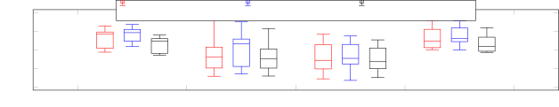
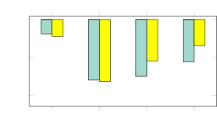
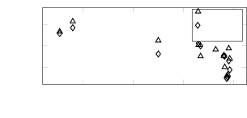
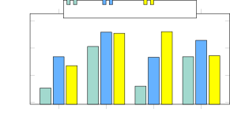
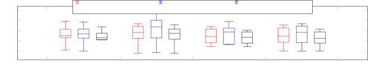

# Large Language Models are Not Yet Human-Level Evaluators for Abstractive Summarization

Chenhui Shen    Liying Cheng   Xuan-Phi Nguyen   Yang You  Lidong Bing
^(†)^(†)thanks: ˜˜Chenhui is under the Joint PhD Program between Alibaba
and National University of Singapore.^(†)^(†)thanks: \$ˆ†\$
Corresponding author. Email: [{chenhui.shen, liying.cheng, x.nguyen,
l.bing}@alibaba-inc.com](mailto:) Affiliation: DAMO Academy, Alibaba
Group, Singapore   Affiliation: National University of Singapore
Affiliation: Hupan Lab, 310023, Hangzhou, China
Email: <youy@comp.nus.edu.sg>

###### Abstract

With the recent undeniable advancement in reasoning abilities in large
language models (LLMs) like ChatGPT and GPT-4, there is a growing trend
for using LLMs on various tasks. One area where LLMs can be employed is
as an alternative evaluation metric for complex generative tasks, which
generally demands expensive human judges to complement the traditional
automatic metrics for various evaluation dimensions such as fluency and
consistency. In this work, we conduct extensive analysis to investigate
the stability and reliability of LLMs as automatic evaluators for
abstractive summarization. We found that while ChatGPT and GPT-4
outperform the commonly used automatic metrics, they are not ready as
human replacements due to significant limitations. That is, LLM
evaluators rate each candidate system inconsistently and are
dimension-dependent. They also struggle to compare candidates with close
performance and become more unreliable with higher-quality summaries by
obtaining a lower correlation with humans. In other words, with better
abstractive summarization systems being introduced at a fast pace, LLMs
may result in misleading and unreliable evaluations.¹¹ 1 Our code and
data are fully released at
[https://github.com/DAMO-NLP-SG/LLM_summeval](https://github.com/DAMO-NLP-SG/LLM_summeval).

## 1 Introduction

The desire for inexpensive and fast automatic metrics has never stopped
growing. In certain tasks like extractive summarization, where full
source sentences are selected to appear in the summaries, simple n-gram
overlap metrics against the “gold” summaries like Rouge (Lin, 2004) or
BLEU (Papineni et al., 2002) may work well because the correct answer
space is narrow. However, for more open tasks like abstractive
summarization, there are countless equally good summaries and the “gold”
summaries become less important. Although many neural-based metrics such
as BERTScore and BARTScore (Zhang et al., 2020b; Yuan et al., 2021), are
advocated as more human-aligned, the evaluation criteria are also
becoming increasingly complex. As a result, abstractive summarization
may not be sufficiently evaluated with automatic metrics Owczarzak
et al. (2012); Nenkova (2006), and often require extensive human
evaluations as complementsYang et al. (2023); Welbl et al. (2021).
However, human evaluations often come with hefty costs and slow
iteration cycles, while also being difficult to reproduce and
standardize due to small sample sizes and potential human biases Shen
et al. (2022b); Liu et al. (2022).

Recent large language models (LLMs) like ChatGPT and GPT-4 (OpenAI, 2023) have demonstrated outstanding capabilities in language
comprehension and reasoning. This leads to a growing trend of employing
LLMs as evaluators for complex language generation tasks by prompting
them with carefully and elaborately crafted instructions (Chiang and
Lee, 2023; Gao et al., 2023; Wang et al., 2023a; Wu et al., 2023; Luo
et al., 2023; Liu et al., 2023). Despite the preliminary success
suggested by such works, it is still inconclusive as to what degree of
confidence we can trust the evaluation results produced by LLMs across
different dimensions, despite their supposedly high average correlation
with humans. It is also unclear if certain LLM-based metrics are more
reliable than others, or if their reliability and fairness vary for
different candidate systems.

In this work, we conduct extensive analysis to assess whether LLM
evaluators can reliably replace human judges. Specifically, we
incorporate two common human evaluation approaches with LLM evaluators,
namely Likert-scale scoring (He et al., 2022; Shen et al., 2022b; Zhang
et al., 2020a) and head-to-head (H2H) comparisons (Shen et al., 2022a;
Li et al., 2020; Liu and Lapata, 2019). For Likert-scale scoring, we
explore direct reason-then-score (RTS) generation and a multiple-choice
question (MCQ) method. The former instructs the LLM to provide reasoning
before giving a score, while the latter simply prompts it to choose a
specific score with a pre-determined description as the reason. For the
Head-to-Head (H2H) comparison, we prompt LLM for a preference over the
summaries from two compared candidate systems.

Our experiments show that LLM evaluators, with RTS and MCQ, outperform
existing automatic metrics (Lin, 2004; Yuan et al., 2021). However, they
are not ready to be reliable alternatives for human evaluation yet.
Specifically, (i) LLM evaluators struggle to distinguish candidates with
close performances (Section 4.2.1). (ii) LLM evaluators are
candidate-dependent, meaning they do not exhibit highly consistent
degrees of human alignment for different candidates (Section 4.2.3).
Thus, they may unfairly favor or disfavor an evaluated candidate.
(iii) LLM evaluators are dimension-dependent, meaning they have varying
degrees of evaluation capabilities for different dimensions like
coherence and fluency (Section 4.2.3). (iv) Lastly, as the quality of
summaries improves with better candidates, LLM evaluators become
unreliably less correlated with human judgments, according to our newly
proposed meta-correlation metric (Section 4.2.4).

While we still call for a better automatic metric, in the meantime, we
suggest a temporary solution in Section 5 for abstractive summarization
practitioners to use LLMs more reliably. Specifically, we advocate
calculating the correlation between RTS and MCQ as a preliminary
indicator of the reliability of the LLM for certain dimensions. If RTS
and MCQ do not generally agree with each other, then further human
evaluations are required.

## 2 Related Work

##### Summarization

The summarization task involves generating a summary that contains
concise and important (i.e., salient) contents of the original input
article Nenkova and McKeown (2012). This task has been handled with 2
different approaches: extractive and abstractive. Unlike extractive
summarization systems that directly extract salient phrases or sentences
from the input article (Ernst et al., 2022; Chen et al., 2021; Zhou
et al., 2018; Dong et al., 2018), abstractive summarization systems are
expected to generate summaries using their own words and apply sentence
fusion or paraphrasing techniques (Shen et al., 2023; Liu et al., 2022;
Xiao et al., 2022; Lewis et al., 2020; Zhang et al., 2020a; Ziegler
et al., 2019; Bing et al., 2015; Xu and Durrett, 2021). As such,
abstractive summarization poses significantly more challenges for
automatic and human evaluation pipelines (Saha et al., 2022; Pagnoni
et al., 2021), because it is increasingly insufficient to use the
provided “gold” summary as ground truth.

##### Human Evaluation

Human evaluation can be conducted with different approaches. Some work
He et al. (2022); Shen et al. (2022b); Zhang et al. (2020a); Cheng
et al. (2020); Gao et al. (2019); Liu et al. (2018); Li et al. (2017);
Kryściński et al. (2018) employ a Likert scale to evaluate the summaries
on discrete ranges, such as from 1 to 5. Meanwhile, many others suggest
comparison approaches by asking human annotators to select the best
summary out of 2 or more generated summaries from different systems
(Shen et al., 2022a; Li et al., 2020; Liu and Lapata, 2019; Fan et al.,
2018; Fabbri et al., 2019). Following this, we test LLM-based evaluators
using both approaches with human-friendly instruction prompts.

##### Automatic Evaluation

Rouge Lin (2004) has been a common lexical overlap metric to evaluate
summarization systems. Apparently, Rouge is not sufficient for
abstractive summarization, because the “gold” labels it relies on cannot
comprehensively account for the complexity and variability of this task.
In addition, the common usage of sentence fusion techniques and novel
words for abstractive summarization may make Rouge even less reliable.
Zhang et al. (2020b) propose the neural-based BERTScore, which leverages
the BERT word embeddings to compute the semantic similarity among
tokens. Yuan et al. (2021) later introduce BARTScore, which uses BART
(Lewis et al., 2020) to compute the probability of a summary given its
input article. Nonetheless, these metrics may not reflect all of the
complicated evaluation dimensions required for abstractive summarization
mentioned earlier, nor do they have sufficiently high correlations with
humans.

##### LLM-based Evaluation

There are many concurrent works that demonstrate the potential of LLMs
to conduct complex human tasks Chiang and Lee (2023); Gao et al. (2023);
Wang et al. (2023a); Wu et al. (2023); Luo et al. (2023); Liu et al.
(2023); Cheng et al. (2023). The key advantage of instruction-tuned
LLMs, like ChatGPT or GPT-4 (Ouyang et al., 2022; OpenAI, 2023), is that
we can explicitly describe in natural language what our evaluation
criteria and dimensions are and how to score the summaries, similar to
how we would explain such tasks to a human expert. Chiang and Lee (2023)
use LLMs for open-ended story evaluations, while Luo et al. (2023) apply
ChatGPT specifically for evaluating the consistency of summaries. Wu
et al. (2023) formulate LLMs as diverse role-players to evaluate
summaries from the perspectives of different personas. Wang et al.
(2023a) and Liu et al. (2023) also explore the LLM’s evaluation
potential in various dimensions for the natural language generation
task. Our work differs from the above works in that besides
investigating the LLMs’ capability using different approaches across
various dimensions for abstractive summarization, we further focus on
the reliability of LLM across evaluated systems and dimensions.

## 3 LLM as a Zero-Shot Evaluator

We investigate an LLM’s evaluation capabilities in the dimensions of
coherence, consistency, fluency, and relevance respectively, as defined
by Fabbri et al. (2021) (see Appendix A). Following common human
evaluation approaches, we propose two methods for Likert-scale scoring,
namely the reason-then-score method and the multiple-choice question
method, as well as one method for head-to-head comparisons. We describe
each method in Section 3.1 using the relevance dimension as an example
(see more prompts and details in Appendix B). We further experiment with
alternative phrasings for different methods in Appendix C.

Besides exploring different evaluation methods, the stability of
LLM-based evaluations across different summarization systems is equally
important. Ideally, a stable LLM evaluator should perform equally well
regardless of the evaluated systems, with a close (if not identical)
degree of alignment with human judgments. In Section 3.2, we propose a
meta-correlation metric and explain how it can gauge the extent to which
LLM evaluators’ performances depend on the evaluated systems, which
indicates how stable and reliable they may be with evaluating any future
candidate systems.

Score the following Summary given the corresponding Article with respect
to relevance from one to five, where one indicates “irrelevance”, and
five indicates “perfect relevance”. Note that relevance measures the
Summary’s selection of important content from the Article, whether the
Summary grasps the main message of the Article without being overwhelmed
by unnecessary or less significant details. Article: {article} Summary:
{summary} Provide your reason in one sentence, then give a final score:

Table 1: Example prompt for the RTS method on the relevance dimension.
Texts in {blue} represent the article and the corresponding summary to
be evaluated.

Choose an option from A to E in order to score the following Summary
given the corresponding Article with respect to relevance from one to
five, where one indicates “irrelevance”, and five indicates “perfect
relevance”. Note that relevance measures the Summary’s selection of
important content from the Article, whether the Summary grasps the main
message of the Article without being overwhelmed by unnecessary or less
significant details. Article: {article} Summary: {summary} A: The
Summary is totally irrelevant to the Article. Score: One. B: The
majority of the Summary is irrelevant to the Article. Score: Two. C:
Some information in the Summary is relevant to the Article whereas some
are not. Score: Three. D: The majority of the Summary is relevant to the
Article. Score: Four. E: All information included in the Summary is
relevant to the Article. Score: Five. Your Answer (enter 1 letter from A
to E):

Table 2: Example prompt for the MCQ method on the relevance dimension.
Texts in {blue} represent the article and the corresponding summary to
be evaluated.

Choose a more relevant summary from Summary \#1 and Summary \#2 with
respect to the corresponding Article by choosing an option from A, B, or
C. Note that relevance measures the summary’s selection of important
content from the Article, whether the summary grasps the main message of
the Article without being overwhelmed by unnecessary or less significant
details. Article: {article} Summary \#1: {summary from model A} Summary
\#2: {summary from model B} A: Summary \#1 is more relevant. B: Summary
\#2 is more relevant. C: Both Summary \#1 and Summary \#2 are equally
relevant. Your choice (enter 1 letter from A to C):

Table 3: Example prompt for the H2H method on the relevance dimension.
Text in {blue}: the specific article, and the corresponding summaries
generated by a pair of compared models.

### 3.1 Summary Evaluation Methods

##### Reason-then-Score (RTS)

Given the success of chain-of-thought prompting (Kojima et al., 2022;
Wei et al., 2022), an intuitive method is to ask the LLM to evaluate a
specific dimension by first generating the reasoning and then a
corresponding score. Since the SummEval dataset (Fabbri et al., 2021)
contains human scores on a Likert scale of 1 to 5, we also ask the LLM
to score the summaries in the same range, as shown in Table 1.

##### MCQ Scoring (MCQ)

Nevertheless, previous works find that the reasoning generated by the
LLM does not always make sense Lyu et al. (2023); Wang et al. (2023b);
Gao et al. (2022). To avoid the misguidance of wrongly generated
reasoning, we explore a more constrained MCQ method for the Likert-scale
scoring. As shown in Table 2, instead of allowing the LLM to freely
generate its thoughts, we dictate specific reasoning for each score.

##### Head-to-Head Comparison (H2H)

Lastly, some concurrent works also observe that ChatGPT can act as an
effective ranking model (Ma et al., 2023a; Ma et al., 2023b). We thus
explore the head-to-head comparison approach for LLM-based evaluations.
As shown in Table 3, we present 2 summaries (Summary \#1 and \#2)
generated by different summarization systems on the same input article,
then prompt the LLM to select the better summary, or to indicate a tie.
Moreover, to avoid potential biases that arise from the summary IDs, we
conduct each evaluation twice, presenting the same summary as either \#1
or \#2 respectively.

### 3.2 Stability of LLM Evaluators

To ensure fairness across all evaluated systems, we argue that it is
crucial for LLMs to produce stable evaluations. That is, regardless of
evaluated systems, the LLMs should maintain a consistent degree of
alignment with human judgments. We investigate such stability in two
ways.

First, We categorize the summaries based on their originating
summarization systems, and then examine the correlation between the LLM
and human evaluations for each system. Ideally, if an LLM is stable
across systems, it should produce evaluations that are similarly
correlated to human evaluations. Otherwise, if the correlations differ
significantly across different candidates, then we may conclude that the
LLM’s evaluations are system-dependent.

Second, we define a meta-correlation metric to quantify the extent to
which the LLM’s performance is affected by the quality of the evaluated
systems. Specifically, we use the average human score for each candidate
as an indicator of its summarization quality ($`Q_{i}`$), as shown in
Equation 1:

```math
Q_{i}=\frac{1}{N}\sum_{j=1}^{N}f_{\text{human}}(g_{i,j}) \tag{1}
```

where $`f_{\text{human}}(\cdot)`$ indicates the human evaluation,
$`g_{i,j}`$ represents the $`j^{th}`$ summary generated by the
$`i^{th}`$ candidate system. Each candidate’s quality is calculated as
an average of $`N`$ generated summaries ($`N=100`$ for all systems).
Next, we use the correlation $`P_{i}`$ between LLM scores and human
scores as an indicator of the LLM’s evaluation performance for the
$`i^{th}`$ candidate, as follows:

```math
\displaystyle P_{i}=\rho([f_{\text{LLM}}(g_{i,1}),...,f_{\text{LLM}}(g_{i,N})], \tag{2}
```

```math
\displaystyle[f_{\text{human}}(g_{i,1}),...,f_{\text{human}}(g_{i,N})])
```

where $`\rho`$ denotes the correlation metric (_i.e.,_ Spearman
correlation, Pearson correlation, or Kendall’s Tau²² 2 We use the
scipy.stats.kendalltau package, which implements the tau-b variant that
accounts for ties.), and $`f_{\text{LLM}}(\cdot)`$ indicates the LLM’s
evaluation for each summary $`g_{i,j}`$. Finally, we calculate the
meta-correlation³³ 3 We use the same correlation metric for both
Equation2 and 3. For instance, if $`P_{i}`$ is obtained using Spearman
correlation, then $`M`$ is also calculated using Spearman correlation.
$`M`$ on a total of $`k`$ candidates as:

```math
\displaystyle M=\rho([Q_{1},...,Q_{k}],[P_{1},...,P_{k}]) \tag{3}
```

Ideally, an LLM should work well regardless of the quality of the
evaluated systems, which means that $`M`$ should be close to zero. On
the other hand, a significant $`M`$ would indicate an undesirable
relationship between the LLM’s evaluation capability and the quality of
the evaluated systems, suggesting that the LLM evaluation is not stable,
such that it may not evaluate each candidate system fairly using the
same standards.

## 4 Experiments

### 4.1 Setups

We use the ChatGPT ‘‘gpt-3.5-turbo-0301’’ snapshot (Section 4.2) for all
three methods. By using a fixed snapshot, we ensure all evaluations are
conducted with the same LLM model. In addition, we evaluate with the
GPT-4 ‘‘gpt-4-0314’’ snapshot (Section 4.3) using the best evaluation
method determined by ChatGPT to check for any potential improvement.
Given that ChatGPT and GPT-4 are amongst the top performing LLMs, we use
their performance to estimate the potential of LLMs as reliable
evaluators. Additional results using three different-sized Llama 2
models Touvron et al. (2023) are reported in Appendix D, which all
performs worse. Similar to Luo et al. (2023) and Wu et al. (2023), we
set the temperature to 0 and reset the dialogue history for each
evaluation instance.

##### Dataset

We use the SummEval benchmark dataset Fabbri et al. (2021). This dataset
contains expert human annotations for coherence, consistency, fluency,
and relevance on the generation results from 12 abstractive systems (see
details in Appendix table 21) on the CNN/DM dataset Hermann et al.
(2015). Each evaluated system generates summaries for the same 100 news
articles, and each summary is scored by 3 expert annotators from 1 to 5.
The annotations achieve with a high kappa coefficient of 0.713 Fabbri
et al. (2021). We further calculate the annotations’ standard deviations
across each evaluated system in Appendix Table 20. Given a step size of
1, the standard deviations are considered very small, thus suggesting
that this dataset has a high level of human agreement. Following Chiang
and Lee (2023), Chhun et al. (2022), and Guan and Huang (2020), we use
the average human scores as the reference scores.

##### Baselines

We use Rouge Lin (2004) F1 scores for Rouge-1, Rouge-2, and Rouge-L,
BERTScore Zhang et al. (2020b), BARTScore, BARTScore-CNN, and
BARTScore-CNN-PARA Yuan et al. (2021) as baseline metrics. The last two
metrics use BART models fine-tuned on CNN/DM’s training data, and are
especially strong.

##### Prompts

We conduct evaluation following our prompt formats given in Table 1, 2,
and 3. Following Fabbri et al. (2021), we re-use the definitions of the
evaluation dimensions: (i) Coherence - the collective quality of all
sentences, (ii) Consistency - the factual alignment between the summary
and the summarized source, (iii) Fluency - the quality of individual
sentences, and (iv) Relevance - the selection of important content from
the source.

##### Measurements

To compare all evaluation methods on equal ground with human evaluation,
we use four different measurements. First, we count the number of
correct preferences (#CP), which is the number of times each automatic
metric has the same preference as the average human scores do over a set
of compared system pairs (Section 4.2.1). This can help measure the
alignment of evaluation methods with humans at a granular level. To
determine the preferred system by a particular metric, we assign a
system 1 point if its generated summary is evaluated as better than that
of the other system according to the metric, or assign both systems 0.5
for a tie. Then, we aggregate the different scores for the compared
systems for all 100 test inputs, and the system with a higher score is
considered the preferred system by that metric (see Appendix Table 22
for details).

Next, we also use the Pearson correlation Cohen et al. (2009), Spearman
correlation Spearman (1987), and Kendall’s Tau Kendall (1938) to measure
the relationship between the scores of automatic evaluators and humans
(Section 4.2.2, 4.2.3, 4.2.4). While the Pearson score measures linear
relationships, the other two measure the ordinal relationship that may
be non-linear. Moreover, Kendall’s Tau is less sensitive than Spearman
correlation to outliers due to its paired counting of concordant and
discordant pairs.

### 4.2 ChatGPT Evaluator

In this section, we examine the ChatGPT evaluator across many aspects,
ranging from human correlation and stability across different systems.

|                      |           |       |       |             |       |       |         |       |       |           |       |       |
| -------------------- | --------- | ----- | ----- | ----------- | ----- | ----- | ------- | ----- | ----- | --------- | ----- | ----- |
|                      | Coherence |       |       | Consistency |       |       | Fluency |       |       | Relevance |       |       |
| Metrics              | Spear.    | Pear. | Kend. | Spear.      | Pear. | Kend. | Spear.  | Pear. | Kend. | Spear.    | Pear. | Kend. |
| Rouge-1\*            | 0.193     | 0.202 | 0.136 | 0.155       | 0.186 | 0.121 | 0.075   | 0.153 | 0.058 | 0.323     | 0.361 | 0.231 |
| Rouge-2\*            | 0.145     | 0.146 | 0.101 | 0.137       | 0.156 | 0.107 | 0.053   | 0.095 | 0.041 | 0.255     | 0.262 | 0.181 |
| Rouge-L\*            | 0.148     | 0.158 | 0.105 | 0.133       | 0.167 | 0.103 | 0.078   | 0.146 | 0.060 | 0.306     | 0.340 | 0.219 |
| BERTScore\*          | 0.375     | 0.383 | 0.265 | 0.163       | 0.182 | 0.127 | 0.167   | 0.229 | 0.130 | 0.396     | 0.414 | 0.285 |
| BARTScore\*          | 0.381     | 0.391 | 0.275 | 0.271       | 0.265 | 0.212 | 0.168   | 0.187 | 0.131 | 0.381     | 0.391 | 0.276 |
| BARTScore-CNN\*      | 0.461     | 0.480 | 0.332 | 0.389       | 0.413 | 0.305 | 0.310   | 0.378 | 0.241 | 0.425     | 0.450 | 0.309 |
| BARTScore-CNN-PARA\* | 0.455     | 0.455 | 0.328 | 0.413       | 0.459 | 0.324 | 0.368   | 0.417 | 0.286 | 0.414     | 0.440 | 0.299 |
| ChatGPT-RTS          | 0.388     | 0.399 | 0.312 | 0.423       | 0.532 | 0.378 | 0.285   | 0.302 | 0.240 | 0.448     | 0.463 | 0.357 |
| ChatGPT-MCQ          | 0.424     | 0.416 | 0.350 | 0.343       | 0.487 | 0.320 | 0.343   | 0.431 | 0.305 | 0.384     | 0.395 | 0.329 |
| GPT-4-RTS            | 0.427     | 0.461 | 0.361 | 0.556       | 0.618 | 0.522 | 0.498   | 0.600 | 0.452 | 0.448     | 0.428 | 0.373 |

Table 4: Spearman (Spear.) correlations, Pearson (Pear.) correlations,
and Kendall’s Tau (Kend.) between various metrics and human scores for a
total of 1,200 summaries. \*: results derived from Wang et al. (2023a).
Bolded: best results. Underlined: second best results. Values in light
gray color are insignificant (p-value $`\geq`$ 0.05).

#### 4.2.1 Correct Preferences

|                    |         |         |         |         |            |
| ------------------ | ------- | ------- | ------- | ------- | ---------- |
| Metrics            | Coh     | Con     | Flu     | Rel     | Avg        |
| Random             | 3.67/22 | 3.67/22 | 3.67/22 | 3.67/22 | 3.67/22    |
| Rouge-1            | 3/40    | 5/46    | 3/46    | 4/47    | 3.75/44.75 |
| Rouge-2            | 2/38    | 7/48    | 3/45    | 4/46    | 4.00/44.25 |
| Rouge-L            | 2/31    | 5/37    | 4/39    | 6/41    | 4.25/37.00 |
| BERTScore          | 4/48    | 5/44    | 4/44    | 6/46    | 4.75/45.50 |
| BARTScore          | 8/46    | 7/48    | 5/45    | 6/46    | 6.50/46.25 |
| BARTScore-CNN      | 9/53    | 5/53    | 5/54    | 4/53    | 5.75/53.25 |
| BARTScore-CNN-PARA | 9/49    | 8/54    | 6/52    | 5/51    | 7.00/51.50 |
| ChatGPT-RTS        | 6/54    | 6/56    | 9/62    | 7/62    | 7.00/58.50 |
| ChatGPT-MCQ        | 5/54    | 7/56    | 8/60    | 7/58    | 6.75/57.00 |
| ChatGPT-H2H        | 8/-     | 7/-     | 7/-     | 4/-     | 6.50/-     |
| GPT-4-RTS          | 5/55    | 7/53    | 8/60    | 7/56    | 6.75/56.00 |

Table 5: Number of correct preferences (#CP) on the 11-pair challenge
set (in black) and the 66-pair full set (in brown). Random: for each
pair, there are three possibilities (two possibilities for one model
being better, one possibility for a tie) so the random \#CP is one-third
of the total compared pairs.

The ultimate goal of evaluation is to determine if one candidate system
is better than the other in a compared pair. The number of correct
preferences (#CP) metric normalizes all evaluation methods into
determining whether an evaluator can, as a human expert would, pick the
same better system or determine a tie. We conduct such analysis with
different pairs of summarization systems on the same input articles. Due
to the limited budget for API calls, we only evaluate H2H on a challenge
set, consisting of 11 candidate pairs with the closest average
performances according to human scores. However, for RTS, MCQ, and other
baselines, we can easily calculate the \#CP for all 66 possible pairs
(see Appendix E).

Table 5 reports the \#CP for both the standard 66-pair full set (in
brown) and the 11-pair challenge set (in black). As shown for the larger
standard set, RTS unanimously obtains the largest \#CP across all
dimensions, with an average of 58.5 out of 66 candidate pairs (i.e.
88.6% accuracy).

Despite the high overall accuracy, weaknesses of such evaluators are
revealed as we dive into their performances in the 11-pair challenge set
(black scores of Table 5), where the evaluated candidates are close
matches. Specifically, BARTScore-CNN-Para performs better than RTS in
coherence and consistency, possibly because it is fine-tuned with
same-domain summarization data. For fluency and relevance, ChatGPT-RTS
still performs best among all evaluators. Nonetheless, its average
accuracy drops significantly to 63.6% (7 out of 11), which indicates LLM
evaluators struggle to differentiate the closely matched candidate
systems. In other words, LLM evaluators may only reliably compare
candidates with a relatively large performance gap.

#### 4.2.2 Correlations with Human

Table 4 reports that Spearman, Pearson correlations, and Kendall’s Tau
between scores of multiple automatic evaluators and humans with a total
of 1200 summaries from all systems, across the four evaluation
dimensions. As shown, ChatGPT RTS and MCQ demonstrate stronger
correlations with humans than many automatic evaluators, such as Rouge
and BARTScore, with up to 0.2 gains in fluency. While RTS achieves
higher correlations in the dimensions of consistency and relevance, MCQ
has relatively strong correlations in the dimensions of coherence and
fluency. Meanwhile, the specialized BARTScore-CNN family also shows
competitive performance in coherence, most likely due to the fine-tuning
process with CNN/DM.

|                    |           |        |        |             |        |        |         |        |        |           |        |        |
| ------------------ | --------- | ------ | ------ | ----------- | ------ | ------ | ------- | ------ | ------ | --------- | ------ | ------ |
|                    | Coherence |        |        | Consistency |        |        | Fluency |        |        | Relevance |        |        |
|                    | Spear.    | Pear.  | Kend.  | Spear.      | Pear.  | Kend.  | Spear.  | Pear.  | Kend.  | Spear.    | Pear.  | Kend.  |
| Rouge-1            | 0.0       | -0.032 | -0.091 | -0.490      | -0.527 | -0.303 | -0.420  | -0.518 | -0.273 | -0.420    | -0.387 | -0.273 |
| Rouge-2            | 0.559     | 0.508  | 0.485  | -0.259      | -0.480 | -0.152 | -0.217  | -0.438 | -0.152 | -0.084    | -0.120 | -0.121 |
| Rouge-L            | 0.231     | 0.251  | 0.121  | -0.510      | -0.522 | -0.303 | -0.168  | -0.412 | -0.152 | -0.224    | -0.266 | -0.121 |
| BERTScore          | -0.413    | -0.403 | -0.212 | -0.580      | -0.869 | -0.424 | -0.455  | -0.663 | -0.303 | -0.685    | -0.756 | -0.515 |
| BARTScore          | -0.916    | -0.747 | -0.788 | -0.266      | -0.504 | -0.121 | 0.154   | 0.123  | 0.182  | -0.769    | -0.837 | -0.606 |
| BARTScore-CNN      | -0.748    | -0.800 | -0.636 | -0.671      | -0.913 | -0.515 | -0.510  | -0.604 | -0.485 | -0.825    | -0.852 | -0.667 |
| BARTScore-CNN-PARA | -0.720    | -0.858 | -0.606 | -0.685      | -0.888 | -0.576 | -0.294  | -0.522 | -0.212 | -0.853    | -0.880 | -0.727 |
| ChatGPT-RTS        | -0.042    | -0.072 | -0.121 | -0.811      | -0.751 | -0.636 | -0.748  | -0.728 | -0.606 | -0.559    | -0.473 | -0.394 |
| ChatGPT-MCQ        | -0.175    | -0.11  | -0.182 | -0.818      | -0.411 | -0.636 | -0.622  | -0.484 | -0.394 | -0.350    | -0.622 | -0.212 |
| GPT-4-RTS          | -0.531    | -0.678 | -0.424 | -0.600      | -0.103 | -0.236 | -0.839  | -0.520 | -0.515 | -0.958    | -0.880 | -0.848 |

Table 6: Meta-correlation for various evaluation methods. Bolded: most
negative meta-correlation. Underlined: second most negative
meta-correlation. Values in light gray color are insignificant (p-value
$`\geq`$ 0.05).

#### 4.2.3 Per-candidate Correlations

Next, we break down the human correlation of ChatGPT-RTS for each
candidate system and measure the statistical spread for the correlations
across all systems (see raw results in Appendix table 23). Ideally, a
stable evaluator should exhibit the same human correlation across
candidates and dimensions, and display flattened boxes in a line.

However, as illustrated in Figure 1, the spread of correlations for
different candidates is particularly wide, with up to 0.5 correlation
difference in consistency. This means that the RTS evaluator exhibits a
significantly varying degree of alignment with human judgment for
different candidates. In other words, ChatGPT-RTS is candidate-dependent
and one should not expect such LLM evaluators to have the same level of
human alignment on a new summarization system. Similar trends can also
be observed for MCQ (see Appendix table 24).

In addition, the medians across the four dimensions are also different.
This indicates that the ChatGPT is also dimension-dependent and
unstable. Given such varying performances across different dimensions,
ChatGPT may not behave well with a newly introduced evaluation
criterion.



Figure 1: Spread of per-candidate correlations with human scores for
ChatGPT-RTS evaluations.



Figure 2: Meta-correlation (Kendall’s Tau) for RTS and MCQ. Shaded:
statistically significant with p $`<0.05`$.



Figure 3: Relationship between per-model correlations (Kendall’s Tau)
and human scores on consistency.

#### 4.2.4 Summary Quality _vs_ Human Alignment

Using our proposed meta-correlation measurement in Section 3.2, we
analyze the relationship between summary quality and human correlation
of LLM evaluators. We illustrate the meta-correlation in terms of
Kendall’s Tau for both RTS and MCQ in Figure 2. As shown, both RTS and
MCQ exhibit strong negative meta-correlation for consistency and
fluency. This suggests that ChatGPT becomes less human-aligned with
improving qualities of the evaluated systems.

To illustrate this phenomenon further, we scatter the paired coordinates
of the summarization system quality ($`Q_{i}`$, Equation 1) and
ChatGPT’s evaluation performance ($`P_{i}`$, Equation 2) in Figure 3. As
shown, while the LLM evaluator is better human-correlated with
lower-quality candidates (\< 3.5), it is less reliable when dealing with
high-quality candidates (\> 4.7) with much lower and inconsistent
correlations.

We compare the meta-correlation for all evaluation metrics in Table 6.
We can see that while the Rouge metrics exhibit no significantly
negative meta-correlation, the neural metrics all display significant
meta-correlation in certain dimensions. One highly likely reason for
this behavior is due to the varying biases inherent to the neural
models, which would explain why Rouge as a simple n-gram overlap metric
doesn’t exhibit significant negative meta-correlations. Interestingly,
Rouge-2 even shows a strong positive meta-correlation on coherence
(which is plausible, because bi-gram overlap performance may be more
accurate as candidates produce more coherent texts).

Both the BARTScore variants and LLMs demonstrate the most negative
meta-correlations. ChatGPT-RTS has the most negative meta-correlation in
the dimensions of consistency and fluency, indicating that it may be the
least reliable to evaluate high-quality systems on these dimensions. On
the other hand, the BARTScore family may be unreliable in comparing
systems with high qualities of coherence, consistency, and relevance.

So far, the observations discussed in Section 4.2.3 and Section 4.2.4
collectively suggest that LLM evaluators may not be a reliable
standalone metric for challenging scenarios, and further human
evaluation is required for conclusive decisions.



Figure 4: The average ChatGPT RTS and MCQ scores and human scores across
dimensions.

#### 4.2.5 RTS and MCQ Scores

Lastly, we delve into the detailed scores generated by ChatGPT with
either the RTS or MCQ method. Since both methods score the summaries in
the same range of human scores of 1 to 5 Fabbri et al. (2021), we can
show a direct comparison of the average RTS and MCQ scores with human
scores in Figure 4 (see more details in Appendix F). As shown, the RTS
scores are much lower than the human scores across all dimensions, while
MCQ scores are consistently higher and better match the human scores
(except for relevance). In other words, while RTS is best aligned with
humans according to Section 4.2.1 and Section 4.2.2, we cannot replace
the human scores with RTS scores in absolute terms.

The discrepancy may be attributed to the unfaithful reasoning generated
by LLMs (Lyu et al., 2023; Wang et al., 2023b; Gao et al., 2022). Our
further investigation suggests that ChatGPT-RTS generates false or
unrelated-to-dimension reasoning. Thus, it is possible that the much
lower scores could be caused by ChatGPT penalizing the summaries
according to false premises (more examples in Appendix G). For instance,
RTS may penalize the summary’s repetitiveness in the consistency
dimension or suppress fluency ratings for missing important details.⁴⁴ 4
Fabbri et al. (2021) observe similar issues with crowd-sourced
non-expert annotators. On the other hand, the MCQ counterpart gives
higher overall scores, most likely because the confined set of
pre-defined reasons prevents such unrelated penalization, though not
leading to better human alignment.

|                                    | Coherence |       |       | Consistency |       |       | Fluency |       |       | Relevance |        |       |
| ---------------------------------- | --------- | ----- | ----- | ----------- | ----- | ----- | ------- | ----- | ----- | --------- | ------ | ----- |
|                                    | Spear.    | Pear. | Kend. | Spear.      | Pear. | Kend. | Spear.  | Pear. | Kend. | Spear.    | Pear.  | Kend. |
| $`\rho(R_{i},P_{i}^{\text{RTS}})`$ | 0.343     | 0.198 | 0.091 | 0.685       | 0.506 | 0.576 | 0.727   | 0.797 | 0.545 | 0.168     | 0.128  | 0.000 |
| $`\rho(R_{i},P_{i}^{\text{MCQ}})`$ | 0.657     | 0.625 | 0.394 | 0.685       | 0.616 | 0.515 | 0.322   | 0.573 | 0.212 | 0.091     | -0.106 | 0.000 |

Table 7: Correlations between RTS-MCQ $`R_{i}`$ and RTS-Human
($`P_{i}^{\text{RTS}}`$) and MCQ-Human ($`P_{i}^{\text{MCQ}}`$). High
values suggest $`R_{i}`$ can be a reliability indicator for RTS and MCQ.
Light gray values are insignificant (p $`\geq`$ 0.05).



Figure 5: GPT-4’s (RTS) spread of per-candidate correlations.

### 4.3 GPT-4 Evaluator

A natural question to ask is whether such aforementioned limitations are
resolved with an stronger LLM. In this section, we conduct similar
analyses on GPT-4 (OpenAI, 2023) with the RTS method. We present the
GPT-4 results in the last rows of Table 4 and 5. The results suggest
that a stronger LLM does not necessarily translate to a stronger LLM
evaluator, although Table 4 does show that GPT-4 outperforms ChatGPT in
terms of human correlation consistently across most dimensions.

Unfortunately, GPT-4 still suffers from the same limitations as ChatGPT.
It appears to be both candidate-dependent and dimension-dependent, as
demonstrated by the large spreads with varying median values across
dimensions in Figure 5 and the significantly negative meta-correlations
out of 3 dimensions (Table 6). However, GPT-4 is less
dimension-dependant as compared to ChatGPT, as the medians in the box
plots in Figure 5 are more aligned than those in Figure 1.

In addition, there is a notable enhancement in the meta-correlation for
consistency, which we attribute to a significant reduction in reported
hallucinations with GPT-4 OpenAI (2023). It is possible that with much
more instruction training to avoid hallucinations, GPT-4 is much better
aligned with humans to detect inconsistencies (i.e. hallucinations) in
summaries.

Nevertheless, GPT-4 exhibits a much worse negative meta-correlation in
the relevance dimension, which, interestingly, seems to reflect the
challenges of maintaining both “truthfulness” and “informativeness”
Ouyang et al. (2022). This is because a model could be easily made more
truthful if allowed to provide less relevant information (for instance,
by refusing to answer the users’ questions). It is possible that with
reduced capability in the informativeness dimension, the model is less
capable of differentiating the nuances of less relevant summaries when
the summary quality is generally high. Nevertheless, we leave it to
future work to determine whether GPT-4’s more negative meta-correlation
in the relevance dimension could be related to its stronger performance
in consistency. We provide more details on the GPT-4 evaluator in
Appendix H.

## 5 A Temporary Efficient Framework

Despite the aforementioned limitations, it may be hard to resist the
temptation of using LLM evaluators given their superiority over other
automatic metrics. In such a case, one should be able to tell when LLM
evaluators are more likely to be unreliable and employ further human
evaluation when necessary. To this end, we suggest combining the RTS and
MCQ scores as a cost-efficient framework. Specifically, we calculate the
correlation between RTS and MCQ scores for the $`i^{th}`$ candidate
system as a reliability indicator:

```math
\displaystyle R_{i}=\rho([f_{\text{RTS}}(g_{i,1}),...,f_{\text{RTS}}(g_{i,N})], \tag{4}
```

```math
\displaystyle[f_{\text{MCQ}}(g_{i,1}),...,f_{\text{MCQ}}(g_{i,N})])
```

Then, we can loosely infer that up to a reliability tolerance
$`r\in(0,1)`$, the LLM evaluators (either RTS or MCQ) are reliable if
$`R_{i}>r`$. In other words, given a candidate $`i`$, if RTS and MCQ
agree with each other up to a certain degree of tolerance $`r`$, we may
assume the evaluator is reliable enough to avoid invoking further human
evaluation.

To validate this theory, we measure the correlations
$`\rho(R_{i},P_{i}^{\text{RTS}})`$ or
$`\rho(R_{i},P_{i}^{\text{MCQ}})`$, where $`P_{i}^{RTS/MCQ}`$ is the
performance of either method as defined in Equation 2. Given
significantly large positive values of either
$`\rho(R_{i},P_{i}^{\text{RTS}})`$ or
$`\rho(R_{i},P_{i}^{\text{MCQ}})`$, we can then conclude that $`R_{i}`$
can be used as a reliable indicator for the performance of the
corresponding method.

As shown in Table 7, $`R_{i}`$ demonstrates a significant correlation
with $`P_{i}^{RTS}`$ on both the consistency and fluency dimensions, and
with $`P_{i}^{MCQ}`$ on the coherence and consistency dimensions. This
means that if RTS and MCQ generally agree with each other on the
candidate’s performance on a particular dimension with high
$`\rho(R_{i},P_{i}^{\text{RTS}})`$ (or
$`\rho(R_{i},P_{i}^{\text{MCQ}})`$), RTS (or MCQ) is more likely to be
human-aligned. Meanwhile, if RTS disagrees with MCQ ($`R_{i}<r`$),
further human evaluators are required to provide a conclusive
evaluation. We provide $`R_{i}`$ values for ChatGPT on each evaluated
system in Appendix Table 29.

## 6 Conclusion

We explore the potential of using LLMs with different prompting
techniques as metrics for abstractive summarization systems. Our
extensive analysis suggests that while LLMs like ChatGPT perform better
than commonly used automatic metrics across different summarization
systems and dimensions, they are still not ready to replace human
evaluators because they are candidate- and dimension-dependent, and they
do not align well with human when comparing high-quality candidates.
Nonetheless, if an LLM evaluator is to be used, we suggest combining
multiple evaluation methods as a preliminary indicator to determine
whether the metric is likely to be unreliable and whether further human
evaluation is required.

## Limitations

##### Potential Human Bias.

We benchmark the LLM evaluation results against the average of three
human expert scores. Naturally, it is possible that these scores may
exhibit potential biases of the human experts. Nevertheless, we wish to
explore whether LLM evaluators are aligned with human experts, and may
naturally exhibit the same bias as a human would. In other words, we
examine whether we can reliably replace human annotators with LLMs,
instead of seeking a “perfect” solution that has absolutely zero bias.

##### Dataset Size.

Given the constraints of the small size of the human-annotated SummEval
dataset, we could only evaluate 100 summaries generated for each
summarization system, with a total of 12 abstractive summarization
systems. Since we have observed a significant correlation of LLM
evaluations with humans for the consolidated 1200 summaries across all
systems, it is possible that with a larger evaluation number, the
per-system correlation could also be improved. In addition, given only
12 evaluated systems, our meta-correlation may still be subject to
sample biases. We leave more investigations for the future once there
are larger annotated datasets.

##### Prompt tuning.

Designing better prompt for LLMs are also ongoing research. Although it
is possible that LLMs may act as better evaluators with better prompts,
prompt tuning is not our focus. We seek to highlight the limitations of
the investigated LLMs and have demonstrated that limitations such as
negative meta-correlation are also found with a few other alternative
prompts (see Appendix C).

##### Availability of Commercialized LLM

We note that the ‘‘gpt-3.5-turbo-0301’’ snapshot is currently taken
down⁵⁵ 5 We release all LLM generations involved in our experiments in
[https://github.com/DAMO-NLP-SG/LLM_summeval](https://github.com/DAMO-NLP-SG/LLM_summeval)
as JSON files. by OpenAI and replaced with a newer snapshot,
“gpt-3.5-turbo-0613”. This is also one disadvantage of using
out-of-the-box commercialized LLM for summarization evaluations, as the
exact checkpoints may not be stably available. As a result, future
models may not be fairly compared against previously evaluated models
using a different LLM checkpoint. Nevertheless, our paper only seeks to
investigate the potential of LLM as an out-of-the-box evaluator, and the
OpenAI models are currently one of the strongest. Eventually, we wish to
raise awareness of some of the significant limitations found with these
LLMs, which need to be resolved before LLMs can be used as direct
replacements for human evaluations. In addition, we also note that the
cost of evaluating only 100 summaries for each system is relatively low
(around 2 USD per system using ChatGPT). Since LLMs also conduct
evaluations much faster than humans (around 2 minutes for LLMs versus 10
hours for human for 100 summaries), it may not pose significant barriers
if one was to re-evaluate all compared systems on a single LLM.

##### Limited Use of the Temporary Solution

Unfortunately, our temporary efficient framework doesn’t apply to the
relevance dimension, where the $`R_{i}`$ has no significant correlation
with the performances of either RTS or MCQ. Moreover, the $`r`$ value
may be dataset-dependent, and it is hard to decide where to draw this
line. We leave for future work of developing better methods to gauge the
reliability of LLM evaluations.

## Acknowledgements

Yang You is being sponsored by NUS startup grant (Presidential Young
Professorship), Singapore MOE Tier-1 grant, ByteDance grant, ARCTIC
grant, SMI grant and Alibaba grant.

## References

- Bing et al. (2015) Lidong Bing, Piji Li, Yi Liao, Wai Lam, Weiwei Guo,
  and Rebecca Passonneau. 2015. [Abstractive multi-document
  summarization via phrase selection and
  merging](https://aclanthology.org/P15-1153). In _Proceedings of
  ACL-IJCNLP_.
- Chen et al. (2021) Moye Chen, Wei Li, Jiachen Liu, Xinyan Xiao, Hua
  Wu, and Haifeng Wang. 2021. [Sgsum: Transforming multi-document
  summarization into sub-graph
  selection](https://aclanthology.org/2021.emnlp-main.333). In
  _Proceedings of EMNLP_.
- Cheng et al. (2023) Liying Cheng, Xingxuan Li, and Lidong Bing. 2023.
  [Is gpt-4 a good data analyst?](https://arxiv.org/abs/2305.15038)
  _arXiv preprint arXiv:2305.15038_.
- Cheng et al. (2020) Liying Cheng, Dekun Wu, Lidong Bing, Yan Zhang,
  Zhanming Jie, Wei Lu, and Luo Si. 2020. [Ent-desc: Entity description
  generation by exploring knowledge
  graph](https://aclanthology.org/2020.emnlp-main.90/). In _Proceedings
  of EMNLP_.
- Chhun et al. (2022) Cyril Chhun, Pierre Colombo, Fabian M. Suchanek,
  and Chloé Clavel. 2022. [Of human criteria and automatic metrics: A
  benchmark of the evaluation of story
  generation](https://aclanthology.org/2022.coling-1.509). In
  _Proceedings of Coling_.
- Chiang and Lee (2023) Cheng-Han Chiang and Hung-yi Lee. 2023. [Can
  large language models be an alternative to human
  evaluations?](https://aclanthology.org/2023.acl-long.870.pdf) In
  _Proceedings of ACL_.
- Cohen et al. (2009) Israel Cohen, Yiteng Huang, Jingdong Chen, Jacob
  Benesty, Jacob Benesty, Jingdong Chen, Yiteng Huang, and Israel
  Cohen. 2009. Pearson correlation coefficient. _Noise reduction in
  speech processing_.
- Dong et al. (2018) Yue Dong, Yikang Shen, Eric Crawford, Herke van
  Hoof, and Jackie Chi Kit Cheung. 2018. [Banditsum: Extractive
  summarization as a contextual
  bandit](https://aclanthology.org/D18-1409/). In _Proceedings of
  EMNLP_.
- Ernst et al. (2022) Ori Ernst, Avi Caciularu, Ori Shapira, Ramakanth
  Pasunuru, Mohit Bansal, Jacob Goldberger, and Ido Dagan. 2022.
  [Proposition-level clustering for multi-document
  summarization](https://aclanthology.org/2022.naacl-main.128/). In
  _Proceedings of NAACL_.
- Fabbri et al. (2019) Alexander Fabbri, Irene Li, Tianwei She, Suyi Li,
  and Dragomir Radev. 2019. [Multi-news: A large-scale multi-document
  summarization dataset and abstractive hierarchical
  model](https://aclanthology.org/P19-1102). In _Proceedings of ACL_.
- Fabbri et al. (2021) Alexander R Fabbri, Wojciech Kryściński, Bryan
  McCann, Caiming Xiong, Richard Socher, and Dragomir Radev. 2021.
  [Summeval: Re-evaluating summarization
  evaluation](https://direct.mit.edu/tacl/article/doi/10.1162/tacl_a_00373/100686/SummEval-Re-evaluating-Summarization-Evaluation).
  _TACL_.
- Fan et al. (2018) Angela Fan, Mike Lewis, and Yann Dauphin. 2018.
  [Hierarchical neural story
  generation](https://aclanthology.org/P18-1082/). In _Proceedings of
  ACL_.
- Gao et al. (2022) Luyu Gao, Aman Madaan, Shuyan Zhou, Uri Alon,
  Pengfei Liu, Yiming Yang, Jamie Callan, and Graham Neubig. 2022. [Pal:
  Program-aided language
  models](https://proceedings.mlr.press/v202/gao23f/gao23f.pdf). In
  _Proceedings of ICML_.
- Gao et al. (2023) Mingqi Gao, Jie Ruan, Renliang Sun, Xunjian Yin,
  Shiping Yang, and Xiaojun Wan. 2023. [Human-like summarization
  evaluation with chatgpt](https://arxiv.org/abs/2304.02554). _arXiv
  preprint arXiv:2304.02554_.
- Gao et al. (2019) Shen Gao, Xiuying Chen, Piji Li, Zhaochun Ren,
  Lidong Bing, Dongyan Zhao, and Rui Yan. 2019. [Abstractive text
  summarization by incorporating reader
  comments](https://ojs.aaai.org/index.php/AAAI/article/view/4603). In
  _Proceedings of AAAI_.
- Guan and Huang (2020) Jian Guan and Minlie Huang. 2020. [UNION: An
  Unreferenced Metric for Evaluating Open-ended Story
  Generation](https://doi.org/10.18653/v1/2020.emnlp-main.736). In
  _Proceedings of EMNLP_.
- He et al. (2022) Junxian He, Wojciech Kryscinski, Bryan McCann,
  Nazneen Rajani, and Caiming Xiong. 2022. [CTRLsum: Towards generic
  controllable text
  summarization](https://aclanthology.org/2022.emnlp-main.396). In
  _Proceedings of EMNLP_.
- Hermann et al. (2015) Karl Moritz Hermann, Tomas Kocisky, Edward
  Grefenstette, Lasse Espeholt, Will Kay, Mustafa Suleyman, and Phil
  Blunsom. 2015. [Teaching machines to read and
  comprehend](https://proceedings.neurips.cc/paper_files/paper/2015/file/afdec7005cc9f14302cd0474fd0f3c96-Paper.pdf).
  _NeurIPS_.
- Kendall (1938) MG Kendall. 1938. [A new measure of rank
  correlation.](https://academic.oup.com/biomet/article-abstract/30/1-2/81/176907)
  _Biometrika_.
- Kojima et al. (2022) Takeshi Kojima, Shixiang Shane Gu, Machel Reid,
  Yutaka Matsuo, and Yusuke Iwasawa. 2022. Large language models are
  zero-shot reasoners. _NeurIPS_.
- Kryściński et al. (2018) Wojciech Kryściński, Romain Paulus, Caiming
  Xiong, and Richard Socher. 2018. [Improving abstraction in text
  summarization](https://aclanthology.org/D18-1207/). In _Proceedings of
  EMNLP_.
- Lewis et al. (2020) Mike Lewis, Yinhan Liu, Naman Goyal, Marjan
  Ghazvininejad, Abdelrahman Mohamed, Omer Levy, Veselin Stoyanov, and
  Luke Zettlemoyer. 2020. [Bart: Denoising sequence-to-sequence
  pre-training for natural language generation, translation, and
  comprehension](https://aclanthology.org/2020.acl-main.703/). In
  _Proceedings of ACL_.
- Li et al. (2017) Piji Li, Wai Lam, Lidong Bing, and Zihao Wang. 2017.
  [Deep recurrent generative decoder for abstractive text
  summarization](https://aclanthology.org/D17-1222). In _Proceedings of
  EMNLP_.
- Li et al. (2020) Wei Li, Xinyan Xiao, Jiachen Liu, Hua Wu, Haifeng
  Wang, and Junping Du. 2020. [Leveraging graph to improve abstractive
  multi-document
  summarization](https://aclanthology.org/2020.acl-main.555). In
  _Proceedings of ACL_.
- Lin (2004) Chin-Yew Lin. 2004. [ROUGE: A package for automatic
  evaluation of summaries](https://aclanthology.org/W04-1013). In _Text
  Summarization Branches Out_.
- Liu et al. (2018) Peter J Liu, Mohammad Saleh, Etienne Pot, Ben
  Goodrich, Ryan Sepassi, Lukasz Kaiser, and Noam Shazeer. 2018.
  [Generating wikipedia by summarizing long
  sequences](https://openreview.net/pdf?id=Hyg0vbWC-). In _ICLR_.
- Liu et al. (2023) Yang Liu, Dan Iter, Yichong Xu, Shuohang Wang,
  Ruochen Xu, and Chenguang Zhu. 2023. [G-eval: Nlg evaluation using
  gpt-4 with better human
  alignment](https://www.microsoft.com/en-us/research/publication/gpteval-nlg-evaluation-using-gpt-4-with-better-human-alignment/).
  _arXiv 2303.16634_.
- Liu and Lapata (2019) Yang Liu and Mirella Lapata. 2019. [Hierarchical
  transformers for multi-document
  summarization](https://aclanthology.org/P19-1500/). In _Proceedings of
  ACL_.
- Liu et al. (2022) Yixin Liu, Ansong Ni, Linyong Nan, Budhaditya Deb,
  Chenguang Zhu, Ahmed H Awadallah, and Dragomir Radev. 2022.
  [Leveraging locality in abstractive text
  summarization](https://aclanthology.org/2022.emnlp-main.408.pdf). In
  _Proceedings of EMNLP_.
- Luo et al. (2023) Zheheng Luo, Qianqian Xie, and Sophia
  Ananiadou. 2023. [Chatgpt as a factual inconsistency evaluator for
  abstractive text summarization](https://arxiv.org/abs/2303.15621).
  _arXiv preprint arXiv:2303.15621_.
- Lyu et al. (2023) Qing Lyu, Shreya Havaldar, Adam Stein, Li Zhang,
  Delip Rao, Eric Wong, Marianna Apidianaki, and Chris
  Callison-Burch. 2023. [Faithful chain-of-thought
  reasoning](https://arxiv.org/abs/2301.13379). _arXiv preprint
  arXiv:2301.13379_.
- Ma et al. (2023a) Xueguang Ma, Xinyu Zhang, Ronak Pradeep, and Jimmy
  Lin. 2023a. [Zero-shot listwise document reranking with a large
  language model](https://arxiv.org/abs/2305.02156). _arXiv preprint
  arXiv:2305.02156_.
- Ma et al. (2023b) Yubo Ma, Yixin Cao, YongChing Hong, and Aixin Sun.
  2023b. [Large language model is not a good few-shot information
  extractor, but a good reranker for hard
  samples!](https://arxiv.org/pdf/2303.08559.pdf) _arXiv preprint
  arXiv:2303.08559_.
- Nenkova (2006) Ani Nenkova. 2006. [Summarization evaluation for text
  and speech: issues and
  approaches](https://www.isca-speech.org/archive/pdfs/interspeech_2006/nenkova06_interspeech.pdf).
  In _Ninth International Conference on Spoken Language Processing_.
- Nenkova and McKeown (2012) Ani Nenkova and Kathleen McKeown. 2012. [A
  survey of text summarization
  techniques](https://link.springer.com/chapter/10.1007/978-1-4614-3223-4_3).
  _Mining text data_.
- OpenAI (2023) OpenAI. 2023. [Gpt-4 technical
  report](https://arxiv.org/abs/2303.08774). _arXiv preprint_.
- Ouyang et al. (2022) Long Ouyang, Jeffrey Wu, Xu Jiang, Diogo Almeida,
  Carroll Wainwright, Pamela Mishkin, Chong Zhang, Sandhini Agarwal,
  Katarina Slama, Alex Ray, et al. 2022. [Training language models to
  follow instructions with human
  feedback](https://proceedings.neurips.cc/paper_files/paper/2022/file/b1efde53be364a73914f58805a001731-Paper-Conference.pdf).
  _NeurIPS_.
- Owczarzak et al. (2012) Karolina Owczarzak, John Conroy, Hoa Trang
  Dang, and Ani Nenkova. 2012. [An assessment of the accuracy of
  automatic evaluation in
  summarization](https://aclanthology.org/W12-2601/). In _Proceedings of
  workshop on evaluation metrics and system comparison for automatic
  summarization_.
- Pagnoni et al. (2021) Artidoro Pagnoni, Vidhisha Balachandran, and
  Yulia Tsvetkov. 2021. [Understanding factuality in abstractive
  summarization with frank: A benchmark for factuality
  metrics](https://aclanthology.org/2021.naacl-main.383/). In
  _Proceedings of NAACL-HLT_.
- Papineni et al. (2002) Kishore Papineni, Salim Roukos, Todd Ward, and
  Wei-Jing Zhu. 2002. [Bleu: a method for automatic evaluation of
  machine translation](https://doi.org/10.3115/1073083.1073135). In
  _Proceedings of ACL_.
- Saha et al. (2022) Swarnadeep Saha, Shiyue Zhang, Peter Hase, and
  Mohit Bansal. 2022. [Summarization programs: Interpretable abstractive
  summarization with neural modular
  trees](https://openreview.net/pdf?id=ooxDOe7ZtBe). In _ICLR_.
- Shen et al. (2022a) Chenhui Shen, Liying Cheng, Lidong Bing, Yang You,
  and Luo Si. 2022a. [Sentbs: Sentence-level beam search for
  controllable
  summarization](https://aclanthology.org/2022.emnlp-main.699/).
  _EMNLP_.
- Shen et al. (2023) Chenhui Shen, Liying Cheng, Xuan-Phi Nguyen, Lidong
  Bing, and Yang You. 2023. [A hierarchical encoding-decoding scheme for
  abstractive multi-document
  summarization](https://%22https://arxiv.org/abs/2305.08503%22). In
  _Findings of EMNLP_.
- Shen et al. (2022b) Chenhui Shen, Liying Cheng, Ran Zhou, Lidong Bing,
  Yang You, and Luo Si. 2022b. [Mred: A meta-review dataset for
  structure-controllable text
  generation](https://aclanthology.org/2022.findings-acl.198.pdf).
  _Findings of ACL_.
- Spearman (1987) C Spearman. 1987. The proof and measurement of
  association between two things. _American Journal of Psychology_.
- Touvron et al. (2023) Hugo Touvron, Louis Martin, Kevin Stone, Peter
  Albert, Amjad Almahairi, Yasmine Babaei, Nikolay Bashlykov, Soumya
  Batra, Prajjwal Bhargava, Shruti Bhosale, et al. 2023. [Llama 2: Open
  foundation and fine-tuned chat
  models](https://arxiv.org/abs/2307.09288). _arXiv preprint
  arXiv:2307.09288_.
- Wang et al. (2023a) Jiaan Wang, Yunlong Liang, Fandong Meng, Haoxiang
  Shi, Zhixu Li, Jinan Xu, Jianfeng Qu, and Jie Zhou. 2023a. [Is chatgpt
  a good nlg evaluator? a preliminary
  study](https://arxiv.org/abs/2303.04048). _arXiv preprint
  arXiv:2303.04048_.
- Wang et al. (2023b) Xuezhi Wang, Jason Wei, Dale Schuurmans, Quoc Le,
  Ed Chi, and Denny Zhou. 2023b. [Self-consistency improves chain of
  thought reasoning in language
  models](https://openreview.net/forum?id=1PL1NIMMrw). In _ICLR_.
- Wei et al. (2022) Jason Wei, Xuezhi Wang, Dale Schuurmans, Maarten
  Bosma, Fei Xia, Ed H Chi, Quoc V Le, Denny Zhou, et al. 2022.
  [Chain-of-thought prompting elicits reasoning in large language
  models](https://openreview.net/pdf?id=_VjQlMeSB_J). _NeurIPS_.
- Welbl et al. (2021) Johannes Welbl, Amelia Glaese, Jonathan Uesato,
  Sumanth Dathathri, John Mellor, Lisa Anne Hendricks, Kirsty Anderson,
  Pushmeet Kohli, Ben Coppin, and Po-Sen Huang. 2021. [Challenges in
  detoxifying language
  models](https://doi.org/10.18653/v1/2021.findings-emnlp.210). In
  _Findings of EMNLP_.
- Wu et al. (2023) Ning Wu, Ming Gong, Linjun Shou, Shining Liang, and
  Daxin Jiang. 2023. [Large language models are diverse role-players for
  summarization evaluation](https://arxiv.org/abs/2303.15078). _arXiv
  preprint arXiv:2303.15078_.
- Xiao et al. (2022) Wen Xiao, Iz Beltagy, Giuseppe Carenini, and Arman
  Cohan. 2022. [Primera: Pyramid-based masked sentence pre-training for
  multi-document
  summarization](https://aclanthology.org/2022.acl-long.360/). In
  _Proceedings of ACL_.
- Xu and Durrett (2021) Jiacheng Xu and Greg Durrett. 2021. [Dissecting
  generation modes for abstractive summarization models via ablation and
  attribution](https://aclanthology.org/2021.acl-long.539.pdf). In
  _Proceedings of ACL-IJCNLP_.
- Yang et al. (2023) Kexin Yang, Dayiheng Liu, Wenqiang Lei, Baosong
  Yang, Mingfeng Xue, Boxing Chen, and Jun Xie. 2023. [Tailor: A
  soft-prompt-based approach to attribute-based controlled text
  generation](https://aclanthology.org/2023.acl-long.25). In
  _Proceedings of ACL_.
- Yuan et al. (2021) Weizhe Yuan, Graham Neubig, and Pengfei Liu. 2021.
  [Bartscore: Evaluating generated text as text
  generation](https://proceedings.neurips.cc/paper/2021/file/e4d2b6e6fdeca3e60e0f1a62fee3d9dd-Paper.pdf).
  _NeurIPS_.
- Zhang et al. (2020a) Jingqing Zhang, Yao Zhao, Mohammad Saleh, and
  Peter Liu. 2020a. [Pegasus: Pre-training with extracted gap-sentences
  for abstractive
  summarization](http://proceedings.mlr.press/v119/zhang20ae/zhang20ae.pdf).
  In _Proceedings of ICML_.
- Zhang et al. (2020b) Tianyi Zhang, Varsha Kishore, Felix Wu, Kilian Q
  Weinberger, and Yoav Artzi. 2020b. [Bertscore: Evaluating text
  generation with bert](https://openreview.net/pdf?id=SkeHuCVFDr). In
  _ICLR_.
- Zhou et al. (2018) Qingyu Zhou, Nan Yang, Furu Wei, Shaohan Huang,
  Ming Zhou, and Tiejun Zhao. 2018. [Neural document summarization by
  jointly learning to score and select
  sentences](https://aclanthology.org/P18-1061/). In _Proceedings of
  ACL_.
- Ziegler et al. (2019) Daniel M Ziegler, Nisan Stiennon, Jeffrey Wu,
  Tom B Brown, Alec Radford, Dario Amodei, Paul Christiano, and Geoffrey
  Irving. 2019. [Fine-tuning language models from human
  preferences](https://arxiv.org/abs/1909.08593). _arXiv preprint
  arXiv:1909.08593_.

Score the following Summary given the corresponding Article with respect
to consistency from one to five, where one indicates “inconsistency” and
five indicates “perfect consistency”. Note that consistency measures the
factual alignment between the Summary and the Article, whether the
Summary is faithful to the Article without introducing contradictions or
misleading representations. Article: {article} Summary: {summary}
Provide your reason in one sentence, then give a final score:

Table 8: Example prompt for the RTS method on the consistency dimension.
Text in {blue}: the specific article and the corresponding summary to be
evaluated.

Score the following Summary given the corresponding Article with respect
to fluency from one to five, where one indicates “disfluency” and five
indicates “perfect fluency”. Note that fluency measures the quality of
individual sentences in the Summary, whether the Summary is
well-written, grammatically correct, and readable on the sentence level.
Article: {article} Summary: {summary} Provide your reason in one
sentence, then give a final score:

Table 9: Example prompt for the RTS method on the fluency dimension.
Text in {cyan}: the specific article and the corresponding summary to be
evaluated.

Score the following Summary given the corresponding Article with respect
to coherence from one to five, where one indicates “incoherence” and
five indicates “perfect coherence”. Note that coherence measures the
collective quality of the Summary, whether the Summary presents
information that flows smoothly and avoids abrupt transitions or
disjoint statements. Article: {article} Summary: {summary} Provide your
reason in one sentence, then give a final score:

Table 10: Example prompt for the RTS method on the coherence dimension.
Text in {cyan}: the specific article and the corresponding summary to be
evaluated.

Choose an option from A to E in order to score the following Summary
given the corresponding Article with respect to consistency from one to
five, where one indicates “inconsistency” and five indicates “perfect
consistency”. Note that consistency measures the factual alignment
between the Summary and the Article, whether the Summary is faithful to
the Article without introducing contradictions or misleading
representations. Article: {article} Summary: {summary} A: The Summary is
totally inconsistent with the Article. Score: One. B: The majority of
the Summary is inconsistent with the Article. Score: Two. C: Some
information in the Summary is consistent with the Article whereas some
are not. Score: Three. D: The majority of the Summary is consistent with
the Article. Score: Four. E: All information included in the Summary is
consistent with the Article. Score: Five. Your Answer (enter 1 letter
from A to E):

Table 11: Example prompt for the MCQ method on the consistency
dimension. Text in {cyan}: the specific article and the corresponding
summary to be evaluated.

## Appendix A Evaluation Dimensions

Fabbri et al. (2021) has defined 4 evaluation dimensions as follows:

1.  1.  Coherence: The collective quality of all sentences. The summary
        should be well-structured and well-organized. The summary should not
        just be a heap of related information but should build from sentence
        to sentence to a coherent body of information about a topic.
2.  2.  Consistency: The factual alignment between the summary and the
        summarized source. A factually consistent summary contains only
        statements that are entailed by the source document.
3.  3.  Fluency: The quality of individual sentences. Sentences in the
        summary should have no formatting problems, capitalization errors or
        obviously ungrammatical sentences (e.g., fragments, missing
        components) that make the text difficult to read.
4.  4.  Relevance: Selection of important content from the source. The
        summary should include only important information from the source
        document.

We follow the above definitions for designing ChatGPT’s evaluation
prompts.

Choose an option from A to E in order to score the following Summary
given the corresponding Article with respect to fluency from one to
five, where one indicates "disfluency" and five indicates "perfect
fluency". Note that fluency measures the quality of individual sentences
in the Summary, whether the Summary is well-written, grammatically
correct, and readable on the sentence level. Article: {article} Summary:
{summary} A: The Summary is totally disfluent. Score: One. B: The
majority of the Summary is disfluent. Score: Two. C: Some sentences in
the Summary are fluent whereas some are not. Score: Three. D: The
majority of the Summary is fluent. Score: Four E: All sentences in the
Summary are fluent. Score: Five. Your Answer (enter 1 letter from A to
E):

Table 12: Example prompt for the MCQ method on the fluency dimension.
Text in {cyan}: the specific article and the corresponding summary to be
evaluated.

Choose an option from A to E in order to score the following Summary
given the corresponding Article with respect to coherence from one to
five, where one indicates "incoherence" and five indicates "perfect
coherence". Note that coherence measures the collective quality of the
Summary, whether the Summary presents information that flows smoothly
and avoids abrupt transitions or disjoint statements. Article: {article}
Summary: {summary} A: The Summary is completely incoherent. Score: One.
B: The Summary is mostly incoherent. Score: Two. C: The Summary is
somewhat coherent. Score: Three. D: The Summary is mostly coherent.
Score: Four. E: The Summary is completely coherent. Score: Five. Your
Answer (enter 1 letter from A to E):

Table 13: Example prompt for the MCQ method on the coherence dimension.
Text in {cyan}: the specific article and the corresponding summary to be
evaluated.

Choose a more consistent summary from Summary \#1 and Summary \#2 with
respect to the corresponding Article by choosing an option from A, B, or
C. Note that consistency measures the factual alignment between the
summary and the Article, whether the summary is faithful to the Article
without introducing contradictions or misleading representations.
Article: {article} Summary \#1: {summary from model A} Summary \#2:
{summary from model B} A: Summary \#1 is more consistent. B: Summary \#2
is more consistent. C: Both Summary \#1 and Summary \#2 are equally
consistent. Your choice (enter 1 letter from A to C):

Table 14: Example prompt for the H2H method on the consistency
dimension. Text in {cyan}: the specific article, and the corresponding
summaries generated by a pair of compared models.

Choose a more fluent summary from Summary \#1 and Summary \#2 with
respect to the corresponding Article by choosing an option from A, B, or
C. Note that fluency measures the quality of individual sentences in the
summary, whether the summary is well-written, grammatically correct, and
readable on the sentence level. Article: {article} Summary \#1: {summary
from model A} Summary \#2: {summary from model B} A: Summary \#1 is more
fluent. B: Summary \#2 is more fluent. C: Both Summary \#1 and Summary
\#2 are equally fluent. Your choice (enter 1 letter from A to C):

Table 15: Example prompt for the H2H method on the fluency dimension.
Text in {cyan}: the specific article, and the corresponding summaries
generated by a pair of compared models.

Choose a more coherent summary from Summary \#1 and Summary \#2 with
respect to the corresponding Article by choosing an option from A, B, or
C. Note that coherence measures the collective quality of the summary,
whether the summary presents information that flows smoothly and avoids
abrupt transitions or disjoint statements. Article: {article} Summary
\#1: {summary from model A} Summary \#2: {summary from model B} A:
Summary \#1 is more coherent. B: Summary \#2 is more coherent. C: Both
Summary \#1 and Summary \#2 are equally coherent. Your choice (enter 1
letter from A to C):

Table 16: Example prompt for the H2H method on the coherence dimension.
Text in {cyan}: the specific article, and the corresponding summaries
generated by a pair of compared models.

## Appendix B Prompt Details and Design

We show the RTS prompts for relevance, consistency, fluency, and
coherence in Table 1, Table 8, Table 9, and Table 10 respectively.

We show the MCQ prompts for relevance, consistency, fluency, and
coherence in Table 2, Table 11, Table 12, and Table 13 respectively.

We show the H2H prompts for relevance, consistency, fluency, and
coherence in Table 3, Table 14, Table 15, and Table 16 respectively.

To determine the exact definitions used in our prompts for each
dimension, we re-use the first sentence from Fabbri et al. (2021)’s
definition. We then prompt the LLM to provide a definition for the
evaluated dimension, such as “define the word relevance in the context
of summarization”, then extract the key phrases generated that we
believe to fit the definitions of Fabbri et al. (2021) to make up the
full definition. We believe this approach may help the LLM to better
evaluate the summaries according to definitions partially generated in
its own language. Nevertheless, we didn’t invest extensive efforts in
prompt designs as this is not our key focus. We also demonstrate that
our prompts have better evaluation results than two alternative prompts
in Appendix C.

|                  | Coh | Con | Flu | Rel | Avg  |
| ---------------- | --- | --- | --- | --- | ---- |
| ChatGPT-RTS2     | 5   | 6   | 7   | 6   | 6.00 |
| ChatGPT-MCQ2     | 4   | 7   | 6   | 4   | 5.25 |
| ChatGPT-StarEval | 7   | 7   | 7   | 6   | 6.75 |

Table 17: Total correct pairs for alternative prompts. Coh: coherence;
Con: consistency; Flu: fluency; Rel: relevance.

|          |            | Coherence |        |        | Consistency |        |        | Fluency |        |        | Relevance |        |        |
| -------- | ---------- | --------- | ------ | ------ | ----------- | ------ | ------ | ------- | ------ | ------ | --------- | ------ | ------ |
|          |            | Spear.    | Pear.  | Kend.  | Spear.      | Pear.  | Kend.  | Spear.  | Pear.  | Kend.  | Spear.    | Pear.  | Kend.  |
| RTS2     | Human-Corr | 0.339     | 0.338  | 0.285  | 0.393       | 0.497  | 0.350  | 0.290   | 0.280  | 0.252  | 0.440     | 0.441  | 0.351  |
|          | Meta-Corr  | -0.559    | -0.476 | -0.424 | -0.748      | -0.843 | -0.576 | -0.825  | -0.823 | -0.636 | -0.385    | -0.506 | -0.212 |
| MCQ2     | Human-Corr | 0.430     | 0.423  | 0.355  | 0.327       | 0.483  | 0.306  | 0.258   | 0.396  | 0.229  | 0.240     | 0.258  | 0.206  |
|          | Meta-Corr  | -0.308    | -0.275 | -0.212 | -0.545      | -0.446 | -0.364 | -0.811  | -0.615 | -0.636 | -0.217    | -0.707 | -0.182 |
| StarEval | Human-Corr | 0.418     | 0.417  | 0.341  | 0.297       | 0.421  | 0.264  | 0.246   | 0.323  | 0.217  | 0.393     | 0.405  | 0.323  |
|          | Meta-Corr  | -0.084    | -0.101 | 0.000  | -0.664      | -0.684 | -0.545 | -0.441  | -0.460 | -0.212 | -0.497    | -0.579 | -0.303 |

Table 18: Results of using alternative prompt with ChatGPT. Light gray
values are insignificant (p-value $`\geq`$ 0.05). Human-Corr reports the
overall correlation of ChatGPT scores with human scores. Meta-corr shows
the meta-correlation.

|     |            | Coherence |        |        | Consistency |        |        | Fluency |        |        | Relevance |        |        |
| --- | ---------- | --------- | ------ | ------ | ----------- | ------ | ------ | ------- | ------ | ------ | --------- | ------ | ------ |
|     |            | Spear.    | Pear.  | Kend.  | Spear.      | Pear.  | Kend.  | Spear.  | Pear.  | Kend.  | Spear.    | Pear.  | Kend.  |
| 7B  | Human-Corr | -0.001    | -0.000 | -0.001 | 0.114       | 0.130  | 0.104  | 0.043   | 0.038  | 0.039  | 0.067     | 0.064  | 0.057  |
|     | Meta-Corr  | 0.245     | -0.258 | 0.182  | -0.524      | -0.720 | -0.424 | -0.042  | 0.463  | -0.03  | 0.238     | 0.169  | 0.212  |
| 13B | Human-Corr | 0.153     | 0.165  | 0.123  | 0.180       | 0.209  | 0.162  | 0.187   | 0.179  | 0.167  | 0.234     | 0.266  | 0.192  |
|     | Meta-Corr  | -0.287    | -0.425 | -0.182 | -0.580      | -0.495 | -0.424 | -0.455  | -0.233 | -0.303 | -0.049    | -0.406 | 0.000  |
| 70B | Human-Corr | 0.234     | 0.254  | 0.186  | 0.357       | 0.395  | 0.319  | 0.155   | 0.161  | 0.134  | 0.248     | 0.285  | 0.200  |
|     | Meta-Corr  | -0.420    | -0.407 | -0.273 | -0.811      | -0.690 | -0.667 | -0.322  | -0.319 | -0.182 | -0.238    | -0.123 | -0.182 |

Table 19: Results of Llama 2 models of 7B, 13B, and 70B RTS
correlations. Light gray values are insignificant (p-value $`\geq`$
0.05). Human-Corr reports the overall correlation of LLM scores with
human scores. Meta-corr shows the meta-correlation.

| ID  | Coh  | Con  | Flu  | Rel  |
| --- | ---- | ---- | ---- | ---- |
| M8  | 0.58 | 0.09 | 0.13 | 0.51 |
| M9  | 0.65 | 0.15 | 0.34 | 0.54 |
| M10 | 0.58 | 0.22 | 0.20 | 0.54 |
| M11 | 0.59 | 0.34 | 0.40 | 0.49 |
| M12 | 0.65 | 0.03 | 0.14 | 0.54 |
| M13 | 0.62 | 0.07 | 0.14 | 0.51 |
| M14 | 0.65 | 0.09 | 0.18 | 0.54 |
| M15 | 0.60 | 0.04 | 0.13 | 0.53 |
| M17 | 0.58 | 0.05 | 0.08 | 0.52 |
| M20 | 0.48 | 0.29 | 0.24 | 0.49 |
| M22 | 0.58 | 0.02 | 0.14 | 0.54 |
| M23 | 0.58 | 0.05 | 0.12 | 0.54 |

Table 20: The standard deviation of human annotations across different
summarization systems and evaluation dimensions.

| ID  | Model Name            | Coh  | Con  | Flu  | Rel  | Avg  |
| --- | --------------------- | ---- | ---- | ---- | ---- | ---- |
| M22 | BART                  | 4.18 | 4.94 | 4.90 | 4.25 | 4.57 |
| M23 | Pegasus (C4)          | 4.16 | 4.91 | 4.88 | 4.26 | 4.55 |
| M17 | T5                    | 4.00 | 4.93 | 4.93 | 4.23 | 4.52 |
| M12 | Unified-ext-abs       | 3.60 | 4.96 | 4.85 | 3.85 | 4.32 |
| M13 | ROUGESal              | 3.44 | 4.82 | 4.86 | 3.83 | 4.24 |
| M15 | Closed book decoder   | 3.35 | 4.95 | 4.80 | 3.67 | 4.19 |
| M14 | Multi-task (Ent + QG) | 3.20 | 4.90 | 4.74 | 3.63 | 4.12 |
| M8  | Pointer Generator     | 3.29 | 4.65 | 4.79 | 3.55 | 4.07 |
| M9  | Fast-abs-rl           | 2.38 | 4.67 | 4.50 | 3.52 | 3.77 |
| M10 | Bottom-Up             | 2.73 | 4.25 | 4.42 | 3.38 | 3.70 |
| M20 | GPT-2 (zero-shot)     | 3.63 | 3.40 | 3.97 | 3.30 | 3.58 |
| M11 | Improve-abs           | 2.28 | 3.27 | 3.65 | 3.15 | 3.09 |

Table 21: The average human evaluation scores of various abstractive
summarization models reported by Fabbri et al. (2021). We calculate the
average (Avg) score of the reported coherence (Coh), consistency (Con),
fluency (Flu), and relevance (Rel) scores. Rows are sorted according to
the Avg column values in descending order.

|         |         |           |       |            |             |       |            |         |       |            |           |       |            |
| ------- | ------- | --------- | ----- | ---------- | ----------- | ----- | ---------- | ------- | ----- | ---------- | --------- | ----- | ---------- |
|         |         | Coherence |       |            | Consistency |       |            | Fluency |       |            | Relevance |       |            |
| Model A | Model B | LLM       | Human |            | LLM         | Human |            | LLM     | Human |            | LLM       | Human |            |
| M22     | M23     | 65.5      | 53.5  | ✓          | 55.75       | 52.5  | ✓          | 61      | 49.5  | $`\times`$ | 58.75     | 49.5  | $`\times`$ |
| M23     | M17     | 48.25     | 52.5  | $`\times`$ | 47          | 49    | ✓          | 49      | 45.5  | ✓          | 45        | 52    | $`\times`$ |
| M17     | M12     | 44        | 66.5  | $`\times`$ | 43.25       | 48.5  | ✓          | 40.5    | 54.5  | $`\times`$ | 49.25     | 72.5  | $`\times`$ |
| M12     | M13     | 58        | 51    | ✓          | 56.5        | 54.5  | ✓          | 56.75   | 50    | $`\times`$ | 58        | 45    | $`\times`$ |
| M13     | M15     | 45.5      | 49.5  | ✓          | 52          | 46    | $`\times`$ | 48.75   | 52    | $`\times`$ | 51.25     | 60.5  | ✓          |
| M15     | M14     | 57        | 54    | ✓          | 55          | 53.5  | ✓          | 56.5    | 52    | ✓          | 54        | 57    | ✓          |
| M14     | M8      | 49.25     | 44    | ✓          | 50          | 54.5  | $`\times`$ | 47      | 46.5  | ✓          | 49.25     | 53.5  | $`\times`$ |
| M8      | M9      | 77.5      | 82    | ✓          | 78.5        | 53    | ✓          | 80.5    | 63.5  | ✓          | 76        | 54    | ✓          |
| M9      | M10     | 45        | 36    | ✓          | 41.5        | 58    | $`\times`$ | 46      | 44.5  | ✓          | 41.5      | 56    | $`\times`$ |
| M10     | M20     | 58.25     | 24    | $`\times`$ | 61.75       | 64    | ✓          | 63.75   | 61.5  | ✓          | 61.5      | 54.5  | ✓          |
| M20     | M11     | 56.5      | 82    | ✓          | 50          | 53    | $`\times`$ | 51      | 58.5  | ✓          | 50        | 53    | $`\times`$ |
| \#CP    |         | 8         |       |            | 7           |       |            | 7       |       |            | 4         |       |            |

Table 22: \#CP calculation for the ChatGPT-H2H metric of Model A over
Model B. The numerical values in the middle section columns are
aggregated scores for Model A. We omit the value for Model B, which is
simply “100 - aggregated scores for Model A”. We use “✓” to indicate
both LLM and humans prefer the same model, and “$`\times`$” otherwise.
The model pairs are sorted in descending order according to the average
human scores for each model.

|     | Coherence |       |       | Consistency |        |        | Fluency |        |        | Relevance |       |       |
| --- | --------- | ----- | ----- | ----------- | ------ | ------ | ------- | ------ | ------ | --------- | ----- | ----- |
| ID  | Spear.    | Pear. | Kend. | Spear.      | Pear.  | Kend.  | Spear.  | Pear.  | Kend.  | Spear.    | Pear. | Kend. |
| M8  | 0.420     | 0.383 | 0.323 | 0.229       | 0.273  | 0.209  | 0.274   | 0.245  | 0.236  | 0.519     | 0.509 | 0.438 |
| M9  | 0.174     | 0.243 | 0.142 | 0.119       | 0.265  | 0.103  | 0.256   | 0.258  | 0.219  | 0.254     | 0.307 | 0.200 |
| M10 | 0.365     | 0.415 | 0.292 | 0.305       | 0.452  | 0.251  | 0.258   | 0.288  | 0.223  | 0.367     | 0.378 | 0.284 |
| M11 | 0.378     | 0.420 | 0.320 | 0.404       | 0.488  | 0.335  | 0.227   | 0.288  | 0.182  | 0.501     | 0.511 | 0.394 |
| M12 | 0.208     | 0.237 | 0.160 | 0.087       | 0.020  | 0.082  | 0.086   | 0.107  | 0.071  | 0.438     | 0.451 | 0.354 |
| M13 | 0.455     | 0.473 | 0.359 | 0.178       | 0.037  | 0.167  | 0.063   | 0.151  | 0.055  | 0.403     | 0.403 | 0.329 |
| M14 | 0.433     | 0.467 | 0.355 | 0.114       | 0.187  | 0.105  | -0.007  | 0.055  | -0.005 | 0.421     | 0.435 | 0.336 |
| M15 | 0.372     | 0.385 | 0.279 | 0.189       | 0.316  | 0.177  | 0.100   | 0.087  | 0.085  | 0.252     | 0.288 | 0.193 |
| M17 | 0.291     | 0.320 | 0.233 | -0.086      | -0.061 | -0.084 | 0.017   | 0.046  | 0.015  | 0.204     | 0.199 | 0.175 |
| M20 | 0.382     | 0.394 | 0.310 | 0.528       | 0.501  | 0.430  | 0.367   | 0.349  | 0.307  | 0.292     | 0.278 | 0.237 |
| M22 | 0.215     | 0.293 | 0.162 | -0.072      | -0.052 | -0.070 | -0.114  | -0.131 | -0.101 | 0.201     | 0.300 | 0.172 |
| M23 | 0.392     | 0.427 | 0.320 | 0.003       | 0.305  | 0.002  | -0.078  | -0.022 | -0.069 | 0.223     | 0.324 | 0.184 |

Table 23: Spearman (Spear.) correlations, Pearson (Pear.) correlations,
and Kendall’s Tau (Kend.) between ChatGPT-RTS and human scores on the
100 summaries for each model. Values in light gray color are
insignificant (p-value $`\geq`$ 0.05).

|     | Coherence |       |       | Consistency |        |        | Fluency |        |        | Relevance |       |       |
| --- | --------- | ----- | ----- | ----------- | ------ | ------ | ------- | ------ | ------ | --------- | ----- | ----- |
| ID  | Spear.    | Pear. | Kend. | Spear.      | Pear.  | Kend.  | Spear.  | Pear.  | Kend.  | Spear.    | Pear. | Kend. |
| M8  | 0.289     | 0.310 | 0.236 | 0.235       | 0.362  | 0.226  | 0.348   | 0.348  | 0.321  | 0.349     | 0.419 | 0.302 |
| M9  | 0.170     | 0.170 | 0.148 | 0.211       | 0.321  | 0.200  | 0.198   | 0.299  | 0.174  | 0.318     | 0.356 | 0.276 |
| M10 | 0.352     | 0.314 | 0.293 | 0.138       | 0.273  | 0.125  | 0.155   | 0.210  | 0.138  | 0.420     | 0.427 | 0.362 |
| M11 | 0.285     | 0.312 | 0.250 | 0.380       | 0.370  | 0.317  | 0.200   | 0.218  | 0.163  | 0.397     | 0.428 | 0.334 |
| M12 | 0.306     | 0.304 | 0.258 | -0.025      | -0.059 | -0.024 | 0.256   | 0.306  | 0.239  | 0.283     | 0.287 | 0.246 |
| M13 | 0.425     | 0.425 | 0.351 | 0.471       | 0.312  | 0.457  | 0.199   | 0.214  | 0.186  | 0.435     | 0.402 | 0.375 |
| M14 | 0.490     | 0.472 | 0.422 | 0.112       | 0.157  | 0.110  | 0.084   | 0.143  | 0.078  | 0.326     | 0.329 | 0.284 |
| M15 | 0.317     | 0.298 | 0.250 | 0.061       | 0.513  | 0.060  | 0.055   | 0.025  | 0.050  | 0.433     | 0.420 | 0.378 |
| M17 | 0.250     | 0.255 | 0.215 | -0.106      | -0.081 | -0.105 | -0.011  | 0.024  | -0.011 | 0.293     | 0.285 | 0.260 |
| M20 | 0.463     | 0.450 | 0.381 | 0.455       | 0.442  | 0.371  | 0.494   | 0.450  | 0.404  | 0.326     | 0.334 | 0.264 |
| M22 | 0.211     | 0.173 | 0.182 | -0.096      | -0.080 | -0.095 | -0.092  | -0.056 | -0.087 | 0.352     | 0.371 | 0.313 |
| M23 | 0.218     | 0.209 | 0.189 | 0.107       | 0.448  | 0.104  | -0.275  | -0.269 | -0.261 | 0.147     | 0.187 | 0.129 |

Table 24: Spearman (Spear.) correlations, Pearson (Pear.) correlations,
and Kendall’s Tau (Kend.) between ChatGPT-MCQ and human scores on the
100 summaries for each model. Values in light gray color are
insignificant (p-value $`\geq`$ 0.05).

|     | Coherence |          |       |       | Consistency |          |       |       | Fluency  |          |       |       | Relevance |          |       |       |
| --- | --------- | -------- | ----- | ----- | ----------- | -------- | ----- | ----- | -------- | -------- | ----- | ----- | --------- | -------- | ----- | ----- |
| ID  | Chat-RTS  | Chat-MCQ | GPT-4 | human | Chat-RTS    | Chat-MCQ | GPT-4 | human | Chat-RTS | Chat-MCQ | GPT-4 | human | Chat-RTS  | Chat-MCQ | GPT-4 | human |
| M8  | 2.43      | 3.70     | 4.56  | 3.29  | 4.21        | 4.70     | 4.77  | 4.65  | 2.51     | 3.76     | 4.61  | 4.79  | 3.56      | 4.33     | 4.71  | 3.55  |
| M9  | 1.80      | 3.51     | 4.41  | 2.38  | 3.93        | 4.69     | 4.94  | 4.67  | 2.16     | 3.45     | 4.15  | 4.50  | 3.51      | 4.33     | 4.82  | 3.52  |
| M10 | 2.05      | 3.49     | 4.05  | 2.73  | 3.77        | 4.52     | 4.60  | 4.25  | 2.23     | 3.43     | 3.92  | 4.42  | 3.45      | 4.25     | 4.62  | 3.38  |
| M11 | 1.70      | 2.63     | 2.93  | 2.28  | 2.36        | 4.11     | 3.72  | 3.27  | 1.71     | 2.66     | 2.77  | 3.65  | 2.92      | 4.06     | 3.87  | 3.15  |
| M12 | 2.75      | 3.92     | 4.75  | 3.60  | 4.46        | 4.75     | 5.00  | 4.96  | 2.59     | 3.84     | 4.72  | 4.85  | 3.89      | 4.40     | 4.95  | 3.85  |
| M13 | 2.91      | 3.99     | 4.76  | 3.44  | 4.40        | 4.73     | 4.89  | 4.82  | 2.69     | 3.93     | 4.69  | 4.86  | 3.90      | 4.41     | 4.85  | 3.83  |
| M14 | 2.38      | 3.87     | 4.54  | 3.20  | 4.25        | 4.70     | 4.99  | 4.90  | 2.42     | 3.83     | 4.53  | 4.74  | 3.67      | 4.32     | 4.84  | 3.63  |
| M15 | 2.65      | 3.81     | 4.58  | 3.35  | 4.33        | 4.75     | 4.90  | 4.95  | 2.60     | 3.84     | 4.61  | 4.80  | 3.78      | 4.32     | 4.82  | 3.67  |
| M17 | 3.05      | 4.11     | 4.89  | 4.00  | 4.84        | 4.87     | 4.97  | 4.93  | 3.29     | 4.08     | 4.79  | 4.93  | 4.30      | 4.43     | 4.97  | 4.23  |
| M20 | 2.00      | 2.95     | 2.99  | 3.63  | 2.66        | 3.57     | 3.51  | 3.40  | 2.22     | 3.02     | 3.05  | 3.97  | 2.73      | 3.78     | 3.47  | 3.30  |
| M22 | 3.54      | 4.09     | 4.92  | 4.18  | 4.83        | 4.82     | 4.97  | 4.94  | 3.57     | 4.06     | 4.94  | 4.90  | 4.41      | 4.43     | 4.95  | 4.25  |
| M23 | 3.00      | 4.14     | 4.88  | 4.16  | 4.74        | 4.84     | 4.94  | 4.91  | 3.08     | 4.05     | 4.76  | 4.88  | 4.10      | 4.45     | 4.96  | 4.26  |
| avg | 2.52      | 3.68     | 4.35  | 3.35  | 4.06        | 4.59     | 4.68  | 4.55  | 2.59     | 3.66     | 4.29  | 4.61  | 3.68      | 4.29     | 4.65  | 3.72  |

Table 25: Average scores for ChatGPT using RTS (Chat-RTS) and MCQ
(Chat-MCQ), GPT-4 using RTS (GPT-4), as well as the human scores.

| Dimension   | Generation                                                                                                                                                                                                                                                                |
| ----------- | ------------------------------------------------------------------------------------------------------------------------------------------------------------------------------------------------------------------------------------------------------------------------- |
| Consistency | The summary is inconsistent with the article as it omits important details and repeats a phrase multiple times, resulting in a score of 1.                                                                                                                                |
| Consistency | The summary includes some relevant information but lacks coherence and omits important details, resulting in a score of 2.5 out of 5 for consistency.                                                                                                                     |
| Fluency     | The summary is well-written and grammatically correct, but lacks important details from the article such as the potential link between antibiotics and weight gain, and the warnings about over-prescription of antibiotics and the development of superbugs. Score: 3/5. |
| Fluency     | The summary lacks coherence and does not provide a clear understanding of the article, resulting in a score of 1 for disfluency.                                                                                                                                          |

Table 26: Examples of wrong reasons generated during RTS by ChatGPT that
do not correspond to the evaluated dimension. Bolded: reasons that don’t
match the evaluated dimension.

## Appendix C Alternative prompts

We also use ChatGPT to evaluate with the exact prompts from Wang et al.
(2023a). We name these prompts “StarEval” since they prompt the LLM to
give one to five stars for the summary. In addition, we use ChatGPT to
evaluate with alternative prompts for RTS and MCQ by using the full
definition as shown in Appendix A instead of supplementing the
definition with ChatGPT-generated phrases. We name these two prompts
RTS2 and MCQ2 respectively.

We show the results of these alternative prompts in Table 17 and Table 18.

## Appendix D Llama 2 Results

We report the results of using three different sizes of Llama 2 models
as LLM evaluators in Table 19. As shown, while the smallest model (7B)
exhibits very low correlations with human scores (and only significant
on the consistency and relevance dimensions), the larger models (13B and
70B) demonstrate significant correlations with human scores on the full
dataset level. However, even the best-performing 70B model fails to
outperform the human correlation of BARTScore, and is completely
overwhelmed by the results of ChatGPT and GPT-4. This suggests that the
open-sourced Llama 2 models are not suitable to be used as zero-shot
evaluators. Moreover, all Llama 2 models exhibit significant
meta-correlations for at least one dimension.

## Appendix E Challenging Pairs

To count the total correct pairs, we only evaluate the challenging
pairs, which consist of summarization systems of consecutive
performances according to average human scores across all dimensions.
Thus, each pair contains 2 summarization systems with the smallest
difference in terms of average performance.

For instance, as shown in Table 21, M22 has the best average human score
of 4.57, followed by M23 of 4.55, then M17 of 4.52. We thus compare
model pairs of “M22-M23” and “M23-M17”. The full challenge set is shown
in Table 22.

For RTS, MCQ, and all other baseline metrics, we simply need to compare
the evaluated values across all systems, and each metric only needs to
evaluate a total of 1200 summaries. However, for H2H, we need to
evaluate a total of 6,600 summary pairs for the full standard set, and
each pair needs to be evaluated twice with different summary positions
(see Section 3.1), resulting in a total of 13,200 LLM evaluations. Due
to a limited budget, we thus only compare a challenge set of 11 pairs,
reducing the total required LLM evaluations to 2,200.

## Appendix F Average ChatGPT scores

We present the average ChatGPT evaluation scores for each model across
all dimensions in Table 25. Generally, the same trend holds for the
individual systems, that ChatGPT score systems much more conservatively
with RTS, and becomes more optimistic with MCQ.

## Appendix G Incorrect Reasons in RTS

We illustrate some of the observed incorrect reasons generated with the
RTS method by ChatGPT that do not correspond to the evaluated dimension
in Table 26. We further provide incorrect reasons generated by GPT-4 in
Table 27.

We haven’t compiled the exact number of mismatched reasons for either
LLM, but we do observe a non-trivial fraction of the evaluations
containing unrelated-to-dimension reasoning during preliminary
verification. For instance, on the consistency dimension, ChatGPT-RTS
has 42% evaluations containing dimension-irrelevant reasoning for the
M11 (avg. score of 2.36) model, and 10% for the M17 model (avg. score of
4.84).

| Dimension   | Generation                                                                                                                                                                                                                       |
| ----------- | -------------------------------------------------------------------------------------------------------------------------------------------------------------------------------------------------------------------------------- |
| Coherence   | The summary is somewhat coherent but includes incorrect information, such as stating that Merson restarted his row with Burnley instead of Andros Townsend, and does not flow smoothly; therefore, I would give it a score of 3. |
| Consistency | The summary is consistent with the article as it mentions the helicopter airlifting patients to the hospital, but it leaves out important details such as the number of people involved and their injuries. Final score: 3.      |
| Consistency | The summary accurately reflects the main points of the article, although it could have mentioned Falcao’s unhappiness in France. Final score: 4.                                                                                 |
| Fluency     | The summary is coherent and grammatically correct, but it does not provide enough information about the incident. Final score: 3.                                                                                                |
| Fluency     | The summary is only one sentence and do not provide enough information about the article’s content. Final score: 1.                                                                                                              |

Table 27: Examples of wrong reasons generated during RTS by GPT-4 that
don’t correspond to the evaluated dimension. Bolded: reasons that don’t
match the evaluated dimension.

## Appendix H GPT-4 Evaluator

We also look into the reasoning of GPT-4 and discover that it makes the
same mistakes as ChatGPT by penalizing the summary for reasons unrelated
to the evaluated dimension (see Table 27).

Another major difference is that GPT-4 tends to give overly generous
scores. In one exceptionally extreme case, GPT-4 gives full scores for
all generations by M12 in terms of consistency. Table 25 also shows the
much higher average scores given by GPT-4 across all dimensions than
those of ChatGPT-RTS.

|     | Coherence |       |       | Consistency |        |        | Fluency |       |       | Relevance |       |       |
| --- | --------- | ----- | ----- | ----------- | ------ | ------ | ------- | ----- | ----- | --------- | ----- | ----- |
| ID  | Spear.    | Pear. | Kend. | Spear.      | Pear.  | Kend.  | Spear.  | Pear. | Kend. | Spear.    | Pear. | Kend. |
| M8  | 0.429     | 0.446 | 0.362 | 0.449       | 0.597  | 0.433  | 0.412   | 0.409 | 0.385 | 0.425     | 0.489 | 0.365 |
| M9  | 0.288     | 0.346 | 0.243 | 0.349       | 0.350  | 0.331  | 0.462   | 0.465 | 0.407 | 0.413     | 0.490 | 0.358 |
| M10 | 0.495     | 0.480 | 0.403 | 0.518       | 0.683  | 0.469  | 0.406   | 0.579 | 0.360 | 0.510     | 0.537 | 0.429 |
| M11 | 0.584     | 0.572 | 0.474 | 0.529       | 0.536  | 0.439  | 0.448   | 0.436 | 0.358 | 0.500     | 0.519 | 0.405 |
| M12 | 0.245     | 0.360 | 0.209 | -           | -      | -      | 0.387   | 0.506 | 0.372 | 0.169     | 0.106 | 0.149 |
| M13 | 0.271     | 0.271 | 0.230 | 0.535       | 0.444  | 0.518  | 0.093   | 0.337 | 0.089 | 0.237     | 0.337 | 0.206 |
| M14 | 0.263     | 0.312 | 0.222 | -0.040      | -0.026 | -0.040 | 0.311   | 0.432 | 0.291 | 0.277     | 0.315 | 0.241 |
| M15 | 0.403     | 0.418 | 0.342 | 0.158       | 0.504  | 0.155  | 0.240   | 0.242 | 0.225 | 0.307     | 0.402 | 0.267 |
| M17 | 0.285     | 0.240 | 0.246 | 0.390       | 0.748  | 0.385  | 0.091   | 0.131 | 0.088 | 0.210     | 0.253 | 0.185 |
| M20 | 0.427     | 0.418 | 0.334 | 0.378       | 0.362  | 0.313  | 0.482   | 0.468 | 0.402 | 0.479     | 0.491 | 0.391 |
| M22 | 0.026     | 0.004 | 0.023 | 0.346       | 0.608  | 0.343  | 0.248   | 0.141 | 0.242 | 0.143     | 0.084 | 0.126 |
| M23 | 0.320     | 0.330 | 0.283 | 0.360       | 0.168  | 0.354  | 0.267   | 0.136 | 0.251 | 0.005     | 0.003 | 0.005 |

Table 28: Spearman (Spear.) correlations, Pearson (Pear.) correlations,
and Kendall’s Tau (Kend.) between GPT-4 RTS and human scores on the 100
summaries for each model. Values in light gray color are insignificant
(p-value $`\geq`$ 0.05). Note that for the consistency of M12,
correlations cannot be calculated because GPT-4 gives 5 scores to all
examples.

|     | Coherence |       |       | Consistency |        |        | Fluency |       |       | Relevance |       |       |
| --- | --------- | ----- | ----- | ----------- | ------ | ------ | ------- | ----- | ----- | --------- | ----- | ----- |
| ID  | Spear.    | Pear. | Kend. | Spear.      | Pear.  | Kend.  | Spear.  | Pear. | Kend. | Spear.    | Pear. | Kend. |
| M8  | 0.464     | 0.455 | 0.407 | 0.557       | 0.613  | 0.526  | 0.391   | 0.367 | 0.341 | 0.517     | 0.514 | 0.471 |
| M9  | 0.436     | 0.415 | 0.416 | 0.215       | 0.342  | 0.195  | 0.578   | 0.571 | 0.517 | 0.450     | 0.485 | 0.412 |
| M10 | 0.374     | 0.345 | 0.340 | 0.300       | 0.297  | 0.270  | 0.631   | 0.585 | 0.551 | 0.506     | 0.507 | 0.459 |
| M11 | 0.326     | 0.428 | 0.307 | 0.437       | 0.421  | 0.393  | 0.354   | 0.509 | 0.303 | 0.467     | 0.486 | 0.419 |
| M12 | 0.500     | 0.469 | 0.444 | 0.446       | 0.486  | 0.424  | 0.273   | 0.320 | 0.241 | 0.588     | 0.591 | 0.542 |
| M13 | 0.462     | 0.450 | 0.408 | 0.470       | 0.510  | 0.445  | 0.325   | 0.345 | 0.282 | 0.515     | 0.498 | 0.475 |
| M14 | 0.524     | 0.460 | 0.463 | 0.325       | 0.293  | 0.307  | 0.216   | 0.257 | 0.194 | 0.501     | 0.476 | 0.455 |
| M15 | 0.534     | 0.499 | 0.470 | 0.266       | 0.326  | 0.251  | 0.383   | 0.369 | 0.337 | 0.584     | 0.550 | 0.535 |
| M17 | 0.312     | 0.294 | 0.274 | -0.016      | -0.008 | -0.015 | 0.251   | 0.261 | 0.225 | 0.530     | 0.479 | 0.504 |
| M20 | 0.636     | 0.623 | 0.566 | 0.733       | 0.664  | 0.644  | 0.566   | 0.556 | 0.492 | 0.570     | 0.565 | 0.496 |
| M22 | 0.314     | 0.338 | 0.276 | 0.245       | 0.151  | 0.241  | 0.371   | 0.341 | 0.330 | 0.471     | 0.412 | 0.451 |
| M23 | 0.380     | 0.386 | 0.337 | 0.158       | 0.496  | 0.153  | 0.296   | 0.275 | 0.259 | 0.450     | 0.505 | 0.421 |

Table 29: $`R_{i}`$, the reliability indicator calculated by the
Spearman (Spear.) correlations, Pearson (Pear.) correlations, and
Kendall’s Tau (Kend.) between ChatGPT-RTS and ChatGPT-MCQ. Values in
light gray color are insignificant (p-value $`\geq`$ 0.05).
