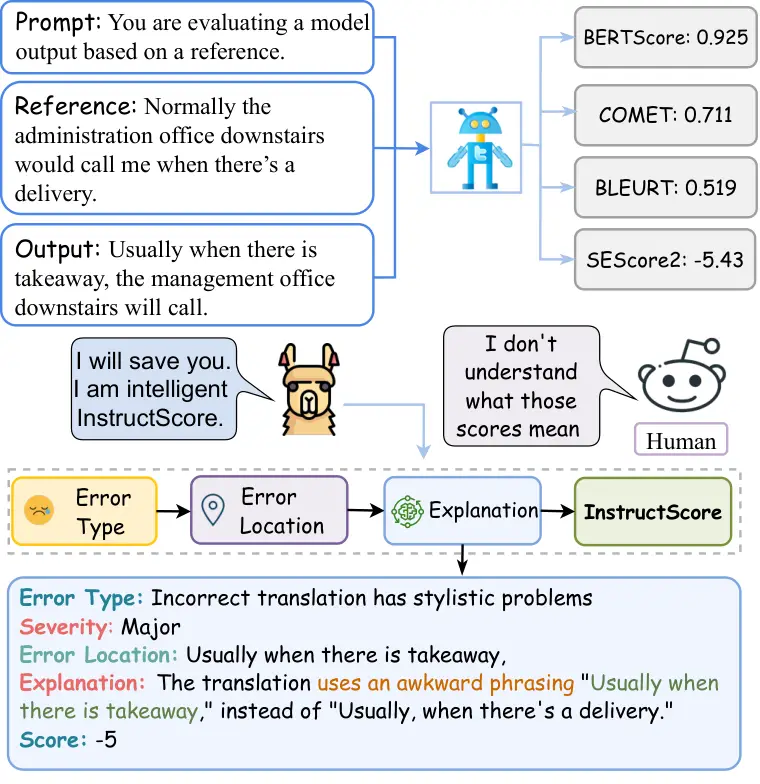

# InstructScore: Explainable Text Generation Evaluation with Fine-grained Feedback

Wenda Xu^(¶), Danqing Wang^(¶), Liangming Pan^(¶), Zhenqiao Song^(¶)
Email: [wendaxu@cs.ucsb.edu](mailto:)    Markus Freitag
Email: [danqingwang@cs.ucsb.edu](mailto:)    William Yang Wang^(¶)
Email: [liangmingpan@cs.ucsb.edu](mailto:)    Lei Li
Email: [zhenqiao@cs.ucsb.edu](mailto:)    ^(¶)University of California
Email: [william@cs.ucsb.edu](mailto:)    Santa Barbara
Email: [freitag@google.com](mailto:)    Google Research
Email: [leili@cs.cmu.edu](mailto:)    Carnegie Mellon University

###### Abstract

Automatically evaluating the quality of language generation is critical.
Although recent learned metrics show high correlation with human
judgement, these metrics do not provide explicit explanation of their
verdict, nor associate the scores with defects in the generated text. To
address this limitation, we present InstructScore, a fine-grained
explainable evaluation metric for text generation. By harnessing both
explicit human instruction and the implicit knowledge of GPT-4, we
fine-tune a text evaluation metric based on LLaMA, producing both a
score for generated text and a human readable diagnostic report. We
evaluate InstructScore on a variety of generation tasks, including
translation, captioning, data-to-text, and commonsense generation.
Experiments show that our 7B model surpasses all other unsupervised
metrics, including those based on 175B GPT-3 and GPT-4. Surprisingly,
our InstructScore, even without direct supervision from human-rated
data, achieves performance levels on par with state-of-the-art metrics
like COMET22, which were fine-tuned on human ratings.



Figure 1: InstructScore generates a comprehensive error diagnostic
report for text generation tasks, including error type, location,
severity label, and explanation. Based on this report, InstructScore
counts the number of major errors (each worth $`-5`$) and minor errors
(each worth $`-1`$), ultimately assigning a final score.

## 1 Introduction

Although large language models (LLMs) have led to significant progress
in various natural language tasks  (Brown et al., 2020; Ouyang et al.,
2022; Touvron et al., 2023), it remains a challenge to automatically
evaluate the quality of text generation across versatile tasks.
Traditional word overlap metrics, such as $`n`$-gram matching, BLEU
Papineni et al. (2002), and chrF Popović (2015), along with
distance-based metrics like TER Snover et al. (2006) do not best align
with human experts’ judgements Freitag et al. (2021a). They primarily
focus on surface form differences between reference and candidate
texts Freitag et al. (2020). On the other hand, recent learned metrics
such as BERTScore Zhang et al. (2019), BLEURT Sellam et al. (2020a),
COMET Rei et al. (2022) and SEScore Xu et al. (2022b); Xu et al. (2022a)
show a higher correlation with humans on text generation tasks. However,
all these metrics produce a single numerical score. These learned
metrics lack interpretation of predictions nor link the scores with
individual defects in the candidate text.

How can we devise a fine-grained explanation-based text generation
metric capable of pinpointing concrete error locations, identifying
error types, assigning severity labels, and justifying the final
score—all simultaneously without relying on human-annotated data. In
this paper, we propose InstructScore, a method to learn an explainable
text generation metric without using human annotated ratings.
InstructScore provides both a numerical score and a natural language
error explanation. To this end, we first extract latent evaluation
knowledge from an instruction-following model, such as GPT-4 OpenAI
(2023), to construct a synthetic dataset with a predetermined
explanation structure. Next, we determine a range of explanation failure
modes and devise automated feedback to meta-evaluate error explanations.
Finally, we further fine-tune InstructScore model on self-generated
outputs that optimize feedback scores, resulting in diagnostic reports
that are better aligned with humans.

We have conduct experiments on a variety of text generation tasks:
machine translation, table-to-text, image captioning, commonsense
genteration, and keyword-to-dialogue generation. Our experimental
findings show that the unsupervised InstructScore outperforms prior
strong baselines on all these tasks. It achieves the best results for
the unseen keyword-to-dialogue generation task. Surprisingly,
InstructScore surpasses the supervised BLEURT in 6 out of 9 directions
and closely matches state-of-the-art COMET22 in machine translation.
Furthermore, we identify a range of failure modes and design an
automatic pipeline to pinpoint explanation failures. Our refinement step
improves human score by 13.7%, leading to a more accurate alignment with
human judgment.

Our InstructScore enjoys the following advantages: (i) Compact yet
competitive: InstructScore’s 7B version displays strong performance
compared to metrics based on closed-source 175B LLMs. (ii) Explainable:
InstructScore provides natural language explanations to justify
numerical scores. (iii) Generalizable: The unsupervised training
pipeline does not require human-annotations, making it easily adaptable
to different domains and tasks.

Figure 2: Our InstructScore pipeline consists of three components:
First, we construct synthetic data from GPT-4 and use it to fine-tune a
7B LLAMA model. Second, we sample from real-world machine-generated
distribution to trigger InstructScore’s failure modes. We query GPT-4 on
each failure mode and gather automatic feedback. Third, we select
explanations that are most aligned with human to further fine-tune LLaMA
model. Step 2 and 3 can be repeated to iteratively refine the model
output.

## 2 Related Work

Learned Evaluation Metrics Supervised metrics optimize performance by
directly fine-tuning human rating data, such as COMET Rei et al. (2020)
and BLEURT Sellam et al. (2020a), as shown by Rei et al. (2020) and
Sellam et al. (2020a). However, human rating data is often unavailable.
Unsupervised metrics use different learning objectives or heuristics on
embeddings, such as BERT for greedy matching and coverage scoring Zhang
et al. (2019), or sequence-to-sequence models for probability estimation
Thompson and Post (2020); Yuan et al. (2021). SEScore Xu et al. (2022b)
and SEScore2 Xu et al. (2022a) train a regression model by synthesizing
human-like errors from raw text and using either a pre-trained natural
language inference or a multilingual masked prediction model to attach
error severity score. Supervised metrics can arguably attain higher
correlations with human judgments Freitag et al. (2021b); Freitag et al.
(2022), while unsupervised metrics, such as SEScore Xu et al. (2022b)
and BERTScore Zhang et al. (2019), exhibit greater levels of
generalization. However, none of these approaches offer an explanation
for the resulting scores, rendering the decision-making processes
obscure and less trustworthy. In this paper, we generate a diagnostic
report to provide detailed explanations to support metric’s final
decisions.

Explainable Evaluation Metric. Recent demand for explainability in
evaluation metrics has grown significantly. Freitag et al. (2021a)
introduce a multi-dimensional human evaluation (MQM) framework for
machine translation, while Leiter et al. (2022) investigates key
characteristics of explainable metrics. Several metrics derived from
those frameworks enhance explainability by differentiating error
severity (Lu et al., 2022; Xu et al., 2022b; Xu et al., 2022a; Perrella
et al., 2022). Other efforts focus on explanatory aspects of text
generation metrics, like error locations Zerva et al. (2022) and
multi-dimensional assessment Zhong et al. (2022). Despite progress,
explanations remain unclear. Researchers also explore LLMs’ potential in
evaluation, as demonstrated by Fu et al. (2023), but suffers from a lack
of explanation. Kocmi and Federmann (2023) and Liu et al. (2023) find
large models like GPT-3.5 on system-level can correlate to humans and
generate rationales. However, these generated rationales are free-form
and may not necessarily align with human judgements Zheng et al. (2023).
In our work, we explicitly refine InstructScore to produce explanations
that align with human.

## 3 Problem Definition

Our goal is to learn an explainable metric model that not only predicts
the quality score of candidate text comparing to a reference but also
generates a diagnostic report in natural language. Specifically,
InstructScore assesses the quality of $`x`$ regarding a reference $`r`$
by generating an informative diagnostic report, which includes the
details about error location $`l`$, error type $`t`$, severity level
$`se`$, and explanation $`e`$ that are associated with the identified
error. InstructScore consists of a score predictor and an explanation
generator (Exp-Generator) which learns a function $`f`$:
$`(\mathbf{x},\mathbf{y})\rightarrow\{(l,t,se,e)_{i}\}_{i=1}^{n}`$ with
$`n`$ number of errors. However, such human annotated mapping data for
most text generation tasks is scarce due to limited human resources and
high annotation costs. To this end, we propose a data construction
method to automatically generate high-quality pseudo data to learn
$`f`$.

## 4 The InstructScore Approach

InstructScore assesses the quality of generated texts based on an
explainable diagnostic report. Building upon this report, InstructScore
provides an intuitive way to comprehend a model’s generation capability,
resulting in easier comparison among different models. In particular, we
begin by extracting concise yet representative explainable knowledge
from a large-scale instruction-following model, which is then utilized
to train our Exp-Generator. After carefully analyzing the diagnostic
reports produced by our Exp-Generator, we summarize common failure modes
in diagnostic report and ask GPT-4 to identify them. Then we transform
the GPT-4’s feedback into alignment scores using our predefined
criteria. Finally, we select diagnostic reports that have the highest
alignment scores, and further finetune our Exp-Generator on those
self-refined outputs. The overall framework is illustrated in Figure 2.

The quality score $`s`$ for each candidate $`y`$ is determined based on
the number of errors and their severity labels in the diagnostic report.
Minor errors are given a score of $`-1`$ and major errors are given a
score of $`-5`$. These penalties for errors are weighted to calculate
the final score. Similar to previous practices Freitag et al. (2021a),
our metric identifies up to five errors per sentence.

### 4.1 Learning with Guided Error and Explanation Synthesis

We leverage GPT-4 to extract representative explainable knowledge that
can greatly contribute to the subsequent Exp-Generator learning process.

Specifically, we collected raw sentences in the target language from
diverse domains and topics via GPT-4 (Details are included in Section
5.1 and Appendix A), resulting in data across diverse tasks. This corpus
is used as the starting point to inject errors. Then, we prompt GPT-4 to
synthesize designated generation errors, as shown in Table 1.

|                                                                                                                                                                                                                                                                                                                                                                                                                        |
| ---------------------------------------------------------------------------------------------------------------------------------------------------------------------------------------------------------------------------------------------------------------------------------------------------------------------------------------------------------------------------------------------------------------------- |
| Prompt for GPT4:                                                                                                                                                                                                                                                                                                                                                                                                       |
| The correct translation is, "The art of writing for educational publications involves striking a delicate balance between providing enough detail to be useful and overwhelming the reader with too much information." Please give 0 minor errors and 2 major errors. For each error, give me an error type, a major/minor label, an error location, and an explanation. The format is Paraphrase correct translation: |
| Incorrect Translation:                                                                                                                                                                                                                                                                                                                                                                                                 |
| Error type 1: Translation includes information not present in the correct translation                                                                                                                                                                                                                                                                                                                                  |
| Major/minor: Major                                                                                                                                                                                                                                                                                                                                                                                                     |
| Error location 1:                                                                                                                                                                                                                                                                                                                                                                                                      |
| Explanation for error 1:                                                                                                                                                                                                                                                                                                                                                                                               |
| Error type 2: Problems with grammar, other than orthography                                                                                                                                                                                                                                                                                                                                                            |
| Major/minor: Major                                                                                                                                                                                                                                                                                                                                                                                                     |
| Error location 2:                                                                                                                                                                                                                                                                                                                                                                                                      |
| Explanation for error 2:                                                                                                                                                                                                                                                                                                                                                                                               |
| GPT4 Output:                                                                                                                                                                                                                                                                                                                                                                                                           |
| Error type 1: Translation includes information not present in the correct translation                                                                                                                                                                                                                                                                                                                                  |
| Major/minor: Major                                                                                                                                                                                                                                                                                                                                                                                                     |
| Error location 1: "…giving enough examples…"                                                                                                                                                                                                                                                                                                                                                                           |
| Explanation for error 1: The correct translation talks about providing enough detail, not specific examples, which changes the meaning of the sentence.                                                                                                                                                                                                                                                                |
| Error type 2: Problems with grammar, other than orthography                                                                                                                                                                                                                                                                                                                                                            |
| Major/minor: Major                                                                                                                                                                                                                                                                                                                                                                                                     |
| Error location 2: "…making the reader bored with too many details."                                                                                                                                                                                                                                                                                                                                                    |
| Explanation for error 2: The correct translation mentions overwhelming the reader with too much information, not making them bored with too many details. This change in phrasing alters the meaning of the sentence.                                                                                                                                                                                                  |

Table 1: This prompt was used to generate synthetic data to fine-tune
the LLAMA model, specifically GPT-4. The model was provided with the
number of errors in a sentence. For each error annotation, we pre-define
the error type and a severity label. GPT-4 was then required to identify
the error locations and provide explanations for each error annotation.
The texts highlighted are variables for each synthesized generation. The
complete example can be found in Appendix Table 29.

For each text, we specify the number of errors, error types, and
severity labels, and ask GPT-4 to generate a candidate output with the
specified error descriptions and 2) an explanation for this error
annotation. If an evaluation task is multi-dimensional, error types will
be separately assigned to each dimension (An example is included in the
Appendix). Benefiting from the large-scale pre-training process, GPT-4
is able to generate diverse errors and meet the requirements with
specified instructions. To avoid the model’s over-reliance on the
lexical and structural similarities between the candidate and raw text,
we request GPT-4 to rephrase the raw text sentence to construct a
pseudo-reference sentence. By specifying error type $`t`$, severity
label $`se`$, and raw text, GPT-4 is able to generate a synthetic error
sentence $`x`$ with annotated error location $`l`$ and a pseudo
reference $`y`$ with explanation $`e`$. Therefore, we can construct
synthetic data that reflects the relationship between $`(x,y)`$ and
$`(t,l,se,e)`$.

We train our Exp-Generator by utilizing the constructed data.
Particularly, we use LLaMA as the initialization of the Exp-Generator
since it is open-sourced and performs well in both understanding and
generation tasks. Then we train our Exp-Generator by taking the pseudo
reference $`y`$ and candidate $`x`$ as the input, and the diagnostic
report including the corresponding error type $`t`$, error location
$`l`$, severity label $`se`$ and the explanation $`e`$ as the output. A
concrete example can be found in Figure 2. Accordingly, our training
objective can be defined as follows:

```math
\mathcal{L}(t,l,se,e,x,y)=-\log P(t,l,se,e|y,x;\theta) \tag{1}
```

where $`\theta`$ is the trainable parameter of the Exp-Generator.

|                     |                              |                                                                                 |
| ------------------- | ---------------------------- | ------------------------------------------------------------------------------- |
| Fields              | Explanation Failure Mode     | Description                                                                     |
| Local Failure Mode  |                              |                                                                                 |
| Error Type          | Inconsistency to explanation | M1: Error type descriptions are not consistent with explanation                 |
| Error Location      | Inconsistency to explanation | M2: Error locations are not consistent with the explanation                     |
|                     | Error location hallucination | M3: Error locations are not referred in the output text                         |
| Major/Minor         | Major/Minor disagreement     | M5: Major and minor labels do not correspond to the correct severity levels     |
| Explanation         | Error location hallucination | M4: Error locations can not refer to the output text                            |
|                     | Explanation failure          | M6: The explanation is wrong. However, error at a specified location does exist |
| Global Failure Mode |                              |                                                                                 |
| All 4 Fields        | False negative error         | G1: Error described in the explanation is not an error                          |
|                     | Repetition                   | G2: One error is mentioned more than once among explanations                    |
|                     | Phrase misalignment          | G3: Incorrect phrase and correct phrase are not correctly aligned               |
|                     | Mention multiple errors      | G4: One error span mentions multiple errors                                     |

.

Table 2: This table shows common failure modes of the explanation output
of first step Exp-Generator (Fine-tuned LLaMA on synthetic data without
refinement). Local errors are field-specific, which only correspond to
the error of the local field. Global errors can affect all four fields,
such as error type, error location, major/minor, and explanation. The
observation of the failures modes at first step Exp-Generator is the
main motivation for us to perform refinement with automatic feedback
(See Section 4.3)

|                                                                                                                                                                                                                                             |
| ------------------------------------------------------------------------------------------------------------------------------------------------------------------------------------------------------------------------------------------- |
| InstructScore Input:                                                                                                                                                                                                                        |
| Reference: Activities include the “Cool Maker Loves Family” carnival of children’s future learning, the first children’s visual art festival, the “Book Carnival” event and the “Whole Family Loves Reading” Picture Book Reading activity. |
| Output: Activities include the "love family and create cool" children’s future learning carnival, the first children’s visual arts festival, the "book carnival" activity, the "family love reading" picture book series activity.          |
| InstructScore Output:                                                                                                                                                                                                                       |
| Your Translation contains 5 errors:                                                                                                                                                                                                         |
| Error type 5: Incorrect translation includes information not present in the correct translation                                                                                                                                             |
| Major/minor: Major                                                                                                                                                                                                                          |
| Error location 5: "whole family loves reading"                                                                                                                                                                                              |
| Explanation for error 5: The incorrect translation adds the phrase "whole family loves reading," which is not present in the correct translation and changes the focus from "families" to "whole families."                                 |

Table 3: This is the case where error locations in explanation can not
refer to the output text (M4). "whole family loves reading" is never
mentioned in the output text. Instead, it was mentioned in the reference
text. The complete example can be found in Appendix Table 16.

|                                                                                                                                                                                                                                                                                                                                                                                                                                                                                                                                                                                                                                                                                                                                                                                                                                           |
| ----------------------------------------------------------------------------------------------------------------------------------------------------------------------------------------------------------------------------------------------------------------------------------------------------------------------------------------------------------------------------------------------------------------------------------------------------------------------------------------------------------------------------------------------------------------------------------------------------------------------------------------------------------------------------------------------------------------------------------------------------------------------------------------------------------------------------------------- |
| Prompt: Ref: …… entered the revolutionary base area of south Jiangxi. Out: …… entered the old revolutionary district of southern Jiangxi. Error location 1: "old revolutionary district" Error type 1: Terminology is non-standard Explanation 1: The correct term should be "new revolutionary base area" …… Q1: For each error location, extract the incorrect error location. Q2: Parse the explanation into either one of the four forms: \[incorrect phrase, correct phrase\]…… Q3: If A2 is "incorrect phrase to correct phrase", is A2 a correct alignment for reference and output? Q4: According to the sentence context, is it no-error or minor-error or major-error? Q5: Is the explanation consistent with the given error type? Q6: Is error location in explanation? Q7: Do two error locations mention the same location? |

Table 4: Prompt for GPT4 feedback: We asked following questions to
determine the correctness and consistency of the explanation. This is a
simplified prompt of how we obtained GPT-4 feedback for Table 2
(Complete examples can be found in Appenfix Table 34 and 35).

### 4.2 Auto-Identifying Failure Modes of Metric Output

The diagnostic report plays an important role in text quality
explanation. However, the above trained model is not guaranteed to
produce sensible explanations – those incorrect explanations are
referred to as failure modes. We categorize failure modes into global
and local levels. A global failure invalidates all four fields: error
type, error location, major/minor and explanation. A local failure only
affects a specific field, like error type.

In Table 2, we define six scenarios M1-M6 for local failures and four
scenarios G1-G4 for global failures. We demonstrate one failure mode M4
in Table 3. Concrete examples for each failure mode are included in the
Appendix Table 13, 14, 15, 16, 17, 18, 19, 20, 21, 22. A special case is
when the method outputs an annotation containing no error. In this
situation, we need to verify if this is accurate (A concrete example can
be found in Appendix Table 35). If errors are present, the diagnostic
report is incorrect.

Ideally, a human annotator can provide the most accurate judgment for
detecting each failure mode. However, obtaining annotations from humans
for every instance of a diagnostic report is infeasible. As an
alternative, we leverage GPT-4’s capabilities in information extraction,
parsing, and semantic understanding OpenAI (2023) to convert complex
requirement queries into simple Yes/No questions.

Specifically, we prompt GPT-4 to parse the explanation into incorrect
and correct phrase pairs and extract the error span from the error
location. To address hallucinations from error location (M3) and
explanation (M4), we verify if our parsed error span is present in the
candidate sentence. If one error annotation contains multiple
incorrect-correct phrase pairs, it indicates multiple errors in one
error location (G4). To address G1, we first check if the incorrect
phrase is indeed an error. Additionally, we verify if the revision
suggestion is in the output. For the remaining M and G aspects, we
design specific prompt queries for the GPT-4. A detailed example of the
prompt query for checking M1-M6 and G1-G4 can be found in Table 4.

After obtaining local and global failure modes from GPT-4’s feedback, we
can convert those feedback into alignment scores. We assign a binary
score in each field of the diagnostic output. If one local error is
observed, the corresponding field will receive score of 0. If one global
error is observed, all four fields corresponding to that annotation will
receive 0s. Each diagnostic report has a score of
$`\frac{\#correctfields}{\#totalfields}`$, yielding a alignment score
between 0 and 1. For example, one candidate sentence can be given four
error annotations. For each error annotation, there are four fields:
error type, location, major/minor, and explanation, 16 fields in total.
If one global and one failure modes are observed, the corresponding
alignment score will be 11/16.

### 4.3 Refinement with Meta-Feedback

We then leverage the well-learned Exp-Generator to produce high-quality
pseudo training data to iteratively refine the model performance, which
can further benefit final quality score calculation. Specifically, we
use hypothsis $`h_{i}`$ with reference $`k_{i}`$ as the model input and
employ sampling strategies to generate diverse diagnostic reports. Due
to discrepancies between synthetic data and real world
hypothesis-reference pairs $`\{x,y\}`$ and $`\{h,k\}`$ Sellam et al.
(2020a); Xu et al. (2022b), we anticipate real world model hypothesis
can trigger diverse failure modes from Table 2. For each input pair
$`(h_{i},k_{i})`$, we use top p samping to sample $`n`$ possible
diagnostic outputs, denotated as $`\{o_{1},o_{2},...,o_{n}\}`$. Based on
the feedback scores from GPT-4, we keep the diagnostic output that
optimizes the alignment score,
$`o_{aligned}=\{t_{aligned},l_{aligned},se_{aligned},e_{aligned}\}`$,
and further fine-tune our Exp-Generator. This automatic critiques and
self-training pipeline can further encourage our Exp-Generator to
generate more accurate diagnostic reports. Based on the human
evaluation, the final quality score can reduce failure modes and align
outputs with humans better.

```math
\mathcal{L}(o_{aligned},x,y)=\\
-\log P(o_{aligned}|y,x;\theta) \tag{2}
```

|                     |               |                            |                   |                   |           |                   |      |
| ------------------- | ------------- | -------------------------- | ----------------- | ----------------- | --------- | ----------------- | ---- |
|                     |               | Seen Tasks                 |                   |                   |           | Unseen Task       |      |
|                     |               | WMT22(Zh$`\rightarrow`$En) | WebNLG20          | Flicker3k         | Commongen | BAGEL             | Rank |
|                     |               | $`\tau`$/$`\rho`$          | $`\tau`$/$`\rho`$ | $`\tau`$/$`\rho`$ | Acc       | $`\tau`$/$`\rho`$ | Avg  |
| Supervised          | MATESE        | 38.9 / 52.8                | \-                | \-                | \-        | \-                | \-   |
|                     | Metric XXL    | 42.7 / 58.1                | \-                | \-                | \-        | \-                | \-   |
|                     | COMET-22      | 42.8 / 58.5                | \-                | \-                | \-        | \-                | \-   |
|                     | BLEURT-20     | 36.1 / 43.0                | 40.2 / 63.5       | 24.3 / 35.1       | 39.5      | 22.9 / 32.3       | 2.8  |
| Without Supervision | BLEU          | 14.5 / 17.5                | 20.1 / 20.7       | 13.8 / 21.6       | 26.8      | 10.9 / 16.8       | 10.2 |
|                     | ChrF          | 15.4 / 14.7                | 26.6 / 40.0       | 13.3 / 24.5       | 33.0      | 10.8 / 16.8       | 9.0  |
|                     | METEOR        | 16.5 / 18.8                | 25.6 / 36.3       | 13.4 / 23.1       | 33.9      | 12.6 / 14.5       | 9.4  |
|                     | CIDEr         | 18.0 / 22.1                | 26.1 / 31.8       | 15.2 / 29.8       | 32.6      | 15.7 / 23.1       | 7.8  |
|                     | BERTScore     | 31.6 / 37.6                | 32.8 / 50.4       | 17.4 / 24.6       | 38.8      | 17.1 / 28.2       | 5.6  |
|                     | BARTScore     | 22.2 / 24.9                | 33.1 / 56.8       | 17.9 / 22.2       | 37.0      | 20.3 / 20.7       | 6.2  |
|                     | PRISM         | 25.0 / 27.9                | 37.6 / 59.4       | 16.1 / 23.8       | 38.0      | 21.7 / 30.7       | 5.1  |
|                     | GEMBA-GPT4    | 38.2 / 37.4                | \-                | \-                | \-        | \-                | \-   |
|                     | SEScore2      | 33.0 / 46.4                | 36.8 / 48.4       | 16.7 / 22.2       | 34.4      | 23.3 / 32.5       | 4.9  |
|                     | InstructScore | 40.3 / 51.9                | 39.5 / 59.0       | 30.1 / 34.6       | 58.2      | 25.6 / 34.2       | 2.0  |

Table 5: We applied segment-level Kendall and Pearson correlation on
WMT22, WebNLG20, Flicker3k, and BAGEL, and ranking accuracy for
Commongen. InstructScore significantly outperforms all unsupervised
metrics in 8/9 directions using William’s pairwise significance test (p
\< 0.05). The top supervised and unsupervised metrics are bolded.
Pearson and Kendall correlations are ranked per task, with overall
performance being the average rank across tasks. Appendix Table 9
contains ranking details for each correlation and task.

## 5 Experiments

In the experiment section, we aim to answer the following research
questions: 1) What is the performance across various tasks within the
English language? 2) What is the performance across different domains
within the same task? 3) What is the performance across different
evaluation dimensions? 4) What is the performance at unseen tasks? 5)
Given that LLaMA is predominantly trained in English texts, can it
effectively evaluate generations in other languages? 6) Can we align the
diagnostic report with human expectations without requiring extensive
human efforts?

To answer Q1, we tested InstructScore at various tasks, including WMT22
(Machine Translation) Freitag et al. (2022), WebNLG (Table-to-text)
Castro Ferreira et al. (2020), Flicker3k (Captioning) Hodosh et al.
(2013), BAGEL (Keyword-to-text) Mairesse et al. (2010) and Commongen
(Commonsense text generation) Lin et al. (2020). To address Q2, we
examed our method at four diverse domains: News, Conversation, Social,
and E-Commerce at WMT22. For Q3, we evaluated our method at five
evaluation dimensions at WebNLG. For Q4, we evaluated InstructScore at
BAGEL benchmark, a task and evaluation dimensions that are unseen in the
synthetic data. For Q5, we evaluated our approach to English-to-German
translations in order to investigate its multilingual evaluation
capabilities. Lastly, we demonstrate our metric with automatic critique
and refinement can achieve higher human ratings regarding failure modes.

### 5.1 Experiment Setup

#### Baseline and Benchmark

We tested our InstructScore at 1) WMT22 shared metric task, in two
target languages: English and German. WMT22 uses an MQM-based human
evaluation procedure Freitag et al. (2021a). WMT22 has 14 English, 16
German participating Machine Translation systems, with 26,250 and 21,040
human-annotated outputs respectively; 2) WebNLG20: The input of the task
contains Wikipedia triples, and the output is a natural language text.
This benchmark contains 16 participating WebNLG systems with 2832
human-annotated outputs; 3) Flicker3K-CF: This benchmark contains 145K
binary quality judgment gathered from CrowdFlower over 48K (image,
caption) pairs with 1K unique images; 4) Commongen: This benchmark
contains 2796 model outputs from 6 participating systems. All human
annotations are done in pairwise rankings for the same source input.
Therefore, we compute ranking accuracy to estimate the metric’s
performance; 5) BAGEL: The input of this task contains keywords and the
output is a fluent human conversation. This benchmark contains 202 model
outputs. We included top-performing baseline metrics which joined each
challenge, including n-gram based metrics: BLEU Papineni et al. (2002),
chrF Popović (2015), METEOR Banerjee and Lavie (2005) and CIDEr Vedantam
et al. (2015); Unsupervised learned metrics: PRISM Thompson and Post
(2020), BARTScore Yuan et al. (2021), BERTScore Zhang et al. (2019), and
SEScore2 Xu et al. (2022a); LLM-based metrics: GPT3-Dav3 and GPT4Kocmi
and Federmann (2023); Supervised learned metrics: BLEURT-20 Sellam
et al. (2020a), MaTESe Perrella et al. (2022), UniTE Wan et al. (2022)
and MetricX XXL.

#### Implementation

We utilize GPT-4 as our implicit evaluation knowledge base and LLaMA-7B
as our trained initialization¹¹ 1 We include InstructScore based on
LLaMA2-7B Touvron et al. (2023) results in the Appendix Table 12. We
demonstrate that varying pertaining initialization can lead to different
results at diverse NLG tasks.. To ensure coverage of diverse text
domains, we separately collect a dataset of 10k raw sentences from 100
different domains using GPT-4 for both English and German. Details on
the construction of this dataset are provided in Appendix Sec. C. To
adapt to specific task domains, we separately gathered 10k sentences for
the training datasets of WebNLG17 Gardent et al. (2017), CoCo Captioning
Chen et al. (2015), and CommonGen Liu et al. (2022). We apply the
respective prompts defined in Appendix Tables 29, 30, 31, and 32 to
generate synthetic data.

We define four evaluation scenarios: 1) evaluation with reference only; 2) evaluation with reference and additional data; 3) evaluation with
reference where the source has different modalities; 4) evaluation with
reference and world knowledge. For each scenario, we obtain 10k
candidate-reference pairs as input and structured diagnostic reports as
output. We train a separate checkpoint for each evaluation scenario,
resulting in four checkpoints in total. All models are fine-tuned with
language modeling loss with 10k synthetic data. Each model is trained
for three epochs, with a learning rate, batch size, and weight decay of
2e-5, 128, and 0, respectively. During the evaluation of each model, we
set the temperature to 0 for greedy decoding. Details of our automatic
critique and self-training are included in the Appendix Sec E.

#### Meta-evaluation

We assess the performance of InstructScore using Segment-level Kendall
and Pearson correlations between human and metric output. Kendall Tau-b
might favor tie pairs, possibly giving an unfair advantage to certain
systems Deutsch et al. (2023). Pearson, on the other hand, measures
linear association. By reporting both complementary results, we can
comprehensively understand the metric’s performance. We employed three
human annotators to assess the alignment of our model before and after
refinement. In particular, the human raters ²² 2 Each human rater is
paid at \$16.0 per hour, which is above the minimum wage of the local
region. will estimate a binary score based on M1 to M6 and G1 to G4
criteria for each field in the diagnostic report. The total score of a
diagnostic report is calculated as
$`\frac{\#correctfields}{\#totalfields}`$. The final score is averaged
among raters. Details of human evaluation procedures are included in the
Appendix Sec F and Table 8.

Figure 3: Segment-level Kendall ($`\tau`$) correlation on Zh-En for
different domains of WMT22. We connect points to highlight InstructScore
with two other top performing metrics in the figure.

### 5.2 Main Results

#### Robust Performance across Tasks

We assess the primary performance of InstructScore for five diverse NLG
tasks. As shown in Table 5, InstructScore significantly outperforms all
other unsupervised metrics in 8 out of 9 directions, achieving the best
overall ranking. All improvements are statistically significant by
William’s pairwise significant test Graham and Baldwin (2014) with p \<
0.05. Surprisingly, InstructScore even outperforms prior supervised
learned metrics that trained over direct assessment data (DA), leading
BLEURT20 in 6 out of 9 directions. Compared to GPT4 baseline,
InstructScore outperforms GEMBA-GPT4 with 0.021 in Kendall and 0.145 in
Pearson correlation. The larger gap in Pearson correlation can be
explained by a large set of ties that GEMBA-GPT4 is producing. This will
lead to false positive in Kendall correlation. Lastly, we demonstrate
that InstructScore can achieve close performance to the supervised
learned metrics, MATESE, COMET22 and Metric XXL, that have trained over
comprehensive human rating data (DA and MQM), with average 0.012 gap in
Kendall correlation and 0.045 in Pearson correlation.

#### Robust Performance across Domains

In Figure 3, we further evaluate the performance of InstructScore across
different domains. From Kendall correlation analysis, InstructScore
surpasses all unsupervised metrics in four domains except GPT-3.5 and
GPT-4 baselines at Chat. It achieves comparable performance in
Ecommerce, Chat, and Social domains when compared to the leading
supervised metrics COMET22 and Metric-XXL. However, its performance is
noticeably worse in the News domain compared to SOTA COMET22 and
Metric-XXL. This gap can be primarily attributed to their supervised
data distribution at News domain DA and MQM data.

Figure 4: Segment-level Kendall Correlation on WebNLG Data-to-Text
generation. Cor, Cov, Flu, Rel, and Str represent Correctness, Coverage,
Fluency, Relevance, and Text Structure respectively. We connect points
to highlight InstructScore with two other top performing metrics in the
figure.

#### Robust Performance across Dimensions

Unlike most of metrics which only output a single score, InstructScore
can output a score in each evaluation dimension. In Figure 4, we
demonstrate that InstructScore outperforms all unsupervised learned
metrics across five different dimensions. Compared to BLEURT, which
trained over WebNLG human rating data, InstructScore outperforms best
performed BLEURT in three out of five evaluation dimensions. This
signifies that InstructScore can be extended to assign a single quality
score but extending into multi-dimensional NLG evaluation.

#### Generalization over Unseen Task

Since each NLG task has distinct evaluation criteria, one natural
question to ask: Is InstructScore generalizable to the task with unseen
data format and evaluation criteria? To verify this question, we use
BAGEL benchmark as unseen task since it contains distinct data formats
from our training data and contains distinct criteria. From Table 5 and
Figure 5, we demonstrate that despite never seen the evalaution criteria
of keywords to text, InstructScore achieves the higher Kendall and
Pearson correlation compared to BLEURT as well as two of three unseen
evaluation dimensions.

Figure 5: Segment-level Kendall Correlation on different dimensions of
BAGEL dialogue generation. We connect points to highlight InstructScore
with two other top performing metrics in the figure.

### 5.3 Quantitative Analysis

#### Performance at Non-English Language.

In Figure 6, InstructScore outperforms most unsupervised metrics, but
not 175B GPT3.5 models at WMT22 English-to-German or supervised
counterparts like COMET22 and BLEURT20. We hypothesize that multiple
factors contribute to the observed LLaMA performance on non-English
texts: (1) limited pretraining data, resulting in weaker pre-trained
knowledge for other languages, and (2) the task setup requiring
alignment between languages due to mixed code text generation (see
Appendix Sec D and Table 24). Future research could explore multilingual
alignment warmup methods before training on evaluation data.

Figure 6: Segment-level Kendall correlation of InstructScore at WMT22
English-to-German. Purple indicates unsupervised learned metrics, while
Blue indicates supervised learned metrics.

#### Automatic critique and Self-training can improve human Alignment

We conduct human evaluation to assess our metric’s alignment before and
after self-training. From Figure 7, we demonstrates that InstructScore
after automatic-critique and refinement can significantly reduce most of
global and local failure modes. In particular, all global failures have
more than 50% decreases in occurrences. This signifies that
InstructScore has improved over its phrase alignment, error
identification and error formats. Moreover, consistency between four
fields have all improved, demonstrated by improvements over all M
occurrences. We observed that M6 has slight increase. This is due to
some of the conversions from global failures into the local failures. In
Table 6, we demonstrated that InstructScore can achieve 0.106 absolute
human score gains with on par performance at Kendall and Pearson
correlation. The detailed human evaluation procedure, individual rater
scores and a case study are included in the Appendix Sec F, 10 and 23.

Figure 7: Failure mode occurrence per sentence before and after
refinement. Results are averaged by three human raters.

|                      |         |         |       |
| -------------------- | ------- | ------- | ----- |
| InstructScore        | Kendall | Pearson | Human |
| Fine-tune            | 0.404   | 0.515   | 0.773 |
| Fine-tune+Refinement | 0.403   | 0.519   | 0.879 |

Table 6: We report Segment-level Kendall, Pearson correlation and human
score before and after refinement.

#### Automatic critique and Self-training can improve precision and recall of InstructScore

We conduct a human evaluation of the quality of InstructScore’s
annotations (with three annotators). We calculated the precision and
recall of the annotations before and after refinement. Precision = \# of
correctly annotated error fields / \# of InstructScore’s labeled error
fields. Recall = \# of correctly annotated error fields / (# of
correctly annotated error fields+the number of error fields that
InstructScore missed). Error fields consist of error type, severity
label, error location, and explanations. In Table 7, InstructScore can
achieve 77.8% precision and 82.4% recall before refinement. After
refinement, InstructScore can improve precision and recall by 11.6% and
3.2%, respectively. In addition, we study the field of explanation in
particular, the refinement step can improve the precision of explanation
from 75.6% to 86.1% and improve the recall of explanation from 81.9% to
85.0%. Overall, our finding suggests that 89.4% of InstructScore’s
output after refinement is correct and it can identify 85.6% of errors
produced by the translation system.

|                   |             |             |             |             |
| ----------------- | ----------- | ----------- | ----------- | ----------- |
| Human Evaluation  | $`P_{All}`$ | $`R_{All}`$ | $`P_{Exp}`$ | $`R_{Exp}`$ |
| Before refinement | 0.778       | 0.824       | 0.756       | 0.819       |
| After refinement  | 0.894       | 0.856       | 0.861       | 0.850       |

Table 7: We report precision and recall before and after refinement on
all annotation fields (error type, location, severity label and
explanation) by InstructScore, annotated by $`P_{All}`$ and $`R_{All}`$.
In addition, we include precision and recall on the explanation field
only, annotated by $`P_{Exp}`$ and $`R_{Exp}`$.

## 6 Conclusion

In this paper, we present a novel framework for explainable text
generation evaluation, addressing the existing black-box limitations
associated with learned metrics. We define a set of failure modes to
regularize the explanations. We empirically demonstrate that
InstructScore can be generalized to different domains, tasks and
evaluation dimensions, achieving the best ranking compared to other
general text generation metrics. Lastly, our refinement from automatic
feedback can further improve human alignment score, precision, and
recall, by 13.7%, 11.6%, and 3.2%, respectively, leading to a more
accurate alignment with human requirements. We released the
InstructScore model for public use and open-source the data and codes.

## Limitations

While we have not yet been able to test InstructScore in a multilingual
setting due to the limited availability of human annotation and
significant label costs, it has shown promising results in leveraging
smaller synthetic and feedback data to fine-tune and refine its
performance. In fact, InstructScore has demonstrated superior
performance compared to unsupervised baselines, such as BERTScore,
BARTScore, and PRISM in high-resource non-English language, such as
German. Going forward, we aim to assess InstructScore’s multilingual
evaluation capabilities across high, medium, and low-resource languages.
As our instructions are in English and the evaluation target is in other
language, we plan to enhance InstructScore’s mixed code generation and
multilingual word alignment abilities by exploring more pretraining and
warm-up techniques.

Although our current computing resources restrict our ability to confirm
the impacts of model size on performance, future research should
investigate model size utilizing scaling law Kaplan et al. (2020) to
uncover potential improvements in failure modes related to larger model
sizes.

In the present framework, we introduce a straightforward but efficient
refinement process to enhance the alignment of our metric with human
judgements. Future research can investigate more advanced techniques,
such as incorporating human feedback through reinforcement Ouyang et al.
(2022), for more effective integration of feedback into the training
pipeline. More sophisticated approach holds promising potential to
further boost the performance of this pipeline.

## Ethics Statement

InstructScore, as an open-source and explainable evaluation metric for
text generation, emphasizes transparency and accountability in the
evaluation of natural language processing systems. By generating
interpretable evaluations and diagnostic reports, it fosters trust among
developers and end-users. Moreover, its introduction could propel
further innovation in the field of explainable evaluation metrics and
make high-quality evaluation tools more accessible. However, it is
crucial to ascertain that the interpretations provided by InstructScore
do not harbor biases present in the training data, and data privacy and
security measures are observed.

The quality improvements that may stem from using InstructScore could be
instrumental in diverse applications such as translation services,
chatbots, and content creation. Nonetheless, it is vital to monitor
these advancements to ensure that they do not inadvertently suppress
linguistic diversity. Additionally, the biases that may have been passed
on to InstructScore from pre-existing models like GPT4 should be
critically examined, and efforts must be made to alleviate biases that
could impact language, dialect, or cultural representation.

Finally, the impact of InstructScore on educational and professional
writing practices should not be overlooked. As writers and educators
might adapt their styles based on algorithmic evaluations, it is
essential to balance the quest for higher scores with the preservation
of human creativity and the diversity of expression. InstructScore has
the potential to be a powerful tool in the evaluation of text
generation, but it is imperative that ethical considerations surrounding
transparency, accessibility, bias, and societal impact are vigilantly
monitored and addressed.

We hired three human raters to annotate InstructScore’s diagnostic
reports. We randomly sampled 100 candidate-reference pairs from WMT22
Chinese-to-English direction. All evaluated data does not contain
sensitive or explicit languages. There is no risk of exposing raters’
identities and they have full knowledge of data usage. All annotators
are well-trained with evaluation protocols and are proficient in
English. The salary rate is above minimum wage at the local region. All
human rating data will be released upon paper acceptance. The detailed
human evaluation process is included in the Appendix Sec F.

## 7 Acknowledgement

This work was supported by the National Science Foundation award
\#2048122. The views expressed are those of the author and do not
reflect the official policy or position of the US government.

## References

- Banerjee and Lavie (2005) Satanjeev Banerjee and Alon Lavie. 2005.
  [METEOR: An automatic metric for MT evaluation with improved
  correlation with human judgments](https://aclanthology.org/W05-0909).
  In _Proceedings of the ACL Workshop on Intrinsic and Extrinsic
  Evaluation Measures for Machine Translation and/or Summarization_,
  pages 65–72, Ann Arbor, Michigan. Association for Computational
  Linguistics.
- Brown et al. (2020) Tom Brown, Benjamin Mann, Nick Ryder, Melanie
  Subbiah, Jared D Kaplan, Prafulla Dhariwal, Arvind Neelakantan, Pranav
  Shyam, Girish Sastry, Amanda Askell, et al. 2020. Language models are
  few-shot learners. _Advances in neural information processing
  systems_, 33:1877–1901.
- Castro Ferreira et al. (2020) Thiago Castro Ferreira, Claire Gardent,
  Nikolai Ilinykh, Chris van der Lee, Simon Mille, Diego Moussallem, and
  Anastasia Shimorina. 2020. [The 2020 bilingual, bi-directional WebNLG+
  shared task: Overview and evaluation results (WebNLG+ 2020)](https://www.aclweb.org/anthology/2020.webnlg-1.7). In
  _Proceedings of the 3rd International Workshop on Natural Language
  Generation from the Semantic Web (WebNLG+)_, pages 55–76, Dublin,
  Ireland (Virtual). Association for Computational Linguistics.
- Chen et al. (2015) Xinlei Chen, Hao Fang, Tsung-Yi Lin, Ramakrishna
  Vedantam, Saurabh Gupta, Piotr Dollar, and C. Lawrence Zitnick. 2015.
  [Microsoft coco captions: Data collection and evaluation
  server](http://arxiv.org/abs/1504.00325).
- Deutsch et al. (2023) Daniel Deutsch, George Foster, and Markus
  Freitag. 2023. [Ties matter: Modifying kendall’s tau for modern metric
  meta-evaluation](http://arxiv.org/abs/2305.14324).
- Freitag et al. (2021a) Markus Freitag, George Foster, David Grangier,
  Viresh Ratnakar, Qijun Tan, and Wolfgang Macherey. 2021a. Experts,
  errors, and context: A large-scale study of human evaluation for
  machine translation. _Transactions of the Association for
  Computational Linguistics_, 9:1460–1474.
- Freitag et al. (2020) Markus Freitag, David Grangier, and Isaac
  Caswell. 2020. Bleu might be guilty but references are not innocent.
  In _Proceedings of the 2020 Conference on Empirical Methods in Natural
  Language Processing (EMNLP)_, pages 61–71.
- Freitag et al. (2022) Markus Freitag, Ricardo Rei, Nitika Mathur,
  Chi-kiu Lo, Craig Stewart, Eleftherios Avramidis, Tom Kocmi, George
  Foster, Alon Lavie, and André F. T. Martins. 2022. [Results of WMT22
  metrics shared task: Stop using BLEU – neural metrics are better and
  more robust](https://aclanthology.org/2022.wmt-1.2). In _Proceedings
  of the Seventh Conference on Machine Translation (WMT)_, pages 46–68,
  Abu Dhabi, United Arab Emirates (Hybrid). Association for
  Computational Linguistics.
- Freitag et al. (2021b) Markus Freitag, Ricardo Rei, Nitika Mathur,
  Chi-kiu Lo, Craig Stewart, George Foster, Alon Lavie, and Ondřej
  Bojar. 2021b. [Results of the WMT21 metrics shared task: Evaluating
  metrics with expert-based human evaluations on TED and news
  domain](https://aclanthology.org/2021.wmt-1.73). In _Proceedings of
  the Sixth Conference on Machine Translation_, pages 733–774, Online.
  Association for Computational Linguistics.
- Fu et al. (2023) Jinlan Fu, See-Kiong Ng, Zhengbao Jiang, and Pengfei
  Liu. 2023. Gptscore: Evaluate as you desire. _arXiv preprint
  arXiv:2302.04166_.
- Gardent et al. (2017) Claire Gardent, Anastasia Shimorina, Shashi
  Narayan, and Laura Perez-Beltrachini. 2017. [The WebNLG challenge:
  Generating text from RDF data](https://doi.org/10.18653/v1/W17-3518).
  In _Proceedings of the 10th International Conference on Natural
  Language Generation_, pages 124–133, Santiago de Compostela, Spain.
  Association for Computational Linguistics.
- Graham and Baldwin (2014) Yvette Graham and Timothy Baldwin. 2014.
  [Testing for significance of increased correlation with human
  judgment](https://doi.org/10.3115/v1/D14-1020). In _Proceedings of the
  2014 Conference on Empirical Methods in Natural Language Processing
  (EMNLP)_, pages 172–176, Doha, Qatar. Association for Computational
  Linguistics.
- Hodosh et al. (2013) Micah Hodosh, Peter Young, and Julia
  Hockenmaier. 2013. [Framing image description as a ranking task: Data,
  models and evaluation metrics](https://doi.org/10.1613/jair.3994).
  _Journal of Artificial Intelligence Research_, 47:853–899.
- Kaplan et al. (2020) Jared Kaplan, Sam McCandlish, Tom Henighan,
  Tom B. Brown, Benjamin Chess, Rewon Child, Scott Gray, Alec Radford,
  Jeffrey Wu, and Dario Amodei. 2020. [Scaling laws for neural language
  models](http://arxiv.org/abs/2001.08361).
- Kocmi and Federmann (2023) Tom Kocmi and Christian Federmann. 2023.
  Large language models are state-of-the-art evaluators of translation
  quality. _arXiv preprint arXiv:2302.14520_.
- Leiter et al. (2022) Christoph Leiter, Piyawat Lertvittayakumjorn,
  Marina Fomicheva, Wei Zhao, Yang Gao, and Steffen Eger. 2022. Towards
  explainable evaluation metrics for natural language generation. _arXiv
  preprint arXiv:2203.11131_.
- Lin et al. (2020) Bill Yuchen Lin, Wangchunshu Zhou, Ming Shen, Pei
  Zhou, Chandra Bhagavatula, Yejin Choi, and Xiang Ren. 2020.
  [CommonGen: A constrained text generation challenge for generative
  commonsense
  reasoning](https://www.aclweb.org/anthology/2020.findings-emnlp.165).
  In _Findings of the Association for Computational Linguistics: EMNLP
  2020_, pages 1823–1840, Online. Association for Computational
  Linguistics.
- Liu et al. (2022) Jiacheng Liu, Alisa Liu, Ximing Lu, Sean Welleck,
  Peter West, Ronan Le Bras, Yejin Choi, and Hannaneh Hajishirzi. 2022.
  [Generated knowledge prompting for commonsense
  reasoning](https://doi.org/10.18653/v1/2022.acl-long.225). In
  _Proceedings of the 60th Annual Meeting of the Association for
  Computational Linguistics (Volume 1: Long Papers)_, pages 3154–3169,
  Dublin, Ireland. Association for Computational Linguistics.
- Liu et al. (2023) Yang Liu, Dan Iter, Yichong Xu, Shuohang Wang,
  Ruochen Xu, and Chenguang Zhu. 2023. [G-eval: Nlg evaluation using
  gpt-4 with better human alignment](http://arxiv.org/abs/2303.16634).
- Lu et al. (2022) Qingyu Lu, Liang Ding, Liping Xie, Kanjian Zhang,
  Derek F Wong, and Dacheng Tao. 2022. Toward human-like evaluation for
  natural language generation with error analysis. _arXiv preprint
  arXiv:2212.10179_.
- Mairesse et al. (2010) François Mairesse, Milica Gašić, Filip
  Jurčíček, Simon Keizer, Blaise Thomson, Kai Yu, and Steve Young. 2010.
  [Phrase-based statistical language generation using graphical models
  and active learning](https://aclanthology.org/P10-1157). In
  _Proceedings of the 48th Annual Meeting of the Association for
  Computational Linguistics_, pages 1552–1561, Uppsala, Sweden.
  Association for Computational Linguistics.
- OpenAI (2023) OpenAI. 2023. [Gpt-4 technical
  report](http://arxiv.org/abs/2303.08774).
- Ouyang et al. (2022) Long Ouyang, Jeff Wu, Xu Jiang, Diogo Almeida,
  Carroll L Wainwright, Pamela Mishkin, Chong Zhang, Sandhini Agarwal,
  Katarina Slama, Alex Ray, et al. 2022. Training language models to
  follow instructions with human feedback. _arXiv preprint
  arXiv:2203.02155_.
- Papineni et al. (2002) Kishore Papineni, Salim Roukos, Todd Ward, and
  Wei-Jing Zhu. 2002. [Bleu: a method for automatic evaluation of
  machine translation](https://doi.org/10.3115/1073083.1073135). In
  _Proceedings of the 40th Annual Meeting of the Association for
  Computational Linguistics_, pages 311–318, Philadelphia, Pennsylvania,
  USA. Association for Computational Linguistics.
- Perrella et al. (2022) Stefano Perrella, Lorenzo Proietti, Alessandro
  Scirè, Niccolò Campolungo, and Roberto Navigli. 2022. [MaTESe: Machine
  translation evaluation as a sequence tagging
  problem](https://aclanthology.org/2022.wmt-1.51). In _Proceedings of
  the Seventh Conference on Machine Translation (WMT)_, pages 569–577,
  Abu Dhabi, United Arab Emirates (Hybrid). Association for
  Computational Linguistics.
- Popović (2015) Maja Popović. 2015. [chrF: character n-gram F-score for
  automatic MT evaluation](https://doi.org/10.18653/v1/W15-3049). In
  _Proceedings of the Tenth Workshop on Statistical Machine
  Translation_, pages 392–395, Lisbon, Portugal. Association for
  Computational Linguistics.
- Rei et al. (2022) Ricardo Rei, José G. C. de Souza, Duarte Alves,
  Chrysoula Zerva, Ana C Farinha, Taisiya Glushkova, Alon Lavie, Luisa
  Coheur, and André F. T. Martins. 2022. [COMET-22: Unbabel-IST 2022
  submission for the metrics shared
  task](https://aclanthology.org/2022.wmt-1.52). In _Proceedings of the
  Seventh Conference on Machine Translation (WMT)_, pages 578–585, Abu
  Dhabi, United Arab Emirates (Hybrid). Association for Computational
  Linguistics.
- Rei et al. (2020) Ricardo Rei, Craig Stewart, Ana C Farinha, and Alon
  Lavie. 2020. [COMET: A neural framework for MT
  evaluation](https://doi.org/10.18653/v1/2020.emnlp-main.213). In
  _Proceedings of the 2020 Conference on Empirical Methods in Natural
  Language Processing (EMNLP)_, pages 2685–2702, Online. Association for
  Computational Linguistics.
- Sellam et al. (2020a) Thibault Sellam, Dipanjan Das, and Ankur Parikh.
  2020a. [BLEURT: Learning robust metrics for text
  generation](https://doi.org/10.18653/v1/2020.acl-main.704). In
  _Proceedings of the 58th Annual Meeting of the Association for
  Computational Linguistics_, pages 7881–7892, Online. Association for
  Computational Linguistics.
- Sellam et al. (2020b) Thibault Sellam, Amy Pu, Hyung Won Chung,
  Sebastian Gehrmann, Qijun Tan, Markus Freitag, Dipanjan Das, and Ankur
  Parikh. 2020b. [Learning to evaluate translation beyond english:
  Bleurt submissions to the wmt metrics 2020 shared
  task](https://www.aclweb.org/anthology/2020.wmt-1.102). In
  _Proceedings of the Fifth Conference on Machine Translation_, pages
  921–927, Online. Association for Computational Linguistics.
- Snover et al. (2006) Matthew Snover, Bonnie Dorr, Rich Schwartz,
  Linnea Micciulla, and John Makhoul. 2006. [A study of translation edit
  rate with targeted human
  annotation](https://aclanthology.org/2006.amta-papers.25). In
  _Proceedings of the 7th Conference of the Association for Machine
  Translation in the Americas: Technical Papers_, pages 223–231,
  Cambridge, Massachusetts, USA. Association for Machine Translation in
  the Americas.
- Thompson and Post (2020) Brian Thompson and Matt Post. 2020.
  [Automatic machine translation evaluation in many languages via
  zero-shot
  paraphrasing](https://doi.org/10.18653/v1/2020.emnlp-main.8). In
  _Proceedings of the 2020 Conference on Empirical Methods in Natural
  Language Processing (EMNLP)_, pages 90–121, Online. Association for
  Computational Linguistics.
- Touvron et al. (2023) Hugo Touvron, Thibaut Lavril, Gautier Izacard,
  Xavier Martinet, Marie-Anne Lachaux, Timothée Lacroix, Baptiste
  Rozière, Naman Goyal, Eric Hambro, Faisal Azhar, et al. 2023. Llama:
  Open and efficient foundation language models. _arXiv preprint
  arXiv:2302.13971_.
- Vedantam et al. (2015) Ramakrishna Vedantam, C. Lawrence Zitnick, and
  Devi Parikh. 2015. [Cider: Consensus-based image description
  evaluation](http://arxiv.org/abs/1411.5726).
- Wan et al. (2022) Yu Wan, Dayiheng Liu, Baosong Yang, Haibo Zhang,
  Boxing Chen, Derek Wong, and Lidia Chao. 2022. [UniTE: Unified
  translation
  evaluation](https://doi.org/10.18653/v1/2022.acl-long.558). In
  _Proceedings of the 60th Annual Meeting of the Association for
  Computational Linguistics (Volume 1: Long Papers)_, pages 8117–8127,
  Dublin, Ireland. Association for Computational Linguistics.
- Xu et al. (2022a) Wenda Xu, Xian Qian, Mingxuan Wang, Lei Li, and
  William Yang Wang. 2022a. Sescore2: Retrieval augmented pretraining
  for text generation evaluation. _arXiv preprint arXiv:2212.09305_.
- Xu et al. (2022b) Wenda Xu, Yi-Lin Tuan, Yujie Lu, Michael Saxon, Lei
  Li, and William Yang Wang. 2022b. [Not all errors are equal: Learning
  text generation metrics using stratified error
  synthesis](https://aclanthology.org/2022.findings-emnlp.489). In
  _Findings of the Association for Computational Linguistics: EMNLP
  2022_, pages 6559–6574, Abu Dhabi, United Arab Emirates. Association
  for Computational Linguistics.
- Yuan et al. (2021) Weizhe Yuan, Graham Neubig, and Pengfei Liu. 2021.
  [Bartscore: Evaluating generated text as text
  generation](https://proceedings.neurips.cc/paper/2021/file/e4d2b6e6fdeca3e60e0f1a62fee3d9dd-Paper.pdf).
  In _Advances in Neural Information Processing Systems_, volume 34,
  pages 27263–27277. Curran Associates, Inc.
- Zerva et al. (2022) Chrysoula Zerva, Frédéric Blain, Ricardo Rei,
  Piyawat Lertvittayakumjorn, José G. C. de Souza, Steffen Eger, Diptesh
  Kanojia, Duarte Alves, Constantin Orăsan, Marina Fomicheva, André
  F. T. Martins, and Lucia Specia. 2022. [Findings of the WMT 2022
  shared task on quality
  estimation](https://aclanthology.org/2022.wmt-1.3). In _Proceedings of
  the Seventh Conference on Machine Translation (WMT)_, pages 69–99, Abu
  Dhabi, United Arab Emirates (Hybrid). Association for Computational
  Linguistics.
- Zhang et al. (2019) Tianyi Zhang, Varsha Kishore, Felix Wu, Kilian Q.
  Weinberger, and Yoav Artzi. 2019. [Bertscore: Evaluating text
  generation with bert](https://doi.org/10.48550/ARXIV.1904.09675).
- Zheng et al. (2023) Lianmin Zheng, Wei-Lin Chiang, Ying Sheng, Siyuan
  Zhuang, Zhanghao Wu, Yonghao Zhuang, Zi Lin, Zhuohan Li, Dacheng Li,
  Eric. P Xing, Hao Zhang, Joseph E. Gonzalez, and Ion Stoica. 2023.
  [Judging llm-as-a-judge with mt-bench and chatbot
  arena](http://arxiv.org/abs/2306.05685).
- Zhong et al. (2022) Ming Zhong, Yang Liu, Da Yin, Yuning Mao, Yizhu
  Jiao, Pengfei Liu, Chenguang Zhu, Heng Ji, and Jiawei Han. 2022.
  [Towards a unified multi-dimensional evaluator for text
  generation](https://aclanthology.org/2022.emnlp-main.131). In
  _Proceedings of the 2022 Conference on Empirical Methods in Natural
  Language Processing_, pages 2023–2038, Abu Dhabi, United Arab
  Emirates. Association for Computational Linguistics.

|                                                                                                                                                                                                                                                                                                                         |
| ----------------------------------------------------------------------------------------------------------------------------------------------------------------------------------------------------------------------------------------------------------------------------------------------------------------------- |
| Human Evaluation Instructions:                                                                                                                                                                                                                                                                                          |
| M1: Error type descriptions are not consistent with explanation                                                                                                                                                                                                                                                         |
| M2: Error locations are not consistent with the explanation                                                                                                                                                                                                                                                             |
| M3: Error locations are not referred in the output text                                                                                                                                                                                                                                                                 |
| M4: Error locations can not refer to the output text                                                                                                                                                                                                                                                                    |
| M5: Major and minor labels do not correspond to the correct severity levels                                                                                                                                                                                                                                             |
| M6: The explanation is wrong. However, error at a specified location does exist.                                                                                                                                                                                                                                        |
| G1: Error described in the explanation is not an error                                                                                                                                                                                                                                                                  |
| G2: One error is mentioned more than once among explanations                                                                                                                                                                                                                                                            |
| G3: Incorrect phrase and correct phrase are not correctly aligned                                                                                                                                                                                                                                                       |
| G4: One error span mentions multiple errors                                                                                                                                                                                                                                                                             |
| The rule is following: local failure mode will only impact local field in the error annotation, like error type, error location or explanation. However, global failure mode is between different error annotations.                                                                                                    |
|                                                                                                                                                                                                                                                                                                                         |
| For example, sentence 1 contains 2 errors. You will have 8 fields in total                                                                                                                                                                                                                                              |
| Error type 1:                                                                                                                                                                                                                                                                                                           |
| Major/minor:                                                                                                                                                                                                                                                                                                            |
| Error location 1:                                                                                                                                                                                                                                                                                                       |
| Explanation for error 1:                                                                                                                                                                                                                                                                                                |
| Error location 2:                                                                                                                                                                                                                                                                                                       |
| Major/minor:                                                                                                                                                                                                                                                                                                            |
| Error location 2:                                                                                                                                                                                                                                                                                                       |
| Explanation for error 2:                                                                                                                                                                                                                                                                                                |
|                                                                                                                                                                                                                                                                                                                         |
| If one M1 and one M2 occur, you will receive score 6/8. If G1 occurs, the entire error annotation 1 or 2 (like error type2, major/minor, location and explanation all become invalid). You will receive score 4/8. If a global failure has an overlap with local failure, you will choose global failure as annotation. |
|                                                                                                                                                                                                                                                                                                                         |
| Your annotations will begin from here:                                                                                                                                                                                                                                                                                  |

Table 8: This is the human evaluation instruction for human raters.

|                     |               |                         |                         |                         |           |                         |             |
| ------------------- | ------------- | ----------------------- | ----------------------- | ----------------------- | --------- | ----------------------- | ----------- |
|                     |               | Seen Tasks              |                         |                         |           |                         | Unseen Task |
|                     |               | MT(Zh$`\rightarrow`$En) | WebNLG                  | Flicker3k               | Commgen   | BAGEL                   | Rank        |
|                     |               | Rank($`\tau`$/$`\rho`$) | Rank($`\tau`$/$`\rho`$) | Rank($`\tau`$/$`\rho`$) | Rank(Acc) | Rank($`\tau`$/$`\rho`$) | Avg         |
| Supervised          | MATESE        | 4 / 3                   | \-                      | \-                      | \-        | \-                      | \-          |
|                     | Metric XXL    | 2 / 2                   | \-                      | \-                      | \-        | \-                      | \-          |
|                     | COMET-22      | 1 / 1                   | \-                      | \-                      | \-        | \-                      | \-          |
|                     | BLEURT-20     | 6 / 6                   | 1 / 1                   | 2 / 1                   | 2         | 3 / 3                   | 2.8         |
| Without Supervision | BLEU          | 14 / 13                 | 10 / 10                 | 8 / 10                  | 10        | 9 / 8                   | 10.2        |
|                     | ChrF          | 13 / 14                 | 7 / 7                   | 10 / 4                  | 8         | 10 / 8                  | 9.0         |
|                     | METEOR        | 12 / 12                 | 9 / 9                   | 9 / 9                   | 7         | 8 / 10                  | 9.4         |
|                     | CIDEr         | 11 / 11                 | 8 / 8                   | 7 / 3                   | 9         | 7 / 6                   | 7.8         |
|                     | BERTScore     | 8 / 7                   | 6 / 5                   | 4 / 6                   | 3         | 6 / 5                   | 5.6         |
|                     | BARTScore     | 10 / 10                 | 5 / 4                   | 3 / 7                   | 5         | 5 / 7                   | 6.2         |
|                     | PRISM         | 9 / 9                   | 3 / 2                   | 6 / 5                   | 4         | 4 / 4                   | 5.1         |
|                     | GEMBA-GPT4    | 5 / 8                   | \-                      | \-                      | \-        | \-                      | \-          |
|                     | SEScore2      | 7 / 5                   | 4 / 6                   | 5 / 7                   | 6         | 2 / 2                   | 4.9         |
|                     | InstructScore | 3 / 4                   | 2 / 3                   | 1 / 2                   | 1         | 1 / 1                   | 2.0         |

Table 9: We rank metrics based on Meta evaluation such as Kendall
correlation ($`\tau`$), Pearson correlation ($`\rho`$) and Ranking
accuracy (Acc) for each task. The final ranking is the average rankings
of all Meta-evaluations across five tasks.

|                      |        |        |        |
| -------------------- | ------ | ------ | ------ |
| InstructScore        | Rater1 | Rater2 | Rater3 |
| Fine-tune            | 0.818  | 0.698  | 0.804  |
| Fine-tune+Refinement | 0.849  | 0.887  | 0.902  |

Table 10: The human scores from three different raters before and after
refinement.

## Appendix A Prompting for Data Generation

In this section, we will discuss the data generation processes using
prompts for GPT-4 API. We start from the seed domains, such as News,
Technical, Legal and Medical, etc. We query GPT-4 to augment seed
domains to 100 domains (See a prompt example in Table 25). For each
domain, we query GPT-4 to generate 100 topics (See a prompt example in
Table 26). Therefore, we have obtained 10,000 different topics for this
process. For each topic, we generate 5 distinct sentences, each with a
different length and structure (See a prompt example in Table 27). For
each topic, we randomly select one sentence out of five candidates,
yielding 10,000 raw text sentences from distinct topics. We start from
each raw text to synthesize sentence errors.

Based on the guidelines provided by (Freitag et al., 2021a), we
arbitrarily decide the range of errors from $`1`$ to $`5`$. For each raw
text, we randomly select a number of errors from $`1`$ to $`5`$. Each
synthesized error will have error types that are predefined from MQM
guidelines Freitag et al. (2021a). For each synthesized error, we
randomly select one error type that is defined in Table 28 and randomly
select major or minor severity labels. Therefore, based on the given raw
text, error type, and severity label, GPT-4 needs to generate the
location of the error and explanation for the error annotation (See a
prompt example in Table 29). To disentangle the model’s reliance on
sentence structure and lexical overlap, we paraphrase the raw text to
yield the pseudo reference. The generated synthetic erroneous sentence
will become pseudo model generated text. This completes our synthetic
data construction. During the fine-tuning process on the LLAMA model, we
input the model with pseudo reference and pseudo candidate text, LLAMA
is optimized to generate error type, error location, severity label, and
explanation.

## Appendix B Prompting for LLM Feedback

To obtain GPT-4 feedback for InstructScore’s generated diagnostic
report, we developed two different prompts. If our diagnostic report
contains error annotations, we asked 7 questions listed in Table 34 to
determine the correctness and consistency of the explanation output.
This is how we collected responses for failure modes that we defined in
Table 2. if our diagnostic report does not contain error annotation, we
directly query GPT-4 to validate this claim. If GPT-4 reconfirms with
InstructScore ’s claim, the feedback score is $`1`$. Otherwise, $`0`$.

## Appendix C Raw Sentence Generation from GPT-4

For the data generation pipeline, we start by prompting GPT-4 with 12
seed domains, such as medical, technology News, etc. We used GPT-4 to
augment them to 100 distinct domains. For each domain, we further used
GPT-4 to generate 100 topics. In the end, we generate 10k sentences with
distinct topics, lengths, and sentence structures (See Appendix Table
25).

## Appendix D Implementation of InstructScore at Non-English Language

We trained a German reference only metric to investigate InstructScore’s
multilingual capability. In this case, our metric will output
explanations in English but quote error locations in German. See an
example in Appendix Table 33.

## Appendix E Implementation on Refinement pipeline

We used 18 participating system outputs at WMT20 Sellam et al. (2020b)
to approximate the distribution of the model-generated output. We use
2,000 Chinese-to-English parallel sentences. We randomly select one of
the 20 MT systems to translate each source sentence and obtain 2,000
translation outputs in the end. We pair each translation with reference
as input to InstructScore and use top p sampling with temperature 0.8
and $`p=0.9`$ to generate 8 candidate outputs for each input. We
obtained GPT-4’s feedback on those 16,000 candidate outputs and formed
35,932 ranking pairs ³³ 3 We removed tie ranking pairs. We selected
4,777 diagnostic outputs which achieved the highest alignments scores to
further fine-tune InstructScore.

## Appendix F Human Evaluation Procedure

We conduct a human evaluation on WMT22 Zh-En testing set. We randomly
select 100 system outputs from 14 participating systems. Following the
prior practice Freitag et al. (2021a), we hired three graduate students
who are proficient in English language annotations. Each rater is
trained with our annotation procedure for two hours before the
annotations. The detailed human evaluation instruction is included in
Table 8. Each rater will give a binary score for each field of error
type, error location, major/minor label and explanation. If a global
failure has an overlap with local failure, rater will choose global
failure as annotation. For each annotated example, rater will count the
number of correct fields and divide the total number of fields to obtain
a alignment score. The final score of 100 examples is the average of 100
alignment scores. We obtained Kappa index among three raters, 0.388, for
inter-rater agreement. In Table 10, it is evident that all raters agree
on the improvement in alignment after the refinement process.

|                                      |                                  |          |
| ------------------------------------ | -------------------------------- | -------- |
| Fields                               | Explanation Failure Mode         | Percent% |
| Local Failure Mode                   |                                  |          |
| Error Type                           | M1: Consistency to explanation   | 5.2%     |
| Error Location                       | M2: Consistency to explanation   | 1.2%     |
|                                      | M3: Error location hallucination | 8.2%     |
| Explanation                          | M4: Error location hallucination | 4.5%     |
|                                      | M5: Major/Minor disagreement     | 27.6%    |
| Global Failure Mode                  |                                  |          |
| Error Type, Location and Explanation | G1: No-error                     | 2.3%     |
|                                      | G2: Repetition                   | 1.8%     |
|                                      | G3: Phrase misalignment          | 1.4%     |
|                                      | G4: Mention multiple errors      | 0.2%     |
|                                      | G5: Phrase inconsistency         | 2.2%     |

Table 11: This table shows explanation failure modes and their
corresponding failure occurrence ratios.

## Appendix G Qualitative Analysis

In this section, we will display a case study of our generated
explanations from InstructScore.

### G.1 Case study of InstructScore’s Output

#### Failure Modes of InstructScore’s Output

Please check ten failure modes (M1-M6, G1-G4) for InstructScore without
refinement (See Table 13, 14, 15, 16, 17, 18, 19, 20, 21, 22).

|                            |                   |                   |             |                   |             |
| -------------------------- | ----------------- | ----------------- | ----------- | ----------------- | ----------- |
| Seen Tasks                 |                   |                   |             | Unseen Task       |             |
| WMT22(Zh$`\rightarrow`$En) | WebNLG20          | Flicker3k         | Commongen   | BAGEL             |             |
| $`\tau`$/$`\rho`$          | $`\tau`$/$`\rho`$ | $`\tau`$/$`\rho`$ | Acc         | $`\tau`$/$`\rho`$ |             |
| InstructScore (LLaMA)      | 40.3 / 51.9       | 39.5 / 59.0       | 30.1 / 34.6 | 58.2              | 25.6 / 34.2 |
| InstructScore (LLaMA2)     | 39.6 / 48.9       | 39.0 / 54.1       | 21.1 / 21.8 | 69.9              | 31.0 / 46.2 |

Table 12: We applied segment-level Kendall and Pearson correlation on
WMT22, WebNLG20, Flicker3k, and BAGEL, and ranking accuracy for
Commongen. InstructScore with LLaMA initialization outperforms LLaMA2
initialization at Translation, data-to-text and captioning. However,
InstructScore based on LLaMA2 initialization significantly outperforms
LLaMA initialization at Commonsense generation and unseen task
text-to-dialogue (BAGEL).

|                                                                                                                                                                                                                           |
| ------------------------------------------------------------------------------------------------------------------------------------------------------------------------------------------------------------------------- |
| InstructScore Input:                                                                                                                                                                                                      |
| Reference: Recommendation: Swiss legacy; wear time and art on your wrist; OMEGA is elegant and simple, low-key but attractive, suitable for work and formal situations.                                                   |
| Output: Recommended reason: Inheriting Switzerland, the art of time is in the wrist, Omega is dignified and elegant, simple and simple, not ostentatious but charming, and can be worn on commuting and formal occasions. |
| InstructScore Output:                                                                                                                                                                                                     |
| Your Translation contains 5 errors:                                                                                                                                                                                       |
| Error type 1: Incorrect translation does not accurately represent the correct translation                                                                                                                                 |
| Major/minor: Major                                                                                                                                                                                                        |
| Error location 1: "Inheriting Switzerland"                                                                                                                                                                                |
| Explanation for error 1: The phrase "Inheriting Switzerland" does not accurately convey the meaning of "Swiss heritage."                                                                                                  |
| Error type 2: Incorrect translation includes information not present in the correct translation                                                                                                                           |
| Major/minor: Major                                                                                                                                                                                                        |
| Error location 2: "the art of time is in the wrist"                                                                                                                                                                       |
| Explanation for error 2: The phrase "the art of time is in the wrist" introduces information that is not present in the correct translation, which is about the art of time being on the wrist.                           |
| Error type 3: Incorrect translation is missing content from the correct translation                                                                                                                                       |
| Major/minor: Major                                                                                                                                                                                                        |
| Error location 3: "simple and simple"                                                                                                                                                                                     |
| Explanation for error 3: The phrase "simple and simple" is missing the word "elegant" from the correct translation, which should be "simple and elegant."                                                                 |
| Error type 4: Incorrect translation has stylistic problems                                                                                                                                                                |
| Major/minor: Major                                                                                                                                                                                                        |
| Error location 4: "not ostentatious but charming"                                                                                                                                                                         |
| Explanation for error 4: The phrase "not ostentatious but charming" has stylistic problems, as it should be "understated but charming" to match the correct translation.                                                  |
| Error type 5: Wrong grammatical register (eg, inappropriately informal pronouns). Internal inconsistency (not related to terminology)                                                                                     |
| Major/minor: Major                                                                                                                                                                                                        |
| Error location 5: "commuting"                                                                                                                                                                                             |
| Explanation for error 5: The word "commuting" is not consistent with the correct translation’s use of "work" and changes the meaning of the sentence.                                                                     |

Table 13: This is the case where error type descriptions are not
consistent with explanation (M1). Error type 5 should be a word choice
error. However, model predicts that this is related to grammatical
register.

|                                                                                                                                                                                                                               |
| ----------------------------------------------------------------------------------------------------------------------------------------------------------------------------------------------------------------------------- |
| InstructScore Input:                                                                                                                                                                                                          |
| Reference: The advantage of building inspection shafts using concrete modules is that the four sides of the modules are of concave groove structures, which are built to form chain locks.                                    |
| Output: The advantage of using concrete modules to build inspection wells is that the upper, lower, left and right sides of the modules are all concave-convex groove structure, and the combined masonry forms a chain lock. |
| InstructScore Output:                                                                                                                                                                                                         |
| Your Translation contains 4 errors:                                                                                                                                                                                           |
| Error type 1: Incorrect translation does not accurately represent the correct translation                                                                                                                                     |
| Major/minor: Major                                                                                                                                                                                                            |
| Error location 1: "inspection wells" instead of "inspection shafts"                                                                                                                                                           |
| Explanation for error 1: The term "inspection wells" is not the same as "inspection shafts" and may confuse the reader.                                                                                                       |
| Error type 2: Incorrect translation includes information not present in the correct translation                                                                                                                               |
| Major/minor: Major                                                                                                                                                                                                            |
| Error location 2: "inspection wells" instead of "inspection shafts"                                                                                                                                                           |
| Explanation for error 2: The addition of "convex" changes the meaning of the structure, which is not present in the correct translation.                                                                                      |
| Error type 3: Incorrect translation is missing content from the correct translation                                                                                                                                           |
| Major/minor: Major                                                                                                                                                                                                            |
| Error location 3: "combined masonry" instead of "combined masonry work"                                                                                                                                                       |
| Explanation for error 3: The phrase "combined masonry work" is missing, which changes the meaning of the sentence.                                                                                                            |
| Error type 4: Incorrect translation has stylistic problems                                                                                                                                                                    |
| Major/minor: Minor                                                                                                                                                                                                            |
| Error location 4: "The advantage of using concrete modules to build inspection wells is that the upper, lower, left and right sides of the modules are all concave-convex groove structure,"                                  |
| Explanation for error 4: The sentence structure is awkward and not as clear as the correct translation.                                                                                                                       |

Table 14: This is the case where error locations are not consistent with
the explanation (M2).

|                                                                                                                                                                                                |
| ---------------------------------------------------------------------------------------------------------------------------------------------------------------------------------------------- |
| InstructScore Input:                                                                                                                                                                           |
| Reference: 1. \[Baijiu Distillery Direct Sales\] Ningcheng Balihan Aged Cellar 42 Degrees 500 ML, Rich Flavor Sorghum Original Baijiu, Aged Spirit Tasting Mellow, Four Bottles in One Box     |
| Output: 1. \[Directly run by winery\] Ningcheng Balihan Laojiao 42 degree 500ML lush-flavored sorghum puree liquor with a soft and refreshing taste, four bottles in the whole box             |
| InstructScore Output:                                                                                                                                                                          |
| Your Translation contains 5 errors:                                                                                                                                                            |
| Error type 1: Incorrect translation does not accurately represent the correct translation                                                                                                      |
| Major/minor: Major                                                                                                                                                                             |
| Error location 1: "winery" instead of "distillery"                                                                                                                                             |
| Explanation for error 1: The translation incorrectly states that the business is a winery instead of a distillery, which changes the meaning of the sentence.                                  |
| Error type 2: Incorrect translation includes information not present in the correct translation                                                                                                |
| Major/minor: Major                                                                                                                                                                             |
| Error location 2: "lush-flavored" instead of "rich-flavored"                                                                                                                                   |
| Explanation for error 2: The translation adds the word "lush," which is not present in the correct translation and changes the meaning of the description.                                     |
| Error type 3: Incorrect translation is missing content from the correct translation                                                                                                            |
| Major/minor: Major                                                                                                                                                                             |
| Error location 3: "aged spirit" instead of "aged baijiu"                                                                                                                                       |
| Explanation for error 3: The translation omits the specific type of alcohol being described, which is important for understanding the product being sold.                                      |
| Error type 4: Incorrect translation has stylistic problems                                                                                                                                     |
| Major/minor: Major                                                                                                                                                                             |
| Error location 4: "whole box" instead of "box" Explanation for error 4: The translation uses the phrase "whole box," which is not a standard way to describe a box and may confuse the reader. |
| Error type 5: Incorrect translation does not accurately represent the correct translation                                                                                                      |
| Major/minor: Major                                                                                                                                                                             |
| Error location 5: "soft and refreshing taste" instead of "smooth and refreshing taste"                                                                                                         |
| Explanation for error 5: The translation changes the adjective "smooth" to "soft," which alters the description of the taste of the alcohol.                                                   |

Table 15: This is the case where error locations are not referred in the
output text (M3). "aged spirit" is not never mentioned in the output
text.

|                                                                                                                                                                                                                                                                                                                                                  |
| ------------------------------------------------------------------------------------------------------------------------------------------------------------------------------------------------------------------------------------------------------------------------------------------------------------------------------------------------ |
| InstructScore Input:                                                                                                                                                                                                                                                                                                                             |
| Reference: It is understood that the activities held during the “Children’s Day” by China Children’s Center this year include the “Cool Maker Loves Family” carnival of children’s future learning, the first children’s visual art festival, the “Book Carnival” event and the “Whole Family Loves Reading” Picture Book Reading activity.      |
| Output: It is understood that the activities held by the China children’s center during this year’s "June 1" children’s day include the "love family and create cool" children’s future learning carnival, the first children’s visual arts festival, the "book carnival" activity, the "family love reading" picture book series activity, etc. |
| InstructScore Output:                                                                                                                                                                                                                                                                                                                            |
| Your Translation contains 5 errors:                                                                                                                                                                                                                                                                                                              |
| Error type 1: Incorrect translation includes information not present in the correct translation                                                                                                                                                                                                                                                  |
| Major/minor: Major                                                                                                                                                                                                                                                                                                                               |
| Error location 1: "June 1"                                                                                                                                                                                                                                                                                                                       |
| Explanation for error 1: The incorrect translation specifies the date of Children’s Day as "June 1," while the correct translation says "Children’s Day," which does not specify the date.                                                                                                                                                       |
| Error type 2: Incorrect translation has stylistic problems                                                                                                                                                                                                                                                                                       |
| Major/minor: Major                                                                                                                                                                                                                                                                                                                               |
| Error location 2: "love family and create cool"                                                                                                                                                                                                                                                                                                  |
| Explanation for error 2: The phrase "love family and create cool" is awkward and does not convey the intended meaning of "celebrating families and creativity."                                                                                                                                                                                  |
| Error type 3: Incorrect translation is missing content from the correct translation                                                                                                                                                                                                                                                              |
| Major/minor: Major                                                                                                                                                                                                                                                                                                                               |
| Error location 3: "Children’s Day"                                                                                                                                                                                                                                                                                                               |
| Explanation for error 3: The incorrect translation omits the term "Children’s Day," which is an important aspect of the correct translation.                                                                                                                                                                                                     |
| Error type 4: Incorrect translation does not accurately represent the correct translation                                                                                                                                                                                                                                                        |
| Major/minor: Major                                                                                                                                                                                                                                                                                                                               |
| Error location 4: "picture book series activity"                                                                                                                                                                                                                                                                                                 |
| Explanation for error 4: The incorrect translation changes the meaning of the "picture book reading activity" to imply a series of books rather than a single event.                                                                                                                                                                             |
| Error type 5: Incorrect translation includes information not present in the correct translation                                                                                                                                                                                                                                                  |
| Major/minor: Major                                                                                                                                                                                                                                                                                                                               |
| Error location 5: "whole family loves reading"                                                                                                                                                                                                                                                                                                   |
| Explanation for error 5: The incorrect translation adds the phrase "whole family loves reading," which is not present in the correct translation and changes the focus from "families" to "whole families."                                                                                                                                      |

Table 16: This is the case where error locations in explanation can not
refer to the output text (M4). "whole family loves reading" is never
mentioned in the output text. Instead, it was mentioned in the reference
text.

|                                                                                                                                                                    |
| ------------------------------------------------------------------------------------------------------------------------------------------------------------------ |
| InstructScore Input:                                                                                                                                               |
| Reference: Therefore, Zhang Zhongmou thinks it is ironic for Intel to work on wafer foundry.                                                                       |
| Output: So, Zhang Zhongmou feels ironic about Intel’s entry into wafer foundry.                                                                                    |
| InstructScore Output:                                                                                                                                              |
| Your Translation contains 2 errors:                                                                                                                                |
| Error type 1: Wrong grammatical register (eg, inappropriately informal pronouns). Internal inconsistency (not related to terminology)                              |
| Major/minor: Major                                                                                                                                                 |
| Error location 1: "So"                                                                                                                                             |
| Explanation for error 1: The use of "So" is informal and inconsistent with the formal tone of the rest of the sentence.                                            |
| Error type 2: Incorrect translation is missing content from the correct translation                                                                                |
| Major/minor: Minor                                                                                                                                                 |
| Error location 2: "entry" instead of "entry into"                                                                                                                  |
| Explanation for error 2: The incorrect translation omits the word "into," which is necessary to convey the meaning of Intel’s entry into the wafer foundry market. |

Table 17: This is the case where major and minor labels do not
correspond to the correct severity levels (M5). The use of "So" is not a
severe error.

|                                                                                                                                                                                                                                                                             |
| --------------------------------------------------------------------------------------------------------------------------------------------------------------------------------------------------------------------------------------------------------------------------- |
| InstructScore Input:                                                                                                                                                                                                                                                        |
| Reference: Washing hands with air, diagnosing disease through breath, and accurately seeking for source of smog; last night, a series of creative academic achievements were awarded at the opening ceremony of the 2016 Annual Academic Conference of Zhejiang University. |
| Output: Wash hands with air, judge diseases, accurately search for the source of fog Yesterday evening, at the opening ceremony of the 2016 academic annual meeting of Zhejiang University, a series of academic achievements were recognized.                              |
| InstructScore Output:                                                                                                                                                                                                                                                       |
| Your Translation contains 3 errors:                                                                                                                                                                                                                                         |
| Error type 1: Incorrect translation is missing content from the correct translation                                                                                                                                                                                         |
| Major/minor: Major                                                                                                                                                                                                                                                          |
| Error location 1: "judge diseases"                                                                                                                                                                                                                                          |
| Explanation for error 1: The incorrect translation is missing the word "diagnose" and changes the meaning from accurately determining the cause of a disease to simply judging diseases.                                                                                    |
| Error type 2: Incorrect translation has stylistic problems                                                                                                                                                                                                                  |
| Major/minor: Major                                                                                                                                                                                                                                                          |
| Error location 2: "accurately search for the source of fog"                                                                                                                                                                                                                 |
| Explanation for error 2: The incorrect translation uses "fog" instead of "smog," which changes the meaning and makes the sentence less clear.                                                                                                                               |
| Error type 3: Incorrect translation includes information not present in the correct translation                                                                                                                                                                             |
| Major/minor: Minor                                                                                                                                                                                                                                                          |
| Error location 3: "academic annual meeting"                                                                                                                                                                                                                                 |
| Explanation for error 3: The incorrect translation adds the word "annual" to the phrase "academic meeting," which is not present in the correct translation. However, this does not significantly change the meaning of the sentence.                                       |

Table 18: This is the case where the explanation is wrong. However,
error at a specified location does exist (M6). "academic annual meeting"
is a minor error. However, explanation is wrong because the word
"annual" is also present in the reference.

|                                                                                                                                                                                                                              |
| ---------------------------------------------------------------------------------------------------------------------------------------------------------------------------------------------------------------------------- |
| InstructScore Input:                                                                                                                                                                                                         |
| Reference: This set of biological sensor uses the new material of graphene; its target is chemical elements, and its keen “sense of smell” enables it to reflect the health status of the body more in-depth and accurately. |
| Output: This biosensor uses graphene, a new material, and its target is chemical elements. Its keen sense of smell enables it to reflect the health status more deeply and accurately.                                       |
| InstructScore Output:                                                                                                                                                                                                        |
| Your Translation contains 2 errors:                                                                                                                                                                                          |
| Error type 1: Incorrect translation is missing content from the correct translation                                                                                                                                          |
| Major/minor: Major                                                                                                                                                                                                           |
| Error location 1: "and its target is chemical elements"                                                                                                                                                                      |
| Explanation for error 1: The incorrect translation omits the information about the biosensor’s target being "chemical elements" and instead only mentions "chemical elements."                                               |
| Error type 2: Incorrect translation has stylistic problems                                                                                                                                                                   |
| Major/minor: Minor                                                                                                                                                                                                           |
| Error location 2: "biosensor" instead of "biological sensor"                                                                                                                                                                 |
| Explanation for error 2: The incorrect translation uses "biosensor" instead of "biological sensor," which is a minor stylistic error that does not significantly change the meaning but may be noticed by the reader.        |

Table 19: Error described in the explanation is not an error (G1). The
incorrect phrase and suggested revision are exactly the same.

|                                                                                                                                                                                              |
| -------------------------------------------------------------------------------------------------------------------------------------------------------------------------------------------- |
| InstructScore Input:                                                                                                                                                                         |
| Reference: And how much longer does it take for the restaurant to prepare it? Could could help me ask them?                                                                                  |
| Output: Or how long before the restaurant is ready? Can you ask for me?                                                                                                                      |
| InstructScore Output:                                                                                                                                                                        |
| Your Translation contains 3 errors:                                                                                                                                                          |
| Error type 1: Incorrect translation is missing content from the correct translation                                                                                                          |
| Major/minor: Major                                                                                                                                                                           |
| Error location 1: "Or how long before the restaurant is ready?"                                                                                                                              |
| Explanation for error 1: The incorrect translation omits the information about the wait time for the food, which is an important detail in the correct translation.                          |
| Error type 2: Incorrect translation has stylistic problems                                                                                                                                   |
| Major/minor: Major                                                                                                                                                                           |
| Error location 2: "Can you ask for me?"                                                                                                                                                      |
| Explanation for error 2: The incorrect translation changes the meaning of the sentence by implying that the person is asking the question on behalf of someone else, rather than themselves. |
| Error type 3: Problems with grammar, other than orthography                                                                                                                                  |
| Major/minor: Minor                                                                                                                                                                           |
| Error location 3: "could help me ask them?"                                                                                                                                                  |
| Explanation for error 3: The incorrect translation uses "could help me ask them" instead of "could you ask them for me?" The grammar is slightly off, but the meaning is still clear.        |

Table 20: One error is mentioned more than once among explanations (G2).

|                                                                                                                                                                                                             |
| ----------------------------------------------------------------------------------------------------------------------------------------------------------------------------------------------------------- |
| InstructScore Input:                                                                                                                                                                                        |
| Reference: Normally, people wash hands by flushing hands with water, with a little soap and sanitizer at most; however, Li Qizhang and his classmates invented a set of “equipment to wash hands with air”. |
| Output: Ordinary people wash their hands with water, at most, wipe some soap and squeeze some hand sanitizer, while Li Qizhang and other students invented a set of "air hand washing device".              |
| InstructScore Output:                                                                                                                                                                                       |
| Your Translation contains 4 errors:                                                                                                                                                                         |
| Error type 1: Incorrect translation is missing content from the correct translation                                                                                                                         |
| Major/minor: Major                                                                                                                                                                                          |
| Error location 1: "with air"                                                                                                                                                                                |
| Explanation for error 1: The incorrect translation changes the method of hand washing from "with water" to "with air," which significantly alters the meaning of the sentence.                              |
| Error type 2: Incorrect translation has stylistic problems                                                                                                                                                  |
| Major/minor: Major                                                                                                                                                                                          |
| Error location 2: "Ordinary people wash their hands with water, at most, wipe some soap and squeeze some hand sanitizer,"                                                                                   |
| Explanation for error 2: The incorrect translation has a choppy and awkward sentence structure, making it difficult to understand the intended meaning.                                                     |
| Error type 3: Incorrect translation includes information not present in the correct translation                                                                                                             |
| Major/minor: Major                                                                                                                                                                                          |
| Error location 3: "other students"                                                                                                                                                                          |
| Explanation for error 3: The incorrect translation adds information about other students, which is not present in the correct translation.                                                                  |
| Error type 4: Incorrect translation does not accurately represent the correct translation                                                                                                                   |
| Major/minor: Minor                                                                                                                                                                                          |
| Error location 4: "air hand washing device"                                                                                                                                                                 |
| Explanation for error 4: The incorrect translation uses "air hand washing device" instead of "air hand washing equipment," which is a less accurate representation of the correct translation.              |

Table 21: This is the case where two phrases are misaligned in the
explanation (G3). "With water" and "With air" are incorrectly aligned.
"with air" is the correct generation output and is not an error.

|                                                                                                                                                                                                                                                                                                                                                                  |
| ---------------------------------------------------------------------------------------------------------------------------------------------------------------------------------------------------------------------------------------------------------------------------------------------------------------------------------------------------------------- |
| InstructScore Input:                                                                                                                                                                                                                                                                                                                                             |
| Reference: Wang Cheng pointed out that hosting the talent summit was an important measure to implement the spirit of the talent working conference of the central government and the spirit of the 12th Party Congress of Hunan, showing the sincerity of Hunan in terms of putting emphasis on talents, being eager for talents and making full use of talents. |
| Output: Wang Cheng pointed out that the talent summit is an important initiative to implement the central talent work conference and the spirit of the 12th Party Congress of the province, which shows the sincere sincerity of Hunan in attaching importance to talents, thirsting for talents and using talents well.                                         |
| InstructScore Output:                                                                                                                                                                                                                                                                                                                                            |
| Your Translation contains 2 errors:                                                                                                                                                                                                                                                                                                                              |
| Error type 1: Incorrect translation does not accurately represent the correct translation                                                                                                                                                                                                                                                                        |
| Major/minor: Major                                                                                                                                                                                                                                                                                                                                               |
| Error location 1: "the central talent work conference" and "the 12th Party Congress of the province"                                                                                                                                                                                                                                                             |
| Explanation for error 1: The incorrect translation changes the meaning by referring to different events and locations than the correct translation.                                                                                                                                                                                                              |
| Error type 2: Incorrect translation has stylistic problems                                                                                                                                                                                                                                                                                                       |
| Major/minor: Minor                                                                                                                                                                                                                                                                                                                                               |
| Error location 2: "thirsting for talents"                                                                                                                                                                                                                                                                                                                        |
| Explanation for error 2: The phrase "thirsting for talents" is awkward and not commonly used, which makes it a stylistic issue.                                                                                                                                                                                                                                  |

Table 22: One error span mentions multiple errors (G4)

|                                                                                                                                                                                                                                                                             |
| --------------------------------------------------------------------------------------------------------------------------------------------------------------------------------------------------------------------------------------------------------------------------- |
| InstructScore Input:                                                                                                                                                                                                                                                        |
| Reference: Washing hands with air, diagnosing disease through breath, and accurately seeking for source of smog; last night, a series of creative academic achievements were awarded at the opening ceremony of the 2016 Annual Academic Conference of Zhejiang University. |
| Output: Wash hands with air, judge diseases, accurately search for the source of fog Yesterday evening, at the opening ceremony of the 2016 academic annual meeting of Zhejiang University, a series of academic achievements were recognized.                              |
| InstructScore before refinement’s output:                                                                                                                                                                                                                                   |
| Your Translation contains 3 errors:                                                                                                                                                                                                                                         |
| Error type 1: Incorrect translation is missing content from the correct translation                                                                                                                                                                                         |
| Major/minor: Major                                                                                                                                                                                                                                                          |
| Error location 1: "judge diseases" Explanation for error 1: The incorrect translation is missing the word "diagnose" and changes the meaning from accurately determining the cause of a disease to simply judging diseases.                                                 |
| Error type 2: Incorrect translation has stylistic problems                                                                                                                                                                                                                  |
| Major/minor: Major                                                                                                                                                                                                                                                          |
| Error location 2: "accurately search for the source of fog"                                                                                                                                                                                                                 |
| Explanation for error 2: The incorrect translation uses "fog" instead of "smog," which changes the meaning and makes the sentence less clear.                                                                                                                               |
| Error type 3: Incorrect translation includes information not present in the correct translation                                                                                                                                                                             |
| Major/minor: Minor                                                                                                                                                                                                                                                          |
| Error location 3: "academic annual meeting"                                                                                                                                                                                                                                 |
| Explanation for error 3: The incorrect translation adds the word "annual" to the phrase "academic meeting," which is not present in the correct translation. However, this does not significantly change the meaning of the sentence.                                       |
| InstructScore after refinement’s output:                                                                                                                                                                                                                                    |
| Your Translation contains 3 errors:                                                                                                                                                                                                                                         |
| Error type 1: Incorrect translation is missing content from the correct translation                                                                                                                                                                                         |
| Major/minor: Major                                                                                                                                                                                                                                                          |
| Error location 1: "judge diseases" Explanation for error 1: The incorrect translation is missing the information about "diagnosing diseases" from the correct translation.                                                                                                  |
| Error type 2: Incorrect translation has stylistic problems                                                                                                                                                                                                                  |
| Major/minor: Major                                                                                                                                                                                                                                                          |
| Error location 2: "accurately search for the source of fog"                                                                                                                                                                                                                 |
| Explanation for error 2: The incorrect translation uses "fog" instead of "smog," which changes the meaning and makes it less clear.                                                                                                                                         |
| Error type 3: Incorrect translation does not accurately represent the correct translation                                                                                                                                                                                   |
| Major/minor: Minor                                                                                                                                                                                                                                                          |
| Error location 3: "academic annual meeting"                                                                                                                                                                                                                                 |
| Explanation for error 3: The incorrect translation uses "academic annual meeting" instead of "academic annual conference," which is a minor error that does not significantly change the meaning but will be noticed.                                                       |

Table 23: In this case, InstructScore before refinement is able to
correctly identify the error location, type and major/minor label.
However, its explanation over the error is incorrect. InstructScore
after refinement improves model’s rationable and output the correct
explanation.

|                                                                                                                                                                                                                              |
| ---------------------------------------------------------------------------------------------------------------------------------------------------------------------------------------------------------------------------- |
| InstructScore Input:                                                                                                                                                                                                         |
| Reference:                                                                                                                                                                                                                   |
| Diese Vakuumpumpe mit Mehrfachbetrieb hat einen speziellen, in den Pumpenkopf integrierten Griff, der dem Benutzer eine exzellente Kontrolle über den Pump- und Saugvorgang gibt."                                           |
| Output:                                                                                                                                                                                                                      |
| Diese mehrfach angetriebene Vakuumpumpe verfügt über einen speziellen Griff, der in den Pumpenkopf eingebaut ist und dem Benutzer eine hervorragende Kontrolle über den Pump- und Saugvorgang gibt.                          |
| InstructScore Output:                                                                                                                                                                                                        |
| Your Translation contains 2 errors:                                                                                                                                                                                          |
| Error type 1: Incorrect translation is missing content from the correct translation                                                                                                                                          |
| Major/minor: Major                                                                                                                                                                                                           |
| Error location 1: "mit Mehrfachbetrieb" is missing in the incorrect translation                                                                                                                                              |
| Explanation for error 1: The incorrect translation omits the important information that the vacuum pump is multifunctional, which changes the meaning of the sentence.                                                       |
| Error type 2: Incorrect translation has stylistic problems                                                                                                                                                                   |
| Major/minor: Minor                                                                                                                                                                                                           |
| Error location 2: "hervorragende" instead of "exzellente"                                                                                                                                                                    |
| Explanation for error 2: The use of "hervorragende" is not incorrect, but it is less commonly used in this context and may be considered a stylistic choice. The meaning is still clear, but it may be noticed by the reader |

Table 24: Candidate and reference texts are both in German. However,
instruction and diagonostic report are in English to enhance user’s
understandings. From this example, we can see the generation of the
Non-English diagnostic report requires mixed code output and
multilingual understandings between English and target language.

|                                                                                                                                                                                                                                                                                                                                                                                                                                                                                                                                                                                                                                                                                                                                                                                                                                                                                                                                                                                                                                                                                                                                                                                                                                                                                                                                                                                                                                                                                                                                                                                                                                                                                                                                                                                                                                                                                                                                                                                                                                                                                                                                                                                                                                                                                                                               |
| ----------------------------------------------------------------------------------------------------------------------------------------------------------------------------------------------------------------------------------------------------------------------------------------------------------------------------------------------------------------------------------------------------------------------------------------------------------------------------------------------------------------------------------------------------------------------------------------------------------------------------------------------------------------------------------------------------------------------------------------------------------------------------------------------------------------------------------------------------------------------------------------------------------------------------------------------------------------------------------------------------------------------------------------------------------------------------------------------------------------------------------------------------------------------------------------------------------------------------------------------------------------------------------------------------------------------------------------------------------------------------------------------------------------------------------------------------------------------------------------------------------------------------------------------------------------------------------------------------------------------------------------------------------------------------------------------------------------------------------------------------------------------------------------------------------------------------------------------------------------------------------------------------------------------------------------------------------------------------------------------------------------------------------------------------------------------------------------------------------------------------------------------------------------------------------------------------------------------------------------------------------------------------------------------------------------------------- |
| Prompt: Find 100 major domains at machine translation following format like this: News, Technical, Legal, Medical, Financial, Gaming, E-commerce, Tourism and hospitality, Marketing and advertising, and Scientific (make sure all domains are very distinct from one another)                                                                                                                                                                                                                                                                                                                                                                                                                                                                                                                                                                                                                                                                                                                                                                                                                                                                                                                                                                                                                                                                                                                                                                                                                                                                                                                                                                                                                                                                                                                                                                                                                                                                                                                                                                                                                                                                                                                                                                                                                                               |
| GPT-4: "News","Technical","Legal","Medical","Financial","Gaming","E-commerce","Tourism and hospitality", "Marketing and advertising","Scientific","Education","Social media","Entertainment","Automotive","Sports","Retail", "Energy","Agriculture","Aerospace","Art and culture","Beauty and personal care","Construction","Consumer goods", "Defense","Electronics","Environment","Food and beverage","Government","Health and fitness","Insurance","Internet of things (IoT)","Logistics","Manufacturing","Music","Non-profit","Pharmaceuticals","Real estate","Recruitment","Religion","Telecommunications","Transportation","Utilities","Venture capital","Virtual and augmented reality","Web development","Wine and spirits","Women’s issues","Workplace and HR","Youth issues","Zoology","Robotics and automation","Urban planning and development","Parenting and family","Mental health and wellness","Biotechnology","Cybersecurity","Film and television","Language and linguistics","Photography and videography","Politics and diplomacy","Psychology and neuroscience","Public health and safety","Publishing and journalism","Radio and podcasts","Renewable energy and sustainability","Research and development","Shipping and maritime","Space and astronomy","Start-ups and entrepreneurship", "Taxation and accounting","Textiles and fashion","Theatre and performing arts","Travel and exploration","Weather and meteorology","Wildlife and conservation","Animation and graphic design","Artificial intelligence and machine learning","Blockchain and cryptocurrency","Cannabis and hemp industries","Chemical engineering and materials science","Coaching and personal development","Comic books and graphic novels", "Dance and choreography","Diet and nutrition","Digital marketing and SEO","Disaster relief and emergency management","E-learning and online courses","Event planning and management","Forensic science and criminology","Genealogy and family history","Geology and earth sciences","Home and garden","Industrial design and product design","Intellectual property and patents","Interior design and architecture","Library and information science", "Marine biology and oceanography","Meteorology and climatology","Mining and minerals","Pet care and animal husbandry" |

Table 25: This is one example of how we generate 100 distinct domains
from GPT-4.

|                                                                                                                                                                                                                                                                                                                                                                                                                                                                                                                                                                                                                                                                                                                                                                                                                                                                                                                                                                                                                                                                                                                                                                                                                                                                                                                                                                                                                                                                                                                                                                                                                                                                                                                                                                                                                                                                                                                                                                                                                                                                                                                                                                                                                                                                                                                                   |
| --------------------------------------------------------------------------------------------------------------------------------------------------------------------------------------------------------------------------------------------------------------------------------------------------------------------------------------------------------------------------------------------------------------------------------------------------------------------------------------------------------------------------------------------------------------------------------------------------------------------------------------------------------------------------------------------------------------------------------------------------------------------------------------------------------------------------------------------------------------------------------------------------------------------------------------------------------------------------------------------------------------------------------------------------------------------------------------------------------------------------------------------------------------------------------------------------------------------------------------------------------------------------------------------------------------------------------------------------------------------------------------------------------------------------------------------------------------------------------------------------------------------------------------------------------------------------------------------------------------------------------------------------------------------------------------------------------------------------------------------------------------------------------------------------------------------------------------------------------------------------------------------------------------------------------------------------------------------------------------------------------------------------------------------------------------------------------------------------------------------------------------------------------------------------------------------------------------------------------------------------------------------------------------------------------------------------------- |
| Prompt: Find 100 topics in the Technical domain (make sure all topics are very distinct from one another)                                                                                                                                                                                                                                                                                                                                                                                                                                                                                                                                                                                                                                                                                                                                                                                                                                                                                                                                                                                                                                                                                                                                                                                                                                                                                                                                                                                                                                                                                                                                                                                                                                                                                                                                                                                                                                                                                                                                                                                                                                                                                                                                                                                                                         |
| GPT-4: 1. Artificial Intelligence 2. Machine Learning 3. Data Science 4. Natural Language Processing 5. Robotics 6. Internet of Things 7. Big Data 8. Cyber Security 9. Cloud Computing 10. Virtual Reality 11. Augmented Reality 12. Blockchain 13. Cryptocurrencies 14. Quantum Computing 15. 5G Technology 16. Wireless Communication 17. Computer Vision 18. Neural Networks 19. Deep Learning 20. Human-Computer Interaction 21. User Experience Design 22. Software Development 23. Web Development 24. Mobile App Development 25. Game Development 26. Computer Graphics 27. Computer Animation 28. Computer Networks 29. Operating Systems 30. Database Management 31. Information Retrieval 32. Computer Architecture 33. Microprocessors 34. Embedded Systems 35. Control Systems 36. Mechatronics 37. Electrical Engineering 38. Electronic Engineering 39. Mechanical Engineering 40. Civil Engineering 41. Chemical Engineering 42. Materials Science 43. Nanotechnology 44. Biomedical Engineering 45. Bioinformatics 46. Computational Biology 47. Genetics 48. Neuroscience 49. Psychology 50. Linguistics 51. Computational Linguistics 52. Digital Signal Processing 53. Image Processing 54. Audio Processing 55. Video Processing 56. Speech Recognition 57. Speech Synthesis 58. Text-to-Speech 59. Optical Character Recognition 60. Computer Vision Applications 61. Face Recognition 62. Object Detection 63. Object Tracking 64. Image Segmentation 65. Image Classification 66. Image Retrieval 67. Image Compression 68. Video Compression 69. Video Streaming 70. Multimedia Systems 71. Human-Robot Interaction 72. Human-Centered Computing 73. Ubiquitous Computing 74. Wearable Computing 75. Smart Homes 76. Smart Cities 77. Intelligent Transportation Systems 78. Autonomous Vehicles 79. Drones 80. Industrial Automation 81. Manufacturing Systems 82. Quality Control 83. Supply Chain Management 84. Logistics 85. Health Informatics 86. Telemedicine 87. Electronic Health Records 88. Medical Imaging 89. Medical Devices 90. Biomechanics 91. Rehabilitation Engineering 92. Assistive Technology 93. Education Technology 94. E-Learning 95. Learning Analytics 96. Gamification 97. Social Media Analytics 98. Web Analytics 99. Search Engine Optimization 100. Digital Marketing. |

Table 26: This is one example of how we generate 100 topics within a
certain domain. Here are 100 topics generated by GPT-4 for the Technical
domain.

|                                                                                                                                                                                                                                              |
| -------------------------------------------------------------------------------------------------------------------------------------------------------------------------------------------------------------------------------------------- |
| Prompt: Give me 5 English sentences about 5G Technology (Each has a distinct topic, length, and sentence structure). Only return English text.                                                                                               |
| GPT-4:                                                                                                                                                                                                                                       |
| 1. With the introduction of 5G technology, we can expect significantly faster download speeds, enabling quicker access to high-quality content such as 4K videos and virtual reality experiences.                                            |
| 2. One of the most exciting aspects of 5G technology is its potential for improving communication between smart devices in the Internet of Things, paving the way for a more connected and efficient society.                                |
| 3. Enhanced safety features and real-time data transfer in 5G-powered autonomous vehicles will revolutionize the way we commute, offering faster, greener, and more reliable transportation.                                                 |
| 4. 5G networks are anticipated to make dramatic improvements in telemedicine; for example, doctors could conduct remote consultations and perform surgeries with haptic feedback, ultimately increasing accessibility to healthcare.         |
| 5. Although there are concerns surrounding the potential health risks and privacy issues associated with 5G technology, many experts argue that the benefits far outweigh the drawbacks, heralding a new era of innovation and connectivity. |

Table 27: This is one example how we generate 5 distinct sentences for
distinct sentence length and structure from GPT-4 for a given topic.

|                   |                           |                                                                     |
| ----------------- | ------------------------- | ------------------------------------------------------------------- |
| Error Category    |                           | Description                                                         |
| Accuracy          | Addition                  | Translation includes information not present in the source.         |
|                   | Omission                  | Translation is missing content from the source.                     |
|                   | Mistranslation            | Translation does not accurately represent the source.               |
|                   | Untranslated text         | Source text has been left untranslated.                             |
| Fluency           | Spelling                  | Incorrect spelling or capitalization.                               |
|                   | Grammar                   | Problems with grammar, other than orthography.                      |
|                   | Register                  | Wrong grammatical register (eg, inappropriately informal pronouns). |
|                   | Inconsistency             | Internal inconsistency (not related to terminology).                |
|                   | Character encoding        | Characters are garbled due to incorrect encoding.                   |
| Terminology       | Inappropriate for context | Terminology is non-standard or does not fit the context.            |
|                   | Inconsistent use          | Terminology is used inconsistently.                                 |
| Style             | Awkward                   | Translation has stylistic problems.                                 |
| Locale convention | Address format            | Wrong format for addresses.                                         |
|                   | Currency format           | Wrong format for currency.                                          |
|                   | Date format               | Wrong format for dates.                                             |
|                   | Name format               | Wrong format for names.                                             |
|                   | Telephone format          | Wrong format for telephone numbers.                                 |
|                   | Time format               | Wrong format for time expressions.                                  |

Table 28: We use the above error types to perform data synthesis at
GPT-4. These definitions are from  Freitag et al. (2021a). For each
error annotation, we randomly select one of the above error types and
query GPT4 for the generation. Please check the prompt example at Table 29.

|                                                                                                                                                                                                                                                                                                                                                                                                                                                                                                                                                                                                                                                                                                                                      |
| ------------------------------------------------------------------------------------------------------------------------------------------------------------------------------------------------------------------------------------------------------------------------------------------------------------------------------------------------------------------------------------------------------------------------------------------------------------------------------------------------------------------------------------------------------------------------------------------------------------------------------------------------------------------------------------------------------------------------------------ |
| Prompt: You are evaluating a model output based on a reference, which describes semantics about text. The correct translation is, "The art of writing for educational publications involves striking a delicate balance between providing enough detail to be useful and overwhelming the reader with too much information.". Your translation needs to contain two non-overlapping errors non-overlapping errors based on the given error types. Please give 0 minor errors and 2 major errors. Major errors can significantly alter the meaning of the sentences, while minor errors will not change the meaning. For each error, give me an error type, a major/minor label, an error location, and an explanation. The format is |
| Paraphrase correct translation:                                                                                                                                                                                                                                                                                                                                                                                                                                                                                                                                                                                                                                                                                                      |
| Incorrect Translation:                                                                                                                                                                                                                                                                                                                                                                                                                                                                                                                                                                                                                                                                                                               |
| Error type 1: Translation includes information not present in the correct translation                                                                                                                                                                                                                                                                                                                                                                                                                                                                                                                                                                                                                                                |
| Major/minor: Major                                                                                                                                                                                                                                                                                                                                                                                                                                                                                                                                                                                                                                                                                                                   |
| Error location 1:                                                                                                                                                                                                                                                                                                                                                                                                                                                                                                                                                                                                                                                                                                                    |
| Explanation for error 1:                                                                                                                                                                                                                                                                                                                                                                                                                                                                                                                                                                                                                                                                                                             |
| Error type 2: Problems with grammar, other than orthography                                                                                                                                                                                                                                                                                                                                                                                                                                                                                                                                                                                                                                                                          |
| Major/minor: Major                                                                                                                                                                                                                                                                                                                                                                                                                                                                                                                                                                                                                                                                                                                   |
| Error location 2:                                                                                                                                                                                                                                                                                                                                                                                                                                                                                                                                                                                                                                                                                                                    |
| Explanation for error 2:                                                                                                                                                                                                                                                                                                                                                                                                                                                                                                                                                                                                                                                                                                             |
| GPT-4: Paraphrase correct translation: "The art of writing for educational publications involves striking a delicate balance between providing enough detail to be useful and overwhelming the reader with too much information."                                                                                                                                                                                                                                                                                                                                                                                                                                                                                                    |
| Incorrect Translation: "Writing for educational publications is about finding a balance between giving enough examples to be useful and making the reader bored with too many details."                                                                                                                                                                                                                                                                                                                                                                                                                                                                                                                                              |
| Error type 1: Translation includes information not present in the correct translation                                                                                                                                                                                                                                                                                                                                                                                                                                                                                                                                                                                                                                                |
| Major/minor: Major                                                                                                                                                                                                                                                                                                                                                                                                                                                                                                                                                                                                                                                                                                                   |
| Error location 1: "…giving enough examples…"                                                                                                                                                                                                                                                                                                                                                                                                                                                                                                                                                                                                                                                                                         |
| Explanation for error 1: The correct translation talks about providing enough detail, not specific examples, which changes the meaning of the sentence.                                                                                                                                                                                                                                                                                                                                                                                                                                                                                                                                                                              |
| Error type 2: Problems with grammar, other than orthography                                                                                                                                                                                                                                                                                                                                                                                                                                                                                                                                                                                                                                                                          |
| Major/minor: Major                                                                                                                                                                                                                                                                                                                                                                                                                                                                                                                                                                                                                                                                                                                   |
| Error location 2: "…making the reader bored with too many details."                                                                                                                                                                                                                                                                                                                                                                                                                                                                                                                                                                                                                                                                  |
| Explanation for error 2: The correct translation mentions overwhelming the reader with too much information, not making them bored with too many details. This change in phrasing alters the meaning of the sentence.                                                                                                                                                                                                                                                                                                                                                                                                                                                                                                                |

Table 29: This prompt was used to generate synthetic data to fine-tune
the LLAMA model, specifically GPT-4. The model was provided with the
number of errors in a sentence. For each error annotation, we pre-define
the error type and a severity label. GPT-4 was then required to identify
the error locations and provide explanations for each error annotation.
The prompts in red are variables for each synthesized generation.

|                                                                                                                                                                                                                                                                                                                                                                                                                                                                                                                                                                                                                                                                                                                                                                        |
| ---------------------------------------------------------------------------------------------------------------------------------------------------------------------------------------------------------------------------------------------------------------------------------------------------------------------------------------------------------------------------------------------------------------------------------------------------------------------------------------------------------------------------------------------------------------------------------------------------------------------------------------------------------------------------------------------------------------------------------------------------------------------- |
| Prompt: You are evaluating a model output based on a reference, which describes semantics about another modality, such as image. The correct generation is, "A very large kite is laying on the beach.". Your generation needs to contain two non-overlapping errors based on the given error types. Please give 2 minor errors and 0 major error. Major errors can confuse or mislead the reader due to significant change in meaning, while minor errors don’t lead to loss of meaning but errors are still noticeable. For each error, give me an error type, a major/minor label, an error location and an explanation. If some error types with major/minor labels do not exist at incorrect generation, put N/A at error location and explanation. The format is |
| Paraphrased correct generation:                                                                                                                                                                                                                                                                                                                                                                                                                                                                                                                                                                                                                                                                                                                                        |
| Incorrect Generation:                                                                                                                                                                                                                                                                                                                                                                                                                                                                                                                                                                                                                                                                                                                                                  |
| Error type 1: The caption wrongly describes motion or movement in the correct generation                                                                                                                                                                                                                                                                                                                                                                                                                                                                                                                                                                                                                                                                               |
| Major/minor: Minor                                                                                                                                                                                                                                                                                                                                                                                                                                                                                                                                                                                                                                                                                                                                                     |
| Error location 1:                                                                                                                                                                                                                                                                                                                                                                                                                                                                                                                                                                                                                                                                                                                                                      |
| Explanation for error 1:                                                                                                                                                                                                                                                                                                                                                                                                                                                                                                                                                                                                                                                                                                                                               |
| Error type 2: The caption wrongly describes object relationships in the correct generation                                                                                                                                                                                                                                                                                                                                                                                                                                                                                                                                                                                                                                                                             |
| Major/minor: Minor                                                                                                                                                                                                                                                                                                                                                                                                                                                                                                                                                                                                                                                                                                                                                     |
| Error location 2:                                                                                                                                                                                                                                                                                                                                                                                                                                                                                                                                                                                                                                                                                                                                                      |
| Explanation for error 2:                                                                                                                                                                                                                                                                                                                                                                                                                                                                                                                                                                                                                                                                                                                                               |
| GPT-4: Paraphrased correct generation: A huge kite rests on the sandy beach.                                                                                                                                                                                                                                                                                                                                                                                                                                                                                                                                                                                                                                                                                           |
| Incorrect Generation: A huge kite is flying towards the sandy beach.                                                                                                                                                                                                                                                                                                                                                                                                                                                                                                                                                                                                                                                                                                   |
| Error type 1: The caption wrongly describes motion or movement in the correct generation                                                                                                                                                                                                                                                                                                                                                                                                                                                                                                                                                                                                                                                                               |
| Major/minor: Minor                                                                                                                                                                                                                                                                                                                                                                                                                                                                                                                                                                                                                                                                                                                                                     |
| Error location 1: "flying towards"                                                                                                                                                                                                                                                                                                                                                                                                                                                                                                                                                                                                                                                                                                                                     |
| Explanation for error 1: The kite is described as laying on the beach in the correct generation, while in the incorrect generation it is described as flying towards the beach.                                                                                                                                                                                                                                                                                                                                                                                                                                                                                                                                                                                        |
| Error type 2: The caption wrongly describes object relationships in the correct generation                                                                                                                                                                                                                                                                                                                                                                                                                                                                                                                                                                                                                                                                             |
| Major/minor: Minor                                                                                                                                                                                                                                                                                                                                                                                                                                                                                                                                                                                                                                                                                                                                                     |
| Error location 2: "towards"                                                                                                                                                                                                                                                                                                                                                                                                                                                                                                                                                                                                                                                                                                                                            |
| Explanation for error 2: The incorrect generation suggests that the kite is moving towards the beach, while in the correct generation, the kite is already on the beach. This changes the relationship between the objects (kite and beach).                                                                                                                                                                                                                                                                                                                                                                                                                                                                                                                           |

Table 30: This prompt was used to generate synthetic data to fine-tune
the LLAMA model, specifically GPT-4. The model was provided with the
number of errors in a sentence. For each error annotation, we pre-define
the error type and a severity label. GPT-4 was then required to identify
the error locations and provide explanations for each error annotation.
The prompts in green are variables for each synthesized generation.

|                                                                                                                                                                                                                                                                                                                                                                                                                                                                                                                                                                                                                                                                                                                                                                                           |
| ----------------------------------------------------------------------------------------------------------------------------------------------------------------------------------------------------------------------------------------------------------------------------------------------------------------------------------------------------------------------------------------------------------------------------------------------------------------------------------------------------------------------------------------------------------------------------------------------------------------------------------------------------------------------------------------------------------------------------------------------------------------------------------------- |
| Prompt: You are evaluating a model output based on commonsense knowledge. Use "enter, exit, shopper, store" to write a sentence which follows common sense. One example generation is, "shoppers enter and exit a store .". Your generation needs to contain two non-overlapping errors based on the given error types. Please give 0 minor error and 2 major errors. Major errors can confuse or mislead the reader due to significant change in meaning, while minor errors don’t lead to loss of meaning but errors are still noticeable. For each error, give me an error type, a major/minor label, an error location and an explanation. If some error types with major/minor labels do not exist at incorrect generation, put N/A at error location and explanation. The format is |
| Paraphrased correct generation:                                                                                                                                                                                                                                                                                                                                                                                                                                                                                                                                                                                                                                                                                                                                                           |
| Incorrect Generation:                                                                                                                                                                                                                                                                                                                                                                                                                                                                                                                                                                                                                                                                                                                                                                     |
| Error type 1: Actions/beliefs contradicting known personality                                                                                                                                                                                                                                                                                                                                                                                                                                                                                                                                                                                                                                                                                                                             |
| Major/minor: Major                                                                                                                                                                                                                                                                                                                                                                                                                                                                                                                                                                                                                                                                                                                                                                        |
| Error location 1:                                                                                                                                                                                                                                                                                                                                                                                                                                                                                                                                                                                                                                                                                                                                                                         |
| Explanation for error 1:                                                                                                                                                                                                                                                                                                                                                                                                                                                                                                                                                                                                                                                                                                                                                                  |
| Error type 2: Inaccurate characteristics/abilities of objects                                                                                                                                                                                                                                                                                                                                                                                                                                                                                                                                                                                                                                                                                                                             |
| Major/minor: Major                                                                                                                                                                                                                                                                                                                                                                                                                                                                                                                                                                                                                                                                                                                                                                        |
| Error location 2:                                                                                                                                                                                                                                                                                                                                                                                                                                                                                                                                                                                                                                                                                                                                                                         |
| Explanation for error 2:                                                                                                                                                                                                                                                                                                                                                                                                                                                                                                                                                                                                                                                                                                                                                                  |
| GPT-4: Paraphrased correct generation: Customers come in and out of the store.                                                                                                                                                                                                                                                                                                                                                                                                                                                                                                                                                                                                                                                                                                            |
| Incorrect Generation: Shoppers fly in and stay forever in the store.                                                                                                                                                                                                                                                                                                                                                                                                                                                                                                                                                                                                                                                                                                                      |
| Error type 1: Inaccurate characteristics/abilities of objects                                                                                                                                                                                                                                                                                                                                                                                                                                                                                                                                                                                                                                                                                                                             |
| Major/minor: Major                                                                                                                                                                                                                                                                                                                                                                                                                                                                                                                                                                                                                                                                                                                                                                        |
| Error location 1: Shoppers fly                                                                                                                                                                                                                                                                                                                                                                                                                                                                                                                                                                                                                                                                                                                                                            |
| Explanation for error 1: Shoppers cannot fly; they walk or move using other means such as wheelchairs or carts.                                                                                                                                                                                                                                                                                                                                                                                                                                                                                                                                                                                                                                                                           |
| Error type 2: Actions/beliefs contradicting known personality                                                                                                                                                                                                                                                                                                                                                                                                                                                                                                                                                                                                                                                                                                                             |
| Major/minor: Major                                                                                                                                                                                                                                                                                                                                                                                                                                                                                                                                                                                                                                                                                                                                                                        |
| Error location 2: stay forever in the store Explanation for error 2: Shoppers do not stay in the store forever; they eventually leave after making their purchases or browsing.                                                                                                                                                                                                                                                                                                                                                                                                                                                                                                                                                                                                           |

Table 31: This prompt was used to generate synthetic data to fine-tune
the LLAMA model, specifically GPT-4. The model was provided with the
number of errors in a sentence. For each error annotation, we pre-define
the error type and a severity label. GPT-4 was then required to identify
the error locations and provide explanations for each error annotation.
The prompts in green are variables for each synthesized generation.

|                                                                                                                                                                                                                                                                                                                                                                                                                                                                                                                                                                                                                                                                                                                                                                                                                                                                                                                                                       |
| ----------------------------------------------------------------------------------------------------------------------------------------------------------------------------------------------------------------------------------------------------------------------------------------------------------------------------------------------------------------------------------------------------------------------------------------------------------------------------------------------------------------------------------------------------------------------------------------------------------------------------------------------------------------------------------------------------------------------------------------------------------------------------------------------------------------------------------------------------------------------------------------------------------------------------------------------------- |
| Prompt: You are evaluating a model output based on a structured data input and a reference. The input is ’1634:The Bavarian Crisis \| author \| Eric Flint’, ’1634: The Bavarian Crisis \| mediaType \| Hardcover’, ’1634: The Bavarian Crisis \| numberOfPages \| "448"’. The correct generation is, "1634: The Bavarian Crisis, written by Eric Flint, has 448 pages and is available in hardcover.". Your generation needs to contain one non-overlapping error based on the given error types. Please give 1 minor error and 0 major error. Major errors can confuse or mislead the reader due to significant change in meaning, while minor errors don’t lead to loss of meaning but errors are still noticeable. For each error, give me an error type, a major/minor label, an error location and an explanation. If some error types with major/minor labels do not exist at incorrect generation, put N/A at error location and explanation. |
| The format is:                                                                                                                                                                                                                                                                                                                                                                                                                                                                                                                                                                                                                                                                                                                                                                                                                                                                                                                                        |
| Paraphrased correct generation:                                                                                                                                                                                                                                                                                                                                                                                                                                                                                                                                                                                                                                                                                                                                                                                                                                                                                                                       |
| Incorrect Generation:                                                                                                                                                                                                                                                                                                                                                                                                                                                                                                                                                                                                                                                                                                                                                                                                                                                                                                                                 |
| Error dimension 1: Data Coverage                                                                                                                                                                                                                                                                                                                                                                                                                                                                                                                                                                                                                                                                                                                                                                                                                                                                                                                      |
| Error type 1: The text only partially describes a predicate present in the data                                                                                                                                                                                                                                                                                                                                                                                                                                                                                                                                                                                                                                                                                                                                                                                                                                                                       |
| Major/minor: Minor                                                                                                                                                                                                                                                                                                                                                                                                                                                                                                                                                                                                                                                                                                                                                                                                                                                                                                                                    |
| Error location 1:                                                                                                                                                                                                                                                                                                                                                                                                                                                                                                                                                                                                                                                                                                                                                                                                                                                                                                                                     |
| Explanation for error 1:                                                                                                                                                                                                                                                                                                                                                                                                                                                                                                                                                                                                                                                                                                                                                                                                                                                                                                                              |
| GPT-4: Paraphrased correct generation: "1634: The Bavarian Crisis, written by Eric Flint, has 448 pages and is available in hardcover."                                                                                                                                                                                                                                                                                                                                                                                                                                                                                                                                                                                                                                                                                                                                                                                                               |
| Incorrect Generation: "1634: The Bavarian Crisis, written by Eric Flint, is available in hardcover."                                                                                                                                                                                                                                                                                                                                                                                                                                                                                                                                                                                                                                                                                                                                                                                                                                                  |
| Error dimension 1: Data Coverage                                                                                                                                                                                                                                                                                                                                                                                                                                                                                                                                                                                                                                                                                                                                                                                                                                                                                                                      |
| Error type 1: The text only partially describes a predicate present in the data                                                                                                                                                                                                                                                                                                                                                                                                                                                                                                                                                                                                                                                                                                                                                                                                                                                                       |
| Major/minor: Minor                                                                                                                                                                                                                                                                                                                                                                                                                                                                                                                                                                                                                                                                                                                                                                                                                                                                                                                                    |
| Error location 1: author and numberOfPages                                                                                                                                                                                                                                                                                                                                                                                                                                                                                                                                                                                                                                                                                                                                                                                                                                                                                                            |
| Explanation for error 1: The incorrect generation omits the predicate "numberOfPages", which results in incomplete information and noticeable errors in data coverage.                                                                                                                                                                                                                                                                                                                                                                                                                                                                                                                                                                                                                                                                                                                                                                                |

Table 32: This prompt was used to generate synthetic data to fine-tune
the LLAMA model, specifically GPT-4. The model was provided with the
number of errors in a sentence. For each error annotation, we pre-define
the error type and a severity label. GPT-4 was then required to identify
the error locations and provide explanations for each error annotation.
The prompts in green are variables for each synthesized generation.

|                                                                                                                                                                                                                                                                                                                                                                                                                                                                                                                                                                                                                                                                                                                                                                                  |
| -------------------------------------------------------------------------------------------------------------------------------------------------------------------------------------------------------------------------------------------------------------------------------------------------------------------------------------------------------------------------------------------------------------------------------------------------------------------------------------------------------------------------------------------------------------------------------------------------------------------------------------------------------------------------------------------------------------------------------------------------------------------------------- |
| Prompt: You are translating from English-to-German. The correct translation is, "Die Anzahl der COVID-19-Fälle in Deutschland hat einen neuen Höchststand erreicht.". First, paraphrase the correct translation. Then, generate a translation that contains four non-overlapping errors based on the given error types. Please give 2 minor errors and 2 major errors. Major errors can confuse or mislead the reader due to significant change in meaning, while minor errors don’t lead to loss of meaning but will be noticed. For each error, give me an error type, a major/minor label, an error location and an explanation. If some error types with major/minor labels do not exist at incorrect translation, put N/A at error location and explanation. The format is: |
| Paraphrased correct translation:                                                                                                                                                                                                                                                                                                                                                                                                                                                                                                                                                                                                                                                                                                                                                 |
| Incorrect Translation:                                                                                                                                                                                                                                                                                                                                                                                                                                                                                                                                                                                                                                                                                                                                                           |
| Error type 1: Terminology is non-standard or does not fit context. Terminology is used inconsistently                                                                                                                                                                                                                                                                                                                                                                                                                                                                                                                                                                                                                                                                            |
| Major/minor: Major                                                                                                                                                                                                                                                                                                                                                                                                                                                                                                                                                                                                                                                                                                                                                               |
| Error location 1:                                                                                                                                                                                                                                                                                                                                                                                                                                                                                                                                                                                                                                                                                                                                                                |
| Explanation for error 1:                                                                                                                                                                                                                                                                                                                                                                                                                                                                                                                                                                                                                                                                                                                                                         |
| Error type 2: Incorrect translation includes information not present in the correct translation (Not the case of opposing the meaning from correct translation)                                                                                                                                                                                                                                                                                                                                                                                                                                                                                                                                                                                                                  |
| Major/minor: Major                                                                                                                                                                                                                                                                                                                                                                                                                                                                                                                                                                                                                                                                                                                                                               |
| Error location 2:                                                                                                                                                                                                                                                                                                                                                                                                                                                                                                                                                                                                                                                                                                                                                                |
| Explanation for error 2:                                                                                                                                                                                                                                                                                                                                                                                                                                                                                                                                                                                                                                                                                                                                                         |
| Error type 3: Incorrect translation does not accurately represent the correct translation (Not the case of opposing the meaning from correct translation)                                                                                                                                                                                                                                                                                                                                                                                                                                                                                                                                                                                                                        |
| Major/minor: Minor                                                                                                                                                                                                                                                                                                                                                                                                                                                                                                                                                                                                                                                                                                                                                               |
| Error location 3:                                                                                                                                                                                                                                                                                                                                                                                                                                                                                                                                                                                                                                                                                                                                                                |
| Explanation for error 3:                                                                                                                                                                                                                                                                                                                                                                                                                                                                                                                                                                                                                                                                                                                                                         |
| Error type 4: Incorrect translation has stylistic problems                                                                                                                                                                                                                                                                                                                                                                                                                                                                                                                                                                                                                                                                                                                       |
| Major/minor: Minor                                                                                                                                                                                                                                                                                                                                                                                                                                                                                                                                                                                                                                                                                                                                                               |
| Error location 4:                                                                                                                                                                                                                                                                                                                                                                                                                                                                                                                                                                                                                                                                                                                                                                |
| Explanation for error 4:                                                                                                                                                                                                                                                                                                                                                                                                                                                                                                                                                                                                                                                                                                                                                         |
| GPT-4:                                                                                                                                                                                                                                                                                                                                                                                                                                                                                                                                                                                                                                                                                                                                                                           |
| Paraphrased correct translation: "In Deutschland ist die Zahl der COVID-19-Fälle auf einen neuen Rekord gestiegen."                                                                                                                                                                                                                                                                                                                                                                                                                                                                                                                                                                                                                                                              |
| Incorrect Translation: "Die Summe von COVID-19-Äpfel in Deutschland hat einen neuen Höchstwert erreichen."                                                                                                                                                                                                                                                                                                                                                                                                                                                                                                                                                                                                                                                                       |
| Error type 1: Terminology is non-standard or does not fit context. Terminology is used inconsistently                                                                                                                                                                                                                                                                                                                                                                                                                                                                                                                                                                                                                                                                            |
| Major/minor: Major                                                                                                                                                                                                                                                                                                                                                                                                                                                                                                                                                                                                                                                                                                                                                               |
| Error location 1: "COVID-19-Äpfel"                                                                                                                                                                                                                                                                                                                                                                                                                                                                                                                                                                                                                                                                                                                                               |
| Explanation for error 1: The term "COVID-19-Äpfel" is incorrect and does not fit the context. The correct term should be "COVID-19-Fälle".                                                                                                                                                                                                                                                                                                                                                                                                                                                                                                                                                                                                                                       |
| Error type 2: Incorrect translation includes information not present in the correct translation (Not the case of opposing the meaning from correct translation)                                                                                                                                                                                                                                                                                                                                                                                                                                                                                                                                                                                                                  |
| Major/minor: Major                                                                                                                                                                                                                                                                                                                                                                                                                                                                                                                                                                                                                                                                                                                                                               |
| Error location 2: "Summe"                                                                                                                                                                                                                                                                                                                                                                                                                                                                                                                                                                                                                                                                                                                                                        |
| Explanation for error 2: The use of the word "Summe" adds information not present in the correct translation. The correct word should be "Anzahl" or "Zahl".                                                                                                                                                                                                                                                                                                                                                                                                                                                                                                                                                                                                                     |
| Error type 3: Incorrect translation does not accurately represent the correct translation (Not the case of opposing the meaning from correct translation)                                                                                                                                                                                                                                                                                                                                                                                                                                                                                                                                                                                                                        |
| Major/minor: Minor                                                                                                                                                                                                                                                                                                                                                                                                                                                                                                                                                                                                                                                                                                                                                               |
| Error location 3: "erreichen"                                                                                                                                                                                                                                                                                                                                                                                                                                                                                                                                                                                                                                                                                                                                                    |
| Explanation for error 3: The verb "erreichen" is in the infinitive form, while it should be in the past participle form "erreicht" to represent the correct translation accurately.                                                                                                                                                                                                                                                                                                                                                                                                                                                                                                                                                                                              |
| Error type 4: Incorrect translation has stylistic problems                                                                                                                                                                                                                                                                                                                                                                                                                                                                                                                                                                                                                                                                                                                       |
| Major/minor: Minor                                                                                                                                                                                                                                                                                                                                                                                                                                                                                                                                                                                                                                                                                                                                                               |
| Error location 4: "von"                                                                                                                                                                                                                                                                                                                                                                                                                                                                                                                                                                                                                                                                                                                                                          |
| Explanation for error 4: The preposition "von" is not necessary in this context, and it creates a stylistic problem. The correct translation should be "Die Anzahl der COVID-19-Fälle".                                                                                                                                                                                                                                                                                                                                                                                                                                                                                                                                                                                          |

Table 33: This prompt was used to generate synthetic data to fine-tune
the LLAMA model, specifically GPT-4. The model was provided with the
number of errors in a sentence. For each error annotation, we pre-define
the error type and a severity label. GPT-4 was then required to identify
the error locations and provide explanations for each error annotation.
The prompts in green are variables for each synthesized generation.

|                                                                                                                                                                                                                                                                                                                                                                                                                                                                                                                                                                                                                                                                                                                                                                                                                                                                                                                                                                                                                                                                                                                                                                                                                                                                                                                                                                                                                                                                                                                                                                                                                                                                                                                                                                                                                                                                                                                                                                                                                                                                                                                                                                                                                                                                                                                                                                                                     |
| --------------------------------------------------------------------------------------------------------------------------------------------------------------------------------------------------------------------------------------------------------------------------------------------------------------------------------------------------------------------------------------------------------------------------------------------------------------------------------------------------------------------------------------------------------------------------------------------------------------------------------------------------------------------------------------------------------------------------------------------------------------------------------------------------------------------------------------------------------------------------------------------------------------------------------------------------------------------------------------------------------------------------------------------------------------------------------------------------------------------------------------------------------------------------------------------------------------------------------------------------------------------------------------------------------------------------------------------------------------------------------------------------------------------------------------------------------------------------------------------------------------------------------------------------------------------------------------------------------------------------------------------------------------------------------------------------------------------------------------------------------------------------------------------------------------------------------------------------------------------------------------------------------------------------------------------------------------------------------------------------------------------------------------------------------------------------------------------------------------------------------------------------------------------------------------------------------------------------------------------------------------------------------------------------------------------------------------------------------------------------------------------------- |
| Prompt (For diagnostic report which contains error annotations): Ref: State-owned enterprises and advantageous private enterprises entered the revolutionary base area of south Jiangxi. Out: State-owned enterprises and dominant private enterprises entered the old revolutionary district of southern Jiangxi. Error1: Error location 1: "old revolutionary district" Error type 1: Terminology is non-standard or does not fit the context. Terminology is used inconsistently Explanation 1: The correct term should be "new revolutionary base area" which refers to the area where the revolution started in 1927, not "old revolutionary district" which does not convey the same meaning. Error2: Error location 2: "dominant" Error type 2: Incorrect translation includes information not present in the correct translation Explanation 2: The word "dominant" is used instead of "privileged," which adds information that is not present in the correct translation, but does not change the overall meaning. Q1: For each error location, extract the incorrect error location. A1: Q2: Parse the explanation into either one of the four forms: \[incorrect phrase, correct phrase\], \[incorrect phrase, None\], \[None, correct phrase\], or \[None, None\]. A2: Q3: If A2 is "incorrect phrase to correct phrase", is A2 a correct alignment for reference and output? (Answer Yes/No) If A2 contains None, Answer None. A3: Q4: According to the sentence context, if A2 is "incorrect phrase to correct phrase" and incorrect and correct phrases can be used interchangeably, it is no-error. If an error can be fixed by reading the rest of the output context it is a minor-error. If it changes the sentence’s meaning (Don’t consider sentence formality changes) and is unable to be fixed by reading the rest of the output it is a major-error. Answer, no-error or minor-error or major-error A4: Q5: Is the explanation consistent with the given error type? A5: Q6: Does the explanation talk about the given error location? A6: Q7: Do two error locations mention the same location in two different ways? (Answer Yes/No) How many pairs of repetitions? (Answer in a number) A7: Yes/No, number The output format will be in JSON {{Err1: {Q1: A1, Q2: A2, Q3: A3, Q4: A4, Q5: A5, Q6: A6}, Err2: {Q1: A1, Q2: A2, Q3: A3, Q4: A4, Q5: A5, Q6: A6}, Q7: A7} |
| GPT-4: { "Err1": { "Q1": "old revolutionary district", "Q2": \["old revolutionary district", "new revolutionary base area"\], "Q3": "Yes", "Q4": "major-error", "Q5": "Yes", "Q6": "Yes" }, "Err2": { "Q1": "dominant", "Q2": \["dominant", "privileged"\], "Q3": "Yes", "Q4": "minor-error", "Q5": "Yes", "Q6": "Yes" }, "Q7": "No, 0" }                                                                                                                                                                                                                                                                                                                                                                                                                                                                                                                                                                                                                                                                                                                                                                                                                                                                                                                                                                                                                                                                                                                                                                                                                                                                                                                                                                                                                                                                                                                                                                                                                                                                                                                                                                                                                                                                                                                                                                                                                                                           |

Table 34: Human-instructed annotation: if our diagnostic report contains
error annotations, we asked following questions to determine the
correctness and consistency of the explanation output. This is a prompt
example of how we obtained GPT-4 feedback for Table 2.

|                                                                                                                                                                                                                                                                                                                                                                                                                                                                                                                                                          |
| -------------------------------------------------------------------------------------------------------------------------------------------------------------------------------------------------------------------------------------------------------------------------------------------------------------------------------------------------------------------------------------------------------------------------------------------------------------------------------------------------------------------------------------------------------- |
| Prompt (For diagnostic report which contains no-error): Reference: Summarizing foreign media reports, the IAEA report states that Iran’s Natanz Nuclear Facility’s advanced centrifuge is “accumulating or ready to accumulate enriched uranium”. Output: According to comprehensive foreign media reports, the IAEA report pointed out that the advanced centrifuges at Iran’s Natanz nuclear facility are "accumulating or are ready to accumulate enriched uranium". Compared to the reference, does the output contain any error? (Answer in Yes/No) |
| GPT-4: No                                                                                                                                                                                                                                                                                                                                                                                                                                                                                                                                                |

Table 35: Human-instructed annotation: if our diagnostic report does not
contain error annotation, we directly query GPT-4 to validate this
claim. If GPT-4 reconfirms with InstructScore’s claim, the feedback
score is 1. Otherwise, 0.
