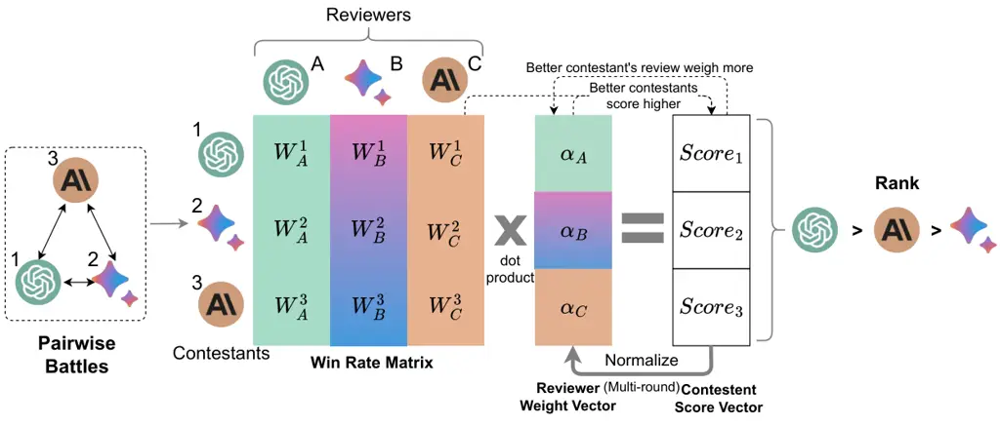
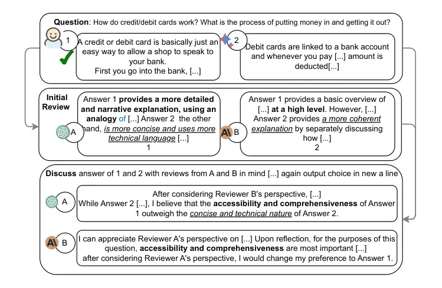
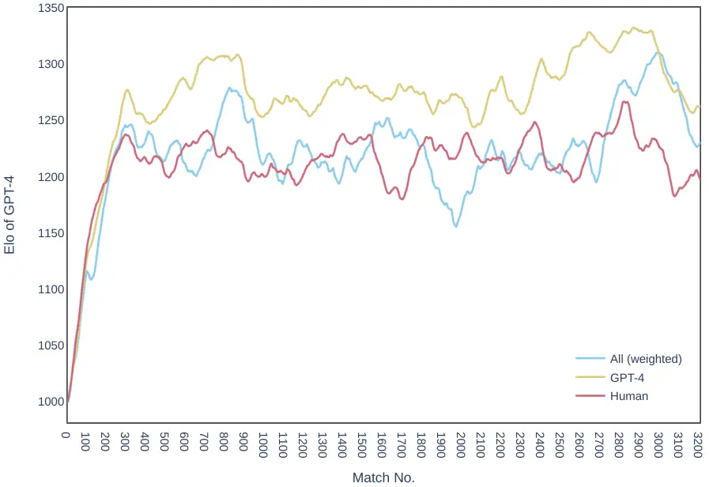
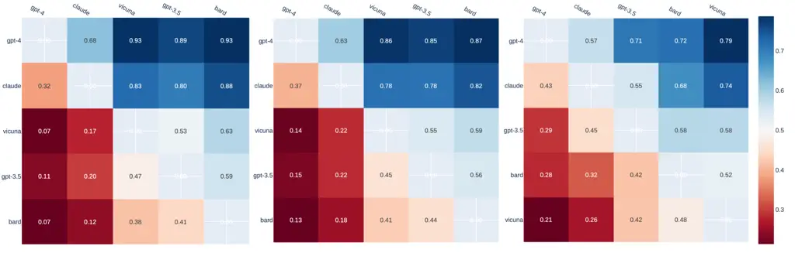
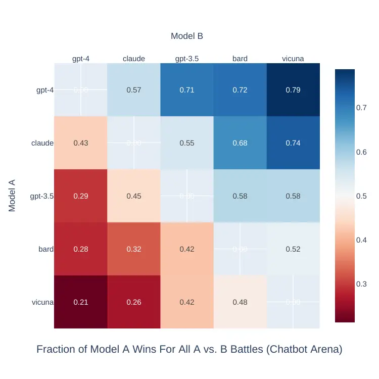
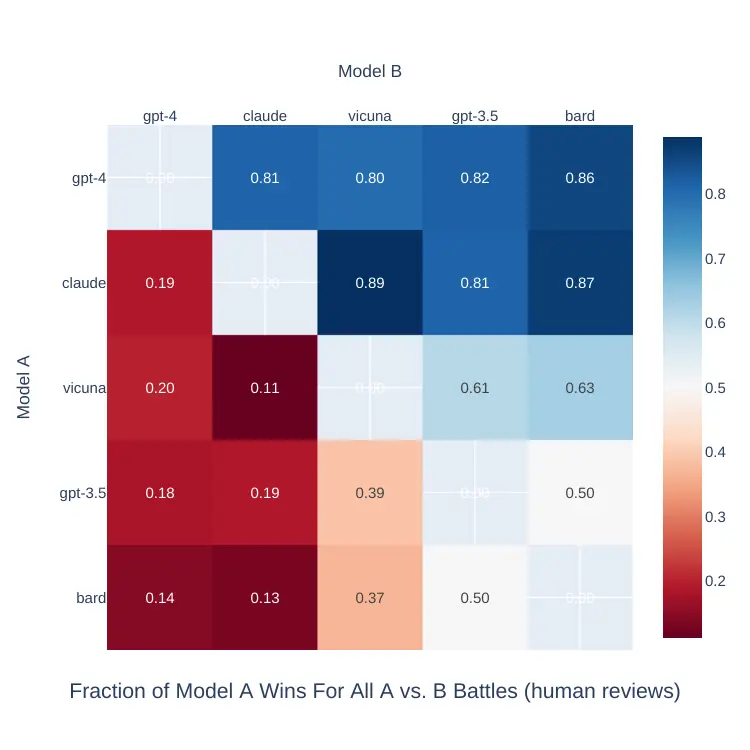
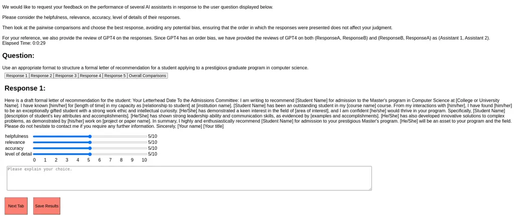
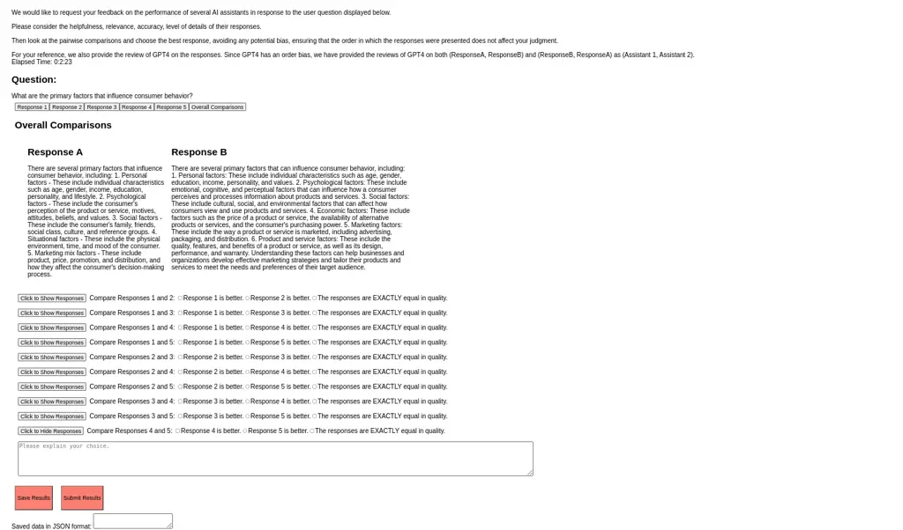

# PRD: Peer Rank and Discussion Improve Large Language Model based Evaluations

Ruosen Li    Teerth Patel    Xinya Du Affiliation: Department of
Computer Science, The University of Texas at Dallas
Affiliation: {ruosen.li, teerth.patel, xinya.du}@utdallas.edu

###### Abstract

Nowadays, the quality of responses generated by different modern large
language models (LLMs) is hard to evaluate and compare automatically.
Recent studies suggest and predominantly use LLMs for reference-free
evaluation of open-ended question answering. More specifically, they use
the recognized “strongest” LLM as the evaluator, which conducts pairwise
comparisons of candidate models’ answers and provides a ranking score.
However, this intuitive method has multiple problems, such as bringing
in self-enhancement (favoring its own answers) and positional bias. We
draw insights and lessons from the educational domain (Cho & MacArthur,
2011; Walsh, 2014) to improve LLM-based evaluations. Specifically, we
propose (1) the peer rank (PR) algorithm that takes into account each
peer LLM’s pairwise preferences of all answer pairs, and outputs a final
ranking of models; and (2) peer discussion (PD), where we prompt two
LLMs to discuss and try to reach a mutual agreement on the preferences
of two answers. We conduct experiments on two benchmark datasets. We
find that our approaches achieve higher accuracy and align better with
human judgments. Interestingly, PR can induce a relatively accurate
self-ranking of models under the anonymous setting, where each model’s
name is unrevealed. Our work provides space to explore evaluating models
that are hard to compare for humans.¹¹ 1 Codes are available at:
[https://github.com/bcdnlp/PRD](https://github.com/bcdnlp/PRD).

Reviewed on OpenReview:
[https://openreview.net/forum?id=YVD1QqWRaj](https://openreview.net/forum?id=YVD1QqWRaj)

## 1 Introduction

With a rising number of large language models (LLMs) being developed
ever more quickly recently, evaluations become increasingly important as
they encode values and priorities that the LLM community should improve
upon (Jones & Galliers, 1995; Liang et al., 2022). At the same time, the
evaluation becomes harder as well. For example, recent models finetuned
with reinforcement learning from human feedback (RLHF) demonstrate
greater alignment with human preferences, but this capability usually
cannot be reflected by decent performance on standard NLP benchmarks
(e.g., MMLU (Hendrycks et al., 2020) and ARC (Clark et al., 2018)).
Furthermore, human queries span a diverse range of settings and
scenarios, making it nearly impossible to list them all Fan et al.
(2019); Ouyang et al. (2022).

To tackle this discrepancy, open-ended questions are being used more
often to test LLMs’ performance (Chiang et al., 2023). Then, by default,
evaluation is done by collecting human preferences of pairwise
comparisons and then calculating scores for each LLM to induce a general
ranking. Yet the collection process is costly and time-consuming, to
automate and scale up the evaluation, most recent works utilize the
state-of-the-art LLM as the judge (Dubois et al., 2023; Lin & Chen,
2023). However, various studies show that this method is problematic, as
the pairwise comparison judgment provided usually contains various
biases, such as favoring LLMs’ own answers Liu et al. (2023); Zheng
et al. (2023).

Motivated by these limitations, we propose the idea of peer evaluation.
The goal is to mitigate the biases in automated evaluations while still
benefiting from LLM’s strong capability in reading and writing reviews.
We propose Peer Rank and Discussion-based evaluation framework (PRD).
The suit consists of two alternatives that share the same format and
goal – involving peer LLMs’ participation as reviewers to reach a more
fair evaluation result where all peers mutually agree. We draw insights
and lessons from educational psychology research field on methodologies
of student peer reviewing (Walsh, 2014), as well as their impact and
benefits (Cho & MacArthur, 2011; Yalch et al., 2019). More specifically,
Peer Rank (PR) is utilized for global rankings and induces reviewer
weights. It works for the tournament-style benchmarking setting where
each LLM in pairwise matches produces an answer for an open-ended
question. Instead of using the average vote to decide the final
preference scoring, we propose weighted votes based on LLMs reviewers’
capabilities. Peer Discussion (PD) facilitates fine-grained pairwise
comparison/ranking. It works for the general pairwise comparison
setting. Given two candidate answers, we prompt two other reviewer LLMs
to have multi-turn discussions to reach a mutual agreement on the
pairwise scoring or preference. The process shares a similar format of
LLM interacting with each other through conversations like two
communicative agents (Li et al., 2023; Park et al., 2023; Fu et al.,
2023b). PR and PD are closely interrelated and fall under the same theme
of providing a more fair (de-biased) ranking of long- and free-form
answers. enumerate We conduct extensive experiments and analysis for
measuring PR and PD’s capabilities of providing fair pairwise
comparisons. PR is tested on Vicuna80 Chiang et al. (2023), which
contains pairwise judgments from human annotators. Our method improves
correlations with human rankings substantially. This paradigm also
enables a group of LLMs to induce a self-ranking. PD is tested on both
Vicuna80 and LFQA (Xu et al., 2023), which includes annotated pairwise
comparisons of Human-Machine and Machine-Machine answers. PD enables
LLMs to achieve better pairwise comparisons that are more accurate than
single model-based reviews. Both PR and PD mitigate the above mention
biases especially self-enhancement bias significantly. Further, we
provide more analysis for PD, showing: (1) the LLM leading discussions
is less likely to alter its opinion; (2) stronger LLMs are more likely
to hold their opinions.

## 2 Related Work

##### Automatic Evaluations

Natural Language Generation (NLG) evaluation methods are mainly of a
similarity-based or reference-free type. For similarity-based metrics,
the generated texts are compared to reference texts Papineni et al.
(2002); Zhang et al. (2019). In parallel, people have also developed
task-specific metrics such as consistency (Kryściński et al., 2020; Wang
et al., 2020), faithfulness (Fabbri et al., 2022; Gao et al., 2023) and
coherence (Dziri et al., 2019). This is similar to our peer discussion
idea on designing more specific prompts for large language model-based
evaluations. Our prompting-based method is more flexible and can act as
a unified evaluator (Zhong et al., 2022).

Specifically, for long-form or open-ended question answering, early work
uses ROUGE (Lin (2004)) to measure the similarity between human and
machine-generated answers. However, researchers find that ROUGE is not a
fair metric for quality measurement due to the open-ended nature of
long-form answers (Krishna et al., 2021; Xu et al., 2023). Fu et al.
(2023a) propose GPTScore, which evaluates texts with generative
pre-training models like GPT-3. Xu et al. (2023) implements a similar
idea for evaluating long-form answers. Given a prompt consisting of a
question with two answer candidates, GPT-3 is fine-tuned to output the
label answer 1 or answer 2 (pairwise comparisons).

##### LLMs as evaluators: problems and challenges

Most recently, with the trend of developing more LLMs, evaluations for
benchmarking the progress have become even more important but also more
difficult. They are tested on both standard datasets such as MMLU, and
more importantly, on open-ended questions which are much more prevalent
in real life (Nakano et al., 2021; Chiang et al., 2023). People mostly
use GPT-4 (Liu et al., 2023; OpenAI, 2023) as an evaluator for either
generating scores or pairwise comparisons (Wang et al., 2023b; Zhou
et al., 2023). However, such a strategy has fundamental problems because
of various biases, such as (1) positional bias (Dettmers et al., 2023;
Wang et al., 2023a), where a model favors the first answer in pairwise
comparisons; (2) verbosity and length bias (Wang et al., 2023b); (3) and
most importantly, self-enhancement bias, where an LLM favors its own
answers (Liu et al., 2023; Zheng et al., 2023).

Efforts have been proposed to tackle them: (1) Using position
switching (Wang et al., 2023a) for mitigating positional bias; (2) Zheng
et al. (2023) proposes Chatbot Arena, where real users ask questions and
provide pairwise judgments of answers generated by two LLMs. But this is
time-consuming and requires expert annotation to ensure fairness; (3)
Bai et al. (2023) propose using each LLM as an examiner, where each
generates questions to test other models. Different from PD, their
“exams” are biased with randomly generated questions. Moreover, none of
the above works support inducing self-rankings through peer ranking.

Overall, our work, peer evaluation-oriented methods, undergo tests on
two benchmarks, each covering a variety of tasks, and focuses more on
the alignment between LLMs’ evaluations and human judgments.

##### LLM Interactions and Discussion

There have been works that explore Multi-agent discussion with LLMs,
including Liang et al. (2023); Du et al. (2023); Chan et al. (2023);
Chen et al. (2023). All of them are task-oriented frameworks aiming at
improving LLMs’ performance on general tasks. Du et al. (2023) focused
on math tasks and question answering tasks. Liang et al. (2023) tested
two tasks, including machine translation and question answering. Chen
et al. (2023) covered math and reasoning. Chan et al. (2023) implemented
a multi-agent debate framework with multiple prompts for evaluation.
Prior works utilize LLM interactions to accomplish tasks and improve
models’ accuracy. For our case, based on one response from humans and
another from LLM, our approach utilizes LLM interactions to discuss
which one is better and in order to achieve better evaluation that align
with human preferences.

##### Peer Evaluation in the Educational Domain

Prior works on educational research mainly focus on human-in-the-loop
studies, such as in the classroom (Cho & MacArthur, 2011; Nicol et al.,
2014). They conduct human-oriented data collection and experiments to
verify the benefits of peer evaluations (Walsh, 2014). In contrast, we
focus on automatic evaluation, employing peer LLM reviewers to conduct
pairwise comparisons of LLMs’ answers. Moreover, our peer rank process
focuses on pairwise comparisons, instead of absolute grades.

## 3 Methodologies



Figure 1: The peer rank process (PR): each LLM model acts both as
reviewers (A, B, C) and contestants (1, 2, 3). From the battles between
contestants (pairwise comparisons), it induces a self-ranking. In this
example, models A, B, and C represent GPT-4, Bard, and Claude,
respectively.

In general, Peer Rank (PR) can be applied to induce self-ranking – a
ranking of a group of LLMs’ own capabilities. Peer Discussion (PD)
provides a more fine-grained and interactive comparison of two models’
answers. Both of them aim at reducing the bias in automatic evaluations.
We elaborate on the technical details in this section.

### 3.1 Peer Rank and Scoring (PR)

Figure 1 illustrates the peer rank algorithm. The general idea is to
obtain weighted scores of each battle from the peer reviewer’s judgment,
and then induce self-rankings from the scores. This process is iterated
multiple times until the scores converge.

Given a set of questions $`Q`$, we generate an answer to each question
from each LLM. Let $`A_{m}(q)`$ be the answer to question $`q\in Q`$ by
the model $`m`$. Each _battle_ represents two models (the contestants)
answering the same question $`q`$. The comparison of the answers in a
battle by the LLM reviewer model $`r`$ forms a _review_. Let
$`K_{r}(x,y)`$ be the score given by the reviewer $`r`$ to the pair of
answers $`(x,y)`$. We use a score of $`-1`$ to indicate the first answer
is better, $`0`$ to indicate a tie, and $`1`$ to indicate the second
answer is better. Suppose we have a set of reviewer models $`R`$ and a
set of contestant models $`C`$. We form a set of battle reviews,
$`B=\{\left(q,i,j,r,s\right)|\>q\in Q,\>(i,j)\in C^{2},\>r\in R\}`$,
where $`s=K_{r}(A_{i}(q),A_{j}(q))`$ is the score given by reviewer
$`r`$ to the answers/responses generated by $`i`$ and $`j`$ for question
$`q`$. We create a shorthand $`K_{r}^{ij}(q)`$ for this review.

Based on these peer reviews, we can evaluate models based on their
performance by calculating metrics such as the win rate of each
contestant and the Elo ratings (Section 3.1.2) of each contestant. Since
each model is ranked by its peers, we call it Peer Rank.

Specifically, the set of questions should be diverse and cover various
tasks, such as question answering (12.5%), email writing (12.5%), coding
(6%), math solving (4%), etc. Answers/responses should also vary in
format, including concise answers, step-by-step reasonings, detailed
explanations, code snippets, long-form answers, etc. Reviewers assess
response pairs and indicate preferences in the process (“battle
review”). Then, both winrate and Elo metrics can be calculated.

#### 3.1.1 Win rate Calculation

The win rate for a contestant is the number of wins for that contestant
divided by the number of battles it participates in. Ties are counted as
0.5 wins for both contestants.

Our win rate calculation assigns differing weight to the scores provided
by different reviewers (A, B, C) based on the performance of the
corresponding reviewers as a contestant (1, 2, 3). This operates on the
assumption that models which are better contestants are also more fit to
evaluate and compare answers, so they should be given more weight in
evaluation (Equation 2). In another way, since the score is a measure of
their ability to review/grade correctly, we weigh the win rate an LLM
gives another LLM by their own score Walsh (2014). Moreover, the
self-rewarding paper by Yuan et al. (2024) also made this assumption.
They use a model itself for evaluations during the iterations and prove
that it makes sense. In their results, the better-performing models also
perform well in providing high-quality evaluations/rewards to
themselves.

Initially, all reviewers are given the same weight. On each iteration of
the calculation, the win rate for each contestant is calculated using
the current weights. The win rates are scaled to the range of $`[0,1]`$
using a linear scaling. Then, they are scaled again so that their sum
is 1. Next, these results are used as the weights for the next round.

Formally, let $`W_{r}^{c}`$ be the raw win rate of contestant $`c\in C`$
from the reviews of reviewer $`r\in R`$. This is equal to the number of
times $`c`$ wins a battle plus half of the number of times $`c`$ ties,
divided by the number of battles $`c`$ participates in.

```math
\small\begin{split}\displaystyle{W_{r}^{c}}=\frac{\displaystyle\sum_{q}{\sum_{d\in C,d\neq c}{\left[f(K_{r}^{dc}(q))+f(-K_{r}^{cd}(q))\right]}}}{2|Q|(|C|-1)}\end{split} \tag{1}
```

where $`f(score)=\frac{score+1}{2}`$ maps a score of
($`\mathrm{loss}=-1`$, $`\mathrm{tie}=0`$, $`\mathrm{win}=1`$) for the
second contestant to a win count of (0, 0.5, 1), so that ties count as
half of a win.

Note that we negate $`K_{r}^{cd}(q)`$ when inputting it into $`f`$ so
that the win value of $`c`$ is computed instead of $`d`$. Also, since
there are $`|Q|`$ questions, $`|C-1|`$ contestants to battle, and 2
orders for two contestants to battle, there are $`2|Q||C-1|`$ battles
involving a fixed contestant $`c`$.

Let $`\alpha_{r}^{k}`$ be the weight assigned to reviewer $`r`$ after
iteration $`k`$. Initially, $`\alpha_{r}^{0}=1/|R|`$, so that all
reviewers have the same weight, and the weights add to 1. Namely, we
assume each reviewer LLM has the same capabilities to start. The score
of contestant $`c\in C`$ for iteration $`k`$ is the weighted average of
the raw win rates for contestant $`c`$. We set the weights for the next
iteration to $`\alpha^{k}`$:

```math
\centering\small\begin{split}\mathrm{score}_{c}^{k}&=\sum_{r\in R}\alpha_{r}^{k-1}\cdot W_{r}^{c},\alpha^{k}=\text{Norm}(\mathrm{MinMax}(\mathrm{score}^{k}))\end{split}\@add@centering \tag{2}
```

where the weights are scaled to a range of $`[0,1]`$ and finally
normalized to have sum equal to 1:

```math
\centering\small\begin{split}\mathrm{MinMax}(S)=\frac{S-\min_{r\in R}(S_{r})}{\max_{r\in R}(S_{r})-\min_{r\in R}(S_{r})}\end{split}\@add@centering
```

Given this set of equations, we look for the fixed/converging point of
the framework. This process is reminiscent of the problem faced by the
PageRank algorithm (Page et al., 1999). The detailed equivalent
implementation of PR is shown in the Algorithm 2 in Appendix E.

The whole process is simple but effective. It automatically adjusts
weights for all models and mitigates the self-enhancement bias. During
the process, every reviewer model’s score is considered instead of only
one model itself (Equation 2). While a reviewer may favor its outputs,
other reviewers’ scores provide a fair balance. Additionally, weaker
models’ reviewing weights decrease automatically (to near zero) because
of the normalization operation. Empirical tests showed that fixing the
self-weight at zero resulted in poorer performance.

#### 3.1.2 Elo Calculation

Another method for calculating the performance of a contestant relative
to other contestants is the Elo rating (Elo, 1967; Askell et al., 2021),
which is utilized for ranking players and widely used in games
(battles) (Dettmers et al., 2023). It measures the relative skill levels
of players by predicting the expected win rate against opponents. It
takes a sequence of pairwise reviews and generates ratings for each
contestant, with a greater rating indicating better performance. This is
a more fine-grained measurement compared to win rate. Based on a similar
idea, we assign different weights to reviewers based on their previous
performance such that a review from a higher-weight reviewer has a
greater influence upon Elo ratings.

Similarly to the win rates calculation, we start with equal weights on
all reviewers and then normalize the resulting Elo ratings to give
weights for the next iteration. We repeat the Elo calculation with the
new weights, update the weights based on the new ratings, and continue
repeating until it converges. Walsh (2014) has proved the guarantee of
convergence. Compared to Walsh (2014), which involves student grading in
the educational domain, our work focuses on peer LLM reviewers
conducting pairwise comparisons of LLMs’ answers, utilizing winrate and
Elo scores. We introduce an automatic LLM peer evaluation metric for the
machine learning field and extend Walsh’s convergence proof, showing our
method’s reliability through experimental results. ²² 2 We provide the
proof of convergence of our peer rank algorithm in Appendix A. More
difference details are in appendix C.

A brief overview of the actual Elo ratings calculation follows. All
contestants start out with an initial rating of 1000. On each battle,
the expected likelihood of each contestant winning is calculated based
on the difference between their Elo ratings. The Elo rating of the
winner is increased, and the rating of the loser is decreased. The
magnitude of the Elo ratings change is inversely related to the
outcome’s likelihood. In our calculations, we weigh reviewers so that
reviews by a high-weight reviewer cause larger changes in Elo. For more
details, please refer to Algorithm 1 in Appendix E.



Figure 2: The peer discussion process (PD). Bold and italic texts
describe the advantages of answer 1 and answer 2. In this example,
finally, the two LLM reviewers reach the mutual agreement of selecting
answer 1 (human-written answer), which correlates with human annotator
preference.

### 3.2 Peer Discussions (PD)


Table 1: It shows the review template for reviewers with three slots
({Q}, {A1}, and {A2}). We instruct reviewer models to focus on core
aspects , whose definitions are in appendix F. As mentioned in Wang
et al. (2023a), position bias still exists after emphasizing it in the
prompt.

In peer discussion, we prompt two LLMs to discuss how to judge two
candidate answers, trying to reach a final agreed review. All prompts
include detailed instructions and specify the output format for the
LLMs. In Figure 2, we demonstrate the peer discussion process between
two LLMs reviewers (A and B). The input is a given question and two
answers, which may be both generated by machines or one by humans and
another by machines (e.g. GPT-3 v.s. human answers). They first conduct
pairwise comparisons on answers separately, providing explanations and
indicating their preferred answer by outputting the number 1 or 2 by the
end (the prompt for getting initial reviews is listed in Table 1). Then,
the two models discuss multiple turns until they reach a fixed number of
turns.

The specific prompt for discussion is listed in Table 2. At the very
beginning, a system prompt (role prompt) tells models their role –
whether it is reviewer A or reviewer B (e.g., Claude or GPT-4). Then,
all information, including the question, two comparison answers, and the
initial reviews, are listed line by line. The order of initial reviews
is the same as that of reviewers in discussions. In other words, if
reviewer A leads the discussion, reviewer A’s initial review is listed
first. Right before the start of the discussion, the system prompt
specifies the detailed requirements, which provide explicit aspects to
focus on.


Table 2: The discussion template for reviewer A at the third turn.
Similar to the review template, we explicitly indicate aspects that
reviewers need to pay attention to. All texts above are chat history
which are input to reviewer A LLM model.

Specifically, we draw insights from WebGPT (Nakano et al. (2021))’s
annotation guideline OpenAI (2022). For long-form question answering, we
focus on (1) _Unsupported information_: detecting information with no
support, assume the worst case: that all of it is false. This aspect is
most important and often determines the overall rating; (2) _Core
information_: about whether the question has actually been answered; (3)
_Coherence_: generally, it is less important than the two above. Then,
the overall preference is finally determined. Moreover, we do not adjust
the above prompts based on any datasets we test in experiments.

## 4 Experiments and Analysis

### 4.1 Datasets, Metrics, and Setup

#### 4.1.1 Datasets

We select two “meta-evaluation” datasets, LFQA (Xu et al., 2023) and
Vicuna80, with human annotations for pairwise comparisons, to measure
the correlation between our evaluation methods and human judgments.

LFQA (Xu et al., 2023) contains 140 long-form questions across seven
domains (e.g., economics, history, and biology) and two candidate
answers (from either GPT3 or Human) for each. Similar to ELI5 (Fan
et al., 2019), it contains more recent (i.e., after July 2021) questions
from Reddit forums “r/explainlikeimfive” and “r/AskHistorians”. The
authors collected expert-level annotations of which answer is better
(overall preference).

Vicuna80 (Chiang et al., 2023) is a set of 80 open-ended questions,
which spans 9 categories and covers a wide range of tasks, including
question answering, email writing, math problems, etc. In the QLoRA
work (Dettmers et al., 2023), authors annotated pairwise comparison
scores (overall preference) across 7 models for each question. The
scores include 0, 1, 2, which correspond to tie, model 1 wins, and model
2 wins respectively. We select pairwise comparison annotations of 4
models’ answers (i.e., GPT4, ChatGPT-3.5., PaLM-2, Vicuna-13b). To make
our study more comprehensive, we add recent proprietary language models
such as Claude. Specifically, we also annotate pairwise comparisons
between Claude’s answers and the other 4 models’. We term this a more
complete version of the dataset Vicuna80. More details about the
annotation process are provided in Appendix I. Since answers to
open-ended questions are even harder to compare, the annotators achieve
a fair agreement.

SummEval (Fabbri et al., 2020) is a benchmark evaluating summarizations.
It contains 1600 summaries over 100 news articles from CNN/Daily Mail
dataset (Hermann et al., 2015). Each summary is evaluated in four
aspects: coherence, consistency, fluency, and relevance. In our
experiments, we take the average of the four metrics as the evaluation
results.

In LFQA, questions receive 1-3 expert-level annotations per category,
with human agreement ranging from 0.4 to 0.65. Each Vicuna80 question
receives 3 human annotations, with human agreement between 0.5 and 0.62.
Each SummEval summary is annotated by 8 humans, with an agreement number
of 0.7. We use the human majority vote as the human preference during
battles.

#### 4.1.2 Metrics

For experiments on PR, we follow metrics in Wang et al. (2023a). We
first conduct example-level pairwise comparisons. Specifically, each
evaluation example (pairwise comparison) consists of a question and a
pair of answers. We compare the model predicted preference score against
gold human preference and report Accuracy and Fleiss’ $`\kappa`$ , a
statistic that measures the reliability of agreement among multiple
raters. Specifically, Fleiss’ $`\kappa`$ is employed to gauge alignment
between the model’s predictions and human preferences, where a higher
score signifies a stronger alignment. Following Dettmers et al. (2023),
we also compare model-predicted global ranking scores against
human-judged ranking scores. Specifically, we report Elo scores (Elo, 1967) and win rate (WR) based rankings (Table 4). We use All to denote
our method where each reviewer has equal weights, and use All (Weighted)
to denote the setting where the final round weights are applied to each
reviewer. Besides experiments on PR and PD respectively, we also compare
PR and PD in an experiment of judging answer qualities of GPT-3.5 v.s.
Vicuna-13b (Section 4.2 and 4.3).

|         | GPT-4     |      | All  |      | All (Weighted) |      | Human Raters |      |
| ------- | --------- | ---- | ---- | ---- | -------------- | ---- | ------------ | ---- |
| models  | Elo       | Rank | Elo  | Rank | Elo            | Rank | Elo          | Rank |
| GPT-4   | 1282      | 1    | 1165 | 1    | 1213 (-23)     | 1    | 1236         | 1    |
| Claude  | 1150      | 2    | 1104 | 2    | 1125 (-2)      | 2    | 1127         | 2    |
| Vicuna  | 883       | 4    | 930  | 3    | 912 (-8)       | 3    | 920          | 3    |
| GPT-3.5 | 890 (+22) | 3    | 919  | 4    | 894            | 4    | 868          | 4    |
| PaLM-2  | 804       | 5    | 881  | 5    | 856 (+8)       | 5    | 847          | 5    |

|         | GPT-4          |      | All            |      | All (Weighted) |      | Human Raters |      |
| ------- | -------------- | ---- | -------------- | ---- | -------------- | ---- | ------------ | ---- |
| models  | Win Rate       | Rank | Win Rate       | Rank | Win Rate       | Rank | Win Rate     | Rank |
| GPT-4   | 0.856          | 1    | 0.749          | 1    | 0.802 (-0.020) | 1    | 0.822        | 1    |
| Claude  | 0.709          | 2    | 0.662          | 2    | 0.685 (-0.004) | 2    | 0.689        | 2    |
| Vicuna  | 0.340          | 4    | 0.393 (+0.004) | 3    | 0.376          | 3    | 0.389        | 3    |
| GPT-3.5 | 0.342 (+0.028) | 3    | 0.375          | 4    | 0.346          | 4    | 0.314        | 4    |
| PaLM-2  | 0.245          | 5    | 0.320          | 5    | 0.290 (+0.004) | 5    | 0.286        | 5    |

|         | All  |      | All (Weighted) |      | Human Raters |      |
| ------- | ---- | ---- | -------------- | ---- | ------------ | ---- |
| models  | Elo  | Rank | Elo            | Rank | Elo          | Rank |
| Vicuna  | 999  | 2    | 1011 (-47)     | 1    | 1058         | 1    |
| Zephyr  | 1010 | 1    | 1007 (+7)      | 2    | 1000         | 2    |
| GPT-3.5 | 991  | 3    | 993 (+52)      | 3    | 941          | 3    |

Table 3: The above tables show results performed on the Vicuna80
dataset. The rows represent the contestants in battles, and the columns
represent evaluation methods. The upper table shows the correlation of
Elo scores between LLM reviewers and human rater. Bottom table shows the
correlation between global win rates. Additional results on emerging
(more) LLMs in Table 4 further verify the consistent robustness of PR.
Boldfaced numbers are the closest to scores from human raters. Blue
numbers show the difference between the scores from LLM reviewers and
Human raters. For more detailed pairwise win rates, please refer to the
heat maps in Section 4.2.

Table 4: Additional Elo Scores for Vicuna, Zephyr and GPT-3.5

For experiments on PD, we use peer discussion accuracy (PDA) to describe
the correlation of model discussion results compared to human
annotators. PDA is calculated by the number of correct answers from peer
discussion results over the number of all answers. A high PDA result
indicates a better correlation with human judgments.

#### 4.1.3 Setup

For Vicuna-13b, we use the default version from Chiang et al. (2023).
For all other API-based LLM models, we use specific versions of each,
i.e., GPT-4-0613, GPT-3.5-turbo-0613, Claude-1, and Text-Bison@001 for
GPT-4, GPT-3.5, Claude, and PaLM-2 respectively. For more details,
please refer to appendix B. For discussions in the PD method, we set the
maximum number of turns as 4. Based on our experiments, most discussions
reach mutual agreements at turn 4. Moreover, the default temperature for
all models is 0.2.

### 4.2 Results for Peer Rank (PR)

On the Vicuna80 dataset, we compare our PR method and representative
LLM-based evaluation methods, such as GPT-4 and Claude.

| Reviewer                 | Fleiss’ $`\kappa`$ | Accuracy   |
| ------------------------ | ------------------ | ---------- |
| GPT-3.5                  | 0.387              | 0.621      |
| Claude                   | 0.319              | 0.607      |
| GPT-4                    | 0.406              | 0.643      |
| GPT-4 & Claude & GPT-3.5 | 0.403              | 0.666^(∗)  |
| All Reviewers (Weighted) | 0.410              | 0.673^(∗∗) |

Table 5: Example-level correlation results, for the fourth and fifth
rows, we take the peer reviewers’ majority vote weighted by winrate.
Two-tailed t-test results statistical significance is indicated with
$`{}^{*}(p<0.01)`$, $`{}^{**}(p<0.002)`$.

In Table 5, all reviewer combinations listed except Claude, when
compared to human reviews at an example level, display a Fleiss’
$`\kappa`$ of around 0.40, indicating fair to moderate agreement. There
is a significant difference in accuracy between LLM reviewers. The worst
reviewer is Claude, with an accuracy of only 60.7%. The best individual
reviewer is GPT-4, with an accuracy of 64.3%. The combination of
reviewers (PR) increases this accuracy by a few percentage points, with
our PR approach being highest at 67.3%.

Inspecting Table 4, GPT-4 reviewer ranks GPT-3.5 higher, while our All
(Weighted) achieves the same ranking as humans: i.e. GPT-4 \> Claude \>
Vicuna \> GPT-3.5 \> PaLM-2. This shows that a weighted peer ranking
provides a more accurate evaluation of the global performance of models.
Moreover, the ranking corresponds to that in the Chatbot Arena
Leaderboard²²footnotemark: 2 . Thus, the assumption in section 3.1.1 can
be verified. In terms of the Elo ratings provided by the human reviews,
we clearly observe that GPT-4 clearly favors its own answers and is
prone to self-enhancement bias. Our approach (All (Weighted)) produces
the closest Elo ratings. Furthermore, it also produces the closest win
rates (less than a 1% difference for many contestants). In the
beginning, when the weight is the same for every reviewer (weights equal
to one), the win rate given by “All reviewers” is low at about 0.749
partially because each reviewer is treated equally so that each reviewer
might have a preference for its own answer. After several
rounds/iterations, the final win rate becomes more fair. We display the
final round weights in Figure 4.

Figure 3: Peer rank final round weights of each LLM reviewer. GPT-4 and
Claude take 48.8% and 37.7% weights. Bard got close to zero weights.



Figure 4: GPT-4 Elo scores every 100 battles on the Vicuna80. Elo scores
provided by the GPT-4 reviewer are consistently higher than human
ratings, while our All (weighted) ratings correlate with humans well.



Figure 5: Pairwise win rate heatmaps: Fraction of Model A Wins for all A
vs. B Battles (A: rows, B: columns). Left: GPT-4 evaluator; Middle: our
method All (weighted); Right: Chatbot Arena pairwise win rate. All
results in the three sub-figures are generated separately using the same
data.

In Figure 4, we draw the line chart of how the GPT-4 Elo score changes
as more battles are fed to the Elo algorithm. GPT-4’s score takes off as
battle number increases. We can observe that GPT-4 displays
self-enhancement across the entire process, while our PR-based
evaluation correlates with human pairwise comparisons well.

In Figure 5, we present the detailed pairwise win rates between every
two contestants (LLMs). We compare our evaluation with GPT-4 based
evaluation, as well as the Chatbot Arena leaderboard. The Arena
ranking³³ 3
[https://lmsys.org/blog/2023-05-25-leaderboard/](https://lmsys.org/blog/2023-05-25-leaderboard/)
is based on user queries and their corresponding preferences for two
responses. The figure demonstrates that although both approaches favor
GPT-4 and Claude answers, the win rates calculated by our approach All
(weighted) correlate better with Arena win rate, especially on weaker
models. More pairwise win rate heatmaps are in Appendix H.

|                                | GPT-4 lead     | Claude lead    | Random         |
| ------------------------------ | -------------- | -------------- | -------------- |
| GPT-4 init score               | \-             | \-             | 0.729 (±0.014) |
| Claude init score              | \-             | \-             | 0.671 (±0.025) |
| Generic prompt                 | 0.714 (±0.018) | 0.671 (±0.022) | 0.686 (±0.022) |
|    w/ explicit criteria        | 0.729 (±0.014) | 0.721 (±0.018) | 0.720 (±0.014) |
|    w/ role                     | 0.743 (±0.011) | 0.729 (±0.018) | 0.729 (±0.011) |
|    w/ role & explicit criteria | 0.750 (±0.014) | 0.721 (±0.011) | 0.743 (±0.011) |

Table 6: Different prompting’s effect on Peer Discussion Accuracy (on
the LFQA dataset). The first two rows are the results before discussions
(from GPT-4 and Claude respectively). The last three rows are results
after discussions.

### 4.3 Results for Peer Discussions (PD)

##### Prompt for Discussion

By preliminary study, we find that the template asking for explicit
aspects, such as core information, unsupported information, and
coherence, can substantially help LLM reviewers generate valuable and
informative reviews which correlate better with human annotators.

We first conduct preliminary experiments to find a relatively good
prompt for facilitating LLM peer discussions. The first two rows in
Table 6 lists the Peer Discussion Accuracy (PDA) of GPT-4 and Claude’s
initial pairwise comparison preference before discussions. They have a
moderate agreement with human preference, with GPT-4 leading around 5%.
For the discussion-based evaluators, we report three types. By “GPT-4
lead”, we refer to the discussions where GPT-4 first expresses opinions;
by “random”, we refer to discussions where the leader is randomly
picked.

In discussions (the last three rows), when we use a generic prompt (such
as ‘‘pick your preferred answer’’), the discussion’s final preference
PDA is around 0.69, higher than Claude’s initial judgment’s PDA but
lower than GPT-4’s. When we add more explicit aspects into the prompt ⁴⁴
4 We select aspects from WebGPT annotation guidelines mentioned in the
previous section., the PDA boosts significantly (4% improvement). When
we add the role/identity information (Appendix G) to each turn’s prompt
(“w/ role”) to remind the reviewer, the PDA scores increase for both
models, indicating the role information is helpful for LLMs in
discussions.

##### General Accuracy

|                     | Accuracy   |
| ------------------- | ---------- |
| GPT-4               | 0.3500     |
| (PD) GPT-4 & Claude | 0.3675^(∗) |
| (PR) All            | 0.4375     |
| (PR) All (weighted) | 0.4625     |

Table 7: Comparing peer discussions (PD) and peer ranking (PR) on
Vicuna80 (random order is applied to the GPT4 & Claude discussion).

In Table 8, we report the peer discussion accuracy (PDA) of multiple
combinations of reviewers’ discussion results on LFQA based on the best
two discussion prompts in Table 6. We observe: (1) when two reviewer
LLMs are of similar capabilities (e.g., GPT-4 and Claude differ by less
than 100 in Table 4), they reach stable improvements upon their initial
reviews. In the above example, GPT-4 gets 3% improvement (from 0.729
(±0.014) to 0.743 (±0.011)), and Claude get 8% improvement (from 0.671
(±0.025) to 0.729 (±0.018)) ; (2) when there is a substantial gap
between reviewer capabilities (e.g., GPT-4 and GPT-35 differ larger than
100 in Table 4), the PDA of the weaker model always reaches the most
improvement and the highest final result. In the above example, GPT-35
receives a 30% improvement (from 0.579 (±0.026) to 0.700 (±0.018)). ;
(3) when models “self-discuss”, for example, we create two variants of
the same model by setting different temperatures and prompt them to
discuss, weaker models (e.g., GPT-3.5) can substantially “self-improve”
(from 0.579 (±0.026) to 0.664 (±0.018)). GPT-4’s self-discussion brings
little improvement (from 0.729 (±0.014) to 0.779 (±0.014)). Future
investigations on how to design better self-discussion strategies would
be worth working on.

Table 9 shows the same trend as Table 8. A higher correlation score
indicates discussion results are more aligned with human annotations.
Models with similar capabilities (GPT-4 & Claude) get large improvements
after discussion. Models having a substantial gap (GPT-4 & GPT-35) reach
results close to the stronger model. When a model self-discuss (GPT-35),
it can improve its own performance.

Table 7 reports accuracy on comparisons of GPT-3.5 v.s. Vicuna-13b
answers to Vicuna80 questions, we see the GPT-4 & Claude discussion
increases the accuracy by over 1.5%. Also, we compare with PR method and
find that the review becomes substantially better after weighted
scoring.

[TABLE]

Table 8: Peer discussion accuracies (PDA) on LFQA. “-0.8” indicates the
temperature is 0.8. Statistical significance is indicated with
$`{}^{*}(p<0.05)`$. “Best prompt” indicates the discussion uses the best
prompt in table 6. (±Numbers) represent standard deviations.

| R1 vs R2            | R1       |          | R2       |          | R1 lead  |          | R2 lead  |          | Random   |          |
| ------------------- | -------- | -------- | -------- | -------- | -------- | -------- | -------- | -------- | -------- | -------- |
|                     | $`\rho`$ | $`\tau`$ | $`\rho`$ | $`\tau`$ | $`\rho`$ | $`\tau`$ | $`\rho`$ | $`\tau`$ | $`\rho`$ | $`\tau`$ |
| GPT-4 & GPT-35      | 0.293    | 0.233    | 0.262    | 0.251    | 0.297    | 0.266    | 0.284    | 0.219    | 0.292    | 0.233    |
| GPT-35 & GPT-35-0.8 | 0.262    | 0.251    | 0.211    | 0.178    | 0.264    | 0.207    | 0.340    | 0.328    | 0.334    | 0.264    |
| GPT-4 & Claude      | 0.293    | 0.233    | 0.234    | 0.200    | 0.344    | 0.268    | 0.335    | 0.282    | 0.341    | 0.268    |

Table 9: Summary-level Spearman ($`\rho`$) and Kendall-Tau ($`\tau`$)
correlations between model evaluation results and the Summeval
Benchmark. Columns R1 and R2 contain the results before discussions. The
rest of the columns represent discussion results. Variances of all
scores are lower than 0.06. P-values for all discussion results
(boldfaced) are less than 0.05.

| Reviewers | GPT-3              |                  |
| --------- | ------------------ | ---------------- |
|           | Initial Preference | After Discussion |
| Human     | 58.67%             |                  |
| GPT-3.5   | 72.46%             | 62.22%           |
| Claude    | 63.81%             | 60.28%           |
| GPT-4     | 55.50%             | 58.75%           |

Table 10: GPT-3 answer win rates judged by different reviewers on LFQA.
For all LLM reviewers, we take the average accuracy of all discussions
they participate in. Self-enhancement exists and is mitigated by PD.

##### Peer discussions help mitigate self-enhancement bias

According to what we previously discovered, LLMs endure self-enhancement
bias when acting as judges – preferring the answers they generate or
that of the models under the same series (e.g., GPT-4 and GPT-3).

We conduct experiments on the subset of LFQA questions where we have
human-annotated pairwise comparisons between Human and Machine-generated
(GPT-3 text-davinci-002) answers. Table 10 shows the win rates of GPT-3
judged by humans and three LLMs. We report the LLMs’ initial and
after-discussion preferences. Both GPT-3.5 and Claude highly prefer
GPT-3’s answers in their initial reviews. Specifically, GPT-3.5
significantly favors GPT-3 answers with a 13.79% higher win rate. After
discussing with other LLMs, all models align better with humans. Our
peer discussion method largely helps GPT-3.5 mitigate self-enhancement
bias. Before discussions, GPT-4’s initial preference aligns well with
humans and is almost the same as humans after peer discussions. Although
GPT-4 still has the self-enhancement bias, it does not favor GPT-3’s
answers.

Peer discussions help mitigate position bias As indicated by recent work
of Wang et al. (2023a), LLMs are prone to position bias, describing that
LLMs tend to show a preference for specific positions, even when
prompted not to do so (Table 1 in Appendix). In Table 11, the win rate
of GPT-3 is highly affected by its position when models generate initial
reviews. GPT-3.5 highly prefers the answer in the first position
compared to Claude and GPT-4. The GPT-3 win rate calculated by GPT-3.5
is 15.79% higher than the win rate based on human-annotated pairwise
comparisons when GPT-3 appears first (73.68 vs 57.89). After peer
discussion, all LLM reviewers have closer preferences to humans. Second,
all LLMs’ scores for GPT-3 answers of both positions are closer as well,
indicating that the position bias is mitigated after peer discussions.

| Reviewers | Initial Preference |             | After Discussion |             |
| --------- | ------------------ | ----------- | ---------------- | ----------- |
|           | GPT-3 Answer First | Human First | GPT-3 First      | Human First |
| Human     | 57.89%             | 59.46%      | 57.89%           | 59.46%      |
| GPT-3.5   | 73.68%             | 59.46%      | 67.11%           | 58.56%      |
| Claude    | 63.16%             | 64.41%      | 55.70%           | 55.41%      |
| GPT-4     | 54.51%             | 56.37%      | 58.27%           | 58.30%      |

Table 11: GPT-3 answer win rate (in the GPT-3 vs Human battles).
Position bias is mitigated.

From another perspective, Figure 7 shows the global preference of
selecting answers at the first or second positions across different LLM
reviewers. Overall, GPT-3.5 prefers answers at the first position. The
other two models favor answers in the second position, similar to the
position bias shown in Table 11. After peer discussion, it shows the
same trend of mitigating position bias as well.

## 5 Further Analysis

Figure 6: The position bias of all three LLMs’ initial and after peer
discussion reviews. Human has an equivalent preference for either
position (red dotted line).

Figure 7: The discussion ordering effect of all three models at the
leading and following positions.

##### The reviewer who leads the discussion tends to hold its opinion.

In a discussion between two LLM reviewers, we define the reviewer who
leads the discussion as the _leader_ and the other reviewer as the
_follower_. We find that leaders are less likely to be convinced by
followers when they insist on their own opinions at the first turn. We
name it “Discussion Ordering Effect”. We observe this effect in
discussions over the LFQA questions.

We define two phenomenons which may happen during the discussions: (1)
_Opinion altering (OA)_: a reviewer changing its opinion after the
discussion. For example, R2 posts its preference at turn 2, which is
different from R1’s preference at turn 1, then R1 changes its preference
at turn 3 that agrees with R2; (2) _Opinion holding (OH)_: a reviewer
does not change its opinion even another reviewer disagrees. For
example, R1 posts its preference at turn 1 while R2 disagrees with R1 at
turn 2; then, R1 still holds its preference at turn 3.

As shown in Figure 7, all models have OA when they are in the follower
position, while their number of OA decreases significantly after they
switch to the leader position. This implies that the discussion ordering
effect exists. On the pairwise comparisons of LFQA where two reviewers
initially disagree: when in the leader position, GPT-4 has no OA, and
Claude has two OAs (happens during the discussions with GPT-3.5). When
GPT-4 discusses with Claude, both of them hold their initial preferences
when they are in the leader position.

##### Stronger LLMs tend to hold their opinions

As from Figure 7, we add up the green mass (OH total) for each LLM
reviewer to obtain their OH cases in both orderings. We see that models
that are commonly recognized as being stronger (e.g. GPT-4) are more
firm in their reviews and hold their opinions. For example, GPT-3.5
changes its opinion most often, and GPT-4 usually holds its opinion.
More specifically, GPT-4 holds its opinion in 174 discussions, while
Claude and GPT-3.5 hold only in 94 and 76 discussions, respectively.

## 6 Conclusion

In this work, we provide promising prospects for using a peer evaluation
method to improve LLM-based evaluations. Our framework mitigates
potential bias (e.g. self-enhancement, positional) in previous prevalent
methods. Our proposed peer rank process provides a more fair ranking of
model capabilities. The peer discussion process helps models reach
mutual agreements that correlate with human preference. In the future,
we plan to investigate how the general peer evaluation process benefits
the LLMs in learning to access their own answer and answering new
questions Nicol et al. (2014).

## Limitations

\(1\) Currently, the complexity of reviews for N models is $`O(N^{3})`$.
As the number of tested models grows, the number of pairwise model
comparisons increases at the square level, and the number of reviews
will grow cubically. The PR method’s scalability is a potential issue.
To mitigate the issue, we can randomly select K models or utilize the
current top K models as reviewers. This significantly simplifies the
complexity of our method. (2) Although we can mitigate model bias by
applying peer discussion, it brings position bias which potentially
harms the evaluation performance. The simple and straightforward
solution is to average the results in two orders for each pair of models
or randomly determine the order. However, it can only mitigate position
bias but not solve it. We encourage future works to focus on reducing
the complexity of pairwise comparison and solving the position bias
problem.

#### Acknowledgments

We thank the anonymous reviewers, Jialu Li and Liqiang Jing for their
valuable suggestions on various aspects of this work. This research is
supported in part by the National Science Foundation CAREER Grant
IIS-2340435 and an Amazon Research Award.

## References

- Askell et al. (2021) Amanda Askell, Yuntao Bai, Anna Chen, Dawn Drain,
  Deep Ganguli, Tom Henighan, Andy Jones, Nicholas Joseph, Ben Mann,
  Nova DasSarma, et al. A general language assistant as a laboratory for
  alignment. _arXiv preprint arXiv:2112.00861_, 2021.
- Bai et al. (2023) Yushi Bai, Jiahao Ying, Yixin Cao, Xin Lv, Yuze He,
  Xiaozhi Wang, Jifan Yu, Kaisheng Zeng, Yijia Xiao, Haozhe Lyu, et al.
  Benchmarking foundation models with language-model-as-an-examiner.
  _arXiv preprint arXiv:2306.04181_, 2023.
- Chan et al. (2023) Chi-Min Chan, Weize Chen, Yusheng Su, Jianxuan Yu,
  Wei Xue, Shan Zhang, Jie Fu, and Zhiyuan Liu. Chateval: Towards better
  llm-based evaluators through multi-agent debate. _ArXiv_,
  abs/2308.07201, 2023. URL
  [https://api.semanticscholar.org/CorpusID:260887105](https://api.semanticscholar.org/CorpusID:260887105).
- Chen et al. (2023) Justin Chih-Yao Chen, Swarnadeep Saha, and Mohit
  Bansal. Reconcile: Round-table conference improves reasoning via
  consensus among diverse llms. _ArXiv_, abs/2309.13007, 2023. URL
  [https://api.semanticscholar.org/CorpusID:262217323](https://api.semanticscholar.org/CorpusID:262217323).
- Chiang et al. (2023) Wei-Lin Chiang, Zhuohan Li, Zi Lin, Ying Sheng,
  and et.al. Vicuna: An open-source chatbot impressing gpt-4 with 90%\*
  chatgpt quality, https://lmsys.org/blog/2023-03-30-vicuna/. 2023.
- Cho & MacArthur (2011) Kwangsu Cho and Charles MacArthur. Learning by
  reviewing. _Journal of educational psychology_, 103(1):73, 2011.
- Clark et al. (2018) Peter Clark, Isaac Cowhey, Oren Etzioni, Tushar
  Khot, Ashish Sabharwal, Carissa Schoenick, and Oyvind Tafjord. Think
  you have solved question answering? try arc, the ai2 reasoning
  challenge. _arXiv preprint arXiv:1803.05457_, 2018.
- Dettmers et al. (2023) Tim Dettmers, Artidoro Pagnoni, Ari Holtzman,
  and Luke Zettlemoyer. Qlora: Efficient finetuning of quantized llms.
  _arXiv preprint arXiv:2305.14314_, 2023.
- Du et al. (2023) Yilun Du, Shuang Li, Antonio Torralba, Joshua B.
  Tenenbaum, and Igor Mordatch. Improving factuality and reasoning in
  language models through multiagent debate. _ArXiv_,
  abs/2305.14325, 2023. URL
  [https://api.semanticscholar.org/CorpusID:258841118](https://api.semanticscholar.org/CorpusID:258841118).
- Dubois et al. (2023) Yann Dubois, Xuechen Li, Rohan Taori, Tianyi
  Zhang, Ishaan Gulrajani, Jimmy Ba, Carlos Guestrin, Percy Liang, and
  Tatsunori B Hashimoto. Alpacafarm: A simulation framework for methods
  that learn from human feedback. _arXiv preprint
  arXiv:2305.14387_, 2023.
- Dziri et al. (2019) Nouha Dziri, Ehsan Kamalloo, Kory Mathewson, and
  Osmar R Zaiane. Evaluating coherence in dialogue systems using
  entailment. In _Proceedings of the 2019 Conference of the North
  American Chapter of the Association for Computational Linguistics:
  Human Language Technologies, Volume 1 (Long and Short Papers)_, pp.
  3806–3812, 2019.
- Elo (1967) Arpad E Elo. The proposed uscf rating system. its
  development, theory, and applications. _Chess Life_,
  22(8):242–247, 1967.
- Fabbri et al. (2020) A. R. Fabbri, Wojciech Kryscinski, Bryan McCann,
  Richard Socher, and Dragomir R. Radev. Summeval: Re-evaluating
  summarization evaluation. _Transactions of the Association for
  Computational Linguistics_, 9:391–409, 2020. URL
  [https://api.semanticscholar.org/CorpusID:220768873](https://api.semanticscholar.org/CorpusID:220768873).
- Fabbri et al. (2022) Alexander Richard Fabbri, Chien-Sheng Wu, Wenhao
  Liu, and Caiming Xiong. Qafacteval: Improved qa-based factual
  consistency evaluation for summarization. In _Proceedings of the 2022
  Conference of the North American Chapter of the Association for
  Computational Linguistics: Human Language Technologies_, pp.
  2587–2601, 2022.
- Fan et al. (2019) Angela Fan, Yacine Jernite, Ethan Perez, David
  Grangier, Jason Weston, and Michael Auli. Eli5: Long form question
  answering. In _Proceedings of the 57th Annual Meeting of the
  Association for Computational Linguistics_, pp. 3558–3567, 2019.
- Fu et al. (2023a) Jinlan Fu, See-Kiong Ng, Zhengbao Jiang, and Pengfei
  Liu. Gptscore: Evaluate as you desire. _arXiv preprint
  arXiv:2302.04166_, 2023a.
- Fu et al. (2023b) Yao Fu, Hao Peng, Tushar Khot, and Mirella Lapata.
  Improving language model negotiation with self-play and in-context
  learning from ai feedback. _arXiv preprint arXiv:2305.10142_, 2023b.
- Gao et al. (2023) Tianyu Gao, Howard Yen, Jiatong Yu, and Danqi Chen.
  Enabling large language models to generate text with citations. _arXiv
  preprint arXiv:2305.14627_, 2023.
- Hendrycks et al. (2020) Dan Hendrycks, Collin Burns, Steven Basart,
  Andy Zou, Mantas Mazeika, Dawn Song, and Jacob Steinhardt. Measuring
  massive multitask language understanding. In _International Conference
  on Learning Representations_, 2020.
- Hermann et al. (2015) Karl Moritz Hermann, Tomás Kociský, Edward
  Grefenstette, Lasse Espeholt, Will Kay, Mustafa Suleyman, and Phil
  Blunsom. Teaching machines to read and comprehend. _ArXiv_,
  abs/1506.03340, 2015. URL
  [https://api.semanticscholar.org/CorpusID:6203757](https://api.semanticscholar.org/CorpusID:6203757).
- Jones & Galliers (1995) Karen Sparck Jones and Julia R Galliers.
  Evaluating natural language processing systems: An analysis and
  review. 1995.
- Krishna et al. (2021) Kalpesh Krishna, Aurko Roy, and Mohit Iyyer.
  Hurdles to progress in long-form question answering. In _Proceedings
  of the 2021 Conference of the North American Chapter of the
  Association for Computational Linguistics: Human Language
  Technologies_, pp. 4940–4957, Online, June 2021. Association for
  Computational Linguistics. doi: 10.18653/v1/2021.naacl-main.393. URL
  [https://aclanthology.org/2021.naacl-main.393](https://aclanthology.org/2021.naacl-main.393).
- Kryściński et al. (2020) Wojciech Kryściński, Bryan McCann, Caiming
  Xiong, and Richard Socher. Evaluating the factual consistency of
  abstractive text summarization. In _Proceedings of the 2020 Conference
  on Empirical Methods in Natural Language Processing (EMNLP)_, pp.
  9332–9346, 2020.
- Li et al. (2023) Guohao Li, Hasan Abed Al Kader Hammoud, Hani Itani,
  Dmitrii Khizbullin, and Bernard Ghanem. Camel: Communicative agents
  for" mind" exploration of large scale language model society. _arXiv
  preprint arXiv:2303.17760_, 2023.
- Liang et al. (2022) Percy Liang, Rishi Bommasani, Tony Lee, Dimitris
  Tsipras, Dilara Soylu, Michihiro Yasunaga, Yian Zhang, Deepak
  Narayanan, Yuhuai Wu, Ananya Kumar, et al. Holistic evaluation of
  language models. _arXiv preprint arXiv:2211.09110_, 2022.
- Liang et al. (2023) Tian Liang, Zhiwei He, Wenxiang Jiao, Xing Wang,
  Yan Wang, Rui Wang, Yujiu Yang, Zhaopeng Tu, and Shuming Shi.
  Encouraging divergent thinking in large language models through
  multi-agent debate. _ArXiv_, abs/2305.19118, 2023. URL
  [https://api.semanticscholar.org/CorpusID:258967540](https://api.semanticscholar.org/CorpusID:258967540).
- Lin (2004) Chin-Yew Lin. Rouge: A package for automatic evaluation of
  summaries. In _Text summarization branches out_, pp. 74–81, 2004.
- Lin & Chen (2023) Yen-Ting Lin and Yun-Nung Chen. Llm-eval: Unified
  multi-dimensional automatic evaluation for open-domain conversations
  with large language models. _arXiv preprint arXiv:2305.13711_, 2023.
- Liu et al. (2023) Yang Liu, Dan Iter, Yichong Xu, Shuohang Wang,
  Ruochen Xu, and Chenguang Zhu. Gpteval: Nlg evaluation using gpt-4
  with better human alignment. _arXiv preprint arXiv:2303.16634_, 2023.
- Madaan et al. (2023) Aman Madaan, Niket Tandon, Prakhar Gupta, Skyler
  Hallinan, Luyu Gao, Sarah Wiegreffe, Uri Alon, Nouha Dziri, Shrimai
  Prabhumoye, Yiming Yang, Shashank Gupta, Bodhisattwa Prasad Majumder,
  Katherine Hermann, Sean Welleck, Amir Yazdanbakhsh, and Peter Clark.
  Self-refine: Iterative refinement with self-feedback, 2023.
- Nakano et al. (2021) Reiichiro Nakano, Jacob Hilton, Suchir Balaji,
  Jeff Wu, Long Ouyang, Christina Kim, Christopher Hesse, Shantanu Jain,
  Vineet Kosaraju, William Saunders, et al. Webgpt: Browser-assisted
  question-answering with human feedback. _arXiv preprint
  arXiv:2112.09332_, 2021.
- Nicol et al. (2014) David Nicol, Avril Thomson, and Caroline Breslin.
  Rethinking feedback practices in higher education: a peer review
  perspective. _Assessment & evaluation in higher education_,
  39(1):102–122, 2014.
- OpenAI (2022) OpenAI. Webgpt annotation guidelines. 2022. URL
  [https://docs.google.com/document/d/1i0h5dorAZydNNiDJamqq_ZGSpzaPKvLcuJvFaO87lM0/edit](https://docs.google.com/document/d/1i0h5dorAZydNNiDJamqq_ZGSpzaPKvLcuJvFaO87lM0/edit).
- OpenAI (2023) OpenAI. Gpt-4 technical report. _ArXiv_,
  abs/2303.08774, 2023.
- Ouyang et al. (2022) Long Ouyang, Jeffrey Wu, Xu Jiang, Diogo Almeida,
  Carroll Wainwright, Pamela Mishkin, Chong Zhang, Sandhini Agarwal,
  Katarina Slama, Alex Ray, et al. Training language models to follow
  instructions with human feedback. _Advances in Neural Information
  Processing Systems_, 35:27730–27744, 2022.
- Page et al. (1999) Lawrence Page, Sergey Brin, Rajeev Motwani, and
  Terry Winograd. The pagerank citation ranking: Bringing order to the
  web. Technical report, Stanford InfoLab, 1999.
- Papineni et al. (2002) Kishore Papineni, Salim Roukos, Todd Ward, and
  Wei-Jing Zhu. Bleu: a method for automatic evaluation of machine
  translation. In _Proceedings of the 40th annual meeting of the
  Association for Computational Linguistics_, pp. 311–318, 2002.
- Park et al. (2023) Joon Sung Park, Joseph C O’Brien, Carrie J Cai,
  Meredith Ringel Morris, Percy Liang, and Michael S Bernstein.
  Generative agents: Interactive simulacra of human behavior. _arXiv
  preprint arXiv:2304.03442_, 2023.
- Walsh (2014) Toby Walsh. The peerrank method for peer assessment. In
  _Proceedings of the Twenty-first European Conference on Artificial
  Intelligence_, pp. 909–914, 2014.
- Wang et al. (2020) Alex Wang, Kyunghyun Cho, and Mike Lewis. Asking
  and answering questions to evaluate the factual consistency of
  summaries. In _Proceedings of the 58th Annual Meeting of the
  Association for Computational Linguistics_, pp. 5008–5020, 2020.
- Wang et al. (2023a) Peiyi Wang, Lei Li, Liang Chen, Dawei Zhu,
  Binghuai Lin, Yunbo Cao, Qi Liu, Tianyu Liu, and Zhifang Sui. Large
  language models are not fair evaluators, 2023a.
- Wang et al. (2023b) Yizhong Wang, Hamish Ivison, Pradeep Dasigi, Jack
  Hessel, Tushar Khot, Khyathi Raghavi Chandu, David Wadden, Kelsey
  MacMillan, Noah A. Smith, Iz Beltagy, and Hanna Hajishirzi. How far
  can camels go? exploring the state of instruction tuning on open
  resources. _ArXiv_, abs/2306.04751, 2023b.
- Xu et al. (2023) Fangyuan Xu, Yixiao Song, Mohit Iyyer, and Eunsol
  Choi. A critical evaluation of evaluations for long-form question
  answering. In _Proceedings of ACL_, 2023.
- Yalch et al. (2019) Matthew M Yalch, Erika M Vitale, and J Kevin Ford.
  Benefits of peer review on students’ writing. _Psychology Learning &
  Teaching_, 18(3):317–325, 2019.
- Yuan et al. (2024) Weizhe Yuan, Richard Yuanzhe Pang, Kyunghyun Cho,
  Sainbayar Sukhbaatar, Jing Xu, and Jason Weston. Self-rewarding
  language models. _ArXiv_, abs/2401.10020, 2024. URL
  [https://api.semanticscholar.org/CorpusID:267035293](https://api.semanticscholar.org/CorpusID:267035293).
- Zhang et al. (2019) Tianyi Zhang, Varsha Kishore, Felix Wu, Kilian Q
  Weinberger, and Yoav Artzi. Bertscore: Evaluating text generation with
  bert. _arXiv preprint arXiv:1904.09675_, 2019.
- Zheng et al. (2023) Lianmin Zheng, Wei-Lin Chiang, Ying Sheng, Siyuan
  Zhuang, Zhanghao Wu, Yonghao Zhuang, Zi Lin, Zhuohan Li, Dacheng Li,
  Eric. P Xing, Hao Zhang, Joseph E. Gonzalez, and Ion Stoica. Judging
  llm-as-a-judge with mt-bench and chatbot arena, 2023.
- Zhong et al. (2022) Ming Zhong, Yang Liu, Da Yin, Yuning Mao, Yizhu
  Jiao, Pengfei Liu, Chenguang Zhu, Heng Ji, and Jiawei Han. Towards a
  unified multi-dimensional evaluator for text generation. In
  _Proceedings of the 2022 Conference on Empirical Methods in Natural
  Language Processing_, pp. 2023–2038, 2022.
- Zhou et al. (2023) Chunting Zhou, Pengfei Liu, Puxin Xu, Srini Iyer,
  Jiao Sun, Yuning Mao, Xuezhe Ma, Avia Efrat, Ping Yu, Lili Yu, et al.
  Lima: Less is more for alignment. _arXiv preprint
  arXiv:2305.11206_, 2023.

## Appendix A Proof of convergence of peer rank

We adapt the convergence proof in Walsh (2014) to our peer rank setting,
the main difference is that we introduce weighted winrate, instead of
student grades. More specifically:

We suppose there are $`m`$ LLMs, and LLM agent $`j`$ provides a winrate
$`W_{i,j}`$ for the response of LLM agent $`i`$.

Let $`X^{n}_{i}`$ be the score of agent $`i`$ in the $`n`$th iteration
of the peer rank and $`0<\alpha<1`$. We define the score at each
iteration as follows:

```math
\displaystyle X^{0}_{i} \displaystyle= \displaystyle\frac{1}{m}\sum_{j}W_{i,j}
```

```math
\displaystyle X^{n+1}_{i} \displaystyle= \displaystyle\frac{1}{\sum_{j}X^{n}_{j}}\sum_{j}X^{n}_{j}.W_{i,j}
```

The PeerRank scores are the fixed point of these set of equations. Note
that whilst we start with the (unweighted) average grade, this choice is
not very critical and we will typically reach the same fixed point with
other initial seeds.

### Fixed Point Analysis

A fixed point $`X^{*}`$ of the iteration satisfies:

```math
X^{*}_{i}=\frac{1}{S^{*}}\sum_{j}X^{*}_{j}\cdot W_{i,j}
```

where $`S^{*}=\sum_{j}X^{*}_{j}`$. Since $`X^{*}`$ must be a normalized
vector (its components sum to 1), let $`S^{*}=1`$. Then:

```math
X^{*}_{i}=\sum_{j}X^{*}_{j}\cdot W_{i,j}
```

In vector notation, this is:

```math
\mathbf{X}^{*}=W^{T}\mathbf{X}^{*}
```

where $`\mathbf{X}^{*}`$ is the fixed point vector and $`W^{T}`$ is the
transpose of the matrix $`W`$. This implies $`\mathbf{X}^{*}`$ is a
right eigenvector of $`W^{T}`$ with eigenvalue 1.

The Perron-Frobenius theorem for stochastic matrices guarantees that
there is a unique eigenvector with eigenvalue 1 (up to a scaling
factor), and for a primitive matrix (which can be made by proper
assumption on $`W`$), the powers of $`W^{T}`$ will converge to a
rank-one matrix projecting onto this eigenvector.

Thus, repeated application of $`W^{T}`$ followed by normalization
ensures that $`\{X^{n}\}`$ converges to this unique eigenvector, which
is the fixed point $`\mathbf{X}^{*}`$.

## Appendix B LLM details

As mentioned in section 4.1, we use APIs of GPT-4, GPT-3.5, Claude, and
PaLM-2. Currently, the last two models’ APIs are free.

To generate initial reviews for LFQA (140 questions), GPT-4-0613 costs
about \$20. For the discussion between GPT-4-0613 and Claude-1 on LFQA,
the OpenAI API costs about \$24. The price of GPT-3.5-turbo-0613 is
1/20-th and 1/30-th of GPT-4-0613 on inputs and outputs correspondingly.

## Appendix C Major differences between our PR work and Walsh (2014)

Major differences are as follows:

1.  1.  We focus on the evaluation setting where peer LLM reviewers conduct
        pairwise comparisons of two contestant LLMs’ answers, instead of
        student giving grades to other students;
2.  2.  As a result, our work involves concepts of winrate/elo scores
        obtained from pairwise battles;
3.  3.  Walsh (2014) targets the educational domain audience and involves
        student participation, while our work is the first to propose the
        automatic LLM peer evaluation metric and targets machine learning
        area audience;
4.  4.  Regarding convergence, we extend Walsh’s proof and demonstrate that
        our winrate/elo will converge, which also correlates with
        experimental results (See Appendix A).

## Appendix D Major Differences between Self-Discuss and Self-Refine

Our “self-discuss” and “Self-refine” proposed by Madaan et al. (2023)
are different. Major differences are as follows:

1.  1.  Self-refine is task-oriented work aiming at improving LLMs’
        performance in solving tasks. Our work (including self-discuss)
        focuses on LLM-based evaluations and proposes the first
        peer-evaluation framework. Our goal is to improve the alignment
        between LLMs’ evaluations and human judgments.
2.  2.  Self-refine improves performance by iteratively evaluating outputs
        from the same model (with a fixed temperature: 0.7). However, we
        enhance evaluations by discussions between LLMs from multiple
        perspectives (different decoding strategies) to reach a mutual
        agreement. Although two reviewer LLMs share the same backbone (e.g.
        GPT-3.5), they adopt varied decoding temperatures (e.g., 0.2 and
        0.8), which afford models to explore diverse discussion strategies.

## Appendix E Detailed Win rate & Elo Calculation

The algorithm for calculating weighted Elo is described in Algorithm 1.
The algorithm for calculating weighted win rate is described in
Algorithm 2:

Input : $`B`$ -- The list of battle reviews

Each review is a 5-tuple

(question, contestant A, contestant B, reviewer, score)

where a score of {-1, 0, 1}

means {A wins, tie, B wins}

$`W`$ -- The mapping of reviewers to weights

Output : $`Elo`$ -- The Elo rating for each contestant

1 $`K\leftarrow 32`$ ;

2 Define $`p(x)=\frac{1}{1+10^{x/400}}`$ ;

// scale weights so that their mean is 1.

3 $`W\leftarrow W/mean(W)`$ ;

4 $`Elo\leftarrow`$ mapping of each contestant in $`B`$ to 1000. ;

5 foreach _$`(q,i,j,r,s)\in B`$_ do

     6 $`\omega\leftarrow W[r]`$ ;

     7 $`rA\leftarrow Elo[i]`$ ;

     8 $`rB\leftarrow Elo[j]`$ ;

     9 $`eA\leftarrow p(rB-rA)`$ ;

     10 $`eB\leftarrow p(rA-rB)`$ ;

    // sA has win value of 0, 0.5, or 1 for $`i`$ loss, tie, or $`i`$
win

     11 $`sA\leftarrow(1-s)/2`$ ;

     12 $`sB\leftarrow 1-sA`$ ;

     13 Increment $`Elo[i]`$ by $`\omega K(sA-eA)`$ ;

     14 Increment $`Elo[j]`$ by $`\omega K(sB-eB)`$ ;

15 end foreach

16 return $`Elo`$

Algorithm 1 Weighted Elo Ratings

Input : $`B`$ -- The list of battle reviews

  Each review is a 5-tuple

  (question, contestant A, contestant B,

  reviewer, score)

  where a score of {-1, 0, 1}

  means {A wins, tie, B wins}

$`Iters`$ -- The number of iterations to run

Output : $`S`$ -- The win-rate for each contestant

$`W`$ -- The resulting weights at the end

1 $`C\leftarrow`$ set of contestants in $`B`$ ;

2 $`R\leftarrow`$ set of reviewers in $`B`$ ;

3 $`W\leftarrow`$ mapping of each reviewer to $`1/|R|`$ ;

4 for _1 to Iters_ do

    // No. of reviews for each contestant

     5 $`N\leftarrow`$ mapping of each $`c\in C`$ to 0 ;

    // Weighted wins for each contestant

     6 $`V\leftarrow`$ mapping of each $`c\in C`$ to 0;

     7 foreach _$`(q,i,j,r,s)\in B`$_ do

        // Update number of reviews

         8 Increment $`N[i]`$ by 1 ;

         9 Increment $`N[j]`$ by 1 ;

         10 $`\omega\leftarrow W[r]`$ ;

        /\* maps (loss=-1, tie=0, win=1)  
to (0, 0.5, 1) \*/

         11 Define $`f(x)=(1+x)/2`$ ;

         12 Increase $`V[i]`$ by $`\omega\cdot f(-s)`$ ;

         13 Increase $`V[j]`$ by $`\omega\cdot f(s)`$ ;

     14 end foreach

     15 $`S\leftarrow`$ mapping of each $`c\in C`$ to
$`\frac{V[c]}{N[c]}`$ ;

     16 $`W\leftarrow\mathrm{Normalize}(\mathrm{MinMax}(S))`$ ;

17 end for

18 return _$`S,W`$_

Algorithm 2 Weighted Win Rates

## Appendix F Term Definitions

Definitions of the three terms in Table 1 are:

- •
  Unsupported information: It is the information that is not related to
  the question and redundant in the current answer.
- •
  Core Information: This type of information is the key to answering the
  question. Lacking it will lead to a wrong answer.
- •
  Coherence: The answer should be tightly structured and coherent,
  progressing logically from one sentence to the next, avoiding a
  disorganized presentation of related information.

Our experiments are already based on prompts, including explanations of
terms. We find that this does not affect the performance of PD.

## Appendix G Role Prompt

Table 12 describes the prompt added at the end of each turn during
discussions. The role information in the prompt serves as an instruction
for models in next-turn discussions.


Table 12: The role prompt is added to the end of each turn. It is used
to notify another model to follow the instructions.

## Appendix H Pairwise win rate heatmap

Figure 8 shows more pairwise win rate heatmaps.



Figure 8: Pairwise win rate heatmap (Left: arena leaderboard; Right: our
human).

## Appendix I Human Annotation for Pairwise Preference

Since completing one HIT can take a considerable amount of time (6-10
min), we added a button that allows saving their work at any stage in
the middle of the HIT. This button populates a text area with a JSON
representation of the current responses, which may be copied into a
file.

We annotate part of the pairwise comparisons of model answers on
Vicuna80. We built an interface form. The screenshot is as illustrated
in Figure 10.



Figure 9: The form used by human annotators for individual rating of a
model. Sliders are included to rate a response on several metrics from 0
to 10. Explanations can be entered in the text area below. The tab bar
and next button navigate between responses.



Figure 10: The form used by human annotators for pairwise comparisons
between model answers. Each pair of comparisons has buttons to choose
which model is best, along with an area to provide an explanation. An
associated button hides/shows the respective responses and automated
comparisons.

## Appendix J Discussion Examples

In this section, there are four examples showing opinion-altering (OA),
opinion-holding (OH), and post-agreement opinion-altering. In the
following discussions, all texts before a colored reviewer’s name are
the input for that reviewer. the text before "\[System\]" is the
reviewer’s original output and the text after "\[System\]" is added
after each round which reminds the nex reviewer about its role.

The following example is a discussion between GPT-3.5 and Claude-1. In
this example, GPT-3.5 alters its opinion to agree with Claude-1, while
Claude-1 holds its opinion.


The following example is a discussion between GPT-4 and Claude-1. In
this example, GPT-4 holds its opinion, and Claude-1 alters its opinion
to agree with GPT-4’s opinion.


The following example is a discussion between Claude-1 and GPT-4. In
this example, Claude-1 alters its opinion after reaching an agreement
with GPT-4.


The following example is a discussion between GPT-4 and GPT-3.5. In this
example, both reviewers hold their opinion all the time.


