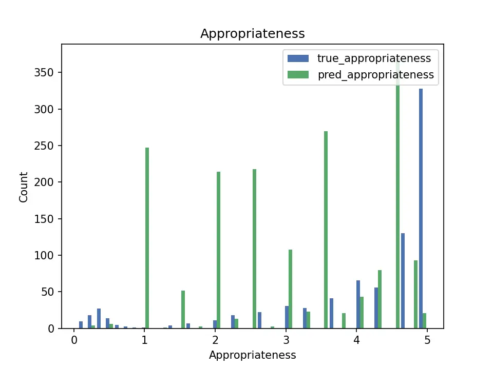
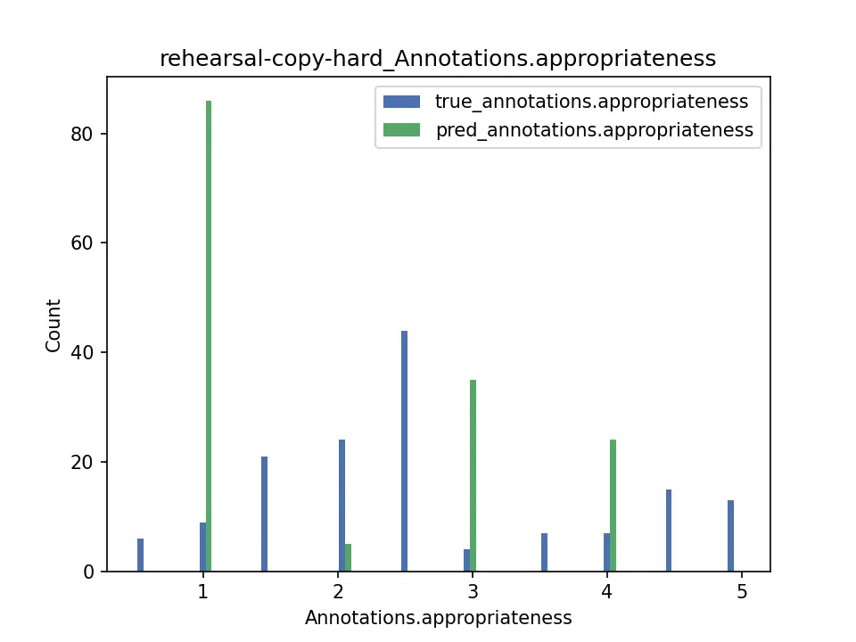
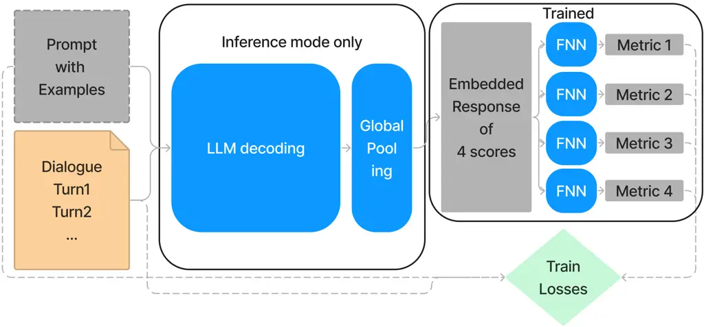
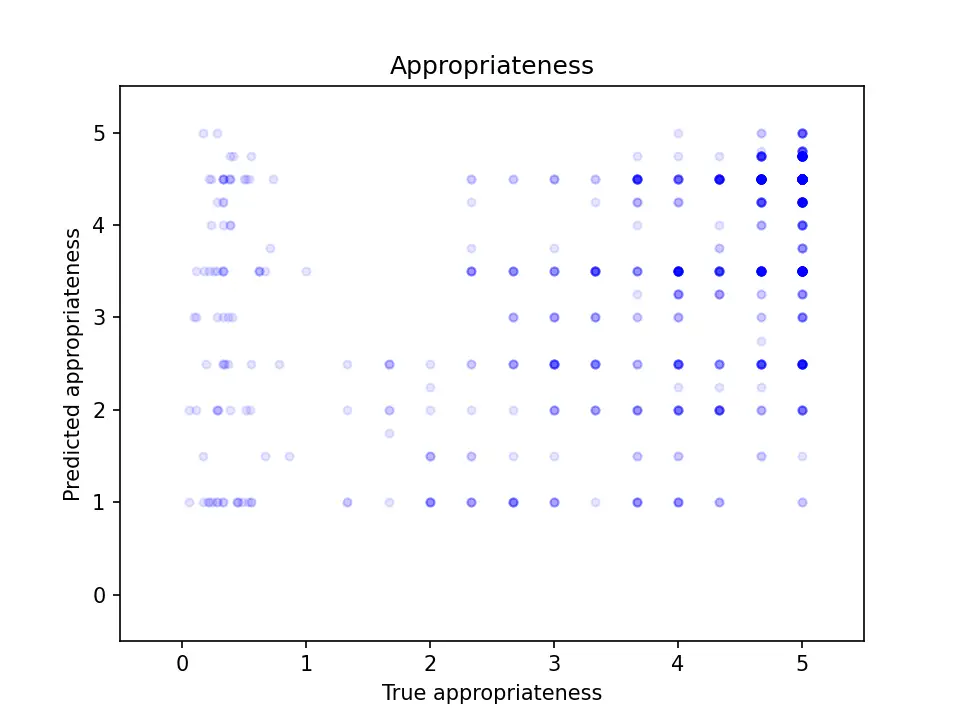
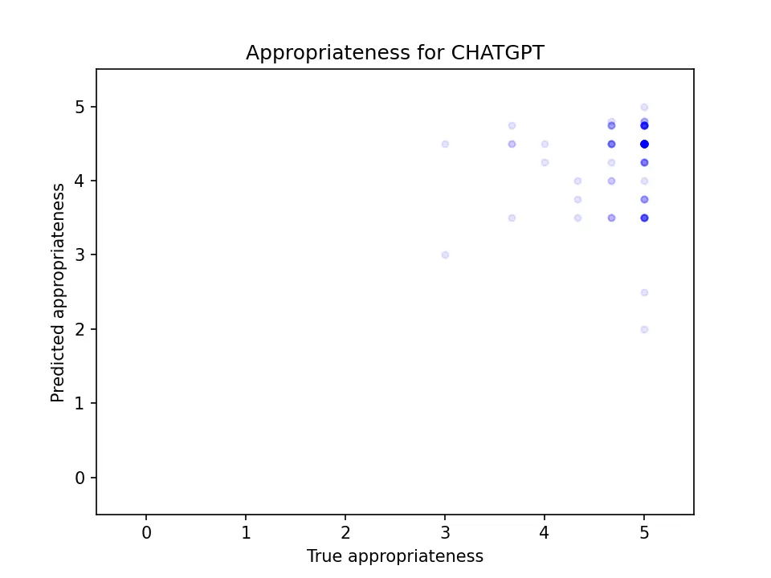

# Three Ways of Using Large Language Models to Evaluate Chat

Ondřej Plátek    Vojtěch Hudeček    Patricia Schmidtová    Mateusz Lango
   Ondřej Dušek Affiliation: Charles University, Faculty of Mathematics
and Physics Affiliation: Institute of Formal and Applied Linguistics
Affiliation: Prague, Czech Republic
Email: [oplatek@ufal.mff.cuni.cz](mailto:)

###### Abstract

This paper describes the systems submitted by team6 for ChatEval, the
DSTC 11 Track 4 competition. We present three different approaches to
predicting turn-level qualities of chatbot responses based on large
language models (LLMs). We report improvement over the baseline using
dynamic few-shot examples from a vector store for the prompts for
ChatGPT. We also analyze the performance of the other two approaches and
report needed improvements for future work. We developed the three
systems over just two weeks, showing the potential of LLMs for this
task. An ablation study conducted after the challenge deadline shows
that the new Llama 2 models are closing the performance gap between
ChatGPT and open-source LLMs. However, we find that the Llama 2 models
do not benefit from few-shot examples in the same way as ChatGPT.

## 1 Introduction

This paper describes the systems submitted by team6 for ChatEval, the
DSTC 11 Track 4 competition aimed at evaluating open-domain chat.¹¹ 1
Results & task description at
[chateval.org/dstc11](https://chateval.org/dstc11). Our experimental
code is available at
[github.com/oplatek/chateval-llm](https://github.com/oplatek/chateval-llm).
We participated in Task 2, which focuses on evaluating multiple criteria
on the level of individual dialogue turns. The task of evaluating
responses in a chat is challenging because it requires an understanding
of the interlocutor’s roles (pragmatics), the conversation’s context,
and the response’s meaning (semantics). At the same time, the
conversations are often ungrammatical Rodríguez-Cantelar et al. (2023)
and vary in style Zhang et al. (2018). The commonly used metrics, such
as BLEU Papineni et al. (2002), METEOR Banerjee and Lavie (2005), or
BERTScore Zhang et al. (2019), are based on comparison to human
references and thus correlate poorly with human judgments on the
turn-level, as they penalize many correct responses for a given chat
context Zhao et al. (2017). At the same time, human evaluation is
expensive and time-consuming. Previous referenceless metrics based on
neural networks and language models still do not reach sufficient
correlations with human judgements Zhang et al. (2020); Lowe et al.
(2017).

Figure 1: The architecture of the vector store approach with a LLM.
During training, we construct the vector store from embedded annotated
dialogues. At inference time, the input dialogue is embedded, and most
similar examples from the vector store are retrieved to be included in
the prompt.

In our work, we followed up on the recent development of pretrained
Large Language Models (LLMs) with instruction finetuning Brown et al.
(2020); Raffel et al. (2020), which have been found to be capable
evaluators in machine translation, summarization as well as
dialogue Kocmi and Federmann (2023); Liu et al. (2023). Therefore, we
applied LLMs and specific prompting to elicit ratings for the multiple
qualities evaluated in DSTC11 Track 4 Task 2: appropriateness, content
richness, grammatical correctness, and relevance. We present three
different systems used for our three submissions, all of which are based
on LLMs and few-shot prompting: (1) We evaluate a straightforward
approach with manually designed fixed prompts for off-the-shelf open
LLMs checkpoints. (2) We train a simple feed-forward regression neural
network (FNN) on top of frozen LLM embeddings to predict the turn-level
metrics scores. (3) We used the ChatGPT API and few-shot examples
retrieved dynamically from the development set to improve the prompting
performance. As no data annotated with the target metrics were available
for the challenge, we heuristically mapped existing annotations from the
development set to the target metrics, and we manually annotated a small
rehearsal dataset for hyperparameter search.

Based on the human annotations released after the challenge finished,
our team6 achieved second place thanks to our third method, dynamically
prompted chatGPT with few-shot examples. This approach showed that LLM
prompting is a viable option for prototyping chat evaluation. However,
the two other methods we explored scored worse: open LLMs with fixed
prompts generally showed poor performance, and the regression FFN worked
well on the development set but did not generalize well to the test set.

## 2 Task & Data

The goal of the DSTC11 Track 4 Task 2 was to predict several turn-level
metrics automatically on the test set. For each dialogue turn,
considering the preceding dialogue history, the participants were to
submit a system to predict the score of the target metrics, defined by
the organizers as:

- •
  _Appropriateness_ – The response is appropriate given the preceding
  dialogue.
- •
  _Content Richnes_ – The response is informative, with long sentences
  including multiple entities and conceptual or emotional words.
- •
  _Grammatical Correctness_ – Responses are free of grammatical and
  semantic errors.
- •
  _Relevance_ – Responses are on-topic with the immediate dialogue
  history.

Table 1 shows chat conversations from the rehearsal dataset with the
turn-level metric annotations.

The organizers provided the participants with training, development, and
test sets Rodríguez-Cantelar et al. (2023), each coming from different
domains and annotated with different metrics:

- •
  _Training set_ – consists of 390k dialogues, annotated with sentiment
  and toxicity labels. This set was not used in our experiments at all
  since our goal was to fine-tune or select LLMs that are already
  well-performing with no finetuning.
- •
  _Development set_ – consists of 24 datasets, some annotated with
  dataset-specific metrics. For our experiments, we created a [heuristic
  mapping](https://github.com/oplatek/chateval-llm/blob/807ebeeb812ab24df13d8cbb8fde24ac188bef7a/chateval/datasets.py#L354)
  to the target metrics on a subset of the development set (see
  Section 3).
- •
  _Test set_ – consists of 3,470 dialogues and 130k turns, annotated
  with the target metrics. The data was only published in an anonymized
  form and at the end of the challenge, with no annotations or metadata,
  so that challenge participant could produce their model outputs. The
  annotations were published after the challenge was finished.
- •
  _Rehearsal set_ – this is a set of 156 turns collected in the same way
  as the test set, released earlier than the test set. We manually
  annotated this set with the target metrics (see Section 3) and used
  the result for hyperparameter search.

The submitted systems were benchmarked for the quality of their ranking
using the Spearman correlation coefficients (SCC) Zar (2005) computed
between the predicted scores and the human judgments. As a secondary
measure, the Pearson correlation coefficients (PCC) Freedman et al.
(2007) were used to evaluate the correlation. The measures were computed
for each of the target metrics separately. The overall submissions’
ranking was determined using the average of the four SCCs.

| Dialogue Turns                                                         | Appr | Rich. | Gram. | Rel |
| ---------------------------------------------------------------------- | ---- | ----- | ----- | --- |
| My boss gave me a 10 raise just last month And it was a nice surprise  | 5    | 5     | 5     | \-  |
| It’s great and he might think you’re doing a great job                 | 5    | 5     | 5     | 5   |
| We have always been very nice He has always been very supportive of me | 4    | 5     | 5     | 5   |
| That’s a good thing                                                    | 4    | 3     | 5     | 4   |
| do you have any pets?                                                  | 5    | 4     | 3     | \-  |
| I am retired so I love to travel so pets would slow me down            | 4    | 4     | 3     | 4   |
| I understand that my idea of traveling is a hot hot bubble bath        | 3    | 4     | 2     | 2   |
| Yes I have dogs and cats I like to take them with me on trips          | 2    | 4     | 2     | 2   |

Table 1: Two examples of complete conversations from the rehearsal set
are annotated with turn-level metrics: appropriateness, content
richness, grammatical correctness, and relevance. The context for each
turn are the previous turns (lines) in the conversation. The second
conversation at the bottom of the table shows an inappropriate response
in the last turn because the last response contradicts previous
responses of the system.

## 3 Data Preprocessing

Since no information was provided on how the individual development
dataset metrics relate to the target dialogue metrics, we built a
heuristic to obtain target metric scores. The heuristic uses a linear
combination of one or more dataset-specific metrics to the target
metrics, chosen based on individual descriptions from the literature.²²
2 See the line 354 for the [turn metric
mapping](https://github.com/oplatek/chateval-llm/blob/807ebeeb812ab24df13d8cbb8fde24ac188bef7a/chateval/datasets.py)
for different datasets. Using the development set and the heuristic, we
created a supervised dataset and split it into training and development
splits. We used this development dataset for model selection or
supervised training, and we use this dataset to develop the three
systems described in Section 4.

During our experiments, we struggled to find representative labels and
input data which could be used as a development set. Therefore, we
decided to annotate the additional 156 turns from the rehearsal set with
the target metrics described in Section 2. We used this data to find our
submitted systems’ optimal hyperparameters. We assumed that this data
came from the same distribution as the test set, but this later proved
clearly not to be the case, as seen in Figure 2.

Note that we did not use the training set at all.





Figure 2: The histogram of predicted and human-annotated scores for
appropriateness of a reply, on the test set (above) and on our manually
annotated development set (below). Predicted scores are from ChatGPT
with dynamic few-shot examples (see Section 4.3). Note that the
rehearsal set is not representative of the test set – compare the blue
bars representing the human-annotated scores. Interestingly,
ChatGPT-predicted scores on the test set are not concentrated at the
extremes, unlike on the rehearsal set.

## 4 Submitted Systems

Inspired by Kocmi and Federmann (2023), we used pre-trained LLMs with
prompts for predicting the individual metrics. We started with the
simplest approach possible and manually designed the prompts.

### 4.1 Method 1: Simple Prompting

We experimented with prompting GPT-NeoX-20B (Black et al., 2022),
OPT-30B (Zhang et al., 2022b), and TK-Instruct-11B (Wang et al.,
2022).³³ 3 The numbers identify each exact model checkpoint by the
number of parameters. We tried several prompt templates for each model
and selected the best-performing one on the development set and the
manually annotated rehearsal set. The templates were slightly adapted
for each model to control for the deviations in model pretraining or
instruction finetuning procedures, i.e., the wording of instructions or
tags denoting a user-system interaction.

We used templates evaluating a single quality of each turn (i.e.,
calling the LLM four times to predict all metrics). We focus on a
single-metric template because most of the open-source models have
trouble sticking to the desired output format when asked to generate a
structured response with all four quality scores. Our templates included
two hardcoded examples from the DailyDialog set Li et al. (2017), one of
the provided development datasets.

We developed the prompt templates iteratively. Every time we rephrased
the prompt templates, we evaluated them on the DailyDialog dev set,
which is part of the challenge dev set.

### 4.2 Method 2: Feed-Forward Regressor on Top of LLMs

Our second method attempts to solve the problem that the prompted LLMs
sometimes produce malformed output. We assumed that LLMs extract
relevant features even when the decoder produces a malformed one-best
hypothesis. Therefore, we aimed to use LLM contextual embeddings as
features for a simple regressor. However, instead of using the LLM’s
output directly, we implemented a simple embedding extractor on top of
the LLM, and we trained a regression model to predict all four scores
based on the embeddings. We use global max and average pooling over
decoder layers and time steps of the decoded output to obtain the
prompted response embedding.

We designed the prompts so the LLMs’ replies contain information about
all four metrics, so a single call to the LLMs is sufficient to obtain
all four scores. At the same time, we designed the prompt so the LLM
replies are as short as possible. To train the regressor, we used our
heuristically mapped development data (see Section 3). We trained four
simple feed-forward networks (FFNs), each modeling one of the target
metrics using the same input embeddings. See Figure 3 for the
architecture of the FNN.



Figure 3: The architecture of the FFN trained on top of embeddings of
LLM responses.

### 4.3 Method 3: Dynamic Few-Shot Examples from a Vector Store

The previous two approaches used fixed few-shot examples. However, the
performance of the in-context LLM learning can be improved by providing
examples that are contextually similar to the instance being
evaluated Brown et al. (2020). We, therefore, implement a vector store
with a dynamic few-shot example selection. First, we take dialogues from
the development set relevant to a given metric (based on our mapping
described in Section 3), and compute turn-level embeddings. These are
then used as keys in a vector store optimized for similarity search. At
runtime, we retrieve a set of examples based on their similarity to the
input and include them in the LLM prompt. See Figure 1 for a detailed
overview of the vector store architecture.

## 5 Experiments

We experimented with the three methods described in Section 4. First, we
we experimented with the Simple Prompting method using the open-source
LLMs (Section 4.1). Based on the results, we started two independent
experiments. Section 5.2 describes the FFN training and Section 5.3
describes the development of vector storage which we used with ChatGPT
API. For all three methods, we used the rehearsal set to select the
best-performing model-template combination and hyperparameters.

### 5.1 Simple Prompting Submision

For our baseline submission, we selected the best-performing
model-template combinations for each quality separately and then
combined the results. Appropriateness and Relevance were generated by
OPT-30b (Zhang et al., 2022b). Content Richness was generated by
TK-Instruct (Wang et al., 2022). As the outputs for “Grammatical
Correctness” were malformed in most cases, we replaced the outputs with
randomly generated scores.

### 5.2 FFN Fine-Tuning setup

We trained the FFN using two layers with 1024 hidden units and ReLU
activation with batch size 2048 and learning rate 5e-5. We used the
log-cosh Saleh and Saleh (2022) loss function. We split the original
development set into training and validation sets. We trained until
early stopping based on the validation set using SCC for appropriateness
as a stopping criterion. We extracted the embeddings from the prompted
LLMs on the training and validation sets and cached them. We used the
same LLM checkpoints as in the simple prompting method. We only used dev
datasets whose annotations mapped to all four target metrics (see
Section 3).; DailyDialog (Li et al., 2017), Fed-Turn (Mehri and
Eskenazi, 2020a), Persona-See (See et al., 2019), and Persona-Usr (Mehri
and Eskenazi, 2020b).

### 5.3 Vector Store Implementation

We use FAISS Johnson et al. (2019) to implement vector storage that can
perform effective similarity-based retrieval. To convert the dialogues
into embeddings that are saved to the vector store, we used the
MPNet Song et al. (2020) pretrained sentence representation
model Reimers and Gurevych (2019). We store the same development
datasets in the vector store that we used for FFN training
(Section 5.2), with the heuristically mapped scores for all four
metrics.

We used the prompt template in Figure 4 with dynamically retrieved
examples using vector store for the prompt and ChatGPT as the prompted
LLM.⁴⁴ 4 We used the gpt-3.5-turbo-0301 API version.

```ltx_verbatim
Following is a dialogue context and the response to it.
Express how the response is appropriate given the context
with a continuous number between 1 and 5.
The higher the score, the more appropriate the sentences are.
Here are a few examples:
--------
{examples}
--------
Now complete the following with just a single float number:
Context: {dialogue_context}
Response: {response}
Appropriateness Score:
```

Figure 4: Prompt template used with the few-shot dynamic examples
retrieval with ChatGPT has a placeholder for the examples. Each example
contains the turn response together with its dialogue context and the
ground truth appropriateness score. The other methods used a similar
template, with only a slight rewording.

## 6 Results & Discussion

We report positive findings related to Method 3 (Section 4.3), but we
also report lessons learned from implementing the other two methods and,
in general, using the data provided for the challenge. First, we
summarize observations from our use of the data (Section 6.1). Then we
report negative results from the simple prompting and FFN fine-tuning
(Sections 6.2 and 6.3, respectively). We also report our best results
from the vector store (Section 6.4) and discuss what our best model in
the challenge is capable of evaluating. Finally, we add an ablation
study in Section 6.5 performed after the challenge was complete,
comparing few-shot capabilities of ChatGPT with the newly released
Llama 2 model.

We are aware that LLMs are trained on large datasets, some of which
(e.g., ChatGPT) are not public. However, due to the novelty of the test
set Rodríguez-Cantelar et al. (2023), we believe that the test set has
not leaked to their training set.

### 6.1 Dataset Analysis

The test set contains dialogue samples from various datasets unseen in
the development and rehearsal sets: BlenderBot3, ChatGPT, DSTC10Persona,
DSTC10Topical, ESL, GPT3, NCM. The distribution of the test set was
unknown to the participants, and most of the data comes from the unseen
BlenderBot3 and ChatGPT datasets. We observed that scores for individual
metrics were not normalized across the datasets as the ESL and NCM
datasets had a range of 0-1, while the other datasets had a range of
1-5.

This discrepancy in data distributions most likely resulted in our model
selection and hyperparameter search on the rehearsal dataset being
detrimental to the final performance of our systems. See the mismatch in
the distribution of our own manual annotations on the rehearsal set and
human annotation on the test set in Figure 2. Furthermore, we argue that
we could have achieved better results if we ran our model selection not
only on the appropriateness metric but optimized for all four metrics.

### 6.2 Simple Prompting is Fragile

In our informal experiments with simple prompting, we noticed that
instruction-tuned LLM checkpoints produce results with intended formats
more reliably. We also experimented with templates evaluating all four
metrics using a single prompt. However, single-quality templates were
generally more reliable and yielded outputs adhering to the expected
formats more often. We consistently observed that adding examples to the
templates improved the reliability of the outputs.

Manual development of prompts, which relies on observing a small set of
examples, was impractical for a diverse development dataset. We
frequently developed a promising prompt only to discover that the model
produces malformed outputs when run on conversations from a different
system. The typical problem was that LLMs would interpret part of the
input conversation as instruction. Consequently, instead of replying
with the metric score, the model replied with a next turn fitting the
conversation prefix. Whenever the model did not respond in the desired
format, we used an uninformed response score of 3. The number of
informed responses was the largest factor in the overall lower score for
the simple prompting method.

### 6.3 FFN is Fast but Lacks Normalization

The training of the FFN is very efficient because we ran the LLMs only
once in inference mode. Note that the training was faster than
extracting the embeddings from the LLMs, and a single FFN layer adds
negligible computational and memory costs at inference time. The FNN
regression model solved the problem of LLMs producing malformed outputs.
However, our submission suffered from unnormalized scores in different
development dataset splits, and the model performed poorly on the test
set. The results of our FFN training in Method 2 thus were influenced by
incorrectly scaling the target metric values: For example, the FedTurn
scores lie in the range $`[0,2.2]`$ instead of $`[1,5]`$.

### 6.4 Are we Comparing Systems or Turns?

Method 3 (Section 4.3) was the most successful in our experiments. We
argue that we could achieve even better results if we did model
selection not only on the appropriateness metric but optimized for all
four metrics. We also argue that data mismatch between the rehearsal and
test sets was detrimental to the performance of the systems. Despite
that, we placed second as a team, improved upon a baseline, and are
relatively close to the best system in terms of the overall ranking. See
Table 2 for the comparison of the systems based on the average of the
SCC over the four metrics. See Figure 2.

| System                       |                        | Avg. Spearman |
| ---------------------------- | ---------------------- | ------------- |
| Baseline Zhang et al. (2020) |                        | 0.3387        |
| Winning submision (_team4_)  |                        | 0.4890        |
| Ours:                        | Simple Prompting       | 0.0807        |
|                              | FFN Regressor          | 0.1742        |
|                              | ChatGPT + Vector Store | 0.4190        |

Table 2: The overall performance of the baseline, the challenge winning
submission and our three submissions.

Our third method, ChatGPT with vector store examples (Section 4.3), was
the most successful in our experiments. We observed that it easily
contrasts between responses from different datasets but does not
distinguish well among turns coming from the same dialogue system and
the same dataset. The SCC scores in Table 3 shows that the score for the
whole test set is better than most of the individual subsets based on
different source datasets.

| Dataset       | Appropriateness | Relevance | Content richness |
| ------------- | --------------- | --------- | ---------------- |
| TEST-ALL      | 0.488           | 0.361     | 0.452            |
| BLENDERBOT3   | 0.383           | 0.287     | 0.303            |
| CHATGPT       | 0.122           | 0.060     | 0.181            |
| DSTC10PERSONA | 0.803           | 0.968     | 0.216            |
| DSTC10TOPICAL | 0.300           | 0.401     | 0.200            |
| ESL           | 0.199           | \-        | \-               |
| GPT3          | 0.091           | 0.007     | 0.242            |
| NCM           | 0.061           | \-        | \-               |

Table 3: The performance of our best system as Spearman correlation
coefficients scores on the test set split for the metrics
Appropriateness, content richness, and relevance. The first row TEST-ALL
reports the results on the whole dataset. For brevity, we do not report
grammatical correctness per splits which is 0.402 for the whole test
set. The test set contains conversations from different systems,
including ChatGPT and GPT3.





Figure 5: The two scatterplots show the correlation of ground truth
turn-level scores for appropriateness and the prediction of our best
system, on the whole test set (left) and for the test set turns
generated by ChatGPT (right). Our system shows a relatively good
correlation over the whole test set and evaluates the ChatGPT results
correctly as high-quality, but it fails at distinguishing the quality of
individual ChatGPT turns.

### 6.5 Revisiting Few-Shot Prompts in Ablation

We present an additional ablation study, which we ran after the
challenge was completed and evaluated on the _Appropriateness_ quality.
Using both ChatGPT and the newly released Llama 2 models Touvron et al.
(2023), we investigate the influence of the few-shot examples on the
performance of the models.⁵⁵ 5 We used the Llama2-7b-chat-hf checkpoint
([https://huggingface.co/meta-llama/Llama-2-7b-chat-hf](https://huggingface.co/meta-llama/Llama-2-7b-chat-hf))
and the gpt-3.5-turbo-0613 version of the ChatGPT API. The
gpt-3.5-turbo-0301 was used for the _Porig_ experiments with the
original prompts from our submission. In order to do so, we made two
changes to the prompts: (1) we designed a single prompt template that
can be used both with and without few-shot examples, (2) we normalized
the use of newlines at the end of the prompt and in the few-shot
examples, which improved performance. We also (3) further improved the
prompt by iterative experiments on the DailyDialog development set.

We label the improved prompt (with changes 1+2+3) as _Pimpr_; we compare
to a prompt closer to the original (with only changes 1+2 applied) as
_Pnorm_. We then compared both ChatGPT and Llama 2 using both prompts
_Pimpr_ and _Pnorm_ in three variants: (a) base without few-shot
examples, (b) with two static examples (labeled -fix-2egs), and (c) with
two dynamically retrieved examples using the vector store (labeled
dyn-2egs, cf. Section 4.3. We also include a comparison to the original
ChatGPT with the prompt used in our model submitted to the challenge
(labeled as _Porig_, see Section 5.3). Finally, we ran an experiment
with variants of _Porig_/_Pnorm_ where we prompted the model to evaluate
all the four qualities in a single prompt (labeled as _-All_).

Our results in Table 4 suggest that it pays off to design the prompt
carefully, and it is beneficial to use few-shot examples in the prompts.
However, using dynamic examples form the vector store instead of fixed
ones does not bring further improvements. We can see on ChatGPT results
that our prompt improvements had an effect, and we were able to improve
substantially over our challenge submission. There is a notable gap
between ChatGPT and Llama 2; on the other hand, the Llama 2 results are
much better than any of our previous results with open models (see
Sections 6.2 and 6.3). We observe that predicting four qualities at once
is not as good as predicting appropriateness only. However, it still
seems an attractive alternative since such template use is roughly four
times more effective when predicting four qualities individually. The
percentage of failures for all reported systems is lower than 1% and
thus does not play a significant role in the evaluation.

|                        |                  |                |         |
| ---------------------- | ---------------- | -------------- | ------- |
| System                 | Prompt           | Spearman Appr. | (%fail) |
| Llama 2 7B Chat        | _Pimpr_          | 0.3310         | (0.04%) |
|                        | _Pimpr_-fix-2egs | 0.3756         | (0.56%) |
|                        | _Pimpr_-dyn-2egs | 0.3683         | (0.36%) |
| ChatGPT 3.5-turbo-0613 | _Pimpr_          | 0.4536         | (0.01%) |
|                        | _Pimpr_-fix-2egs | 0.6136         | (0.00%) |
|                        | _Pimpr_-dyn-2egs | 0.5962         | (0.00%) |
| Llama 2 7B Chat        | _Pnorm_          | 0.3914         | (0.98%) |
|                        | _Pnorm_-fix-2egs | 0.3551         | (0.06%) |
|                        | _Pnorm_-dyn-2egs | 0.3756         | (0.65%) |
|                        | _Pnorm_-All      | 0.3710         | (0.01%) |
| ChatGPT 3.5-turbo-0613 | _Pnorm_-dyn-2egs | 0.5462         |         |
|                        | _Pnorm_-fix-All  | 0.5334         |         |
| ChatGPT 3.5-turbo-0301 | _Porig_-dyn-2egs | 0.4880         |         |
|                        | _Porig_-fix-All  | 0.3616         |         |

Table 4: Ablation study with the ChatGPT and Llama 2 7B Chat models for
the _Appropriateness_ quality (see Section 6.5 for prompt variants
explanation). “%fail” indicates the percentage of LLM outputs that
failed to parse due to incorrect format.

## 7 Related Work

Recent works in chat evaluation focus on referenceless approaches, as
these do not suffer from penalizing appropriate responses based on
surface dissimilarity to a single human-written reference response Liu
et al. (2017); Lowe et al. (2017). Here, Lowe et al. (2017) trained a
neural network from scratch on relatively large annotated data to
predict a single score, but this approach was later found to generalize
poorly, even to basic data perturbations, let alone other datasets Sai
et al. (2019); Lowe (2019).

Later works leveraged pretrained language models for better
generalization abilities, such as BERT Zhang et al. (2020); Gao et al.
(2020), RoBERTa Mehri and Eskenazi (2020c), GPT-2 Sinha et al. (2020) or
DialoGPT Mehri and Eskenazi (2020a). These metrics are trained on
human-labeled sets of system outputs based on popular open-domain
datasets, similar to the ChatEval development data. Some of them use
additional data augmentation techniques, such as self-training Zhang
et al. (2022a). While they do achieve good correlations on some
datasets, generalization with respect to unseen datasets is still not
guaranteed Yeh et al. (2021).

Sai et al. (2021) stressed the importance of predicting multiple
qualities, such as, fluency and appropriateness, in dialogue evaluation.
At the same time, they asserted that metrics should be sensitive enough
to distinguish between similar responses. Using simple text
perturbations targeting the individual qualities, they show that most
existing metrics are not robust enough.

Two very recent works, closely related to ours, propose the usage of
instruction-tuned LLMs to evaluate generated text in various tasks like
summarization and dialogue response generation  Liu et al. (2023), or
machine translation Kocmi and Federmann (2023). Both approaches use
in-context learning and multiple prompting techniques to obtain scalar
metric predictions or candidate rankings. They achieved good results and
correlations with human judgments. However, they used only closed models
for the evaluation and did not experiment with few-shot prompting using
relevant examples.

## 8 Conclusion

We presented three simple approaches to using LLMs for turn-level chat
evaluation. We achieved promising results using ChatGPT prompting with
few-shot example retrieval from a vector score, and ranked as the
second-best team. Based on the results of our best system, we argue that
chat turn evaluation systems based on current state-of-the-art LLMs are
usable only for system-level evaluation but not for segment-level
evaluation, i.e., they cannot distinguish between the quality of
individual turns, especially for outputs of high-quality latest systems
based on LLMs such as ChatGPT and GPT3.

We observed that LLMs are fragile to the prompts, few-shot examples and
cannot be used out-of-the-box for chat evaluation. We also report
implementing a simple regressor on top of embeddings obtained from the
prompted LLM decoder. We attribute its poor performance to our incorrect
implementation of data preparation.

We also presented an ablation study that investigated the influence of
the few-shot examples on the performance of LLMs. We found that few-shot
examples help the LLMs to generalize better to unseen data, especially
with respect to fitting the desired output format. However, using
examples dynamically obtained from the vector store instead of
hand-picked fixed examples did not bring any additional improvements.

We reached a new best Spearman correlation coefficient of 0.6136 for
appropriateness with ChatGPT and fixed few-shot examples in our ablation
study. In addition, the Llama 2 open model used in our ablation showed
significant improvements over the challenge baseline.

## 9 Acknowledgements

This research was supported by Charles University projects GAUK 40222
and SVV 260575 and by the European Research Council (Grant agreement
No. 101039303 NG-NLG). It used resources provided by the
LINDAT/CLARIAH-CZ Research Infrastructure (Czech Ministry of Education,
Youth, and Sports project No. LM2018101). The authors thank the
anonymous reviewers for their valuable feedback, Milan Fučík and Mateusz
Krubiński for their suggestions and technical support.

## References

- Banerjee and Lavie (2005) Satanjeev Banerjee and Alon Lavie. 2005.
  Meteor: An automatic metric for mt evaluation with improved
  correlation with human judgments. In _Proceedings of the acl workshop
  on intrinsic and extrinsic evaluation measures for machine translation
  and/or summarization_, pages 65–72.
- Black et al. (2022) Sid Black, Stella Biderman, Eric Hallahan, Quentin
  Anthony, Leo Gao, Laurence Golding, Horace He, Connor Leahy, Kyle
  McDonell, Jason Phang, Michael Pieler, USVSN Sai Prashanth, Shivanshu
  Purohit, Laria Reynolds, Jonathan Tow, Ben Wang, and Samuel
  Weinbach. 2022. [Gpt-neox-20b: An open-source autoregressive language
  model](https://doi.org/10.48550/ARXIV.2204.06745).
- Brown et al. (2020) Tom B. Brown, Benjamin Mann, Nick Ryder, Melanie
  Subbiah, Jared Kaplan, Prafulla Dhariwal, Arvind Neelakantan, Pranav
  Shyam, Girish Sastry, Amanda Askell, Sandhini Agarwal, Ariel
  Herbert-Voss, Gretchen Krueger, Tom Henighan, Rewon Child, Aditya
  Ramesh, Daniel M. Ziegler, Jeffrey Wu, Clemens Winter, Christopher
  Hesse, Mark Chen, Eric Sigler, Mateusz Litwin, Scott Gray, Benjamin
  Chess, Jack Clark, Christopher Berner, Sam McCandlish, Alec Radford,
  Ilya Sutskever, and Dario Amodei. 2020. [Language Models are Few-Shot
  Learners](https://doi.org/10.48550/arXiv.2005.14165). ArXiv:2005.14165
  \[cs\].
- Freedman et al. (2007) David Freedman, Robert Pisani, and Roger
  Purves. 2007. Statistics (international student edition). _Pisani, R.
  Purves, 4th edn. WW Norton & Company, New York_.
- Gao et al. (2020) Xiang Gao, Yizhe Zhang, Michel Galley, Chris
  Brockett, and Bill Dolan. 2020. [Dialogue response ranking training
  with large-scale human feedback
  data](https://doi.org/10.18653/v1/2020.emnlp-main.28). In _Proceedings
  of the 2020 Conference on Empirical Methods in Natural Language
  Processing (EMNLP)_, pages 386–395, Online. Association for
  Computational Linguistics.
- Johnson et al. (2019) Jeff Johnson, Matthijs Douze, and Hervé
  Jégou. 2019. Billion-scale similarity search with GPUs. _IEEE
  Transactions on Big Data_, 7(3):535–547.
- Kocmi and Federmann (2023) Tom Kocmi and Christian Federmann. 2023.
  [Large Language Models Are State-of-the-Art Evaluators of Translation
  Quality](https://doi.org/10.48550/arXiv.2302.14520). ArXiv:2302.14520
  \[cs\].
- Li et al. (2017) Yanran Li, Hui Su, Xiaoyu Shen, Wenjie Li, Ziqiang
  Cao, and Shuzi Niu. 2017. [DailyDialog: A Manually Labelled Multi-turn
  Dialogue Dataset](http://arxiv.org/abs/1710.03957). ArXiv:1710.03957
  \[cs\] version: 1.
- Liu et al. (2017) Chia-Wei Liu, Ryan Lowe, Iulian V. Serban, Michael
  Noseworthy, Laurent Charlin, and Joelle Pineau. 2017. [How NOT To
  Evaluate Your Dialogue System: An Empirical Study of Unsupervised
  Evaluation Metrics for Dialogue Response
  Generation](http://arxiv.org/abs/1603.08023). ArXiv:1603.08023 \[cs\].
- Liu et al. (2023) Yang Liu, Dan Iter, Yichong Xu, Shuohang Wang,
  Ruochen Xu, and Chenguang Zhu. 2023. [G-Eval: NLG Evaluation using
  GPT-4 with Better Human
  Alignment](https://doi.org/10.48550/arXiv.2303.16634).
  ArXiv:2303.16634 \[cs\].
- Lowe (2019) Ryan Lowe. 2019. [Introducing Retrospectives: ’Real Talk’
  for your Past
  Papers](https://thegradient.pub/introducing-retrospectives/). Library
  Catalog: thegradient.pub.
- Lowe et al. (2017) Ryan Lowe, Michael Noseworthy, Iulian Vlad Serban,
  Nicolas Angelard-Gontier, Yoshua Bengio, and Joelle Pineau. 2017.
  [Towards an Automatic Turing Test: Learning to Evaluate Dialogue
  Responses](https://doi.org/10.18653/v1/P17-1103). In _Proceedings of
  the 55th Annual Meeting of the Association for Computational
  Linguistics (Volume 1: Long Papers)_, pages 1116–1126, Vancouver,
  Canada. Association for Computational Linguistics.
- Mehri and Eskenazi (2020a) Shikib Mehri and Maxine Eskenazi. 2020a.
  [Unsupervised Evaluation of Interactive Dialog with
  DialoGPT](https://aclanthology.org/2020.sigdial-1.28). In _Proceedings
  of the 21th Annual Meeting of the Special Interest Group on Discourse
  and Dialogue_, pages 225–235, 1st virtual meeting. Association for
  Computational Linguistics.
- Mehri and Eskenazi (2020b) Shikib Mehri and Maxine Eskenazi. 2020b.
  [USR: An Unsupervised and Reference Free Evaluation Metric for Dialog
  Generation](https://doi.org/10.18653/v1/2020.acl-main.64). In
  _Proceedings of the 58th Annual Meeting of the Association for
  Computational Linguistics_, pages 681–707, Online. Association for
  Computational Linguistics.
- Mehri and Eskenazi (2020c) Shikib Mehri and Maxine Eskenazi. 2020c.
  [USR: An unsupervised and reference free evaluation metric for dialog
  generation](https://doi.org/10.18653/v1/2020.acl-main.64). In
  _Proceedings of the 58th Annual Meeting of the Association for
  Computational Linguistics_, pages 681–707, Online. Association for
  Computational Linguistics.
- Papineni et al. (2002) Kishore Papineni, Salim Roukos, Todd Ward, and
  Wei-Jing Zhu. 2002. [Bleu: a method for automatic evaluation of
  machine translation](https://doi.org/10.3115/1073083.1073135). In
  _Proceedings of the 40th Annual Meeting of the Association for
  Computational Linguistics_, pages 311–318, Philadelphia, Pennsylvania,
  USA. Association for Computational Linguistics.
- Raffel et al. (2020) Colin Raffel, Noam Shazeer, Adam Roberts,
  Katherine Lee, Sharan Narang, Michael Matena, Yanqi Zhou, Wei Li, and
  Peter J. Liu. 2020. [Exploring the Limits of Transfer Learning with a
  Unified Text-to-Text
  Transformer](https://doi.org/10.48550/arXiv.1910.10683).
  ArXiv:1910.10683 \[cs, stat\].
- Reimers and Gurevych (2019) Nils Reimers and Iryna Gurevych. 2019.
  [Sentence-bert: Sentence embeddings using siamese
  bert-networks](https://arxiv.org/abs/1908.10084). In _Proceedings of
  the 2019 Conference on Empirical Methods in Natural Language
  Processing_. Association for Computational Linguistics.
- Rodríguez-Cantelar et al. (2023) Mario Rodríguez-Cantelar, Chen Zhang,
  Chengguang Tang, Ke Shi, Sarik Ghazarian, João Sedoc, Luis Fernando
  D’Haro, and Alexander Rudnicky. 2023. [Overview of Robust and
  Multilingual Automatic Evaluation Metrics for Open-Domain Dialogue
  Systems at DSTC 11 Track 4](http://arxiv.org/abs/2306.12794).
  ArXiv:2306.12794 \[cs\].
- Sai et al. (2021) Ananya B. Sai, Tanay Dixit, Dev Yashpal Sheth,
  Sreyas Mohan, and Mitesh M. Khapra. 2021. [Perturbation checklists for
  evaluating nlg evaluation metrics](http://arxiv.org/abs/2109.05771).
- Sai et al. (2019) Ananya B. Sai, Mithun Das Gupta, Mitesh M. Khapra,
  and Mukundhan Srinivasan. 2019. [Re-Evaluating ADEM: A Deeper Look at
  Scoring Dialogue
  Responses](https://doi.org/10.1609/aaai.v33i01.33016220). In
  _Proceedings of the AAAI Conference on Artificial Intelligence_, pages
  6220–6227, Honolulu, HI, USA. Number: 01.
- Saleh and Saleh (2022) Resve A. Saleh and A. K. Md Ehsanes
  Saleh. 2022. [Statistical Properties of the log-cosh Loss Function
  Used in Machine Learning](http://arxiv.org/abs/2208.04564).
  ArXiv:2208.04564 \[cs, stat\].
- See et al. (2019) Abigail See, Stephen Roller, Douwe Kiela, and Jason
  Weston. 2019. [What makes a good conversation? How controllable
  attributes affect human
  judgments](https://doi.org/10.18653/v1/N19-1170). In _Proceedings of
  the 2019 Conference of the North American Chapter of the Association
  for Computational Linguistics: Human Language Technologies, Volume 1
  (Long and Short Papers)_, pages 1702–1723, Minneapolis, Minnesota.
  Association for Computational Linguistics.
- Sinha et al. (2020) Koustuv Sinha, Prasanna Parthasarathi, Jasmine
  Wang, Ryan Lowe, William L. Hamilton, and Joelle Pineau. 2020.
  [Learning an unreferenced metric for online dialogue
  evaluation](https://doi.org/10.18653/v1/2020.acl-main.220). In
  _Proceedings of the 58th Annual Meeting of the Association for
  Computational Linguistics_, pages 2430–2441, Online. Association for
  Computational Linguistics.
- Song et al. (2020) Kaitao Song, Xu Tan, Tao Qin, Jianfeng Lu, and
  Tie-Yan Liu. 2020. [MPNet: Masked and Permuted Pre-training for
  Language Understanding](https://doi.org/10.48550/arXiv.2004.09297).
  ArXiv:2004.09297 \[cs\].
- Touvron et al. (2023) Hugo Touvron, Louis Martin, Kevin Stone, Peter
  Albert, Amjad Almahairi, Yasmine Babaei, Nikolay Bashlykov, Soumya
  Batra, Prajjwal Bhargava, Shruti Bhosale, Dan Bikel, Lukas Blecher,
  Cristian Canton Ferrer, Moya Chen, Guillem Cucurull, David Esiobu,
  Jude Fernandes, Jeremy Fu, Wenyin Fu, Brian Fuller, Cynthia Gao,
  Vedanuj Goswami, Naman Goyal, Anthony Hartshorn, Saghar Hosseini, Rui
  Hou, Hakan Inan, Marcin Kardas, Viktor Kerkez, Madian Khabsa, Isabel
  Kloumann, Artem Korenev, Punit Singh Koura, Marie-Anne Lachaux,
  Thibaut Lavril, Jenya Lee, Diana Liskovich, Yinghai Lu, Yuning Mao,
  Xavier Martinet, Todor Mihaylov, Pushkar Mishra, Igor Molybog, Yixin
  Nie, Andrew Poulton, Jeremy Reizenstein, Rashi Rungta, Kalyan Saladi,
  Alan Schelten, Ruan Silva, Eric Michael Smith, Ranjan Subramanian,
  Xiaoqing Ellen Tan, Binh Tang, Ross Taylor, Adina Williams, Jian Xiang
  Kuan, Puxin Xu, Zheng Yan, Iliyan Zarov, Yuchen Zhang, Angela Fan,
  Melanie Kambadur, Sharan Narang, Aurelien Rodriguez, Robert Stojnic,
  Sergey Edunov, and Thomas Scialom. 2023. [Llama 2: Open Foundation and
  Fine-Tuned Chat Models](https://doi.org/10.48550/arXiv.2307.09288).
  ArXiv:2307.09288 \[cs\].
- Wang et al. (2022) Yizhong Wang, Swaroop Mishra, Pegah
  Alipoormolabashi, Yeganeh Kordi, Amirreza Mirzaei, A. Arunkumar, Arjun
  Ashok, Arut Selvan Dhanasekaran, Atharva Naik, David Stap, Eshaan
  Pathak, Giannis Karamanolakis, Haizhi Gary Lai, Ishan Purohit, Ishani
  Mondal, Jacob Anderson, Kirby Kuznia, Krima Doshi, Maitreya Patel,
  Kuntal Kumar Pal, M. Moradshahi, Mihir Parmar, Mirali Purohit, Neeraj
  Varshney, Phani Rohitha Kaza, Pulkit Verma, Ravsehaj Singh Puri,
  Rushang Karia, Shailaja Keyur Sampat, Savan Doshi, Siddharth Deepak
  Mishra, Sujan C. Reddy, Sumanta Patro, Tanay Dixit, Xu dong Shen,
  Chitta Baral, Yejin Choi, Hannaneh Hajishirzi, Noah A. Smith, and
  Daniel Khashabi. 2022. [Benchmarking generalization via in-context
  instructions on 1,600+ language
  tasks](http://arxiv.org/abs/2204.07705).
- Yeh et al. (2021) Yi-Ting Yeh, Maxine Eskenazi, and Shikib
  Mehri. 2021. [A comprehensive assessment of dialog evaluation
  metrics](https://doi.org/10.18653/v1/2021.eancs-1.3). In _The First
  Workshop on Evaluations and Assessments of Neural Conversation
  Systems_, pages 15–33, Online. Association for Computational
  Linguistics.
- Zar (2005) Jerrold H Zar. 2005. Spearman rank correlation.
  _Encyclopedia of Biostatistics_, 7.
- Zhang et al. (2020) Chen Zhang, Luis D’Haro, Rafael Banchs, Thomas
  Friedrichs, and Haizhou Li. 2020. [Deep am-fm: Toolkit for automatic
  dialogue evaluation](https://doi.org/10.1007/978-981-15-8395-7_5).
  _Conversational Dialogue Systems for the Next Decade_, pages 53–69.
- Zhang et al. (2022a) Chen Zhang, Luis D’Haro, Thomas Friedrichs, and
  Haizhou Li. 2022a. [Mdd-eval: Self-training on augmented data for
  multi-domain dialogue
  evaluation](https://doi.org/10.1609/aaai.v36i10.21420). _Proceedings
  of the AAAI Conference on Artificial Intelligence_, 36:11657–11666.
- Zhang et al. (2018) Saizheng Zhang, Emily Dinan, Jack Urbanek, Arthur
  Szlam, Douwe Kiela, and Jason Weston. 2018. [Personalizing Dialogue
  Agents: I have a dog, do you have pets
  too?](https://doi.org/10.48550/arXiv.1801.07243) ArXiv:1801.07243
  \[cs\].
- Zhang et al. (2022b) Susan Zhang, Stephen Roller, Naman Goyal, Mikel
  Artetxe, Moya Chen, Shuohui Chen, Christopher Dewan, Mona Diab, Xian
  Li, Xi Victoria Lin, Todor Mihaylov, Myle Ott, Sam Shleifer, Kurt
  Shuster, Daniel Simig, Punit Singh Koura, Anjali Sridhar, Tianlu Wang,
  and Luke Zettlemoyer. 2022b. [Opt: Open pre-trained transformer
  language models](http://arxiv.org/abs/2205.01068).
- Zhang et al. (2019) Tianyi Zhang, Varsha Kishore, Felix Wu, Kilian Q
  Weinberger, and Yoav Artzi. 2019. Bertscore: Evaluating text
  generation with bert. _arXiv preprint arXiv:1904.09675_.
- Zhao et al. (2017) Tiancheng Zhao, Ran Zhao, and Maxine
  Eskenazi. 2017. [Learning discourse-level diversity for neural dialog
  models using conditional variational
  autoencoders](https://doi.org/10.18653/v1/P17-1061). In _Proceedings
  of the 55th Annual Meeting of the Association for Computational
  Linguistics (Volume 1: Long Papers)_, pages 654–664, Vancouver,
  Canada. Association for Computational Linguistics.
