# ALLURE: Auditing and Improving LLM-based Evaluation of Text using Iterative In-Context-Learning

Conference: arXiv preprint; preprint; 2023arXiv
preprintCCS: Human-centered computing

Hosein Hasanbeig Affiliation: Microsoft Research, 300 Lafayette St, New
York, New York, USA, 10012 email: <hosein.hasanbeig@microsoft.com> ,
Hiteshi Sharma email: <hiteshi.sharma@microsoft.com>
Affiliation: Microsoft, 1 Microsoft Way, Redmond, Washington, USA, 98052
, Leo Betthauser email: <leo.betthauser@microsoft.com>
Affiliation: Microsoft, 1 Microsoft Way, Redmond, Washington, USA, 98052
, Felipe Vieira Frujeri email: <felipe.frujeri@microsoft.com>
Affiliation: Microsoft, 1 Microsoft Way, Redmond, Washington, USA, 98052
and Ida Momennejad Affiliation: Microsoft Research, 300 Lafayette St,
New York, New York, USA, 10012 email: <idamo@microsoft.com>

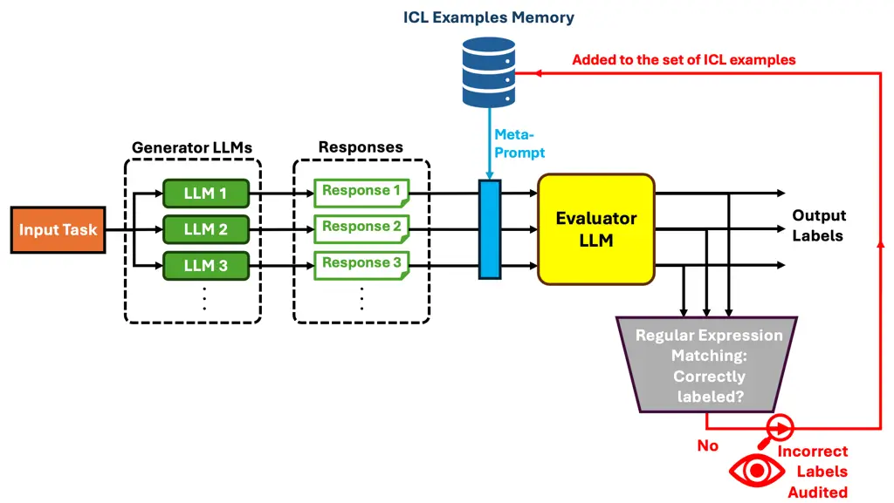

Figure 1. ALLURE architecture: a closed-loop in-context-learning
protocolsample

###### Abstract.

From grading papers to summarizing medical documents, large language
models (LLMs) are evermore used for evaluation of text generated by
humans and AI alike. However, despite their extensive utility, LLMs
exhibit distinct failure modes, necessitating a thorough audit and
improvement of their text evaluation capabilities. Here we introduce
ALLURE, a systematic approach to Auditing Large Language Models
Understanding and Reasoning Errors. ALLURE involves comparing
LLM-generated evaluations with annotated data, and iteratively
incorporating instances of significant deviation into the evaluator,
which leverages in-context learning (ICL) to enhance and improve robust
evaluation of text by LLMs. Through this iterative process, we refine
the performance of the evaluator LLM, ultimately reducing reliance on
human annotators in the evaluation process. We anticipate ALLURE to
serve diverse applications of LLMs in various domains related to
evaluation of textual data, such as medical summarization, education,
and and productivity.

###### Keywords: 

Large Language Models, Audit

## 1. Introduction

Large Language Models (LLMs) are rapidly becoming ubiquitous in
automation, such as the evaluation of text generated by humans and AI
alike (Zhao et al., 2023). Examples range from summarizing medical notes
(Singhal et al., 2023; Jain et al., 2022) and reviewing LLM output for
errors, to grading term papers and educational use (Yan et al., 2023).
In fact some studies report that humans may prefer LLMs’ summarization
in some domains (Liu et al., 2023a). However, while the accuracy of
evaluation and summarization can have critical ethical, medical, and
educational consequences (Yan et al., 2023), LLMs display identifiable
categories of failure modes when evaluating other text. For instance,
previous work has discovered a bias in LLM-based evaluators (Wang
et al., 2023a), and while others improved LLM evaluations by prompting
two LLMs to reach a mutual agreement on two answers (Li et al., 2023),
identifying and correcting these failure modes remain crucial to
tackling both technical and ethical challenges to LLM use in evaluation
and summarization of text (Yan et al., 2023; Liu et al., 2023a).

To address such challenges for LLM-based evaluation of text, here we
propose ALLURE, a protocol for systematic auditing and improving
LLM-based evaluation accuracy with iterative in-context-learning (ICL).
Using ALLURE we audit GPT-4’s evaluation of responses generated by eight
LLMs, identify their failure modes, and improve GPT-4’s evaluation
accuracy. The eight LLMs, whose resposnes were evaluated by GPT-4,
include GPT-4 (2023, 2023), GPT-3.5-turbo-175B (Ouyang et al., 2022),
text-Davinci-3-175B (Brown et al., 2020), Bard (Thoppilan et al., 2022),
Anthropic Claude-1-52B (Anthropic, 2023), LLaMA-13B (Touvron et al.,
2023), Cohere-52.4B (Cohere, 2022), Alpaca-7B (Taori et al., 2023). In
order to do so, we store examples of failures in memory and use these
examples to generate in-context-learning (ICL) prompts and iteratively
improve them to optimize GPT-4’s evaluation of text. We employ a signal
detection theoretic approach in our analysis, and apply the protocol to
GPT-4’s evaluation of planning behavior of 8 LLMs in an RL task
(Experiment 1) and improving GPT-4’s summarization of news (Experiment
2).

In our experiments, we categorized failure modes of GPT-4 as an
evaluator in two different domains: LLMs performing RL planning tasks,
and LLMs performing summarization for news articles. We then used
iterative ICL to improve GPT-4’s evaluation performance, testing the
robustness of our method by ablating instructions and prompts, number
and types of ICL examples and more guidance.

In Experiment 1, we focus on 8 LLMs’ planning output on RL tasks,
categorize their failure modes, and use iterative ICL to improve GPT-4’s
performance as an evaluator, while testing the robustness of the impact
of ICL prompts to the use of examples from different failure mode
clusters using an ablation approach. In Experiment 2, we use a similar
approach to increase GPT-4’s evaluation of news summarization by four
LLMs (T5 (Raffel et al., 2020), GPT-2 (Radford et al., 2019),
Pegasus (Zhang et al., 2020), and Improve-abs (Kryściński et al.,
2018)). We show that GPT-4’s evaluation is sensitive to the instructions
and prompts: providing more context, examples, and guidance can improve
evaluation. We used an ICL approach, and found that it is not merely the
number of examples that is used in the ICL but the type of examples
used. Namely, the examples need to be related to the specific type of
error or "failure mode", which we have identified and named in
Section 4.1.

We found that it is not merely the number of examples, but the type of
examples used in the ICL that can influence the performance of GPT-4 as
an evaluator. Namely, the examples need to be related to the specific
type of error or "failure mode", which we have identified and named in
Section 4.1. While the addition of ICL examples can improve GPT-4’s
evaluation performance, increasing the number of examples does not
improve performance in an additive manner (both at a problem class and
overall). Notably, we observed that, increasing the number of examples
in ICL initially, leads to a dip in ICL-based improvement, but improves
after a certain amount is added. Furthermore, we found that different
set of "similar" ICL examples yields asymmetric improvements in GPT-4’s
evaluation accuracy. This points to the importance of analyzing selected
examples for ICL prompts holistically, considering the relationship of
different clusters of failure modes and categories of examples.

## 2. Related work

The swift progress of Large Language Models (LLMs) has emphasized the
significance of assessing their generated responses. Conventional n-gram
metrics such as ROUGE (ROUGE, 2004), and sophisticated model-based
evaluations such as BERTScore(Zhang et al., 2019) and BARTScore (Yuan
et al., 2021), are not sufficient for such a thorough assessment (He
et al., 2022). There has been a series of work which use ChatGPT and
GPT-4 as evaluators. For example, (Wang et al., 2023b) uses ChatGPT to
evaluate five NLG meta-evaluation datasets including summarization,
story generation and data-to-text tasks. They find that the ChatGPT
evaluator has a high correlation with humans in most cases, especially
for creative NLG tasks (e.g., story generation). GPTScore (Fu et al., 2023) evaluates texts using GPT-3 by formulating the evaluation task as
a conditional generation problem. On the other hand, (Liu et al.,
2023b), the authors use GPT-3.5 and GPT-4 to formulate the evaluation
task as a form-filling problem. They demonstrate human-level evaluation
capability in various NLP tasks.

In (Kiciman et al., 2023), the algorithms based on GPT-3.5 and GPT-4
outperform existing algorithms on the causal discovery, counterfactual
reasoning, and actual causality inferring. The authors in (Zheng et al., 2023) present LLM-as-a-judge evaluate models on more open-ended
questions and conclude that it is a scalable and explainable way to
approximate human preferences. Despite all the impressive successes,
these LLMs are not reliable. The authors in (Zhuo et al., 2023) found
that the fact-based question-answering capability of ChatGPT does not
improve compared to its predecessors. Hence, it is risky to use these
models in domains where factual correctness is critical, for instance in
legal domain (Deroy et al., 2023) where they conclude that LLMs are not
ready for fully automatic deployment for legal case judgement
summarization and human-in-the-loop approach (manually annotating for
inconsistencies) is rather more suitable. Furthermore, these LLMs are
sensitive to the prompts, instructions and inputs (Turpin et al., 2023)
and one can skew the evaluation results by easy manipulations (Wang
et al., 2023a) .

## 3. In-Context-learning and ALLURE

In-context-learning (ICL) refers to the process of using the given
context to guide a model’s understanding and response generation. Unlike
traditional methods, where models are fine-tuned on specific tasks with
pre-defined objectives, ICL leverages the immediate context (e.g.,
through several examples) to make better predictions and generate more
accurate responses (Radford et al., 2019). ICL is especially relevant in
LLM-based evaluation of text, where context plays a crucial role in
comprehending and generating meaningful, coherent evaluation. By
considering the immediate context, models can better adapt to variations
in language, style, and content, subsequently enhancing their overall
performance (Brown et al., 2020).

The primary concept of ICL is acquiring knowledge through analogies
(Winston, 1980). Initially, ICL needs several examples to establish a
demonstration context, typically presented in natural language templates
(Liu et al., 2021; Su et al., 2022). Following this, ICL combines a
query with the demonstration context to create a prompt, which is then
given as an input to the language model for predictions. ICL avoids
parameter updates and directly executes predictions using pre-trained
language models, in contrast with supervised learning which demands a
training phase involving gradient descent to modify model parameters.
The model is anticipated to discern the concealed pattern within the
demonstration and subsequently generate accurate predictions (Dong
et al., 2023).

ICL can be thought of in relation to the notion of episodic memory in
reinforcement learning (RL) and meta-learning (Gershman and Daw, 2017).
Episodic memory stores records of critical past events, bundling
memories that are similar within a given context. The context or items
are in turn retrieved as reference points when making new decisions that
are similar to these past experiences along one feature dimension or
other. In RL, episodic memory can enable an agent to approximate value
functions over complex state spaces, generalization of structures and
context, learn with low number of samples, and given long-term
dependencies between actions and rewards (Gershman and Daw, 2017;
Momennejad, 2020; Momennejad et al., 2018). In short, episodic memory
offers a solution to avoid forgetting and improve generalization while
training with a lower sample complexity  (Lengyel and Dayan, 2007;
Blundell et al., 2016).

The ICL approach presents numerous appealing benefits as a novel
paradigm. Firstly, it mirrors the human decision-making process by
drawing on analogies. In addition, the use of natural language for
demonstrations enables an intelligible interface for interaction with
LLMs. Thus, the integration of human expertise by modifying
demonstrations and templates is simplified. Lastly, in contrast to
supervised training, ICL operates as a training-free learning framework,
which not only substantially lowers computational expenses for adapting
to new real-world tasks (Dong et al., 2023). Although ICL shows promise,
further investigation reveals that it can be unstable: the choice of
prompt format, training examples, and even the order of the examples can
cause accuracy to vary from near chance to near state-of-the-art (Zhao
et al., 2021). The functioning mechanism of the ICL remains ambiguous,
and only a limited number of studies have offered initial clarifications
(Dai et al., 2023).

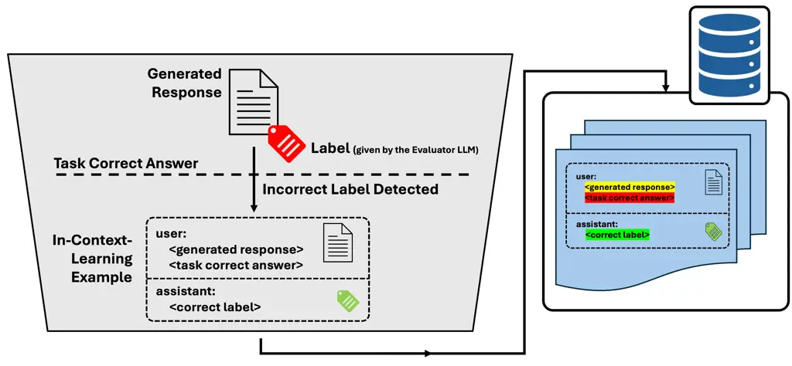

Figure 2. A close-up view of the trapezoid within the ALLURE
architecture, as shown in Figure 1. The generated response by a
task-receiving LLM are compared against the correct answer
automatically. Consider a binary classification task. If the generated
response matches the correct answer and the assigned label is “label:
0”, or the generated response does not match the correct answer and the
assigned label is “label: 1”, then the assigned label by the evaluator
LLM is potentially incorrect. From the generated response and the
assigned label, an in-context-learning (ICL) example is generated using
a predefined template. In the constructed ICL example, a (hypothetical)
user repeats the response, and an (hypothetical) assistant assigns the
correct label, setting an example for the evaluator. This is then
audited by a human to ensure the quality of the generated ICL examples
as in Figure 1. The ICL examples are finally stored in the memory, where
each example includes the generated response, the task correct answer,
and the correct label.

ALLURE: In this paper, we put forth a semi-automated closed-loop
approach for ICL, which is based on the protocol depicted in Figure 1.
In the first loop, the Evaluator LLM assesses the Responses generated by
the Generator LLMs and assigns a label to each response. The correctness
of the generated labels are verified using Regular Expression Matching
between the generated responses and the correct response to the Input
Task. Regular expressions are patterns that are widely used to match
character combinations in text. The regular expression matching filters
out potential candidates for ICL when the evaluator labels are wrong.
When discovering such erroneous labels, an ICL example is constructed
following the framework in Figure 2.

The structure of the constructed ICL example is as follows. The user
reiterates the response along with the expected correct answer, and the
assistant, i.e., the evaluator LLM, assigns the correct label. The
constructed ICL example is then audited to ensure the correctness of the
assigned label. If the ICL example passes the audit, then it is added to
the ICL Examples Memory database. The examples in this database are
presented to the evaluator LLM as a meta-prompt which essentially
robustifies the evaluator against its past mistakes. Similar to the
episodic memory in RL, this memory database grows as the evaluator
interacts with more tasks, allowing the evaluator to generate more
accurate labels for unseen tasks.

## 4. Experiment 1: Auditing GPT-4’s evaluation of planning behavior in eight LLMs

Most LLMs struggle with planning behavior  (Momennejad et al., 2023).
The experiments discussed in this section are based on the findings
in (Momennejad et al., 2023). The authors in (Momennejad et al., 2023)
investigated whether state-of-the-art LLMs understand the latent
structure of planning problems in several cognitive maps. A cognitive
map is a representation of latent relational structures that underlies a
task in an environment, and supports decision-making, reasoning, and
deduction in both biological and artificial agents (Tolman, 1948;
Behrens et al., 2018; Momennejad, 2020; Brunec and Momennejad, 2022).
Such representations also emerge in model-based (Sutton and Barto, 2018)
or task-oriented model-free reinforcement learning (RL) (Hasanbeig
et al., 2018; Hasanbeig et al., 2019a; Hasanbeig et al., 2019b;
Hasanbeig et al., 2020; Hasanbeig, 2020; Hasanbeig et al., 2021;
Hasanbeig et al., 2022; Hasanbeig et al., 2023a; Hasanbeig et al.,
2023b), which capture a latent construct of the task.

To measure LLMs behavioral signatures, the prompts designed in
(Momennejad et al., 2023) make use of several cognitive maps in a set of
tasks adapted from existing human behavioral experiments (Schapiro
et al., 2013; Momennejad et al., 2017; Momennejad et al., 2018;
Momennejad et al., 2019; Pudhiyidath et al., 2022). These engineered
prompts are then evaluated over eight different LLMs (GPT-4 (2023,
2023), GPT-3.5-turbo-175B (Ouyang et al., 2022),
text-Davinci-3-175B (Brown et al., 2020), Bard (Thoppilan et al., 2022),
Anthropic Claude-1-52B (Anthropic, 2023), LLaMA-13B (Touvron et al.,
2023), Cohere-52.4B (Cohere, 2022), Alpaca-7B (Taori et al., 2023)), and
the recorded responses are available online (CogMaps, 2023). To verify
whether the recorded responses are indeed correct, (Momennejad et al., 2023) uses GPT-4 as the "Evaluator LLM" to assign scores of $`1`$ or
$`0`$, depending on whether the recorded response is correct or not,
respectively. Despite reducing human labor, this process is not
mistake-proof and the authors in (Momennejad et al., 2023) reported an
auditing process over the scores given by GPT-4 to ensure accuracy.

In this section, we propose a semi-automated closed-loop
in-context-learning approach based on the protocol presented in
Figure 1. The responses collected from each LLM are initially scored by
GPT-4, and the score labels are checked against the correct answers for
each task. This allows us to identify and categorize false negative and
false positive labels. Upon finding such incorrect labels, an ICL
example is generated as per Figure 2. Firstly, the score label assigned
by the evaluator LLM (GPT-4 in this case) and the generated response
(e.g., by LLaMA-13B) are compared against the correct answer. If the
assigned label is incorrect, an ICL example is generated in which the
user repeats the response and the expected correct answer, and then the
assistant assigns the correct label (in this case, the negation of the
incorrect label).

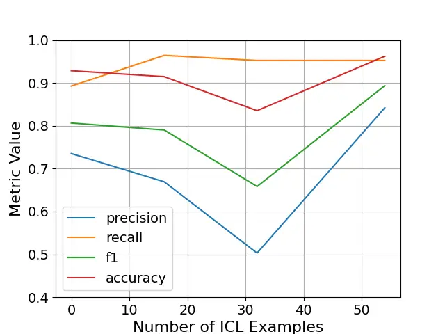

(a)

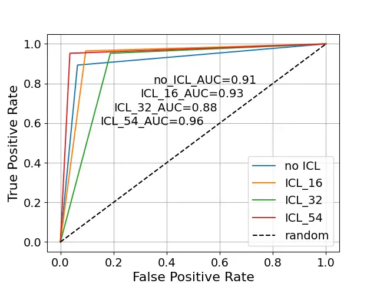

(b)

Figure 3. The Effect of the number of in-context-learning (ICL) examples
on the performance of the evaluator LLM. (a) The accuracy of a (label)
classification model is evaluated using the F1 score, which is a metric
that considers both precision and recall. The F1 score represents the
harmonic mean of these two factors, thus providing a balanced assessment
of the model’s performance, which is particularly useful when the data
is imbalanced. With a range between $`0`$ and $`1`$, a higher F1 score
indicates that the model is able to accurately identify both positive
and negative instances due to its high precision and recall. The total
number of evaluated responses is 504. (b) Area under the curve (AUC) is
another metric used widely in statistics and machine learning, borrowed
from signal processing, to evaluate the performance of a model. It
represents the probability that a randomly chosen positive example will
be ranked higher than a randomly chosen negative example, and ranges
from $`0`$ to $`1`$, with higher values indicating better model
performance. “x” in “ICL$`\_`$x”, refers to the number of ICL examples
in the meta-prompt provided to the evaluator LLM.

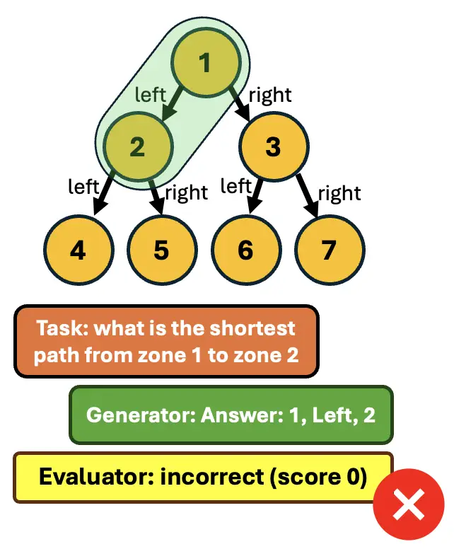

(a)

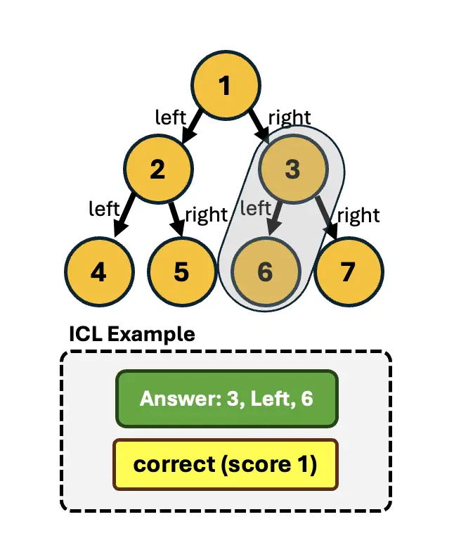

(b)

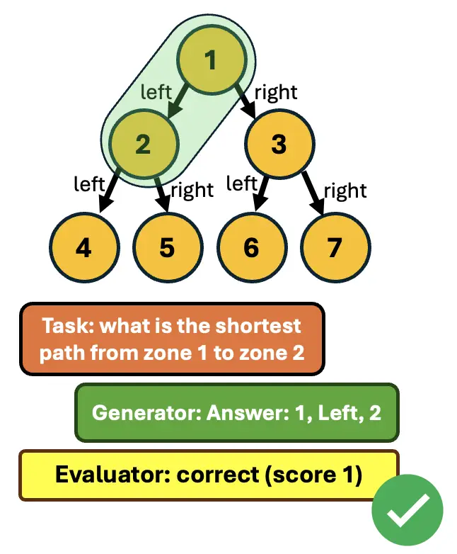

(c)

Figure 4. An instance of generalization with ICL in the Experiment 1.
(a) A correct response generated by text-Davinci-3 and an incorrect
label that is assigned by GPT-4 (without ICL robustification). (b) An
ICL example from a different task that is added to the GPT-4 meta-prompt
(c) GPT-4 generalized from the ICL example and corrected the
previously-incorrect score label.

For each cognitive map in (Momennejad et al., 2023), we gathered a set
of ICL examples, and whenever the input task is defined over a specific
cognitive map, the relevant subset of the ICL examples are given to the
evaluator LLM as a meta-prompt to the input responses (Figure 1). In
this meta-prompt, the generated ICL examples are concatenated to
robustify the evaluator LLM against its previous incorrect score labels.
To assess how the inclusion of additional ICL examples impacts the
performance of evaluator LLM, we uniformly sampled specific proportions
from the ICL examples dataset. The results are summarized in Figure 3,
where the evaluator is provided with different number of ICL examples.
There is an interesting dip in the performance of the evaluator as the
number of ICL examples grows, which points at the fact that certain ICL
examples are more critical.

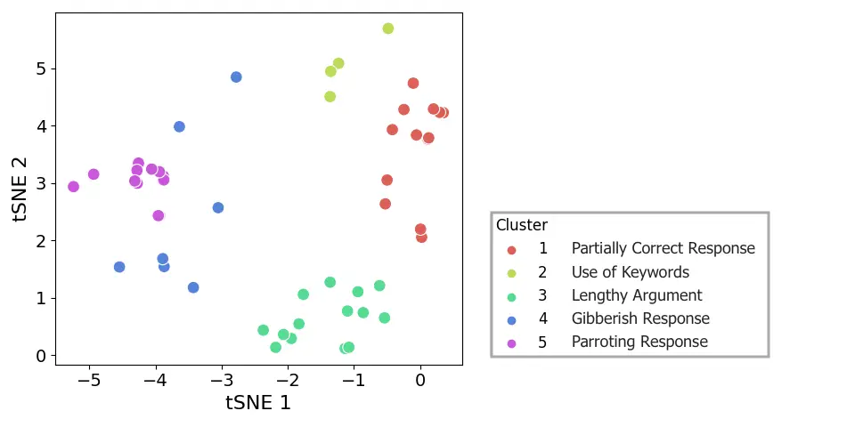

Figure 5. Visualization of the failure mode categories. Experiment 1
revealed a correlation between the failure of the evaluator LLM and the
style of the generated response by the generator LLMs. To examine this
correlation, we categorized the failure modes that are used for ICL
examples construction (Section 4.1), and used the SBERT sentence
transformer (Reimers and Gurevych, 2019) to generate embeddings to
measure the similarity between these failure modes. These embeddings are
projected onto a two dimensional plane using tSNE (Hinton and Roweis, 2002) to preserve the closest $`k`$-points from the original 384
dimensional embedding. Note that the differentiation among the clusters
is evident, and those that are (contextually) more similar are situated
nearby.

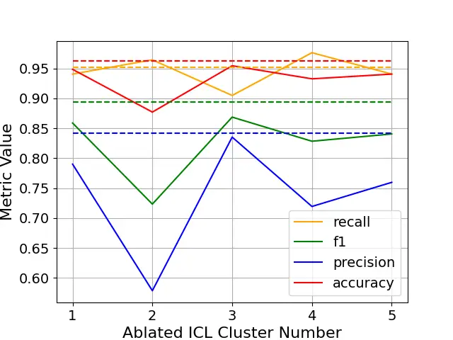

(a)

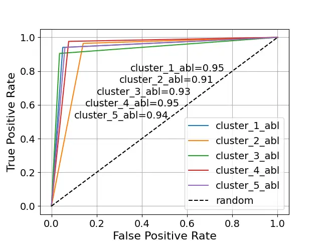

(b)

Figure 6. Cluster ablation test. (a) The performance of the evaluator
significantly changes as we ablate ICL clusters. The dashed lines
indicate the corresponding metric values when there is no cluster
ablation. Ablating Cluster 2 (Use of Keywords) has the greatest impact
on the performance of the evaluator LLM. (b) Changes in AUC as the
clusters are ablated. AUC when there is no ablation is $`0.96`$ as per
Figure 3b.

Furthermore, we observed many instances in which the evaluator LLM
generalized from the ICL examples and provided correct score labels for
unseen tasks, indicating improvement in its robustness. An example of
such generalization is provided in Figure 4. As in Figure 4a, the
generated response by text-Davinci-3 is “Answer: 1, Left, 2” and the
correct expected answer is “Answer: 1, 2”. Without any ICL
robustification, the evaluator LLM (GPT-4) assigned the score label of
“score: 0” to this response. However, the generated response is in fact
correct since in this cognitive map, the extra word “left” refers to the
left edge from node 1 which leads to node 2. A similar (but not exact)
instance has been observed before and recorded as part of the ICL
examples, as shown in Figure 4b. The provided ICL in Figure 4b instructs
the evaluator LLM (GPT-4), through an example, that in this cognitive
map, a response that includes the edge name “left” is indeed correct.
Specifically, the correct score label for a generated response “Answer:
3, Left, 6” with the expected answer “Answer: 3, 6” is “score: 1”, i.e.,
correct. After adding this ICL example to the meta-prompt provided to
the evaluator LLM, we observed that the evaluator LLM was able to
generalize and correct its label, as shown in Figure 4c.

To further investigate this, in the following, we identify the evaluator
failure modes that are recorded as ICL examples, and then categorize
them into different clusters. Further, we systematically analyze the
effect of each of these clusters on the performance of the evaluator.

### 4.1. Categorizing Failure Modes

When auditing the generated responses by different LLMs, the authors
in (Momennejad et al., 2023) reported co-occurences between the failure
of the evaluator LLM and the style of the generated response by these
LLMs. This finding is similar to results from  (Zou et al., 2023) which
leverage probable continuations from open source decoder models to
construct a suffix which maximizes the likelihood of aligned decoder
model to respond to malicious queries. To better understand this
potential correlation, we first introduce the following categories of
the responses that managed to deceive the evaluator LLM. We also provide
examples of these failure modes below:

1.  (1)
    Deceived by Partial Correctness: A response which contains a portion
    of the expected answer but is either incomplete or includes
    factually incorrect statements.

    

2.  (2)
    Deceived by Keywords: A response which includes certain keywords
    from the input task, and the mere inclusion of such keywords
    resulted in an incorrect evaluation.

    

3.  (3)
    Deceived by Lengthy Argument: A non-concise response which might be
    only tangentially related the task and may not even answer the
    question explicitly.

    

4.  (4)
    Deceived by Gibberish: A generated response which is unintelligible
    to a human, e.g., auditor, and sometimes is in the context of the
    prompt.

    

5.  (5)
    Deceived by Parroting: A response that repeats the input task or
    prompt one or more times without novel continuation.

    

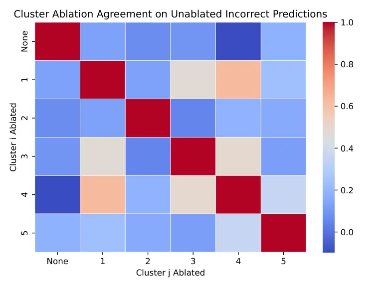

(a)

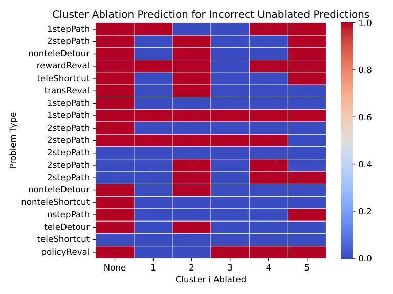

(b)

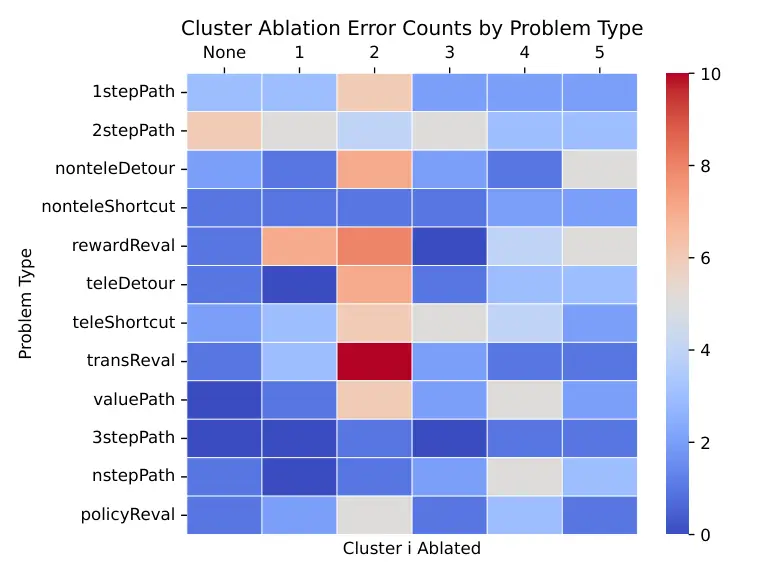

(c)

Figure 7. Ablating ICL examples by failure mode. We investigated which
examples, from which failure mode cluster defined in Section  4.1, were
crucial to the success of ICL prompts. To do so, we used ablation to
probe the effect of each cluster of examples on the effectiveness of the
ICL prompt. That is, we systematically kept everything in a given ICL
prompt the same but removed examples that belonged to a specific cluster
of failure modes. We then re-run the evaluator with the ablated ICL. (a)
Ablation of examples from each cluster of failure mode led to dissimilar
performance compared with performance using the original ICL (pairwise
comparison, Cohen’s Kappa  (Cohen, 1960)). (b) Demonstrated the
influence of ablated examples from each failure mode cluster on the
Evaluator’s behavior. (c) Error counts by problem type for each cluster
ablation. The original ICL prompt yielded a total of 19 errors. Ablating
Cluster 2 had the largest impact on performance, yielding 62 errors,
while ablating Cluster 3 had the least impact on performance, yielding
23 incorrect predictions.

Each of the above categories include several ICL examples in (Momennejad
et al., 2023), and we can form five ICL clusters accordingly. To better
visualize and assess pairwise similarity of these ICL clusters we
leveraged SBERT sentence transformer (Reimers and Gurevych, 2019), a
state-of-the-art model for text semantic similarity analysis. Each ICL
example is encoded into a $`384`$-dimensional embedding, and is
projected into a $`2`$D tSNE map as shown in Figure 5. The distinction
between the clusters is noticeable, and the clusters that are
contextually closer are adjacent, e.g., Cluster 1 (Partial Correctness)
and Cluster 2 (Use of Keywords) or Cluster 4 (Gibberish Response) and
Cluster 5 (Parroting Response).

To identify the most relevant ICL clusters, in what follows, we conduct
a systematic cluster ablation test where in each step we remove a
cluster from the set of ICL examples and analyze the change in the
evaluator performance. The test results are summarized in Figure 6. It
is evident that the ablation of Cluster 2 (ICLs that include Keywords)
from the set of ICL examples has the most significant impact on the
performance of the evaluator. Namely, robustifying the evaluator using
ICL against its 2nd failure mode (i.e., Deceived by Keywords) appears to
be most crucial in CogEval.

To further investigate the similarities (and dissimilarities) between
the ICL clusters we focused deeper on the score labels generated by the
evaluator when a cluster is ablated.

Figure  7c demonstrates that the benefits of ICL are non-additive. This
can be observed by the model performance on teleDetour where ablating
cluster 1 increases the performance but ablating cluster 2 decreases the
performance. Further we see an asymmetry to the importance per ICL
cluster. Ablating Cluster 2 had a substantial impact increasing the
total number of errors by 226 percent while ablating Cluster 3 increased
errors by 21 percent. This highlighted that relationships between the
ICL examples also changed the evaluator’s behavior. Therefore, it is
important when picking ICL examples to not only focus on the
relationship between the example and the question but also potential
relationships which may exist between ICL examples.

## 5. Experiment 2: Auditing Text Summarization

In this section, we evaluate the factual correctness of the
summarization. We use the SummEval data (Fabbri et al., 2020), which is
based on the CNN/DailyMail dataset (Hermann et al., 2015). It contains
human ratings on four aspects of each summary: fluency, coherence,
consistency and relevance on a scale of $`1-5`$. We focus on the factual
correctness of the summary, given by the consistency score. We consider
a summary to be factually incorrect if the consistency score is less
than $`2.5`$, otherwise it is factually correct. We select the summaries
generated by GPT-2, T5, Pegasus and Improve-abs¹¹ 1
[https://github.com/Yale-LILY/SummEval](https://github.com/Yale-LILY/SummEval).
Given the document and its summary, we use GPT-4 for evaluation. It
outputs the score as $`1`$ if the summary if factually correct,
otherwise the score is $`0`$ for summaries with hallucinations. Similar
to G-Eval (Liu et al., 2023b), which uses LLM like GPT-4 and GPT-3.5
(text-davinci-003) to score the documents and summaries, and measures
the correlations with human score, we have the following
chain-of-thoughts (CoT) prompt for evaluation:

The examples consist of the source text, summary and consistency score
as shown below:

We use GPT-4 to score the consistency of a given source text and summary
and then we measure the accuracy of these predictions against the human
annotations. Figure 8 shows the accuracy of GPT-4 predictions for
factual correctness with the number of ICL examples in the prompt for
SummEval dataset where the accuracy is measured with respect to human
labels for factual correctness (also called the consistency aspect in
the database). We found that with 4 or more demonstration examples, the
accuracy does improve for the evaluator.

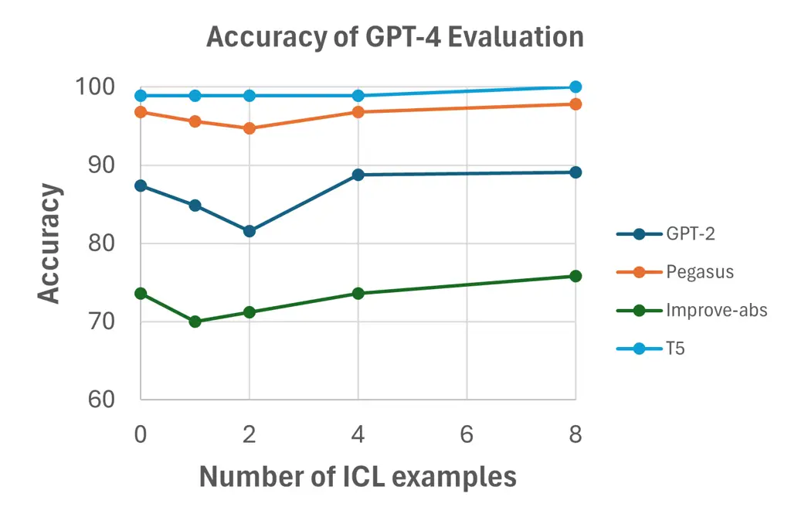

Figure 8. Changes in GPT-4’s evaluation accuracy with increasing number
of ICL examples. GPT-4 evaluated the factual correctness of news
summarization (also called "consistency" in the original database) by
four LLMs: GPT-2, T5, Pegasus and Improve-abs. We compared each LLM’s
generated summaries with human labels to compute factual correctness. We
observe that adding 4 or more ICL examples improves GPT-4’s evaluation
of summarization by all four LLMs.

## 6. Discussion and future directions

LLMs are widely used to automate evaluation of educational and medical
text, in spite of displaying failure modes that pose ethical and
technical challenges (Yan et al., 2023). Thus, despite the extensive
utility of LLMs in tasks such as grading papers, assessing summarized
medical documents, or analyzing user responses, their text evaluation
capabilities still require a thorough audit and improvement. To address
this challenge, we propose ALLURE, a systematic protocol for auditing
and improving LLM-based evaluation of text using iterative ICL.

ALLURE compares LLM-generated evaluations with annotated data,
iteratively incorporating instances of significant deviation into the
evaluator’s ICL prompts (context). The approach leverages in-context
learning (ICL) to enhance and improve the robust evaluation of text by
LLMs. We improve and investigate improvements due to ICL in two ways.
First, ALLURE iteratively adds corrected examples of failure modes to
the ICL prompts in order to improve evaluation. Second, we use ablation
to understand which specific examples (related to the same cluster of
failure modes) were crucial to the improvements. Through this iterative
process and ablation, our goal was to refine the performance of the
evaluator LLM with minimal ICL, ultimately reducing the reliance on
human annotators in the evaluation process.

We found that while ICL examples can improve GPT-4’s evaluation
performance, merely increasing the number of examples does not improve
performance in an additive manner (both at a problem class and overall).
In fact, increasing the number of examples in ICL initially leads to a
dip in ICL-based improvement, but improves after a certain amount is
added (decrease up to 30 and then improvement overall at 45 number of
ICL). Furthermore, we find that different sets or clusters of "similar"
ICL examples (categorized based on different failure modes) yield
asymmetric improvements in GPT-4’s evaluation accuracy. This points to
the importance of analyzing selected examples for ICL prompts
holistically, considering the relationship of different clusters of
failure modes and categories of examples.

Future directions include a thorough analysis of attention mechanisms
underlying the improvements due to ICL. Another direction is a thorough
analysis of the changes induced by ALLURE’s ICL on the underlying
embeddings, or latent representations. It would be interesting to come
up with metrics to measure the contributions of ICL to changes in
attention and embeddings that mediate the improvements. Finally, while
ALLURE reduces reliance on humans by using a systematic protocol, one
limitation of the current approach is that the ICL prompts still require
a human in the loop. An important future direction would be to automate
the entire achieve out of distribution (OOD) generalization. One
possible approach would be to automate extraction of the relevant
features and examples of failure modes, automate the iterative process
of ICL generation and re-running of the evaluation, and automate the
auditing of GPT-4’s evaluation.

To summarize, we propose ALLURE, a systematic protocol for Auditing and
Improving Large Language Model based evaluation of text. We expect that
ALLURE will benefit diverse applications of LLMs in various domains
related to the evaluation of textual data, potentially enhancing
productivity in these fields. By addressing the limitations of LLMs and
improving their text evaluation capabilities, ALLURE represents a
significant step forward in the optimization and adaptation of large
language models for a wide range of evaluation tasks.

###### Acknowledgements.

We would like to thank Richard Ciapala for engineering support.

## References

- 2023 (2023) OpenAI 2023. 2023. GPT-4 technical report. _arXiv preprint
  arXiv:2303.08774_ (2023).
- Anthropic (2023) Anthropic. 2023. Introducing Claude.
  [https://www.anthropic.com/index/introducing-claude](https://www.anthropic.com/index/introducing-claude).
  \[Online\].
- Behrens et al. (2018) Timothy EJ Behrens, Timothy H Muller, James CR
  Whittington, Shirley Mark, Alon B Baram, Kimberly L Stachenfeld, and
  Zeb Kurth-Nelson. 2018. What is a cognitive map? Organizing knowledge
  for flexible behavior. _Neuron_ 100, 2 (2018), 490–509.
- Blundell et al. (2016) Charles Blundell, Benigno Uria, Alexander
  Pritzel, Yazhe Li, Avraham Ruderman, Joel Z Leibo, Jack Rae, Daan
  Wierstra, and Demis Hassabis. 2016. Model-free episodic control.
  _arXiv preprint arXiv:1606.04460_ (2016).
- Brown et al. (2020) Tom Brown, Benjamin Mann, Nick Ryder, Melanie
  Subbiah, Jared D Kaplan, Prafulla Dhariwal, Arvind Neelakantan, Pranav
  Shyam, Girish Sastry, Amanda Askell, et al. 2020. Language models are
  few-shot learners. _Advances in neural information processing systems_
  33 (2020), 1877–1901.
- Brunec and Momennejad (2022) Iva K Brunec and Ida Momennejad. 2022.
  Predictive representations in hippocampal and prefrontal hierarchies.
  _Journal of Neuroscience_ 42, 2 (2022), 299–312.
- CogMaps (2023) CogMaps. 2023. CogEval Prompts and Responses.
  [https://github.com/cogeval/cogmaps](https://github.com/cogeval/cogmaps).
- Cohen (1960) J. Cohen. 1960. A Coefficient of Agreement for Nominal
  Scales. _Educational and Psychological Measurement_ 20, 1 (1960), 37.
- Cohere (2022) Cohere. 2022. Introducing Cohere.
  [https://txt.cohere.com/cohere-launches-extremely-large-beta-2](https://txt.cohere.com/cohere-launches-extremely-large-beta-2).
  \[Online\].
- Dai et al. (2023) Damai Dai, Yutao Sun, Li Dong, Yaru Hao, Shuming Ma,
  Zhifang Sui, and Furu Wei. 2023. Why Can GPT Learn In-Context?
  Language Models Implicitly Perform Gradient Descent as
  Meta-Optimizers. arXiv:2212.10559 \[cs.CL\]
- Deroy et al. (2023) Aniket Deroy, Kripabandhu Ghosh, and Saptarshi
  Ghosh. 2023. How Ready are Pre-trained Abstractive Models and LLMs for
  Legal Case Judgement Summarization? arXiv:2306.01248 \[cs.CL\]
- Dong et al. (2023) Qingxiu Dong, Lei Li, Damai Dai, Ce Zheng, Zhiyong
  Wu, Baobao Chang, Xu Sun, Jingjing Xu, Lei Li, and Zhifang Sui. 2023.
  A Survey on In-context Learning. arXiv:2301.00234 \[cs.CL\]
- Fabbri et al. (2020) Alexander R Fabbri, Wojciech Kryściński, Bryan
  McCann, Caiming Xiong, Richard Socher, and Dragomir Radev. 2020.
  SummEval: Re-evaluating Summarization Evaluation. _arXiv preprint
  arXiv:2007.12626_ (2020).
- Fu et al. (2023) Jinlan Fu, See-Kiong Ng, Zhengbao Jiang, and Pengfei
  Liu. 2023. Gptscore: Evaluate as you desire. _arXiv preprint
  arXiv:2302.04166_ (2023).
- Gershman and Daw (2017) Samuel J Gershman and Nathaniel D Daw. 2017.
  Reinforcement Learning and Episodic Memory in Humans and Animals: An
  Integrative Framework. _Annu. Rev. Psychol._ 68, 1 (Jan. 2017),
  101–128.
- Hasanbeig (2020) Hosein Hasanbeig. 2020. _Safe and certified
  reinforcement learning with logical constraints_. Ph. D. Dissertation.
  University of Oxford.
- Hasanbeig et al. (2018) Hosein Hasanbeig, Alessandro Abate, and Daniel
  Kroening. 2018. Logically-constrained reinforcement learning. _arXiv
  preprint arXiv:1801.08099_ (2018).
- Hasanbeig et al. (2019a) Hosein Hasanbeig, Alessandro Abate, and
  Daniel Kroening. 2019a. Logically-Constrained Neural Fitted
  Q-Iteration. In _Proceedings of the 18th International Conference on
  Autonomous Agents and MultiAgent Systems_. International Foundation
  for Autonomous Agents and Multiagent Systems, 2012–2014.
- Hasanbeig et al. (2020) Hosein Hasanbeig, Alessandro Abate, and Daniel
  Kroening. 2020. Cautious reinforcement learning with logical
  constraints. _arXiv preprint arXiv:2002.12156_ (2020).
- Hasanbeig et al. (2021) Hosein Hasanbeig, Natasha Yogananda Jeppu,
  Alessandro Abate, Tom Melham, and Daniel Kroening. 2021. DeepSynth:
  Automata synthesis for automatic task segmentation in deep
  reinforcement learning. In _Proceedings of the AAAI Conference on
  Artificial Intelligence_, Vol. 35. 7647–7656.
- Hasanbeig et al. (2019b) Hosein Hasanbeig, Yiannis Kantaros,
  Alessandro Abate, Daniel Kroening, George J Pappas, and Insup Lee.
  2019b. Reinforcement Learning for Temporal Logic Control Synthesis
  with Probabilistic Satisfaction Guarantees. In _Proceedings of the
  58th Conference on Decision and Control_. IEEE, 5338–5343.
- Hasanbeig et al. (2022) Hosein Hasanbeig, Daniel Kroening, and
  Alessandro Abate. 2022. LCRL: Certified policy synthesis via
  logically-constrained reinforcement learning. In _International
  Conference on Quantitative Evaluation of Systems_. Springer, 217–231.
- Hasanbeig et al. (2023a) Hosein Hasanbeig, Daniel Kroening, and
  Alessandro Abate. 2023a. Certified Reinforcement Learning with Logic
  Guidance. _Artificial Intelligence_ (2023), 103949.
  [https://doi.org/10.1016/j.artint.2023.103949](https://doi.org/10.1016/j.artint.2023.103949)
- Hasanbeig et al. (2023b) Hosein Hasanbeig, Natasha Yogananda Jeppu,
  Alessandro Abate, Tom Melham, and Daniel Kroening. 2023b. Symbolic
  Task Inference in Deep Reinforcement Learning. _Journal of Artificial
  Intelligence Research (JAIR)_ (2023).
- He et al. (2022) Tianxing He, Jingyu Zhang, Tianle Wang, Sachin Kumar,
  Kyunghyun Cho, James Glass, and Yulia Tsvetkov. 2022. On the blind
  spots of model-based evaluation metrics for text generation. _arXiv
  preprint arXiv:2212.10020_ (2022).
- Hermann et al. (2015) Karl Moritz Hermann, Tomas Kocisky, Edward
  Grefenstette, Lasse Espeholt, Will Kay, Mustafa Suleyman, and Phil
  Blunsom. 2015. Teaching machines to read and comprehend. _Advances in
  neural information processing systems_ 28 (2015).
- Hinton and Roweis (2002) Geoffrey E Hinton and Sam Roweis. 2002.
  Stochastic neighbor embedding. _Advances in neural information
  processing systems_ 15 (2002).
- Jain et al. (2022) Raghav Jain, Anubhav Jangra, Sriparna Saha, and
  Adam Jatowt. 2022. A Survey on Medical Document Summarization.
  arXiv:2212.01669 \[cs.CL\]
- Kiciman et al. (2023) Emre Kiciman, Robert Ness, Amit Sharma, and
  Chenhao Tan. 2023. Causal Reasoning and Large Language Models: Opening
  a New Frontier for Causality. arXiv:2305.00050 \[cs.AI\]
- Kryściński et al. (2018) Wojciech Kryściński, Romain Paulus, Caiming
  Xiong, and Richard Socher. 2018. Improving abstraction in text
  summarization. _arXiv preprint arXiv:1808.07913_ (2018).
- Lengyel and Dayan (2007) Máté Lengyel and Peter Dayan. 2007.
  Hippocampal contributions to control: the third way. _Advances in
  neural information processing systems_ 20 (2007).
- Li et al. (2023) Ruosen Li, Teerth Patel, and Xinya Du. 2023. PRD:
  Peer Rank and Discussion Improve Large Language Model based
  Evaluations. arXiv:2307.02762 \[cs.CL\]
- Liu et al. (2021) Jiachang Liu, Dinghan Shen, Yizhe Zhang, Bill Dolan,
  Lawrence Carin, and Weizhu Chen. 2021. What Makes Good In-Context
  Examples for GPT-$`3`$? _arXiv preprint arXiv:2101.06804_ (2021).
- Liu et al. (2023a) Yixin Liu, Alexander R. Fabbri, Pengfei Liu,
  Dragomir Radev, and Arman Cohan. 2023a. On Learning to Summarize with
  Large Language Models as References. arXiv:2305.14239 \[cs.CL\]
- Liu et al. (2023b) Yang Liu, Dan Iter, Yichong Xu, Shuohang Wang,
  Ruochen Xu, and Chenguang Zhu. 2023b. Gpteval: Nlg evaluation using
  gpt-4 with better human alignment. _arXiv preprint arXiv:2303.16634_
  (2023).
- Momennejad (2020) Ida Momennejad. 2020. Learning structures:
  predictive representations, replay, and generalization. _Current
  Opinion in Behavioral Sciences_ 32 (2020), 155–166.
- Momennejad et al. (2019) Ida Momennejad, Ajua Duker, and Alin
  Coman. 2019. Bridge ties bind collective memories. _Nature
  communications_ 10, 1 (2019), 1578.
- Momennejad et al. (2023) Ida Momennejad, Hosein Hasanbeig, Felipe
  Frujeri, Hiteshi Sharma, Robert Ness, Nebojsa Jojic, Hamid Palangi,
  and Jonathan Larson. 2023. Evaluating Cognitive Maps in Large Language
  Models: No Emergent Planning. _Advances in Neural Information
  Processing Systems_ (2023).
- Momennejad et al. (2018) Ida Momennejad, A Ross Otto, Nathaniel D Daw,
  and Kenneth A Norman. 2018. Offline replay supports planning in human
  reinforcement learning. _elife_ 7 (2018), e32548.
- Momennejad et al. (2017) Ida Momennejad, Evan M Russek, Jin H Cheong,
  Matthew M Botvinick, Nathaniel Douglass Daw, and Samuel J
  Gershman. 2017. The successor representation in human reinforcement
  learning. _Nature human behaviour_ 1, 9 (2017), 680–692.
- Ouyang et al. (2022) Long Ouyang, Jeffrey Wu, Xu Jiang, Diogo Almeida,
  Carroll Wainwright, Pamela Mishkin, Chong Zhang, Sandhini Agarwal,
  Katarina Slama, Alex Ray, et al. 2022. Training language models to
  follow instructions with human feedback. _Advances in Neural
  Information Processing Systems_ 35 (2022), 27730–27744.
- Pudhiyidath et al. (2022) Athula Pudhiyidath, Neal W Morton, Rodrigo
  Viveros Duran, Anna C Schapiro, Ida Momennejad, Demitrius M
  Hinojosa-Rowland, Robert J Molitor, and Alison R Preston. 2022.
  Representations of temporal community structure in hippocampus and
  precuneus predict inductive reasoning decisions. _Journal of Cognitive
  Neuroscience_ 34, 10 (2022), 1736–1760.
- Radford et al. (2019) Alec Radford, Jeffrey Wu, Rewon Child, David
  Luan, Dario Amodei, Ilya Sutskever, et al. 2019. Language models are
  unsupervised multitask learners. _OpenAI blog_ 1, 8 (2019), 9.
- Raffel et al. (2020) Colin Raffel, Noam Shazeer, Adam Roberts,
  Katherine Lee, Sharan Narang, Michael Matena, Yanqi Zhou, Wei Li, and
  Peter J Liu. 2020. Exploring the limits of transfer learning with a
  unified text-to-text transformer. _The Journal of Machine Learning
  Research_ 21, 1 (2020), 5485–5551.
- Reimers and Gurevych (2019) Nils Reimers and Iryna Gurevych. 2019.
  Sentence-BERT: Sentence Embeddings using Siamese BERT-Networks. In
  _Proceedings of the 2019 Conference on Empirical Methods in Natural
  Language Processing_. Association for Computational Linguistics.
  [https://arxiv.org/abs/1908.10084](https://arxiv.org/abs/1908.10084)
- ROUGE (2004) Lin CY ROUGE. 2004. A package for automatic evaluation of
  summaries. In _Proceedings of Workshop on Text Summarization of ACL,
  Spain_, Vol. 5.
- Schapiro et al. (2013) Anna C Schapiro, Timothy T Rogers, Natalia I
  Cordova, Nicholas B Turk-Browne, and Matthew M Botvinick. 2013. Neural
  representations of events arise from temporal community structure.
  _Nature neuroscience_ 16, 4 (2013), 486–492.
- Singhal et al. (2023) Karan Singhal, Shekoofeh Azizi, Tao Tu, S. Sara
  Mahdavi, Jason Wei, Hyung Won Chung, Nathan Scales, Ajay Tanwani,
  Heather Cole-Lewis, Stephen Pfohl, Perry Payne, Martin Seneviratne,
  Paul Gamble, Chris Kelly, Abubakr Babiker, Nathanael Schärli,
  Aakanksha Chowdhery, Philip Mansfield, Dina Demner-Fushman, Blaise
  Agüera y Arcas, Dale Webster, Greg S. Corrado, Yossi Matias, Katherine
  Chou, Juraj Gottweis, Nenad Tomasev, Yun Liu, Alvin Rajkomar, Joelle
  Barral, Christopher Semturs, Alan Karthikesalingam, and Vivek
  Natarajan. 2023. Large language models encode clinical knowledge.
  _Nature_ 620, 7972 (Jul 2023), 172–180.
  [https://doi.org/10.1038/s41586-023-06291-2](https://doi.org/10.1038/s41586-023-06291-2)
- Su et al. (2022) Hongjin Su, Jungo Kasai, Chen Henry Wu, Weijia Shi,
  Tianlu Wang, Jiayi Xin, Rui Zhang, Mari Ostendorf, Luke Zettlemoyer,
  Noah A Smith, et al. 2022. Selective annotation makes language models
  better few-shot learners. _arXiv preprint arXiv:2209.01975_ (2022).
- Sutton and Barto (2018) Richard S Sutton and Andrew G Barto. 2018.
  _Reinforcement learning: An introduction_. MIT press.
- Taori et al. (2023) Rohan Taori, Ishaan Gulrajani, Tianyi Zhang, Yann
  Dubois, Xuechen Li, Carlos Guestrin, Percy Liang, and Tatsunori B.
  Hashimoto. 2023. Stanford Alpaca: An Instruction-following LLaMA
  model.
- Thoppilan et al. (2022) Romal Thoppilan, Daniel De Freitas, Jamie
  Hall, Noam Shazeer, Apoorv Kulshreshtha, Heng-Tze Cheng, Alicia Jin,
  Taylor Bos, Leslie Baker, Yu Du, et al. 2022. LaMDA: Language models
  for dialog applications. _arXiv preprint arXiv:2201.08239_ (2022).
- Tolman (1948) Edward C Tolman. 1948. Cognitive maps in rats and men.
  _Psychological review_ 55, 4 (1948), 189.
- Touvron et al. (2023) Hugo Touvron, Thibaut Lavril, Gautier Izacard,
  Xavier Martinet, Marie-Anne Lachaux, Timothée Lacroix, Baptiste
  Rozière, Naman Goyal, Eric Hambro, Faisal Azhar, et al. 2023. LLaMA:
  Open and efficient foundation language models. _arXiv preprint
  arXiv:2302.13971_ (2023).
- Turpin et al. (2023) Miles Turpin, Julian Michael, Ethan Perez, and
  Samuel R Bowman. 2023. Language Models Don’t Always Say What They
  Think: Unfaithful Explanations in Chain-of-Thought Prompting. _arXiv
  preprint arXiv:2305.04388_ (2023).
- Wang et al. (2023b) Jiaan Wang, Yunlong Liang, Fandong Meng, Zengkui
  Sun, Haoxiang Shi, Zhixu Li, Jinan Xu, Jianfeng Qu, and Jie Zhou.
  2023b. Is ChatGPT a Good NLG Evaluator? A Preliminary Study.
  arXiv:2303.04048 \[cs.CL\]
- Wang et al. (2023a) Peiyi Wang, Lei Li, Liang Chen, Zefan Cai, Dawei
  Zhu, Binghuai Lin, Yunbo Cao, Qi Liu, Tianyu Liu, and Zhifang Sui.
  2023a. Large Language Models are not Fair Evaluators.
  arXiv:2305.17926 \[cs.CL\]
- Winston (1980) Patrick H Winston. 1980. Learning and reasoning by
  analogy. _Commun. ACM_ 23, 12 (1980), 689–703.
- Yan et al. (2023) Lixiang Yan, Lele Sha, Linxuan Zhao, Yuheng Li,
  Roberto Martinez-Maldonado, Guanliang Chen, Xinyu Li, Yueqiao Jin, and
  Dragan Gašević. 2023. Practical and ethical challenges of large
  language models in education: A systematic scoping review. _British
  Journal of Educational Technology_ (Aug 2023).
  [https://doi.org/10.1111/bjet.13370](https://doi.org/10.1111/bjet.13370)
- Yuan et al. (2021) Weizhe Yuan, Graham Neubig, and Pengfei Liu. 2021.
  Bartscore: Evaluating generated text as text generation. _Advances in
  Neural Information Processing Systems_ 34 (2021), 27263–27277.
- Zhang et al. (2020) Jingqing Zhang, Yao Zhao, Mohammad Saleh, and
  Peter Liu. 2020. Pegasus: Pre-training with extracted gap-sentences
  for abstractive summarization. In _International Conference on Machine
  Learning_. PMLR, 11328–11339.
- Zhang et al. (2019) Tianyi Zhang, Varsha Kishore, Felix Wu, Kilian Q
  Weinberger, and Yoav Artzi. 2019. Bertscore: Evaluating text
  generation with bert. _arXiv preprint arXiv:1904.09675_ (2019).
- Zhao et al. (2023) Wayne Xin Zhao, Kun Zhou, Junyi Li, Tianyi Tang,
  Xiaolei Wang, Yupeng Hou, Yingqian Min, Beichen Zhang, Junjie Zhang,
  Zican Dong, Yifan Du, Chen Yang, Yushuo Chen, Zhipeng Chen, Jinhao
  Jiang, Ruiyang Ren, Yifan Li, Xinyu Tang, Zikang Liu, Peiyu Liu,
  Jian-Yun Nie, and Ji-Rong Wen. 2023. A Survey of Large Language
  Models. arXiv:2303.18223 \[cs.CL\]
- Zhao et al. (2021) Zihao Zhao, Eric Wallace, Shi Feng, Dan Klein, and
  Sameer Singh. 2021. Calibrate before use: Improving few-shot
  performance of language models. In _International Conference on
  Machine Learning_. PMLR, 12697–12706.
- Zheng et al. (2023) Lianmin Zheng, Wei-Lin Chiang, Ying Sheng, Siyuan
  Zhuang, Zhanghao Wu, Yonghao Zhuang, Zi Lin, Zhuohan Li, Dacheng Li,
  Eric Xing, et al. 2023. Judging LLM-as-a-judge with MT-Bench and
  Chatbot Arena. _arXiv preprint arXiv:2306.05685_ (2023).
- Zhuo et al. (2023) Terry Yue Zhuo, Yujin Huang, Chunyang Chen, and
  Zhenchang Xing. 2023. Red teaming ChatGPT via Jailbreaking: Bias,
  Robustness, Reliability and Toxicity. arXiv:2301.12867 \[cs.CL\]
- Zou et al. (2023) Andy Zou, Zifan Wang, J. Zico Kolter, and Matt
  Fredrikson. 2023. Universal and Transferable Adversarial Attacks on
  Aligned Language Models. arXiv:2307.15043 \[cs.CL\]

## Appendix A Appendix

### A.1. ICM Examples

In Experiment 1, the cognitive maps are inspired by a set of tasks
adapted from existing human behavioral experiments (Schapiro et al.,
2013; Momennejad et al., 2017; Momennejad et al., 2018; Momennejad
et al., 2019; Pudhiyidath et al., 2022). Navigating cognitive maps
requires adaptive multi-step planning using compressed representations
of the environment. In the following we present the distribution of the
ICL examples over the required planning skills, described in Table 1
in (Momennejad et al., 2023).

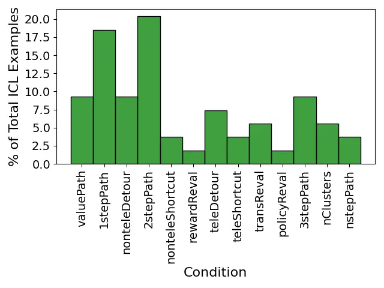

Figure 9. Distribution of ICL examples over the planning skills
described in Table 1 in (Momennejad et al., 2023). Interestingly, "path"
planning skill sets were the dominant failure modes, which resulted in
more ICL examples for those skill sets.

### A.2. tSNE Analysis

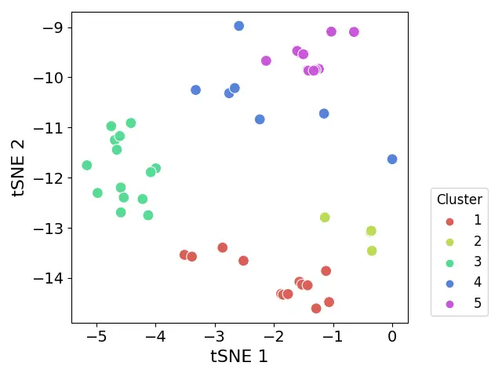

(a)

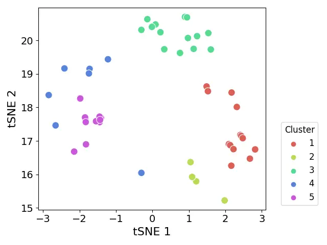

(b)

(c)

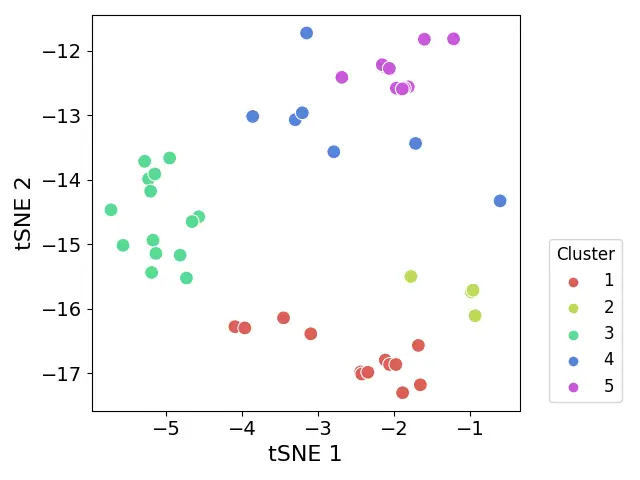

(d)

Figure 10. Several runs of tSNE over the ICL example embeddings. Given
the stochastic nature of tSNE, the clusters are still distinguishable
and similar ICL examples are adjacent to each other.
