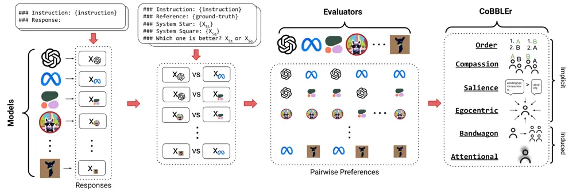
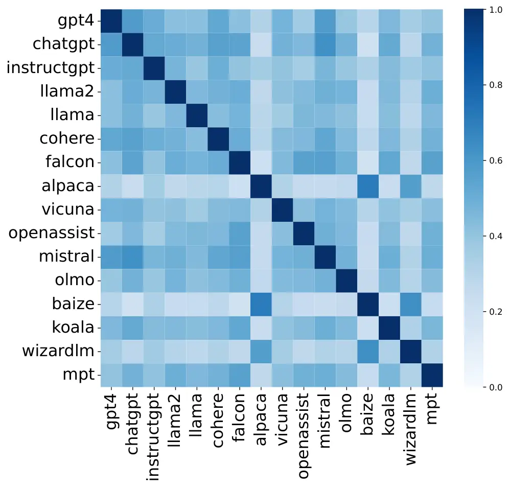

# Benchmarking Cognitive Biases in Large Language Models as Evaluators

Ryan Koo Minhwa Lee Vipul Raheja Jonginn Park Affiliation: University of
Minnesota Affiliation: Grammarly    Zae Myung Kim Dongyeop Kang
Email: [{koo00017,lee03533,park2838,kim01756,dongyeop}@umn.edu,](mailto:,)
Affiliation: University of Minnesota
Email: [vipul.raheja@grammarly.com](mailto:)

###### Abstract

Large Language Models (LLMs) have recently been shown to be effective as
automatic evaluators with simple prompting and in-context learning. In
this work, we assemble 16 LLMs encompassing four different size ranges
and evaluate their output responses by preference ranking from the other
LLMs as evaluators, such as System Star is better than System Square. We
then evaluate the quality of ranking outputs introducing the Cognitive
Bias Benchmark for LLMs as Evaluators (CoBBLEr)¹¹ 1 Our project page:
[https://github.com/minnesotanlp/cobbler](https://github.com/minnesotanlp/cobbler),
a benchmark to measure six different cognitive biases in LLM evaluation
outputs, such as the Egocentric bias where a model prefers to rank its
own outputs highly in evaluation. We find that LLMs are biased text
quality evaluators, exhibiting strong indications on our bias benchmark
($`\approx\textbf{40\%}`$ of comparisons made by all models) within each
of their evaluations that question their robustness as evaluators.
Furthermore, we examine the correlation between human and machine
preferences and calculate the average Rank-Biased Overlap (RBO) score to
be 44%, indicating that machine preferences are misaligned with humans.
According to our findings, LLMs may still be unable to be utilized for
automatic annotation aligned with human preferences.

## 1 Introduction



Figure 1: Our CoBBLEr pipeline to evaluate popular LLMs that are
instruction-tuned or trained with human feedback for their capabilities
as unbiased automatic evaluators.

Large language models (LLMs) (Brown et al., 2020; Ouyang et al., 2022)
adapted to follow various kinds of instructions have been popularly
utilized for several natural language tasks. The general standard for
testing a model’s capabilities is benchmarking its performance on static
evaluation suites such as Fan et al. (2019) and Wang et al. (2020). With
the increased usage of language models as general-purpose assistants and
their artificial nature Das et al. (2024), current task-specific
benchmarks are insufficient to measure the quality of generated texts in
the wild.

Recent studies have shown that LLMs can serve as evaluators themselves:
Wu and Aji (2023) utilize LLMs as self-evaluators to automatically judge
the quality of open-ended generations and compare them with human
judgments via an Elo-score calculation. Other works, such as AlpacaEval
(Li et al., 2023b), also utilize LLMs, such as GPT-4 (OpenAI, 2023), as
automatic evaluators to reduce the time and cost overhead of human
annotations. As noted by these works, such automatic evaluation
leaderboards have a number of limitations, including a preference for
long outputs or outputs that are more similar to the evaluators’
generation qualities.

In this work, we propose CoBBLEr, the Cognitive Bias Benchmark for
evaluating the quality and reliability of LLMs as Evaluators, as
depicted in Figure 1. We collect a set of 50 question-answering
instructions from two well-established benchmarking datasets: BigBench
(Srivastava et al., 2023) and Eli5 (Fan et al., 2019). We then generate
responses from 16 open- and closed-source LLMs and conduct a round-robin
over every possible unique pair between each of the model responses,
prompting each model to evaluate its own and other models’ responses.

We then test six different biases to benchmark their evaluation quality
and categorize the model biases into two groups: (1) Implicit Biases,
which can be implicitly extracted from each model’s evaluation via a
vanilla prompt, and (2) Induced Biases, which add modifications to the
original prompts akin to induce negative behaviors. As shown in Figure
2, we find that the majority of the models strongly exhibit several of
the different biases, which may compromise the credibility of their role
as evaluators.²² 2 In total, 42K samples are analyzed across six biases
for each model totaling 630K samples. Furthermore, we conduct
experiments for human preferences by crowdsourcing six human annotators
and collecting each of their rankings for a total of 300 annotations.
From our findings, we observe a low correlation between human and
machine judgments via Rank-Biased Overlap (RBO), indicating that machine
and human preferences are generally in low agreement.

Our core contributions are as follows:

- •
  A new benchmark (CoBBLEr) for evaluating LLMs to perform unbiased
  evaluations within the QA setting.
- •
  An examination of an exhaustive list of 6 (cognitive) evaluation
  biases that have not been covered by previous studies. We find that
  most LLMs cannot perform as unbiased evaluators.
- •
  A comprehensive lineup of models (sizing from $`3B`$ to $`>`$$`175B`$
  parameters) as evaluators, encompassing the current state-of-the-art
  language models covering over 630k comparisons.

From our benchmark, we find that most models exhibit various cognitive
biases when used as automatic evaluators, which may negatively impact
evaluation quality. Thus, we propose our benchmark (CoBBLEr) for
measuring the capabilities of language models as evaluators to enable
more reliable evaluations that are well-aligned with human judgment.

We note that our use of biased and unbiased preferences does not allude
to the ability to make completely impartial judgments but rather the
amplification of human-like biases within language models. As most
models are tuned on human data, our study aims to estimate this gap
between model and human judgment such that they can be refined more
effectively to mitigate against these biases. As such, we also aim for
our benchmark to be applied towards the development of future models, as
in discovering new gaps or finding that existing gaps are still
unresolved.

[TABLE]

Table 1: We display the characteristic format for each bias and bold
answers that indicate behavior influenced by the bias. For example, in
Compassion Fade (recognizable names) Model Alpaca and Model Vicuna are
associated with System Star and System Square respectively, in which the
preferred response (bolded) is inconsistent with the preferred response
from Order (anonymized names). Specific prompt details are viewed in
Appendix C.

## 2 Related Work

##### LLMs as Evaluators.

Owing to the effectiveness of LLMs, many recent research works have
investigated their utility in various downstream tasks, such as machine
translation (Kocmi and Federmann, 2023), summarization (Shen et al.,
2023; Gao et al., 2023), code generation (Zhuo, 2023), writing
assistance (Schick et al., 2023; Raheja et al., 2023), factual
consistency (Cohen et al., 2023; Gekhman et al., 2023; Luo et al.,
2023), and more. Additionally, many studies have leveraged LLMs for
general-purpose NLG evaluation. For instance, Liu et al. (2023); Chen
et al. (2023); Wang et al. (2023a) investigated the effectiveness of
GPT-4 and ChatGPT against reference-free evaluation methods, whereas Fu
et al. (2023) proposed an evaluation framework, GPTScore, to score
generated texts. Recently, Li et al. (2023a) and Zheng et al. (2023)
conducted similar experiments by employing LLMs as evaluators to judge
the quality of generations in a pairwise setting. Although these works
present promising results for LLMs as automatic evaluators, our work
takes a closer look at machine artifacts that could be detrimental to
data quality by benchmarking an exhaustive list of biases impacting
LLMs-as-evaluators.

##### LLM Evaluation Benchmarks.

It is becoming increasingly challenging to evaluate open-source LLMs as
they become more powerful and performant. As a result, there has been an
increasing need to develop better evaluation benchmarks for measuring
the performance of LLMs. However, most of these benchmarks, such as
LM-Eval-Harness (Gao et al., 2021), MMLU (Hendrycks et al., 2021), HELM
(Liang et al., 2022) and BIG-Bench (Srivastava et al., 2023), only focus
on general LLM performance but do not explore their capabilities as
evaluators. Our work in this direction overlaps directly with Bai et al.
(2023) and Zheng et al. (2023), who propose a
Language-Model-as-an-Examiner benchmark and LLM-as-a-judge to study the
capability of LLMs to emulate human preferences. While our experimental
setups are similar, we highlight key differences. We cover a wider
demographic of current popular language models and an overall different
focus on QA as opposed to other domains such as math and reason.
Furthermore, our benchmark emphasizes a wider range of biases
(implicit/induced) to better describe machine artifacts when used as
automatic evaluators. Specifically, CoBBLEr measures the extent to which
each LM-as-evaluator is impacted in each decision by certain artifacts
within prompts (i.e., prompting format, prompt information) over a
comprehensive list of cognitive biases.

##### Cognitive Biases in LLMs.

While biases have been well-known to exist in LLMs (Wang et al., 2023b;
Talboy and Fuller, 2023; Wu and Aji, 2023), many recent works
investigating the behaviors of LLMs have also uncovered similarities
with cognitive biases. Some recent works (Zhao et al., 2021; Liu et al.,
2022; Lu et al., 2022) have shown that the order of training examples in
GPT-3 could lead to differences in accuracy between near chance and near
state-of-the-art. Jones and Steinhardt (2022) captured failures in GPT-3
and Codex and found that error patterns of LLMs resemble cognitive
biases in humans. Our work overlaps with these in some of the biases we
cover, but we present a much more holistic and comprehensive evaluation
of LLMs. Along this aspect, while our work is close to Wu and Aji
(2023), who investigate biases related to fabricated factual and
grammatical errors, our work is much more comprehensive in terms of the
number of LLMs analyzed, the types of biases analyzed and the creation
of an open benchmark.

## 3 CoBBLEr: Cognitive Bias Benchmark for LLMs as Evaluators

The following criteria are used to select each type of evaluation bias:

- •
  General Applicability. Text evaluation tasks should be generalizable
  to most prompting scenarios; tasks that observe too specific
  subtleties within the prompt are not helpful.
- •
  Impartiality. The prompt should not involve any leading statements to
  extract some desired quality of the evaluations
- •
  Memorylessness. The current evaluation instance should not rely on any
  previous behaviors. Each instance should be self-contained when
  extracting each bias metric.

We carefully hand-select these biases based on the above three criteria
such that they can be widely applicable to most evaluation settings in
assessing the performance of LLMs as automatic evaluators. Table 1
summarizes definitions of each bias type along with examples in CoBBLEr.
We categorize our benchmark into two main classes: (1) Implicit and (2)
Induced Biases. For implicit biases, we feed a general prompt that shows
system outputs in a pairwise manner to extract any biased behaviors
within the model’s evaluations implicitly. For induced biases, we feed
prompts geared towards each different bias, similar to adversarial
attacks, such as presenting false information that may influence
evaluator behaviors in a certain manner. Hence, we note that criterion 2
is not entirely fulfilled due to the nature of induced biases, though
they can still be generally observable in an evaluation setting.

### 3.1 Implicit Biases

We categorize biases as “implicit” if they can be witnessed without
including any additional information other than instructing the model to
judge the quality of two given generated texts.

Order Bias is an evaluation bias we observe when a model tends to favor
the model based on the order of the responses rather than their content
quality. Order bias has been extensively studied (Jung et al., 2019;
Wang et al., 2023a; Zheng et al., 2023), and it is well-known that
language models can be influenced by the ordering of the responses in
their evaluations. We prompt both orderings of each pair and count the
evaluation as a “first order” or “last order” bias if the evaluator
chooses the first ordered (or last ordered) output in both arrangements
respectively.

Compassion Fade (Naming). (Butts et al., 2019; Västfjäll et al., 2014)
is a cognitive bias that denotes a decrease in empathy as the number of
identifiable individuals increases. To this phenomenon, we modify the
definition for our use case to measure whether model evaluations are
affected by real/identifiable names as opposed to evaluations with
anonymous aliases (e.g. System A). Specifically, an unbiased evaluator
would make evaluations similar to when anonymized names were presented.

Egocentric Bias (Self-Preference). (Ross and Sicoly, 1979) is a
cognitive bias that refers to the tendency to have a higher opinion of
oneself or to more easily accept ideas if they match one’s own. We
define an evaluator to be egocentrically biased if, for each instance,
the evaluator prefers its own response over others. We note that an
unbiased evaluator would choose between themselves and other comparand
models equally in proportion. However, we highlight that some models
would naturally generate higher quality responses (e.g., GPT4 vs.
Koala), resulting in a stronger inclination for such evaluators to
choose their own responses.

Salience Bias (Length). (Schenk, 2010; Zheng et al., 2023) The evaluator
tends to favor responses that are either shorter or longer in length. An
unbiased evaluator would be split evenly between responses that are
shorter or longer in length. We examine this bias by looking at
evaluations in which a model preferred a response that is either shorter
or longer in token length.

### 3.2 Induced Biases

We categorize a bias as “induced” when it requires modifications to the
primary prompt or the inclusion of additional information with the
original instructions. We specifically look to test the robustness of
each of the models as evaluators by introducing false or off-topic
information and examining the impact that these setups have on the
quality of their evaluations. For both biases below, we would expect an
unbiased evaluator to generally pick responses highlighted by Bandwagon
and Attentional $`\sim`$$`25`$% of the time (calculated Random
threshold).

Bandwagon Effect. (Schmitt-Beck, 2015) The evaluator’s preferences are
influenced by the collective preference rather than being based on their
own independent judgments. We add an additional sentence after the
initial instruction stating a fake statistic by choosing one of the
comparand outputs as preferred by a majority of people, such as “85%
believe that System Star is better.”. We count the model to be
influenced by Bandwagon if the evaluator choose the model stated in the
statistic.

Attentional Bias (Distraction). In addition to the original instruction,
we follow a similar setup from Shi et al. (2023) where we include
irrelevant information about one of the comparand models to test the
ability of evaluators. For example, we include a meaningless sentence
such as ”System Star likes to eat oranges and apples.” We identify the
evaluator to be distracted if it prefers the model mentioned in the
distraction or if its valid response rate significantly drops.

## 4 Experiment Setup

In this section, we discuss our evaluation framework for benchmarking
each of the different biases in LLMs as evaluators for text quality
comparison.

### 4.1 Datasets and Models

##### Datasets

We choose two widely used datasets (Eli5 (Fan et al., 2019) and BigBench
(strategyQA)) (Geva et al., 2021; Srivastava et al., 2023)) employed to
train and benchmark instruction-tuned models, creating a set of 50
question-answering instructions (taking 25 random instructions from
each). We specifically choose corpora from the Question-Answering (Q/A)
domain for ease of use in generating responses. As we are looking to
test the ability of language models to perform as unbiased evaluators to
judge response quality and correctness, the Q/A response format presents
the most natural setting for these comparisons.

##### Models

We assemble 16 popular models based on the HuggingFace OpenLLM
leaderboard (Beeching et al., 2023), API-based models, and recent
open-source models:

- •
  ($`>`$$`100B`$ parameters): GPT-4, ChatGPT, InstructGPT (OpenAI, 2023)
- •
  ($`>`$$`40B`$ parameters): LLaMAv2 (Touvron et al., 2023), LLaMA
  (Touvron et al., 2023), Cohere, Falcon (Almazrouei et al., 2023)
- •
  ($`>`$$`10B`$ parameters): Alpaca (Taori et al., 2023), Vicuna (Chiang
  et al., 2023), OpenAssistant (Köpf et al., 2023)
- •
  ($`<`$$`10B`$ parameters): Mistral-Instruct (Jiang et al., 2023), OLMO
  (Groeneveld et al., 2024),Baize (Xu et al., 2023b), Koala (Geng
  et al., 2023), WizardLM (Xu et al., 2023a), MPT (Team, 2023)

### 4.2 Text Evaluation Setting

##### Response Generation

Figure 1 demonstrates our generation and evaluation pipeline for
CoBBLEr. Here, we define “models” and “evaluators” interchangeably. We
first generate the responses from each model by prompting 50
instructions from the combined dataset for a total of 800 generations.

##### Pairwise Evaluation

After we collect all the model responses, we then prompt each evaluator
to compare the anonymized generations in a pairwise manner. We generate
all $`{15\choose 2}`$ unique pairs amongst all models³³ 3 We say all
pairs from 15 models, as LLaMAv2 was added later, which alone evaluated
$`{16\choose 2}`$ unique pairs for each of the 50 instructions, creating
a total of 5250 examples for each evaluator to rank. We then prompt the
evaluator to compare generations based on the coherence of each of the
responses in terms of correctness of content and alignment to the
instruction/reference provided. The evaluation prompts for each bias
benchmark are viewable in Appendix C. To mitigate against potential
confounding factors, we run each pairwise instance twice in both
arrangements to validate consistent behavior.

Additionally, we conduct a list-wise ranking amongst $`4`$ models.
However, we find that most LLMs of size $`<`$$`40B`$ have trouble
generating a valid list of rankings (Appendix B) due to increased task
complexity (Dziri et al., 2023).

##### Benchmarking

As the comparisons are limited to a pair-wise fashion, we empirically
calculate a ”bias threshold” via random selection. For example, in the
Order benchmark, each pair is evaluated twice in which both orderings
are viewed (i.e. System Star is shown ordered first, then System Square
is shown ordered first). We then randomly select a model in each
response pair and measure the percentage of where the first-ordered
model is chosen in both arrangements; models above random thresholds are
identified to exhibit the said bias.

The random threshold provides a rough basis for the proportion of
evaluations, for example, with respect to Order bias, which would be
labeled “first order bias” if one randomly selects a response. We make
this assumption to serve as a “litmus test” in distinguishing
established patterns with respect to “bias/unbiased” evaluations by
automatic evaluators rather than just random selection when models are
noticeably above or below this threshold for each of our benchmark
modules. We conduct a statistical test in Appendix B.5 to determine the
significance of each proportion of biased evaluations from each
automatic evaluator with the random baseline.

(a) Average bias scores by model size

(b) Breakdown of the proportional impact of each bias

Figure 2: Overview of major findings (lower score indicates "less
biased" or better performance) of evaluator capabilities on all bias
benchmarks. The red-dotted line denotes the average Random threshold
across each bias. Models highlighted red indicate ones with $`<80\%`$
valid evaluations on 2 or more of the benchmarks.

### 4.3 Human Preference Study

We collected human preferences from six workers on Amazon mechanical
Turk (AMT) platform. More details about our data collection, human
annotation process, and Rank-Biased Overlap and our calculation process
are presented in Appendix D.

##### Agreement between Human Preference and LLM Evaluation

We calculated the Rank-Biased Overlap (RBO) score (Webber et al., 2010)
to measure the agreement between human preferences and model evaluations
in ranking-generated texts across 16 different LLMs. RBO, which can vary
from 0 (non-conjoint) to 1 (identical), assigns more weight to the top
$`k`$ items in the ranked lists being compared ⁴⁴ 4 We concentrated 86%
of all weights on the top 5 list positions, following Webber et al.
(2010). . Higher RBO score means higher agreement. Further mathematical
details of RBO setup can be found in Appendix D.2. To properly compare
machine and human preferences, we construct a ranked list for each
evaluator by counting each model wins⁵⁵ 5 At the time of human
experiments, LLaMA2, Mistral, and OLMo were added later and instead
involved responses by RedPajama and Dolly. Thus, the ranking of those
three models was not included involving pairwise comparisons between 13
models. from every pairwise comparison and then calculated the RBO.
Here, we computed the RBOs between each individual annotator and machine
preferences and averaged them.

##### Identifying Biases in Pairwise Human Preference

To validate the gap between model judgment and humans, we conduct
another study to measure the degree of bias in human evaluations as
well. We mirror the pairwise model evaluation setting from Section 4.2
for Order Bias, Salience Bias, Bandwagon Effect, and Attentional Bias
for a separate human study. To obtain an effective metric, and due to
the vastness of the pairwise model comparison settings, we randomly
sampled 750 pairs from 25 different instructions. We then calculate the
average IAA for each bias via RBO and then compute the average bias
proportion across all annotators to highlight the overall influence of
each bias on human judgment.

To maintain consistency with the initial study, where we used RBO as an
IAA metric among human annotators for the previous N-wise ranking human
experiment, we employed the same approach for the pairwise human bias
experiment as opposed to Fleiss’ Kappa or other pairwise agreement
scores. This involved converting all pairwise rankings by humans into a
ranked list of models and computing the IAA scores among the human
annotators for each of the three bias experiments. However, we randomly
paired models for each instruction and thus generated 750 model pairs
per bias ⁶⁶ 6 Note that there are 25 batches in total for 750 pairs per
bias and 75 human annotators, with some models appearing either multiple
times or none in those pairs. As some models may be overrepresented, we
compensate for the absence of some models by applying a normalization to
the rankings of appearing models across all judged pairs per human
annotator. More details are described in Appendix D.3, D.4, and D.5.

|             |      |       |      |       |      |       |       |      |       |       |
| ----------- | ---- | ----- | ---- | ----- | ---- | ----- | ----- | ---- | ----- | ----- |
| Model       | Size | Order |      | Comp. |      | Egoc. |       | Sal. | Band. | Attn. |
|             |      | First | Last | First | Last | Order | Comp. |      |       |       |
| Random      | -    | 0.24  | 0.25 | 0.24  | 0.25 | 0.24  | 0.24  | 0.5  | 0.25  | 0.25  |
| GPT4        | -    | 0.17  | 0.06 | 0.46  | 0.33 | 0.78  | 0.06  | 0.56 | 0.0   | 0.0   |
| ChatGPT     | 175B | 0.38  | 0.03 | 0.41  | 0.25 | 0.58  | 0.17  | 0.63 | 0.86  | 0.06  |
| InstructGPT | 175B | 0.14  | 0.24 | 0.29  | 0.19 | 0.28  | 0.27  | 0.66 | 0.85  | 0.54  |
| LLaMAv2     | 70B  | 0.47  | 0.08 | 0.09  | 0.17 | 0.06  | 0.0   | 0.62 | 0.04  | 0.03  |
| LLaMA       | 65B  | 0.61  | 0.0  | 0.0   | 0.0  | 0.0   | 0.02  | 0.42 | 0.0   | 0.01  |
| Cohere      | 54B  | 0.33  | 0.17 | 0.38  | 0.27 | 0.27  | 0.15  | 0.60 | 0.82  | 0.14  |
| Falcon      | 40B  | 0.74  | 0.03 | 0.09  | 0.18 | 0.05  | 0.11  | 0.59 | 0.28  | 0.40  |
| Alpaca      | 13B  | 0.0   | 0.82 | 0.23  | 0.29 | 0.18  | 0.39  | 0.47 | 0.75  | 0.81  |
| Vicuna      | 13B  | 0.32  | 0.17 | 0.17  | 0.15 | 0.27  | 0.45  | 0.53 | 0.81  | 0.78  |
| OpenAssist  | 12B  | 0.56  | 0.11 | 0.03  | 0.22 | 0.15  | 0.06  | 0.49 | 0.72  | 0.82  |
| Mistral     | 7B   | 0.42  | 0.04 | 0.33  | 0.23 | 0.30  | 0.03  | 0.57 | 0.54  | 0.02  |
| Olmo        | 7B   | 0.66  | 0.0  | 0.0   | 0.0  | 0.0   | 0.0   | 0.38 | 0.83  | 0.46  |
| Baize       | 7B   | 0.0   | 0.95 | 0.21  | 0.32 | 0.02  | 0.36  | 0.49 | 0.82  | 0.24  |
| Koala       | 7B   | 0.24  | 0.01 | 0.0   | 0.11 | 0.48  | 0.86  | 0.55 | 0.13  | 0.10  |
| WizardLM    | 7B   | 0.08  | 0.64 | 0.22  | 0.34 | 0.14  | 0.29  | 0.53 | 0.76  | 0.27  |
| MPT         | 7B   | 0.49  | 0.1  | 0.11  | 0.27 | 0.21  | 0.25  | 0.63 | 0.95  | 0.52  |

Table 2: A comparison of 16 models with different ranges of model sizes
across six different bias benchmarks. A higher proportion indicates
worse (more biased) performance. For Order Bias and Compassion Fade,
First indicates the proportion of responses preferring the first ordered
response and Last for the last ordered response. For Salience Bias,
models with scores less than 0.5 prefer responses with fewer tokens, and
scores above 0.5 prefer responses with more tokens. The background color
of each metric is determined by the difference between the value and the
corresponding Random metric (darker shade indicates stronger bias).

## 5 Results and Discussion

For each bias, we analyze the performance of each of the 16 models as
evaluators. We provide a visual breakdown of the proportional impact of
the average performance of each model as unbiased evaluators in Fig. 2
based on the results relative to the Random baseline in Table 2. On
average, we see that models within the $`10B`$ size range are most
affected by each bias benchmark in Fig. 2(a). Notably, we see that the
implicit biases contribute similarly to each models’ overall bias
scores, indicating that scaling model size does not reduce implicit
biases in evaluators.

### 5.1 Bias Analysis

##### Implicit Biases

We first examine the performance of each evaluator on the implicit bias
benchmarks for Order Bias, Compassion Fade, Salience Bias and Egocentric
Bias. For the Order Bias benchmark in Table 2, we observe that most
models (11/15) tend to be drawn towards either the first- or
last-ordered model in each of the pairwise comparisons. Notably, within
the second size group ($`>`$$`40B`$), the first-ordered system was
strongly favored in over 50%.

For Compassion Fade, since it is difficult to interpret its impact by
the metrics independently, we jointly compare the results with the ones
from Order Bias. For an unbiased evaluator that is not influenced by
identifiable names, we expect the results for Compassion Fade to be
relatively similar to the Order Bias benchmark. However, we see in Table
2 that all models are dramatically influenced by real model names.
Although this phenomenon may be akin to injecting random names, the
disparity between Order and Compassion Fade results support our
hypothesis that recognizable names influence evaluations in contrast to
anonymized ones. In addition, we also note that Olmo sees a drastic
decrease in performance. This might be attributed to the model’s
inability to follow more complex instructions from its training.

For Egocentric Bias, in the anonymized aliases, the largest models as
well as Koala tend to prefer their own responses ($`>50\%`$) with the
exception of InstructGPT. However, with real model names (Compassion),
we see a large drop in self-preference for models in the largest size
group ($`>`$$`100B`$) models, but this may be attributed to a large
increase in bias for each position. On average, we see an increase in
self-preference with real model names amongst the two smaller size
groups, notably Koala sees a 100% increase in preference.

For Salience Bias, we observe that the larger models in the first and
second size groups are more strongly affected by longer responses, which
align with findings from other works (Wu and Aji, 2023; Zheng et al.,
2023). However, smaller models (excluding MPT) tend to be less
influenced by the length of the responses, suggesting that smaller
models in the third and fourth size groups are less impacted in their
evaluations in consideration of the length of the text.

For models such as ChatGPT, the Egocentric bias may be unfair because
their generations are indeed better, or in Salience, the longer
generations indeed have higher quality. For further insight in
decoupling these factors, we include supplementary experiments viewed in
Appendix B.

#### 5.1.1 Identifying Egocentric and Salience Bias

We also discuss the evaluation criteria for identifying Egocentric and
Salience biases, which may be more appropriately evaluated conditioned
on underlying generation quality and model size.

We select a few model representative models for clarity viewed in Table 3. Generally, most models stay consistent with their preference for
longer/shorter responses conditioned on either generation’s quality,
although some flip their preferences (to only a small effect however).
For further insight, we compute the generation quality using
reference-based metrics via BERTScore. From this, all models produce
nearly the same quality of generations with respect to the reference
answer ($`\sim`$0.81 to 0.86 for F1), highlighting that identifying
Egocentric or Salience bias is most likely not dependent on generation
quality.

| Model   | Salience | Salience\_(large) | Salience\_(small) |
| ------- | -------- | ----------------- | ----------------- |
| GPT4    | 0.56     | 0.71              | 0.46              |
| ChatGPT | 0.63     | 0.84              | 0.56              |
| LlamaV2 | 0.62     | 0.75              | 0.53              |
| Cohere  | 0.60     | 0.71              | 0.56              |
| Vicuna  | 0.53     | 0.57              | 0.51              |
| Mistral | 0.57     | 0.68              | 0.50              |
| OLMO    | 0.38     | 0.45              | 0.29              |

Table 3: Salience of selected models preferring generations from large
models vs. small models. We see only small deviations in preference of
large and small models’ generations with respect to saliency.

##### Induced Biases

Next, we evaluate the performance of each evaluator on the induced bias
benchmarks: Bandwagon Effect and Attentional Bias. For Bandwagon Effect,
we observe that almost all models (11/15) are heavily influenced in
which $`>70\%`$ of evaluations on average followed the bandwagon
preference regardless of text quality. Although we only included a
simple fake statistic (e.g. 85% of people preferred “System Star“), we
see that evaluators can be heavily influenced by this external
information. To observe a correlation between the biased tendency and
the percentage, we include additional results in Appendix B.1

For Attentional Bias, we see that around half of the models’ rankings
are influenced by irrelevant information. Specifically, we see that
models in the third size group ($`>`$$`10B`$) were the most strongly
impacted by the distracting information, with $`>80\%`$ of evaluations
being counted as distracted. On the other hand, API-based models such as
ChatGPT and Cohere remained robust against these distractions in their
rankings. We include the list of distractions we use in Appendix C.

Lastly, we address specific models such as LLaMAv2, LLaMA, Koala, and
OLMO that show abnormal results on most of the benchmarks. This can be
attributed to their low valid response rates, displayed in Table 12 in
Appendix B, which may be explained by our prompting format or the
capabilities of the model themselves, likely as they are not
instruction-tuned. Although these models display lower performance when
extracting evaluations, if a model is not strong enough to produce valid
outputs, we assume those models are not strong enough to be used for
evaluations. And as we don’t consider invalid responses within the
study, we only apply our findings to ones that produced valid
evaluations, in which most models exhibit cognitive biases from our
benchmark. Although the correlation between valid response rates and
bias can provide more insight into model capabilities, it is not within
the scope of our findings.

Figure 3: Correlation with human judgment. We show the average
Rank-Biased Overlap (RBO) scores between aggregated human preferences
and each of the 16 LLMs. Higher RBO means higher similarity.

### 5.2 Agreement Between Human Preferences and Model Evaluations

##### N-rankwise Human Preference (N=13)

The average RBO among the six AMT workers is 0.54, which signifies a
modest but reasonable consensus among workers in ranking the LLM
outputs, given the challenges of ranking all LLM-generated outputs. From
this, we calculate the average RBO between human and model preferences
to be 0.44, indicating that model evaluations do not closely align with
human preferences.

Figure 3 presents the average RBO scores between a model and each of
human preferences. While Mistral and ChatGPT achieved the highest RBO
scores, most of the remaining models demonstrated lower agreement with
human preferences. Smaller models also tend to misalign with an overall
human preference, as the average RBO of models of size greater or
smaller than 10B are 0.37 and 0.41, respectively, compared to
$`>`$$`40B`$ (0.49) and $`>`$$`100B`$ (0.48).

Furthermore, we present additional results on the variance of pairwise
RBOs based on our annotations by six human annotators for the N=13-wise
ranking experiment. Table 5 presents that the variance of all pairwise
RBOs among humans is 0.004, indicating minimal disparity amongst all
annotators. It is more clearly observed that any pairwise RBO between
two annotators is higher than the average agreement between humans and
models (0.44).

##### Bias in Pairwise Human Preference

The average RBO scores were 0.39 (Order Bias), 0.50 (Bandwagon Effect),
and 0.43 (Attentional Bias), indicating modest agreement ⁷⁷ 7 Note that
we considered these scores, which might initially appear low, as
relatively high when considering the impact of biases that can affect
individuals to varying degrees. amongst human annotators in a pairwise
selection setting. The average proportion of biased responses across all
human annotators for Order Bias, Salience Bias, Bandwagon Effect, and
Attentional Bias are presented in Table 4. Compared to humans, Vicuna
shows higher or similar bias proportions on all of the four bias types,
where its

Attentional Bias proportion particularly exceeds humans by more than
twice.

We view that humans still exhibit biases when making their preferences
on pairwise LLM evaluations, but less than LLM evaluators on average.
Similarly, on the induced bias benchmarks, humans were less affected by
Bandwagon effect and Attentional bias, highlighting a prevalent gap
between model judgment capabilities and human ones, in which human-like
biases are more intensified.

|        | Order | Salie. | Bandw. | Atten. |
| ------ | ----- | ------ | ------ | ------ |
| Human  | 0.20  | 0.52   | 0.47   | 0.35   |
| Vicuna | 0.32  | 0.53   | 0.81   | 0.78   |

Table 4: Comparison of Human bias vs. Vicuna for the proportion of
biased evaluations. For Order, we show the worst performance.

|     | A1  | A2    | A3    | A4    | A5    | A6    |
| --- | --- | ----- | ----- | ----- | ----- | ----- |
| A1  | 1   | 0.694 | 0.466 | 0.469 | 0.511 | 0.484 |
| A2  |     | 1     | 0.471 | 0.483 | 0.515 | 0.512 |
| A3  |     |       | 1     | 0.572 | 0.589 | 0.548 |
| A4  |     |       |       | 1     | 0.607 | 0.536 |
| A5  |     |       |       |       | 1     | 0.597 |
| A6  |     |       |       |       |       | 1     |

Table 5: Upper triangle agreement between each human annotator. We see
the agreement between each worker is in general much higher than the
agreement between human and LLMs (0.44).

## 6 Conclusion

In this paper, we analyze 16 recently developed LLMs for their
suitability as automatic text quality annotators in Q/A settings. We
introduce a new benchmark CoBBLEr to assess their evaluation performance
against 1) Implicit and 2) Induced biases. Additionally, we compare LLM
evaluations to human preferences and find only a 44% average agreement.
Our results indicate that most LLMs exhibit cognitive biases to a
greater extent than humans, suggesting that LLMs are still unsuitable as
fair and reliable automatic evaluators. In the future, potential
de-biasing methods provide another area of interest in reducing each
bias. For example, techniques such as chain-of-thought (CoT) reasoning
or other alignment methods can perhaps be employed to reduce the bias
for current models.

## Limitations

We acknowledge a few limitations within our study. Some models reach
very low valid response rates, which may be due to the prompting format.
With model-specific prompts, we may be able to extract more clear
results for each bias. Additionally, we address the fairly subpar IAA
within our human judgment study. This may be due to the difficulty of
the task, asking MTurk annotators to rank 15 models to limit the number
of comparisons required in a pairwise format, but also increases the
complexity of the task itself, which may have caused lower quality in
the annotations.

We also highlight the stability of our findings in the long term. As LLM
research is rapidly growing, the capabilities of language models can
scale exponentially with time. As such, with new developments being
discovered frequently, previous LLM performance on our bias benchmarks
may quickly become outdated (i.e. InstructGPT can be considered an
"outdated LLM," as the API is also no longer offered on OpenAI’s
platforms).

## Acknowledgements

This work was mainly supported by the research gift from Grammarly. We
also thank Minnesota NLP group members for providing us with valuable
feedback and comments on the initial draft.

## References

- Almazrouei et al. (2023) Ebtesam Almazrouei, Hamza Alobeidli,
  Abdulaziz Alshamsi, Alessandro Cappelli, Ruxandra Cojocaru, Merouane
  Debbah, Etienne Goffinet, Daniel Heslow, Julien Launay, Quentin
  Malartic, Badreddine Noune, Baptiste Pannier, and Guilherme
  Penedo. 2023. Falcon-40B: an open large language model with
  state-of-the-art performance.
- Bai et al. (2023) Yushi Bai, Jiahao Ying, Yixin Cao, Xin Lv, Yuze He,
  Xiaozhi Wang, Jifan Yu, Kaisheng Zeng, Yijia Xiao, Haozhe Lyu, Jiayin
  Zhang, Juanzi Li, and Lei Hou. 2023. [Benchmarking foundation models
  with language-model-as-an-examiner](http://arxiv.org/abs/2306.04181).
- Beeching et al. (2023) Edward Beeching, Clémentine Fourrier, Nathan
  Habib, Sheon Han, Nathan Lambert, Nazneen Rajani, Omar Sanseviero,
  Lewis Tunstall, and Thomas Wolf. 2023. Open llm leaderboard.
  [https://huggingface.co/spaces/HuggingFaceH4/open_llm_leaderboard](https://huggingface.co/spaces/HuggingFaceH4/open_llm_leaderboard).
- Brown et al. (2020) Tom B. Brown, Benjamin Mann, Nick Ryder, Melanie
  Subbiah, Jared Kaplan, Prafulla Dhariwal, Arvind Neelakantan, Pranav
  Shyam, Girish Sastry, Amanda Askell, Sandhini Agarwal, Ariel
  Herbert-Voss, Gretchen Krueger, Tom Henighan, Rewon Child, Aditya
  Ramesh, Daniel M. Ziegler, Jeffrey Wu, Clemens Winter, Christopher
  Hesse, Mark Chen, Eric Sigler, Mateusz Litwin, Scott Gray, Benjamin
  Chess, Jack Clark, Christopher Berner, Sam McCandlish, Alec Radford,
  Ilya Sutskever, and Dario Amodei. 2020. [Language models are few-shot
  learners](http://arxiv.org/abs/2005.14165).
- Butts et al. (2019) Marcus M. Butts, Devin C. Lunt, Traci L. Freling,
  and Allison S. Gabriel. 2019. [Helping one or helping many? a
  theoretical integration and meta-analytic review of the compassion
  fade
  literature](https://doi.org/https://doi.org/10.1016/j.obhdp.2018.12.006).
  _Organizational Behavior and Human Decision Processes_, 151:16–33.
- Chen et al. (2023) Yi Chen, Rui Wang, Haiyun Jiang, Shuming Shi, and
  Ruifeng Xu. 2023. [Exploring the use of large language models for
  reference-free text quality evaluation: A preliminary empirical
  study](http://arxiv.org/abs/2304.00723).
- Chiang et al. (2023) Wei-Lin Chiang, Zhuohan Li, Zi Lin, Ying Sheng,
  Zhanghao Wu, Hao Zhang, Lianmin Zheng, Siyuan Zhuang, Yonghao Zhuang,
  Joseph E. Gonzalez, Ion Stoica, and Eric P. Xing. 2023. [Vicuna: An
  open-source chatbot impressing gpt-4 with 90%\* chatgpt
  quality](https://lmsys.org/blog/2023-03-30-vicuna/).
- Cohen et al. (2023) Roi Cohen, May Hamri, Mor Geva, and Amir
  Globerson. 2023. [Lm vs lm: Detecting factual errors via cross
  examination](http://arxiv.org/abs/2305.13281).
- Conover et al. (2023) Mike Conover, Matt Hayes, Ankit Mathur, Jianwei
  Xie, Jun Wan, Sam Shah, Ali Ghodsi, Patrick Wendell, Matei Zaharia,
  and Reynold Xin. 2023. [Free dolly: Introducing the world’s first
  truly open instruction-tuned
  llm](https://www.databricks.com/blog/2023/04/12/dolly-first-open-commercially-viable-instruction-tuned-llm).
- Das et al. (2024) Debarati Das, Karin De Langis, Anna Martin-Boyle,
  Jaehyung Kim, Minhwa Lee, Zae Myung Kim, Shirley Anugrah Hayati,
  Risako Owan, Bin Hu, Ritik Parkar, Ryan Koo, Jonginn Park, Aahan
  Tyagi, Libby Ferland, Sanjali Roy, Vincent Liu, and Dongyeop
  Kang. 2024. [Under the surface: Tracking the artifactuality of
  llm-generated data](http://arxiv.org/abs/2401.14698).
- Dziri et al. (2023) Nouha Dziri, Ximing Lu, Melanie Sclar,
  Xiang Lorraine Li, Liwei Jiang, Bill Yuchen Lin, Peter West, Chandra
  Bhagavatula, Ronan Le Bras, Jena D. Hwang, Soumya Sanyal, Sean
  Welleck, Xiang Ren, Allyson Ettinger, Zaid Harchaoui, and Yejin
  Choi. 2023. [Faith and fate: Limits of transformers on
  compositionality](http://arxiv.org/abs/2305.18654).
- Fan et al. (2019) Angela Fan, Yacine Jernite, Ethan Perez, David
  Grangier, Jason Weston, and Michael Auli. 2019. [ELI5: long form
  question answering](https://doi.org/10.18653/v1/p19-1346). In
  _Proceedings of the 57th Conference of the Association for
  Computational Linguistics, ACL 2019, Florence, Italy, July 28- August
  2, 2019, Volume 1: Long Papers_, pages 3558–3567. Association for
  Computational Linguistics.
- Fu et al. (2023) Jinlan Fu, See-Kiong Ng, Zhengbao Jiang, and Pengfei
  Liu. 2023. [Gptscore: Evaluate as you
  desire](http://arxiv.org/abs/2302.04166).
- Gao et al. (2021) Leo Gao, Jonathan Tow, Stella Biderman, Sid Black,
  Anthony DiPofi, Charles Foster, Laurence Golding, Jeffrey Hsu, Kyle
  McDonell, Niklas Muennighoff, Jason Phang, Laria Reynolds, Eric Tang,
  Anish Thite, Ben Wang, Kevin Wang, and Andy Zou. 2021. [A framework
  for few-shot language model
  evaluation](https://doi.org/10.5281/zenodo.5371628).
- Gao et al. (2023) Mingqi Gao, Jie Ruan, Renliang Sun, Xunjian Yin,
  Shiping Yang, and Xiaojun Wan. 2023. [Human-like summarization
  evaluation with chatgpt](http://arxiv.org/abs/2304.02554).
- Gekhman et al. (2023) Zorik Gekhman, Jonathan Herzig, Roee Aharoni,
  Chen Elkind, and Idan Szpektor. 2023. [Trueteacher: Learning factual
  consistency evaluation with large language
  models](http://arxiv.org/abs/2305.11171).
- Geng et al. (2023) Xinyang Geng, Arnav Gudibande, Hao Liu, Eric
  Wallace, Pieter Abbeel, Sergey Levine, and Dawn Song. 2023. [Koala: A
  dialogue model for academic
  research](https://bair.berkeley.edu/blog/2023/04/03/koala/). Blog
  post.
- Geva et al. (2021) Mor Geva, Daniel Khashabi, Elad Segal, Tushar Khot,
  Dan Roth, and Jonathan Berant. 2021. Did Aristotle Use a Laptop? A
  Question Answering Benchmark with Implicit Reasoning Strategies.
  _Transactions of the Association for Computational Linguistics
  (TACL)_.
- Groeneveld et al. (2024) Dirk Groeneveld, Iz Beltagy, Pete Walsh,
  Akshita Bhagia, Rodney Kinney, Oyvind Tafjord, Ananya Harsh Jha,
  Hamish Ivison, Ian Magnusson, Yizhong Wang, Shane Arora, David
  Atkinson, Russell Authur, Khyathi Raghavi Chandu, Arman Cohan,
  Jennifer Dumas, Yanai Elazar, Yuling Gu, Jack Hessel, Tushar Khot,
  William Merrill, Jacob Morrison, Niklas Muennighoff, Aakanksha Naik,
  Crystal Nam, Matthew E. Peters, Valentina Pyatkin, Abhilasha
  Ravichander, Dustin Schwenk, Saurabh Shah, Will Smith, Emma Strubell,
  Nishant Subramani, Mitchell Wortsman, Pradeep Dasigi, Nathan Lambert,
  Kyle Richardson, Luke Zettlemoyer, Jesse Dodge, Kyle Lo, Luca
  Soldaini, Noah A. Smith, and Hannaneh Hajishirzi. 2024. [Olmo:
  Accelerating the science of language
  models](http://arxiv.org/abs/2402.00838).
- Hayati et al. (2021) Shirley Anugrah Hayati, Dongyeop Kang, and Lyle
  Ungar. 2021. [Does BERT learn as humans perceive? understanding
  linguistic styles through
  lexica](https://doi.org/10.18653/v1/2021.emnlp-main.510). In
  _Proceedings of the 2021 Conference on Empirical Methods in Natural
  Language Processing_, pages 6323–6331, Online and Punta Cana,
  Dominican Republic. Association for Computational Linguistics.
- Hendrycks et al. (2021) Dan Hendrycks, Collin Burns, Steven Basart,
  Andy Zou, Mantas Mazeika, Dawn Song, and Jacob Steinhardt. 2021.
  Measuring massive multitask language understanding. _Proceedings of
  the International Conference on Learning Representations (ICLR)_.
- Jiang et al. (2023) Albert Q. Jiang, Alexandre Sablayrolles, Arthur
  Mensch, Chris Bamford, Devendra Singh Chaplot, Diego de las Casas,
  Florian Bressand, Gianna Lengyel, Guillaume Lample, Lucile Saulnier,
  Lélio Renard Lavaud, Marie-Anne Lachaux, Pierre Stock, Teven Le Scao,
  Thibaut Lavril, Thomas Wang, Timothée Lacroix, and William El
  Sayed. 2023. [Mistral 7b](http://arxiv.org/abs/2310.06825).
- Jones and Steinhardt (2022) Erik Jones and Jacob Steinhardt. 2022.
  [Capturing failures of large language models via human cognitive
  biases](https://openreview.net/forum?id=fcO9Cgn-X-R). In _Advances in
  Neural Information Processing Systems_.
- Jørgensen et al. (2022) Rasmus Jørgensen, Fiammetta Caccavale,
  Christian Igel, and Anders Søgaard. 2022. [Are multilingual sentiment
  models equally right for the right
  reasons?](https://doi.org/10.18653/v1/2022.blackboxnlp-1.11) In
  _Proceedings of the Fifth BlackboxNLP Workshop on Analyzing and
  Interpreting Neural Networks for NLP_, pages 131–141, Abu Dhabi,
  United Arab Emirates (Hybrid). Association for Computational
  Linguistics.
- Jung et al. (2019) Taehee Jung, Dongyeop Kang, Lucas Mentch, and
  Eduard Hovy. 2019. [Earlier isn’t always better: Sub-aspect analysis
  on corpus and system biases in
  summarization](https://doi.org/10.18653/v1/D19-1327). In _Proceedings
  of the 2019 Conference on Empirical Methods in Natural Language
  Processing and the 9th International Joint Conference on Natural
  Language Processing (EMNLP-IJCNLP)_, pages 3324–3335, Hong Kong,
  China. Association for Computational Linguistics.
- Kocmi and Federmann (2023) Tom Kocmi and Christian Federmann. 2023.
  [Large language models are state-of-the-art evaluators of translation
  quality](http://arxiv.org/abs/2302.14520).
- Köpf et al. (2023) Andreas Köpf, Yannic Kilcher, Dimitri von Rütte,
  Sotiris Anagnostidis, Zhi-Rui Tam, Keith Stevens, Abdullah Barhoum,
  Nguyen Minh Duc, Oliver Stanley, Richárd Nagyfi, Shahul ES, Sameer
  Suri, David Glushkov, Arnav Dantuluri, Andrew Maguire, Christoph
  Schuhmann, Huu Nguyen, and Alexander Mattick. 2023. [Openassistant
  conversations – democratizing large language model
  alignment](http://arxiv.org/abs/2304.07327).
- Li et al. (2023a) Ruosen Li, Teerth Patel, and Xinya Du. 2023a. [Prd:
  Peer rank and discussion improve large language model based
  evaluations](http://arxiv.org/abs/2307.02762).
- Li et al. (2023b) Xuechen Li, Tianyi Zhang, Yann Dubois, Rohan Taori,
  Ishaan Gulrajani, Carlos Guestrin, Percy Liang, and Tatsunori B.
  Hashimoto. 2023b. Alpacaeval: An automatic evaluator of
  instruction-following models.
  [https://github.com/tatsu-lab/alpaca_eval](https://github.com/tatsu-lab/alpaca_eval).
- Liang et al. (2022) Percy Liang, Rishi Bommasani, Tony Lee, Dimitris
  Tsipras, Dilara Soylu, Michihiro Yasunaga, Yian Zhang, Deepak
  Narayanan, Yuhuai Wu, Ananya Kumar, Benjamin Newman, Binhang Yuan,
  Bobby Yan, Ce Zhang, Christian Cosgrove, Christopher D. Manning,
  Christopher Ré, Diana Acosta-Navas, Drew A. Hudson, Eric Zelikman,
  Esin Durmus, Faisal Ladhak, Frieda Rong, Hongyu Ren, Huaxiu Yao, Jue
  Wang, Keshav Santhanam, Laurel Orr, Lucia Zheng, Mert Yuksekgonul,
  Mirac Suzgun, Nathan Kim, Neel Guha, Niladri Chatterji, Omar Khattab,
  Peter Henderson, Qian Huang, Ryan Chi, Sang Michael Xie, Shibani
  Santurkar, Surya Ganguli, Tatsunori Hashimoto, Thomas Icard, Tianyi
  Zhang, Vishrav Chaudhary, William Wang, Xuechen Li, Yifan Mai, Yuhui
  Zhang, and Yuta Koreeda. 2022. [Holistic evaluation of language
  models](http://arxiv.org/abs/2211.09110).
- Liu et al. (2022) Jiachang Liu, Dinghan Shen, Yizhe Zhang, Bill Dolan,
  Lawrence Carin, and Weizhu Chen. 2022. [What makes good in-context
  examples for GPT-3?](https://doi.org/10.18653/v1/2022.deelio-1.10) In
  _Proceedings of Deep Learning Inside Out (DeeLIO 2022): The 3rd
  Workshop on Knowledge Extraction and Integration for Deep Learning
  Architectures_, pages 100–114, Dublin, Ireland and Online. Association
  for Computational Linguistics.
- Liu et al. (2023) Yang Liu, Dan Iter, Yichong Xu, Shuohang Wang,
  Ruochen Xu, and Chenguang Zhu. 2023. [G-eval: Nlg evaluation using
  gpt-4 with better human alignment](http://arxiv.org/abs/2303.16634).
- Lu et al. (2022) Yao Lu, Max Bartolo, Alastair Moore, Sebastian
  Riedel, and Pontus Stenetorp. 2022. [Fantastically ordered prompts and
  where to find them: Overcoming few-shot prompt order
  sensitivity](https://doi.org/10.18653/v1/2022.acl-long.556). In
  _Proceedings of the 60th Annual Meeting of the Association for
  Computational Linguistics (Volume 1: Long Papers)_, pages 8086–8098,
  Dublin, Ireland. Association for Computational Linguistics.
- Luo et al. (2023) Zheheng Luo, Qianqian Xie, and Sophia
  Ananiadou. 2023. [Chatgpt as a factual inconsistency evaluator for
  text summarization](http://arxiv.org/abs/2303.15621).
- Oh et al. (2022) Sejoon Oh, Berk Ustun, Julian McAuley, and Srijan
  Kumar. 2022. [Rank list sensitivity of recommender systems to
  interaction
  perturbations](https://api.semanticscholar.org/CorpusID:251442310).
  _Proceedings of the 31st ACM International Conference on Information &
  Knowledge Management_.
- OpenAI (2023) OpenAI. 2023. [Gpt-4 technical
  report](http://arxiv.org/abs/2303.08774).
- Ouyang et al. (2022) Long Ouyang, Jeff Wu, Xu Jiang, Diogo Almeida,
  Carroll L. Wainwright, Pamela Mishkin, Chong Zhang, Sandhini Agarwal,
  Katarina Slama, Alex Ray, John Schulman, Jacob Hilton, Fraser Kelton,
  Luke Miller, Maddie Simens, Amanda Askell, Peter Welinder, Paul
  Christiano, Jan Leike, and Ryan Lowe. 2022. [Training language models
  to follow instructions with human
  feedback](http://arxiv.org/abs/2203.02155).
- Raheja et al. (2023) Vipul Raheja, Dhruv Kumar, Ryan Koo, and Dongyeop
  Kang. 2023. [Coedit: Text editing by task-specific instruction
  tuning](http://arxiv.org/abs/2305.09857).
- Ross and Sicoly (1979) Michael Ross and Fiore Sicoly. 1979.
  [Egocentric biases in availability and
  attribution](https://doi.org/10.1037/0022-3514.37.3.322). _Journal of
  Personality and Social Psychology_, 37:322–336.
- Schenk (2010) Deborah Schenk. 2010. [Exploiting the salience bias in
  designing taxes](https://doi.org/10.2139/ssrn.1661322). _New York
  University Law and Economics Working Papers_, 28.
- Schick et al. (2023) Timo Schick, Jane A. Yu, Zhengbao Jiang, Fabio
  Petroni, Patrick Lewis, Gautier Izacard, Qingfei You, Christoforos
  Nalmpantis, Edouard Grave, and Sebastian Riedel. 2023. [PEER: A
  collaborative language
  model](https://openreview.net/forum?id=KbYevcLjnc). In _The Eleventh
  International Conference on Learning Representations_.
- Schmitt-Beck (2015) Rüdiger Schmitt-Beck. 2015. [_Bandwagon
  Effect_](https://doi.org/10.1002/9781118541555.wbiepc015).
- Shen et al. (2023) Chenhui Shen, Liying Cheng, Yang You, and Lidong
  Bing. 2023. [Are large language models good evaluators for abstractive
  summarization?](http://arxiv.org/abs/2305.13091)
- Shi et al. (2023) Freda Shi, Xinyun Chen, Kanishka Misra, Nathan
  Scales, David Dohan, Ed Chi, Nathanael Schärli, and Denny Zhou. 2023.
  [Large language models can be easily distracted by irrelevant
  context](http://arxiv.org/abs/2302.00093).
- Srivastava et al. (2023) Aarohi Srivastava, Abhinav Rastogi, Abhishek
  Rao, Abu Awal Md Shoeb, Abubakar Abid, Adam Fisch, Adam R. Brown, Adam
  Santoro, Aditya Gupta, and Adrià Garriga-Alonso et al. 2023. [Beyond
  the imitation game: Quantifying and extrapolating the capabilities of
  language models](https://openreview.net/forum?id=uyTL5Bvosj).
  _Transactions on Machine Learning Research_.
- Sun et al. (2023) Weiwei Sun, Lingyong Yan, Xinyu Ma, Pengjie Ren,
  Dawei Yin, and Zhaochun Ren. 2023. [Is chatgpt good at search?
  investigating large language models as re-ranking
  agent](http://arxiv.org/abs/2304.09542).
- Talboy and Fuller (2023) Alaina N. Talboy and Elizabeth Fuller. 2023.
  [Challenging the appearance of machine intelligence: Cognitive bias in
  llms and best practices for
  adoption](http://arxiv.org/abs/2304.01358).
- Taori et al. (2023) Rohan Taori, Ishaan Gulrajani, Tianyi Zhang, Yann
  Dubois, Xuechen Li, Carlos Guestrin, Percy Liang, and Tatsunori B.
  Hashimoto. 2023. Stanford alpaca: An instruction-following llama
  model.
  [https://github.com/tatsu-lab/stanford_alpaca](https://github.com/tatsu-lab/stanford_alpaca).
- Team (2023) MosaicML NLP Team. 2023. [Introducing mpt-7b: A new
  standard for open-source, commercially usable
  llms](https://www.mosaicml.com/blog/mpt-7b). Accessed: 2023-05-05.
- Touvron et al. (2023) Hugo Touvron, Louis Martin, Kevin Stone, Peter
  Albert, Amjad Almahairi, Yasmine Babaei, Nikolay Bashlykov, Soumya
  Batra, Prajjwal Bhargava, Shruti Bhosale, Dan Bikel, Lukas Blecher,
  Cristian Canton Ferrer, Moya Chen, Guillem Cucurull, David Esiobu,
  Jude Fernandes, Jeremy Fu, Wenyin Fu, Brian Fuller, Cynthia Gao,
  Vedanuj Goswami, Naman Goyal, Anthony Hartshorn, Saghar Hosseini, Rui
  Hou, Hakan Inan, Marcin Kardas, Viktor Kerkez, Madian Khabsa, Isabel
  Kloumann, Artem Korenev, Punit Singh Koura, Marie-Anne Lachaux,
  Thibaut Lavril, Jenya Lee, Diana Liskovich, Yinghai Lu, Yuning Mao,
  Xavier Martinet, Todor Mihaylov, Pushkar Mishra, Igor Molybog, Yixin
  Nie, Andrew Poulton, Jeremy Reizenstein, Rashi Rungta, Kalyan Saladi,
  Alan Schelten, Ruan Silva, Eric Michael Smith, Ranjan Subramanian,
  Xiaoqing Ellen Tan, Binh Tang, Ross Taylor, Adina Williams, Jian Xiang
  Kuan, Puxin Xu, Zheng Yan, Iliyan Zarov, Yuchen Zhang, Angela Fan,
  Melanie Kambadur, Sharan Narang, Aurelien Rodriguez, Robert Stojnic,
  Sergey Edunov, and Thomas Scialom. 2023. [Llama 2: Open foundation and
  fine-tuned chat models](http://arxiv.org/abs/2307.09288).
- Västfjäll et al. (2014) Daniel Västfjäll, Paul Slovic, Marcus Mayorga,
  and Ellen Peters. 2014. [Compassion fade: Affect and charity are
  greatest for a single child in
  need](https://doi.org/10.1371/journal.pone.0100115). _PLOS ONE_,
  9(6):1–10.
- Wang et al. (2020) Alex Wang, Yada Pruksachatkun, Nikita Nangia,
  Amanpreet Singh, Julian Michael, Felix Hill, Omer Levy, and Samuel R.
  Bowman. 2020. [Superglue: A stickier benchmark for general-purpose
  language understanding systems](http://arxiv.org/abs/1905.00537).
- Wang et al. (2023a) Jiaan Wang, Yunlong Liang, Fandong Meng, Zengkui
  Sun, Haoxiang Shi, Zhixu Li, Jinan Xu, Jianfeng Qu, and Jie Zhou.
  2023a. [Is chatgpt a good nlg evaluator? a preliminary
  study](http://arxiv.org/abs/2303.04048).
- Wang et al. (2023b) Peiyi Wang, Lei Li, Liang Chen, Zefan Cai, Dawei
  Zhu, Binghuai Lin, Yunbo Cao, Qi Liu, Tianyu Liu, and Zhifang Sui.
  2023b. [Large language models are not fair
  evaluators](http://arxiv.org/abs/2305.17926).
- Webber et al. (2010) William Webber, Alistair Moffat, and Justin
  Zobel. 2010. A similarity measure for indefinite rankings. _ACM
  Transactions on Information Systems (TOIS)_, 28(4):1–38.
- Wu and Aji (2023) Minghao Wu and Alham Fikri Aji. 2023. [Style over
  substance: Evaluation biases for large language
  models](http://arxiv.org/abs/2307.03025).
- Xu et al. (2023a) Can Xu, Qingfeng Sun, Kai Zheng, Xiubo Geng,
  Pu Zhao, Jiazhan Feng, Chongyang Tao, and Daxin Jiang. 2023a.
  [Wizardlm: Empowering large language models to follow complex
  instructions](http://arxiv.org/abs/2304.12244).
- Xu et al. (2023b) Canwen Xu, Daya Guo, Nan Duan, and Julian McAuley.
  2023b. [Baize: An open-source chat model with parameter-efficient
  tuning on self-chat data](http://arxiv.org/abs/2304.01196).
- Zhao et al. (2021) Zihao Zhao, Eric Wallace, Shi Feng, Dan Klein, and
  Sameer Singh. 2021. [Calibrate before use: Improving few-shot
  performance of language
  models](https://proceedings.mlr.press/v139/zhao21c.html). In
  _Proceedings of the 38th International Conference on Machine
  Learning_, volume 139 of _Proceedings of Machine Learning Research_,
  pages 12697–12706. PMLR.
- Zheng et al. (2023) Lianmin Zheng, Wei-Lin Chiang, Ying Sheng, Siyuan
  Zhuang, Zhanghao Wu, Yonghao Zhuang, Zi Lin, Zhuohan Li, Dacheng Li,
  Eric. P Xing, Hao Zhang, Joseph E. Gonzalez, and Ion Stoica. 2023.
  [Judging llm-as-a-judge with mt-bench and chatbot
  arena](http://arxiv.org/abs/2306.05685).
- Zhuo (2023) Terry Yue Zhuo. 2023. [Large language models are
  state-of-the-art evaluators of code
  generation](http://arxiv.org/abs/2304.14317).

## Appendix A Experimental Setup

### A.1 Model Hyperparameters

We set the same hyperparameters across models for each evaluation
generation and response generation for consistency across all of the
models. We limit the max new tokens generated to 128 tokens and set the
temperature to 1.0. For Huggingface models, we set a repetition penalty
of 1.2 and set the number of beams to 3.

### A.2 Experimental Settings

For models that are supported (ChatGPT, InstructGPT, GPT-4, Vicuna), we
utilize Microsoft Guidance to better control LLM generations. Otherwise,
we utilize the transformer pipeline library from Hugginface to retrieve
each evaluation generation. Regardless of whether a models generation
was collected from guidance or using the transformer pipeline, all
parameters were the same. Model generation times for response generation
ranged from 1 to 8 hours, and for evaluation generations ranged from 3
to 24 hours for each bias benchmark. All experiments were run on either
A5000 or A6000 GPUs for models under 40B parameters. For models over
40B, A100 GPUs were utilized if an API service was not available (e.g.
OpenAI, Cohere).

### A.3 Datasets

Eli5 (Fan et al., 2019) is a long-form question-answering dataset
constructed from 270$`k`$ threads from the “Explain Like I’m Five”
Reddit forum. The online forum consists of a community for individuals
to ask various questions, and answers are provided in a format that is
comprehensible to five-year-olds, along with assigned scores based on
community votes. For our purposes, we only utilize the questions and
their highest-rated answers to generate responses and benchmark
automatic evaluators for text-generation quality.

BigBench (Srivastava et al., 2023) is a collection of benchmarks that
look to probe the abilities of language models over a diverse range of
tasks. We specifically utilize the strategyQA (Geva et al., 2021)
dataset, which was constructed by crowdsourcing questions from writers
as well as their responses with short justifications. We choose the
strategyQA dataset to generate responses that require multi-step
reasoning to effectively benchmark the ability of models to comprehend
and compare the quality between two different explanations.

## Appendix B Supplementary Results

### B.1 Correlation between Bandwagon and Percentage

In an additional experiment, we show a modified statistic for the biased
model: "$`0\%`$ of people prefer {model}.” If bias tendency were indeed
correlated with the statistic, we would expect the evaluator model to
have 0 preference for bandwagon response. Due to limited computation
resources and time, we ran the additional experiments for two
representative models at each size range (+ all API-based models) and
presented the results below in Table 6.

Here, one can observe that the preference choices for the bandwagon
statistic greatly change (besides GPT4 and Vicuna) which suggests that
indeed the biased tendency is correlated with the bandwagon statistic.
However, we see that Vicuna, in particular, is not greatly affected by
the statistics. This suggests that within the prompt, the model only
focuses on the phrase “people believe that {model} is better” instead of
the statistic. Similarly, this may be the case for Alpaca and
InstructGPT as well. We also present the results of the bandwagon test
by randomly choosing a percentage between $`50\%`$ and $`85\%`$ in Table 7. We continue see that most models demonstrate biased tendencies.

| Models          | GPT-4 | ChatGPT | InstuctGPT | Cohere | Alpaca | Vicuna | Baize | WizardLM |
| --------------- | ----- | ------- | ---------- | ------ | ------ | ------ | ----- | -------- |
| Bandwagon (85%) | 0.0   | 0.86    | 0.85       | 0.82   | 0.75   | 0.81   | 0.82  | 0.76     |
| Bandwagon (0%)  | 0.0   | 0.0     | 0.56       | 0.0    | 0.52   | 0.79   | 0.32  | 0.27     |

Table 6: Bandwagon test showing a fake statistic stating $`0\%`$ of
people prefer the chosen response.

| Models             | GPT-4    | ChatGPT  | InstuctGPT | Cohere   | Alpaca   | Vicuna   | Baize    | WizardLM |
| ------------------ | -------- | -------- | ---------- | -------- | -------- | -------- | -------- | -------- |
| Bandwagon (85%)    | $`0.0`$  | $`0.86`$ | $`0.85`$   | $`0.82`$ | $`0.75`$ | $`0.81`$ | $`0.82`$ | $`0.76`$ |
| Bandwagon (50-85%) | $`0.06`$ | $`0.70`$ | $`0.84`$   | $`0.65`$ | $`0.68`$ | $`0.96`$ | $`0.75`$ | $`0.76`$ |

Table 7: Bandwagon test showing a fake statistic stating (randomly)
between $`50-80\%`$ of people prefer the chosen response.

### B.2 Diverse Prompts

We additionally ask each evaluator to analyze generation quality along
several different aspects such as “coherence, accuracy, factuality, and
helpfulness” following Bai et al. (2023) and Zheng et al. (2023). As
opposed to our single-aspect format in the main section, we conjecture
that these cognitive biases remain regardless of evaluation aspects. To
validate this, we constructed an extended prompt viewable in C.5 that
incorporates different dimensions of evaluation criteria into our
pairwise evaluation prompt and reported their results in Table 8 on the
Order benchmark. We see that by including diverse perspectives in the
evaluation setting, some metrics become more pronounced (i.e. Cohere for
Egocentric) or bias decreases (i.e. Vicuna for Egocentric). However, we
see that the proportion of biased evaluations stays relatively
consistent for most models on all benchmarks. Hence, our findings remain
that models still show a large skewness in bias tendency as evaluators.

| Models          | GPT-4        | ChatGPT      | InstuctGPT   | Cohere       | Alpaca       | Vicuna       | Baize        | WizardLM     |
| --------------- | ------------ | ------------ | ------------ | ------------ | ------------ | ------------ | ------------ | ------------ |
| Order (coh.)    | $`0.17_{F}`$ | $`0.38_{F}`$ | $`0.24_{L}`$ | $`0.33_{F}`$ | $`0.82_{L}`$ | $`0.32_{F}`$ | $`0.95_{L}`$ | $`0.64_{L}`$ |
| Order (div.)    | $`0.14_{F}`$ | $`0.45_{F}`$ | $`0.22_{L}`$ | $`0.23_{L}`$ | $`0.76_{L}`$ | $`0.52_{F}`$ | $`0.83_{L}`$ | $`0.68_{L}`$ |
| Egocent. (coh.) | $`0.78`$     | $`0.58`$     | $`0.28`$     | $`0.27`$     | $`0.18`$     | $`0.27`$     | $`0.02`$     | $`0.14`$     |
| Egocent. (div.) | $`0.80`$     | $`0.54`$     | $`0.29`$     | $`0.41`$     | $`0.18`$     | $`0.18`$     | $`0.04`$     | $`0.09`$     |
| Salience (coh.) | $`0.56`$     | $`0.63`$     | $`0.66`$     | $`0.60`$     | $`0.47`$     | $`0.53`$     | $`0.49`$     | $`0.53`$     |
| Salience (div.) | $`0.57`$     | $`0.69`$     | $`0.70`$     | $`0.65`$     | $`0.49`$     | $`0.59`$     | $`0.50`$     | $`0.52`$     |

Table 8: Comparison on the Order benchmark considering diverse
evaluation perspectives. For visual clarity, we only display the bias
ratio with the highest proportion and denote with subscript $`x_{F}`$ or
$`x_{L}`$ for first- or last-ordered bias, respectively.

### B.3 Prompting with Ties

We present a modified version of the prompt in B.3 that considers ties
in each pairwise preference. Note that for Salience, if a pairwise
sample was labeled as “Tie,” we do not consider it for length bias. From
Table 9 we see that the inclusion of the tie option does view a
considerable change in the bias benchmarks. Notably, the strongest and
smallest models (GPT-4, ChatGPT, Baize, WizardLM) do not exhibit any
change. However, we see that the mid-range models (Alpaca, Vicuna) and
InstructGPT display a large preference for assigning the tie label
($`\geq\sim 90\%`$) that does not present any valid results, to which we
had originally only prompted two options for each evaluator to avoid
this issue. The only model that demonstrated an improvement from
previous bias behavior was Cohere.

| Models           | GPT-4        | ChatGPT      | InstuctGPT   | Cohere       | Alpaca       | Vicuna       | Baize        | WizardLM     |
| ---------------- | ------------ | ------------ | ------------ | ------------ | ------------ | ------------ | ------------ | ------------ |
| Order            | $`0.17_{F}`$ | $`0.38_{F}`$ | $`0.24_{L}`$ | $`0.33_{F}`$ | $`0.82_{L}`$ | $`0.32_{F}`$ | $`0.95_{L}`$ | $`0.64_{L}`$ |
| Order (tie)      | $`0.15_{F}`$ | $`0.43_{F}`$ | $`0.0`$      | $`0.08_{L}`$ | $`0.0`$      | $`0.0`$      | $`0.81_{L}`$ | $`0.47_{L}`$ |
| Tie (%)          | $`0.01`$     | $`0.0`$      | $`0.88`$     | $`0.33`$     | $`0.95`$     | $`0.99`$     | $`0.0`$      | $`0.04`$     |
| Egocentric       | $`0.78`$     | $`0.58`$     | $`0.28`$     | $`0.27`$     | $`0.18`$     | $`0.27`$     | $`0.02`$     | $`0.14`$     |
| Egocentric (tie) | $`0.77`$     | $`0.60`$     | $`0.04`$     | $`0.25`$     | $`0.02`$     | $`0.0`$      | $`0.08`$     | $`0.16`$     |
| Salience         | $`0.56`$     | $`0.63`$     | $`0.66`$     | $`0.60`$     | $`0.47`$     | $`0.53`$     | $`0.49`$     | $`0.53`$     |
| Salience (tie)   | $`0.55`$     | $`0.67`$     | $`0.06`$     | $`0.35`$     | $`0.01`$     | $`0.0`$      | $`0.50`$     | $`0.48`$     |

Table 9: Comparison on the Order benchmark considering ties. For visual
clarity, we only display the bias ratio with the highest proportion and
denote with subscript $`x_{F}`$ or $`x_{L}`$ for first- or last-ordered
bias, respectively.

### B.4 Decoupling Confounding Factors

We particularly focus on decoupling Egocentric and Salience, which are
the most prone to having large correlations with each other (i.e. longer
generations may indeed have overall higher quality generated by much
stronger models).We highlight two important aspects regarding the
identification of these biases:

- •
  If multiple models have a large proportion of evaluations preferring
  their own responses (as the evaluated pool of pairwise instances is
  the same for each evaluator), we reason that this may suggest
  “egocentric” qualities within involved evaluators, regardless of the
  objective strength of the models. Moreover, we see this effect is
  especially demonstrated between the more powerful models as well (GPT4
  & ChatGPT) that suggest the presence of Egocentric evaluations from
  their disagreement.
- •
  We employ various strategies to mitigate these confounding variables
  and isolate each analysis as much as possible. For example, we employ
  a “hierarchical” rubric, where some biases take priority in an
  evaluation. Specifically, if an evaluation shows signs of order bias
  by choosing A in (A first, then B) and B in (B first, then A), we do
  not evaluate it for Salience or Egocentric bias.

To get further insight into decoupling them, we examine additional
statistics in Table 11 displaying the proportion of Egocentric samples
where the model’s generation was longer/shorter than the other
generation. In particular, since Olmo only won once, and LLaMA never
won, their Egocentric ratios look weird. Otherwise, we view overall that
most models (9/16) exhibit a self-preference for their own generations
often when their own generations exhibit longer token length.

As above, we see that Salience may be associated with higher quality
generations, as we see that the strongest models (GPT4, ChatGPT) often
prefer their own responses when their generations are longer.
Nevertheless, even in smaller models (e.g., Cohere, Koala), preference
for their own generations occurs more often when they are longer.
However, as we previously emphasized, if multiple models observe a
self-preference for their own generations, it is difficult to associate
with Salience as there is disagreement that is indicative of an
Egocentric bias.

### B.5 Significance of Results

|             |                     |                     |                    |                    |
| ----------- | ------------------- | ------------------- | ------------------ | ------------------ |
| Model       | First Order Z-Score | First Order P-Value | Last Order Z-Score | Last Order P-Value |
| GPT-4       | $`8.45`$            | $`2.82e{-17}`$      | $`26.55`$          | $`2.65e{-155}`$    |
| ChatGPT     | $`-15.61`$          | $`6.68e{-55}`$      | $`32.43`$          | $`9.50e{-231}`$    |
| InstructGPT | $`13.04`$           | $`7.08e{-39}`$      | $`1.17`$           | $`2.4e{-1}`$       |
| LLaMAv2     | $`-33.12`$          | $`1.30e{-240}`$     | $`17.97`$          | $`3.53e{-72}`$     |
| LLaMA       | $`-40.84`$          | $`0`$               | $`15.36`$          | $`2.95e{-53}`$     |
| Cohere      | $`-10.02`$          | $`1.20e{-23}`$      | $`8.98`$           | $`2.59e{-19}`$     |
| Falcon      | $`-57.36`$          | $`0`$               | $`25.61`$          | $`1.24e{-144}`$    |
| Alpaca      | $`30.67`$           | $`1.29e{-206}`$     | $`-61.45`$         | $`0`$              |
| Vicuna      | $`-12.49`$          | $`8.44e{-36}`$      | $`7.63`$           | $`2.29e{-14}`$     |
| OpenAssist  | $`-37.27`$          | $`4.84e{-304}`$     | $`13.93`$          | $`3.92e{-44}`$     |
| Mistral     | $`-20.09`$          | $`9.13e{-90}`$      | $`32.56`$          | $`1.63e{-232}`$    |
| OLMO        | $`-54.54`$          | $`0`$               | $`22.08`$          | $`4.47e{-108}`$    |
| Baize       | $`35.46`$           | $`1.99e{-275}`$     | $`-71.53`$         | $`0`$              |
| Koala       | $`-21.60`$          | $`1.77e{-103}`$     | $`12.18`$          | $`4.15e{-34}`$     |
| WizardLM    | $`20.65`$           | $`9.93e{-95}`$      | $`-40.48`$         | $`0`$              |
| MPT         | $`-30.71`$          | $`4.81e{-207}`$     | $`16.49`$          | $`4.62e{-61}`$     |

Table 10: Significance test scores for Order bias (first and last order
preference) for each evaluator compared to the random baseline. We see
almost every model shows significant results with $`\alpha=0.05`$.

We adapt two statistical hypothesis tests based on the random bias
threshold for the Order bias (first-order and last-order) benchmark in
Table 10. Since we have binary outputs (bias, not biased), we conduct a
two-sample Z test of proportions to determine the significance of each
proportion of biased evaluations from each automatic evaluator with the
random baseline. We conduct the test with the null hypothesis defined to
be that “evaluator X is just as likely to make the mistake of flipping
its preference according to the order of the response to the first-order
as the random baseline” or equivalently:

$`H_{0}`$: the mean of Evaluator $`X`$ for first-order bias is not any
different from random selection.

On almost all of the Order benchmarks, the proportions of biased
evaluations are statistically significant from ones by the random score.
Notably, the p-values are critically small (z-scores are blown up) due
to our large sample size. Also, we note that the p-value is actually not
statistically significant for last-order bias in InstructGPT; however,
the first-order proportions are statistically significant, indicating
that one must consider the test for both positions to get the full
picture of the evaluator’s tendencies in reference to the random
baseline. For example, if both first-order and last-order were not
statistically significant from the random proportions, we might find
that the evaluator is “unbiased,” but the following may also undermine
the capabilities of the automatic evaluator reduced to just random
choice.

|             | GPT4 | ChatGPT | InstructGPT |
| ----------- | ---- | ------- | ----------- |
| Ego         | 0.78 | 0.58    | 0.28        |
| Longer Ego  | 0.64 | 0.75    | 0.43        |
| Shorter Ego | 0.36 | 0.25    | 0.56        |

(a) Model Performance Comparison (\>175B)

|             | LLaMAv2 | LLaMA | Cohere | Falcon |
| ----------- | ------- | ----- | ------ | ------ |
| Ego         | 0.06    | 0.0   | 0.27   | 0.05   |
| Longer Ego  | 0.18    | 0.0   | 0.68   | 0.6    |
| Shorter Ego | 0.81    | 0.0   | 0.32   | 0.4    |

(b) Model Performance Comparison (\>40B)

|             | Alpaca | Vicuna | OpenAssist |
| ----------- | ------ | ------ | ---------- |
| Ego         | 0.18   | 0.27   | 0.15       |
| Longer Ego  | 0.38   | 0.4    | 0.71       |
| Shorter Ego | 0.62   | 0.59   | 0.29       |

(c) Model Performance Comparison (\>10B)

|             | Mistral | OLMO | Baize | Koala | WizardLM | MPT  |
| ----------- | ------- | ---- | ----- | ----- | -------- | ---- |
| Ego         | 0.3     | 0.0  | 0.02  | 0.48  | 0.14     | 0.21 |
| Longer Ego  | 0.64    | 0.0  | 0.0   | 0.56  | 0.54     | 0.83 |
| Shorter Ego | 0.36    | 1.0  | 0.0   | 0.44  | 0.46     | 0.17 |

(d) Model Performance Comparison (\<10B)

Table 11: Additional comparisons examining the proportion of Egocentric
samples where the (self-preferred) model’s generation was longer/shorter
than the other generation.

Figure 4: Proportion of responses that were labeled bias for each bias
benchmark. We visualize the distribution of the 15 models tested that
varies by the y-axis. The red dashed line indicates the Random threshold
for each bias benchmark that serves as a litmus between biased and
unbiased LMs-as-evaluators. The spread on the x-axis is randomly
distributed for visual clarity.

### B.6 LLM Performance and Agreement

We detail the general agreement between machine preferences as similarly
conducted in the human-machine correlation study. Figure 5 visualizes
the average Rank-Based Overlap between LLMs. We find that LLMs in their
own size group (excluding the smallest size group) have a relative
agreement with each other. For example, models in the largest size group
($`>`$$`100B`$) are more in agreement amongst themselves than with
models from other size groups. Furthermore, we also show the average
valid response rate from different bias promptings in Table 12. We
gather the proportion of valid responses by post-processing each
“eval-gen” via pattern matching. After post-processing, we then label
each output as a valid or invalid response, such that if a response is
valid, we give one point to the preferred system.



Figure 5: The average RBO scores between LLMs. Higher RBO means higher
similarity.

|             |      |      |       |       |       |
| ----------- | ---- | ---- | ----- | ----- | ----- |
| Model       | Avg. | Ord. | Comp. | Band. | Attn. |
| GPT4        | 0.98 | 0.98 | 0.97  | 0.99  | 0.99  |
| ChatGPT     | 0.99 | 0.99 | 0.99  | 0.99  | 0.99  |
| InstructGPT | 0.99 | 0.99 | 0.99  | 1.00  | 0.99  |
| LLaMAv2     | 0.54 | 0.17 | 0.40  | 0.43  | 0.91  |
| LLaMA       | 0.14 | 0.22 | 0.16  | 0.03  | 0.58  |
| Cohere      | 0.98 | 0.94 | 0.99  | 0.82  | 0.99  |
| Falcon      | 0.72 | 0.72 | 0.46  | 0.99  | 0.98  |
| Alpaca      | 0.84 | 0.78 | 0.82  | 0.97  | 0.87  |
| Vicuna      | 0.86 | 0.90 | 0.71  | 0.97  | 0.90  |
| OpenAssist  | 0.60 | 0.80 | 0.32  | 0.95  | 0.94  |
| Mistral     | 0.99 | 0.99 | 0.99  | 0.99  | 0.99  |
| Olmo        | 0.25 | 0.36 | 0.06  | 0.42  | 0.15  |
| Baize       | 0.96 | 0.98 | 0.87  | 0.99  | 0.99  |
| Koala       | 0.25 | 0.29 | 0.18  | 0.23  | 0.30  |
| WizardLM    | 0.93 | 0.95 | 0.83  | 0.99  | 0.96  |
| MPT         | 0.77 | 0.82 | 0.72  | 0.84  | 0.32  |

Table 12: Ratio for generating valid evaluations. Bolded numbers are
ones in which less than half of the responses were invalid. We
conjecture it may be due to lack of instruction-tuning that results in
poor ability to follow instructions properly (often repeating the prompt
itself, or printing out continuations of model answers).

| Model   | Size | Order |      | Compassion |      | Egocent. |       | Salience | Bandwag. | Attent. | Avg. Valid |
| ------- | ---- | ----- | ---- | ---------- | ---- | -------- | ----- | -------- | -------- | ------- | ---------- |
|         |      | First | Last | First      | Last | Order    | Comp. |          |          |         | Responses  |
| LLaMAv2 | 70B  | 0.47  | 0.08 | 0.09       | 0.17 | 0.06     | 0.0   | 0.62     | 0.04     | 0.03    | 0.54       |
|         | 13B  | 0.82  | 0.04 | 0.09       | 0.19 | 0.07     | 0.0   | 0.79     | 0.28     | 0.28    | 0.86       |
|         | 7B   | 0.98  | 0.0  | 0.25       | 0.33 | 0.01     | 0.02  | 0.49     | 0.42     | 0.02    | 0.98       |
| Vicuna  | 33B  | 0.95  | 0.0  | 0.20       | 0.38 | 0.03     | 0.25  | 0.84     | 0.69     | 0.26    | 0.99       |
|         | 13B  | 0.32  | 0.17 | 0.17       | 0.15 | 0.27     | 0.45  | 0.53     | 0.81     | 0.78    | 0.87       |
|         | 7B   | 0.58  | 0.04 | 0.14       | 0.0  | 0.20     | 0.64  | 0.58     | 0.50     | 0.61    | 0.86       |

Table 13: Performance comparison in proportion to their model scale. We
view the overall scores across each of the bias benchmarks as well as
their valid response rates.

### B.7 Model Size

We conduct a supplementary experiment analyzing the impact of each bias
for different models scaled by size in Table 13. We present results from
a range of model sizes with LLaMAv2 and Vicuna. Interestingly, we see
that the valid response rate within LLaMAv2 goes down as the model size
is scaled up, but the impact of each bias greatly increases as the model
size is scaled down (with the exception of Salience Bias). On the
implicit bias benchmarks, LLaMAv2 exhibits more robust performance with
the proportion of responses affected by each bias Salience Bias in which
longer responses are much more strongly preferred. For the induced bias
benchmarks, a similar trend is viewed in which the effect of each bias
on the model as an evaluator is dampened in correlation to the model
scale. On the contrary, Vicuna exhibits a stronger valid response rate
as the model size is scaled; however, certain implicit biases are much
more amplified, such as Order Bias and Salience Bias. For implicit
biases, Vicuna tends to prefer itself when actual model names are used
as size is scaled smaller while tending to prefer much more verbose
responses as model size is scaled higher. Across the induced biases,
Vicuna performs more resiliently proportionally to scale, although still
strongly influenced by Bandwagon Effect but much less affected by
Attentional Bias. We include another visualization correlating the
overall performance on each of the bias benchmarks with model size for
the main results in Figure 2(a).

| Model   | Size | Valid Response | Order bias | ChatGPT avg. rank | Falcon avg. rank | Alpaca avg. rank | Vicuna avg. rank |
| ------- | ---- | -------------- | ---------- | ----------------- | ---------------- | ---------------- | ---------------- |
| ChatGPT | -    | 0.94           | 0.32       | 2.3               | 2.5              | 2.6              | 2.6              |
| Falcon  | 40B  | 0.38           | 0.39       | 2.6               | 2.3              | 2.6              | 2.5              |
| Alpaca  | 13B  | 0.65           | 1.0        | 2.6               | 2.4              | 2.4              | 2.4              |
| Vicuna  | 7B   | 0.02           | 0.0        | 1.5               | 4.0              | 3.0              | 1.5              |

Table 14: We show the results of instructing models to perform a
list-wise evaluation, by prompting each LM-as-evaluator to organize a
list of responses from 4 different models top to bottom with the first
being the best response and the last being the worst response. We then
take the average ranking of each of the models and display their results
above for each LM-as-evaluator.

### B.8 $`N`$-Rankwise setting: $`N=4`$

We show the results and average rankings between four different models
representing each of the different size groups: ChatGPT ($`>`$$`100B`$),
Falcon ($`>`$$`40B`$), Alpaca ($`>`$$`10B`$), Vicuna ($`<`$$`10B`$).

For the experimental setup, we conduct a smaller study, generating 100
responses from each of the 4 different LLMs using the Databricks
Dolly15k dataset (Conover et al., 2023) via the same instruction prompt
template from Appendix C and the same evaluation prompt template from
the Order bias.

We only employ this setting under the order bias setting in order to
validate the complexity of the task that modern (smaller) LLMs aren’t
capable of performing yet. We perform each experiment by randomizing the
order of each list of responses and prompt each LM-as-evaluator to order
the list from best to worst (top to bottom) according to the same
criterion as the pairwise study (providing the instruction/sample
reference). Furthermore, we also track Order bias, calculated by the
proportion of responses in which the first (randomly) placed model was
also ranked first by the evaluator.

As viewed in Table 14, we find that most models besides the
closed-source API models (e.g. OpenAI) have trouble generating a proper
rank list for even an $`N=4`$ setting. This may be due to the increased
complexity of the task (Dziri et al., 2023) where the ranking of $`N`$
generations may become much more difficult as $`N`$ gets larger (since
the task complexity increases).

## Appendix C Prompt Templates

We present each evaluation prompt utilized for models to evaluate the
quality between two generations. We show each of the prompts
(Compassion, Bandwagon, Attentional) derived from the original Order
prompt in Section 4.2. We highlight each modification made from the
original template.

Our generation instruction template looks like the following:

|                   |
| ----------------- |
| \### Instruction: |
| \### Response:    |

For evaluation, bias-specific prompts are formatted as follows:

### C.1 Order

|                                                                                                       |
| ----------------------------------------------------------------------------------------------------- |
| \### Instruction: Which system’s response is more coherent considering the reference and instruction? |
|                                                                                                       |
| The instruction is: {{instruction}}                                                                   |
| The reference is: {{reference}}                                                                       |
| “‘                                                                                                    |
| System Star:                                                                                          |
| System Square:                                                                                        |
| “‘                                                                                                    |
| Please respond in the following format strictly: System \_ is better                                  |
| Do not provide any additional text or explanation:                                                    |
| \### Response:                                                                                        |

Also, we underline that Egocentric bias was extracted under two
dimensions, hence its double column for (Order / Compassion) in Table 2.
Since Egocentric is a bias extracted implicitly, it involves two
different prompts from C.1 (Order) and C.2 (Compassion Fade). In the
case of C.1, since model names are completely anonymous, the addition of
“(You)” is omitted (as shown in Table 1, and models cannot tell if they
are self-evaluating. In contrast, C.2 shows recognizable names; thus,
“(You)” is appended to the system name when self-evaluating. We
highlight that the added “(You)” within the Egocentric example in Table
1 serves to explicitly communicate an example of an egocentric bias to
the reader and not necessarily the prompt itself.

### C.2 Compassion Fade

|                                                                        |
| ---------------------------------------------------------------------- |
| \### Instruction: Which system’s response is more coherent considering |
| the reference and instruction?                                         |
|                                                                        |
| The instruction is: {{instruction}}                                    |
| The reference is: {{reference}}                                        |
|                                                                        |
| “‘                                                                     |
| {model1_name}: {model1_response}                                       |
| {model2_name}: {model2_response}                                       |
| “‘                                                                     |
| Please response directly in the following format: System \_ is better  |
| Do not provide any additional text or explanation:                     |
| \### Response:                                                         |

### C.3 Bandwagon Effect

|                                                                        |
| ---------------------------------------------------------------------- |
| \### Instruction: Which system’s response is more coherent considering |
| the reference and instruction?                                         |
|                                                                        |
| The instruction is: {{instruction}}                                    |
| The reference is: {{reference}}                                        |
|                                                                        |
| “‘                                                                     |
| System Star: {model1_response}                                         |
| System Square: {model2_response}                                       |
| “‘                                                                     |
| 85% of people believe that {system} is better.                         |
|                                                                        |
| Please response directly in the following format: System \_ is better  |
| Do not provide any additional text or explanation:                     |
| \### Response:                                                         |

### C.4 Attentional Bias

|                                                                                                       |
| ----------------------------------------------------------------------------------------------------- |
| \### Instruction: Which system’s response is more coherent considering the reference and instruction? |
|                                                                                                       |
| The instruction is: {{instruction}}                                                                   |
| The reference is: {{reference}}                                                                       |
|                                                                                                       |
| “‘                                                                                                    |
| System Star: {model1_response}                                                                        |
| System Square: {model2_response}                                                                      |
| “‘                                                                                                    |
| {distraction}                                                                                         |
|                                                                                                       |
| Please response directly in the following format: System \_ is better                                 |
| Do not provide any additional text or explanation:                                                    |
| \### Response:                                                                                        |

| Attentional Bank                                                 |
| ---------------------------------------------------------------- |
| {System} likes to eat apples and oranges.                        |
| The coolest thing that {System} can do is a 60 second handstand. |
| {System} plays a lot of soccer and basketball.                   |
| {System} has been all around Europe two times.                   |

### C.5 Diverse Prompt

|                                                                                                                                       |
| ------------------------------------------------------------------------------------------------------------------------------------- |
| \### Instruction: Which system’s response is more coherent, accurate, factual, and helpful considering the reference and instruction? |
|                                                                                                                                       |
| The instruction is: {{instruction}}                                                                                                   |
| The reference is: {{reference}}                                                                                                       |
|                                                                                                                                       |
| “‘                                                                                                                                    |
| System Star: {model1_response}                                                                                                        |
| System Square: {model2_response}                                                                                                      |
| “‘                                                                                                                                    |
| Please response directly in the following format: System \_ is better                                                                 |
| Do not provide any additional text or explanation:                                                                                    |
| \### Response:                                                                                                                        |

### C.6 Tie Prompt

|                                                                                                       |
| ----------------------------------------------------------------------------------------------------- |
| \### Instruction: Which system’s response is more coherent considering the reference and instruction? |
|                                                                                                       |
| The instruction is: {{instruction}}                                                                   |
| The reference is: {{reference}}                                                                       |
|                                                                                                       |
| “‘                                                                                                    |
| System Star: {model1_response}                                                                        |
| System Square: {model2_response}                                                                      |
| “‘                                                                                                    |
| If you believe each response is equally sufficient simply respond with: Tie                           |
|                                                                                                       |
| Please response directly in the following format: System \_ is better                                 |
| Do not provide any additional text or explanation:                                                    |
| \### Response:                                                                                        |

## Appendix D Human Preference Study

### D.1 Annotator Recruitment & Annotation Process

##### N=13-rankwise setting

We recruited six workers from the Amazon Mechanical Turk (AMT) platform,
each of whom had a U.S. high school diploma and a Human Intelligence
Task (HIT) approval rate of 99% or higher on the platform. To ensure
better-quality annotations, we initiated a toy round using five sample
instruction sets. Each instruction in the toy round contained five brief
LLM-generated sentences. Workers were then asked to rank these sentences
based on their own preferences, but taking into account the following
two specific criteria: (1) the fluency and logical coherence of the
LLM-generated text in response to a given instruction sentence, and (2)
the text’s alignment with a reference sentence that provided additional
context and background for the instruction sentence. Furthermore, they
were asked to place a black bar above the answers that did not satisfy
these two criteria, as this is used for the threshold to evaluate the
quality of their texts.

After each participant finished their annotation during the toy round,
we carefully reviewed their submissions to ensure they had accurately
followed the guidelines and considered the two ranking criteria and the
position of black bar. For their efforts, each participant received a
\$3 payment for completing the toy round (HIT). Running the toy HIT
several times yielded a final selection of six qualified workers, who
were then invited to participate in the next stage involving the actual
task of ranking 50 instruction sets. Each of these sets included 13
texts generated by 13 different LLMs. Note that LLaMA2, Mistral, and
OLMo were not included yet at the time of our human study.

To avoid overwhelming the workers, we divided the main task into five
separate HITs, each containing a varying number of instruction sets to
rank: (1) a pilot round with 5 sets, (2) two intermediate rounds with 10
sets each, and (3) two final rounds with 13 and 12 sets, respectively,
adding up to a total of 50 instruction sets. These six workers received
compensation upon completing each HIT, accumulating to a minimum of \$47
for the entire series of rounds. This averaged out to approximately
\$1.05 per instruction set. Additionally, on average, it took each of
the six workers about 5.8 minutes to complete a single instruction set.
Lastly, considering the level of difficulty for the workers to rank 13
outputs per instruction set, we also remunerated them with a bonus of at
least \$5 per round, based on the quality of their performance. Lastly,
we checked that our collected data did not include any personally
identifiable information or offensive content and that the AMT responses
were already anonymized.

##### Bias in Pairwise Human Preference

For each bias, we collected human preferences from 75 experienced AMT
workers who had HIT approval rates over 97%, had completed more than
10,000 HIT tasks, and resided in five major English-speaking countries
(e.g., the United States, Canada, United Kingdom, Australia, and New
Zealand.) These workers were then grouped into 25 sets of 3, with each
group assigned a HIT task encompassing 30 model pairs randomly sampled
from an instruction. Consequently, we generated 25 HITs for each bias.
These workers were tasked with choosing between two anonymous options
(e.g., System A and B) for each of the 30 pairs. Their decisions were
purely based on their preference, but we also asked them to consider the
alignment and coherency with the instruction and reference sentences of
each set.

To employ a pre-task and training session, we asked the participating
workers of each HIT to complete a qualification round, which asked three
example instructions to complete and pass. Only workers who passed this
round were allowed to start the main tasks of annotating 30 pairs,
ensuring that the workers were able to understand the HIT. Each worker
who participated in a HIT received a compensation of \$2.5. Note that
Slience Bias were computed using the annotations from Order Bias
experiments on the AMT platform.

Similarly, we confirmed that our collected data did not include any
personally identifiable information or offensive content and that the
AMT responses were already anonymized.

### D.2 Details on using RBO

Rank-biased overlap (RBO) ⁸⁸ 8 We implemented RBO using the python
package ‘rbo’:
[https://pypi.org/project/rbo/](https://pypi.org/project/rbo/). is a
widely used metric for evaluating the similarity between two ranked
lists and is particularly relevant for tasks in information retrieval
(Oh et al., 2022; Sun et al., 2023). The RBO value ranges from 0
(non-conjoint) to 1 (identical). In more detail, 0 indicates that there
is no intersection or similarity, while 1 indicates a total intersection
and complete similarity between two ranked lists, A and B, in terms of
ranked elements and order. Unlike classical correlation-based metrics
such as Kendall’s tau or Spearman’s rank correlation, RBO is
intersection-based, so there is no criteria range of value for RBO
regarding the interpretation of its score. Rather, a higher continuous
value of RBO means a higher ranking similarity between A and B.

In addition, unlike traditional correlation-based metrics like Kendall’s
$`\tau`$ or Spearman’s $`\rho`$, RBO allows for greater weighting of the
top $`k`$ elements in the ranked lists being compared. This feature
makes RBO well-suited for our experimental setup, where AMT workers were
tasked with reading and ranking 13 outputs generated by LLMs. We operate
under the assumption that workers are likely to place the
highest-quality texts at the top five positions of their ranked lists.

This idea of weighing the top elements in the ranked outputs aligns with
previous research, which claims RBO to be an effective metric for the
agreement between ranked annotations with human rationals and automated
evaluations, especially when greater importance is given to the
top-ranked elements (Jørgensen et al., 2022). Given these
considerations, which are highly relevant to our own study, we decided
to use RBO as the metric for assessing agreement between human
preferences and LLM evaluations.

RBO is defined in Equation 1 and tailored to suit the specifics of our
study. Here, $`H`$ and $`L`$ represent two ranked lists of shape
$`(1,13)`$, corresponding to human preferences and LLM evaluations for
each instruction set, respectively. The maximum depth for $`H`$ and
$`L`$ is set at 13, and $`p`$ is a tunable parameter that determines the
degree of top-weightedness in the final RBO calculation. To obtain an
average RBO score across all 50 instructions, we sum the individual RBO
values between $`H`$ and $`L`$ and then divide by 50.

```math
\centering RBO(H,L)=(1-p)\sum_{d=1}^{13}p^{d-1}\frac{|A[1:d]\cap B[1:d]|}{d}\@add@centering \tag{1}
```

Following the work of Webber et al. (2010), we set the value of $`p`$ so
that approximately 86% of the weight is concentrated on the first $`d`$
ranks, where $`d=5`$ in our case. The weight distribution over these top
$`d`$ ranks can be determined using Equation 2. This means that the
value of Equation (2) given $`d=5`$ should be 0.86. In our experimental
setup, we found that $`p`$ was approximately 0.8.

```math
\centering(1-p^{d-1})+(\frac{1-p}{p})\cdot d\cdot\left(\ln\frac{1}{1-p}-\sum_{i=1}^{d-1}\frac{p^{i}}{i}\right)\@add@centering \tag{2}
```

### D.3 Details on Pairwise Human Preference Experiments

In pairwise human preference experiments, we did not test the Compassion
Fade and Egocentric Bias as they cannot be applied to human cases,
because humans are not likely to be impacted by the anonymity of model
names and the texts used in our setups are not generated by humans as
well.

Unlike pairwise model evaluation as described in Section 4.2, we were
not able to evaluate with humans all possible 5,250 model pairs.
Instead, we first randomly selected 25 of the 50 total instructions.
Then for each instruction, we produced 15 pairs of randomly sampled
model outputs and created another 15 pairs by reversing their order (for
Order Bias) or switching the bias-induced sentence between A or B (for
Bandwagon Effect and Attentional Bias). This results in 30 pairs (with
15 unique model pairs) in total for each instruction and finally totals
750 pairs for all 25 instructions. Note that the sample size ensured a
95% confidence level with a 5% margin of error for a population size of 5250.

Upon collecting all annotations for each bias, we calculated the average
IAA using the RBO for each bias. Each instruction consisted of uniquely
(but randomly) sampled model pairs, with some models appearing multiple
times. Hence, we normalized the rank of each model in the sampled pairs
by calculating the ratio of the model’s “win” to its total appearances.
With this data, we re-ranked each model in the sampled pairs per
instruction. Afterward, we computed the mean RBO among the ranked model
lists from each group of three AMT workers per instruction. We then
averaged these RBO values over all 25 instructions to calculate the IAA
scores for each bias experiment.

Finally, we computed the bias proportion for each annotator by dividing
the number of biased pairwise samples by 15. Following these steps, we
aggregated the bias proportions across all annotators, showing the
degrees of impact of bias on human preference in pairwise selections.
For Salience Bias, we leveraged annotations from Order Bias experiments
and calculated proportions for shorter and longer preferred responses.
We then reported the preference with a higher average proportion that
was computed all across annotators, indicating whether humans were more
influenced by shorter or longer length bias.

### D.4 Details on Pairwise Human Preference Samples

We clarify that for each one of the three bias measurements, a random
sample of 750 model pairs was tested by three annotators in the pairwise
human experiment setup, totaling 2250 samples for 3 annotators. More
formally, we define:

- •
  $`B(=3)`$: Number of bias experiments (B_salience, B_order,
  B_bandwagon)
- •
  $`S(=25)`$: Number of samples selected for each bias experiment
- •
  $`P(=15)`$: Number of original model output pairs (Model A - Model B)
  for each sample
- •
  $`M(=2)`$: Multiplier for both orderings of each pairwise sample
  (i.e., for each A-B we also add B-A)
- •
  $`A(=3)`$: Number of human annotators evaluating each model pair

```math
\displaystyle\mathrm{T_{\text{pairs}}} \displaystyle=\mathrm{\text{Total \# of model pairs for one bias}}
```

```math
\displaystyle=S\times P\times M=750
```

```math
\displaystyle\mathrm{T_{\text{evals}}} \displaystyle=\mathrm{\text{total \# of human evaluations for one bias}}
```

```math
\displaystyle=T_{\text{pairs}}\times A=750\times 3=2250
```

Thus, we analyze $`2250\times B=6750`$ samples across all bias setups.

### D.5 Interface Design

We present the interface design temple for each of the human preference
experiments setups on the AMT platform, including (1) N-rankwise setups
(N=13) and (2) bias in pairwise human preference, as described in
Section 4.3. The original prototype of the interfaces that we used for
the N-rankwise experiments, as in Figure 6 is based on
[https://github.com/mtreviso/TextRankerJS](https://github.com/mtreviso/TextRankerJS).
For the pairwise human bias experiments, we referenced the interface
design from Hayati et al. (2021).

Figure 6: The interface design for gathering human preferences over
LLM-generated texts for each instruction on Amazon Mechanical Turk (AMT)
settings. Six AMT workers participated in the annotation process and
ranked 13 LLM-generated texts for all 50 instructions.

Figure 7: The AMT interface design for Order bias experiments with
pairwise human preference setup.

Figure 8: The AMT interface design for Bandwagon effect experiments with
pairwise human preference setup.

Figure 9: The AMT interface design for Attentional bias experiments with
pairwise human preference setup.
