\DeclareCaptionType

highlightblock\[Block\]\[List of Blocks\]

# NAACL’24 Findings SocREval: Large Language Models with the Socratic Method for Reference-Free Reasoning Evaluation

Hangfeng HeHongming Zhang^(‡) Affiliation: University of
Rochester^(‡)Tencent AI Lab, Seattle Email: <hangfeng.he@rochester.edu>
   Dan Roth Affiliation: University of Pennsylvania
Email: <hongmzhang@global.tencent.com>
Email: [danroth@seas.upenn.edu](mailto:)

###### Abstract

To comprehensively gauge the capacity of current models for complex
reasoning, it is crucial to assess their step-by-step reasoning in a
scalable manner. Established reference-based evaluation metrics rely on
human-annotated reasoning chains as references to assess the
model-derived chains. However, such “gold-standard” human-written
reasoning chains may not be unique and their acquisition is often
labor-intensive. Existing reference-free reasoning evaluation metrics,
while eliminating the need for human-crafted reasoning chains as
references, often require fine-tuning with human-derived chains before
evaluation, complicating the process and questioning their adaptability
to other datasets. To address these challenges, we harness GPT-4 to
automatically evaluate reasoning chain quality, thereby removing the
dependency on human-written reasoning chains for both model fine-tuning
and evaluative purposes. Leveraging the Socratic method, we develop
SocREval (Socratic Method-Inspired Reasoning Evaluation), a novel
approach for prompt design in reference-free reasoning evaluation.
Empirical results from four human annotated datasets reveal that
SocREval significantly improves GPT-4’s performance, surpassing existing
reference-free and reference-based reasoning evaluation metrics. Beyond
its demonstrated efficacy, SocREval, proves to be both cost-efficient
and robust to prompt writing and example selection, as substantiated by
our in-depth analysis.¹¹ 1 Our code is publicly available at
[https://github.com/HornHehhf/SocREval](https://github.com/HornHehhf/SocREval).

## 1 Introduction

Figure 1: Examples from the GSM8K and DROP datasets illustrating two
explanation paradigms: Explain-then-Predict and Predict-then-Explain.
For clarity, we use “\|\|” to represent the Python newline character
“\n”.

Recent advances in large language models (LLMs) have led to
state-of-the-art results in a plethora of natural language processing
(NLP) tasks, demonstrating the effectiveness of in-context learning
without the need for task-specific training or fine-tuning (OpenAI,
2023; Anil et al., 2023; Touvron et al., 2023). Despite these impressive
achievements, the inherent reasoning capabilities of LLMs remain notably
below human expectations (Arkoudas, 2023). Although the core of
reasoning fundamentally involves offering justifications, most
contemporary evaluations primarily assess a model’s reasoning capability
based on its end-task performance (Huang and Chang, 2023). Such
evaluations, focusing solely on the accuracy of the final answer,
neglect the complexities of the underlying reasoning chains. This
oversight inhibits a full understanding of a model’s reasoning and
challenges further progress in the field.

To assess the quality of reasoning chains produced by models, a direct
and intuitive approach centers on contrasting these generated chains
with human-constructed ones, termed as reference-based reasoning
evaluation (Clinciu et al., 2021; Welleck et al., 2022; Saparov and He,
2022). However, these reference-based metrics rely on human-constructed
reasoning chains as references, which are both labor-intensive and
costly. Furthermore, “gold-standard” reasoning chains may not be unique
(Dalvi et al., 2021), implying that the effectiveness of reference-based
evaluations can be significantly influenced by the choice and breadth of
human-crafted references. In light of these challenges, recent research
has begun to explore the evaluation of reasoning chains without
necessitating human-annotated references—termed reference-free reasoning
evaluation (Golovneva et al., 2022; Prasad et al., 2023). Regrettably,
these reference-free metrics necessitate the fine-tuning of models on
datasets with human-annotated reasoning chains before the evaluation,
which are complicated and restricts their applicability across diverse
datasets.

In this work, we propose to harness the capabilities of LLMs to evaluate
the model-generated reasoning chains, distinctively eliminating the
necessity for both model fine-tuning and reliance on human-crafted
reasoning chains. The application of the Socratic method has been
demonstrated to enhance the quality of prompts for LLMs in reasoning
tasks (Chang, 2023a; Dong et al., 2023). Building upon this insight, we
further leverage the Socratic method to craft optimized prompts,
facilitating better reference-free reasoning evaluations using LLMs,
which we denote as SocREval - representing the Socratic method inspired
Reasoning Evaluation. Specifically, we employ three fundamental
strategies from the Socratic method—Definition, Maieutics, and
Dialectic—and their combinations, aiming to refine the prompting
mechanism of LLMs for reference-free reasoning evaluation.

To verify the efficacy of our proposal, SocREval, we assessed its
correlation with human judgment concerning the overall quality of
reasoning chains produced by LLMs across four diverse datasets from
ROSCOE (Golovneva et al., 2022): GSM8K (Cobbe et al., 2021) for
arithmetic reasoning; e-SNLI (Camburu et al., 2018) for both deductive
and commonsense reasoning; DROP (Dua et al., 2019) for discrete
reasoning; and Cosmos QA (Huang et al., 2019) for commonsense reasoning.
Our empirical findings reveal that GPT-4 exhibits a superior correlation
with human judgment in comparison to existing reference-free reasoning
evaluation metrics, notably ROSCOE (Golovneva et al., 2022) and ReCEval
(Prasad et al., 2023). By leveraging the Socratic method, SocREval
notably improves GPT-4’s correlation coefficient with human judgment
from $`0.40`$ to a remarkable $`0.58`$ when assessing the overall
quality of the generated reasoning chains—surpassing even the
performance of ROSCOE when furnished with human-written reasoning chains
as references. A comprehensive analysis underscores the robustness of
SocREval in terms of prompt writing and example selection while
highlighting its cost-efficiency. This paper provides quantitative
experimental results that validate the Socratic Method’s effectiveness
in prompt design for reference-free reasoning, thereby complementing
prior research primarily focused on qualitative case analyses.

### 1.1 Related Work

#### Prompting LLMs with the Socratic method.

The Socratic method’s essence is a sequence of probing questions to
elucidate complex ideas, closely relevant to the LLM prompting
techniques. Chang (2023a) crafted prompt templates utilizing the
Socratic method, introducing the Critical Inquisitive Template (CRIT)
for reasoning evaluation and subsequent Socratic synthesis for
decision-making (Chang, 2023b). Dong et al. (2023) further employed the
Socratic method for deeper LLM engagements in intricate problem-solving.
Unlike these endeavors, which emphasize qualitative case analyses, our
work focuses on quantitative experiments for reference-free reasoning
evaluation.

#### Evaluation of reasoning chains.

Evaluating the quality of reasoning chains generated by models has been
traditionally approached by contrasting them with human-generated ones,
referred to as reference-based reasoning evaluation. Conventional
natural language generation (NLG) metrics assess the similarity between
such machine-generated and human-crafted reasoning chains (Celikyilmaz
et al., 2020; Clinciu et al., 2021; Welleck et al., 2022). In contrast,
several domain-specific metrics were tailored for assessing reasoning
chains relying on the specific structure of the dataset (Dalvi et al.,
2021; Saparov and He, 2022; Han et al., 2022). Recently, ROSCOE
(Golovneva et al., 2022) pioneered reference-free reasoning evaluation
by introducing metrics grounded in step-by-step reasoning chains,
targeting dimensions such as semantic consistency, logicality,
informativeness, fluency, and factuality. ReCEval (Prasad et al., 2023)
moved further and centered its evaluation on correctness and
informativeness. Both ROSCOE and ReCEval align closely with our work’s
focus on reference-free reasoning evaluation. While both methods
necessitate fine-tuning on datasets with human-derived reasoning chains,
our approach avoids such fine-tuning requirements.

#### Evaluating text generation with LLMs.

The stellar capabilities of LLMs on NLP tasks have propelled their
adoption in evaluating generated text quality. Techniques range from
harnessing conditional generative probabilities (Fu et al., 2023) to
leveraging the prompts tailored for specific evaluation needs (Liu
et al., 2023; Lu et al., 2023). Such methods have been deployed across
diverse NLG domains, including summarization (Gao et al., 2023), machine
translation (Kocmi and Federmann, 2023), and more (Wang et al., 2023),
with evaluations being both individual and comparative (Chen et al.,
2023; Zheng et al., 2023). In contrast to these endeavors, our research
uses LLMs with the Socratic method to realize reference-free reasoning
evaluation, whereas the aforementioned works target other
text-generation tasks.

## 2 Large Language Models with the Socratic method

This section describes our approach to evaluate the overall quality of
step-by-step reasoning without using human-crafted references,
leveraging LLMs with the Socratic method.

### 2.1 Prompt Skeleton for Reference-Free Reasoning Evaluation

Two dominant explanation paradigms often incorporate step-by-step
reasoning chains to elucidate final answers: Explain-then-Predict (E-P)
and Predict-then-Explain (P-E) (Ye and Durrett, 2022; Zelikman et al.,
2022). Given the nature of LLMs such as GPT-4, it’s crucial to formulate
appropriate prompt templates to assess the reasoning chains within these
paradigms.

#### Explain-then-Predict (E-P).

Within this paradigm, the explanation precedes the final answer, both
being part of the LLM’s generated response. A concrete illustration is
provided in Figure 1. We propose the subsequent prompt template for
evaluating reasoning chains: Instruction + Example question + Example
generated response + Example representation + Question + Generated
response + Evaluation prompt. The detailed prompt template can be found
in Appendix A.1.

#### Predict-then-Explain (P-E).

Here, the explanation follows the final answer. Notably, the explanation
generated doesn’t influence the final answer in P-E. For specific
instances, refer to Figure 1 (see more in Figure 8 in Appendix A.1). In
crafting prompts for this paradigm, we leverage terminology from the
expert annotation user interface presented by Golovneva et al. (2022),
including terms like Situation (Premise) and Claim (Hypothesis). Our
proposed template is: Instruction + Example Situation (Premise) +
Example Claim (Hypothesis) + Example question + Example generated
response + Example representation + Situation (Premise) + Claim
(Hypothesis) + Question + Generated response + Evaluation prompt. Note
that the question in this template is always ”Is the Claim supported by
the Situation?” which serves as a directive for LLMs to elucidate the
provided Claim (Hypothesis) given the Situation (Premise). Beyond
evaluating reasoning chains for question-answering explanations, this
template is also suitable for assessing reasoning within natural
language inference explanations. Detailed prompt templates are in
Appendix A.1.

Despite the distinction between prompt templates for both paradigms,
both employ the identical Instruction and Evaluation prompt. Drawing
inspiration from Golovneva et al. (2022), the Instruction and Evaluation
prompt used in our experiments are described below:

{highlightblock} Instruction: Does the generated response answer the
question in a well-justified manner? Please give me an overall quality
score in \[1, 2, 3, 4, 5\] (1=incomprehensible and wrong, 5=clear and
correct).  
(Evaluation prompt) Please give me the overall quality of the generated
response for the question based on the instruction and the format of the
example representation.

\(1\) Instruction and Evaluation Prompt for GPT-4

While the term “Instruction” is incorporated within the prompt, the term
“Evaluation prompt” is omitted and is solely used to denote the final
sentence of the prompt. Additionally, each of our prompt templates
incorporates one demonstration example to guarantee that LLMs produce
outputs in the desired format, while the exploration of zero-shot or
few-shot examples is deferred to future research endeavors.

### 2.2 Refinement of Prompts Through the Socratic Method

The Socratic method, characterized by a series of probing questions
aimed at exploring complex ideas, is a foundational approach in teaching
and philosophy, fostering critical thinking and promoting
self-discovery. Recent work has adopted this method to enhance prompts
for LLMs, leading to enriched reasoning capacities (Chang, 2023a; Dong
et al., 2023). Chang (2023a) identifies ten principal strategies within
the Socratic method: Definition, Generalization, Induction, Elenchus,
Hypothesis Elimination, Maieutics, Dialectic, Recollection, Irony, and
Analogy. Similar to CRIT as decribed in (Chang, 2023a), we identify
three strategies highly aligned with our use cases. Diverging from CRIT,
we omit the Elenchus strategy in our case. This decision stems from our
observation that our datasets do not necessitate obtaining extra
evidence beyond the provided context to support the reasoning chains.
Nonetheless, we acknowledge its potential significance for reasoning
tasks lacking adequate context, such as StrategyQA (Geva et al., 2021),
deferring further exploration to future work.

{highlightblock} Instruction: Does the generated response answer the
question in a well-justified manner? Please give me an overall quality
score in \[1, 2, 3, 4, 5\] (1=incomprehensible and wrong, 5=clear and
correct). Note that you need to take into account both the explanation
and the answer in the generated response.  
(Evaluation prompt) Please give me the overall quality of the generated
response for the question based on the instruction and the format of the
example representation.

\(2\) Instruction and Evaluation Prompt for SocREval (Definition)

#### Definition strategy.

Socrates frequently employed definitions to elucidate key terminologies.
In reference-free reasoning evaluation, the definition strategy can be
used to refine the comprehension of assessment criteria for LLMs. When
incorporating this strategy into GPT-4, we denote the resultant
evaluation metric as SocREval (Definition) as shown in Prompt (3).
Differences, when compared with the original prompt (Prompt (2)), are
highlighted in italicized text in purple.

{highlightblock} Instruction: Does the generated response answer the
question in a well-justified manner? Please conduct a qualitative
analysis on the generated response first and then give me an overall
quality score in \[1, 2, 3, 4, 5\] (1=incomprehensible and wrong,
5=clear and correct) for the given generated response by taking into
account the qualitative analysis.  
(Evaluation prompt) Please conduct a qualitative analysis on the
generated response first and then give me the overall quality of the
given generated response for the question by taking into account the
qualitative analysis based on the instruction and the format of the
example representation:

\(3\) Instruction and Evaluation Prompt for SocREval (Maieutics)

#### Maieutics strategy.

Maieutics assists individuals in revealing their inherent knowledge. By
applying maieutics, we prompt LLMs to analyze the quality of reasoning
chains prior to delivering the final score. This bears similarity to
chain-of-thought prompting (Wei et al., 2022; Kojima et al., 2022) with
a divergent focus on reference-free reasoning evaluation. It’s important
to differentiate our approach from the Maieutic prompting in Jung et al.
(2022). Although both are inspired by the Maieutics strategy from the
Socratic method, their methodology induces a tree of explanations
through an abductive and recursive manner. With the integration of the
maieutics strategy, the resultant evaluation metric is labeled SocREval
(Maieutics) as shown in Prompt (4). Deviations from the original prompt
(Prompt (2)) are highlighted in italicized blue.

{highlightblock} Instruction: Does the generated response answer the
question in a well-justified manner? Please generate your own response
for the question first and then give me an overall quality score in \[1,
2, 3, 4, 5\] (1=incomprehensible and wrong, 5=clear and correct) for the
given generated response by taking into account your own response.  
(Evaluation prompt) Please generate your own response for the question
first and then give me the overall quality of the given generated
response for the question by taking into account your own response based
on the instruction and the format of the example representation:

\(4\) Instruction and Evaluation Prompt for SocREval (Dialectic)

#### Dialectic strategy.

The dialectic approach navigates diverse perspectives through
constructive discourse, fostering profound insights into the subject
matter. Within the context of reference-free reasoning evaluation, we
harness the dialectic strategy by prompting LLMs to formulate their own
responses to a given question before evaluating existing reasoning
chains. This methodology aligns with generating “pseudo references” in
reference-free summarization evaluation, as introduced by (Gao et al.,
2020; Chen et al., 2021). While their emphasis is on summarization
assessment, ours is dedicated to reasoning evaluation. The resultant
evaluation metric is termed SocREval (Dialectic) as shown in Prompt (5).
Discrepancies against the original prompt (Prompt (2)) are highlighted
in italicized brown.

{highlightblock} Instruction: Does the generated response answer the
question in a well-justified manner? Please generate your own response
for the question first, then conduct a qualitative analysis on the
generated response by taking into account your own response, and finally
give me an overall quality score in \[1, 2, 3, 4, 5\]
(1=incomprehensible and wrong, 5=clear and correct) for the given
generated response by taking into account both your own response and the
qualitative analysis. Note that you need to take into account both the
explanation and the answer in the generated response.  
(Evaluation prompt) Please generate your own response for the question
first, then conduct a qualitative analysis on the generated response by
taking into account your own response, and finally give me the overall
quality of the given generated response for the question by taking into
account both your own response and the qualitative analysis based on the
instruction and the format of the example representation:

\(5\) Instruction and Evaluation Prompt for SocREval (All)

#### Integration of three strategies.

We combine the aforementioned three strategies to devise optimized
prompts for reference-free reasoning evaluation. The resultant
evaluation metric is termed SocREval (All)²² 2 Unless otherwise
specified, references to SocREval implicitly denote SocREval (All)., as
shown in Prompt (6). Further explorations of different combinations are
detailed in Appendix A.2.

## 3 Experiments

|                            |       |        |      |           |         |
| -------------------------- | ----- | ------ | ---- | --------- | ------- |
|                            | GSM8K | e-SNLI | DROP | Cosmos QA | Average |
| Reference-based ROSCOE     | 0.81  | 0.43   | \-   | \-        | \-      |
| Reference-free ROSCOE      | 0.32  | 0.30   | 0.22 | 0.18      | 0.26    |
| ReCEval                    | 0.36  | \-     | \-   | \-        | \-      |
| GPT-4                      | 0.57  | 0.24   | 0.42 | 0.39      | 0.40    |
| SocREval (Definition)      | 0.62  | 0.30   | 0.43 | 0.39      | 0.44    |
| SocREval (Maieutics)       | 0.64  | 0.58   | 0.47 | 0.39      | 0.52    |
| SocREval (Dialectic)       | 0.74  | 0.31   | 0.43 | 0.43      | 0.48    |
| SocREval (All) or SocREval | 0.82  | 0.58   | 0.49 | 0.42      | 0.58    |

Table 1: Somers’ D correlations between reasoning evaluation metrics and
human judgment. For reference-free evaluation metrics (excluding
reference-based ROSCOE), the top two correlations in each column are
distinctly highlighted in bold and underlined. “-” indicates missing
values: Prasad et al. (2023) assessed ReCEval exclusively on GSM8K, and
only GSM8K and e-SNLI encompass human-annotated explanations, allowing
for reference-based ROSCOE scoring. For GPT-4 and SocREval variants, all
p-values of the correlations are below $`0.0001`$ (\*\*\*\*).

In this section, we evaluate the performance of SocREval on
reference-free reasoning evaluation. In our experiments, we focus on
GPT-4 (i.e., gpt-4-0613), eschewing assessments on smaller language
models like GPT-3.5 and Llama 2 (Touvron et al., 2023). This decision is
based on the anticipation of the emergence of more powerful LLMs in the
near future, rendering the exploration of smaller language models less
critical.

#### Datasets.

In our experiments, we utilize four³³ 3 SemEVAL (Ostermann et al., 2018)
was excluded as Golovneva et al. (2022) did not release their
annotations for it due to approval constraints. human judged datasets
from ROSCOE (Golovneva et al., 2022), including GSM8K (Cobbe et al., 2021) for arithmetic reasoning, e-SNLI (Camburu et al., 2018) for
deductive and commonsense reasoning, DROP (Dua et al., 2019) for
discrete reasoning, and Cosmos QA(Huang et al., 2019) for commonsense
reasoning. In the context of GSM8K, the reasoning chains in the ROSCOE
datasets are derived from the GPT-3 175B Verification model (Cobbe
et al., 2021), leveraging the chain-of-thought prompting approach (Wei
et al., 2022). For the remaining datasets, GPT-3 (Brown et al., 2020) is
used to extract detailed reasoning chains. Notably, GSM8K adopts the
Explain-then-Predict explanatory paradigm, while the others are aligned
with the Predict-then-Explain explanation paradigm. Expert annotators
evaluated the reasoning chains for factors such as overall quality, and
examined individual steps, identifying issues like commonsense errors.
For the scope of this study, we only focus on the overall quality⁴⁴ 4
Assessing the overall quality of reasoning chains is essential, as it
establishes a foundation for specific error analyses and can be used to
improve reasoning chain generation. of reasoning chains, placing
discussions on specific error types in Appendix A.2. The datasets
comprise human-judged annotations on reasoning chains for $`200`$
examples in GSM8K, $`151`$ in ESNLI, $`210`$ in DROP, and $`195`$ in
COSMOS-QA. We refer readers to Golovneva et al. (2022) for more details.

#### Baselines.

We consider two established suites of reasoning evaluation metrics as
our baselines: ROSCOE (Golovneva et al., 2022) and ReCEval (Prasad
et al., 2023). ROSCOE encompasses a comprehensive set of metrics,
assessing attributes such as semantic consistency, logicality,
informativeness, fluency, and factuality by exploiting the properties of
step-by-step rationales. This suite incorporates both reference-free and
reference-based metrics. In contrast, ReCEval introduces a collection of
purely reference-free metrics specifically crafted to measure the
correctness and informativeness of reasoning chains. Considering the
various metrics within reference-free ROSCOE, reference-based ROSCOE⁵⁵ 5
While our focus is on reference-free reasoning evaluation, and thus we
do not formally consider reference-based ROSCOE as our baseline, we
include comparisons with them for a more comprehensive overview., and
ReCEval, we present the peak performance from each group of metrics as
our baselines, i.e., the best correlation achieved among all specific
metrics in ROSCOE or ReCEval, though the optimal metric for each group
often varies across different datasets.

|                                 |                   |                   |                   |                   |                   |
| ------------------------------- | ----------------- | ----------------- | ----------------- | ----------------- | ----------------- |
|                                 | GSM8K             | e-SNLI            | DROP              | Cosmos QA         | Average           |
| SocREval (6 different prompts)  | 0.80 $`\pm`$ 0.01 | 0.56 $`\pm`$ 0.04 | 0.49 $`\pm`$ 0.01 | 0.42 $`\pm`$ 0.03 | 0.57 $`\pm`$ 0.01 |
| SocREval (6 different examples) | 0.83 $`\pm`$ 0.02 | 0.54 $`\pm`$ 0.03 | 0.50 $`\pm`$ 0.01 | 0.42 $`\pm`$ 0.02 | 0.57 $`\pm`$ 0.01 |

Table 2: Assessment of SocREval’s robustness concerning prompt writing
and example selection. The standard deviation of the performance is
indicated post $`\pm`$ for each configuration.

#### Meta evaluation.

In alignment with ROSCOE and ReCEval, we employ Somers’ D (Somers, 1962)
to measure the correlation between human judgments and reasoning
evaluation metrics. Specifically, using Kendall’s $`\tau`$ coefficient,
Somers’ D correlation is articulated as $`D(Y|X)=\tau(X,Y)/\tau(X,X)`$.
Note that the Somers’ D coefficient is asymmetric, necessitating that
the human score is chosen as the first variable ($`X`$) and the metric
score as the second variable ($`Y`$). Unless otherwise stated, we adopt
practices from ROSCOE and ReCEval to normalize scores to the $`[0,1]`$
range for correlation analysis, even though Somers’ D is inherently
scale-invariant due to its focus on ordinal associations. A detailed
analysis of the meta evaluation is in Appendix A.2.

#### Results.

As shown in Table 1, GPT-4 outperforms existing reference-free reasoning
evaluation metrics, namely reference-free ROSCOE (on average) and
ReCEval. Note that while both reference-free ROSCOE and ReCEval
necessitate model fine-tuning on datasets furnished with human-annotated
reasoning chains, GPT-4 operates effectively without such fine-tuning,
underscoring its effectiveness in reference-free reasoning evaluation.
By integrating three strategies derived from the Socratic method —
namely, Definition, Maieutics, and Dialectic — our proposed evaluation
metric, SocREval, further outperforms GPT-4. Among these strategies,
Maieutics emerges as the most effective on average. A fusion of the
above three strategies not only augments GPT-4’s performance but also
surpasses that of reference-based ROSCOE. On average, these strategies
from the Socratic method amplify GPT-4’s correlation score from $`0.40`$
to $`0.58`$, highlighting the merit of the Socratic method in crafting
suitable prompts for LLMs in reference-free reasoning evaluation.
Examples of SocREval’s outputs are presented in Appendix A.1.
Furthermore, a detailed ablation study of SocREval (All) is in Appendix
A.2. For new datasets or tasks, a practical approach is to first apply
each strategy from the Socratic method independently, then combine the
beneficial ones to enhance prompt design.

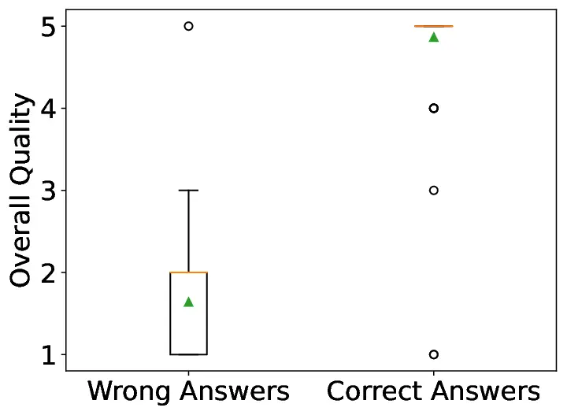

(a) Human judgment

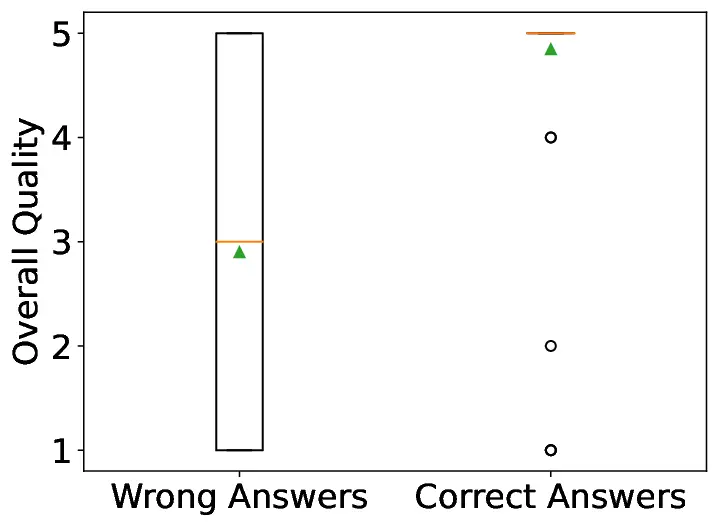

(b) GPT-4

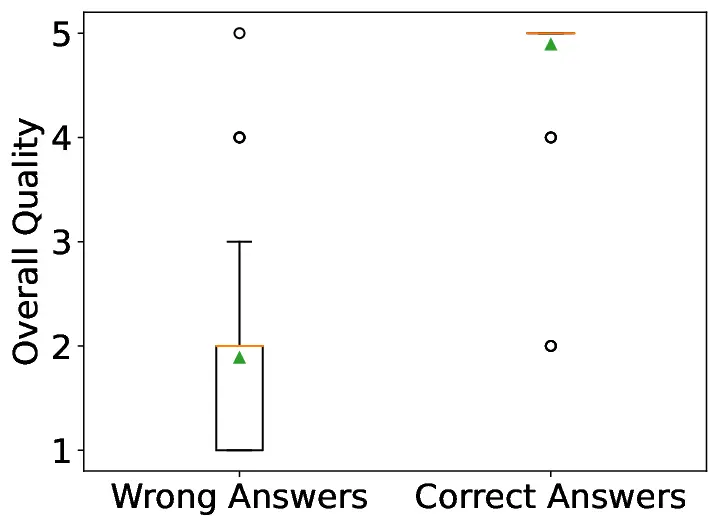

(c) SocREval

Figure 7: Distribution of the quality of reasoning chains across
questions on GSM8K, differentiated by answer correctness (correct versus
wrong), as assessed through human judgment, GPT-4, and SocREval. Quality
scores range from 1 to 5, with the orange line representing the median
and the green triangle signifying the mean.

## 4 Analysis

In this section, we undertake an in-depth analysis of SocREval. For
brevity and clarity, our primary emphasis centers on our best evaluation
metric, SocREval (All), often referred to simply as SocREval.

#### Robustness analysis.

Prompting techniques, in certain contexts, have exhibited sensitivity to
their specific phrasings (Kojima et al., 2022). To discern the influence
of prompt writing on SocREval, we systematically rephrase Prompt (6)
five times. More details are in Appendix A.1. By default, we utilize the
first example from each dataset as the demonstration in the prompt. To
systematically evaluate the influence of this demonstration example, we
select five distinct examples at random for each dataset to serve as
demonstrations. As shown in Table 2, the standard deviation for SocREval
across the six variations of Prompt (6) as well as the standard
deviation encompassing six disparate demonstration examples both
consistently measure at $`0.01`$, indicating the robustness of SocREval
on prompt writing and example selection. This robustness highlights that
the specific template of the prompt is of minor significance, as long as
effective strategies from the Socratic Method are utilized.

#### Cost analysis.

The substantial size of LLMs inherently implies considerable operating
expenses that cannot be overlooked. Numerous methodologies have been
devised to enhance LLMs’ capabilities from varied dimensions, but they
frequently come with escalated costs (Wei et al., 2022; Wang et al.,
2022; Madaan et al., 2024). For instance, self-consistency (Wang et al., 2022) significantly enhance the performance of GPT-3 (Code-davinci-002),
boosting accuracy on GSM8K from $`60.1\%`$ to $`78.0\%`$ and on
StrategyQA (Geva et al., 2021) from $`73.4\%`$ to $`79.8\%`$. However,
this improvement incurs a substantial cost, requiring $`40`$ output
samples and resulting in a roughly $`40`$-fold rise in computational
expenses. Within this context, we assess the OpenAI API costs tied to
SocREval in comparison to those of GPT-4. Note that these API costs are
based on the number of input and output tokens processed by the LLMs. As
illustrated in Figure 19 in Appendix A.1, SocREval (All) incurs a cost
that is less than $`2.1`$ times that of GPT-4, while amplifying the
reasoning evaluation performance from $`0.40`$ to $`0.58`$. This
highlights the cost-efficacy of our proposal. It is important to
underscore that SocREval’s cost-efficiency is contextualized within the
usage of LLMs, relative to alternative prompting or decoding strategies
like self-consistency. Compared to approaches utilizing smaller language
models like ROSCOE and ReCEval, SocREval incurs higher inference costs
due to its reliance on LLMs, but it offers a distinct advantage by
obviating the need for fine-tuning and human-crafted reasoning chains,
which may be more resource-intensive.

#### Answer analysis.

When presented with a question, the whole reasoning trajectory comprises
both an explanation and an answer, as shown in the Explain-then-Predict
and Predict-then-Explain explanation paradigms. In this part, we delve
deeper into the interplay between answer accuracy and the overall
quality of reasoning chains. We segment our GSM8K examples into two
groups: examples with correct answers and examples with wrong answers.
Within each group, we investigate the distribution of the overall
quality of reasoning chains, as assessed by human judgment, GPT-4, and
SocREval. Figure 7 reveals that, according to human evaluators,
explanations associated with correct answers typically exhibit high
quality, whereas those linked to wrong answers manifest a discernible
decline in quality—a trend aligning with our anticipations. While GPT-4
demonstrates proficiency in assessing explanation quality for correctly
answered instances, it tends to overestimate the quality for wrongly
answered ones. By leveraging the Socratic method, SocREval markedly
mitigates this overestimation tendency. More analysis can be found in
Figure 20 in Appendix A.2.

## 5 Discussion

In this work, we introduced a novel framework that harnesses the
Socratic method to craft optimized prompts for LLMs, specifically GPT-4,
enabling enhanced assessment of reasoning chain quality. Distinctively,
our proposal avoids the need for model fine-tuning on human-crafted
reasoning chains, a prevalent requirement in current reference-free
reasoning evaluation metrics. The efficacy of our approach is
substantiated across four datasets, wherein our proposed reference-free
evaluation metric SocREval demonstrates superior correlation with human
judgments regarding reasoning chains produced by LLMs. Comprehensive
analyses further underscore the robustness of our method with respect to
prompt writing and example selection, all while maintaining
cost-efficiency.

Our study substantiates the efficacy of the Socratic Method in prompt
design for reference-free reasoning evaluation, offering quantitative
experimental results that demonstrate its applicability in reasoning
tasks, in contrast to prior research that predominantly relied on
qualitative case analyses. Building on these findings, we anticipate
several promising directions for future exploration. First, we simply
select three strategies deeply relevant to our datasets; however, the
expansive potential of the Socratic method’s strategies deserves a more
comprehensive exploration. Second, since evaluation plays a pivotal role
in feedback mechanisms, a fusion of our proposal with prominent feedback
integration methods like SELF-REFINE (Madaan et al., 2024) and Reflexion
(Shinn et al., 2023) could be useful in improving the reasoning
capabilities of LLMs. Moreover, considering the important role of
reasoning chains in advanced prompting techniques—such as chain of
thought, tree of thoughts (Yao et al., 2023), and graph of thoughts
(Besta et al., 2024), we plan to harness our framework, LLMs with the
Socratic method, for an enriched understanding of these techniques,
subsequently designing better prompts.

## Limitations

Our evaluation uses publicly available datasets, raising the possibility
that elements from these datasets might have been incorporated into
GPT-4’s training, potentially biased the assessment results. However,
this concern is mitigated by the substantial enhancements achieved by
SocREval, which significantly augment GPT-4’s capabilities. If GPT-4’s
training indeed encompassed these datasets, it presents a challenge to
further improvement. We thus expect SocREval to perform well on new
datasets, a hypothesis we plan to investigate in future studies.
Additionally, while we employ GPT-4 to evaluate the quality of reasoning
chains produced by GPT-3 variants, an intriguing inquiry emerges: Can
GPT-4 effectively evaluate reasoning chains generated by itself?
Addressing this necessitates human judgment of reasoning chains
generated by GPT-4, a facet we postpone for future research.

## Acknowledgements

This work was partially funded by ONR Contract N00014-23-1-2364 and by
the Army Research Office under Grant Number W911NF-20-1-0080. The views
and conclusions contained in this document are those of the authors and
should not be interpreted as representing the official policies, either
expressed or implied, of the Army Research Office or the U.S.
Government.

## References

- Anil et al. (2023) Rohan Anil, Andrew M Dai, Orhan Firat, Melvin
  Johnson, Dmitry Lepikhin, Alexandre Passos, Siamak Shakeri, Emanuel
  Taropa, Paige Bailey, Zhifeng Chen, et al. 2023. PaLM 2 technical
  report. _arXiv preprint arXiv:2305.10403_.
- Arkoudas (2023) Konstantine Arkoudas. 2023. GPT-4 can’t reason. _arXiv
  preprint arXiv:2308.03762_.
- Besta et al. (2024) Maciej Besta, Nils Blach, Ales Kubicek, Robert
  Gerstenberger, Michal Podstawski, Lukas Gianinazzi, Joanna Gajda,
  Tomasz Lehmann, Hubert Niewiadomski, Piotr Nyczyk, et al. 2024. Graph
  of thoughts: Solving elaborate problems with large language models. In
  _Proceedings of the AAAI Conference on Artificial Intelligence_,
  volume 38, pages 17682–17690.
- Brown et al. (2020) Tom Brown, Benjamin Mann, Nick Ryder, Melanie
  Subbiah, Jared D Kaplan, Prafulla Dhariwal, Arvind Neelakantan, Pranav
  Shyam, Girish Sastry, Amanda Askell, et al. 2020. Language models are
  few-shot learners. _Advances in neural information processing
  systems_, 33:1877–1901.
- Camburu et al. (2018) Oana-Maria Camburu, Tim Rocktäschel, Thomas
  Lukasiewicz, and Phil Blunsom. 2018. e-SNLI: Natural language
  inference with natural language explanations. _Advances in Neural
  Information Processing Systems_, 31.
- Celikyilmaz et al. (2020) Asli Celikyilmaz, Elizabeth Clark, and
  Jianfeng Gao. 2020. Evaluation of text generation: A survey. _arXiv
  preprint arXiv:2006.14799_.
- Chang (2023a) Edward Y Chang. 2023a. Prompting large language models
  with the socratic method. In _2023 IEEE 13th Annual Computing and
  Communication Workshop and Conference (CCWC)_, pages 0351–0360. IEEE.
- Chang (2023b) Edward Y Chang. 2023b. Socrasynth: Socratic synthesis
  for reasoning and decision making. _Stanford University InfoLab
  Technical Report_.
- Chen et al. (2021) Wang Chen, Piji Li, and Irwin King. 2021. A
  training-free and reference-free summarization evaluation metric via
  centrality-weighted relevance and self-referenced redundancy. In
  _Proceedings of the 59th Annual Meeting of the Association for
  Computational Linguistics and the 11th International Joint Conference
  on Natural Language Processing (Volume 1: Long Papers)_, pages
  404–414.
- Chen et al. (2023) Yi Chen, Rui Wang, Haiyun Jiang, Shuming Shi, and
  Ruifeng Xu. 2023. Exploring the use of large language models for
  reference-free text quality evaluation: A preliminary empirical study.
  _arXiv preprint arXiv:2304.00723_.
- Clinciu et al. (2021) Miruna Clinciu, Arash Eshghi, and Helen
  Hastie. 2021. A study of automatic metrics for the evaluation of
  natural language explanations. In _Proceedings of the 16th Conference
  of the European Chapter of the Association for Computational
  Linguistics: Main Volume_, pages 2376–2387.
- Cobbe et al. (2021) Karl Cobbe, Vineet Kosaraju, Mohammad Bavarian,
  Mark Chen, Heewoo Jun, Lukasz Kaiser, Matthias Plappert, Jerry Tworek,
  Jacob Hilton, Reiichiro Nakano, et al. 2021. Training verifiers to
  solve math word problems. _arXiv preprint arXiv:2110.14168_.
- Dalvi et al. (2021) Bhavana Dalvi, Peter Jansen, Oyvind Tafjord,
  Zhengnan Xie, Hannah Smith, Leighanna Pipatanangkura, and Peter
  Clark. 2021. Explaining answers with entailment trees. In _Proceedings
  of the 2021 Conference on Empirical Methods in Natural Language
  Processing_, pages 7358–7370.
- Dong et al. (2023) Qingxiu Dong, Li Dong, Ke Xu, Guangyan Zhou, Yaru
  Hao, Zhifang Sui, and Furu Wei. 2023. Large language model for
  science: A study on P vs. NP. _arXiv preprint arXiv:2309.05689_.
- Dua et al. (2019) Dheeru Dua, Yizhong Wang, Pradeep Dasigi, Gabriel
  Stanovsky, Sameer Singh, and Matt Gardner. 2019. DROP: A reading
  comprehension benchmark requiring discrete reasoning over paragraphs.
  In _Proceedings of NAACL-HLT_, pages 2368–2378.
- Fu et al. (2023) Jinlan Fu, See-Kiong Ng, Zhengbao Jiang, and Pengfei
  Liu. 2023. GPTscore: Evaluate as you desire. _arXiv preprint
  arXiv:2302.04166_.
- Gao et al. (2023) Mingqi Gao, Jie Ruan, Renliang Sun, Xunjian Yin,
  Shiping Yang, and Xiaojun Wan. 2023. Human-like summarization
  evaluation with ChatGPT. _arXiv preprint arXiv:2304.02554_.
- Gao et al. (2020) Yang Gao, Wei Zhao, and Steffen Eger. 2020. SUPERT:
  Towards new frontiers in unsupervised evaluation metrics for
  multi-document summarization. In _Proceedings of the 58th Annual
  Meeting of the Association for Computational Linguistics_, pages
  1347–1354.
- Geva et al. (2021) Mor Geva, Daniel Khashabi, Elad Segal, Tushar Khot,
  Dan Roth, and Jonathan Berant. 2021. Did aristotle use a laptop? a
  question answering benchmark with implicit reasoning strategies.
  _Transactions of the Association for Computational Linguistics_,
  9:346–361.
- Golovneva et al. (2022) Olga Golovneva, Moya Peng Chen, Spencer Poff,
  Martin Corredor, Luke Zettlemoyer, Maryam Fazel-Zarandi, and Asli
  Celikyilmaz. 2022. ROSCOE: A suite of metrics for scoring step-by-step
  reasoning. In _The Eleventh International Conference on Learning
  Representations_.
- Han et al. (2022) Simeng Han, Hailey Schoelkopf, Yilun Zhao, Zhenting
  Qi, Martin Riddell, Luke Benson, Lucy Sun, Ekaterina Zubova, Yujie
  Qiao, Matthew Burtell, et al. 2022. FOLIO: Natural language reasoning
  with first-order logic. _arXiv preprint arXiv:2209.00840_.
- Huang and Chang (2023) Jie Huang and Kevin Chen-Chuan Chang. 2023.
  Towards reasoning in large language models: A survey. In _61st Annual
  Meeting of the Association for Computational Linguistics, ACL 2023_,
  pages 1049–1065. Association for Computational Linguistics (ACL).
- Huang et al. (2019) Lifu Huang, Ronan Le Bras, Chandra Bhagavatula,
  and Yejin Choi. 2019. Cosmos QA: Machine reading comprehension with
  contextual commonsense reasoning. In _Proceedings of the 2019
  Conference on Empirical Methods in Natural Language Processing and the
  9th International Joint Conference on Natural Language Processing
  (EMNLP-IJCNLP)_, pages 2391–2401.
- Jung et al. (2022) Jaehun Jung, Lianhui Qin, Sean Welleck, Faeze
  Brahman, Chandra Bhagavatula, Ronan Le Bras, and Yejin Choi. 2022.
  Maieutic prompting: Logically consistent reasoning with recursive
  explanations. In _Proceedings of the 2022 Conference on Empirical
  Methods in Natural Language Processing_, pages 1266–1279.
- Kocmi and Federmann (2023) Tom Kocmi and Christian Federmann. 2023.
  Large language models are state-of-the-art evaluators of translation
  quality. In _Proceedings of the 24th Annual Conference of the European
  Association for Machine Translation_, pages 193–203.
- Kojima et al. (2022) Takeshi Kojima, Shixiang Shane Gu, Machel Reid,
  Yutaka Matsuo, and Yusuke Iwasawa. 2022. Large language models are
  zero-shot reasoners. _Advances in neural information processing
  systems_, 35:22199–22213.
- Liu et al. (2023) Yang Liu, Dan Iter, Yichong Xu, Shuohang Wang,
  Ruochen Xu, and Chenguang Zhu. 2023. G-Eval: NLG evaluation using
  gpt-4 with better human alignment. In _Proceedings of the 2023
  Conference on Empirical Methods in Natural Language Processing_, pages
  2511–2522.
- Lu et al. (2023) Qingyu Lu, Baopu Qiu, Liang Ding, Liping Xie, and
  Dacheng Tao. 2023. Error analysis prompting enables human-like
  translation evaluation in large language models: A case study on
  ChatGPT. _arXiv preprint arXiv:2303.13809_.
- Madaan et al. (2024) Aman Madaan, Niket Tandon, Prakhar Gupta, Skyler
  Hallinan, Luyu Gao, Sarah Wiegreffe, Uri Alon, Nouha Dziri, Shrimai
  Prabhumoye, Yiming Yang, et al. 2024. Self-refine: Iterative
  refinement with self-feedback. _Advances in Neural Information
  Processing Systems_, 36.
- OpenAI (2023) OpenAI. 2023. GPT-4 technical report. _arXiv preprint
  arXiv:2303.08774_.
- Ostermann et al. (2018) Simon Ostermann, Michael Roth, Ashutosh Modi,
  Stefan Thater, and Manfred Pinkal. 2018. Semeval-2018 task 11: Machine
  comprehension using commonsense knowledge. In _Proceedings of the 12th
  International Workshop on semantic evaluation_, pages 747–757.
- Prasad et al. (2023) Archiki Prasad, Swarnadeep Saha, Xiang Zhou, and
  Mohit Bansal. 2023. ReCEval: Evaluating reasoning chains via
  correctness and informativeness. In _Proceedings of the 2023
  Conference on Empirical Methods in Natural Language Processing_, pages
  10066–10086.
- Saparov and He (2022) Abulhair Saparov and He He. 2022. Language
  models are greedy reasoners: A systematic formal analysis of
  chain-of-thought. In _The Eleventh International Conference on
  Learning Representations_.
- Shinn et al. (2023) Noah Shinn, Federico Cassano, Ashwin Gopinath,
  Karthik Narasimhan, and Shunyu Yao. 2023. Reflexion: Language agents
  with verbal reinforcement learning. _Advances in Neural Information
  Processing Systems_, 36.
- Somers (1962) Robert H Somers. 1962. A new asymmetric measure of
  association for ordinal variables. _American sociological review_,
  pages 799–811.
- Touvron et al. (2023) Hugo Touvron, Louis Martin, Kevin Stone, Peter
  Albert, Amjad Almahairi, Yasmine Babaei, Nikolay Bashlykov, Soumya
  Batra, Prajjwal Bhargava, Shruti Bhosale, et al. 2023. Llama 2: Open
  foundation and fine-tuned chat models. _arXiv preprint
  arXiv:2307.09288_.
- Wang et al. (2023) Jiaan Wang, Yunlong Liang, Fandong Meng, Zengkui
  Sun, Haoxiang Shi, Zhixu Li, Jinan Xu, Jianfeng Qu, and Jie
  Zhou. 2023. Is ChatGPT a good NLG evaluator? a preliminary study. In
  _Proceedings of the 4th New Frontiers in Summarization Workshop_,
  pages 1–11.
- Wang et al. (2022) Xuezhi Wang, Jason Wei, Dale Schuurmans, Quoc V Le,
  Ed H Chi, Sharan Narang, Aakanksha Chowdhery, and Denny Zhou. 2022.
  Self-consistency improves chain of thought reasoning in language
  models. In _The Eleventh International Conference on Learning
  Representations_.
- Wei et al. (2022) Jason Wei, Xuezhi Wang, Dale Schuurmans, Maarten
  Bosma, Fei Xia, Ed Chi, Quoc V Le, Denny Zhou, et al. 2022.
  Chain-of-thought prompting elicits reasoning in large language models.
  _Advances in Neural Information Processing Systems_, 35:24824–24837.
- Welleck et al. (2022) Sean Welleck, Jiacheng Liu, Ximing Lu, Hannaneh
  Hajishirzi, and Yejin Choi. 2022. Naturalprover: Grounded mathematical
  proof generation with language models. _Advances in Neural Information
  Processing Systems_, 35:4913–4927.
- Yao et al. (2023) Shunyu Yao, Dian Yu, Jeffrey Zhao, Izhak Shafran,
  Tom Griffiths, Yuan Cao, and Karthik Narasimhan. 2023. Tree of
  thoughts: Deliberate problem solving with large language models.
  _Advances in Neural Information Processing Systems_, 36.
- Ye and Durrett (2022) Xi Ye and Greg Durrett. 2022. The unreliability
  of explanations in few-shot prompting for textual reasoning. _Advances
  in neural information processing systems_, 35:30378–30392.
- Zelikman et al. (2022) Eric Zelikman, Yuhuai Wu, Jesse Mu, and Noah
  Goodman. 2022. STaR: Bootstrapping reasoning with reasoning. _Advances
  in Neural Information Processing Systems_, 35:15476–15488.
- Zheng et al. (2023) Lianmin Zheng, Wei-Lin Chiang, Ying Sheng, Siyuan
  Zhuang, Zhanghao Wu, Yonghao Zhuang, Zi Lin, Zhuohan Li, Dacheng Li,
  Eric Xing, et al. 2023. Judging LLM-as-a-judge with MT-bench and
  chatbot arena. _Advances in Neural Information Processing
  Systems_, 36.

## Appendix A Appendix

In this section, we delve deeper into the experimental details and
present additional results. Further information can be found in our
released code.

### A.1 Experimental Details

#### Examples in e-SNLI and Cosmos QA.

In addition to the examples from GSM8K and DROP depicted in Figure 1, we
present examples from e-SNLI and Cosmos QA in Figure 8.

#### Prompt templates.

For SocREval, detailed prompt templates across the four datasets—GSM8K,
e-SNLI, DROP, and Cosmos QA—are described in Tables 3-6. Detailed
prompting templates for SocREval with specific strategies, such as
SocREval (Definition) and SocREval (All - Definition), can be readily
derived by adjusting the Instruction, Evaluation prompt, and Example
representation as appropriate.

#### Sample outputs of SocREval.

To facilitate a deeper comprehension of SocREval, Figures 9- 13 exhibit
some effective and ineffective outputs generated by various SocREval
variants.

#### Prompt variants in the robustness analysis.

Building on the discussions in Section 4, for an in-depth robustness
examination related to prompt writing for SocREval, we have rephrased
Prompt (6) five times. These five distinct variations of the original
Prompt (6) are shown in Prompts (14)-(18).

#### Detailed cost analysis.

A detailed comparison of the costs associated with GPT-4 and SocREval is
presented in Figure 19.

### A.2 Additional Results

#### Extended answer analysis.

Building upon the discussion in Section 4, we provide an in-depth
visualization of the quality distributions for reasoning chains related
to questions in the GSM8K dataset, as presented in Figure 20.

#### Ablation study.

The SocREval approach harnesses three distinct strategies from the
Socratic method—Definition, Maieutics, and Dialectic—to elicit
reference-free reasoning evaluations from LLMs. To investigate the
significance of each strategy within this integration of three
strategies, we omit each from SocREval and observe the consequences. The
specific instructions and evaluation prompts utilized in the ablation
study, including SocREval (All - Definition), SocREval (All -
Maieutics), and SocREval (All - Dialectic), are detailed in Prompts
(21)-(23). As shown in Table 7, excluding any single strategy
consistently decreases GPT-4’s efficacy. Notably, the Dialectic strategy
emerges as the pivotal one within the integration of three strategies,
with its omission resulting in the most pronounced performance
degradation. However, while Dialectic holds paramount importance within
the integration of three strategies, Maieutics outperforms when
strategies are incorporated individually (see Table 1). This suggests
the complex interactions among the strategies. Delving into the
intricate dynamics of how these strategies interplay in shaping LLM
prompts is compelling and warranted for future exploration.

#### Meta evaluation analysis.

To obtain a deeper insight into the superiority of SocREval over GPT-4,
we expand our evaluation scope by incorporating eight supplementary
metrics for meta evaluation beyond just Somers’ D: Pearson’s Correlation
Coefficient, Spearman’s Rank Correlation Coefficient, Kendall’s
$`\tau`$, Accuracy, Root Mean Squared Error (RMSE), Mean Absolute Error
(MAE), Micro F1 Score, and Macro F1 Score. These meta-evaluation metrics
are designed to quantify the alignment between evaluation metrics and
human judgment. As shown in Table 8, SocREval consistently outperforms
GPT-4 across all meta-evaluation metrics. In addition, we transitioned
the initial five-class classification into both three-class and
two-class classification. Within the three-class classification, the
original score of $`1`$ is remapped to $`-1`$ (strongly negative),
scores $`2`$ to $`4`$ are assigned to $`0`$ (moderately negative), and
the score of $`5`$ is designated as $`1`$ (strongly positive). For the
two-class classification, scores from $`1`$ to $`4`$ are remapped to
$`0`$ (negative), while a score of $`5`$ corresponds to $`1`$
(positive). Similar to Table 8, meta evaluation is carried out for both
two-class and three-class classification employing nine distinct
metrics. As shown in Tables 9 and 10, it is evident that SocREval
systematically surpasses GPT-4 across all meta-evaluation metrics for
both three-class and two-class classification. Delving deeper, we
analyzed the confusion matrices for GPT-4 and SocREval across the four
datasets: GSM8K, e-SNLI, DROP, and Cosmos QA. Figure 24 reveals that
while GPT-4 tends to overestimate the quality of reasoning chains,
SocREval successfully mitigates this bias by integrating strategies from
the Socratic method.

#### Error type analysis.

Drawing inspiration from ROSCOE and ReCEval, we delve deeper into an
analysis focused on specific error types⁶⁶ 6 While some error types such
as “Coherence” are evaluated at the chain-level, others like “Missing
step” are assessed at the step-level. Consistent with the scoring setup
in ROSCOE and ReCEval, we aggregate step-level error scores using a
“min” operation to derive the error score for the entire reasoning
chain, based on the intuition that the quality of a reasoning chain is
anchored by its weakest step. within reasoning chains. Initially, we
compute the correlation between human-annotated errors and the overall
quality of reasoning chains as judged by humans. As evident in Table 11,
“Missing Step” and “Coherence” notably register the strongest
correlations with the overall quality amongst the ten annotated error
categories. This suggests these two errors heavily influence human
assessment of reasoning chain quality. Additionally, we examine the
correlation of both GPT-4 and SocREval with ten human-annotated error
types across the four datasets. As depicted in Table 12, on average,
SocREval surpasses GPT-4 in almost all error types except the
“Hallucination”. Interestingly, when compared to reference-free ROSCOE,
the SocREval only lags in errors like “Hallucination,” “Redundancy,” and
“Grammar.” Although ROSCOE and ReCEval utilize diverse metrics for
specific error types, with different metrics excelling in varied
contexts, we instead prompt LLMs to assess the overall quality of
reasoning chains rather than pinpointing specific error types. One
prospective avenue might be directing LLMs to directly identify the
presence of particular error types—a pursuit we postpone for future
exploration. For a granular breakdown of correlations specific to each
dataset, readers are directed to Tables 13-16.

Figure 8: Examples from the e-SNLI and Cosmos QA datasets.

|                                                                                                                                                                                                                                                                                                                                                                                                                                                                                                                                                                                                                                                                                                                                                                                                           |
| --------------------------------------------------------------------------------------------------------------------------------------------------------------------------------------------------------------------------------------------------------------------------------------------------------------------------------------------------------------------------------------------------------------------------------------------------------------------------------------------------------------------------------------------------------------------------------------------------------------------------------------------------------------------------------------------------------------------------------------------------------------------------------------------------------- |
| Instruction: Does the generated response answer the question in a well-justified manner? Please generate your own response for the question first, then conduct a qualitative analysis on the generated response by taking into account your own response, and finally give me an overall quality score in \[1, 2, 3, 4, 5\] (1=incomprehensible and wrong, 5=clear and correct) for the given generated response by taking into account both your own response and the qualitative analysis. Note that you need to take into account both the explanation and the answer in the generated response.                                                                                                                                                                                                      |
| Example question: Janet’s ducks lay 16 eggs per day. She eats three for breakfast every morning and bakes muffins for her friends every day with four. She sells the remainder at the farmers’ market daily for \$2 per fresh duck egg. How much in dollars does she make every day at the farmers’ market?                                                                                                                                                                                                                                                                                                                                                                                                                                                                                               |
| Example generated response: Janet eats 3 duck eggs for breakfast and bakes 4 into muffins so 3 + 4 = $`<<`$3+4=7$`>>`$7 duck eggs are used\|\|Each day Janet’s ducks lay 16 eggs and she uses 7, 16 - 7 = $`<<`$16-7=9$`>>`$9 duck eggs are for sale\|\|She sells her eggs for \$2 per egg and has 9 available for sale so 2 \* 9 = \$$`<<`$2\*9=18$`>>`$18 per day\|\|A: 18                                                                                                                                                                                                                                                                                                                                                                                                                              |
| Example representation: {“own response”: “Janet uses a total of 3 (for breakfast) + 4 (for muffins) = 7 duck eggs each day. Given that her ducks lay 16 eggs per day, she is left with 16 - 7 = 9 eggs to sell at the farmers’ market. Each of these eggs sells for \$2, so Janet makes a total of 9 \* \$2 = \$18 at the farmers’ market each day.”, “qualitative analysis”: “The generated response is correct and complete. It precisely calculates the number of eggs that Janet consumes each day and subtracts that from the total number of eggs laid. It then multiplies the remaining eggs by the selling price to get the total amount that Janet makes each day. The response is also clear and easy to follow, with each step of the calculation laid out explicitly.”, “overall quality”: 5} |
| Question: A robe takes 2 bolts of blue fiber and half that much white fiber. How many bolts in total does it take?                                                                                                                                                                                                                                                                                                                                                                                                                                                                                                                                                                                                                                                                                        |
| Generated response: It takes 2 bolts of blue and half that much white so it takes 2\*1/2 = $`<<`$2\*1/2=1.0$`>>`$1 bolt of white\|\|It takes 1 bolt of white and it takes 2 bolts of blue so it takes 1+2 = $`<<`$1+2=3$`>>`$3 bolts in total\|\|A: 3                                                                                                                                                                                                                                                                                                                                                                                                                                                                                                                                                     |
| (Evaluation prompt) Please generate your own response for the question first, then conduct a qualitative analysis on the generated response by taking into account your own response, and finally give me the overall quality of the given generated response for the question by taking into account both your own response and the qualitative analysis based on the instruction and the format of the example representation:                                                                                                                                                                                                                                                                                                                                                                          |

Table 3: The full prompt for SocREval on GSM8K. While elements like
“Instruction” are embedded within the prompt, the term “Evaluation
prompt” is exclusive and simply represents the last sentence in the
prompt. For clarity, besides the demonstration example in the prompt, an
additional example is provided. The notation “\|\|” is employed to
symbolize the Python newline character “\n”.

|                                                                                                                                                                                                                                                                                                                                                                                                                                                                                                                                                                                                                                                                                                                                                                                                     |
| --------------------------------------------------------------------------------------------------------------------------------------------------------------------------------------------------------------------------------------------------------------------------------------------------------------------------------------------------------------------------------------------------------------------------------------------------------------------------------------------------------------------------------------------------------------------------------------------------------------------------------------------------------------------------------------------------------------------------------------------------------------------------------------------------- |
| Instruction: Does the generated response answer the question in a well-justified manner? Please generate your own response for the question first, then conduct a qualitative analysis on the generated response by taking into account your own response, and finally give me an overall quality score in \[1, 2, 3, 4, 5\] (1=incomprehensible and wrong, 5=clear and correct) for the given generated response by taking into account both your own response and the qualitative analysis. Note that you need to take into account both the explanation and the answer in the generated response.                                                                                                                                                                                                |
| Example Situation (Premise): Two women are embracing while holding to go packages.                                                                                                                                                                                                                                                                                                                                                                                                                                                                                                                                                                                                                                                                                                                  |
| Example Claim (Hypothesis): Two woman are holding packages.                                                                                                                                                                                                                                                                                                                                                                                                                                                                                                                                                                                                                                                                                                                                         |
| Example question: Is the Claim supported by the Situation?                                                                                                                                                                                                                                                                                                                                                                                                                                                                                                                                                                                                                                                                                                                                          |
| Example generated response: The two women are most likely embracing because they are either friends or family. If they were just holding packages, there would be no need for them to embrace. The answer is Yes.                                                                                                                                                                                                                                                                                                                                                                                                                                                                                                                                                                                   |
| Example representation: {“own response”: “Yes, the Claim is supported by the Situation. The Situation states that two women are ‘embracing while holding to go packages,’ which means they are holding packages. Therefore, the Claim is accurate.”, “qualitative analysis”: “The generated response starts by making an assumption about why the two women might be embracing, suggesting they could be friends or family. While this could be true, it is not directly relevant to the question asked. The core of the question is about the Claim’s accuracy given the Situation. The latter part of the generated response does correctly determine that the answer is ‘Yes.’ However, the earlier assumption makes the response longer and potentially more confusing.”, “overall quality”: 4} |
| Situation (Premise): Two women are embracing while holding to go packages.                                                                                                                                                                                                                                                                                                                                                                                                                                                                                                                                                                                                                                                                                                                          |
| Claim (Hypothesis): The men are fighting outside a deli.                                                                                                                                                                                                                                                                                                                                                                                                                                                                                                                                                                                                                                                                                                                                            |
| Question: Is the Claim supported by the Situation?                                                                                                                                                                                                                                                                                                                                                                                                                                                                                                                                                                                                                                                                                                                                                  |
| Generated response: Two women are embracing while holding to go packages means they are friends or family. They are not fighting. The answer is No.                                                                                                                                                                                                                                                                                                                                                                                                                                                                                                                                                                                                                                                 |
| (Evaluation prompt) Please generate your own response for the question first, then conduct a qualitative analysis on the generated response by taking into account your own response, and finally give me the overall quality of the given generated response for the question by taking into account both your own response and the qualitative analysis based on the instruction and the format of the example representation:                                                                                                                                                                                                                                                                                                                                                                    |

Table 4: The full prompt for SocREval on e-SNLI. While elements like
“Instruction” are embedded within the prompt, the term “Evaluation
prompt” is exclusive and simply represents the last sentence in the
prompt. For clarity, besides the demonstration example in the prompt, an
additional example is provided.

|                                                                                                                                                                                                                                                                                                                                                                                                                                                                                                                                                                                                                                                                                                                                                                                                                                                                                                                                                                                                                                         |
| --------------------------------------------------------------------------------------------------------------------------------------------------------------------------------------------------------------------------------------------------------------------------------------------------------------------------------------------------------------------------------------------------------------------------------------------------------------------------------------------------------------------------------------------------------------------------------------------------------------------------------------------------------------------------------------------------------------------------------------------------------------------------------------------------------------------------------------------------------------------------------------------------------------------------------------------------------------------------------------------------------------------------------------- |
| Instruction: Does the generated response answer the question in a well-justified manner? Please generate your own response for the question first, then conduct a qualitative analysis on the generated response by taking into account your own response, and finally give me an overall quality score in \[1, 2, 3, 4, 5\] (1=incomprehensible and wrong, 5=clear and correct) for the given generated response by taking into account both your own response and the qualitative analysis. Note that you need to take into account both the explanation and the answer in the generated response.                                                                                                                                                                                                                                                                                                                                                                                                                                    |
| Example Situation (Premise): Hoping to rebound from their loss to the Patriots, the Raiders stayed at home for a Week 16 duel with the Houston Texans. Oakland would get the early lead in the first quarter as quarterback JaMarcus Russell completed a 20-yard touchdown pass to rookie wide receiver Chaz Schilens. The Texans would respond with fullback Vonta Leach getting a 1-yard touchdown run, yet the Raiders would answer with kicker Sebastian Janikowski getting a 33-yard and a 30-yard field goal. Houston would tie the game in the second quarter with kicker Kris Brown getting a 53-yard and a 24-yard field goal. Oakland would take the lead in the third quarter with wide receiver Johnnie Lee Higgins catching a 29-yard touchdown pass from Russell, followed up by an 80-yard punt return for a touchdown. The Texans tried to rally in the fourth quarter as Brown nailed a 40-yard field goal, yet the Raiders’ defense would shut down any possible attempt. Who scored the first touchdown of the game? |
| Example Claim (Hypothesis): Chaz Schilens                                                                                                                                                                                                                                                                                                                                                                                                                                                                                                                                                                                                                                                                                                                                                                                                                                                                                                                                                                                               |
| Example question: Is the Claim supported by the Situation?                                                                                                                                                                                                                                                                                                                                                                                                                                                                                                                                                                                                                                                                                                                                                                                                                                                                                                                                                                              |
| Example generated response: Chaz Schilens was the receiver of the touchdown pass from JaMarcus Russell, so he scored the first touchdown. The answer is Yes.                                                                                                                                                                                                                                                                                                                                                                                                                                                                                                                                                                                                                                                                                                                                                                                                                                                                            |
| Example representation: {“own response”: “Yes, the Claim is supported by the Situation as Chaz Schilens caught a 20-yard touchdown pass from JaMarcus Russell, making him the scorer of the first touchdown.”, “qualitative analysis”: “Both the generated response and my own response acknowledge that Chaz Schilens caught the first touchdown of the game from a pass by JaMarcus Russell. The generated response provides a concise and clear explanation that supports the answer.”, “overall quality”: 5}                                                                                                                                                                                                                                                                                                                                                                                                                                                                                                                        |
| Situation (Premise): Hoping to rebound from their loss to the Patriots, the Raiders stayed at home for a Week 16 duel with the Houston Texans. Oakland would get the early lead in the first quarter as quarterback JaMarcus Russell completed a 20-yard touchdown pass to rookie wide receiver Chaz Schilens. The Texans would respond with fullback Vonta Leach getting a 1-yard touchdown run, yet the Raiders would answer with kicker Sebastian Janikowski getting a 33-yard and a 30-yard field goal. Houston would tie the game in the second quarter with kicker Kris Brown getting a 53-yard and a 24-yard field goal. Oakland would take the lead in the third quarter with wide receiver Johnnie Lee Higgins catching a 29-yard touchdown pass from Russell, followed up by an 80-yard punt return for a touchdown. The Texans tried to rally in the fourth quarter as Brown nailed a 40-yard field goal, yet the Raiders’ defense would shut down any possible attempt. How many field goals did Kris Brown kick?           |
| Claim (Hypothesis): 3                                                                                                                                                                                                                                                                                                                                                                                                                                                                                                                                                                                                                                                                                                                                                                                                                                                                                                                                                                                                                   |
| Question: Is the Claim supported by the Situation?                                                                                                                                                                                                                                                                                                                                                                                                                                                                                                                                                                                                                                                                                                                                                                                                                                                                                                                                                                                      |
| Generated response: Kris Brown kicked 4 field goals. The answer is No.                                                                                                                                                                                                                                                                                                                                                                                                                                                                                                                                                                                                                                                                                                                                                                                                                                                                                                                                                                  |
| (Evaluation prompt) Please generate your own response for the question first, then conduct a qualitative analysis on the generated response by taking into account your own response, and finally give me the overall quality of the given generated response for the question by taking into account both your own response and the qualitative analysis based on the instruction and the format of the example representation:                                                                                                                                                                                                                                                                                                                                                                                                                                                                                                                                                                                                        |

Table 5: The full prompt for SocREval on DROP. While elements like
“Instruction” are embedded within the prompt, the term “Evaluation
prompt” is exclusive and simply represents the last sentence in the
prompt. For clarity, besides the demonstration example in the prompt, an
additional example is provided.

|                                                                                                                                                                                                                                                                                                                                                                                                                                                                                                                                                                                                                                                                                                                                                                                                                                      |
| ------------------------------------------------------------------------------------------------------------------------------------------------------------------------------------------------------------------------------------------------------------------------------------------------------------------------------------------------------------------------------------------------------------------------------------------------------------------------------------------------------------------------------------------------------------------------------------------------------------------------------------------------------------------------------------------------------------------------------------------------------------------------------------------------------------------------------------ |
| Instruction: Does the generated response answer the question in a well-justified manner? Please generate your own response for the question first, then conduct a qualitative analysis on the generated response by taking into account your own response, and finally give me an overall quality score in \[1, 2, 3, 4, 5\] (1=incomprehensible and wrong, 5=clear and correct) for the given generated response by taking into account both your own response and the qualitative analysis. Note that you need to take into account both the explanation and the answer in the generated response.                                                                                                                                                                                                                                 |
| Example Situation (Premise): Do i need to go for a legal divorce ? I wanted to marry a woman but she is not in the same religion , so i am not concern of the marriage inside church . I will do the marriage registered with the girl who i am going to get married . But legally will there be any complication , like if the other woman comes back one day , will the girl who i am going to get married now will be in trouble or Is there any complication ? Why is this person asking about divorce ?                                                                                                                                                                                                                                                                                                                         |
| Example Claim (Hypothesis): He wants to get married to a different person .                                                                                                                                                                                                                                                                                                                                                                                                                                                                                                                                                                                                                                                                                                                                                          |
| Example question: Is the Claim supported by the Situation?                                                                                                                                                                                                                                                                                                                                                                                                                                                                                                                                                                                                                                                                                                                                                                           |
| Example generated response: He wants to get married to a different person means he is not married to the person he wants to get married to. The answer is Yes.                                                                                                                                                                                                                                                                                                                                                                                                                                                                                                                                                                                                                                                                       |
| Example representation: {“own response”: “Yes, the Situation suggests that the person wants to get married to a different woman than the one he may have been previously involved with.”, “qualitative analysis”: “The generated response made an assumption that ‘He wants to get married to a different person means he is not married to the person he wants to get married to.’ While this may be true, it’s not directly stated in the Situation. The Situation does not provide information about the current marital status of the person in question. However, the underlying premise that he wants to get married to a different person is accurate based on the context. The generated response does conclude correctly that the answer is ‘Yes,’ meaning the Claim is supported by the Situation.”, “overall quality”: 3} |
| Situation (Premise): Do i need to go for a legal divorce ? I wanted to marry a woman but she is not in the same religion , so i am not concern of the marriage inside church . I will do the marriage registered with the girl who i am going to get married . But legally will there be any complication , like if the other woman comes back one day , will the girl who i am going to get married now will be in trouble or Is there any complication ? Why is he worried about getting married ?                                                                                                                                                                                                                                                                                                                                 |
| Claim (Hypothesis): He was married before and she might come back one day .                                                                                                                                                                                                                                                                                                                                                                                                                                                                                                                                                                                                                                                                                                                                                          |
| Question: Is the Claim supported by the Situation?                                                                                                                                                                                                                                                                                                                                                                                                                                                                                                                                                                                                                                                                                                                                                                                   |
| Generated response: There might be a complication if the woman he was married to came back one day, due to the fact he is not married to her in a religious context, so she could come back and claim him as her husband. The answer is Yes.                                                                                                                                                                                                                                                                                                                                                                                                                                                                                                                                                                                         |
| (Evaluation prompt) Please generate your own response for the question first, then conduct a qualitative analysis on the generated response by taking into account your own response, and finally give me the overall quality of the given generated response for the question by taking into account both your own response and the qualitative analysis based on the instruction and the format of the example representation:                                                                                                                                                                                                                                                                                                                                                                                                     |

Table 6: The full prompt for SocREval on Cosmos QA. While elements like
“Instruction” are embedded within the prompt, the term “Evaluation
prompt” is exclusive and simply represents the last sentence in the
prompt. For clarity, besides the demonstration example in the prompt, an
additional example is provided.

Figure 9: Examples of effective and ineffective outputs from SocREval
(Definition) on GSM8K. Evaluation scores inconsistent with human
judgment are highlighted in red. For clarity, we use “\|\|” to represent
the Python newline character “\n”.

Figure 10: Examples of effective and ineffective outputs from SocREval
(Maieutics) on GSM8K. Evaluation scores inconsistent with human judgment
are highlighted in red. For clarity, we use “\|\|” to represent the
Python newline character “\n”.

Figure 11: Examples of effective and ineffective outputs from SocREval
(Dialectic) on GSM8K. Evaluation scores inconsistent with human judgment
are highlighted in red. For clarity, we use “\|\|” to represent the
Python newline character “\n”.

Figure 12: Effective output example from SocREval (All) on GSM8K.
Evaluation scores inconsistent with human judgment are highlighted in
red. For clarity, we use “\|\|” to represent the Python newline
character “\n”.

Figure 13: Ineffective output example from SocREval (All) on GSM8K.
Evaluation scores inconsistent with human judgment are highlighted in
red. For clarity, we use “\|\|” to represent the Python newline
character “\n”.

{highlightblock} Instruction: Does the generated response aptly address
the question in a well-reasoned way? First, create your own response to
the question. Following this, conduct a qualitative analysis of the
generated response, considering your own response. Conclude by providing
an overall quality score ranging from \[1, 2, 3, 4, 5\] (1=
incomprehensible and incorrect, 5= clear and accurate) for the given
generated response, factoring in both your own response and the
qualitative analysis. It’s imperative to consider both the explanation
and the answer present in the generated response.  
(Evaluation prompt) Firstly, formulate your own response to the
question. Then, undertake a qualitative analysis of the generated
response, using your own response as a reference. Lastly, provide an
assessment of the overall quality of the presented generated response by
weighing both your own response and the qualitative analysis, ensuring
adherence to the provided instruction and the format of the example
representation:

\(6\) Instruction and Evaluation Prompt for SocREval (Variant I)

{highlightblock} Instruction: Does the generated response aptly address
the question with a well-substantiated justification? First, formulate
your own response to the question. Subsequently, perform a qualitative
analysis of the generated response, considering your own response.
Finally, assign an overall quality score ranging from \[1, 2, 3, 4, 5\]
(1= incomprehensible and incorrect, 5= lucid and accurate) for the given
generated response. This score should reflect both your own response and
the qualitative analysis. Ensure you consider both the explanation and
the answer in the generated response.  
(Evaluation prompt) First, craft your own response to the question.
Next, undertake a qualitative analysis of the presented generated
response, referencing your own response for context. Conclude by rating
the overall quality of the generated response, integrating both your own
response and the qualitative analysis, as guided by the instruction and
the format of the example representation:

\(7\) Instruction and Evaluation Prompt for SocREval (Variant II)

{highlightblock} Instruction: Does the generated response adequately
address the question? First, formulate your own response to the
question. Following this, perform a qualitative analysis of the
generated response, using your own response as a reference. Conclude by
assigning an overall quality score ranging from \[1, 2, 3, 4, 5\] (1
being incomprehensible and wrong, 5 being clear and correct) to the
provided generated response. This score should consider both the clarity
of the explanation and the accuracy of the answer in the generated
response.  
(Evaluation prompt) Begin by crafting your own response to the question.
Next, undertake a qualitative analysis of the generated response,
comparing it against your own response. Finally, rate the overall
quality of the generated response, referencing both your own response
and the qualitative analysis. Ensure your evaluation adheres to the
given instruction and the format of the example representation:

\(8\) Instruction and Evaluation Prompt for SocREval (Variant III)

{highlightblock} Instruction: Does the generated response adequately
address the question with sound justification? First, provide your own
response to the question. Subsequently, perform a qualitative analysis
of the generated response, comparing it with your own response. Conclude
by assigning an overall quality score ranging from \[1, 2, 3, 4, 5\] (1
= incomprehensible and wrong, 5 = clear and correct) to the generated
response. This score should reflect both the clarity of the explanation
and the accuracy of the answer in the generated response.  
(Evaluation prompt) Begin by crafting your own response to the question.
Then, execute a qualitative analysis of the generated response, using
your own response as a benchmark. Finally, rate the overall quality of
the provided generated response on a scale of \[1 to 5\], considering
both your own response and the qualitative analysis, following the
instruction provided and the format of the example representation:

\(9\) Instruction and Evaluation Prompt for SocREval (Variant IV)

{highlightblock} Instruction: Does the generated response adequately
address the question with valid justification? First, produce your own
response to the question. Following this, conduct a qualitative analysis
of the generated response, using your own response as a reference.
Lastly, provide an overall quality score ranging from \[1, 2, 3, 4, 5\]
(1=incomprehensible and wrong, 5=clear and correct) for the generated
response. This score should consider both your own response and the
qualitative analysis. It’s important to assess both the explanation and
the answer present in the generated response.  
(Evaluation prompt) Begin by crafting your own response to the question.
Then, perform a qualitative analysis of the generated response,
referencing your own response. Conclude by assigning an overall quality
rating to the provided generated response. This rating should factor in
both your own response and the results of your qualitative analysis,
following the provided instruction and the format of the example
representation:

\(10\) Instruction and Evaluation Prompt for SocREval (Variant V)

Figure 19: Cost comparison between GPT-4 and SocREval. For each
reasoning evaluation metric across four datasets, the OpenAI API costs
are computed based on respective input (at $`\$0.03`$ per $`1K`$ tokens)
and output token counts (at $`\$0.06`$ per $`1K`$ tokens).

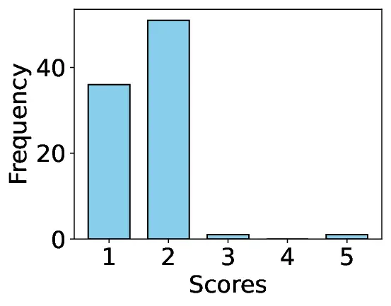

(a) Human judgment (wrong)

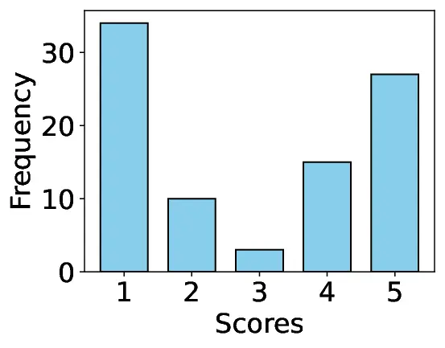

(b) GPT-4 (wrong)

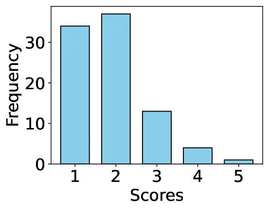

(c) SocREval (wrong)

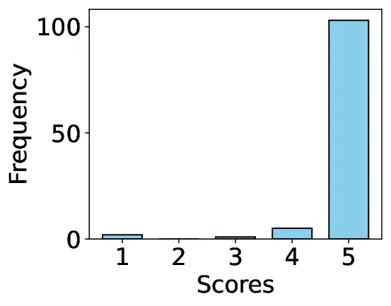

(d) Human judgment (correct)

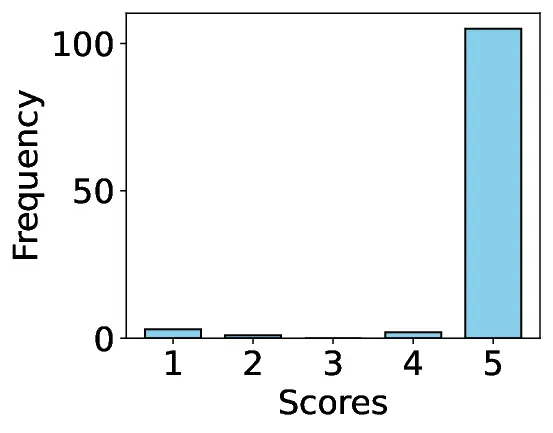

(e) GPT-4 (correct)

(f) SocREval (correct)

Figure 20: Detailed distributions of the quality of reasoning chains
across questions on GSM8K, differentiated by answer correctness (correct
versus wrong), as assessed through human judgment, GPT-4, and SocREval.

{highlightblock} Instruction: Does the generated response answer the
question in a well-justified manner? Please generate your own response
for the question first, then conduct a qualitative analysis on the
generated response by taking into account your own response, and finally
give me an overall quality score in \[1, 2, 3, 4, 5\]
(1=incomprehensible and wrong, 5=clear and correct) for the given
generated response by taking into account both your own response and the
qualitative analysis.  
(Evaluation prompt) Please generate your own response for the question
first, then conduct a qualitative analysis on the generated response by
taking into account your own response, and finally give me the overall
quality of the given generated response for the question by taking into
account both your own response and the qualitative analysis based on the
instruction and the format of the example representation:

\(11\) Instruction and Evaluation Prompt for SocREval (All - Definition)

{highlightblock} Instruction: Does the generated response answer the
question in a well-justified manner? Please generate your own response
for the question first and then give me an overall quality score in \[1,
2, 3, 4, 5\] (1=incomprehensible and wrong, 5=clear and correct) for the
given generated response by taking into account your own response. Note
that you need to take into account both the explanation and the answer
in the generated response.  
(Evaluation prompt) Please generate your own response for the question
first and then give me the overall quality of the given generated
response for the question by taking into account your own response based
on the instruction and the format of the example representation:

\(12\) Instruction and Evaluation Prompt for SocREval (All - Maieutics)

{highlightblock} Instruction: Does the generated response answer the
question in a well-justified manner? Please conduct a qualitative
analysis on the generated response first and then give me an overall
quality score in \[1, 2, 3, 4, 5\] (1=incomprehensible and wrong,
5=clear and correct) for the given generated response by taking into
account the qualitative analysis. Note that you need to take into
account both the explanation and the answer in the generated response.  
(Evaluation prompt) Please conduct a qualitative analysis on the
generated response first and then give me the overall quality of the
given generated response for the question by taking into account the
qualitative analysis based on the instruction and the format of the
example representation:

\(13\) Instruction and Evaluation Prompt for SocREval (All - Dialectic)

|                             |       |        |      |           |         |
| --------------------------- | ----- | ------ | ---- | --------- | ------- |
|                             | GSM8K | e-SNLI | DROP | Cosmos QA | Average |
| SocREval (All) or SocREval  | 0.82  | 0.58   | 0.49 | 0.42      | 0.58    |
| SocREval (All - Definition) | 0.83  | 0.51   | 0.49 | 0.42      | 0.56    |
| SocREval (All - Maieutics)  | 0.81  | 0.38   | 0.51 | 0.42      | 0.53    |
| SocREval (All - Dialectic)  | 0.62  | 0.49   | 0.47 | 0.45      | 0.51    |

Table 7: Ablation study of SocREval. For each column, the top two
correlations are distinctly highlighted in bold and underlined. All
reported correlations have p-values less than 0.0001 (\*\*\*\*).

|          |      |       |          |          |      |      |      |          |          |
| -------- | ---- | ----- | -------- | -------- | ---- | ---- | ---- | -------- | -------- |
|          | SD   | $`r`$ | $`\rho`$ | $`\tau`$ | ACC  | RMSE | MAE  | Micro-F1 | Macro-F1 |
| GPT-4    | 0.40 | 0.55  | 0.55     | 0.49     | 0.48 | 1.40 | 0.91 | 0.48     | 0.28     |
| SocREval | 0.58 | 0.69  | 0.66     | 0.58     | 0.52 | 1.07 | 0.68 | 0.52     | 0.39     |

Table 8: Comparison of SocREval and GPT-4 across various meta-evaluation
metrics. In addition to Somers’ D (SD), metrics encompass Pearson’s
Correlation Coefficient ($`r`$), Spearman’s Rank Correlation Coefficient
($`\rho`$), Kendall’s $`\tau`$ ($`\tau`$), Accuracy (ACC), Root Mean
Squared Error (RMSE), Mean Absolute Error (MAE), Micro F1 Score
(Micro-F1), and Macro F1 Score (Macro-F1). It’s crucial to note that for
RMSE and MAE, lower values indicate superior performance, whereas for
the remaining metrics, higher values are desirable. Note that scores for
each configuration are computed as averages over four datasets: GSM8K,
e-SNLI, DROP, and Cosmos QA.

|          |      |       |          |          |      |      |      |          |          |
| -------- | ---- | ----- | -------- | -------- | ---- | ---- | ---- | -------- | -------- |
|          | SD   | $`r`$ | $`\rho`$ | $`\tau`$ | ACC  | RMSE | MAE  | Micro-F1 | Macro-F1 |
| GPT-4    | 0.37 | 0.45  | 0.45     | 0.43     | 0.56 | 0.74 | 0.48 | 0.56     | 0.46     |
| SocREval | 0.53 | 0.56  | 0.57     | 0.54     | 0.66 | 0.60 | 0.35 | 0.66     | 0.57     |

Table 9: Comparison between SocREval and GPT-4 over diverse
meta-evaluation metrics in the context of three-class classification.
Specifically, we map the original score of $`1`$ to $`-1`$ (strongly
negative), scores $`2`$ through $`4`$ to $`0`$ (moderately negative),
and the original score of $`5`$ to $`1`$ (strongly positive). In
addition to Somers’ D (SD), metrics encompass Pearson’s Correlation
Coefficient ($`r`$), Spearman’s Rank Correlation Coefficient ($`\rho`$),
Kendall’s $`\tau`$ ($`\tau`$), Accuracy (ACC), Root Mean Squared Error
(RMSE), Mean Absolute Error (MAE), Micro F1 Score (Micro-F1), and Macro
F1 Score (Macro-F1). It’s crucial to note that for RMSE and MAE, lower
values indicate superior performance, whereas for the remaining metrics,
higher values are desirable. Scores for each configuration are computed
as averages over four datasets: GSM8K, e-SNLI, DROP, and Cosmos QA.

|          |      |       |          |          |      |      |      |          |          |
| -------- | ---- | ----- | -------- | -------- | ---- | ---- | ---- | -------- | -------- |
|          | SD   | $`r`$ | $`\rho`$ | $`\tau`$ | ACC  | RMSE | MAE  | Micro-F1 | Macro-F1 |
| GPT-4    | 0.37 | 0.40  | 0.40     | 0.40     | 0.69 | 0.55 | 0.31 | 0.69     | 0.64     |
| SocREval | 0.51 | 0.52  | 0.52     | 0.52     | 0.80 | 0.42 | 0.20 | 0.80     | 0.75     |

Table 10: Comparison between SocREval and GPT-4 over diverse
meta-evaluation metrics in the context of two-class classification.
Specifically, original scores ranging from $`1`$ to $`4`$ are mapped to
$`0`$ (negative), while the original score of $`5`$ is mapped to $`1`$
(positive). In addition to Somers’ D (SD), metrics encompass Pearson’s
Correlation Coefficient ($`r`$), Spearman’s Rank Correlation Coefficient
($`\rho`$), Kendall’s $`\tau`$ ($`\tau`$), Accuracy (ACC), Root Mean
Squared Error (RMSE), Mean Absolute Error (MAE), Micro F1 Score
(Micro-F1), and Macro F1 Score (Macro-F1). It’s crucial to note that for
RMSE and MAE, lower values indicate superior performance, whereas for
the remaining metrics, higher values are desirable. Scores for each
configuration are computed as averages over four datasets: GSM8K,
e-SNLI, DROP, and Cosmos QA.

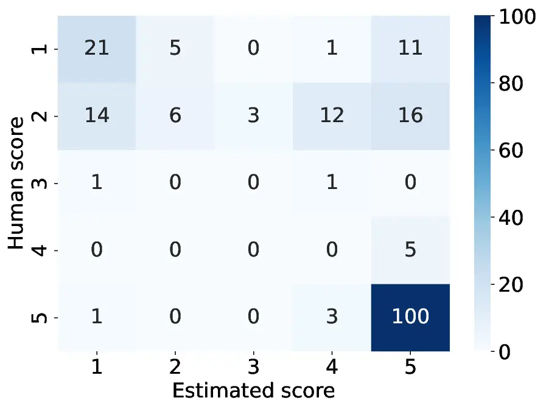

(a) GPT-4 on GSM8K

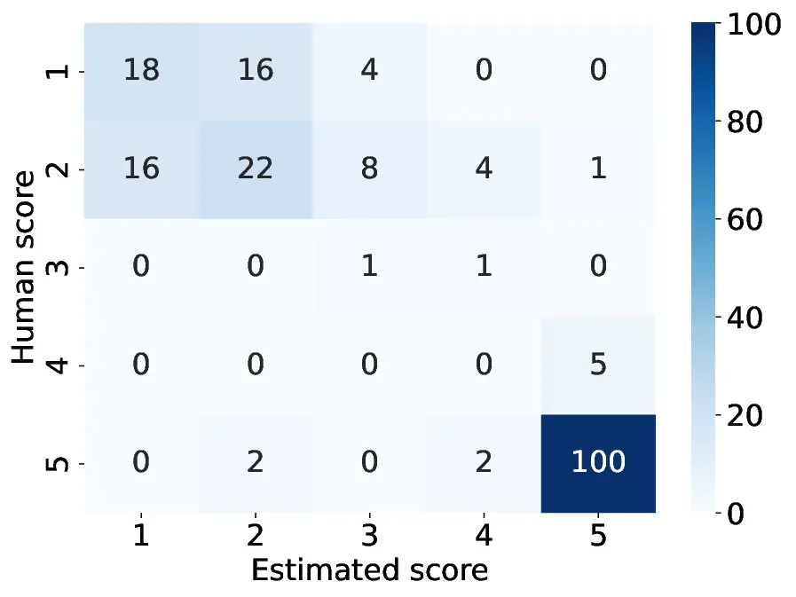

(b) SocREval on GSM8K

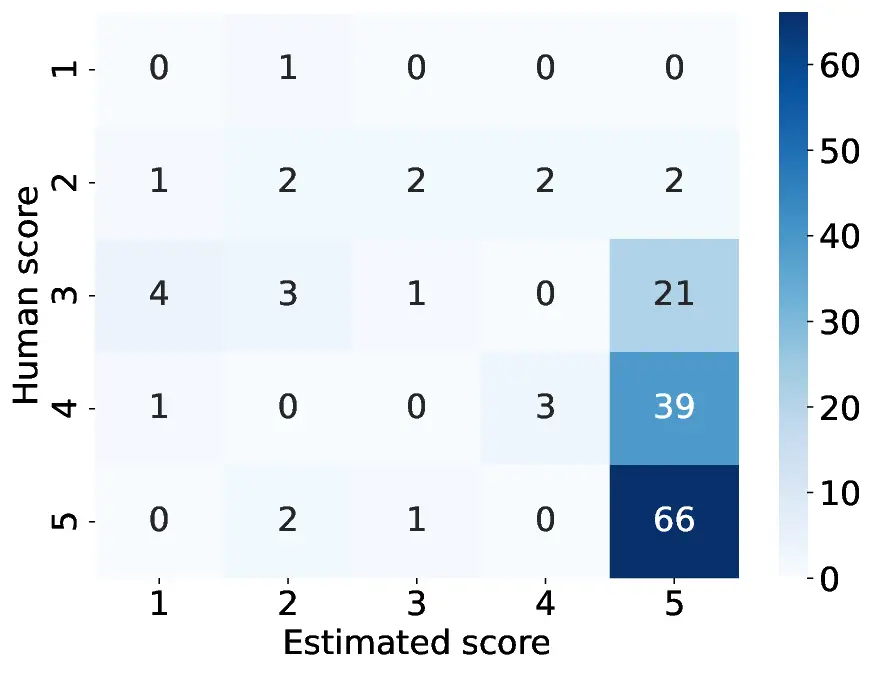

(c) GPT-4 on e-SNLI

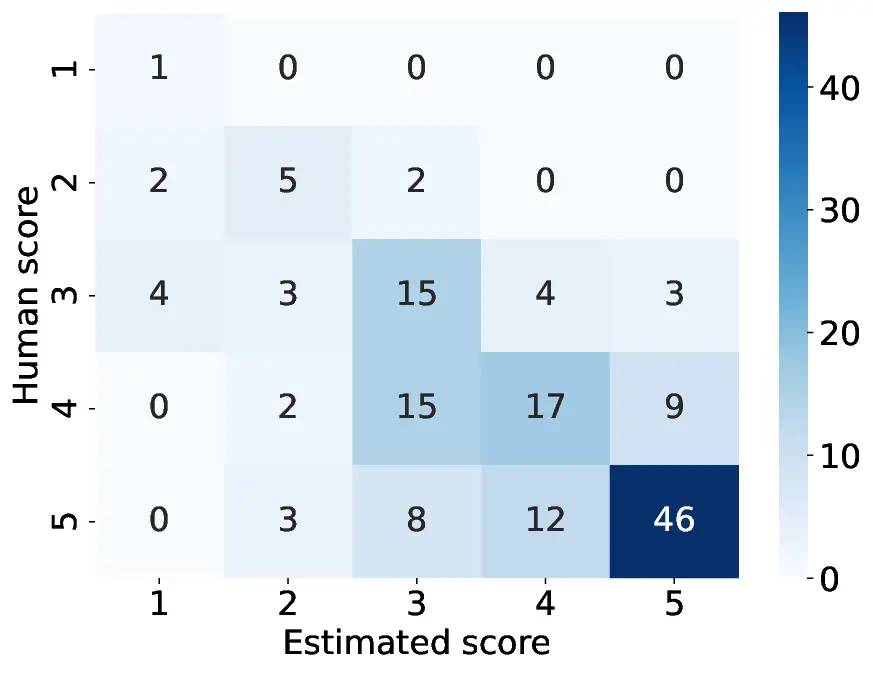

(d) SocREval on e-SNLI

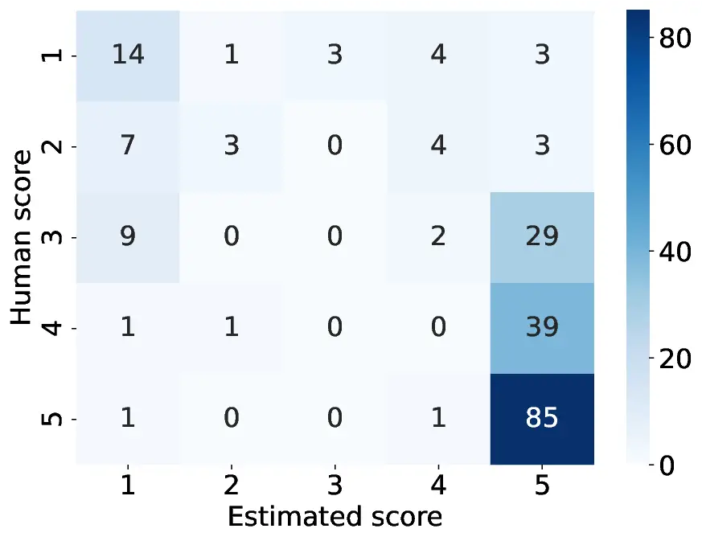

(e) GPT-4 on DROP

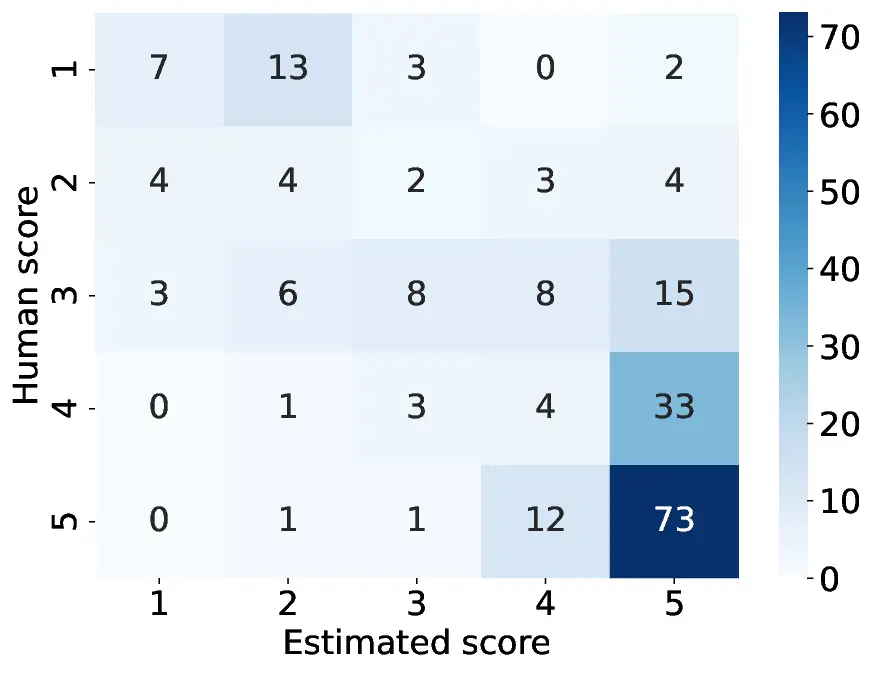

(f) SocREval on DROP

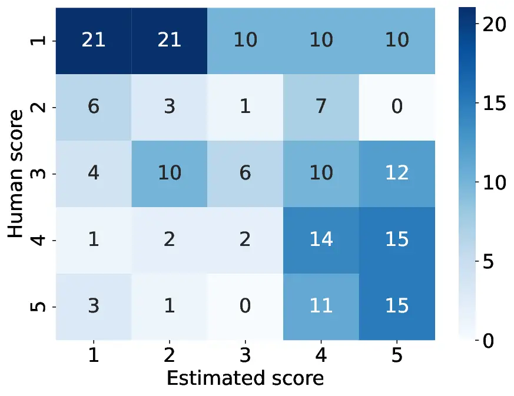

(g) GPT-4 on Cosmos QA

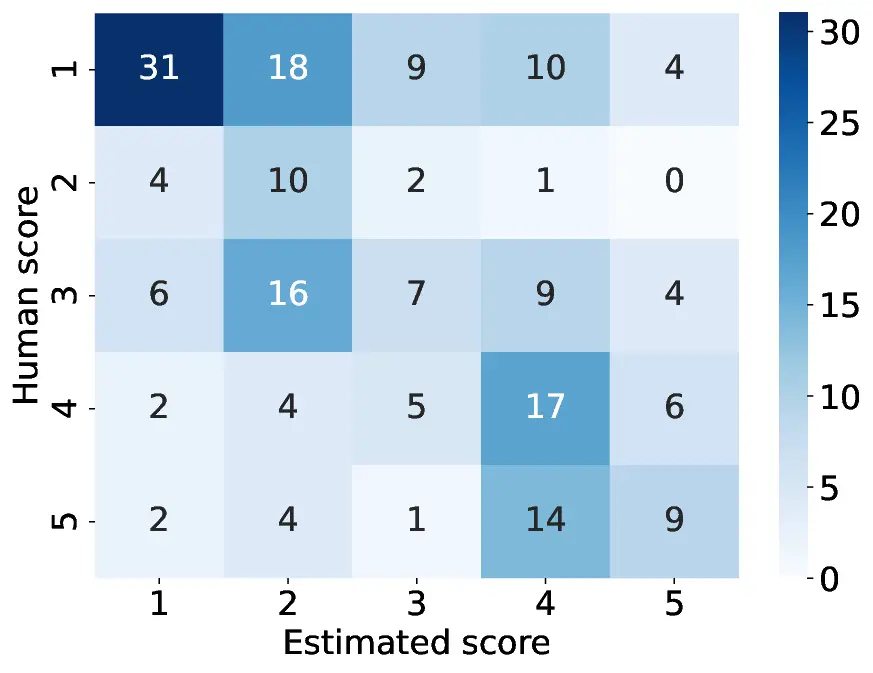

(h) SocREval on Cosmos QA

Figure 24: Confusion matrices for GPT-4 and SocREval evaluated across
four datasets: GSM8K, e-SNLI, DROP, and Cosmos QA.

|        |       |        |      |           |         |
| ------ | ----- | ------ | ---- | --------- | ------- |
|        | GSM8K | e-SNLI | DROP | Cosmos QA | Average |
| COH    | 0.73  | 0.15   | 0.33 | 0.56      | 0.44    |
| COMMON | 0.53  | 0.07   | 0.01 | 0.05      | 0.17    |
| FACT   | 0.50  | 0.22   | 0.19 | 0.07      | 0.25    |
| HALL   | 0.10  | 0.04   | 0.04 | -0.01     | 0.04    |
| RED    | 0.10  | 0.14   | 0.13 | 0.04      | 0.10    |
| REP    | 0.02  | \-     | 0.01 | 0.00      | \-      |
| LOGIC  | 0.53  | 0.18   | 0.12 | 0.07      | 0.23    |
| MATH   | 0.06  | 0.00   | 0.01 | \-        | \-      |
| GRAM   | -0.01 | -0.01  | 0.02 | -0.02     | -0.01   |
| MISS   | 0.73  | 0.36   | 0.50 | 0.35      | 0.49    |

Table 11: Somers’ D correlations between human-annotated errors and
human judgment of overall quality of reasoning chains. Evaluated errors
encompass: Coherency (COH), Commonsense (COMMON), Factuality (FACT),
Hallucination (HALL), Redundancy (RED), Repetition (REP), Logic (LOGIC),
Arithmetic (MATH), Grammar (GRAM), and Missing Step (MISS). The highest
and second-highest correlations for each column are indicated in bold
and underlined, respectively. A ’-’ symbol indicates no correlation
observed.

|                             |      |      |        |      |      |      |     |       |      |       |      |
| --------------------------- | ---- | ---- | ------ | ---- | ---- | ---- | --- | ----- | ---- | ----- | ---- |
|                             | QUAL | COH  | COMMON | FACT | HALL | RED  | REP | LOGIC | MATH | GRAM  | MISS |
| Reference-free ROSCOE       | 0.26 | 0.31 | 0.40   | 0.40 | 0.54 | 0.69 | \-  | 0.35  | \-   | 0.44  | 0.33 |
| ReCEval                     | \-   | \-   | \-     | \-   | \-   | \-   | \-  | \-    | \-   | \-    | \-   |
| GPT-4                       | 0.40 | 0.41 | 0.34   | 0.50 | 0.47 | 0.26 | \-  | 0.25  | \-   | -0.07 | 0.31 |
| SocREval (Definition)       | 0.44 | 0.44 | 0.40   | 0.46 | 0.43 | 0.25 | \-  | 0.28  | \-   | -0.04 | 0.40 |
| SocREval (Maieutics)        | 0.52 | 0.44 | 0.28   | 0.44 | 0.43 | 0.37 | \-  | 0.31  | \-   | -0.03 | 0.47 |
| SocREval (Dialectic)        | 0.48 | 0.42 | 0.35   | 0.54 | 0.38 | 0.32 | \-  | 0.33  | \-   | -0.06 | 0.37 |
| SocREval (All - Dialectic)  | 0.51 | 0.45 | 0.28   | 0.42 | 0.44 | 0.39 | \-  | 0.33  | \-   | 0.06  | 0.51 |
| SocREval (All - Maieutics)  | 0.53 | 0.48 | 0.34   | 0.53 | 0.48 | 0.39 | \-  | 0.36  | \-   | -0.06 | 0.47 |
| SocREval (All - Definition) | 0.56 | 0.47 | 0.34   | 0.57 | 0.41 | 0.36 | \-  | 0.42  | \-   | 0.02  | 0.46 |
| SocREval (All) or SocREval  | 0.58 | 0.51 | 0.40   | 0.53 | 0.43 | 0.34 | \-  | 0.36  | \-   | -0.03 | 0.52 |

Table 12: Average correlation analysis, computed across four datasets
(GSM8K, e-SNLI, DROP, and Cosmos QA), between reasoning evaluation
metrics and various aspects of human judgment. Beyond the overall
quality (QUAL), ten specific error types are considered: Coherency
(COH), Commonsense (COMMON), Factuality (FACT), Hallucination (HALL),
Redundancy (RED), Repetition (REP), Logic (LOGIC), Arithmetic (MATH),
Grammar (GRAM), and Missing Step (MISS). For each column, the highest
and second-highest correlations are denoted in bold and underlined,
respectively. The ’-’ symbol signifies an absence of observed
correlation.

|                             |      |      |        |      |      |      |      |       |      |       |      |
| --------------------------- | ---- | ---- | ------ | ---- | ---- | ---- | ---- | ----- | ---- | ----- | ---- |
|                             | QUAL | COH  | COMMON | FACT | HALL | RED  | REP  | LOGIC | MATH | GRAM  | MISS |
| Reference-free ROSCOE       | 0.32 | 0.30 | 0.28   | 0.35 | 0.50 | 0.64 | 0.98 | 0.22  | 0.56 | 0.34  | 0.35 |
| ReCEval                     | 0.36 | 0.31 | 0.21   | 0.37 | 0.28 | 0.55 | 0.87 | 0.25  | 0.32 | \-    | \-   |
| GPT-4                       | 0.57 | 0.47 | 0.51   | 0.51 | 0.61 | 0.33 | 0.82 | 0.54  | 0.27 | -0.16 | 0.66 |
| SocREval (Definition)       | 0.62 | 0.53 | 0.60   | 0.57 | 0.70 | 0.33 | 0.71 | 0.65  | 0.22 | -0.17 | 0.74 |
| SocREval (Maieutics)        | 0.64 | 0.54 | 0.67   | 0.54 | 0.63 | 0.41 | 0.77 | 0.66  | 0.31 | -0.02 | 0.75 |
| SocREval (Dialectic)        | 0.74 | 0.63 | 0.71   | 0.65 | 0.44 | 0.45 | 0.78 | 0.76  | 0.45 | -0.30 | 0.86 |
| SocREval (All - Dialectic)  | 0.62 | 0.52 | 0.64   | 0.56 | 0.55 | 0.41 | 0.82 | 0.64  | 0.39 | -0.00 | 0.75 |
| SocREval (All - Maieutics)  | 0.81 | 0.67 | 0.78   | 0.72 | 0.69 | 0.47 | 0.80 | 0.80  | 0.44 | -0.32 | 0.92 |
| SocREval (All - Definition) | 0.83 | 0.68 | 0.79   | 0.70 | 0.60 | 0.46 | 0.68 | 0.78  | 0.46 | -0.31 | 0.91 |
| SocREval (All) or SocREval  | 0.82 | 0.72 | 0.78   | 0.71 | 0.63 | 0.44 | 0.84 | 0.76  | 0.50 | -0.24 | 0.92 |

Table 13: Correlation analysis between reasoning evaluation metrics and
diverse facets of human judgment on GSM8K. Beyond the overall quality
(QUAL), ten specific error types are also considered: Coherency (COH),
Commonsense (COMMON), Factuality (FACT), Hallucination (HALL),
Redundancy (RED), Repetition (REP), Logic (LOGIC), Arithmetic (MATH),
Grammar (GRAM), and Missing Step (MISS). For each column, the highest
and second-highest correlations are denoted in bold and underlined,
respectively. The ’-’ symbol signifies an absence of observed
correlation.

|                             |      |      |        |      |      |      |     |       |       |       |       |
| --------------------------- | ---- | ---- | ------ | ---- | ---- | ---- | --- | ----- | ----- | ----- | ----- |
|                             | QUAL | COH  | COMMON | FACT | HALL | RED  | REP | LOGIC | MATH  | GRAM  | MISS  |
| Reference-free ROSCOE       | 0.30 | 0.35 | 0.40   | 0.43 | 0.80 | 0.62 | \-  | 0.53  | 0.60  | 0.41  | 0.60  |
| ReCEval                     | \-   | \-   | \-     | \-   | \-   | \-   | \-  | \-    | \-    | \-    | \-    |
| GPT-4                       | 0.24 | 0.42 | 0.43   | 0.65 | 0.33 | 0.07 | \-  | 0.29  | -0.15 | -0.16 | -0.04 |
| SocREval (Definition)       | 0.30 | 0.44 | 0.38   | 0.61 | 0.29 | 0.08 | \-  | 0.23  | -0.21 | -0.05 | 0.17  |
| SocREval (Maieutics)        | 0.58 | 0.34 | 0.07   | 0.55 | 0.24 | 0.35 | \-  | 0.43  | 0.27  | -0.25 | 0.45  |
| SocREval (Dialectic)        | 0.31 | 0.33 | 0.24   | 0.70 | 0.32 | 0.15 | \-  | 0.39  | -0.21 | -0.04 | -0.04 |
| SocREval (All - Dialectic)  | 0.49 | 0.42 | 0.06   | 0.36 | 0.35 | 0.34 | \-  | 0.47  | -0.47 | -0.03 | 0.50  |
| SocREval (All - Maieutics)  | 0.38 | 0.39 | 0.14   | 0.55 | 0.44 | 0.31 | \-  | 0.44  | -0.34 | -0.35 | 0.22  |
| SocREval (All - Definition) | 0.51 | 0.39 | 0.18   | 0.75 | 0.35 | 0.42 | \-  | 0.56  | 0.56  | 0.12  | 0.16  |
| SocREval (All) or SocREval  | 0.58 | 0.49 | 0.34   | 0.65 | 0.46 | 0.26 | \-  | 0.47  | 0.00  | -0.05 | 0.41  |

Table 14: Correlation analysis between reasoning evaluation metrics and
diverse facets of human judgment on e-SNLI. Beyond the overall quality
(QUAL), ten specific error types are also considered: Coherency (COH),
Commonsense (COMMON), Factuality (FACT), Hallucination (HALL),
Redundancy (RED), Repetition (REP), Logic (LOGIC), Arithmetic (MATH),
Grammar (GRAM), and Missing Step (MISS). For each column, the highest
and second-highest correlations are denoted in bold and underlined,
respectively. The ’-’ symbol signifies an absence of observed
correlation.

|                             |      |      |        |      |      |      |       |       |      |      |      |
| --------------------------- | ---- | ---- | ------ | ---- | ---- | ---- | ----- | ----- | ---- | ---- | ---- |
|                             | QUAL | COH  | COMMON | FACT | HALL | RED  | REP   | LOGIC | MATH | GRAM | MISS |
| Reference-free ROSCOE       | 0.22 | 0.40 | 0.64   | 0.51 | 0.54 | 0.82 | 0.95  | 0.29  | 0.85 | 0.45 | 0.21 |
| ReCEval                     | \-   | \-   | \-     | \-   | \-   | \-   | \-    | \-    | \-   | \-   | \-   |
| GPT-4                       | 0.42 | 0.44 | 0.49   | 0.55 | 0.54 | 0.27 | -0.25 | 0.22  | 0.16 | 0.14 | 0.33 |
| SocREval (Definition)       | 0.43 | 0.45 | 0.51   | 0.48 | 0.48 | 0.25 | -0.27 | 0.20  | 0.14 | 0.13 | 0.35 |
| SocREval (Maieutics)        | 0.47 | 0.53 | 0.40   | 0.47 | 0.50 | 0.40 | 0.61  | 0.13  | 0.22 | 0.23 | 0.37 |
| SocREval (Dialectic)        | 0.43 | 0.40 | 0.41   | 0.64 | 0.58 | 0.28 | -0.28 | 0.12  | 0.29 | 0.30 | 0.31 |
| SocREval (All - Dialectic)  | 0.47 | 0.46 | 0.42   | 0.53 | 0.43 | 0.39 | 0.44  | 0.18  | 0.24 | 0.31 | 0.39 |
| SocREval (All - Maieutics)  | 0.51 | 0.56 | 0.39   | 0.60 | 0.57 | 0.40 | 0.50  | 0.14  | 0.26 | 0.42 | 0.36 |
| SocREval (All - Definition) | 0.49 | 0.47 | 0.39   | 0.61 | 0.53 | 0.33 | 0.02  | 0.22  | 0.29 | 0.28 | 0.39 |
| SocREval (All) or SocREval  | 0.49 | 0.51 | 0.43   | 0.56 | 0.47 | 0.36 | 0.53  | 0.18  | 0.18 | 0.38 | 0.42 |

Table 15: Correlation analysis between reasoning evaluation metrics and
diverse facets of human judgment on DROP. Beyond the overall quality
(QUAL), ten specific error types are also considered: Coherency (COH),
Commonsense (COMMON), Factuality (FACT), Hallucination (HALL),
Redundancy (RED), Repetition (REP), Logic (LOGIC), Arithmetic (MATH),
Grammar (GRAM), and Missing Step (MISS). For each column, the highest
and second-highest correlations are denoted in bold and underlined,
respectively. The ’-’ symbol signifies an absence of observed
correlation.

|                             |      |      |        |      |      |      |       |       |      |       |      |
| --------------------------- | ---- | ---- | ------ | ---- | ---- | ---- | ----- | ----- | ---- | ----- | ---- |
|                             | QUAL | COH  | COMMON | FACT | HALL | RED  | REP   | LOGIC | MATH | GRAM  | MISS |
| Reference-free ROSCOE       | 0.18 | 0.19 | 0.28   | 0.29 | 0.32 | 0.66 | 0.67  | 0.35  | \-   | 0.56  | 0.15 |
| ReCEval                     | \-   | \-   | \-     | \-   | \-   | \-   | \-    | \-    | \-   | \-    | \-   |
| GPT-4                       | 0.39 | 0.30 | -0.06  | 0.29 | 0.39 | 0.39 | -0.34 | -0.04 | \-   | -0.09 | 0.28 |
| SocREval (Definition)       | 0.39 | 0.35 | 0.10   | 0.19 | 0.24 | 0.36 | -0.36 | 0.05  | \-   | -0.05 | 0.33 |
| SocREval (Maieutics)        | 0.39 | 0.34 | -0.02  | 0.19 | 0.36 | 0.31 | -0.28 | 0.03  | \-   | -0.06 | 0.30 |
| SocREval (Dialectic)        | 0.43 | 0.32 | 0.05   | 0.19 | 0.18 | 0.39 | -0.32 | 0.05  | \-   | -0.20 | 0.35 |
| SocREval (All - Dialectic)  | 0.45 | 0.40 | -0.00  | 0.24 | 0.43 | 0.41 | -0.40 | 0.03  | \-   | -0.05 | 0.39 |
| SocREval (All - Maieutics)  | 0.42 | 0.33 | 0.04   | 0.25 | 0.22 | 0.38 | -0.18 | 0.08  | \-   | 0.01  | 0.36 |
| SocREval (All - Definition) | 0.42 | 0.34 | 0.00   | 0.22 | 0.15 | 0.23 | -0.13 | 0.11  | \-   | -0.02 | 0.36 |
| SocREval (All) or SocREval  | 0.42 | 0.32 | 0.06   | 0.21 | 0.14 | 0.30 | -0.38 | 0.03  | \-   | -0.20 | 0.33 |

Table 16: Correlation analysis between reasoning evaluation metrics and
diverse facets of human judgment on Cosmos QA. Beyond the overall
quality (QUAL), ten specific error types are considered: Coherency
(COH), Commonsense (COMMON), Factuality (FACT), Hallucination (HALL),
Redundancy (RED), Repetition (REP), Logic (LOGIC), Arithmetic (MATH),
Grammar (GRAM), and Missing Step (MISS). For each column, the highest
and second-highest correlations are denoted in bold and underlined,
respectively. The ’-’ symbol signifies an absence of observed
correlation.
