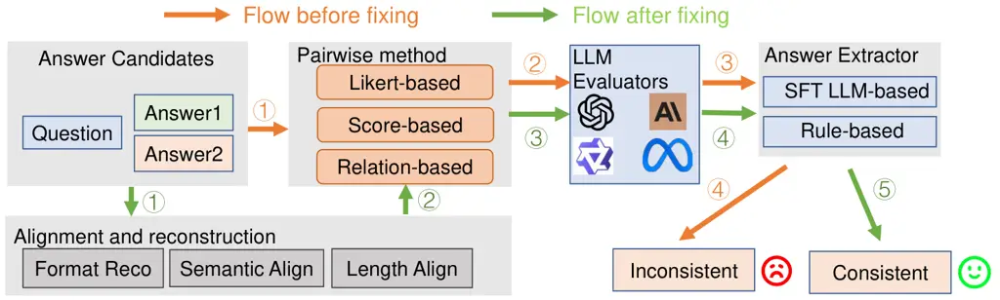
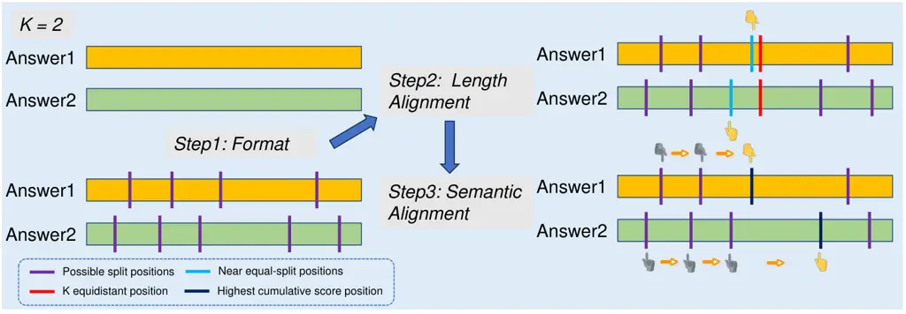

# Split and Merge: Aligning Position Biases in LLM-based Evaluators

Zongjie Li Affiliation: Hong Kong University of Science and Technology
Email: [wangchaozheng@stu.hit.edu.cn](mailto:)    Chaozheng Wang
Affiliation: Harbin Institute of Technology
Email: [gaocuiyun@hit.edu.cn](mailto:)    Pingchuan Ma Affiliation: Hong
Kong University of Science and Technology    Daoyuan Wu    Shuai Wang   
Cuiyun Gao Affiliation: Harbin Institute of Technology    Yang Liu
Affiliation: Nanyang Technological
University{zligo,pmaab,daoyuan,shuaiw}@cse.ust.hk, {yangliu}@ntu.edu.sg,

###### Abstract

Large language models (LLMs) have shown promise as automated evaluators
for assessing the quality of answers generated by AI systems. However,
LLM-based evaluators exhibit position bias, or inconsistency, when used
to evaluate candidate answers in pairwise comparisons, favoring either
the first or second answer regardless of content. To address this
limitation, we propose Portia, an alignment-based system designed to
mimic human comparison strategies to calibrate position bias in a
lightweight yet effective manner. Specifically, Portia splits the
answers into multiple segments, taking into account both length and
semantics, and merges them back into a single prompt for evaluation by
LLMs. Extensive experiments with six LLMs on 11,520 answer pairs
demonstrate that Portia markedly enhances the consistency rates for all
models and forms of comparison tested, achieving an average relative
improvement of 47.46%. It also enables Portia-enhanced GPT-3.5 to
achieve agreement rates with humans comparable to GPT-4 and elevates
GPT-4’s consistency rate up to 98%. Subsequent human evaluations
indicate that the Portia-enhanced GPT-3.5 model can even surpass
standalone GPT-4 in terms of alignment with human evaluators,
highlighting Portia’s ability to correct position bias, improve LLM
consistency, and boost performance while keeping cost efficiency.

²²footnotetext: Corresponding authors.

## 1 Introduction

Recent advances in large language models (LLMs) have achieved remarkable
results on various tasks, sometimes even exceeding human
performance (Kojima et al., 2022; Thapa et al., 2023). However,
assessing the quality of LLM-generated answers poses challenges.
Specifically, n-gram matching metrics like BLEU (Papineni et al., 2002)
can quantify token-level overlap with reference texts but fall short in
evaluating semantic quality. While human evaluators provide more
accurate and valuable feedback, often considered the “gold standards,”
their scalability is generally low, given that they are costly and
time-consuming. As a result, there emerges a growing need for automated
evaluation methods that reliably align with human yet remain efficient
and cost-effective.

Recently, researchers have investigated the use of powerful LLMs like
GPT-4 (OpenAI, 2023) to evaluate the quality of text generated in
response to open-ended questions (Zheng et al., 2024). Notably, robust
LLM evaluators such as GPT-4 have been shown to align remarkably well
with both controlled and crowdsourced human preferences, achieving over
60% agreement (Wang et al., 2023b). These studies suggest that LLMs can
emulate human evaluations, offering a scalable and transparent
alternative to the expensive and time-intensive human assessment of text
quality.

While LLMs have advanced capabilities, they are not flawless evaluators
and have been identified to possess certain biases. One notable bias is
the position bias (Zheng et al., 2024; Wang et al., 2023b), in which an
LLM might prefer either the first or second answer in a pairwise
comparison, regardless of its content, as illustrated in Figure 1. Even
the state-of-the-art GPT-4 model is not immune to position bias (Zheng
et al., 2024; Wang et al., 2023b; Zhang et al., 2023; Zeng et al.,
2023), and the behavior of its various versions can be inconsistent over
time (Chen et al., 2023). Moreover, owing to pronounced position biases
in less-powerful GPT models, much of the prior research (Zheng et al.,
2024; Zhang et al., 2023) has been compelled to use the expensive GPT-4
for LLM evaluations, emphasizing the necessity for a more cost-effective
approach to large-scale assessments.

To address these limitations, we propose Portia ¹¹ 1 The reason for the
naming is provided in Appendix C., an alignment-based system designed to
calibrate position bias. Inspired by human long-text reading
strategies (Ratnasari, 2023), Portia splits the answers into multiple
segments, aligns similar content across candidate answers, and then
merges them back into a single prompt to feed to LLM evaluators.
Specifically, Portia first identifies possible split positions at
sentence boundaries within each answer. It then conducts a length
alignment between the candidates to generate segments of roughly equal
length across answers. If this length alignment does not yield a
consistent verdict, Portia further undertakes an iterative semantic
alignment to identify the optimal split positions, enabling the merging
of segments across candidates. Since this lightweight approach does not
require changes to the models themselves, Portia is readily adaptable to
enhance a variety of LLM evaluators for improved evaluation consistency.

We conducted comprehensive experiments using six LLMs as evaluators to
assess 11,520 answer pairs across three prevalent pairwise comparison
forms. Our results show that Portia markedly boosts consistency rates
for all the tested models and templates, achieving an average relative
improvement of 47.46% and rectifying an average of 62.31% of the
initially inconsistent cases. Furthermore, Portia addresses between 36%
and 86% (over 80% for two-thirds of the comparison templates) of the
position bias occurrences within the GPT-4 model, elevating its
consistency rate up to 98%. Moreover, efficiency and cost evaluations
indicate that Portia enables the less advanced GPT-3.5 model to achieve
88% agreement with the state-of-the-art GPT-4 model at merely 9.57% of
the cost. Additionally, a user study involving five human participants
demonstrated enhanced agreement between Portia-optimized evaluators and
human evaluators. Remarkably, the agreement of human evaluators with
Portia-enhanced GPT-3.5 even exceeds that with the standalone GPT-4. A
subsequent ablation study suggests that Portia’s two key components —
length alignment and semantic alignment — are beneficial for improving
consistency across different comparison forms.

## 2 Background

Paradigms of Using LLM-based Evaluators. Recent work has explored using
LLMs such as GPT-4 to evaluate and compare the performance of AI
systems (Wang et al., 2023b; Chan et al., 2023; Zheng et al., 2024; Hada
et al., 2023). Conceptually, there are two distinct LLM-based comparison
paradigms: _standalone comparison_ and _pairwise comparison_. In the
standalone comparison, LLM evaluators are provided with one answer at a
time and are asked to score each answer independently. As a result,
position bias is not an issue in standalone LLM evaluation and is
therefore beyond the scope of this paper. Nevertheless, we find that the
absolute scores of LLM may lack clear interpretation. To demonstrate
this, we conducted a preliminary study where we examined the consistency
of standalone comparison across a total of 80 test cases, each involving
three sets of value ranges. Our findings indicate that the scores from
standalone comparison do not strictly adhere to a linear mapping
relationship across different scales (more discussion in Appendix D).

Figure 1: A sample pairwise LLM-based evaluation improved by Portia.
Left: The original evaluation exhibiting inconsistency. Right:
Consistent evaluation after applying Portia. Details of the answers,
comparison forms, and evaluation contents have been simplified or
omitted for clarity. An example of the detailed prompt is given
in Table 16. It is worth noting that the answers from different
assistants may differ significantly from each other.

Pairwise comparison presents two answers side-by-side and asks
evaluators to select the superior one. In particular, pairwise
comparison methods can be further categorized into three forms:
_score-based_, _likert-based_, and _relation-based_. In score-based
comparison, evaluators assign a score to each answer and then compare
these scores to determine the better answer. The likert-based
method (Rajani et al., 2023) requires evaluators to score answers on a
likert scale (Likert, 1932), where lower scores indicate a strong
preference towards the first answer, middle scores represent a close
tie, and higher scores signal a preference for the second answer.
Additionally, the relation-based comparison solicits direct inputs from
the evaluators about their preference for one answer over another. This
approach aims to avoid the use of potentially arbitrary scores, guiding
evaluators to make relative comparisons between answers instead. The
details of these three forms are shown in Appendix K.1.

Position Bias in Pairwise Comparison. Despite the generally encouraging
performance of pairwise comparison methods, we note that LLM evaluators
are not perfect and can exhibit certain biases. A primary concern is the
position bias (Zheng et al., 2024; Wang et al., 2023b), whereby the LLM
may favor the first (or second) answer in a pairwise comparison,
regardless of its content. In fact, LLMs have shown notable sensitivity
to small changes in prompts (Zhao et al., 2021; Zhu et al., 2023). For
clarity, we provide a formal definition of position bias as well as the
consistency. As illustrated in Table 13 (refer to Appendix K.1), the
evaluation input comprises a fixed template with three placeholders. The
input set for the LLM evaluators can be represented as
$`\{Q,R_{1},R_{2}\}`$, where $`Q`$ denotes the question set, and
$`R_{1}`$ and $`R_{2}`$ are the two sets of answers for comparison. The
LLM evaluators produce the verdict $`V=LLM(\{Q,R_{1},R_{2}\})`$, which
indicates the preferred answer out of the two candidates. Assuming that
the LLM evaluators are flawless, the verdict $`V`$ should be independent
of the permutation $`\Pi`$ of $`R_{1}`$ and $`R_{2}`$. Thus, position
bias can be expressed as: $`\Pi\not\!\perp\!\!\!\perp V`$. On an
individual sample level, for a specific question $`q\in Q`$ and answers
$`r_{1}`$, $`r_{2}`$, consistency is achieved if the verdict $`v`$
remains the same when the positions of $`r_{1}`$, $`r_{2}`$ are
switched: $`LLM(\{q,r_{1},r_{2}\})=LLM(\{q,r_{2},r_{1}\})`$.

## 3 The Portia System

Design Intuition. It is worth noting that both human evaluators and LLMs
encounter difficulties in making consistent evaluations when faced with
lengthy and intricate answers (Kintsch and Keenan, 1973; Wijesiriwardene
et al., 2023). A common cognitive approach among individuals is to
decompose information into smaller units, thereby simplifying the
comparison process (Ratnasari, 2023). Inspired by this observation,
Portia is designed to split candidate answers into segments, merge
specific segments across candidates that share “comparable” content, and
eventually align them. Based on this intuition, Portia seeks to mimic
effective human comparison procedures, aiming to calibrate position bias
and enhance the consistency of LLM evaluators. That said, for each
question, the verdicts of Portia should be consistent with any
permutation of the answers, i.e., -$`LLM(\{q,r_{1},r_{2}\})=LLM(\{q,r_{2},r_{1}\})`$.

Moreover, Portia is specifically designed to address the position bias
issue, rather than aligning the reasoning capabilities of LLM-based
evaluators. Therefore, if an LLM evaluator lacks the capability to
adequately judge a pair of semantically different responses, this falls
outside the scope of Portia’s intended purpose. Portia is solely focused
on rectifying inconsistencies that arise when the order of a pair of
semantically different responses is altered, leading to a change in the
judgment of the LLM evaluator. In this context, Portia is generalizable
to handling open-ended answers because, regardless of their semantic
differences, we can always mix the two previously individual answers.
Such a mixing operation effectively eliminates the position bias in
pairwise LLM-based evaluation.

### 3.1 Key Design Considerations

Before presenting the technical details of Portia, we first introduce
its key design considerations.

Content Preservation. Content preservation refers to ensuring the
segmented answers encompass the entirety of the information present in
the original answer, without any omissions or additions of new content.
For a given original answer $`r_{1}`$, the set of split answer segments
$`\{r_{1}^{1},r_{1}^{2},...,r_{1}^{k}\}`$ should fully encompass the
content of $`r_{1}`$. This implies that when the segments are
concatenated, the entirety of the original content is preserved
($`\sum_{i=1}^{k}r_{1}^{i}=r_{1}`$). This consideration helps to
preserve the meaning and information of the original answer during the
process of splitting. The preservation of content is critical for
evaluators to assess the same substantive answer content that is divided
into segments, without any alterations or incomplete information.

Order Preservation. Order preservation refers to preserving the original
sequence of the information presented in the answer. This is important
for fair evaluation, as re-ordering or re-arranging the content may
impact the assessment of answer quality. By preserving the order, we
ensure the segmentation process does not introduce artifacts that could
unintentionally alter assessment. This enables the LLM evaluators to
accurately evaluate answers in comparison to the original. Notably,
considering both the content and order of the answer helps maintain
long-range dependencies by preserving all original information and the
sequence in which it is presented.

Resource efficiency. Resource efficiency refers to minimizing
computational costs incurred by the splitting process, beyond the
standard cost when querying the LLM evaluator. To this end, it is
important for the segmentation process to introduce a minimal number of
extra tokens and to be executed rapidly, thus avoiding significant
overhead.

### 3.2 The Core Splitting Algorithm

Due to the page limit, we direct interested readers to Appendix E for a
comprehensive overview of utilizing Portia for LLM evaluation. Here we
concentrate on Portia’s core splitting algorithm, as illustrated in
Algorithm 1. Intuitively, Portia first identifies semantically or
syntactically similar segments across answers. It then aligns these
answer segments and merges them sequentially into a single prompt for
the LLM evaluators to make a final verdict. Specifically, the inputs
include the question $`q`$, two candidate answers $`r_{1}`$ and
$`r_{2}`$, the LLM evaluator’s verdict function $`v()`$, and the
specified number of splits $`k`$. The output of Algorithm 1 is a
consistent verdict $`v\in(1,2,3)`$, where $`1`$ indicates that $`r_{1}`$
is superior, $`2`$ suggests that $`r_{2}`$ is better, and $`3`$
represents a tie.

Overall, the splitting process can be divided into three stages. In the
first phase, possible split positions are determined at the boundaries
of sentences (line 1-2). Segmenting at sentence breaks (e.g., periods or
question marks) reduces the likelihood of producing incomplete words or
fragmented syntactic units in different segments. This particular design
decision aids in maintaining semantic consistency and enhancing
readability in each segment. Notably, natural language and programming
language have different definitions for sentence boundaries; for
instance, the period sign “.” in Python denotes accessing a specific
object member property. Therefore, in instances where answers involve
code blocks, we follow (Li et al., 2023c; Wang et al., 2023a) and
leverage treesitter (tre, ) to parse code blocks and locate suitable
split positions that preserve the code’s structure and execution
sequence.

Input: Question: $`q`$, Answers: $`r_{1},r_{2}`$, Evaluator’s verdict
$`v()`$, Split number $`k`$

Output: Consistent evaluation $`v\in(1,2,3)`$

/\* Step1: identify answers’ formats with split positions. \*/

1 $`r_{1}^{positions}=format(r_{1})`$

2 $`r_{2}^{positions}=format(r_{2})`$

/\* Step2: length alignment. \*/

3 $`[r_{1}^{(1)},...r_{1}^{(k)}]=equalsplit(r_{1}^{positions},k)`$

4 $`[r_{2}^{(1)},...r_{2}^{(k)}]=equalsplit(r_{2}^{positions},k)`$

5 if
_$`v(q_{i},r_{1}^{(1)},r_{2}^{(1)},...,r_{1}^{(k)},r_{2}^{(k)})==v(q_{i},r_{2}^{(1)},r_{1}^{(1)},...,r_{2}^{(k)},r_{1}^{(k)})`$_
then

    6 return _v_ /\* Consistent, return answer \*/

7 end if

/\* Step3: semantic alignment. \*/

8 else

    9 $`s_{max}=0,n_{s}=0`$,
$`Search\_all=False,r_{1}^{bestparts}=[],r_{2}^{bestparts}=[]`$

    10 while _not Search_all_ do

       11 $`r_{1}^{parts}=partition(r_{1}^{positions},k,n_{s})`$

       12 $`r_{2}^{parts}=partition(r_{2}^{positions},k,n_{s})`$

       13 $`n_{s}+=1`$

       14
$`s_{cum}=\sum_{i=1}^{k}similarity(r_{1}^{parts}[i],r_{2}^{parts}[i])`$

      /\* Update max similarity score, keep best split positions. \*/

       15 if _$`s_{cum}>s_{max}`$_ then

          16
$`s_{max}=s_{cum},r_{1}^{bestparts}=r_{1}^{parts},r_{2}^{bestparts}=r_{2}^{parts}`$

       17 end if

    18 end while

    19 if
_$`v(q_{i},r_{1}^{(1)},r_{2}^{(1)},...,r_{1}^{(k)},r_{2}^{(k)})==v(q_{i},r_{2}^{(1)},r_{1}^{(1)},...,r_{2}^{(k)},r_{1}^{(k)})`$_
then

       20 return _v_

    21 end if

22 end if

23 return _None_

Algorithm 1 Alignment-based Splitting

The second stage performs length alignment, splitting each answer into
$`k`$ segments of comparable length (line 3-4); if an answer is too
short to split, Portia would give up splitting and directly ask for the
judge. Specifically, we first find the $`k-1`$ points that divide the
answer into $`k`$ equal segments according to the number of characters.
Subsequently, we select the split location that is closest to each of
the split positions obtained in the first stage, and designate them as
$`[r_{1}^{(1)},...r_{1}^{(k)}]`$.²² 2 An illustration with two detailed
algorithms is available in Appendix H to ease understanding. The $`k`$
corresponding answer segments are subsequently merged again and used for
evaluation by the LLM evaluator. If the LLM evaluator consistently
returns the same verdicts for all length-aligned splits, then the
verdict is returned (lines 5-7).

If inconsistent assessments persist after length alignment, Portia
proceeds to semantic alignment as the third stage (lines 8-17).
Specifically, given a fixed $`k`$ and a set of possible split positions,
we aim to iteratively search for the optimal split positions that
maximize the cumulative semantic similarity between corresponding
segments of the two answers. Note that $`n_{s}`$ represents the index
number of the current segmentation, and $`Search\_all`$ becomes True
when $`n_{s}`$ reaches the maximum number of possible split combinations
$`Cal`$. Semantic similarity between segments $`r_{1}^{t}`$ and
$`r_{2}^{t}`$ is computed by token overlap:
$`sim\_score=\frac{Intersection(set(r_{1}^{t}),set(r_{2}^{t}))}{\max(\text{len}(set(r_{1}^{t})),\text{len}(set(r_{2}^{t})))}`$.
Notably, the choice of value $`k`$ as well as the similarity metric
would have an impact on the efficiency of Portia, and we provide the
theoretical analysis in Section 4.3. We also consider applying other
similarity metrics, such as LM-based metrics (Reimers and Gurevych,
2019). However, we argue that employing such intricate metrics is not
necessary for Portia, as they usually entail extra computing resources,
and introduce more hyper-parameters while yielding only marginal
improvements in performance; see further discussion in Appendix I.
Finally, Portia would yield consistent verdict if applicable (lines
19-22). Note that the above three stages are carried out in a sequential
manner, whereas semantic alignment is only performed when length
alignment is inadequate for ensuring consistent assessments. This
sequential approach prioritizes computational efficiency, as length
alignment is typically faster to execute than semantic alignment.

## 4 Experiments

### 4.1 Experimental Setup

Datasets. We evaluate Portia using the MT-Bench benchmark (Zheng et al.,
2024), following the experimental setup in Wang et al. (2023b). MT-Bench
contains 80 elaborated open-ended questions spanning 8 categories
(Writing, Roleplay, Reasoning, Math, Coding, Extraction, STEM, and
Humanities). For each question, MT-Bench provides several candidate
answers from different LLMs. We consider eight different combinations of
LLM answers (see more details in Appendix G), and we consider all three
comparison forms (score-based, likert-based, and relation-based) in the
pairwise comparison paradigm. Thus, we have $`80*8*3=1920`$ inputs to
evaluate each LLM evaluator. We use this diverse dataset to provide a
comprehensive evaluation of Portia across several representative LLMs
and comparison forms. Additionally, an extended evaluation on a larger
set of open-ended questions can be found in Appendix L.

Models. In this work, we include both locally deployable models that are
open-source and proprietary models that are accessed through only cloud
APIs as LLM evaluators. Details on the specific LLM versions evaluated
are given in Appendix G.

Response Length and generalizability.  In Figure 1, two assistants
provide responses of similar length. However, given the open-ended
nature of the questions in MT-Bench, different LLMs may produce
responses that differ substantially in both length and content for the
same question. To assess Portia’s adaptability to open-ended questions,
we analyzed the statistics of all responses, presented in Table 4. Our
findings indicate that the lengths of responses from the LLMs vary
considerably, underscoring Portia’s flexibility in handling open-ended
questions. Additionally, we explore Portia’s generalizability by
examining the relationship between answer length and inconsistency
(Appendix B.2) and evaluate its performance on extremely short responses
(Appendix B.3). More details are provided in Appendix B.

| Evaluators | De. Method | Model            | Relation-based  | Score-based    | Likert-based    |
| ---------- | ---------- | ---------------- | --------------- | -------------- | --------------- |
| Claude2    |            | % Origin Con     | 28.28           | 47.34          | 50.62           |
|            | API        | % Portia Con     | 83.28(+194.48%) | 65.16(+37.64%) | 94.84(+87.36%)  |
|            |            | % Fixed Coverage | 79.44           | 52.22          | 91.27           |
| Qwen       |            | % Origin Con     | 63.12           | 52.66          | 8.12            |
|            | API        | % Portia Con     | 78.13(+23.78%)  | 71.09(+35.0%)  | 9.38(+15.52%)   |
|            |            | % Fixed Coverage | 65.66           | 59.78          | 6.46            |
| Chatglm2   |            | % Origin Con     | 38.44           | 58.59          | 26.72           |
|            | Local      | % Portia Con     | 61.72(+60.56%)  | 74.06(+26.4%)  | 64.22(+140.34%) |
|            |            | % Fixed Coverage | 56.09           | 51.02          | 60.30           |
| Llama2     |            | % Origin Con     | 36.41           | N/A            | N/A             |
|            | Local      | % Portia Con     | 68.75(+88.82%)  | N/A            | N/A             |
|            |            | % Fixed Coverage | 22.51           | N/A            | N/A             |
| GPT-3.5    |            | % Origin Con     | 78.12           | 39.22          | 78.91           |
|            | API        | % Portia Con     | 88.59(+13.4%)   | 54.84(+39.83%) | 98.60(+24.94%)  |
|            |            | % Fixed Coverage | 70.63           | 42.06          | 96.32           |
| GPT-4      |            | % Origin Con     | 93.44           | 92.75          | 61.50           |
|            | API        | % Portia Con     | 97.03(+3.84%)   | 98.00(+5.66%)  | 63.50(+3.25%)   |
|            |            | % Fixed Coverage | 80.99           | 86.33          | 36.09           |

Table 1: The main results of Portia across LLM evaluators. All metrics
presented are higher-is-better values. “% Origin Con” and “% Portia Con”
are the percentages of consistent results in the original setting when
enhanced by Portia, respectively. “% Fixed Coverage” denotes the
percentage of inconsistent original assessments that are later corrected
by Portia. “De Method” specifies whether the LLM evaluator uses local or
cloud API deployment.

### 4.2 Main Results

As shown in Table 1, Portia improves the consistent rate among all
evaluators. The values depicted in the table correspond to the mean
values obtained from the analysis of all eight combinations of tested
models. We observe that Portia relatively improves the consistent rate
by 3.25% to 194.48%, depending on the evaluator, with the highest fixed
coverage at 96.32% (meaning that nearly all the inconsistent results are
resolved). GPT-4 exhibits the highest average consistency rate, which is
in line with the findings of previous work (Wang et al., 2023b), and
Portia further boosts its consistency up to 98%. Moreover, we observe
that GPT-4 exhibits subpar performance on the likert-based form, not
just compared to its performance on other forms, but also when compared
to GPT-3.5. Upon analyzing results on likert-based forms, over 78% of
GPT-4’s inconsistency provides a score of 5, reflecting its bias for the
second answer, and our method rectifies 36.09% of them. Notably, we only
report the results of Llama2 in relation-based form, as it fails to
provide meaningful evaluations in other forms (see more details
in Appendix J).

The impact of the comparison form on consistency rates is also observed,
with evaluators displaying various preferences. For instance, it is seen
that GPT-3.5 exhibits the least consistent performance when evaluated on
the score-based form, whereas Claude2 struggles most on the
relation-based form. GPT-4, Qwen, and Chatglm2 exhibit the highest
degree of inconsistency when assessed on the likert-based form. This
suggests that appropriately matching comparison forms to evaluators’
capabilities is important. Nevertheless, Portia offers high enhancement
for forms and LLM evaluators.

Per-category Breakdown Analysis. We recognize that our method may not
perfectly resolve all inconsistencies, and there might be instances
where it fails. To better understand Portia’s performance across
different categories, we conduct a statistical analysis of its failure
rates across 8 categories, as shown in Table 2.

| Category       | FR     | Category     | FR     |
| -------------- | ------ | ------------ | ------ |
| Coding         | 17.13% | Common-sense | 12.15% |
| Fermi          | 14.92% | Math         | 11.60% |
| Counterfactual | 13.81% | Knowledge    | 9.94%  |
| Generic        | 12.15% | Roleplay     | 8.29%  |

Table 2: Failure Rates (FR) of Portia across different categories.

We observe that Portia tends to fail more frequently on coding-related
questions. This may be attributed to the tighter contextual
relationships in code due to programming language constraints and fixed
syntactic structures (e.g., for loops). Although we have considered
parsing code and designing separate split positions during the split
stage (as shown in Section 3.2), these results indicate room for
improvement in handling structured data.

To further investigate the generalizability of Portia, we conduct
additional experiments on more open-ended questions, and the results are
provided in Appendix L. Additionally, we compare Portia with more
baselines, where results are shown in Appendix O.

### 4.3 Efficiency and Cost Analysis

(a) Average input token length with different $`k`$. “ori” represents
the original input length. “min” and “max” represent the minimum and
maximum input lengths, respectively.

(b) Computation operations with different $`k`$. The number behind “Avg”
is the average potential split positions for each answer. The y-axis has
been logarized to ease reading.

Figure 2: Theoretical estimation of Portia’s cost with varying $`k`$
based on input length and computation operations.

To show the efficiency and cost-effectiveness of Portia, this section
first performs a theoretical analysis of Portia’s efficiency, and then
evaluates its actual costs in terms of temporal, monetary, and
environmental factors. Specifically, we measure the efficacy of
Portia-enhanced LLMs in terms of their agreement rate with GPT-4.

Theoretical analysis. We first theoretically analyze Portia’s
computational efficiency. As the number of answer segments $`k`$
increases, the average input length for LLM evaluators also grows
correspondingly. In line with line 1 in Algorithm 1, the added tokens
stem from two sources: fixed-length system prompts based on comparison
forms, and split boundary prompts (an example shown in Table K.2) that
scale linearly with $`k`$. Consequently, the additional input length
scales as $`O(K)`$, as depicted in Figure 2(a). Notably, the average
input length of the relation-based form exceeds the other two, as it
requires more tokens for the system prompt. More details are
in Appendix K.

In accordance with line 9 in Algorithm 1, the total number of
computation operations $`Cal`$ is calculated as:
$`Cal=C_{p_{1}}^{k-1}*C_{p_{2}}^{k-1}`$, where $`p_{1}`$ and $`p_{2}`$
are the potential split positions in the two answers.
$`C_{p_{1}}^{k-1}`$ and $`C_{p_{2}}^{k-1}`$ are the combination counts
for the first and second answers, respectively. Using average position
numbers of 10, 20, 30, and 40, we derive the total calculations as
depicted in Figure 2(b). Intuitively, raising the value of $`k`$ can
improve the algorithm’s performance by exploring more split position
combinations. However, this also results in an exponential surge in the
total computation operations, compromising efficiency. As such, we
conducted controlled experiments to identify the optimal value of $`k`$,
and in our case, we found that setting $`k=3`$ strikes a balance between
efficiency and precision. Full details about this controlled experiment
can be found in Appendix I.

Real-World Performance and Cost Analysis. Next, we measure the level of
agreement between the Portia-enhanced LLM evaluators and GPT-4
(considered as the “reference standard.”). Note that to offer a fair
evaluation, we exclusively consider GPT-4 evaluation outputs that are
originally consistent. In the context of a question with two possible
answers, it is deemed as an agreement only when both GPT-4 and
Portia-enhanced assessments are consistent and identical. As evidenced
in Table 9, agreement rates are enhanced by an average of 16.32% after
alignment. Claude2 has the highest gain at 31.65%, while GPT-3.5
achieves the highest agreement rate with GPT-4 at 88.59%.

Additionally, we consider the resource usage in terms of temporal,
monetary, and environmental factors. As shown in Table 9, Chatglm2
exhibits the lowest inferencing time. However, the cost of GPT-3.5 is
lower than that of Chatglm2, while its carbon emission is higher, which
is mainly because the cloud API models usually run on GPU clusters with
more powerful GPUs. It is worth mentioning that GPT-3.5 incurs less than
10% of the average cost of GPT-4, while maintaining an approximate
agreement level of 88% with GPT-4. In brief, the usage of Portia results
in a substantial level of concurrence with GPT-4 while maintaining a
minimal computational burden, hence showcasing a proficient and
eco-friendly alignment. The significant enhancements in performance and
resource utilization underscore the usefulness of this approach in
boosting various LLMs for crucial evaluation work.

### 4.4 Human study

We conducted a human evaluation to further assess the performance of
Portia. The model pair “gpt-3.5-turbo” v.s. “Claude-v1” is selected to
compare human agreement rates on original versus Portia-enhanced
assessments across 80 questions, as these two models have similar
performance (Zheng et al., 2024), making it challenging for LLM
evaluators to make decisions. We recruit five experts: two industrial
developers and three academic researchers, none of whom are authors of
this paper to avoid potential bias due to prior exposure to the MT-BENCH
dataset. For each participant, we create an online questionnaire that
provides one question with two answers, not specifying their origin.
Before the questionnaire, brief instructions on the task and evaluation
criteria are provided. (More details are in Appendix N.) During the
human evaluation process, we observe instances where human evaluators
have differing assessments. This aligns with previous research
highlighting the diversity of human perspectives (Peng et al., 1997). In
such cases, we employ a majority vote to determine the final result, and
we aim to use Portia to help LLM judges closely align with
representative human evaluations.

|          | Ori HAR (%) | Fix HAR (%) |
| -------- | ----------- | ----------- |
| GPT-3.5  | 55.00       | 63.75       |
| Qwen     | 35.00       | 35.00       |
| Chatglm2 | 16.25       | 17.50       |
| Claude2  | 6.25        | 47.50       |
| GPT-4    | 60.00       | 65.00       |

Table 3: Main results from human evaluation comparing the model pair
“gpt-3.5-turbo” v.s. “Claude-v1” on 80 questions. “HAR” represents the
human agreement rate.

The human evaluation results presented in Table 3 demonstrate increased
agreement rates between humans and LLM evaluators after applying Portia.
For example, the human agreement rate with GPT-3.5 increases from 55.00%
on the original assessments to 63.75% after applying Portia
enhancements, which surpasses the original human agreement rate with
GPT-4. In addition, the original human agreement rate for Claude2 is
only 6.25%, but increases substantially to 47.50% after enhancement.
Taken together, these quantitative findings provide evidence that Portia
effectively augments the assessments of all LLM evaluators to achieve
greater concordance with human evaluators. The framework also enables
weaker LLMs to reach comparability with stronger counterparts in terms
of human alignment.

It is crucial to recognize that while LLM judges offer significant
benefits in terms of cost and efficiency, they do not entirely replace
the need for human expertise. By thoroughly investigating the potential
biases present in LLM judges and understanding their limitations across
different categories, we can develop more effective and comprehensive
methods for evaluating AI systems. This improvement not only enhances
the quality and efficiency of assessments but also brings substantial
benefits to the entire AI community.

Figure 3: Fixed coverage rate across LLMs for Portia and variants w/o
Semantic (SA) or Length Alignment (LA).

### 4.5 Ablation Study

To ascertain the individual contributions of each component in Portia,
we conduct ablation experiments on five distinct LLM evaluators. The
results are quantified in terms of the “Fixed Coverage” metric, as
depicted in Figure 3. To facilitate visual interpretation, variants of
Portia incorporating or excluding specific components are denoted by
different colored bars in the histogram. Additionally, texture patterns
in the bars indicate the comparison form used. The plain blue bar
represents the score-based form, while the blue bar with slash lines
corresponds to the relation-based form.

The results reveal that both semantic and length alignment improve
Portia’s performance. Specifically, across all evaluators, semantic
alignment shows a greater contribution to enhancing the likert-based
form, possibly because the likert scale has a greater dependence on
precise semantic meaning for its standardized categorical ratings. For
the other two forms, both alignment methods have similar contributions
with slight differences between LLMs. This is likely because these forms
consider semantic meaning and answer length in a balanced way, similar
to how human evaluators would Ratnasari (2023).

Furthermore, we find that the trends of fixed coverage rate are
consistent across comparison forms for Portia and ablations (without
semantic or length alignment). Likert-based form has the highest fixed
coverage rates, followed by relation-based, with score-based form having
the lowest rates. The exceptions are Qwen on likert-based form and GPT-4
on all forms, where we manually check and find that: (1) Qwen prefers
the second answer for over 90% of examples, no matter whether Portia is
used. (2) GPT-4 has the highest fixed coverage rate on relation-based
form, which is probably because GPT-4 performs consistently enough (more
than 97% consistent rate), and therefore, the improvement on
likert-based form is not obvious. Overall, aside from the outliers,
these results suggest that likert-based form is the most challenging,
and we attribute this to that it requires the evaluators to assign a
single score that contains an assessment of two answers, which is more
difficult than simply choosing the better one like relation-based form.

## 5 Related Work

Automatic Evaluation of AI Outputs. Automated evaluation metrics like
BLEU (Papineni et al., 2002) and ROUGE (Lin, 2004) are widely used to
assess the quality of AI-generated text. However, these metrics have
limited ability to assess meaning, reasoning, and logical consistency.
Recent efforts have focused on developing more robust semantic
similarity metrics using neural representations (Zhang et al., 2019),
but they are still imperfect proxies for human assessment. To address
this, LLM has emerged as a promising alternative for evaluation Chiang
and yi Lee (2023); Liu et al. (2023a); tse Huang et al. (2023); Jiao
et al. (2023); Lin and Chen (2023); Wang et al. (2023c).

Biases in LLM Evaluators. Besides position bias, Zheng et al. (Zheng
et al., 2024) identify two additional biases: verbosity bias, which
refers to a preference for longer answers, and self-enhancement bias,
which involves a preference for self-generated answers. However, the
definition of verbosity bias remains ambiguous, and in line with
previous research (Wang et al., 2023b), we observe that human evaluators
also tend to prefer longer answers. Furthermore, self-enhancement bias
is not universal for all LLMs (Zheng et al., 2024). Therefore, we focus
on position bias, as its mitigation can directly improve the efficiency
and accuracy of various LLM evaluators already in real-world use (Li
et al., 2023a).

## 6 Conclusion

This paper presented Portia, an alignment-based technique to address
position bias for LLM evaluators. By aligning similar content segments
across candidate answers, Portia effectively reduced position bias. It
not only enabled replacing costly models like GPT-4 with affordable
alternatives but also elevated the consistency rate of open-source
models like Llama2.

## 7 Acknowledgements

The HKUST authors are supported in part by a RGC GRF grant under the
contract 16214723, RGC CRF grant under the contract C6015-23G, research
fund provided by HSBC, and a Webank research fund WEB24EG01. The HITSZ
authors are supported in part by National Natural Science Foundation of
China under project (No. 62472126), Natural Science Foundation of
Guangdong Province (Project No. 2023A1515011959), Shenzhen-Hong Kong
Jointly Funded Project (Category A, No. SGDX20230116091246007), and
Shenzhen Basic Research (General Project No. JCYJ20220531095214031) We
are grateful to the anonymous reviewers for their valuable comments.

## 8 Ethical Considerations

Use of Human Annotations We protect the privacy rights of workers and
pay them above the local minimum wage. All five annotators are paid 35\$
per hour for the given 80 samples. Careful instruction is given to
ensure that the annotators understand the task and are not exposed to
harmful content.

Study Scope. Our work aims to improve the consistency of LLM-based
evaluators, which can be utilized to assess the quality of AI-generated
answers. More consistent LLM-based evaluators can provide human-like
evaluations at a lower cost, supplying feedback to reduce biases during
training. Notably, our work enhances the evaluation consistency of
open-source models like Llama2, enabling their use as reliable
evaluators and making research on LLMs more accessible to the broader
community. However, we recognize that malicious actors could exploit
these methods to intentionally train models that go against human
values. The open-source LLMs could be leveraged as consistent evaluators
to guide the training of harmful models such as Worm-GPT (wor, ). While
our work targets constructive applications, we caution that like any
technology, consistent LLM evaluators could potentially be misused.
Researchers should consider ethical implications and preventative
measures. Overall, our current focus is on addressing the position bias
of LLM evaluators, thereby making them more consistent and reliable in
supporting large-scale automatic evaluation processes.

## 9 Limitations

Context Window Length. Although we do not identify any new biases
introduced by Portia   the maximum context window length of the LLM
evaluator poses a challenge, as it requires the LLM to process the
entire input prompt, which comprises the original question and two
candidate responses. If these responses are excessively lengthy, the
merged prompt may exceed the maximum context window length of the LLM,
thereby violating the crucial principle of content preservation
discussed in Section 3.1. While we did not encounter this issue in our
experiments, it could potentially limit the effectiveness of LLMs with
shorter context window lengths. We believe that this can be addressed by
increasing the maximum context window length of LLMs Xiao et al. (2023)
or simply selecting an LLM with a longer context window length, such as
Claude2 for 100k tokens.

Excessive LLM alignment. Although Portia works well under most
scenarios, it is not perfect. One limitation is that Portia is not able
to handle the case where the LLM evaluators refuse to make a verdict,
which usually occurs on LLMs with advanced alignment techniques such as
GPT series models. We find that these models would become too
conservative to make a verdict, no matter how the answers are split and
aligned. For example, GPT-3.5 often refuses to give any meaningful
response when the question is in “Roleplay” category.

## References

- (1) claude2.
  [https://www.anthropic.com/index/claude-2](https://www.anthropic.com/index/claude-2).
- (2) Llama 3.
  [https://llama.meta.com/llama3/](https://llama.meta.com/llama3/).
- (3) qwen.
  [https://github.com/QwenLM/Qwen-7B/blob/main/tech_memo.md](https://github.com/QwenLM/Qwen-7B/blob/main/tech_memo.md).
- (4) treesitter.
  [https://tree-sitter.github.io/tree-sitter/](https://tree-sitter.github.io/tree-sitter/).
- (5) wormgpt. [https://wormgpt.ai/](https://wormgpt.ai/).
- Chan et al. (2023) Chi-Min Chan, Weize Chen, Yusheng Su, Jianxuan Yu,
  Wei Xue, Shanghang Zhang, Jie Fu, and Zhiyuan Liu. 2023. Chateval:
  Towards better llm-based evaluators through multi-agent debate. _arXiv
  preprint arXiv:2308.07201_.
- Chen et al. (2023) Lingjiao Chen, Matei Zaharia, and James Zou. 2023.
  How is chatgpt’s behavior changing over time? _arXiv preprint
  arXiv:2307.09009_.
- Chiang and yi Lee (2023) Cheng-Han Chiang and Hung yi Lee. 2023. [Can
  large language models be an alternative to human
  evaluations?](http://arxiv.org/abs/2305.01937)
- Chien et al. (2023) Andrew A Chien, Liuzixuan Lin, Hai Nguyen, Varsha
  Rao, Tristan Sharma, and Rajini Wijayawardana. 2023. Reducing the
  carbon impact of generative ai inference (today and in 2035). In
  _Proceedings of the 2nd Workshop on Sustainable Computer Systems_,
  pages 1–7.
- DeepSeek-AI (2024) DeepSeek-AI. 2024. [Deepseek-v2: A strong,
  economical, and efficient mixture-of-experts language
  model](http://arxiv.org/abs/2405.04434).
- Devlin et al. (2019) Jacob Devlin, Ming-Wei Chang, Kenton Lee, and
  Kristina Toutanova. 2019. [BERT: Pre-training of deep bidirectional
  transformers for language
  understanding](https://aclanthology.org/N19-1423). In _Proceedings of
  NAACL_.
- Gao et al. (2023) Shuzheng Gao, Cuiyun Gao, Yulan He, Jichuan Zeng,
  Lunyiu Nie, Xin Xia, and Michael R. Lyu. 2023. Code structure-guided
  transformer for source code summarization. _ACM Trans. Softw. Eng.
  Methodol._, 32(1):23:1–23:32.
- Hada et al. (2023) Rishav Hada, Varun Gumma, Adrian de Wynter,
  Harshita Diddee, Mohamed Ahmed, Monojit Choudhury, Kalika Bali, and
  Sunayana Sitaram. 2023. [Are large language model-based evaluators the
  solution to scaling up multilingual
  evaluation?](http://arxiv.org/abs/2309.07462)
- Jiao et al. (2023) Wenxiang Jiao, Wenxuan Wang, Jen tse Huang, Xing
  Wang, and Zhaopeng Tu. 2023. [Is chatgpt a good translator? a
  preliminary
  study](https://api.semanticscholar.org/CorpusID:256105255). _ArXiv_,
  abs/2301.08745.
- Kintsch and Keenan (1973) Walter Kintsch and Janice Keenan. 1973.
  [Reading rate and retention as a function of the number of
  propositions in the base structure of
  sentences](<https://doi.org/https://doi.org/10.1016/0010-0285(73)90036-4>).
  _Cognitive Psychology_, 5(3):257–274.
- Kojima et al. (2022) Takeshi Kojima, Shixiang Shane Gu, Machel Reid,
  Yutaka Matsuo, and Yusuke Iwasawa. 2022. Large language models are
  zero-shot reasoners. _Advances in neural information processing
  systems_, 35:22199–22213.
- Li et al. (2023a) Xuechen Li, Tianyi Zhang, Yann Dubois, Rohan Taori,
  Ishaan Gulrajani, Carlos Guestrin, Percy Liang, and Tatsunori B.
  Hashimoto. 2023a. Alpacaeval: An automatic evaluator of
  instruction-following models.
  [https://github.com/tatsu-lab/alpaca_eval](https://github.com/tatsu-lab/alpaca_eval).
- Li et al. (2023b) Zongjie Li, Chaozheng Wang, Zhibo Liu, Haoxuan Wang,
  Dong Chen, Shuai Wang, and Cuiyun Gao. 2023b. CCTEST: testing and
  repairing code completion systems. In _45th IEEE/ACM International
  Conference on Software Engineering, ICSE 2023, Melbourne, Australia,
  May 14-20, 2023_, pages 1238–1250. IEEE.
- Li et al. (2024) Zongjie Li, Chaozheng Wang, Pingchuan Ma, Chaowei
  Liu, Shuai Wang, Daoyuan Wu, Cuiyun Gao, and Yang Liu. 2024. On
  extracting specialized code abilities from large language models: A
  feasibility study. In _Proceedings of the IEEE/ACM 46th International
  Conference on Software Engineering_, ICSE ’24, New York, NY, USA.
  Association for Computing Machinery.
- Li et al. (2023c) Zongjie Li, Chaozheng Wang, Shuai Wang, and Gao
  Cuiyun. 2023c. Protecting intellectual property of large language
  model-based code generation apis via watermarks. In _Proceedings of
  the 2023 ACM SIGSAC Conference on Computer and Communications
  Security, CCS 2023, Copenhagen, Denmark, November 26-30, 2023_.
- Likert (1932) Rensis Likert. 1932. A technique for the measurement of
  attitudes. _Archives of psychology_.
- Lin (2004) Chin-Yew Lin. 2004. Rouge: A package for automatic
  evaluation of summaries. In _Text summarization branches out_, pages
  74–81.
- Lin and Chen (2023) Yen-Ting Lin and Yun-Nung Chen. 2023. [LLM-eval:
  Unified multi-dimensional automatic evaluation for open-domain
  conversations with large language
  models](https://doi.org/10.18653/v1/2023.nlp4convai-1.5). In
  _Proceedings of the 5th Workshop on NLP for Conversational AI
  (NLP4ConvAI 2023)_, pages 47–58, Toronto, Canada. Association for
  Computational Linguistics.
- Liu et al. (2023a) Yang Liu, Dan Iter, Yichong Xu, Shuohang Wang,
  Ruochen Xu, and Chenguang Zhu. 2023a. [G-eval: Nlg evaluation using
  gpt-4 with better human alignment](http://arxiv.org/abs/2303.16634).
- Liu et al. (2023b) Yang Liu, Dan Iter, Yichong Xu, Shuohang Wang,
  Ruochen Xu, and Chenguang Zhu. 2023b. Gpteval: Nlg evaluation using
  gpt-4 with better human alignment. _arXiv preprint arXiv:2303.16634_.
- OpenAI (2023) OpenAI. 2023. [Gpt-4 technical
  report](http://arxiv.org/abs/2303.08774).
- Papineni et al. (2002) Kishore Papineni, Salim Roukos, Todd Ward, and
  Wei-Jing Zhu. 2002. Bleu: a method for automatic evaluation of machine
  translation. In _Proceedings of the 40th annual meeting of the
  Association for Computational Linguistics_, pages 311–318.
- Peng et al. (1997) Kaiping Peng, Richard E Nisbett, and Nancy YC
  Wong. 1997. Validity problems comparing values across cultures and
  possible solutions. _Psychological methods_, 2(4):329.
- Rajani et al. (2023) Nazneen Rajani, Nathan Lambert, Sheon Han, Jean
  Wang, Osvald Nitski, Edward Beeching, and Lewis Tunstall. 2023. Can
  foundation models label data like humans? _Hugging Face Blog_.
  Https://huggingface.co/blog/llm-v-human-data.
- Ratnasari (2023) Oktavia Yovi Ratnasari. 2023. Students’difficulties
  in reading comprehension and the strategies to deal with the
  difficulties. _Jurnal Penelitian, Pendidikan, dan Pembelajaran_,
  18(13).
- Reimers and Gurevych (2019) Nils Reimers and Iryna Gurevych. 2019.
  [Sentence-BERT: Sentence embeddings using Siamese
  BERT-networks](https://doi.org/10.18653/v1/D19-1410). In _Proceedings
  of the 2019 Conference on Empirical Methods in Natural Language
  Processing and the 9th International Joint Conference on Natural
  Language Processing (EMNLP-IJCNLP)_, Hong Kong, China. Association for
  Computational Linguistics.
- Thapa et al. (2023) Surendrabikram Thapa, Usman Naseem, and Mehwish
  Nasim. 2023. From humans to machines: can chatgpt-like llms
  effectively replace human annotators in nlp tasks. In _Workshop
  Proceedings of the 17th International AAAI Conference on Web and
  Social Media_.
- Touvron et al. (2023) Hugo Touvron, Louis Martin, Kevin Stone, Peter
  Albert, Amjad Almahairi, Yasmine Babaei, Nikolay Bashlykov, Soumya
  Batra, Prajjwal Bhargava, Shruti Bhosale, et al. 2023. Llama 2: Open
  foundation and fine-tuned chat models. _arXiv preprint
  arXiv:2307.09288_.
- tse Huang et al. (2023) Jen tse Huang, Man Ho Adrian Lam, Eric Li,
  Shujie Ren, Wenxuan Wang, Wenxiang Jiao, Zhaopeng Tu, and Michael R.
  Lyu. 2023. [Emotionally numb or empathetic? evaluating how llms feel
  using
  emotionbench](https://api.semanticscholar.org/CorpusID:260682960).
  _ArXiv_, abs/2308.03656.
- Wang et al. (2024) Chaozheng Wang, Zongjie Li, Cuiyun Gao, Wenxuan
  Wang, Ting Peng, Hailiang Huang, Yuetang Deng, Shuai Wang, and
  Michael R Lyu. 2024. Exploring multi-lingual bias of large code models
  in code generation. _arXiv preprint arXiv:2404.19368_.
- Wang et al. (2023a) Chaozheng Wang, Zongjie Li, Yun Pena, Shuzheng
  Gao, Sirong Chen, Shuai Wang, Cuiyun Gao, and Michael R Lyu. 2023a.
  Reef: A framework for collecting real-world vulnerabilities and fixes.
  In _2023 38th IEEE/ACM International Conference on Automated Software
  Engineering (ASE)_, pages 1952–1962. IEEE.
- Wang et al. (2023b) Peiyi Wang, Lei Li, Liang Chen, Dawei Zhu,
  Binghuai Lin, Yunbo Cao, Qi Liu, Tianyu Liu, and Zhifang Sui. 2023b.
  Large language models are not fair evaluators. _arXiv preprint
  arXiv:2305.17926_.
- Wang et al. (2023c) Yidong Wang, Zhuohao Yu, Zhengran Zeng, Linyi
  Yang, Cunxiang Wang, Hao Chen, Chaoya Jiang, Rui Xie, Jindong Wang,
  Xing Xie, et al. 2023c. Pandalm: An automatic evaluation benchmark for
  llm instruction tuning optimization. _arXiv preprint
  arXiv:2306.05087_.
- Wijesiriwardene et al. (2023) Thilini Wijesiriwardene, Ruwan
  Wickramarachchi, Bimal Gajera, Shreeyash Gowaikar, Chandan Gupta, Aman
  Chadha, Aishwarya Naresh Reganti, Amit Sheth, and Amitava Das. 2023.
  Analogical-a novel benchmark for long text analogy evaluation in large
  language models. In _Findings of the Association for Computational
  Linguistics: ACL 2023_, pages 3534–3549.
- Xiao et al. (2023) Guangxuan Xiao, Yuandong Tian, Beidi Chen, Song
  Han, and Mike Lewis. 2023. Efficient streaming language models with
  attention sinks. _arXiv preprint arXiv:2309.17453_.
- Zeng et al. (2022) Aohan Zeng, Xiao Liu, Zhengxiao Du, Zihan Wang,
  Hanyu Lai, Ming Ding, Zhuoyi Yang, Yifan Xu, Wendi Zheng, Xiao Xia,
  et al. 2022. Glm-130b: An open bilingual pre-trained model. _arXiv
  preprint arXiv:2210.02414_.
- Zeng et al. (2023) Zhiyuan Zeng, Jiatong Yu, Tianyu Gao, Yu Meng,
  Tanya Goyal, and Danqi Chen. 2023. Evaluating large language models at
  evaluating instruction following. _arXiv preprint arXiv:2310.07641_.
- Zhang et al. (2019) Tianyi Zhang, Varsha Kishore, Felix Wu, Kilian Q
  Weinberger, and Yoav Artzi. 2019. Bertscore: Evaluating text
  generation with bert. _arXiv preprint arXiv:1904.09675_.
- Zhang et al. (2023) Xinghua Zhang, Bowen Yu, Haiyang Yu, Yangyu Lv,
  Tingwen Liu, Fei Huang, Hongbo Xu, and Yongbin Li. 2023. Wider and
  deeper llm networks are fairer llm evaluators. _arXiv preprint
  arXiv:2308.01862_.
- Zhao et al. (2021) Zihao Zhao, Eric Wallace, Shi Feng, Dan Klein, and
  Sameer Singh. 2021. Calibrate before use: Improving few-shot
  performance of language models. In _International Conference on
  Machine Learning_, pages 12697–12706. PMLR.
- Zheng et al. (2024) Lianmin Zheng, Wei-Lin Chiang, Ying Sheng, Siyuan
  Zhuang, Zhanghao Wu, Yonghao Zhuang, Zi Lin, Zhuohan Li, Dacheng Li,
  Eric P. Xing, Hao Zhang, Joseph E. Gonzalez, and Ion Stoica. 2024.
  Judging llm-as-a-judge with mt-bench and chatbot arena. In
  _Proceedings of the 37th International Conference on Neural
  Information Processing Systems_, NIPS ’23, Red Hook, NY, USA. Curran
  Associates Inc.
- Zhu et al. (2023) Kaijie Zhu, Jindong Wang, Jiaheng Zhou, Zichen Wang,
  Hao Chen, Yidong Wang, Linyi Yang, Wei Ye, Neil Zhenqiang Gong, Yue
  Zhang, et al. 2023. Promptbench: Towards evaluating the robustness of
  large language models on adversarial prompts. _arXiv preprint
  arXiv:2306.04528_.

## Appendix A Reproducibility

To assure reproducibility, we employ various methods to mitigate the
inherent randomness in the decoding process of LLMs. For models using
cloud API, the hyper-parameter “temperature” is uniformly set to 0
across all evaluators. For local models, the sampling function is
deactivated during the decoding phase to get deterministic results.
Specifically, we run experiments on a GPU server with Intel Xeon
Platinum 8276 CPU, 256GB of RAM, and 4 NVIDIA A100 GPUs. This server is
capable of performing cloud API calls and local LLM inference.

All our results are reproducible using the code repository we will
release. All experimental details, including hyperparameters, are
reported in Section 3.2 and Appendix I. We reuse the benchmark datasets
from Zheng et al. (2024), with the different comparison prompt forms
detailed in Appendix K.

## Appendix B Response Length

### B.1 Response Length Statistics

It is possible for the generated results to differ significantly from
each other. To further explore this, we conducted an analysis of the
statistical information of all LLM responses, revealing substantial
differences in response lengths within our benchmark dataset. The
relevant data is presented in Table 4.

| LLM           | Max Length | Min Length | Average Length | Standard Deviation |
| ------------- | ---------- | ---------- | -------------- | ------------------ |
| Alpaca-13b    | 1149       | 6          | 508.99         | 222.98             |
| Bard          | 2652       | 151        | 1276.62        | 495.88             |
| Vicuna-7b     | 2598       | 266        | 1457.01        | 448.55             |
| Claude-v1     | 2392       | 94         | 1624.8         | 612.29             |
| GPT-3.5       | 2218       | 193        | 1206.29        | 460.26             |
| Vicuna-13b    | 2441       | 212        | 1416.92        | 371.0              |
| GPT-4         | 3842       | 201        | 2044.14        | 768.59             |
| Llama-13b     | 4827       | 9          | 757.57         | 895.74             |
| GPT-3.5-short | 365        | 26         | 152.55         | 58.07              |

Table 4: The statistics of answers from different LLMs. “GPT-3.5-short”
is generated by instructing GPT-3.5 to shorten its responses while
preserving as much meaning as possible, which consists of responses
approximately 1/8th the length of the original ones.

From the table, we observe that the lengths of responses generated by
the LLMs vary considerably. For example, the maximum number of
characters in the responses is 4,827, generated by Llama-13b, while the
minimum is just 6 characters, generated by Alpaca-13b.

### B.2 Relationship Between Answer Length and Inconsistency

To further explore the relationship between answer length and
inconsistency, we conduct an additional experiment using the collected
judgment data. For this, "GPT-3.5" was used as the evaluator, analyzing
8 pairs of responses across three comparison forms. The answers are
categorized into 9 groups based on their length, with each group
representing an 800-character interval. The resulting data are presented
in Table 5, with values below 2% of the total indicated by “-”.

| Char Range (\*100) | % Incon Rate |
| ------------------ | ------------ |
| 0-8                | \-           |
| 8-16               | \-           |
| 16-24              | 26.89        |
| 24-32              | 23.02        |
| 32-40              | 31.84        |
| 40-48              | 39.01        |
| 48-56              | 42.73        |
| 56-64              | 55.45        |
| 64+                | \-           |

Table 5: The inconsistency rates in different character count gaps.

The table shows a generally positive correlation between answer length
and inconsistency rate, with shorter answers tending to exhibit lower
inconsistency rates. This finding suggests that position bias is less
significant in shorter answers. To clarify, Portia is designed to be
adaptable to open-ended questions and answers without making any
assumptions about the content of the candidate answers. As long as the
responses contain sufficient content (at least two sentences in our
current setup) for splitting, Portia will follow the same process to
first split the responses and then conduct length or semantic alignment
to merge them. When combined with the enhancement results detailed
in Section 4.2, this leads to the conclusion that the proposed framework
is effective in handling responses of varying lengths.

### B.3 Extremely Short Response

It is worth noting that our initial considerations did not account for a
scenario where responses from one specific LLM are consistently and
significantly shorter (e.g., 1/8th the length) than those from another.
This is due to the expectation that LLMs under test are trained to
generate responses adhering to given instructions, typically resulting
in average response lengths of several hundred characters.

To determine whether our framework remains applicable in such special
cases, we conducted an additional experiment with the following steps:
(1) We instructed GPT-3.5 to shorten its responses while preserving as
much meaning as possible, leading to a subset termed “GPT-3.5-short,”
which consisted of responses approximately 1/8th the length of the
original ones. (2) We then used GPT-3.5 and GPT-4 as evaluators to
compare “GPT-3.5-short” with “GPT-3.5” and “Claude-v1” in exchanged
orders, to assess consistency.

The results, shown in Table 6, indicate a 100% consistency rate (80/80)
for both GPT-3.5 and GPT-4 as evaluators. This suggests that there is no
inconsistency in this particular scenario, and therefore no alignment is
needed. It means that position bias is no longer a concern in such
situations. This finding aligns with previous studies Chiang and yi Lee
(2023); Liu et al. (2023b), which noted that LLM-based evaluators tend
to assign higher scores to longer responses.

| Evaluators    |           | GPT-3.5 | GPT-4 |
| ------------- | --------- | ------- | ----- |
| Model1        | Model2    |         |       |
| GPT-3.5-short | GPT-3.5   | 100%    | 100%  |
| GPT-3.5-short | Claude-v1 | 100%    | 100%  |

Table 6: The consistency rates of GPT-3.5 and GPT-4 as evaluators for
extremely short responses.

It is worth noting that we have previously addressed the scenario in
which the content of the responses differs significantly, but the length
remains similar, as discussed in Section 4.2. In the current case, the
content of the responses is indeed different, as each response contains
only one-eighth of the original content. However, there is no
requirement for alignment in this particular scenario, as position bias
is not a pertinent concern. To summarize, we argue that Portia is
applicable to open-ended questions, accommodating responses that vary
significantly from each other, even in cases where one set of responses
is systematically and markedly shorter than the other.

### B.4 Relationship Between Response Length Gap and Fixed Coverage

To further explore the relationship between the gap in length between
responses and fixed coverage rate, we conducted an experiment using the
collected judgment data. For this, “GPT-3.5” was used as the evaluator,
analyzing 8 pairs of responses across three comparison forms.

|           | % Fixed coverage | % Frequency |
| --------- | ---------------- | ----------- |
| 0-300     | 50.82            | 0.37        |
| 300-600   | 48.41            | 0.24        |
| 600-900   | 63.3             | 0.17        |
| 900-1200  | 62.67            | 0.11        |
| 1200-1500 | 69.77            | 0.08        |

Table 7: Fixed coverage rates in different character count gaps.

The answers are categorized into 5 groups based on their length, with
each group representing a 300-character interval. The results are
presented in Table 7, with frequencies below 3% of the total being
disregarded.

## Appendix C Naming Reason

The name Portia is inspired by the intelligent and astute character,
Portia, from Shakespeare’s “The Merchant of Venice.” In the play, Portia
assists a judge in making fair decisions within the legal rules. Just as
Portia requests the exact amount of flesh to be cut, our method seeks to
make fair splits of the original answers for comparison.

## Appendix D A Preliminary Study of Standalone Comparison

Table 8: The score-based evaluation form for standalone comparison with
six slots ({Q}, {R1}, {R2}, {min_score}, {max_score}, {interval} ).

In this section, following the same setting as Zheng et al. (2024), we
conduct a preliminary study of standalone score-based LLM comparison. We
use the template shown in Table 8 to generate the input for LLM
evaluators. For each question, we generate three sets of value ranges,
setting min_score to 0, max_score to 1, 10, and 100, and interval to
0.1, 1, and 10, respectively. In theory, if the standalone comparison
answer is steady and robust, the score should scale accordingly to the
value ranges. For example, if the score is 0.7 when the max_score is 1,
the score should be 7 when the max_score is 10, and 70 when max_score is 100.

The LLM evaluators are asked to score each answer independently. We use
the answers from “llama-13b” as the input for LLM evaluators, and choose
“GPT-3.5” as the LLM evaluator. Among a total of 80 test cases, we find
that the standalone comparison does not remain consistent for any of
them. Therefore, we conclude that the absolute scores of standalone
comparison do not strictly adhere to a linear mapping relationship
across different scales, potentially undermining their significance. It
is worth noting that although standalone comparison has been used in
prior research by Chiang and yi Lee (2023); Liu et al. (2023a); Zheng
et al. (2024) to evaluate open-ended questions. It does not involve
comparing two responses together, thereby eliminating any position bias.
As a result, our paper primarily focuses on the position bias in
pairwise comparison.

## Appendix E Portia’s Pipeline

Figure 4: This is the overview of using Portia for LLM evaluation.
“Reco” and “SFT” are short for “recognition” and “supervised
fine-tuning”, respectively.

This section explains the full pipeline of utilizing Portia for LLM
evaluation. As depicted in Figure 4, typically there are four key steps:
(1) Data preparation, (2) Comparison method selection, (3) Evaluation,
and (4) Answer extract.

In the first step, we prepare the data for evaluation, which includes
the questions and corresponding answers from two different LLMs to be
compared. If Portia is not implemented, we next choose the comparison
method and formulate the input prompt, which has a great impact on the
evaluation results, as we discussed in Section 4.2. The selected LLM
evaluator is then queried with this prompt to obtain judgments. Note
that the raw evaluation results require additional processing for two
reasons: (1) the output format may differ from the desired final
verdicts and (2) the LLM evaluators may deviate from expected responses.
For example, the LLM evaluator may fail to return the likert score for
some questions but instead return the final verdict directly. Therefore,
we design an answer extractor to extract the final verdict from the
evaluation results. Specifically, we adopt a hybrid method to extract
the final verdict, which first tries to extract with a rule-based
system, and if it fails, then it tries with a supervised fine-tuning
Chatglm2 (Zeng et al., 2022) model.

The Portia-enhanced evaluation would necessitate an additional step of
alignment and reconstruction, which constitutes the core of our
framework. As elucidated in the main text, this procedure is vital for
assessing the LLM answers’ quality with less position bias.

Community needs. Notably, some leading LLM leaderboards, such as Chatbot
Arena Zheng et al. (2024), still rely on human votes for evaluation,
which limits their scalability and increases costs. We believe that our
method can be seamlessly integrated into these leaderboards to support
an automatic evaluation process, significantly reducing costs and
improving the scalability of the leaderboards. For scenarios where
LLM-based evaluators are used, the community can easily implement Portia
by altering the query construction in existing pipelines. By adding the
splitting and merging steps, the community can use the consistent
results from Portia as the final output.

## Appendix F Real-World Performance and Cost Analysis

In this section, we provide a the performance and cost analysis of
different LLM evaluators before and after fix by Portia in real-world
settings. Notably, the carbon emission of GPT-3.5 is estimated
following Chien et al. (2023). We estimate the cost using the official
pricing for cloud APIs and the Azure ND A100 v4 instances for local
models.

|          | AR origin (%) | AR fix (%) | Carbon Emitted (CO₂eq / per 1k) | Avg Cost (USD / per 1k) | Avg Time (s / per 1k) |
| -------- | ------------- | ---------- | ------------------------------- | ----------------------- | --------------------- |
| GPT-4    | \-            | \-         | N/A                             | 29.78                   | 13,446                |
| GPT-3.5  | 82.50         | 88.59      | 7.22                            | 2.85                    | 2,192                 |
| Qwen     | 60.83         | 69.58      | N/A                             | 35.49                   | 6,083                 |
| Chatglm2 | 20.34         | 39.16      | 2.15                            | 4.09                    | 1,983                 |
| Claude2  | 43.44         | 75.09      | N/A                             | 27.17                   | 11,561                |

Table 9: Real-world comparison of different LLM evaluators’ results
before and after fix by Portia with that of GPT-4, including resource
consumption. “AR” denotes the agreement rate with GPT-4.

## Appendix G LLM Details

In this section, we provide more details about the LLM evaluators and
answers used in our experiments.

LLM Evaluators. As introduced in Section 4.1, we include both locally
deployable models that are open-source and proprietary models that are
accessed through only cloud APIs as LLM evaluators. For local models, we
select Chatglm2 (Zeng et al., 2022) and Llama2 (Touvron et al., 2023),
due to their notable efficacy and convenient local deployment
capabilities. For cloud-based LLMs, we use GPT (including both GPT-4 and
GPT-3.5) (OpenAI, 2023) from OpenAI, Qwen (qwe, ) from Alibaba, and
Claude2 (cla, ) from Anthropic. The rationale for using these models is
based on their exceptional performance, since they are considered among
the most advanced and powerful in the world. Specifically, we evaluate
Portia using six distinct LLMs as evaluators:

- •
  GPT-4 (OpenAI, 2023) is a large multimodal model capable of processing
  image and text inputs to generate text outputs. GPT-4 demonstrates
  human-level aptitude on various professional and academic benchmarks.
  We utilize the 8K context length “gpt-4-0613” configuration by
  default.
- •
  GPT-3.5  is a 175B parameter model from OpenAI offered in 4K and 16K
  context length versions. Our experiments use the 4K context
  “gpt-3.5-turbo-0301” model as default.
- •
  Claude2 (cla, ) is the latest large language model released by
  Anthropic. It supports at most 100k tokens as input. We leverage the
  default Claude2 API in our tests.
- •
  Llama2 (Touvron et al., 2023), an open-source series of LLMs from Meta
  AI ranging from 7B to 70B parameters, is trained on 2 trillion tokens
  and doubles Llama1’s context length. Its fine-tuned iterations utilize
  over 1 million human annotations. We evaluate both 7B and 13B Llama2
  chat models.
- •
  Qwen (qwe, ) is a partially open-sourced LLM model released by
  Alibaba. We use the default API service provided by Alibaba cloud in
  our experiments.
- •
  Chatglm2 (Zeng et al., 2022) is the second-generation version of the
  open-source bilingual chat model ChatGLM-6B. We use the offered 6B
  version in our experiments.

LLM Answers. As mentioned in Section 4.1, we consider eight answer
combinations from different LLMs, specifically, the pairs are:
“gpt-3.5-turbo” versus “claude-v1”, “llama-13b” versus “vicuna-13b”,
“alpaca-13b” versus “vicuna-13b”, “gpt-3.5-turbo” versus “gpt-4”,
“gpt-4” versus “claude-v1”, “vicuna-13b” versus “vicuna-7b”, “vicuna-7b”
versus “alpaca-13b”, and “gpt-4” versus “vicuna-13b”. The answers are
generated by the LLMs without any post-processing, and we reuse these
answers from previous work (Zheng et al., 2024). Notably, there is
indeed some overlap between the models used as LLM evaluators and models
used to generate the answers.

## Appendix H Algorithm Illustration

Figure 5: Schematic illustration of the proposed splitting algorithm,
depicting its operation when configured with $`k=2`$ (i.e., division
into two parts).

To elucidate the operational details of the proposed splitting
algorithm, we provide a schematic depiction in Figure 5. Given two
LLM-generated answers, the algorithm first identifies all candidate
split positions coinciding with sentence boundaries in each answer. It
then performs length alignment by initially dividing each answer equally
into $`k`$ partitions and recording the corresponding split positions.
Next, for each answer, the split position closest to the recorded
locations is selected from the candidate positions. The answers are
partitioned into $`k`$ segments at these chosen split positions. The
resulting segments are fed as inputs to the LLM evaluator to obtain the
respective judgments.

In cases where inconsistent judgments persist, the algorithm proceeds
with semantic alignment to further divide each answer into $`k`$ parts.
Specifically, an iterative search is conducted for optimal split
positions that maximize the cumulative semantic similarity between the
corresponding segments from the two answers. This traversal terminates
when the complete set of potential split positions has been evaluated.
Through this process based on both length and semantic alignment, the
algorithm is able to decompose the LLM answers into aligned parts for
more consistent and reliable evaluation.

/\* Step3: semantic alignment. \*/

1 $`s_{max}=0`$, $`r_{1}^{bestparts}=[],r_{2}^{bestparts}=[]`$

2 for _$`i`$ in $`range(len(r_{1}^{positions}))`$_ do

    3 for _$`j`$ in $`range(len(r_{2}^{positions}))`$_ do

       4 $`pos_{1}=r_{1}^{positions}[i],pos_{2}=r_{2}^{positions}[j]`$

       5
$`r_{1}^{parts}[0]=r_{1}[:pos_{1}],r_{2}^{parts}[0]=r_{2}[:pos_{2}]`$

       6
$`r_{1}^{parts}[1]=r_{1}[pos_{1}:],r_{2}^{parts}[1]=r_{2}[pos_{2}:]`$

       7
$`s_{cum}=\sum_{i=1}^{2}similarity(r_{1}^{parts}[i],r_{2}^{parts}[i])`$

      /\* Update max similarity score, keep best split positions. \*/

       8 if _$`s_{cum}>s_{max}`$_ then

          9
$`s_{max}=s_{cum},r_{1}^{bestparts}=r_{1}^{parts},r_{2}^{bestparts}=r_{2}^{parts}`$

       10 end if

    11 end for

12 end for

Algorithm 2 Details of Step 3: Semantic Alignment ($`k=2`$)

/\* Step3: semantic alignment. \*/

1 $`s_{max}=0`$, $`r_{1}^{bestparts}=[],r_{2}^{bestparts}=[]`$

2 for _$`i_{1}`$ in $`range(len(r_{1}^{positions}))`$_ do

    3 for _$`i_{2}`$ in $`range(i_{1}+1,len(r_{1}^{positions}))`$_ do

       4 for _$`j_{1}`$ in $`range(len(r_{2}^{positions}))`$_ do

          5 for _$`j_{2}`$ in $`range(j_{1}+1,len(r_{2}^{positions}))`$_
do

             6
$`pos_{11}=r_{1}^{positions}[i_{1}],pos_{21}=r_{2}^{positions}[j_{1}]`$

             7
$`pos_{12}=r_{1}^{positions}[i_{2}],pos_{22}=r_{2}^{positions}[j_{2}]`$

             8
$`r_{1}^{parts}[0]=r_{1}[:pos_{11}],r_{2}^{parts}[0]=r_{2}[:pos_{21}]`$

             9
$`r_{1}^{parts}[1]=r_{1}[pos_{11}:pos_{12}],r_{2}^{parts}[1]=r_{2}[pos_{21}:pos_{22}]`$

             10
$`r_{1}^{parts}[2]=r_{1}[pos_{12}:],r_{2}^{parts}[2]=r_{2}[pos_{22}:]`$

             11
$`s_{cum}=\sum_{i=1}^{3}similarity(r_{1}^{parts}[i],r_{2}^{parts}[i])`$

            /\* Update max similarity score, keep best split positions.
\*/

             12 if _$`s_{cum}>s_{max}`$_ then

                13
$`s_{max}=s_{cum},r_{1}^{bestparts}=r_{1}^{parts},r_{2}^{bestparts}=r_{2}^{parts}`$

             14 end if

          15 end for

       16 end for

    17 end for

18 end for

Algorithm 3 Details of Step 3: Semantic Alignment ($`k=3`$)

## Appendix I LM Metric

In this section, we first introduce the LM metric used in our
experiments. Then we conduct a controlled experiment to find the optimal
number of splits $`k`$ across different metrics in terms of performance
and efficiency.

LM Metric. To clarify, we use the Sentence-BERT (Reimers and Gurevych, 2019) to measure the similarity between pairs. Sentence-BERT is a
modification of the pretrained BERT (Devlin et al., 2019) network that
uses siamese and triplet network structures to derive semantically
meaningful sentence embeddings that can be compared using
cosine-similarity. We do not follow previous work (Li et al., 2023b; Li
et al., 2024; Gao et al., 2023) where CodeBLEU is used, as Sentence-BERT
is efficient while maintaining the accuracy of BERT.

Efficiency Evaluation. We use the same setup as in Section 4.1 to
conduct the experiment. According to the theoretical analysis
in Section 4.3, we set $`k\in\{1,2,3,4\}`$ and evaluate their
efficiency, the results are shown in Table 10. Note that $`k`$ is the
number of segments after splitting, thus $`k=1`$ means no splitting
would be performed, which leads to 0 in terms of execution time. In
short, it can be interpreted from the table that the execution time
grows exponentially with the increasing $`k`$.

|               | $`k=1`$ | $`k=2`$ | $`k=3`$ | $`k=4`$ |
| ------------- | ------- | ------- | ------- | ------- |
| Token-overlap | 0       | 0.31    | 3.71    | 33.12   |
| Bert-model    | 0       | 2.37    | 21.3    | 295.10  |

Table 10: Average execution time per input of different metrics with
different $`k`$.

|               |         |         |         |         |
| ------------- | ------- | ------- | ------- | ------- |
|               | $`k=1`$ | $`k=2`$ | $`k=3`$ | $`k=4`$ |
| Token-overlap | \-      | 53.3    | 66.7    | 73.3    |
| Bert-model    | \-      | 55.9    | 66.7    | 66.7    |

Table 11: Fixed coverage rates of different metrics with different
$`k`$.

Performance Evaluation. Following the experimental setup described
above, we set $`k\in\{1,2,3,4\}`$ and evaluate their performance. To
clarify, we use the answers from the LLM “gpt-3.5-turbo” and “claude-v1”
in our experiments (under the same conditions outlined in Section 4.4),
where in total of 80 questions are fed to GPT-3.5 for evaluation. The
results are shown in Table 11, where we can see that with the increasing
$`k`$, the fixed coverage rates of both metrics are increasing, and when
$`k=3`$, the fixed coverage rate of both metrics is the same, which is
66.7%. However, further increasing $`k`$ results in limited additional
gains in coverage. Considering the execution time which grows
exponentially with the increasing $`k`$, we choose $`k=3`$ with
token-overlap as the default setting in our experiments. Finally, we
conclude that the semantic similarity score used in Portia achieves a
good balance between coverage and execution time.

## Appendix J On Llama2

Although LLMs can be effective evaluators, they are not infallible. In
some cases, LLM evaluators may struggle to provide a meaningful verdict.
We find that these models would become too conservative to make a
verdict, no matter how the answers are split and aligned. Below is an
example of the Llama2 models (Touvron et al., 2023) that are not
well-served as evaluators.

Table 12: The assessments of Llama2-7b-chat and Llama2-13b-chat on two
comparison forms.

## Appendix K Prompt Templates

### K.1 Comparison Forms

In this section, we provide the detailed templates for the three
comparison forms, including relation-based (Table 13), score-based
(Table 14), and likert-based forms (Table 15).

Table 13: The relation-based evaluation form with three slots ({Q}, {R1}
and {R2}) from (Zheng et al., 2024).

Table 14: The score-based evaluation form with three slots ({Q}, {R1}
and {R2}).

Table 15: The likert-based evaluation form with three slots ({Q}, {R1}
and {R2}).

### K.2 Alignment Templates

In this section, we provide a detailed example in Table 16,
demonstrating how to align the responses from two assistants with three
slots.

Table 16: The detailed prompt illustrated in Figure 1. We use
relation-based form to construct the system prompt. The prompt in green
is the “split boundary prompts”.

## Appendix L Generalizability of Portia

### L.1 Extended Open-Ended Questions

To evaluate the generalizability of Portia, we first generate an
extended set of open-ended questions based on the original MT-Bench
dataset. As introduced in Section 4.1, MT-Bench contains 80 elaborated
open-ended questions spanning different categories. Following their
approach, we use each question in the original dataset as a seed and ask
GPT-4 to generate a number of similar questions according to its
category. The specific prompt used is: “You are given a problem whose
category is {category}, please generate {number_example} problems.”,
where “number_example” is set to 10. It is worth noting that the
generated questions may have duplicates. Therefore, whenever a new
question is generated, we check whether it is a duplicate of any
existing questions. If so, we discard it directly.

(a) Distribution of Question Categories

(b) Distribution of Number of Question Words

Figure 6: Analysis of the extended open-ended question dataset: (a)
distribution of question categories and (b) distribution of the number
of question words.

|              | GPT-4 | GPT-3.5 | Avg Cost |
| ------------ | ----- | ------- | -------- |
| VANILLA      | 52.7  | 44.4    | 1x       |
| Our baseline | 60.0  | 55.0    | 1.03x    |
| MEC          | 60.9  | 55.6    | 3.29x    |
| MEC+BPC      | 62.5  | 58.7    | 3.29x    |
| Ours         | 65.0  | 63.8    | 1.68x    |
| HITL         | 73.8  | 71.3    | 97.3x    |

Table 17: Comparison of different methods and their performance on GPT-4
and GPT-3.5, along with the average cost.

Using the above method, we obtain a total of 640 questions as our new
dataset. We further evaluate this extended dataset from two aspects.
First, we analyze the distribution of question categories, as shown in
Figure 6(a). We can observe that our generated dataset has coverage
across all categories. Secondly, we analyze the distribution of the
number of question words, as shown in Figure 6(b). The vast majority of
questions have lengths between 10 and 20 words, with mean and median
values of 20.41 and 17.00, respectively.

### L.2 Main Results

After obtaining the extended dataset, we further conducted experiments
on it to validate the effectiveness of Portia. The experimental settings
are similar to those introduced in Section 4.1. In the first step, we
queried three models: GPT-3.5-turbo, DeepSeek-v2 DeepSeek-AI (2024), and
Meta-LLaMA-3-70b-instruct lla (). The first model has been introduced in
the previous experiments, while the second and third are relatively new
open-source models with capabilities similar to GPT-3.5-turbo,
especially in code-related tasks (Wang et al., 2024). We selected
GPT-3.5 and GPT-4o as our evaluators to assess the quality of the
generated questions. We experimented with three pairwise comparison
methods: score-based, Likert-based, and relation-based.

Our experimental results are presented in Table 18. We can observe that
Portia is able to improve consistency under all evaluators and
comparison methods. Most of the findings are consistent with those in
the main text. For example, more advanced models have higher average
consistency rates. At the same time, we observe that GPT-4o, despite
being a newer model compared to GPT-4, still has a lower consistency
rate in the Likert-based comparison.

This indirectly demonstrates the necessity of our method, as we can see
that with the updating of models, their biases do not decrease
accordingly. In other words, a better model does not necessarily imply
smaller biases. We also observe that as the performance of open-source
models improves, the quality of their generated answers also increases
to a level similar to that of GPT-3.5, making it more difficult for
evaluators to assess. This highlights the necessity of our method from
another perspective. Facing an increasing number of models, relying
solely on human evaluators to assess answer quality is insufficient,
while Portia can help us better automate the evaluation of answer
quality.

| Evaluators | De. Method | Model            | Relation-based | Score-based  | Likert-based |
| ---------- | ---------- | ---------------- | -------------- | ------------ | ------------ |
| GPT-3.5    |            | % Origin Con     | 87.1           | 57.0         | 77.5         |
|            | API        | % Portia Con     | 92.5(+6.19%)   | 63.3(+11.1%) | 92.5(+19.4%) |
|            |            | % Fixed Coverage | 69.0           | 39.5         | 89.5         |
| GPT-4o     |            | % Origin Con     | 93.5           | 91.5         | 34.5         |
|            | API        | % Portia Con     | 98.8(+5.7%)    | 99.1(+8.3%)  | 37.9(+9.8%)  |
|            |            | % Fixed Coverage | 80             | 92.5         | 27.4         |

Table 18: The main results of Portia on the extended dataset.

| Criteria for Assessing the Answer |                                                                                                                                       |                                                                                                                          |
| --------------------------------- | ------------------------------------------------------------------------------------------------------------------------------------- | ------------------------------------------------------------------------------------------------------------------------ |
| Dimension                         | Description                                                                                                                           | Main Checklist                                                                                                           |
| Feasibility                       | Answers should be clear, specific, feasible, and easily understandable.                                                               | Check for clarity, specificity, practicality, and comprehensibility.                                                     |
| Relevance                         | Answers should directly address the user’s request, provide helpful solutions, faithfully answer the question, and are not off-topic. | Check for direct relevance to the question, helpfulness of solutions, faithfulness to the request, and staying on-topic. |
| Safety                            | Responses should be harmless and not about non-ethical topics.                                                                        | Check for the absence of harmful or unethical content.                                                                   |
| Correctness                       | Answers should not contain factual errors.                                                                                            | Check for the absence of factual inaccuracies or misinformation.                                                         |

Table 19: Human evaluation criteria for the better response.

## Appendix M Error Analysis

We do recognize that our method may not be able to perfectly resolve all
inconsistencies, and there might be instances where it fails. In
analyzing cases where Portia fails, we have found that it might not
perform effectively when dealing with ethical issues. For example, when
using the GPT-3.5 evaluator to assess responses to a question such as
"Explain the process of gene editing using CRISPR-Cas9 technology, and
discuss its potential applications and ethical implications," Portia may
not be able to provide consistent answers (details are provided
in Table 21.) Through this analysis, we believe that our framework may
have limitations on specific topics, especially when addressing moral
issues related to human beings.

From a higher-level perspective on the design of Portia, it is important
to note that the system does not engage in multiple rounds of querying
to arrive at a consistent answer. Consequently, there will inevitably be
instances where Portia is unable to reach a consistent final verdict, as
exemplified in Table 21. In such cases, we advise users to exercise
caution when considering the final verdict and, if necessary, seek the
opinion of human experts for further evaluation, particularly when
dealing with sensitive or complex subject matter.

Position Preference Analysis. We further analyze the position
preferences of different LLM evaluators, both in their original
judgments and after Portia enhancement. Table 20 shows the percentage of
responses in the first position selected as the final answer. We observe
that different LLMs exhibit varying position biases, with GPT-4 favoring
the first position (62.31%) and GPT-3.5 preferring the second (66.44%),
which is also in line with previous work (Wang et al., 2023b).
Portia-enhanced results generally show a more balanced selection, with
percentages closer to 50% for most LLMs. For instance, Claude2’s
first-position preference increases from 19.46% to 32.04%, while GPT-4’s
slightly decreases from 62.31% to 60.85%. These findings suggest that
Portia effectively mitigates position bias while preserving some of the
LLMs’ intrinsic characteristics, thereby improving the consistency and
fairness of the evaluation process.

| LLM Evaluator | Original | Portia |
| ------------- | -------- | ------ |
| GPT-3.5       | 33.56%   | 39.12% |
| Chatglm2      | 48.38%   | 57.89% |
| Qwen          | 36.73%   | 39.13% |
| Claude2       | 19.46%   | 32.04% |
| GPT-4         | 62.31%   | 60.85% |

Table 20: Percentage of first-position responses selected as the final
answer

Table 21: Ethical issues where Portia fails to provide consistent
answers, using GPT-3.5 evaluator.

## Appendix N Annotation Process

In Section 4.4, we engage five experts to assess the effectiveness of
Portia-enhanced evaluations across 80 questions. Each participant
receives an online questionnaire containing questions and their
corresponding answers, without specifying the source of the answers.
Prior to the questionnaire, participants are provided with concise
instructions on the task and evaluation criteria. The relation-based
comparison forms, as shown in Table 13, are employed to compare the
candidate answers. They are asked to evaluate the answers based on the
criteria outlined in Table 19. To maintain the quality of the evaluation
and prevent fatigue, participants are required to take a break after
assessing 40 questions, and a 30-second interval is set between each
question.

To ensure a comprehensive evaluation, our relation-based comparison form
includes an option for annotators to indicate when they consider two
outputs to be of equal quality. Specifically, option \[\[C\]\] in
Table 13 allows annotators to express that “these two outputs are tied”.
However, our analysis reveals that only 11.25% of the responses are
ultimately classified as ties, which aligns with findings from previous
study (Wang et al., 2023b).

We also investigate the potential correlation between position
inconsistency and human judgments of ties. A statistical analysis yields
a p-value of 0.7280, indicating no significant correlation. This finding
suggests that simply treating all instances of LLM position
inconsistency as ties would not accurately reflect human judgments. It’s
important to note that treating all instances of LLM position
inconsistency as ties would lead to an unrealistically high proportion
of tied outcomes. In our analysis with Llama2, for instance, this
approach would result in 63.59% of the comparisons being classified as
ties.

These results underscore the importance of a more specific approach to
resolving LLM position inconsistencies rather than broadly categorizing
them as ties. Our approach aims to provide a more accurate reflection of
quality differences between outputs, even in cases where LLMs initially
show inconsistency in their evaluations.

## Appendix O Stronger Baselines

To further demonstrate the effectiveness of Portia, we compare our
framework with various baselines of the traditional LLM evaluator setup,
including the vanilla method, MEC, BPC, and HITLC. Specifically, the
VANILLA method simply asks evaluators to output their preferences
without any explanation. MEC, BPC, and Human-in-the-loop (HITL) are
methods proposed in Wang et al. (2023b), requiring multiple turns of
querying or human effort.

We present the results in Table 17, showing the agreement rate between
humans and corresponding LLM evaluators for GPT-4 and GPT-3.5.

From the table, we can observe that our framework outperforms all
methods except for HITLC, which requires human effort at an extremely
high cost. Given that our framework is fully automated and low-cost, we
believe that it serves as a strong baseline for future research.
