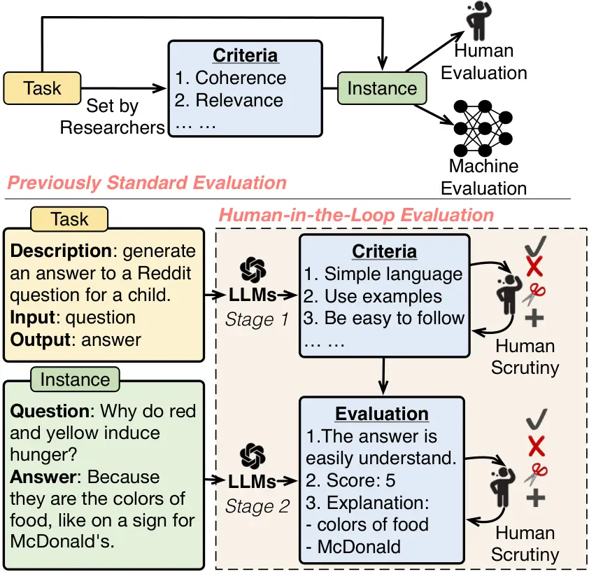
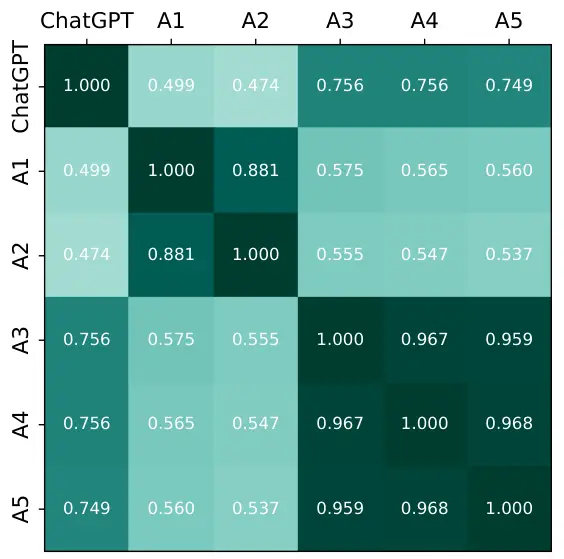
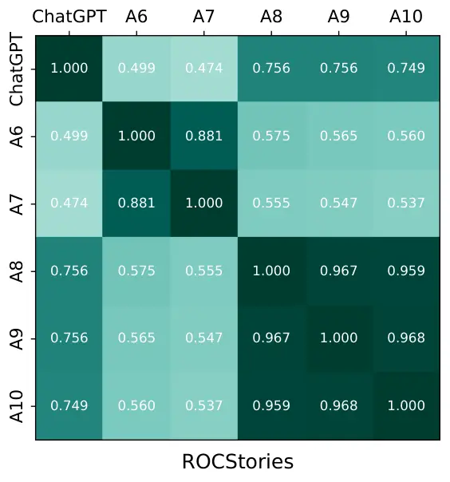
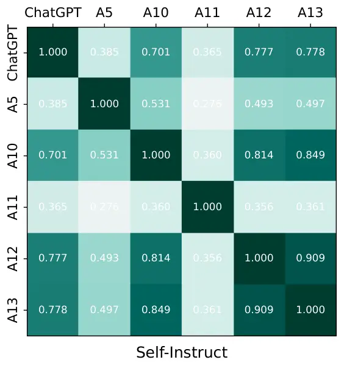
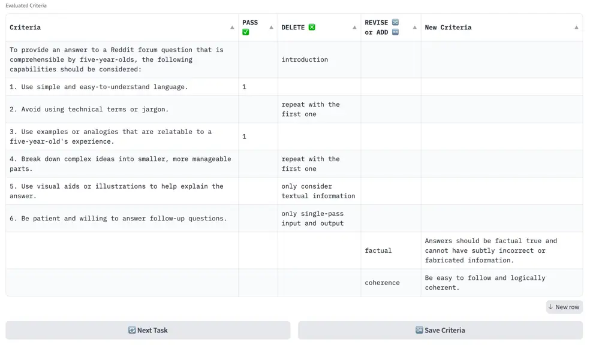
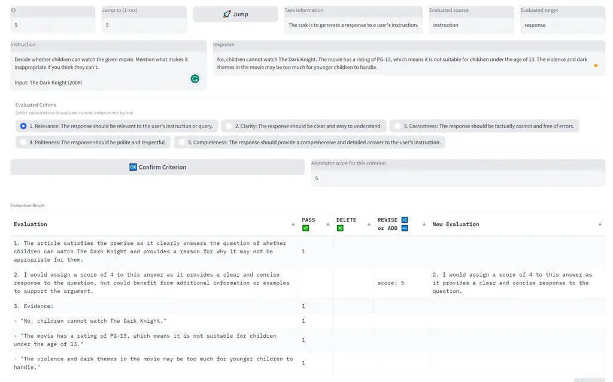

# Exploring the Reliability of Large Language Models as Customized Evaluators for Diverse NLP Tasks

Qintong Li¹¹ 1 Work was done during the internship at Tencent AI lab.
Affiliation:  The University of Hong Kong Email: <qtli@cs.hku.hk>   
Leyang Cui Affiliation:  Tencent AI lab Email: <lpk@cs.hku.hk>   
Lingpeng Kong Affiliation:  The University of Hong Kong
Email: [leyangcui@tencent.com](mailto:)    Wei Bi Affiliation:  Tencent
AI lab Email: [victoriabi@tencent.com](mailto:)

###### Abstract

Previous work adopts large language models (LLMs) as evaluators to
evaluate natural language process (NLP) tasks. However, certain
shortcomings, e.g., fairness, scope, and accuracy, persist for current
LLM evaluators. To analyze whether LLMs can serve as reliable
alternatives to humans, we examine the fine-grained alignment between
LLM evaluators and human annotators, particularly in understanding the
target evaluation tasks and conducting evaluations that meet diverse
criteria. This paper explores both conventional tasks (e.g., story
generation) and alignment tasks (e.g., math reasoning), each with
different evaluation criteria. Our analysis shows that 1) LLM evaluators
can generate unnecessary criteria or omit crucial criteria, resulting in
a slight deviation from the experts. 2) LLM evaluators excel in general
criteria, such as fluency, but face challenges with complex criteria,
such as numerical reasoning. We also find that LLM-pre-drafting before
human evaluation can help reduce the impact of human subjectivity and
minimize annotation outliers in pure human evaluation, leading to more
objective evaluation. All resources are available at
[https://github.com/qtli/CoEval](https://github.com/qtli/CoEval).

## 1 Introduction

The success of Large Language Models (LLMs) in executing real-world
tasks according to instructions (Gravitas, 2023; Liu et al., 2023b) has
spurred increased interest in using LLMs as evaluators, with task
examples treated as specific instructions during evaluation (Liu et al.,
2023c; Zhang et al., 2023b; Zheng et al., 2023, i.a.). However, current
LLM evaluators still have certain shortcomings. For example, an LLM
evaluator for math reasoning tasks may not penalize deceptive solutions
that contain incorrect steps Toh et al. (2023). This issue is
particularly severe for those intricate tasks where meticulous
verification or logical reasoning are the main evaluation criteria (Ling
et al., 2023; Zeng et al., 2023). There is an urgent need for a
systematic investigation on the reliability of LLMs as trustworthy and
universal evaluators capable of replacing humans in various NLP tasks.

Investigating whether LLMs are capable of generating various yet
adequate evaluation criteria across different tasks is a necessary first
step, so that we can understand the extent of agreement between LLM
evaluators and humans in interpreting the instruction of “evaluating a
task”. Furthermore, with the evolving nature of NLP tasks, it is
important for LLM evaluators to flexibly meet new requirements and
diverse criteria. This raises the pertinent question of whether the
evaluation results of LLMs can be trusted and aligned with specific
criteria. If the answer is negative, is there a way to enhance the LLM
evaluators?

We aim to provide separate and clear responses to both questions. To
gauge the task comprehension ability of an LLM evaluator, we prompt an
LLM to offer a variety of evaluation criteria for the assigned tasks,
followed by an examination of how well the LLM’s criteria align with
human expertise. We consider three benchmarks, including question
answering, story generation, and math word problem-solving, as well as
252 instruction-following tasks, across 692 distinct criteria that
experts manually curate. We find that LLMs can generate mostly
consistent, valid and sufficient task-specific evaluation criteria. LLMs
occasionally overlook critical criteria, such as “conciseness” for
writing a brief report, which experts would prioritize (Section 4.3).
This oversight could introduce biases in the subsequent sample
evaluation.

To measure the evaluation quality of LLMs, we discuss several methods
for instructing an LLM evaluator to score samples of a particular task,
with or without evaluation criteria. Meta-evaluation shows that when
LLMs thoroughly consider criteria before summarizing an overall score,
they can achieve a higher correlation with human assessments than when
they directly evaluate.

Currently, LLMs still have a long way to go before they can replace
humans. For example, in evaluating the “analogy usage” on the long-form
QA task, LLM tends to hallucinate and generate more positive scores; and
in evaluating the “logical reasonability” on the math reasoning task,
the LLM evaluator easily fails to detect simple logical errors
(Section 5.2). We further explore the potential for an LLM to serve as a
cost-effective auxiliary to human annotators by allowing humans to edit
the results generated by the LLM evaluator (Section 5.3). Compared with
human-only evaluation, the inter-annotation agreement of Krippendorff’s
$`\alpha`$ notably improves from 0.64 to 0.71. However, directly
replacing pure human evaluation with this method may have some potential
risks. LLM evaluations may inhibit certain aspects of human subjectivity
while mitigating certain annotation outliers.

Based on the efforts and outcomes of this study, we encourage further
research on LLMs as evaluators. This includes exploring their usage in
challenging new tasks, designing proper prompts for evaluation, and
conducting rigorous tests to assess their trustworthiness as evaluators
for the task.

## 2 Related Work

Traditional automatic metrics are well established for judging specific
NLP tasks, such as BLEU (Papineni et al., 2002) for machine translation,
ROUGE (Lin, 2004) and METEOR (Banerjee and Lavie, 2005) for text
summarization, and CIDEr (Vedantam et al., 2015) for image captioning.
To improve the correlation with human judgments, several approaches
integrate contextual word embeddings, including MoverScore (Zhao et al.,
2019), Sentence Mover’s Similarity (Clark et al., 2019),
BERTscore (Zhang et al., 2020), and Bartscore (Yuan et al., 2021). Other
related works propose task-specific metrics to align specific human
assessments, e.g., consistency (Durmus et al., 2020; Honovich et al.,
2021; Fabbri et al., 2022), coherence (Durmus et al., 2020; Ye et al.,
2021), and grammar (Pratapa et al., 2021). However, no universal metric
exists that can accommodate all generation tasks and capture all
desirable properties of language (Reiter and Belz, 2009; Garbacea and
Mei, 2020). Human evaluation is prevalent in generation tasks (Mathur
et al., 2020; Belz et al., 2020; Liu et al., 2023a).

As research in LLMs continues to accelerate, LLM-based evaluation has
emerged as a scalable and cost-effective alternative to human
evaluations (Jain et al., 2023; Taori et al., 2023; Chiang et al., 2023;
Wu and Aji, 2023).  Fu et al. (2023) uses LLM’s predicted text
probability as the automated score. Along a more black-box line, the
community (Wang et al., 2023; Chiang and Lee, 2023; Zeng et al., 2023;
Zhang et al., 2023a; Zhang et al., 2023b) has turned to induce LLM to
directly generate evaluation scores for diverse tasks, such as
summarization (Liu et al., 2023c) and dialogue (Zheng et al., 2023),
with superior human correlation compared to conventional metrics. Prior
studies primarily focus on devising efficient prompting strategies to
elicit high correlations between LLMs and human annotators, reaching
conclusions regarding the efficacy of LLMs as evaluators in a
straightforward manner. Different from previous work, we not target any
particular new task. Rather, our primary focus lies in how well LLMs
align with human experts in understanding evaluation tasks and
evaluating samples based on specific criteria.

## 3 Evaluation Setup

#### Tasks

We consider three benchmarks and 252 instruction-following tasks that
exhibit distinct characteristics and necessitate distinct criteria for
evaluating their output. Investigating the behaviors of the LLM
evaluator on these tasks enables us to derive broad observations.
Specifically, these tasks include: (i) a long-formed QA task ELI5 (Fan
et al., 2019) where the main focus is on the factuality and
comprehensibility of the generated answers; (ii) a story generation task
ROCStories (Mostafazadeh et al., 2016) that primarily emphasizes on the
coherence and relevance and other quality aspects of the generated
story; (iii) a math word problem task GSM8K (Cobbe et al., 2021) that
people are often concerned with its reasoning ability, such as logic and
correctness; (iv) an instruction-following dataset Self-Instruct (Wang
et al., 2022), which involves various daily scenarios (e.g., email
writing and film review), and thus we may require distinct evaluation
perspectives for different instructions within this dataset.

#### Evaluation Configurations

This paper considers gpt-3.5-turbo the representative LLM evaluator due
to its efficacy and economic benefits. We also examine a more powerful
model, i.e., gpt-4, when conducting evaluation, and the results are
shown in Table 9. For the benchmark tasks (ELI5, ROCStories, and GSM8K),
the LLM evaluator and human annotators are instructed to assess the
quality of outputs from three generation models¹¹ 1
[{https://platform.openai.com/docs/models}](https://%7Bhttps://platform.openai.com/docs/models%7D)
(gpt-3.5-turbo, text-davinci-002, and text-curie-001), as well as
human-written ground truth. Each task includes 200 evaluation samples
derived from 50 randomly selected inputs. For Self-Instruct, we use the
model outputs and human evaluations provided by its authors²² 2
[https://github.com/yizhongw/self-instruct/tree/main/human_eval](https://github.com/yizhongw/self-instruct/tree/main/human_eval)
because different tasks require different expertise, and it is extremely
challenging to find qualified human annotators.

## 4 LLM-Generated Criteria

We first investigate the divergence between LLM evaluators and human
experts in explaining the evaluated tasks and examine if an LLM
evaluator can generate various yet adequate evaluation criteria for
various tasks.

### 4.1 Prompt for Evaluation Criteria

Given the substantial ability of gpt-3.5-turbo to adhere to directions,
we utilize the prompt below to request it to generate evaluation
criteria based on the task description and a task example. The example
includes the input $`\bm{x}`$ and an output $`\bm{y}`$.

> Now, we have a task \[$`task`$ $`desc.`$\].
>
> Here is a demonstration example of the task:
>
> Input: \[$`\bm{x}`$\] Output: \[$`\bm{y}`$\]
>
> Please make sure you read and understand how to do this task.
>
> But your real task is to tell me how to evaluate this task. The
> evaluation criteria should include general criteria used in natural
> language tasks, as well as task-specific criteria about this evaluated
> task. Please provide a clear and comprehensive list of your evaluation
> criteria.
>
> Evaluation Criteria:

For benchmark datasets, \[$`task`$ $`desc.`$\] is written by human
experts. For the Self-Instruct task, \[$`task`$ $`desc.`$\] represents
each instruction, such as “Change the response to have a more empathetic
tone in the chat.”. The demonstrated input \[$`\bm{x}`$\] and output
\[$`\bm{y}`$\] are randomly selected from the task dataset. As
gpt-3.5-turbo possesses strong instruction-following abilities, it can
easily understand the instruction to output a set of criteria for a
specific task based on the properties with 100% completion. Therefore,
our study mainly focuses on the quality of the generated criteria.

### 4.2 Consistency of LLM-generated Criteria

Firstly, we explicitly measure the consistency of the criteria generated
by the LLM evaluator when given the same task. We use the prompting
template as described in $`\lx@sectionsign`$4.1 and instruct
gpt-3.5-turbo 10 times at a temperature of 0.7, generating multiple
criteria sets $`\{\mathrm{C}_{1},\ldots,\mathrm{C}_{10}\}`$. We also set
the temperature as 0 for a deterministic result $`\mathrm{\tilde{C}}`$
as reference. We desire that LLMs can perform robustly to generate
mostly similar criteria across different samplings and hyperparameters.

Here, we design two embedding-based metrics to estimate the consistency.
Criteria Consistency (CC) quantifies the average similarities of matched
criteria pairs between the deterministic criteria set
$`\mathrm{\tilde{C}}`$ and a sampled criteria set $`\mathrm{C}_{n}`$.
Inter-criteria Consistency (ICC) measures the average similarities of
matched criteria pairs between any two sampled set $`\mathrm{C}_{n}`$
and $`\mathrm{C}_{m}`$.

```math
\displaystyle\textit{CC}=\frac{\sum_{n=1}^{N}\sum_{i=1}^{|\mathrm{\tilde{C}}|}\max_{\bm{c}_{j}\in\mathrm{C}_{n}}{\textit{sim}(\bm{\tilde{c}}_{i},\bm{c}_{j}})}{|\mathrm{\tilde{C}}|\times N}\,, \tag{1}
```

```math
\displaystyle\textit{ICC}=\frac{\sum_{m=1}^{N}\sum_{n=1,m\neq n}^{N}\sum_{i=1}^{|\mathrm{C}_{m}|}\max_{\bm{c}_{j}\in\mathrm{C}_{n}}\textit{sim}(\bm{c}_{i},\bm{c}_{j})}{\sum_{m=1}^{N}|\mathrm{C}_{m}|\times(N-1)}\,, \tag{2}
```

where $`\bm{c}`$ is a singular criterion and $`N`$ is the number of
samplings (10 in our study). The $`\textit{sim}(\cdot)`$ represents
cosine similarity based on the SimCSE (Gao et al., 2021) embeddings of
criteria $`\bm{c}_{i}`$ and $`\bm{c}_{j}`$.

|        |      |            |       |               |
| ------ | ---- | ---------- | ----- | ------------- |
| Metric | ELI5 | ROCStories | GSM8K | Self-Instruct |
| CC     | 0.75 | 0.82       | 0.80  | 0.78          |
| ICC    | 0.78 | 0.81       | 0.77  | 0.76          |

Table 1: The consistency of the criteria generated by the LLM evaluator,
as defined in Equations 1 and 2, across various sampling instances for
four distinct domains.

#### Results

As shown in Table 1, we observe a substantial level of consensus in both
CC and ICC, especially for story evaluation (ROCStories). We can safely
conclude that LLM can generate consistent criteria for the same task,
which may benefit subsequent evaluation stability.

### 4.3 Alignment with Human Experts

Next, we examine whether the LLM-generated criteria align with human
expertise. Human experts receive the same prompt³³ 3 Compared to what we
offer, human experts undoubtedly possess far more knowledge about the
task. as provided in Section 4.1. In our setting, human experts are
three researchers with over three years of experience in text generation
and language modeling. Details of human experts are in Appendix D.

|                                                                                                                                                                                                                            |
| -------------------------------------------------------------------------------------------------------------------------------------------------------------------------------------------------------------------------- |
| Self-Instruct $`\bullet`$ $`Task`$ $`Desc.`$: Give a brief description of the given category of movies and shows.                                                                                                          |
| $`\bullet`$ $`Input`$: Period Dramas                                                                                                                                                                                       |
| $`\bullet`$ $`Output`$: Want to escape the contemporary world? Explore these historical dramas and shows from the time that have magnificent art and costume design, lots of drama, and a lot of history.                  |
| Criteria $`\mathrm{C}`$ 1.Coherence: Does the description flow smoothly and logically? ✓                                                                                                                                   |
| 2.Accuracy: Does the description accurately capture the essence of the category of movies and shows? Does it provide a true representation of what viewers can expect from this genre? ✂remove unknown viewer information |
| 3.Language: Is the language used in the description appropriate and engaging? ✗unnecessary criterion                                                                                                                       |
| 4.Creativity: Is the description creative and unique? ✗                                                                                                                                                                    |
| 5.Tone: Does the description have an appropriate tone for the category of movies and shows? ✗                                                                                                                              |
|                                                                                                                                                                                                                            |
| ✛ Conciseness: How brief and concise is the description? Is it easy to understand and comprehend?                                                                                                                          |

Table 2: Demonstration of the alignment between a criteria set generated
by LLM and the judgments of human experts. ✓ , ✗ , ✂ , and ✛ denotes the
expert’s judgments of $`Approval`$, $`Deletion`$, $`Need\_to\_improve`$,
and $`Missing`$, respectively. The criteria agreed by experts are
highlighted in green.

We assess the degree of alignment between the criteria of LLM and those
of human experts from two perspectives: sufficiency (whether it is
needed for this specific task) and validity (whether it is clearly
stated and executable during evaluation) as meta-evaluation. Based on
the two requirements, we define four levels of (mis)alignments
accordingly. An illustrative example is shown in Table 2.

1.  1.  $`Approval`$: A generated criterion is directly approved by the
        human expert, e.g., the first criterion in Table 2.
2.  2.  $`Need\_to\_improve`$: The criterion is necessary, but needs some
        improvements, including clarifying and making the criterion more
        executable (e,g, the second criterion requires viewer information
        that is not available for this task.), and adjusting content to
        avoid overlap with other criteria.
3.  3.  $`Deletion`$: The criterion is unnecessary due to its needless or
        invalidity. The fourth criterion, “creativity” in Table 2 is
        unnecessary when composing a brief description.
4.  4.  $`Missing`$: A criterion is crucial but missed by the LLM evaluator,
        e.g., the sixth criterion.

Ideally, a high ratio of $`Approval`$ is preferred.
$`Need\_to\_improve`$ also can express a moderate alignment with human
expertise. $`Deletion`$ or $`Missing`$ is not desirable.

|               |           |                     |           |           |
| ------------- | --------- | ------------------- | --------- | --------- |
| Task          | $`Appr.`$ | $`Need\_to\_Impr.`$ | $`Dele.`$ | $`Miss.`$ |
| ELI5          | 56.52%    | 8.33%               | 35.15%    |      0%   |
| ROCStories    | 54.84%    | 9.68%               | 32.26%    |   3.23%   |
| GSM8K         | 25.00%    |     0%              | 75.00%    |      0%   |
| Self-Instruct | 16.19%    |   4.02%             | 79.22%    |   0.58%   |

Table 3: Alignment between criteria generated by LLM and those proposed
by human experts. The frequent occurrences of 0% indicate all criteria
are either accepted or disapproved by humans.

#### Results

We compute the ratio of each category as the degree of alignment between
the criteria generated by the LLMs and those of human experts⁴⁴ 4 If
there are disagreements among experts, we include a discussion among
them and reach a consensus.. As shown in Table 3, the $`Approval`$ rates
across the four benchmarks are considerably high, particularly for ELI5
and ROCStories, where more than 50% of the criteria proposed by the LLM
are accepted by human experts. The low percentages of
$`Need\_to\_Improve`$ rates on all benchmarks surprise us, even
displaying 0% on two out of the four benchmarks. This indicates that the
LLM can comprehend what one valid criterion should be, and typically
does not produce impractical criteria.

The $`Deletion`$ rates are noteworthy, though, and this is in line with
earlier studies that found OpenAI’s GPT series to be verbose and
repetitious in specific contents Saito et al. (2023). The existence of
$`Missing`$ is not preferred in our results. We found that gpt-3.5-turbo
disregards the specified length requirement in the case of four-sentence
or five-sentence story generation. Likewise, it fails to consider
“completeness” in tasks like identifying all words that match a given
pattern. More LLM-generated criteria can be found in Appendix B.

Figure 1: The 10 most frequently occurring key verbs or nouns in the
evaluated instruction tasks, as well as the top 4 criteria that are most
frequently considered in evaluating the responses to those instructions.

### 4.4 Criteria Diversity

Figure 1 visually represents the top 10 most frequent verbs or nouns
(out of a total of 96 identified) present in the \[$`task`$ $`desc.`$\]
of the Self-Instruct dataset, accompanied by their respective top 4
criteria, which are established by human experts. By evaluating the
criteria generated by LLMs on instruction-following benchmark that
encompasses diverse intents, we can gain a comprehensive understanding
of their behavior when serving as customized evaluators.

## 5 LLMs for Sample-wise Evaluation

After constructing the high-quality evaluation criteria for three
benchmarks and 252 instruction-following tasks, we proceed to examine
the reliability of gpt-3.5-turbo as an evaluator based on specific
criteria for evaluating a task sample. For each criterion, we request
that the LLM produce an explanation in addition to a score, allowing it
to reflect on its own scoring process. At last, we prompt the LLM to
consider all criteria and their respective scores before determining the
overall score. This procedure allows us to obtain a detailed
understanding of the performance of LLMs’ tailored evaluators.

### 5.1 Criterion-level Evaluation Prompt

We adopt a step-by-step instruction, which asks the LLM to evaluate a
task sample ($`\bm{x}`$, $`\bm{y}`$) by considering one criterion
$`\bm{c}_{i}`$ at a time. For each criterion, the LLM is instructed to
provide an evaluation with detailed explanations, i.e., (1) a detailed
reasoning process to explain the evaluation judgment and (2) a rating
score on a 5-point Likert scale⁵⁵ 5 For the majority of criteria, a
maximum score of 5 is adopted. However, for certain non-language-level
criteria, such as length requirement or reasoning completeness, scores
are assigned using a 3-level scale.:

|                                                                                                                                                                                                                                                                         |
| ----------------------------------------------------------------------------------------------------------------------------------------------------------------------------------------------------------------------------------------------------------------------- |
| ELI5 $`\bullet`$ $`Task`$ $`Desc.`$: ELI5 is a task for long-form question answering. It contains complex, diverse questions that require explanatory multi-sentence answers. This task aims to provide an explanatory answer that is comprehensible to five-year-olds. |
| $`\bullet`$ $`Input`$: How is perfume created?                                                                                                                                                                                                                          |
| $`\bullet`$ $`Output`$: Smelly thinks in flowers and herbs can be extracted with alcohol. Then they can be condensed, then put in a bottle, then sprayed on girls and boys alike.                                                                                       |
| $`\bullet`$ $`Criterion`$: Use simple and easy-to-understand language.                                                                                                                                                                                                  |
| LLM evaluating on one criterion in each step 1. The answer does not satisfy the criterion as it uses words like “condensed” which may not be familiar to a five-year-old. ✓                                                                                             |
| - The use of the words “condensed” and “smelly thinks in flowers and herbs.” ✂ wrong explanation - The use of the words “alcohol” and “condensed”.                                                                                                                     |
| - However, the answer does use simple language to explain that perfume is made by extracting scents from flowers and herbs and then putting the condensed scents in a bottle to be sprayed on people. ✓                                                                 |
| 2. Score: 4. ✂ The score exceeds the expected value. 3.                                                                                                                                                                                                                |

Table 4: Illustration of the alignment between LLM’s evaluation and
human annotators for the ELI5 task (Fan et al., 2019). Text highlighted
in green represents the evaluation by human annotators.

> Now, we have a task \[$`task`$ $`desc.`$\].
>
> You need to evaluate whether the output of this task satisfies a given
> criterion.
>
> Input: \[$`\bm{x}`$\] Output: \[$`\bm{y}`$\]
>
> Criterion: \[$`\bm{c}_{i}`$\]
>
> Evaluation Steps:
>
> 1.  1.  Verify whether the output satisfies the requirement of the given
>         criterion and provide explanations regarding your evaluation.
> 2.  2.  Assign a score to represent your evaluation result on a scale of
>         \[$`Lowest`$ $`Score`$\] to \[$`Highest`$ $`Score`$\], where
>         \[$`Lowest`$ $`Score`$\] is the lowest and \[$`Highest`$
>         $`Score`$\] is the highest based on the criterion.
>
> Evaluation Form:

Providing a detailed explanation before reaching a final evaluation
result allows for an in-depth examination of the trustworthiness of
LLM’s evaluations. Upon completion of the evaluation of all criteria,
the LLM evaluator is obligated to assign an overall quality score by
considering all criteria.



Figure 2: Compared with conventional evaluation methods, the proposed
collaborative evaluation pipeline employs an LLM-ideation-human-scrutiny
pipeline from task criteria establishment to instance-level evaluation.

Besides the criterion-level prompting, we also include a vanilla prompt
for the LLM evaluator to directly evaluate the task sample at the
overall level. The detailed prompting format is provided in the
Appendix A.

#### Human-in-the-loop

We also explore a human-in-the-loop setting, where an LLM evaluator
assists human evaluators by providing an initial evaluation reference
for human annotators to conclude a final judgment. We present the
human-in-the-loop evaluation pipeline in Figure 2, which first generates
a checklist of task-specific criteria and subsequently conducts instance
evaluation. Both stages involve the collaboration between LLM and
humans. That is, regarding LLM evaluation results as initial drafts,
humans can perform four distinct actions as described in Section 4.3, to
reach the final evaluation. The LLM is employed as an assistant for
providing diverse criteria and informative evaluations as preliminary
references, and then human evaluators scrutinize and make necessary
corrections to the outcomes of LLMs, ensuring reliable evaluation while
reducing human effort.

#### Convention Human Evaluation

In contrast to the LLM evaluators, we ask five professional human
annotators to score samples from the three benchmarks (ELI5, ROCStories,
and GSM8K) based on the same set of criteria, followed by an overall
score. For Self-Instruct, it is very difficult to find satisfactory
human annotators because different tasks require different expertise, so
we directly use the released expert annotation statistics from Wang
et al. (2022).

### 5.2 Weaknesses of LLM evaluators

To compare the disparity between the LLM evaluator and human annotators,
we first compute their Pearson and Spearman correlation. Next, we
examine the scoring distribution, including the distribution shift with
human annotations and the scoring bias on LLM’s evaluation output.

|                                 |       |          |            |          |                        |                        |
| ------------------------------- | ----- | -------- | ---------- | -------- | ---------------------- | ---------------------- |
| Prompt                          | ELI5  |          | ROCStories |          | GSM8K                  |                        |
|                                 | $`r`$ | $`\rho`$ | $`r`$      | $`\rho`$ | $`r`$                  | $`\rho`$               |
| Direct                          | 0.128 | 0.142    | 0.199      | 0.217    | $`\operatorname{NaN}`$ | $`\operatorname{NaN}`$ |
| Step-by-step                    | 0.407 | 0.392    | 0.282      | 0.200    | -0.016                 | -0.018                 |
| Step-by-step +Human-in-the-loop | 0.412 | 0.417    | 0.427      | 0.437    | 0.669                  | 0.612                  |

Table 5: Sample-level Pearson ($`r`$) and Spearman ($`\rho`$)
correlations of the overall scores on three benchmarks.

Figure 3: The distribution of overall quality scores for three models,
InstructGPT₀₀₁, InstructGPT₀₀₂, and InstructGPT₀₀₃, on the Self-Instruct
dataset. These scores are evaluated by human experts (Human), LLM with
step-by-step evaluation (Step), and LLM with direct evaluation (Direct),
respectively.

|                                 |                   |          |          |          |           |          |            |          |                        |                        |
| ------------------------------- | ----------------- | -------- | -------- | -------- | --------- | -------- | ---------- | -------- | ---------------------- | ---------------------- |
| Evaluation                      | Comprehensibility |          | Accuracy |          | Coherence |          | Engagement |          | Analogy usage          |                        |
|                                 | $`r`$             | $`\rho`$ | $`r`$    | $`\rho`$ | $`r`$     | $`\rho`$ | $`r`$      | $`\rho`$ | $`r`$                  | $`\rho`$               |
| Direct                          | 0.231             | 0.209    | 0.076    | 0.073    | 0.098     | 0.092    | 0.102      | 0.087    | $`\operatorname{NaN}`$ | $`\operatorname{NaN}`$ |
| Step-by-step                    | 0.288             | 0.257    | 0.410    | 0.361    | 0.393     | 0.366    | 0.499      | 0.399    | 0.261                  | 0.246                  |
| Step-by-Step +Human-in-the-loop | 0.303             | 0.310    | 0.410    | 0.413    | 0.491     | 0.499    | 0.429      | 0.432    | 0.396                  | 0.317                  |

Table 6: Sample-level Pearson ($`r`$) and Spearman ($`\rho`$)
correlations between human annotators and LLM with direct evaluation, as
well as LLM with step-by-step evaluation, on the ELI5 dataset for
different criteria. In cases where the correlation is
“$`\operatorname{NaN}`$”, the LLM assigns identical scores to all
outputs under that particular criterion.

|                                 |           |          |           |          |          |          |                        |                        |            |          |                        |                        |
| ------------------------------- | --------- | -------- | --------- | -------- | -------- | -------- | ---------------------- | ---------------------- | ---------- | -------- | ---------------------- | ---------------------- |
| Evaluation                      | Relevance |          | Coherence |          | Language |          | Commonsense            |                        | Creativity |          | Length                 |                        |
|                                 | $`r`$     | $`\rho`$ | $`r`$     | $`\rho`$ | $`r`$    | $`\rho`$ | $`r`$                  | $`\rho`$               | $`r`$      | $`\rho`$ | $`r`$                  | $`\rho`$               |
| Direct                          | 0.169     | 0.154    | 0.155     | 0.153    | 0.165    | 0.167    | $`\operatorname{NaN}`$ | $`\operatorname{NaN}`$ | 0.028      | 0.026    | $`\operatorname{NaN}`$ | $`\operatorname{NaN}`$ |
| Step-by-Step                    | 0.245     | 0.241    | 0.237     | 0.231    | 0.256    | 0.271    | 0.266                  | 0.265                  | 0.130      | 0.113    | 0.118                  | 0.118                  |
| Step-by-Step +Human-in-the-loop | 0.415     | 0.425    | 0.398     | 0.409    | 0.418    | 0.430    | 0.400                  | 0.376                  | 0.388      | 0.395    | 0.800                  | 0.794                  |

Table 7: Sample-level Pearson ($`r`$) and Spearman ($`\rho`$)
correlations of different criteria on the ROCStories dataset.

|              |                   |     |     |                         |     |     |              |     |     |
| ------------ | ----------------- | --- | --- | ----------------------- | --- | --- | ------------ | --- | --- |
| Evaluation   | Logical Reasoning |     |     | Numerical Understanding |     |     | Completeness |     |     |
|              | CS                | OE  | ME  | CS                      | OE  | ME  | CS           | OE  | ME  |
| Direct       | 100               | 0   | 0   | 100                     | 0   | 0   | 100          | 0   | 0   |
| Step-by-step | 100               | 0   | 0   | 99                      | 0   | 1   | 100          | 0   | 0   |

Table 8: Distribution of scores between evaluations generated by LLM and
human evaluators on GSM8K dataset. The 100 indicates that the evaluator
considers all solutions correct for the corresponding criterion. CS
represents a “correct solution”, OE indicates “one error exists”, and ME
means “multiple errors exist”.

#### Correlations between LLM-based Scoring and Human Judgments

Table 5 demonstrates the correlation between human evaluations and
various evaluation techniques (i.e., vanilla prompting, step-by-step
prompting, and the integration of LLMs and human involvement) across the
three benchmark datasets. Prompting LLMs without considering
task-specific criteria yields poor performance on all three datasets. In
comparison, the step-by-step prompting significantly improves human
correlation, particularly on the ELI5 dataset. Nonetheless, when
compared to the human-in-the-loop setup, the LLM evaluation exhibits
lower correlations on the ROCStories dataset (which entails creativity
and subjectivity) and the GSM8K dataset (which requires mathematical
reasoning).

Figure 3 illustrates the comparison between LLM-based evaluation and
human evaluation for the Self-Instruct task. Compared to pure human
evaluation and LLM evaluation with step-by-step criterion evaluation,
the LLM evaluator without specific criteria cannot differentiate between
“minor imperfections” and “significant errors”. Step-by-step evaluation
along each criterion can detect severe errors but tends to assign higher
scores than human evaluators.

The correlations between the LLM evaluator and human annotations on the
ELI5 and ROCStories tasks are presented in Table 6 and Table 7
respectively. The LLM evaluator performs well on general language-level
criteria (e.g., relevance and coherence) but poorly on criteria
involving information seeking (e.g., analogy usage, creativity) or
numerical judgment (e.g., length), showing weak correlations with
humans.

#### Scoring Distribution Bias

Considering the unsatisfactory correlation with human annotators, we aim
to investigate the disparity between the sample-wise scoring
distribution of LLM-based evaluation and human evaluation. Firstly, we
present the LLM evaluator’s performance on the GSM8K dataset in Table 8,
where significant difficulties are encountered. Surprisingly, the LLM
evaluator consistently assigns the highest scores to samples, regardless
of the presence of errors in logic, numbers, or completeness, indicating
the significant challenges faced by LLMs in detecting math-related
errors.

For the question-answering task (ELI5) and story generation task
(ROCStories), the distribution of scores assigned by both LLM and human
evaluators is presented in Figure 4. To facilitate comparison, we select
two representative criteria for each task. For the criteria on the left
side, the difference in scoring distribution between LLM and humans is
negligible, demonstrating the effectiveness of LLM evaluation on these
criteria. However, for criteria on the right side, which pertain to
information-seeking and numerical capabilities, there is a significant
difference. The difference is large, indicating LLM evaluation still may
fail on those complex evaluation criteria.

Figure 4: The distribution of scores assigned by LLM and 5 human
evaluators for predictions generated by various models. To ensure
generalization, human evaluators who participated in different datasets
may vary.

|               |         |         |         |         |
| ------------- | ------- | ------- | ------- | ------- |
| Evaluator     | Score=1 | Score=2 | Score=3 | Score=4 |
| GPT-3.5-turbo | 3.17    | 24.21   | 17.86   | 54.76   |
| GPT-4         | 8.77    | 19.30   | 29.82   | 42.11   |
| HumanEval     | 2.77    | 1.98    | 40.08   | 55.17   |

Table 9: Evaluation score distribution of LLM evaluators and human
evaluators.

#### Evaluating with GPT-4

Our analysis of the more powerful model, gpt-4, as an evaluator,
displayed close alignment with the performance of gpt-3.5-turbo. The
results are shown in Table 9. LLMs showed a consistently positive and
negative tendency akin to humans, as observed in prior research (Zheng
et al., 2023; Wu and Aji, 2023), but tended to provide moderate scores
in comparison. To address this, we recommend starting with sample-wise
evaluations before progressing to pair-wise evaluations, a more reliable
strategy supported by our study findings.

### 5.3 Can We Enhance the Evaluation with LLM-human-in-the-loop?

From the above results and analysis, we can see that the current LLM
evaluator (gpt-turbo-3.5 in this instance) is still imperfect. A
cost-effective and reliable approach to enhance evaluation is to involve
LLMs as auxiliary evaluators for assisting human evaluators.

#### Correlation with Convention Human Evaluation

To fairly investigate the effectiveness of LLM-human-in-the-loop, we
calculate the average Pearson correlation among pairs of evaluators for
each task in Table 10. We can observe that, with the LLM serving as an
assistant, the correlation between human-in-the-loop evaluation and pure
human evaluation is similar to the internal correlation among pure human
annotators. This finding implies that humans are not significantly
influenced by the biases of the LLM. Nonetheless, the scores of LLM
evaluation exhibit a relatively weak correlation with those of humans,
suggesting that relying solely on LLM evaluation may not be reliable.

|               |             |             |      |
| ------------- | ----------- | ----------- | ---- |
| Task          | LLM vs. HuE | L+H vs. HuE | HuE  |
| ELI5          | 0.21        | 0.31        | 0.40 |
| ROCStories    | 0.35        | 0.43        | 0.45 |
| Self-Instruct | 0.37        | 0.33        | 0.23 |

Table 10: Average Pearson correlation among pairs of evaluators with
pure human evaluation, i.e., LLM, LLM+HumanEval (Human-in-the-loop
evaluation), and HumanEval.



Figure 5: Inter-annotator agreement among LLM and 5 humans (A1 to A5)
using Krippendorff’s $`\alpha`$. LLM’s scores are deemed acceptable,
with over 50% of human evaluators showing high agreement
($`\alpha>0.7`$).

#### Inter Annotator Agreements of LLM-evaluation with Human-in-the-loop

Figure 5 reports inter-annotator agreement (IAA) when adopting
LLM-evaluation with human-in-the-loop setting on 200 randomly-sampled
ELI5 samples. We use Krippendorff’s $`\alpha`$ for evaluation scores to
showcase the annotation consistency among LLM and 5 involved human
evaluators. Our findings reveal high agreement among evaluators when
evaluating samples based on the initial drafts proposed by the LLM
evaluator, with $`\alpha`$ exceeding 0.8 for two groups of evaluators,
i.e., (Group 1: A3, A4, and A5) and (Group 2: A1 and A2), indicating
inherent variance in the definitions of “best text snippets” among
different evaluators. Notably, Group 1 (with $`\alpha\approx 0.754`$) is
more consistent with LLM’s evaluation scores compared to Group 2 (with
$`\alpha\approx 0.487`$).

|               |                       |                       |                       |                       |
| ------------- | --------------------- | --------------------- | --------------------- | --------------------- |
| Task          | Correction (%)        | Scrutiny (%)          | Subjectivity (%)      | Outlier (%)           |
| ELI5          | $`\text{42.55}_{47}`$ | $`\text{55.32}_{47}`$ | $`\text{76.47}_{17}`$ | $`\text{63.64}_{22}`$ |
| ROCStories    | $`\text{11.43}_{35}`$ | $`\text{14.29}_{35}`$ | $`\text{37.50}_{24}`$ | $`\text{72.73}_{33}`$ |
| Self-Instruct | $`\text{45.45}_{11}`$ | $`\text{45.45}_{11}`$ | $`\text{61.90}_{21}`$ | $`\text{48.39}_{31}`$ |

Table 11: Human evaluator behaviors in LLM-Human-in-the-loop evaluation.
Correction: humans adjust LLM’s conflicting evaluations to align with
HumanEval Scrutiny: humans scrutinize LLM evaluations inconsistent with
HumanEval. Subjectivity: disagreements arise among human evaluators when
HumanEval shows large disparities. Outlier: all participants agree with
the majority vote of HumanEval, despite some disagreements. The
subscript number indicates the corresponding instances of HumanEval.

#### Reasons behind the Relatively High Correlation of the Human-in-the-loop Evaluation

Given the improved inter-annotator agreement of step-by-step prompting
with human-in-the-loop, we carefully investigate the factors that
improve human agreements. We choose the majority vote of human
annotators as ground truth to analyze the behavior of humans involved in
step-by-step prompting with human-in-the-loop. The results are presented
in Table 11. The elevated values observed in the “Correction”,
“Scrutiny”, and “Subjectivity” categories suggest that humans tend to
follow their own preferences in most cases. This is evident from their
endeavors to revise LLM’s evaluations that contradict their own
judgments (55.32% on ELI5) without blindly relying on LLM (61.90% on
Self-Instruct). Surprisingly, the notable values in the “Outlier”
indicate that humans are willing to agree with LLM when it is justified
and reasonable. This willingness to align with LLM evaluations leads to
higher annotator agreements and removes the outliers existing in human
annotators.

## 6 Conclusion

To examine the reliability of LLMs as universal evaluators, we
investigate whether LLMs can generate appropriate evaluation criteria
across various tasks and whether the evaluation results are trustworthy
based on the given criteria. We request LLMs to create a draft
evaluation, then human experts are employed to assess and refine the
draft evaluation. Based on the expert assessment, we find that 1) LLMs
can consistently generate high-quality task-specific evaluation
criteria, while also producing many unnecessary criteria or missing a
few crucial criteria. 2) LLMs perform well on language-level and
commonsense-related criteria while making mistakes on complex criteria,
such as “analogy usage” and “logical reasonability”. After introducing
human refinement, the LLM evaluator can mitigate specific human
subjectivity with reduced annotation outliers.

## Limitations

We use gpt-turbo-3.5 as our specific LLM evaluator to assess the
reliability of the LLM-as-judge paradigm due to its cost-effectiveness
and performance. Given the high cost of human evaluation, we did not
include additional LLMs. Hiring a qualified evaluator for 200 instances
costs us \$700 and takes over three weeks to recruit, test, and collect
results, while guiding gpt-turbo-3.5 for evaluations takes just a few
hours.

LLM evaluation results can be sensitive to instruction formats. While
finding a globally optimal instruction is challenging, our pilot
experiments show that results across different instructions are not
significantly different for a small subset of instances. Additionally,
decoding strategies influence evaluation outcomes. For deterministic
results, we set the sampling temperature to 0, while also experimenting
with a temperature of 0.7 and sampling 10 times. We observe that this
variation had no significant impact on LLM evaluations.

Different from previous work, we are not trying to explore the use of
LLMs as evaluators for any new particular task or to design any better
prompt for the LLM to fulfill the task as evaluators.

## Ethics Statement

We honor the Code of Ethics. No private data or non-public information
is used in this work. For human evaluation, we recruited our evaluators
from the linguistics departments of local universities through public
advertisement with a specified pay rate. All of our evaluators are
senior undergraduate students or graduate students in linguistic majors
who took this evaluation as a part-time job. We pay them US\$35.5 an
hour. The local minimum salary in the year 2023 is US\$15.5 per hour for
part-time jobs. The annotation does not involve any personally sensitive
information.

We use the models and datasets by their intended usage. Specifically, we
follow the [OpenAI usage
policy](https://openai.com/policies/usage-policies) when using the
models of Open AI.

## References

- Banerjee and Lavie (2005) Satanjeev Banerjee and Alon Lavie. 2005.
  Meteor: An automatic metric for mt evaluation with improved
  correlation with human judgments. In _Proceedings of the acl workshop
  on intrinsic and extrinsic evaluation measures for machine translation
  and/or summarization_, pages 65–72.
- Belz et al. (2020) Anja Belz, Simon Mille, and David M Howcroft. 2020.
  Disentangling the properties of human evaluation methods: A
  classification system to support comparability, meta-evaluation and
  reproducibility testing. In _Proceedings of the 13th International
  Conference on Natural Language Generation_, pages 183–194.
- Chiang and Lee (2023) Cheng-Han Chiang and Hung-yi Lee. 2023. Can
  large language models be an alternative to human evaluations? _arXiv
  preprint arXiv:2305.01937_.
- Chiang et al. (2023) Wei-Lin Chiang, Zhuohan Li, Zi Lin, Ying Sheng,
  Zhanghao Wu, Hao Zhang, Lianmin Zheng, Siyuan Zhuang, Yonghao Zhuang,
  Joseph E. Gonzalez, Ion Stoica, and Eric P. Xing. 2023. [Vicuna: An
  open-source chatbot impressing gpt-4 with 90%\* chatgpt
  quality](https://lmsys.org/blog/2023-03-30-vicuna/).
- Clark et al. (2019) Elizabeth Clark, Asli Celikyilmaz, and Noah A
  Smith. 2019. Sentence mover’s similarity: Automatic evaluation for
  multi-sentence texts. In _Proceedings of the 57th Annual Meeting of
  the Association for Computational Linguistics_, pages 2748–2760.
- Cobbe et al. (2021) Karl Cobbe, Vineet Kosaraju, Mohammad Bavarian,
  Mark Chen, Heewoo Jun, Lukasz Kaiser, Matthias Plappert, Jerry Tworek,
  Jacob Hilton, Reiichiro Nakano, et al. 2021. Training verifiers to
  solve math word problems. _arXiv preprint arXiv:2110.14168_.
- Durmus et al. (2020) Esin Durmus, He He, and Mona Diab. 2020. Feqa: A
  question answering evaluation framework for faithfulness assessment in
  abstractive summarization. In _Proceedings of the 58th Annual Meeting
  of the Association for Computational Linguistics_, pages 5055–5070.
- Fabbri et al. (2022) Alexander Richard Fabbri, Chien-Sheng Wu, Wenhao
  Liu, and Caiming Xiong. 2022. Qafacteval: Improved qa-based factual
  consistency evaluation for summarization. In _Proceedings of the 2022
  Conference of the North American Chapter of the Association for
  Computational Linguistics: Human Language Technologies_, pages
  2587–2601.
- Fan et al. (2019) Angela Fan, Yacine Jernite, Ethan Perez, David
  Grangier, Jason Weston, and Michael Auli. 2019. Eli5: Long form
  question answering. In _Proceedings of the 57th Annual Meeting of the
  Association for Computational Linguistics_, pages 3558–3567.
- Fu et al. (2023) Jinlan Fu, See-Kiong Ng, Zhengbao Jiang, and Pengfei
  Liu. 2023. Gptscore: Evaluate as you desire. _arXiv preprint
  arXiv:2302.04166_.
- Gao et al. (2021) Tianyu Gao, Xingcheng Yao, and Danqi Chen. 2021.
  SimCSE: Simple contrastive learning of sentence embeddings. In
  _Empirical Methods in Natural Language Processing (EMNLP)_.
- Garbacea and Mei (2020) Cristina Garbacea and Qiaozhu Mei. 2020.
  Neural language generation: Formulation, methods, and evaluation.
  _arXiv preprint arXiv:2007.15780_.
- Gravitas (2023) Significant Gravitas. 2023.
  [Auto-gpt](https://github.com/Significant-Gravitas/Auto-GPT).
- Honovich et al. (2021) Or Honovich, Leshem Choshen, Roee Aharoni, Ella
  Neeman, Idan Szpektor, and Omri Abend. 2021. Q2:: Evaluating factual
  consistency in knowledge-grounded dialogues via question generation
  and question answering. In _Proceedings of the 2021 Conference on
  Empirical Methods in Natural Language Processing_, pages 7856–7870.
- Jain et al. (2023) Sameer Jain, Vaishakh Keshava, Swarnashree Mysore
  Sathyendra, Patrick Fernandes, Pengfei Liu, Graham Neubig, and
  Chunting Zhou. 2023. Multi-dimensional evaluation of text
  summarization with in-context learning. _arXiv preprint
  arXiv:2306.01200_.
- Lin (2004) Chin-Yew Lin. 2004. Rouge: A package for automatic
  evaluation of summaries. In _Text summarization branches out_, pages
  74–81.
- Ling et al. (2023) Zhan Ling, Yunhao Fang, Xuanlin Li, Zhiao Huang,
  Mingu Lee, Roland Memisevic, and Hao Su. 2023. Deductive verification
  of chain-of-thought reasoning. _arXiv preprint arXiv:2306.03872_.
- Liu et al. (2023a) Nelson F Liu, Tianyi Zhang, and Percy Liang. 2023a.
  Evaluating verifiability in generative search engines. _arXiv preprint
  arXiv:2304.09848_.
- Liu et al. (2023b) Xiao Liu, Hao Yu, Hanchen Zhang, Yifan Xu, Xuanyu
  Lei, Hanyu Lai, Yu Gu, Hangliang Ding, Kaiwen Men, Kejuan Yang, et al.
  2023b. Agentbench: Evaluating llms as agents. _arXiv preprint
  arXiv:2308.03688_.
- Liu et al. (2023c) Yang Liu, Dan Iter, Yichong Xu, Shuohang Wang,
  Ruochen Xu, and Chenguang Zhu. 2023c. G-eval: Nlg evaluation using
  gpt-4 with better human alignment. _arXiv preprint arXiv:2303.16634_.
- Mathur et al. (2020) Nitika Mathur, Timothy Baldwin, and Trevor
  Cohn. 2020. Tangled up in bleu: Reevaluating the evaluation of
  automatic machine translation evaluation metrics. In _Proceedings of
  the 58th Annual Meeting of the Association for Computational
  Linguistics_, pages 4984–4997.
- Mostafazadeh et al. (2016) Nasrin Mostafazadeh, Nathanael Chambers,
  Xiaodong He, Devi Parikh, Dhruv Batra, Lucy Vanderwende, Pushmeet
  Kohli, and James Allen. 2016. A corpus and cloze evaluation for deeper
  understanding of commonsense stories. In _Proceedings of the 2016
  Conference of the North American Chapter of the Association for
  Computational Linguistics: Human Language Technologies_, pages
  839–849.
- Papineni et al. (2002) Kishore Papineni, Salim Roukos, Todd Ward, and
  Wei-Jing Zhu. 2002. Bleu: a method for automatic evaluation of machine
  translation. In _Proceedings of the 40th annual meeting of the
  Association for Computational Linguistics_, pages 311–318.
- Pratapa et al. (2021) Adithya Pratapa, Antonios Anastasopoulos, Shruti
  Rijhwani, Aditi Chaudhary, David R Mortensen, Graham Neubig, and Yulia
  Tsvetkov. 2021. Evaluating the morphosyntactic well-formedness of
  generated texts. In _Proceedings of the 2021 Conference on Empirical
  Methods in Natural Language Processing_, pages 7131–7150.
- Reiter and Belz (2009) Ehud Reiter and Anja Belz. 2009. An
  investigation into the validity of some metrics for automatically
  evaluating natural language generation systems. _Computational
  Linguistics_, 35(4):529–558.
- Saito et al. (2023) Keita Saito, Akifumi Wachi, Koki Wataoka, and
  Youhei Akimoto. 2023. Verbosity bias in preference labeling by large
  language models. _arXiv preprint arXiv:2310.10076_.
- Taori et al. (2023) Rohan Taori, Ishaan Gulrajani, Tianyi Zhang, Yann
  Dubois, Xuechen Li, Carlos Guestrin, Percy Liang, and Tatsunori B.
  Hashimoto. 2023. Stanford alpaca: An instruction-following llama
  model.
  [https://github.com/tatsu-lab/stanford_alpaca](https://github.com/tatsu-lab/stanford_alpaca).
- Toh et al. (2023) Vernon Toh, Ratish Puduppully, and Nancy F
  Chen. 2023. Veritymath: Advancing mathematical reasoning by
  self-verification through unit consistency. _arXiv preprint
  arXiv:2311.07172_.
- Vedantam et al. (2015) Ramakrishna Vedantam, C Lawrence Zitnick, and
  Devi Parikh. 2015. Cider: Consensus-based image description
  evaluation. In _Proceedings of the IEEE conference on computer vision
  and pattern recognition_, pages 4566–4575.
- Wang et al. (2023) Jiaan Wang, Yunlong Liang, Fandong Meng, Haoxiang
  Shi, Zhixu Li, Jinan Xu, Jianfeng Qu, and Jie Zhou. 2023. Is chatgpt a
  good nlg evaluator? a preliminary study. _arXiv preprint
  arXiv:2303.04048_.
- Wang et al. (2022) Yizhong Wang, Yeganeh Kordi, Swaroop Mishra, Alisa
  Liu, Noah A Smith, Daniel Khashabi, and Hannaneh Hajishirzi. 2022.
  Self-instruct: Aligning language model with self generated
  instructions. _arXiv preprint arXiv:2212.10560_.
- Wu and Aji (2023) Minghao Wu and Alham Fikri Aji. 2023. Style over
  substance: Evaluation biases for large language models. _arXiv
  preprint arXiv:2307.03025_.
- Ye et al. (2021) Zheng Ye, Liucun Lu, Lishan Huang, Liang Lin, and
  Xiaodan Liang. 2021. Towards quantifiable dialogue coherence
  evaluation. In _Proceedings of the 59th Annual Meeting of the
  Association for Computational Linguistics and the 11th International
  Joint Conference on Natural Language Processing (Volume 1: Long
  Papers)_, pages 2718–2729.
- Yuan et al. (2021) Weizhe Yuan, Graham Neubig, and Pengfei Liu. 2021.
  Bartscore: Evaluating generated text as text generation. _Advances in
  Neural Information Processing Systems_, 34:27263–27277.
- Zeng et al. (2023) Zhiyuan Zeng, Jiatong Yu, Tianyu Gao, Yu Meng,
  Tanya Goyal, and Danqi Chen. 2023. Evaluating large language models at
  evaluating instruction following. _arXiv preprint arXiv:2310.07641_.
- Zhang et al. (2020) Tianyi Zhang, Varsha Kishore, Felix Wu, Kilian Q
  Weinberger, and Yoav Artzi. 2020. Bertscore: Evaluating text
  generation with bert. In _International Conference on Learning
  Representations_.
- Zhang et al. (2023a) Xinghua Zhang, Bowen Yu, Haiyang Yu, Yangyu Lv,
  Tingwen Liu, Fei Huang, Hongbo Xu, and Yongbin Li. 2023a. Wider and
  deeper llm networks are fairer llm evaluators. _arXiv preprint
  arXiv:2308.01862_.
- Zhang et al. (2023b) Xinlu Zhang, Yujie Lu, Weizhi Wang, An Yan, Jun
  Yan, Lianke Qin, Heng Wang, Xifeng Yan, William Yang Wang, and
  Linda Ruth Petzold. 2023b. Gpt-4v (ision) as a generalist evaluator
  for vision-language tasks. _arXiv preprint arXiv:2311.01361_.
- Zhao et al. (2019) Wei Zhao, Maxime Peyrard, Fei Liu, Yang Gao,
  Christian M Meyer, and Steffen Eger. 2019. Moverscore: Text generation
  evaluating with contextualized embeddings and earth mover distance. In
  _Proceedings of the 2019 Conference on Empirical Methods in Natural
  Language Processing and the 9th International Joint Conference on
  Natural Language Processing (EMNLP-IJCNLP)_, pages 563–578.
- Zheng et al. (2023) Lianmin Zheng, Wei-Lin Chiang, Ying Sheng, Siyuan
  Zhuang, Zhanghao Wu, Yonghao Zhuang, Zi Lin, Zhuohan Li, Dacheng Li,
  Eric Xing, et al. 2023. Judging llm-as-a-judge with mt-bench and
  chatbot arena. _arXiv preprint arXiv:2306.05685_.

## Appendix A Evaluation Prompts

#### Preparing Evaluation Target Samples

We carefully designed the query formats for each dataset to guide the
models to behave according to the task requirements⁶⁶ 6 We adopted the
prompt design from
[https://github.com/bigscience-workshop/promptsource](https://github.com/bigscience-workshop/promptsource)
as a reference..

#### Step-by-step Prompt for the Overall Evaluation

After the evaluations on the criteria level are generated, we assess the
LLM evaluator’s capability to assign overall quality scores comparable
to those given by human annotators, taking into account all the
criteria. In this analysis, the previous criterion-level evaluation is
treated as a multi-turn history, and an overall score is generated based
on multiple perspectives.

> Now, we have a task \[$`task`$ $`desc.`$\].
>
> Input: \[$`\bm{x}`$\] Output: \[$`\bm{y}`$\]
>
> \[The previous evaluation for each criterion is omitted here.\]
>
> Based on the provided input and evaluation of multiple criteria, you
> need to evaluate the overall quality of the output for this task.
>
> Evaluation Steps:
>
> 1.  1.  Verify the overall quality of output and provide explanations
>         regarding your evaluation.
> 2.  2.  Please an overall score on a scale of \[$`Lowest`$ $`Score`$\] to
>         \[$`Highest`$ $`Score`$\] to represent the quality of the output,
>         where \[$`Lowest`$ $`Score`$\] is the lowest and \[$`Highest`$
>         $`Score`$\] is the highest based on the criterion. Please make
>         sure you remember the task, the input and output to be evaluated,
>         the multiple criteria, and the corresponding scores you assigned.
>
> Evaluation Form:

#### Straightfoward Prompt for the Overall Evaluation

In contrast to the criterion-level evaluation approach, we also include
a straightforward prompt to enable the LLM to directly generate overall
scores without prior evaluation of specific criteria.

> Now, we have a task \[$`task`$ $`desc.`$\].
>
> You need to evaluate the overall quality of the output of this task.
>
> Input: \[$`\bm{x}`$\] Output: \[$`\bm{y}`$\]
>
> You are required to assign an overall score on a scale of 1 to 5 to
> represent the quality of the output, where 1 is the lowest and 5 is
> the highest based on the criterion.
>
> Evaluation Score:

## Appendix B Can LLM Generate Sufficient Specialized Evaluation Criteria?

Human experts are involved in the evaluation of the criteria generated
by LLM. We invite seven NLP researchers with over three years of
research experience in text generation and language modeling. Table 15
presents the finalized evaluation criteria for three benchmark tasks,
while Table 16 outlines the criteria to evaluate several example tasks
in Self-Instruct. All finalized criteria have been unanimously agreed
upon by experts.

|                                                                                                                                                                                                                                                                                                                                                                                                                                |
| ------------------------------------------------------------------------------------------------------------------------------------------------------------------------------------------------------------------------------------------------------------------------------------------------------------------------------------------------------------------------------------------------------------------------------ |
| ELI5 $`\bullet`$ $`Task`$ $`Desc.`$: Provide an answer to a Reddit forum question that is comprehensible by five-year-olds.                                                                                                                                                                                                                                                                                                    |
| $`\bullet`$ $`Input`$: What is happening in my mouth when I whistle?                                                                                                                                                                                                                                                                                                                                                           |
| $`\bullet`$ $`Output`$: You’re pushing air past your lips, and the shape of your lips is vibrating the air as it passes by (similar to how your vocal chords vibrating make the sound of your voice on the air). When air is forced through a constricted area, it will vibrate when it hits a surface (which is why when it’s windy outside, you can hear the wind whistling through the attic or some other enclosed space). |
| Criteria $`C`$:                                                                                                                                                                                                                                                                                                                                                                                                                |
| 1. Use simple and easy-to-understand language. \[✓\]                                                                                                                                                                                                                                                                                                                                                                           |
| 2. Use examples or analogies that are relatable to a five-year-old’s experience. \[✓\]                                                                                                                                                                                                                                                                                                                                         |
| 3. Avoid using technical terms or jargon. ✗same as the first criterion                                                                                                                                                                                                                                                                                                                                                         |
| 4. Break down complex ideas into smaller, more manageable parts. ✗same as the first criterion                                                                                                                                                                                                                                                                                                                                  |
| 5. Use visual aids or illustrations to help explain the answer. ✗not consider visual modality                                                                                                                                                                                                                                                                                                                                  |
| 6. Be helpful and understand the child’s level of comprehension. ✂we only consider the overall performance All things considered, answers should be helpful to the person who asked this question.                                                                                                                                                                                                                            |
|                                                                                                                                                                                                                                                                                                                                                                                                                                |
| ✛ Answers should be factually correct and cannot have subtly incorrect or fabricated information.                                                                                                                                                                                                                                                                                                                              |
| ✛ Be easy to follow and logically coherent.                                                                                                                                                                                                                                                                                                                                                                                    |

Table 12: Demonstration of the derivation of evaluation criteria for the
long-form question-answering task ELI5, achieved through the
collaboration of LLM ideation and human evaluator correction (comments
in square brackets). ✓ signifies approve ($`a_{\mathrm{apv}}`$), ✗
indicates delete ($`a_{\mathrm{del}}`$), ✂ denotes revise
($`a_{\mathrm{revise}}`$), and ✛ represents add ($`a_{\mathrm{add}}`$).
The ultimate criteria are highlighted in yellow.

|                                                                                                                                                                                                                                        |
| -------------------------------------------------------------------------------------------------------------------------------------------------------------------------------------------------------------------------------------- |
| ROCStories $`\bullet`$ $`Task`$ $`Desc.`$: ROCStories is a task for commonsense short story generation. The task aims to generate stories that contain a variety of commonsense causal and temporal relations between everyday events. |
| $`\bullet`$ $`Input`$: Write a five-sentence story about an everyday topic “pizza night”                                                                                                                                               |
| $`\bullet`$ $`Output`$: Ann and her mom had a girls’ night. They watched movies all night. Then they got hungry. They decided to order a pizza. Girls’ night became pizza night!                                                       |
| Criteria $`\mathrm{C}`$ 1. Relevance: be relevant to the given prompt or topic. ✓                                                                                                                                                      |
| 3. Coherence: have a logical flow and provide a closure that makes sense to the reader. ✂remove unknown reader information have a logical flow with a closure.                                                                        |
| 4. Length: be an appropriate length for the given task. ✓                                                                                                                                                                              |
| 5. Engagement: be engaging from beginning to end. ✓                                                                                                                                                                                    |
| 7. Language: The language should be appropriate for the target audience. ✗ unnecessary criterion                                                                                                                                       |
| 8. Creativity: be creative and unique. ✗ unnecessary criterion                                                                                                                                                                         |

Table 13: Demonstration of the alignment between a criteria set
generated by LLM and the judgments of human experts. ✓ , ✗ , ✂ , and ✛
denotes the expert’s judgments of $`Approval`$, $`Deletion`$,
$`Need\_to\_improve`$, and $`Missing`$, respectively. The criteria
agreed by experts are highlighted in green.

As discussed in Section 4, we present the experimental results on the
consistency of the criteria generated by the LLM and its alignment with
human expertise, illustrated through the example task of Self-Instruct
(see Table 2). The comprehensive criteria generated by the LLM and the
evaluation results from human experts for ELI5 and ROCStories are
presented in Tables 12 and 13, respectively. We do not include full
results of Self-Instruct samples, since one criteria set is provided for
each instruction and the complete results for all instructions are
somewhat long.

|               |              |                       |              |             |
| ------------- | ------------ | --------------------- | ------------ | ----------- |
| Task          | $`Approval`$ | $`Need\_to\_improve`$ | $`Deletion`$ | $`Missing`$ |
| ELI5          | 81.16%       | 14.61%                | 3.60%        | 0.63%       |
| -scr.         | 70.66%       | 29.34%                |      0%      |      0%     |
| -evd.         | 85.01%       | 7.17%                 | 6.66%        | 1.16%       |
| ROCStories    | 94.65%       | 3.92%                 | 1.09%        | 0.34%       |
| -scr.         | 85.87%       | 14.13%                |      0%      |      0%     |
| -evd.         | 84.87%       | 13.43%                | 1.29%        | 0.41%       |
| Self-Instruct | 91.49%       | 4.99%                 | 2.95%        | 0.57%       |
| -scr.         | 85.06%       | 14.94%                |      0%      |      0%     |
| -evd.         | 92.88%       | 1.84%                 | 4.43%        | 0.85%       |

Table 14: We present the correction rates of human annotators on LLM
evaluation results, along with a fine-grained analysis of human
preferences regarding the components of the evaluation results, namely
conclusion, score, and evidence.



Figure 6: Inter-annotator agreement (ROCStories) among ChatGPT and
humans using Krippendorff’s $`\alpha`$. ChatGPT’s evaluation scores are
deemed acceptable, with over 50% of human evaluators showing high
agreement ($`\alpha>0.7`$).



Figure 7: Inter-annotator agreement (Self-Instruct) among ChatGPT and
humans using Krippendorff’s $`\alpha`$. ChatGPT’s evaluation scores are
deemed acceptable, with over 50% of human evaluators showing high
agreement ($`\alpha>0.7`$).

## Appendix C Can LLM Generate Sample-wise Evaluations Aligned with Human Judgments?

#### Extraction for LLM’s Evaluation Scores

We observe that LLM tends to provide its evaluation scores in various
expressions. To extract the scores, we apply three simple rules: (1) We
remove string “2.” from the output since the evaluation score is behind
the evaluation conclusion, LLMs will sometimes say “2. The score …”. (2)
We remove the string “out of 5” and “/5” since LLMs sometimes say "give
a score of x out of 5” or “x/5” (3) We use the regular expression to
extract the first number in the sequence.

#### Evaluation Consistency Between LLM and Humans

We initially conducted preliminary experiments to evaluate the overall
quality of LLM’s step-by-step evaluation outcomes based on given
criteria. This is performed using a four-level alignment estimation, as
presented in Table 14. When aggregating the preferences of all human
evaluators, we observe that the ratios of $`Approval`$ are consistently
high for both the overall evaluations across all datasets, indicating
the huge potential of LLM in evaluation. It is worth noting that 29.34%
of LLM-generated scores are revised by human evaluators for ELI5. This
demonstrates that human involvement is essential in identifying issues
overlooked by LLMs.

#### Evaluation Consistency Among Human Evaluators

We calculate the inter-annotator agreements of ROCStories and
Self-Instruct tasks and present the results in Figure 6 and Figure 7
accordingly. Although the consistencies between evaluator A11 and other
evaluators in Figure 7 are not very high, the agreements among the other
four evaluators are higher than the reliable threshold 0.677.

Figure 8: The distribution of scores assigned by LLM and human
evaluators (integrated from a group of five individuals) for generations
written by humans and models with different qualities on the
Self-Instruct task. The score (1 to 5) ratios across different sources
are distinct, suggesting that both LLMs and humans can discern these
differences.

Figure 9: The distribution of scores assigned by LLM and human
evaluators for generations (ELI5 and ROCStories) written by humans and
models with different qualities. The score (1 to 5) ratios across
different sources are distinct, suggesting that both LLMs and humans can
discern these differences.

#### Evaluation of Samples with Varied Quality Levels

We evaluate sentences from both humans and models with varying quality,
expecting that differences between generative sources will be reflected
in the evaluation results. The comparison of the scoring patterns of the
LLM and human evaluators on the Self-Instruct task is presented in
Figure 8. Figure 9 presents the evaluation score distributions of LLM
and humans to distinguish generations from different sources (models and
humans) on ELI5 and ROCStories tasks. The LLM tends to assign more
positive scores than humans, reflected by the smaller range of low
scores.

## Appendix D Details of Human Evaluations

#### Human Expert Selection

In this paper, a total of 7 NLP researchers and 15 crowdsource
annotators participated in the criterion scrutiny. The laypeople were
hired through a qualifying exam. NLP researchers, due to their
familiarity with the evaluated tasks, can be considered experts in
evaluating criteria for providing valuable insights into the suitability
of the criteria. Including both researchers and laypeople in this stage
ensures that the evaluation considers both the scientific theories of
the NLP tasks and the preferences of normal users.

#### Annotator Compensation

On average, evaluators spent approximately five minutes on task criteria
establishment. We compensate evaluators \$2.5 per task. They take around
six minutes to complete a single instance evaluation, which involves
assessing five to six criteria. We pay them US\$35.5 an hour. The local
minimum salary in the year 2023 is US\$15.5 per hour for part-time jobs.
The annotation does not involve any personally sensitive information.
Evaluators tend to slow down their evaluation speed in the middle of the
evaluation process, which can affect time calculations. To ensure the
accuracy of our time calculations and the quality of the annotations, we
periodically check the annotator’s results every few batches. This helps
ensure that the quality of the annotations and the median time taken per
annotator are consistent with our pay rate.

#### Quality Control

In Section 4, NLP researchers who possess familiarity with the evaluated
tasks are recognized as the evaluation experts responsible for assessing
the quality of the evaluation criteria proposed by the LLM. During the
evaluation process based on predefined criteria (Section 5), we engage
crowd annotators to participate in scoring and refining the evaluations
provided by the LLM. Annotators must complete a qualifying exam before
evaluating: (1) They are first pre-screened with a qualification study,
which involves reading an evaluation guideline and evaluating three
instances from three datasets. (2) We individually review the submitted
evaluations from the qualification study and provide feedback to clarify
any misconceptions about the task. (3) Evaluators who performed well on
the qualification study and demonstrated a thorough understanding of the
evaluation guidelines are selected to participate in the human
evaluation. (4) Throughout the whole process, we maintain constant
communication with evaluators to answer any questions. Ultimately, we
selected 15 native speakers (5 evaluators per task) from North America
as human annotators.

#### Annotation Guidelines

Figure 10 and Figure 11 show the evaluation guidelines we used for the
whole evaluation pipeline. We ask crowd evaluators to read these
guidelines as part of the qualification study. Only evaluators who
demonstrated a thorough understanding of the guidelines and tasks were
permitted to participate in the main round of the evaluation procedure.

## Appendix E Evaluation Platform

We build our platform using Gradio repository⁷⁷ 7
[https://gradio.app/](https://gradio.app/) and display the screenshots
of the evaluation pipeline in Figure 12-14.

Figure 10: The first page of the evaluation guideline, which is used in
the qualification test.

Figure 11: The second page of the evaluation guideline, which is used in
the qualification test.


Figure 12: The upper part of the evaluation interface in criteria
establishment.



Figure 13: The lower part of the evaluation interface in criteria
establishment.



Figure 14: The evaluation interface in instance-level evaluation.

[TABLE]

Table 15: The evaluated tasks, i.e., ELI5, ROCStories, and GSM8K, along
with their respective criteria for sample-wise evaluation. The criteria
initially proposed by the LLM are subsequently examined and validated by
human experts.

[TABLE]

Table 16: The evaluated dataset, Self-Instruct, comprises a range of
daily instructions for various scenarios, each requiring slightly
different criteria for evaluation.
