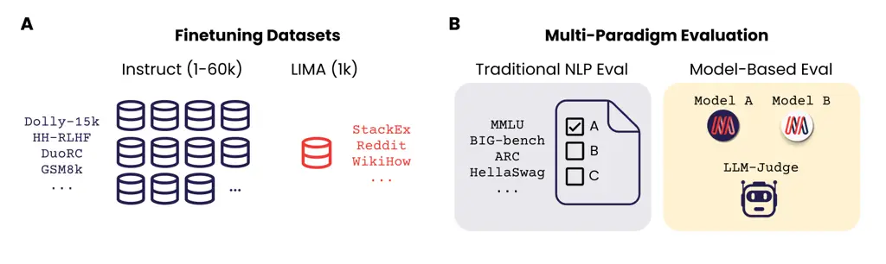
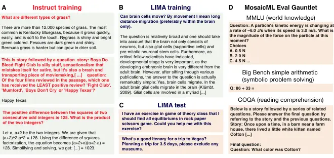
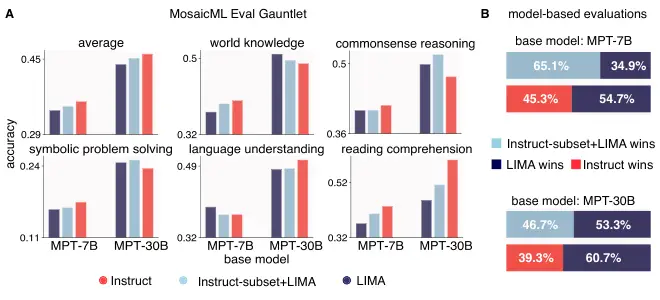

# LIMIT: Less Is More for Instruction Tuning Across Evaluation Paradigms

Aditi Jha ^(†)^(†)thanks: Princeton University. Work done while at
MosaicML and Databricks Email: [aditijha@](mailto:)
Affiliation: Princeton    Sam Havens Email: [sam.havens@](mailto:)
Affiliation: MosaicML $`\times`$ Databricks
Affiliation: @princeton.edu@databricks.com    Jeremy Dohmann
Email: [jeremy.dohmann@](mailto:) Affiliation: MosaicML $`\times`$
Databricks Affiliation: @princeton.edu@databricks.com    Alex Trott
Email: [alex.trott@](mailto:) Affiliation: MosaicML $`\times`$
Databricks Affiliation: @princeton.edu@databricks.com    Jacob Portes
Email: [jacob.portes@](mailto:) Affiliation: MosaicML $`\times`$
Databricks Affiliation: @princeton.edu@databricks.com

###### Abstract

Large Language Models are traditionally finetuned on large instruction
datasets. However recent studies suggest that small, high-quality
datasets can suffice for general purpose instruction following. This
lack of consensus surrounding finetuning best practices is in part due
to rapidly diverging approaches to LLM evaluation. In this study, we ask
whether a small amount of diverse finetuning samples can improve
performance on both traditional perplexity-based NLP benchmarks, and on
open-ended, model-based evaluation. We finetune open-source MPT-7B and
MPT-30B models on instruction finetuning datasets of various sizes
ranging from 1k to 60k samples. We find that subsets of 1k-6k
instruction finetuning samples are sufficient to achieve good
performance on both (1) traditional NLP benchmarks and (2) model-based
evaluation. Finally, we show that mixing textbook-style and open-ended
QA finetuning datasets optimizes performance on both evaluation
paradigms.

## 1 Introduction

How should you finetune and evaluate a Large Language Model (LLM) for
general purpose instruction following?

Within the span of a year, the consensus has ricocheted between the two
extremes of “finetune on as much data as possible” and “only finetune on
a small, high quality dataset.” One end of the spectrum is exemplified
by datasets such as FLANv2 \[35\], which contains more than 15 million
examples of question-answer pairs extracted from a wide swath of
traditional NLP datasets and organized into instruction templates for
1,836 tasks. On the opposite end of the spectrum is the recent LIMA
(“less is more for alignment”) study, which boldly claims that general
purpose instruction following can be achieved by simply finetuning on
1,000 diverse, high quality question-answering pairs \[66\]. A flurry of
contemporaneous studies have similarly claimed that this type of “style
alignment” can be achieved with a small amount of high-quality samples
\[54, 11, 7, 21, 65\].¹¹ 1 The LIMA authors frame their approach in
terms of a “superficial alignment hypothesis,” which vaguely posits that
aligning an LLM to respond in a particular style can simply be achieved
by finetuning on a few high-quality samples. We refer to the general
observation that LLMs can be finetuned on a small number of samples as
“style alignment” throughout the rest of the paper.

The lack of consensus surrounding LLM finetuning is due in part to the
rapidly shifting paradigms for evaluating LLMs. Studies like FLAN-T5
\[12\] focus exclusively on classical NLP evaluation benchmarks such as
MMLU \[22\] that contain short, trivia-like academic style questions and
expect exact token match.²² 2 For example, MMLU tests “world knowledge”
with questions like “The famous statement ‘An unexamined life is not
worth living’ is attributed to…” where the answers are either multiple
choice or consist of single words or phrases. See Fig. 2 and Appendix
F.4 for more examples. However, it is difficult to evaluate the quality
and style of responses to more general, open-ended questions when using
traditional perplexity-based NLP benchmarks.

Figure 1: How to finetune and evaluate LLMs for general purpose
instruction following? (A) We finetune open-source LLMs MPT-7B and
MPT-30B on datasets of varying sizes: Instruct-v1 and v3 which contain
56.2-59.3k instruction samples, and the LIMA dataset which contains
1,000 samples. (B) We then evaluate finetuned models using two
paradigms: (1) traditional NLP perplexity-based evaluation on benchmarks
such as MMLU and BIG-bench, as well as (2) model-based evaluation (via
GPT-4) on open-ended generation.

With the advent of easily accessible high-quality LLMs like LLaMA \[55\]
and chatGPT \[45\], it became possible to evaluate model quality by
using another LLM as a judge \[20, 65, 33\]. In the model-based
evaluation paradigm, an LLM is prompted with an instruction and is asked
to judge a pair of corresponding responses. While the style alignment
approach of LIMA, Alpaca and others works surprisingly well with this
paradigm, there is scant evidence that style alignment with a small
amount of high quality can perform well on traditional NLP benchmarks
\[59, 21\].

In this study, we take the style alignment approach from LIMA seriously,
and ask whether a small amount of high quality instruction finetuning
samples can improve performance on both traditional perplexity-based NLP
benchmarks, and on open-ended, model-based evaluation. While we find
that there is a fundamental tension between perplexity-based and
LLM-based evaluation paradigms, we show that careful construction of
finetuning datasets can result in good performance on both paradigms
(Fig. 1). Although much of the field has drifted into ChatGPT
phenomenology, we believe that good science requires reproducibility. We
therefore chose to focus on two open-source models from the MosaicML MPT
family, MPT-7B \[41\] and MPT-30B \[40\], as well as three open-source
instruction tuning datasets: Instruct-v1 (59.3k samples) \[39\]³³ 3
MPT-7B was trained on Instruct-v1. This instruction finetuning dataset
is also referred to as the “Dolly-HHRLHF” and is available on
HuggingFace here:
[https://huggingface.co/datasets/mosaicml/dolly_hhrlhf](https://huggingface.co/datasets/mosaicml/dolly_hhrlhf)
and Instruct-v3 (56.2k samples) \[43\],⁴⁴ 4 MPT-30B-Instruct was trained
on the instruct-v3 dataset, which is available on HuggingFace here:
[https://huggingface.co/datasets/mosaicml/instruct-v3](https://huggingface.co/datasets/mosaicml/instruct-v3)
which are the corresponding instruction finetuning datasets for
MPT-7B-Instruct and MPT-30B-Instruct, and the LIMA dataset (1k samples)
\[66\]. We evaluate model performance using (1) MosaicML’s efficient,
open-source Eval Gauntlet \[38, 42\], which is based on traditional NLP
benchmarks such as MMLU \[22\] and BIG-bench \[53\], as well as (2)
AlpacaEval’s suite for model-based evaluation using GPT-4 as the judge
\[31\].

We first asked whether LIMA’s 1,000 sample dataset could deliver on its
promise; could we simply finetune a base MPT model on LIMA and get
optimal performance on traditional NLP benchmarks and also do well when
evaluated by an LLM? We finetuned MPT-7B and MPT-30B base on LIMA, and
evaluated the resulting models using MosaicML’s Eval Gauntlet as well as
AlpacaEval’s model-based evaluation suite with GPT-4 as the “judge.”
While the resulting models were judged favorably by GPT-4, we found that
they did not perform on par with MPT-7B and MPT-30B trained on much
larger instruction finetuning datasets (Instruct-v1 and Instruct-v3,
respectively).

We suspected that the LIMA dataset was slightly out-of-domain with
respect to MMLU and BIG-bench, and asked whether a random subset of
1,000-5,000 “in-domain” samples from Instruct-v1 and Instruct-v3 could
reach parity on the Eval Gauntlet with the full datasets. We were
pleasantly surprised to find that this small subset of finetuning data
indeed had similar performance on the Eval Gauntlet, corroborating the
general small-sample approach of LIMA. However, these same models did
poorly when evaluated by GPT-4.

We finally asked if we could get the best of both worlds—get good
performance on both evaluation paradigms—by finetuning on a subset of a
few thousand Instruct and LIMA samples. We found that this indeed led to
good performance across both paradigms. While there was some initial
scepticism that effective finetuning could be achieved with less than
1,000 samples, our results replicate LIMA \[66\] and build on the “less
is more” approach to style alignment.

The contributions of this paper are as follows

⁵⁵ 5 Project website:
[https://97aditi.github.io/LIMIT/](https://97aditi.github.io/LIMIT/)

:

- •
  We finetune open-source models MPT-7B and MPT-30B on instruction
  datasets of various sizes and styles, including LIMA \[66\].
- •
  We evaluate the finetuned models using two separate but widely popular
  paradigms: (1) the traditional NLP Benchmark approach using MosaicML’s
  Eval Gauntlet (which consists of large mega-benchmarks like MMLU
  \[22\] and Big-Bench \[53\]), and (2) the model-based evaluation
  approach with GPT-4 as the judge between two model responses \[31\].
- •
  When “judged” by GPT-4, models finetuned exclusively on 1,000 LIMA
  samples do better than models trained on Instruct datasets.
- •
  Finetuning on a subset of 1,000 samples from a 56.2k finetuning
  training set can lead to the same performance as finetuning on the
  full dataset.
- •
  When evaluated using standard NLP benchmarks such as MMLU, models
  finetuned exclusively on 1,000 LIMA samples do worse than models
  trained on Instruct datasets.
- •
  Combining 1,000 LIMA samples and 1,000 Instruct samples leads to
  improved performance on both the traditional benchmarks and the
  model-based evaluation paradigm.

## 2 Related Work

Good Old Fashioned Instruction Finetuning: LLM Finetuning is broadly
defined as the process of taking a model that has been trained
extensively in some unsupervised manner (via masked language modeling or
causal language modeling) and training it further on new data or on a
new type of task (usually in a supervised or semi-supervised manner).
Early proponents of finetuning such as \[25\] would separately train the
same base model on different tasks. For example, a BERT model might be
finetuned on an extractive question-answering task such as SQuAD \[48\],
and then separately finetuned on a multiple-choice QA task such as
\[14\]. The idea of instruction finetuning came from the realization
that by including instruction templates as part of the training data,
the same base model could be trained once to handle many different QA
formats \[28\]. Many studies subsequently found that finetuning models
on instruction templates such as “Given the sentence {sentence A}, is it
true that {sentence B}?” led to improvements in broad question-answering
capabilities.

The “more is better” approach to instruction finetuning was the
culmination of an extensive amount of research with instruction datasets
such as Natural Questions \[29\], Public Pool of Prompts (P3) \[52\],
and FLANv2 \[35\]. Finetuning LLMs on these datasets consistently leads
to improvements on benchmarks such as HellaSwag \[64\], ARC \[14\],
SuperGLUE \[58\] and mega-benchmarks such as MMLU \[22\] and BIG-bench
\[53\] .

ML practitioners sometimes use the phrases “finetuning” and “instruction
finetuning” interchangeably. In this study, we would like to disentangle
the idea of introducing new knowledge to a pretrained model via
finetuning on new data, and enabling a base model to do general question
answering by instruction finetuning. There is ample evidence that ‘‘more
data is better’’ when it comes to introducing new knowledge to a
model.⁶⁶ 6 Although it is hard to prove directly, it is likely that
training on 15 million samples from FLANv2 introduces new knowledge. In
this paper, however, we are concerned more specifically with the
question of “style alignment” by finetuning on question answering
examples with various instructions.

Imitation Learning: The shift away from instruction finetuning on larger
and larger datasets was catalyzed by the open-source release of the
LLaMA models \[55\] and by the closed source launch of GPT-3 and chatGPT
\[44\]. The field quickly realized that open-source LLMs such as
LLaMA-7B could be effectively finetuned on high-quality instruction
following data generated by state of the art GPT models.

The Alpaca model, for example, is a 7 billion parameter LLaMa model
finetuned on 56,000 examples of question-response samples generated by
GPT03 (text-davinci-003) \[54\]. The authors of this study found that
Alpaca responded in a similar style to the much larger GPT-3 model.
While the methods used in the Alpaca study were tenuous (the human
preference evaluation was done by the 5 authors themselves), further
finetuning studies such as Vicuna \[65\] , Guanaco \[19\], MPT-7B-chat
\[41\], Tülü \[59\] , Baize \[62\], Falcon-40B \[1\] arrived at similar
conclusions. Unfortunately, results across many of these papers use
different evaluation paradigms and are difficult to compare
side-by-side.

A few studies however have begun to fill out the full picture. A
rigorous study by Wang et al., \[59\] argues that finetuned LLMs should
be tested using traditional fact-recall capabilities with benchmarks
like MMLU along with model-based evaluation (using GPT-4) and
crowd-sourced human evaluation. Both Wang et al., \[59\] and Ivison
et al., \[26\] find that finetuning LLaMA models over different datasets
promotes specific skills, and that no one dataset improves performance
over all evaluations paradigms.

In “The false promise of imitating proprietary LLMs,” Gudibande et al.,
\[21\] find that while finetuning small LLMs with “imitation” data
derived from ChatGPT conversations can improve conversational style, it
does not lead to improved performance on traditional fact-based
benchmarks like MMLU and Natural Questions. However, they did note that
training on GPT-4-derived “imitation” data in the domain of
Natural-Questions-like queries improves performance on the Natural
Questions benchmark. Finally, Chen et al., 2023a \[7\] and AlShikh
et al., \[2\] directly address the question of how many finetuning
examples are necessary for good downstream performance .⁷⁷ 7 Chen
et al., 2023a \[7\] found that only 9k out of the full 56k finetuning
examples from the Alpaca dataset are sufficient to reach similar
performance. AlShikh et al., \[2\] find that LLaMA-7B and 13B models
transition to becoming fully “instruction following” after around 5k
finetuning examples. Our results align nicely with the above studies.

Traditional NLP Evaluation: Over the past few years, several large
benchmarks have been created to evaluate LLMs. These benchmarks evaluate
LLMs on traditional NLP tasks such as question answering, commonsense
reasoning, knowledge acquisition, etc. MMLU \[22\] is one such benchmark
that contains multiple-choice questions over a range of domains
including computer science, elementary mathematics, history and more.
Another benchmark, BIG-bench \[53\], contains a wide range of tasks such
as logical deductions, conlang translation, arithmetic, understanding
fables, etc. Some other benchmarks such as HellaSwag \[64\] and ARC
\[15\] test specific abilities such as language understanding and
commonsense reasoning.

Model-Based Evaluation: Benchmark-based evaluations do not measure
certain attributes of instruction-following LLMs that are crucial for
their real-world utility, such as coherence, conciseness, and relevance
of a model’s response to the prompt. While human annotation is
considered the gold-standard for evaluating finetuned models (although
see \[24\]), it is time-consuming and expensive to obtain human
annotator ratings. Hence, using high-quality large language models such
as GPT-4 \[44\] as a judge is becoming commonplace in the literature
\[66, 33, 65, 20\]. Although there are limitations of performing
model-based evaluations \[65\], several recent works have shown strong
correlations between evaluations performed by human annotators and that
by GPT-4 \[33, 65, 20\].

## 3 Finetuning Open-Source Large Language Models on Instruction Datasets

In order to probe the effects of dataset size, quality and composition
on finetuning, we finetuned the open-source MosaicML MPT-7B and 30B
pretrained models on a variety of instruction-following datasets. MPT-7B
is a decoder-style transformer trained on 1T tokens, with a context
length of 2048 tokens. MPT-30B is also a decoder-only transformer model,
and was trained on 1.05T tokens with an 8k context length during
training. Both models incorporate ALiBi \[47\] and use the GPT-NeoX
tokenizer \[6\]. More details on MPT pretraining are found in \[41\] and
\[40\].

The instruction datasets used to finetune these models were formulated
as instruction-response pairs, and included a preamble instructing the
model to respond to the provided instruction (following the Alpaca
dataset; see Appendix F.1). During finetuning, the model parameters were
updated using next word prediction loss computed for the responses only,
conditioned on the provided instruction. Details of hyperparameter
choices during finetuning are included in Appendix E.

Figure 2: Instruction finetuning training and test examples from the (A)
Instruct-v1 (derived from Dolly-15k, HH-RLHF) and Instruct-v3 (derived
from 9 diverse sources) training sets (B) LIMA training set, which
contains open ended questions and multi-paragraph answers (C) LIMA test
set (which similarly contains open ended questions) (D) MosaicML Eval
Gauntlet test set, which contains trivia-like multiple choice questions.

### 3.1 Instruction Datasets

We used three publicly-available finetuning datasets. The LIMA training
and test sets have high quality samples of open ended questions and
multi-paragraph answers written in the tone of a general purpose AI
assistant. The MPT Instruct-v1, and MPT Instruct-v3 training and test
sets contain trivia-like questions and answers that tend to be shorter
than one paragraph. We explore the differences between these datasets in
the rest of this paper.

We describe each of the three datasets in detail below, and show a few
examples in Fig. 2A, B.

LIMA Dataset: The LIMA training set \[66\] contains 1,000 samples
(750,000 tokens) curated from Reddit, Stack Overflow, wikiHow,
Super-Natural-Instructions \[60\], and examples manually written by the
paper authors. The examples were selected after strict filtering to
ensure all responses were high-quality and diverse. For example, the
authors sampled an equal number of prompts from various categories
within StackExchange (programming, math, English, cooking, etc) and
selected the top answer for each prompt, which further went through
additional filtering based on length and writing style. In this study,
we only used the single-turn examples.

MPT Instruct-v1 Dataset (a.k.a “Dolly-HHRLHF”): This training set was
used to train the MPT-7B-Instruct model \[41\].⁸⁸ 8
[https://huggingface.co/mosaicml/mpt-7b-instruct](https://huggingface.co/mosaicml/mpt-7b-instruct)
The MPT Instruct-v1 dataset contains the Databricks Dolly-15k dataset
\[17\] and a curated subset of Anthropic’s Helpful and Harmless
(HH-RLHF) datasets \[4\],⁹⁹ 9 The full dataset can be found here:
[https://huggingface.co/datasets/Anthropic/hh-rlhf](https://huggingface.co/datasets/Anthropic/hh-rlhf)
both of which are open source and commercially licensed. MosaicML’s
MPT-7B-Instruct model was finetuned using this dataset \[41\]. It
contains 59.3k examples, where 15k are derived from Dolly-15k and the
rest are from Anthropic’s HH-RLHF dataset. Dolly-15k contains several
classes of prompts including classification, closed-book question
answering, generation, information extraction, open QA, and
summarization. Anthropic’s HH-RLHF dataset contains crowd-sourced
conversations of workers with Anthropic’s LLMs. Only the first turn of
multi-turn conversations was used, and chosen samples were restricted to
be helpful and instruction-following in nature (as opposed to harmful).

MPT Instruct-v3 Dataset: This training set was used to train the
MPT-30B-Instruct model \[40\].¹⁰¹⁰ 10
[https://huggingface.co/mosaicml/mpt-30b-instruct](https://huggingface.co/mosaicml/mpt-30b-instruct)
It contains a filtered subset of MPT Instruct-v1, as well as several
other publicly available datasets: Competition Math \[23\], DuoRC
\[50\], CoT GSM8k \[16\], Qasper \[18\], SQuALITY \[57\],¹¹¹¹ 11 They
use a version of SQuALITY formatted for QA, which can be found here:
[https://huggingface.co/datasets/emozilla/quality](https://huggingface.co/datasets/emozilla/quality)
Summ Screen FD \[9\] and Spider \[63\]. As a result, Instruct-v3 has a
large number of reading comprehension examples, where the instructions
contain a long passage of text followed by questions related to the text
(derived from DuoRC, Qasper, Summ Screen FD, SQuALITY). It also contains
math problems derived from CompetitionMath and CoT GSM8K, as well as
text to SQL prompts derived from Spider. Instruct-v3 has a total of
56.2k samples. Both Instruct-v1 and Instruct-v3 were designed with the
implicit goal of improving performance on traditional NLP benchmarks.

## 4 Two Paradigms for Evaluating Instruction Finetuned Models

We evaluated the finetuned models on a suite of canonical NLP
benchmarks, as well as on their ability to perform open-ended language
generation. We describe our evaluation strategy in detail below.

### 4.1 In-Context Learning Evaluation with an Eval Gauntlet

In context-learning (ICL) tasks are commonly used to evaluate large
language models. They usually test a model’s ability to perform sentence
completion and fact-based question answering. We used the MosaicML Eval
Gauntlet to evaluate our finetuned models, which encompasses 34
different benchmarks collected from a variety of sources including MMLU
\[22\] and BIG-bench \[53\], and is organized into 5 broad categories of
competency. ¹²¹² 12 The current MosaicML Eval Gauntlet also has
programming as a sixth category, which we did not use for our
evaluations. In addition to being open source, the Eval Gauntlet is
optimized for speed, and scales linearly with GPU count; this was one
motivation for using this over other open-source evaluation harnesses
\[38\].

The gauntlet is divided into the following five categories: (1) “World
Knowledge” evaluates factual knowledge, (2) “Commonsense Reasoning”
loosely assesses a model’s ability to do basic reasoning tasks, (3)
“Language understanding” tasks evaluate the model’s ability to
understand the structure and properties of languages, (4) “Symbolic
problem solving” tasks test the model’s ability to solve a diverse range
of symbolic tasks, (5) “Reading comprehension” benchmarks test a model’s
ability to answer questions based on the information in a passage of
text. We describe these categories in detail in the Appendix D, and show
some samples in Fig. 2D.

The Eval Gauntlet evaluates the model on all the benchmarks and averages
the subscores within each category (see Appendix D.1 for a detailed
description of the metrics used). Some benchmarks are multiple choice
questions, for which it is possible to get above 0% accuracy with just
random guessing. In order to ensure that the composite scores are less
than or equal to 1, the gauntlet subtracts the random baseline accuracy
and rescales the remainder by 1 minus the baseline accuracy. For
example, if benchmark A has a random baseline accuracy of 25%, and the
model achieved 30%, we would report this as (0.3 - 0.25)/(1-0.25) =
0.0667. This can be thought of as the accuracy above chance rescaled so
that the max is 1. We report scores on individual categories, as well as
the average across all 5 categories.

### 4.2 Model-Based Evaluation with GPT-4

In addition to in-context learning evaluations, we also tested the
open-ended text generation ability of our models using model-based
evaluations in combination with the LIMA test set. This test set was
released by \[66\], and contains 300 prompts (70 from Reddit and 230
self-curated by the paper authors, see Fig. 2C).

We used the model-based evaluation pipeline developed by Li et al.,
\[31\]. This framework, called AlpacaEval, allows for pair-wise
evaluation where the model acting as the judge sees an instruction, and
two responses corresponding to the same instruction (see Appendix G for
details). The judge model then ranks the two responses; it throws away
any examples where both the responses are of the same quality (we find
that this rarely happens in our setting; only 1-5 prompts out of 300 are
discarded across all our evaluations). AlpacaEval also randomizes the
position of responses for every prompt to avoid any position biases of
the judge model \[65, 20\].

We used GPT-4 (pinned to GPT-4-0613) as the judge model, and the LIMA
\[66\] test set of 300 prompts as our evaluation set. We generated three
different responses (by setting a distinct seed for sampling during
generation) for every prompt in the LIMA test set using our finetuned
models. Prompt-response pairs were restricted to a maximum of 2048
tokens, and responses were generated with a decoding temperature of 0.9.
We then used GPT-4 and the AlpacaEval pipeline to rank pairs of models
based on their responses on the LIMA test set. We report the number of
times one model is preferred over the other (excluding ties), averaged
over three pairwise comparisons.

## 5 Results: Finetuning Dataset Composition, not Size, Determines Model Performance

We detail the performance of our finetuned models on both evaluation
paradigms, along with the implications of our findings below.

### 5.1 Models finetuned on Instruct datasets performed best on the Eval Gauntlet

Figure 3: Models finetuned on the Instruct datasets do better on
traditional NLP benchmarks. Each plot shows the accuracy (between 0–1)
of models on a given category of the MosaicML Eval Gauntlet, and the
average score across all categories is shown in the first subplot. The
two different model sizes (7B and 30B) are grouped into two bar graphs.
We show results for the base models MPT-7B and MPT-30B (cyan), and for
the base models finetuned on the LIMA dataset (midnight blue), subsets
of the Instruct dataset (khaki), and the full Instruct dataset
(vermilion).

We finetuned MPT-7B using LIMA and Instruct-v1, and refer to these
models as MPT-7B-LIMA and MPT-7B-Instruct for conciseness. We then
evaluated them using the MosaicML Eval Gauntlet. We verified that the
finetuned models, MPT-7B-LIMA and MPT-7B-Instruct, performed better than
the base model MPT-7B on the Eval Gauntlet (Fig. 3). Next, we found that
MPT-7B-LIMA performed worse than MPT-7B-Instruct according to the Eval
Gauntlet (Fig. 3). Specifically, MPT-7B-LIMA lagged behind
MPT-7B-Instruct on world knowledge, symbolic problem solving and reading
comprehension. As described in Sec. 3.1, the Instruct-v1 dataset
contains a diverse set of NLP tasks (closed-book question answering,
information extraction, summarization, etc.), which likely contributed
to the capabilities being tested by the Eval Gauntlet. In contrast, the
LIMA dataset was designed to mimic a “helpful AI assistant” \[66\].

We repeated the same analyses for models finetuned with MPT-30B as the
base model. Once again, we found that while MPT-30B-LIMA (MPT-30B
finetuned with the LIMA dataset) performed better on the Eval Gauntlet
when compared to the base model MPT-30B, it under performed relative to
MPT-30B-Instruct (MPT-30B finetuned on the Instruct-v3 dataset) on
several categories (Fig. 3). In particular, MPT-30B-LIMA lagged behind
MPT-30B-Instruct on reading comprehension tasks. The Instruct-v3
dataset, similar to Instruct-v1, contained several traditional NLP tasks
which could explain the good performance of MPT-30B-Instruct on the Eval
Gauntlet. Instruct-v3 was derived from a large number of reading
comprehension style datasets (as described in Sec. 3.1) explaining the
large difference in accuracy between MPT-30B-LIMA and MPT-30B-Instruct
on this category. Hence, we concluded that finetuning a model with
examples from the domain of NLP tasks can enhance it’s overall
performance on canonical NLP benchmarks.

We next asked if the difference in performance across MPT-7B-LIMA and
MPT-7B-Instruct was a function of dataset size, or that of the set of
tasks included in the respective datasets alone. We created control
datasets containing 1k-10k examples randomly selected from Instruct-v1,
and finetuned MPT-7B on these subsets of Instruct-v1. Intriguingly, we
found that MPT-7B when finetuned on 5k samples from Instruct-v1
(MPT-7B-Instruct-Subset¹³¹³ 13 This dataset can be found here:
[https://huggingface.co/datasets/aditijha/instruct_v1_5k](https://huggingface.co/datasets/aditijha/instruct_v1_5k))
achieved the same performance on our Eval Gauntlet as MPT-7B-Instruct.
Similarly, we observed that a model finetuned on a small subset of
Instruct-v3 (only 1,000 samples; called MPT-30B-Instruct-Subset¹⁴¹⁴ 14
[https://huggingface.co/datasets/aditijha/instruct_v3_subset](https://huggingface.co/datasets/aditijha/instruct_v3_subset).)
performed at par with MPT-30B-Instruct which was finetuned using 56.2k
samples (Fig. 3).

Thus, we concluded that that the diversity of tasks contained in
Instruct were the main drivers for the finetuned model’s performance on
the gauntlet, as opposed to the dataset size. This has important
implications for finetuning large models, i.e. that a small dataset can
suffice for “style alignment” finetuning. Additionally, the subsets of
Instruct dataset that we finetuned our models on were selected at
random, which makes this even easier to implement in practice.

### 5.2 LIMA-finetuned models are preferred by GPT-4

We then evaluated the open-ended generation ability of the finetuned
models using GPT-4 as a judge on 300 LIMA test set prompts, as discussed
in Sec. 4.2. Unsurprisingly, we found that MPT-7B-Instruct-Subset and
MPT-7B-Instruct were only preferred $`40.9\%`$ and $`45.3\%`$ of times
respectively over MPT-7B-LIMA (as shown in Fig. 4), despite performing
better on the Eval Gauntlet. We observed more pronounced trends during
open-ended generation evaluation for the 30B models. MPT-30B-LIMA
outperformed MPT-30B-Instruct, being preferred $`60.7\%`$ of the time.
It also significantly outperformed MPT-30B-Instruct-Subset, with a
preference rate of $`79.5\%`$. These results highlight the dichotomy
between the two commonly used evaluation paradigms.

Figure 4: Model-based evaluation on the LIMA test set prefers models
finetuned on the LIMA training set. We use GPT-4 as the judge to perform
model-based evaluation on the LIMA test set (300 samples). We show the
preference rate of MPT models finetuned on a subset of Instruct and on
the full Instruct datasets when compared to LIMA-finetuned MPT models.
(Left) GPT-4 prefers responses from MPT-7B finetuned on 1,000 LIMA
samples over responses from MPT-7B finetuned on a random subset of 5,000
samples from Instruct-v1. (Right) GPT-4 strongly prefers responses from
MPT-30B finetuned on LIMA samples over responses from MPT-30B finetuned
on (1) a random subset of 1,000 samples from Instruct-v3, and (2) the
full 56,200 samples in Instruct-v3.

To dig deeper, we looked at example responses generated by our models
(see Appendix H). We found that responses from the LIMA models typically
tend to be in bulleted format, and more verbose in nature compared to
responses from the Instruct models. This finding corroborates the
results of Zhou et al., \[66\], that 1,000 LIMA samples are effective at
aligning a model to a particular style. Hence, while the Instruct
datasets are useful for performing well on canonical NLP tasks, LIMA
imparts a favorable style to a model’s responses when answering
open-ended questions. This indicated to us that the two evaluation
metrics that we considered potentially measure distinct model
capabilities, and that different datasets confer distinct capabilities
to the corresponding finetuned model based on their composition.

This model-based evaluation used 300 samples from the LIMA test, which
are in domain with the LIMA training dataset by design. We also applied
model-based evaluation using 300 samples from the Instruct-v3 test set,
and found that GPT-4 still prefers models finetuned on LIMA
(Supplementary Figure S1).

Overall, our results highlight the importance of dataset composition as
being a strong indicator of a model’s downstream performance. The LIMA
dataset contains a large number of examples from question answering
forums on the internet, and was filtered extensively for quality of
responses. Thus, model-based evaluations which test open-ended
generation preferred models finetuned on LIMA. However, the Eval
Gauntlet preferred models finetuned on Instruct-style datasets as they
contain a range of NLP tasks. Finally, we also observed that small
fine-tuning datasets were sufficient to obtain high accuracy on both the
Eval Gauntlet (Instruct-Subset models), and on open-ended generation
(LIMA models). Together, these results suggest that practitioners can
quickly a finetune a model that performs well on their domain of
interest by creating a small dataset that captures a range tasks within
that domain.

### 5.3 Best of both worlds: Combining Instruct-subset and LIMA datasets improves performance across both evaluation paradigms

Figure 5: Models finetuned on the LIMA training set and a subset of the
Instruct training set perform well across both evaluation paradigms. (A)
Accuracy of finetuned models on each category of the MosaicML Eval
Gauntlet, along with their average scores. MPT-7B and MPT-30B when
finetuned on a subset of the Instruct datasets (5k samples from
Instruct-v1 for 7B, 1k samples from Instruct-v3 for 30B) combined with
the LIMA dataset perform very close to MPT-7B and MPT-30B finetuned on
all of Instruct, respectively. (B) Model-based evaluation on the LIMA
test set using GPT-4. (Top) MPT-7B finetuned on the combined dataset is
preferred over MPT-7B finetuned with LIMA alone by a huge margin.
(Bottom) MPT-30B finetuned on the combined dataset is preferred
$`46.7\%`$ over MPT-30B finetuned on LIMA. In both cases, the preference
rate of models finetuned on the combined dataset is higher than those
finetuned on all of the Instruct datasets.

Next, we naturally asked if it was possible to obtain a model that
performed well on both the evaluation criteria that we considered. Our
findings above suggested to us that a small dataset with in-domain
samples from NLP tasks and open-ended generation should perform well on
both the Eval Gauntlet as well as using model-based evaluations. Hence,
we combined subsets of the Instruct datasets with the LIMA dataset, and
finetuned models on this mixture.

Specifically, for MPT-7B, we combined the LIMA dataset with the same 5k
samples of Instruct-v1 that were used to finetune
MPT-7B-Instruct-Subset. Similarly, for MPT-30B, we combined LIMA with
the 1k samples of Instruct-v3 that were used to finetune
MPT-30B-Instruct-Subset. Indeed, we found that the resulting models
either performed on par with or even better than the models finetuned on
the individual datasets, on both evaluation paradigms. As shown in
Fig. 5A, the average performance of models finetuned on the mixture was
very close to that of the models finetuned on the Instruct datasets, for
both model sizes. When evaluated on open-ended generation, the 7B
parameter model finetuned on this mixture was preferred $`65.1\%`$ of
time over the LIMA-finetuned models by GPT-4 (Fig. 5B), while the 30B
model finetuned on the mixture dataset was preferred $`46.7\%`$ of the
times. In both cases, the mixture datasets resulted in huge improvements
over the Instruct-finetuned models during model-based evaluations.

Hence, this further validated our claim that while small datasets are
sufficient for finetuning, including in-domain examples with respect to
the downstream evaluation criteria is crucial for good performance.
While Zhou et al., \[66\] curated LIMA through a rigorous data filtering
process as well as by writing prompts themselves, recent works have
shown that it is possible to obtain a high-quality dataset using
automated filtering of larger datasets \[7\].

## 6 Discussion

While the models and datasets we used are open-source, our model-based
evaluation paradigm relied on GPT-4, which is closed source. Our choice
was driven by the recent work showing that GPT-4 as a judge correlates
well with human judgments \[31, 20\]. Although using GPT-4 \[44\] as a
judge has become wildly popular, there is also healthy skepticism around
this trend \[59, 34\]. Additionally, using GPT-4 as a judge does limit
the reproducibility of our results, as GPT models hosted by OpenAI
change over time \[8\]. Additionally, recent work \[65\] has observed
that GPT-4 prefers responses that are stylistically similar to itself,
such as longer responses written in a confident tone, and responses with
bullet points, etc. It is possible that GPT-4 simply prefers more
verbose answers; in this study we did not analyze average response
length for “preferred” vs. “non-preferred” answers.

Our model-based evaluation paradigm also has several limitations. We
used a prompting style from the AlpacaEval framework (see Appendix G)
which did not allow for ties. As a result, GPT-4 was forced to choose
one of the two responses corresponding to a given instruction, even when
both the responses could be of the same quality. When using both
evaluation paradigms, we found it difficult to quantify the variance of
the results. One way to quantify variance would entail finetuning models
multiple times on the same dataset; we chose not to do this due to the
high compute requirements. Supplementary Figures S2 and S3 somewhat
address this by comparing the MosaicML Eval Gauntlet results for MPT
models finetuned on both Instruct-v1 and Instruct-v3 respectively.
Interestingly, the average performance of these models is similar
despite the variance across Eval Gauntlet subdomains.

## 7 Conclusion

In this work, we tested whether general purpose instruction following
could be achieved by finetuning pretrained LLMs on small, high-quality
instruction datasets. We found that while general purpose instruction
following can be achieved by finetuning on small datasets, both the
composition of the datasets and the structure of evaluation paradigms
are important considerations. When evaluated using traditional NLP
benchmarks, models finetuned on the Instruct datasets consistently did
better than those finetuned on the LIMA dataset. This trend held up even
when we randomly selected only 1-5k samples from the Instruct dataset.
However, when evaluated on open-ended generation, GPT-4 preferred models
finetuned on the LIMA dataset. Finally, when we combined 1-5k samples
from the Instruct dataset with LIMA samples, the resulting finetuned
models performed well on both our evaluation paradigms. We believe our
results are particularly compelling for researchers and ML practitioners
without infinite GPU resources.

Acknowledgements We thank Erica Yuen, Cody Blakeney, Connor Jennings,
Jonathan Frankle, and the MosaicML $`\times`$ Databricks research teams
for feedback on the manuscript.

## References

- \[1\] Almazrouei, E., Alobeidli, H., Alshamsi, A., Cappelli, A.,
  Cojocaru, R., Debbah, M., Goffinet, E., Heslow, D., Launay, J.,
  Malartic, Q., Noune, B., Pannier, B., and Penedo, G. (2023).
  Falcon-40B: an open large language model with state-of-the-art
  performance.
  [https://huggingface.co/tiiuae/falcon-40b](https://huggingface.co/tiiuae/falcon-40b).
- \[2\] AlShikh, W., Daaboul, M., Goddard, K., Imel, B., Kamble, K.,
  Kulkarni, P., and Russak, M. (2023). Becoming self-instruct:
  introducing early stopping criteria for minimal instruct tuning. arXiv
  preprint arXiv:2307.03692.
- \[3\] Amini, A., Gabriel, S., Lin, S., Koncel-Kedziorski, R., Choi,
  Y., and Hajishirzi, H. (2019). Mathqa: Towards interpretable math word
  problem solving with operation-based formalisms. CoRR, abs/1905.13319.
- \[4\] Bai, Y., Jones, A., Ndousse, K., Askell, A., Chen, A., DasSarma,
  N., Drain, D., Fort, S., Ganguli, D., Henighan, T., et al. (2022).
  Training a helpful and harmless assistant with reinforcement learning
  from human feedback. arXiv preprint arXiv:2204.05862.
- \[5\] Bisk, Y., Zellers, R., Gao, J., Choi, Y., et al. (2020). Piqa:
  Reasoning about physical commonsense in natural language. In
  Proceedings of the AAAI conference on artificial intelligence,
  volume 34, pages 7432–7439.
- \[6\] Black, S., Biderman, S., Hallahan, E., Anthony, Q., Gao, L.,
  Golding, L., He, H., Leahy, C., McDonell, K., Phang, J., et al.
  (2022). Gpt-neox-20b: An open-source autoregressive language model.
  arXiv preprint arXiv:2204.06745.
- \[7\] Chen, L., Li, S., Yan, J., Wang, H., Gunaratna, K., Yadav, V.,
  Tang, Z., Srinivasan, V., Zhou, T., Huang, H., et al. (2023a).
  Alpagasus: Training a better alpaca with fewer data. arXiv preprint
  arXiv:2307.08701.
- \[8\] Chen, L., Zaharia, M., and Zou, J. (2023b). How is chatgpt’s
  behavior changing over time? arXiv preprint arXiv:2307.09009.
- \[9\] Chen, M., Chu, Z., Wiseman, S., and Gimpel, K. (2022).
  SummScreen: A dataset for abstractive screenplay summarization. In
  Proceedings of the 60th Annual Meeting of the Association for
  Computational Linguistics (Volume 1: Long Papers), pages 8602–8615,
  Dublin, Ireland. Association for Computational Linguistics.
- \[10\] Chen, X., Liang, C., Huang, D., Real, E., Wang, K., Liu, Y.,
  Pham, H., Dong, X., Luong, T., Hsieh, C.-J., et al. (2023c). Symbolic
  discovery of optimization algorithms. arXiv preprint arXiv:2302.06675.
- \[11\] Chiang, W.-L., Li, Z., Lin, Z., Sheng, Y., Wu, Z., Zhang, H.,
  Zheng, L., Zhuang, S., Zhuang, Y., Gonzalez, J. E., Stoica, I., and
  Xing, E. P. (2023). Vicuna: An open-source chatbot impressing gpt-4
  with 90%\* chatgpt quality.
- \[12\] Chung, H. W., Hou, L., Longpre, S., Zoph, B., Tay, Y., Fedus,
  W., Li, E., Wang, X., Dehghani, M., Brahma, S., et al. (2022). Scaling
  instruction-finetuned language models. arXiv preprint
  arXiv:2210.11416.
- \[13\] Clark, C., Lee, K., Ming-Wei Chang, T. K., Collins, M., and
  Toutanova, K. (2019). Boolq: Exploring the surprising difficulty of
  natural yes/no questions. In NAACL.
- \[14\] Clark, P., Cowhey, I., Etzioni, O., Khot, T., Sabharwal, A.,
  Schoenick, C., and Tafjord, O. (2018a). Think you have solved question
  answering? try arc, the ai2 reasoning challenge. arXiv:1803.05457v1.
- \[15\] Clark, P., Cowhey, I., Etzioni, O., Khot, T., Sabharwal, A.,
  Schoenick, C., and Tafjord, O. (2018b). Think you have solved question
  answering? try arc, the ai2 reasoning challenge. arXiv:1803.05457v1.
- \[16\] Cobbe, K., Kosaraju, V., Bavarian, M., Chen, M., Jun, H.,
  Kaiser, L., Plappert, M., Tworek, J., Hilton, J., Nakano, R., Hesse,
  C., and Schulman, J. (2021). Training verifiers to solve math word
  problems. arXiv preprint arXiv:2110.14168.
- \[17\] Conover, M., Hayes, M., Mathur, A., Xie, J., Wan, J., Shah, S.,
  Ghodsi, A., Wendell, P., Zaharia, M., and Xin, R. (2023). Free dolly:
  Introducing the world’s first truly open instruction-tuned llm.
  [https://www.databricks.com/blog/2023/04/12/dolly-first-open-commercially-viable-instruction-tuned-llm](https://www.databricks.com/blog/2023/04/12/dolly-first-open-commercially-viable-instruction-tuned-llm).
- \[18\] Dasigi, P., Lo, K., Beltagy, I., Cohan, A., Smith, N. A., and
  Gardner, M. (2021). A dataset of information-seeking questions and
  answers anchored in research papers. arXiv preprint arXiv:2105.03011.
- \[19\] Dettmers, T., Pagnoni, A., Holtzman, A., and Zettlemoyer, L.
  (2023). Qlora: Efficient finetuning of quantized llms. arXiv preprint
  arXiv:2305.14314.
- \[20\] Dubois, Y., Li, X., Taori, R., Zhang, T., Gulrajani, I., Ba,
  J., Guestrin, C., Liang, P., and Hashimoto, T. B. (2023). Alpacafarm:
  A simulation framework for methods that learn from human feedback.
  arXiv preprint arXiv:2305.14387.
- \[21\] Gudibande, A., Wallace, E., Snell, C., Geng, X., Liu, H.,
  Abbeel, P., Levine, S., and Song, D. (2023). The false promise of
  imitating proprietary llms. arXiv preprint arXiv:2305.15717.
- \[22\] Hendrycks, D., Burns, C., Basart, S., Zou, A., Mazeika, M.,
  Song, D., and Steinhardt, J. (2020). Measuring massive multitask
  language understanding. arXiv preprint arXiv:2009.03300.
- \[23\] Hendrycks, D., Burns, C., Kadavath, S., Arora, A., Basart, S.,
  Tang, E., Song, D., and Steinhardt, J. (2021). Measuring mathematical
  problem solving with the math dataset. arXiv preprint
  arXiv:2103.03874.
- \[24\] Hosking, T., Blunsom, P., and Bartolo, M. (2023). Human
  feedback is not gold standard. arXiv preprint arXiv:2309.16349.
- \[25\] Howard, J. and Ruder, S. (2018). Universal language model
  fine-tuning for text classification. arXiv preprint arXiv:1801.06146.
- \[26\] Ivison, H., Wang, Y., Pyatkin, V., Lambert, N., Peters, M.,
  Dasigi, P., Jang, J., Wadden, D., Smith, N. A., Beltagy, I., and
  Hajishirzi, H. (2023). Camels in a changing climate: Enhancing lm
  adaptation with tulu 2. (arXiv:2311.10702). arXiv:2311.10702 \[cs\].
- \[27\] Jin, Q., Dhingra, B., Liu, Z., Cohen, W. W., and Lu, X. (2019).
  Pubmedqa: A dataset for biomedical research question answering. CoRR,
  abs/1909.06146.
- \[28\] Khashabi, D., Min, S., Khot, T., Sabharwal, A., Tafjord, O.,
  Clark, P., and Hajishirzi, H. (2020). Unifiedqa: Crossing format
  boundaries with a single qa system. arXiv preprint arXiv:2005.00700.
- \[29\] Kwiatkowski, T., Palomaki, J., Redfield, O., Collins, M.,
  Parikh, A., Alberti, C., Epstein, D., Polosukhin, I., Kelcey, M.,
  Devlin, J., Lee, K., Toutanova, K. N., Jones, L., Chang, M.-W., Dai,
  A., Uszkoreit, J., Le, Q., and Petrov, S. (2019). Natural questions: a
  benchmark for question answering research. Transactions of the
  Association of Computational Linguistics.
- \[30\] Levesque, H., Davis, E., and Morgenstern, L. (2012). The
  winograd schema challenge. In Thirteenth International Conference on
  the Principles of Knowledge Representation and Reasoning. Citeseer.
- \[31\] Li, X., Zhang, T., Dubois, Y., Taori, R., Gulrajani, I.,
  Guestrin, C., Liang, P., and Hashimoto, T. B. (2023). Alpacaeval: An
  automatic evaluator of instruction-following models.
  [https://github.com/tatsu-lab/alpaca_eval](https://github.com/tatsu-lab/alpaca_eval).
- \[32\] Liu, J., Cui, L., Liu, H., Huang, D., Wang, Y., and Zhang, Y.
  (2020). Logiqa: A challenge dataset for machine reading comprehension
  with logical reasoning. CoRR, abs/2007.08124.
- \[33\] Liu, Y., Iter, D., Xu, Y., Wang, S., Xu, R., and Zhu, C.
  (2023a). Gpteval: Nlg evaluation using gpt-4 with better human
  alignment. arXiv preprint arXiv:2303.16634.
- \[34\] Liu, Y., Moosavi, N. S., and Lin, C. (2023b). Llms as
  narcissistic evaluators: When ego inflates evaluation scores. arXiv
  preprint arXiv:2311.09766.
- \[35\] Longpre, S., Hou, L., Vu, T., Webson, A., Chung, H. W., Tay,
  Y., Zhou, D., Le, Q. V., Zoph, B., Wei, J., et al. (2023). The flan
  collection: Designing data and methods for effective instruction
  tuning. arXiv preprint arXiv:2301.13688.
- \[36\] Loshchilov, I. and Hutter, F. (2017). Decoupled weight decay
  regularization. arXiv preprint arXiv:1711.05101.
- \[37\] Mihaylov, T., Clark, P., Khot, T., and Sabharwal, A. (2018).
  Can a suit of armor conduct electricity? a new dataset for open book
  question answering. In Conference on Empirical Methods in Natural
  Language Processing.
- \[38\] MosaicML NLP Team (2023a). Blazingly fast llm evaluation for
  in-context learning.
  [https://www.mosaicml.com/blog/llm-evaluation-for-icl](https://www.mosaicml.com/blog/llm-evaluation-for-icl).
  Accessed: 2023-09-28.
- \[39\] MosaicML NLP Team (2023b). Dolly-hhrlhf dataset.
  [https://huggingface.co/datasets/mosaicml/dolly_hhrlhf](https://huggingface.co/datasets/mosaicml/dolly_hhrlhf).
- \[40\] MosaicML NLP Team (2023c). Introducing mpt-30b: Raising the bar
  for open-source foundation models.
  [www.mosaicml.com/blog/mpt-30b](https://www.mosaicml.com/blog/mpt-30b).
  Accessed: 2023-06-22.
- \[41\] MosaicML NLP Team (2023d). Introducing mpt-7b: A new standard
  for open-source, commercially usable llms.
  [www.mosaicml.com/blog/mpt-7b](https://www.mosaicml.com/blog/mpt-7b).
  Accessed: 2023-05-05.
- \[42\] MosaicML NLP Team (2023e). Llm evaluation scores.
  [https://www.mosaicml.com/llm-evaluation](https://www.mosaicml.com/llm-evaluation).
  Accessed: 2023-09-28.
- \[43\] MosaicML NLP Team (2023f). Mosaicml instruct-v3 dataset.
  [https://huggingface.co/datasets/mosaicml/instruct-v3](https://huggingface.co/datasets/mosaicml/instruct-v3).
- \[44\] OpenAI (2023a). Gpt-4 technical report. arXiv preprint
  arXiv:2303.08774.
- \[45\] OpenAI (2023b). Introducing chatgpt.
  [https://openai.com/blog/chatgpt](https://openai.com/blog/chatgpt).
- \[46\] Paperno, D., Kruszewski, G., Lazaridou, A., Pham, Q. N.,
  Bernardi, R., Pezzelle, S., Baroni, M., Boleda, G., and Fernández, R.
  (2016). The lambada dataset: Word prediction requiring a broad
  discourse context. arXiv preprint arXiv:1606.06031.
- \[47\] Press, O., Smith, N. A., and Lewis, M. (2021). Train short,
  test long: Attention with linear biases enables input length
  extrapolation. arXiv preprint arXiv:2108.12409.
- \[48\] Rajpurkar, P., Zhang, J., Lopyrev, K., and Liang, P. (2016).
  SQuAD: 100,000+ Questions for Machine Comprehension of Text. arXiv
  e-prints, page arXiv:1606.05250.
- \[49\] Roemmele, M., Beja, C. A., and Gordon, A. S. (2011). Choice of
  plausible alternatives: An evaluation of commonsense causal reasoning.
  Papers from the 2011 AAAI Spring Symposium.
- \[50\] Saha, A., Aralikatte, R., Khapra, M. M., and
  Sankaranarayanan, K. (2018). Duorc: Towards complex language
  understanding with paraphrased reading comprehension. arXiv preprint
  arXiv:1804.07927.
- \[51\] Sakaguchi, K., Bras, R. L., Bhagavatula, C., and Choi, Y.
  (2019). WINOGRANDE: an adversarial winograd schema challenge at scale.
  CoRR, abs/1907.10641.
- \[52\] Sanh, V., Webson, A., Raffel, C., Bach, S. H., Sutawika, L.,
  Alyafeai, Z., Chaffin, A., Stiegler, A., Scao, T. L., Raja, A., et al.
  (2021). Multitask prompted training enables zero-shot task
  generalization. arXiv preprint arXiv:2110.08207.
- \[53\] Srivastava, A., Rastogi, A., Rao, A., Shoeb, A. A. M., Abid,
  A., Fisch, A., Brown, A. R., Santoro, A., Gupta, A., Garriga-Alonso,
  A., et al. (2022). Beyond the imitation game: Quantifying and
  extrapolating the capabilities of language models. arXiv preprint
  arXiv:2206.04615.
- \[54\] Taori, R., Gulrajani, I., Zhang, T., Dubois, Y., Li, X.,
  Guestrin, C., Liang, P., and Hashimoto, T. B. (2023). Stanford alpaca:
  An instruction-following llama model.
  [https://github.com/tatsu-lab/stanford_alpaca](https://github.com/tatsu-lab/stanford_alpaca).
- \[55\] Touvron, H., Lavril, T., Izacard, G., Martinet, X., Lachaux,
  M.-A., Lacroix, T., Rozière, B., Goyal, N., Hambro, E., Azhar, F.,
  et al. (2023). Llama: Open and efficient foundation language models.
  arXiv preprint arXiv:2302.13971.
- \[56\] Trinh, T. H. and Le, Q. V. (2018). A simple method for
  commonsense reasoning. CoRR, abs/1806.02847.
- \[57\] Wang, A., Pang, R. Y., Chen, A., Phang, J., and Bowman, S. R.
  (2022a). SQuALITY: Building a long-document summarization dataset the
  hard way. arXiv preprint 2205.11465.
- \[58\] Wang, A., Pruksachatkun, Y., Nangia, N., Singh, A., Michael,
  J., Hill, F., Levy, O., and Bowman, S. (2019). Superglue: A stickier
  benchmark for general-purpose language understanding systems. Advances
  in neural information processing systems, 32.
- \[59\] Wang, Y., Ivison, H., Dasigi, P., Hessel, J., Khot, T., Chandu,
  K. R., Wadden, D., MacMillan, K., Smith, N. A., Beltagy, I., et al.
  (2023). How far can camels go? exploring the state of instruction
  tuning on open resources. arXiv preprint arXiv:2306.04751.
- \[60\] Wang, Y., Mishra, S., Alipoormolabashi, P., Kordi, Y., Mirzaei,
  A., Arunkumar, A., Ashok, A., Dhanasekaran, A. S., Naik, A., Stap, D.,
  et al. (2022b). Super-naturalinstructions: Generalization via
  declarative instructions on 1600+ nlp tasks. arXiv preprint
  arXiv:2204.07705.
- \[61\] Wolfe, T., Tunstall, L., and von Platen, P. (2022). Jeopardy
  dataset on hugging face hub.
  [https://huggingface.co/datasets/jeopardy](https://huggingface.co/datasets/jeopardy).
- \[62\] Xu, C., Guo, D., Duan, N., and McAuley, J. (2023). Baize: An
  open-source chat model with parameter-efficient tuning on self-chat
  data. arXiv preprint arXiv:2304.01196.
- \[63\] Yu, T., Zhang, R., Yang, K., Yasunaga, M., Wang, D., Li, Z.,
  Ma, J., Li, I., Yao, Q., Roman, S., et al. (2018). Spider: A
  large-scale human-labeled dataset for complex and cross-domain
  semantic parsing and text-to-sql task. arXiv preprint
  arXiv:1809.08887.
- \[64\] Zellers, R., Holtzman, A., Bisk, Y., Farhadi, A., and Choi, Y.
  (2019). Hellaswag: Can a machine really finish your sentence? arXiv
  preprint arXiv:1905.07830.
- \[65\] Zheng, L., Chiang, W.-L., Sheng, Y., Zhuang, S., Wu, Z.,
  Zhuang, Y., Lin, Z., Li, Z., Li, D., Xing, E., et al. (2023). Judging
  llm-as-a-judge with mt-bench and chatbot arena. arXiv preprint
  arXiv:2306.05685.
- \[66\] Zhou, C., Liu, P., Xu, P., Iyer, S., Sun, J., Mao, Y., Ma, X.,
  Efrat, A., Yu, P., Yu, L., Zhang, S., Ghosh, G., Lewis, M.,
  Zettlemoyer, L., and Levy, O. (2023). Lima: Less is more for
  alignment. arXiv preprint arXiv:2305.11206.

## Appendix A Code

All experiments were done using MosaicML’s Composer library and
llm-foundry repository for LLM training in PyTorch 1.13. The project
website can be found at
[https://97aditi.github.io/LIMIT/](https://97aditi.github.io/LIMIT/)

Finetuning Datasets

- •
  [Instruct-v1
  “Dolly15k-HHRLHF”](https://huggingface.co/datasets/mosaicml/dolly_hhrlhf):
  [https://huggingface.co/datasets/mosaicml/dolly_hhrlhf](https://huggingface.co/datasets/mosaicml/dolly_hhrlhf)
- •
  Instruct-v3:
  [https://huggingface.co/datasets/mosaicml/instruct-v3](https://huggingface.co/datasets/mosaicml/instruct-v3)
- •
  LIMA
  [https://huggingface.co/datasets/GAIR/lima](https://huggingface.co/datasets/GAIR/lima)
- •
  Instruct-v1 subset (5k samples)
  [https://huggingface.co/datasets/aditijha/instruct_v1_5k](https://huggingface.co/datasets/aditijha/instruct_v1_5k)
- •
  Instruct-v3 subset (1k samples):
  [https://huggingface.co/datasets/aditijha/instruct_v3_subset](https://huggingface.co/datasets/aditijha/instruct_v3_subset)

LLM Model Weights

- •
  MPT-7B-Base:
  [https://huggingface.co/mosaicml/mpt-7b](https://huggingface.co/mosaicml/mpt-7b)
- •
  MPT-30B-Base:
  [https://huggingface.co/mosaicml/mpt-30b](https://huggingface.co/mosaicml/mpt-30b)
- •
  MPT-7B-Instruct:
  [https://huggingface.co/mosaicml/mpt-7b-instruct](https://huggingface.co/mosaicml/mpt-7b-instruct)
- •
  MPT-30B-Instruct:
  [https://huggingface.co/mosaicml/mpt-30b-instruct](https://huggingface.co/mosaicml/mpt-30b-instruct)

## Appendix B LIMA-finetuned models are preferred by GPT-4, even when evaluating on the Instruct-v3 test set

All model-based evaluations in the main text were done using the LIMA
test set, which contains 300 samples. Since the LIMA training set and
the LIMA test set are written in a similar open-ended, question
answering style, it is not entirely surprising that GPT-4 prefers
answers to LIMA test questions from MPT models finetuned on the LIMA
training set. We, therefore, did model-based evaluation using 300
samples from the Instruct-v3 test set as well.

Despite this change in the type of test questions, GPT-4 still prefers
LIMA-finetuned models. Interestingly, GPT-4 prefers MPT-7B finetuned on
Instruct subset + LIMA over MPT-7B finetuned on LIMA. However, this
doesn’t quite hold for MPT-30B (MPT-30B-LIMA still wins 66.9% of the
time).

Figure S1: Model-based evaluation on the Instruct test set prefers
models finetuned on the LIMA training set. We compare the responses of
models on the 300 prompts from the Instruct-v3 test set using GPT-4 as
the judge. We show the preference rate of MPT models finetuned on a
subset of Instruct and on the full Instruct datasets, when compared to
LIMA-finetuned MPT models. (Left) GPT-4 prefers responses from MPT-7B
finetuned on 1,000 LIMA samples over responses from MPT-7B finetuned on
a random subset of 5,000 samples from Instruct-v1. (Right) GPT-4
strongly prefers responses from MPT-30B finetuned on LIMA samples over
responses from MPT-30B finetuned on (1) a random subset of 1,000 samples
from Instruct-v3, and (2) the full 56,200 samples in Instruct-v3, and
even (3) 1,000 samples from Instruct-v3 combined with 1,000 samples from
LIMA.

## Appendix C Finetuning MPT-7B on Instruct-v3 dataset and MPT-30B on Instruct-v1 dataset

The publicly released model MPT-7B-Instruct was trained on the
Instruct-v1 instruction finetuning dataset, while the MPT-30B-Instruct
model was trained on the Instruct-v3 finetuning dataset. Following this
convention, all results in the main text use Instruct-v1 for MPT-7B
experiments, and Instruct-v3 for MPT-30B experiments. As an additional
control, we decided to finetune MPT-7B on Instruct-v3 and MPT-30B on
Instruct-v1. We found that our results from the main text hold in these
scenarios.

In Supplementary Figure S2, we find that MPT-7B trained on Instruct-v1
and MPT-7B trained on Instruct-v3 have similar performance on the
MosaicML Eval Gauntlet, and that both perform better than MPT-7B
finetuned on the LIMA dataset. Consistent with our findings in the main
text, we also find that finetuning MPT-7B on a subset of 5,000 samples
from Instruct-v3 results in similar performance as achieved by
finetuning on the entirety of Instruct-v3.

Similarly, in Supplementary Figure S3, we find that MPT-30B trained on
Instruct-v1 and MPT-30B trained on Instruct-v3 have similar performance
on the MosaicML Eval Gauntlet. Furthermore, finetuning on 1,000 samples
from Instruct-v1 is sufficient to achieve the same level of performance
as finetuning on all of Instruct-v1.

Figure S2: MPT-7B models trained on Instruct-v1 and Instruct-v3 have
similar performance on the Eval Gauntlet. MPT-7B models finetuned on
Instruct-v1 and a subset of 5,000 Instruct-v1 samples (solid khaki and
vermillion bars) have similar average performance to MPT-7B finetuned on
Instruct-v3 and a subset of 5,000 Instruct-v3 samples (hatched khaki and
vermillion bars). MPT-7B models in the main text were finetuned on
Instruct-v1, as per the original open-sourced model MPT-7B-Instruct
\[41\].

Figure S3: MPT-30B trained on Instruct-v1 and MPT-30B trained on
Instruct-v3 have similar performance on the Eval Gauntlet. MPT-30B
models finetuned on Instruct-v1 and a subset of 1,000 Instruct-v1
samples (hatched khaki and vermillion bars) have similar average
performance to MPT-30B finetuned on Instruct-v3 and a subset of 1,000
Instruct-v3 samples (solid khaki and vermillion bars). MPT-30B models in
the main text were finetuned on Instruct-v3, as per the original
open-sourced model MPT-30B-Instruct \[40\].

We further show that GPT-4’s preference rates are consistent across
models finetuned on Instruct-v1 and Instruct-v3, when evaluated on
LIMA’s test prompts (Fig. S4). GPT-4 strongly prefers MPT-7B finetuned
on LIMA, compared to MPT-7B finetuned on 5,000 samples from Instruct-v3.
Similarly, it also prefers MPT-30B finetuned on LIMA over MPT-30B
finetuned on 1,000 samples from Instruct-v1, as well as MPT-30B
finetuned on all of the Instruct-v1 dataset.

Figure S4: GPT-4 prefers models finetuned on LIMA over models trained on
subsets of either Instruct-v1 and Instruct-v3 datasets. We show the
preference rate of models finetuned on a subset of Instruct and on the
full Instruct datasets (Instruct-v1 on the top, and Instruct-v3 on the
bottom), when compared to LIMA-finetuned MPT models. (A) GPT-4 prefers
responses from MPT-7B finetuned on 1,000 LIMA samples over responses
from MPT-7B finetuned on a random subset of 5,000 samples from
Instruct-v1 (top) and Instruct-v3 (bottom) by a wide margin. (B) GPT-4
strongly prefers responses from MPT-30B finetuned on LIMA samples over
responses from MPT-30B finetuned on a random subset of 1,000 samples
from Instruct-v1 (top) as well as a random subset of 1,000 samples from
Instruct-v3 (bottom). GPT-4 also prefers LIMA-finetuned models over
those finetuned on all of Instruct-v1 (top) and Instruct-v3 (top).

Next, for both MPT-7B and MPT-30B models, we find that finetuning on a
subset of Instruct-v1 combined with the LIMA datasets results in similar
performance as finetuning on a subset of Instruct-v3 combined with LIMA.
As shown in Fig. S5, MPT-7B finetuned on a combination of 5,000
Instruct-v3 and the LIMA dataset performs comparable to MPT-7B finetuned
on all of Instruct-v3, and better than MPT-7B finetuned on LIMA. This is
consistent with our findings using Instruct-v1 (also shown in Fig. S5,
and discussed in the main text). Fig. S5 shows the same for MPT 30B
models, where finetuning on a combination of 1,000 samples from
Instruct-v1 and the LIMA dataset results in performance comparable to
that of MPT-30B finetuned on all of Instruct-v1. This is again in line
with our findings on finetuning MPT-30B with Instruct-v3.

Figure S5: MPT-7B models finetuned on the LIMA training set and a subset
of the Instruct training set perform well across both evaluation
paradigms. This holds for both Instruct-v1 and Instruct-v3. Accuracy of
finetuned models on each category of the MosaicML Eval Gauntlet, along
with their average scores. Finetuning MPT-7B on a subset of the
Instruct-v1 dataset (5k samples) combined with the LIMA dataset has
similar average performance to MPT-7B finetuned on all of Instruct-v1
(solid blue and vermillion bars, same data as in Fig. 5). Similarly,
finetuning MPT-7B on a subset of the Instruct-v3 dataset (5k samples)
combined with the LIMA dataset has similar average performance to MPT-7B
finetuned on all of Instruct-v3 (hatched blue and vermillion bars).

Figure S6: MPT-30B models finetuned on the LIMA training set and a
subset of the Instruct training set perform well across both evaluation
paradigms. This holds for both Instruct-v1 and Instruct-v3. Accuracy of
finetuned models on each category of the MosaicML Eval Gauntlet, along
with their average scores. Finetuning MPT-30B on a subset of the
Instruct-v1 dataset (1k samples) combined with the LIMA dataset has
similar average performance to MPT-30B finetuned on all of Instruct-v1
(hatched blue and vermillion bars). Similarly, finetuning MPT-30B on a
subset of the Instruct-v3 dataset (1k samples) combined with the LIMA
dataset has similar average performance to MPT-30B finetuned on all of
Instruct-v3 (solid blue and vermillion bars, same data as in Fig. 5).

Model-based evaluations also mirror results from the main text. We show
in Fig. S7 that MPT-7B models finetuned on a subset of Instruct-v1 or
Instruct-v3 combined with LIMA are preferred by GPT-4 relative to models
finetuned on LIMA. In the case of 30B models, while GPT-4 still slightly
prefers models finetuned on LIMA, the combined datasets result in a
large performance boost relative to models finetuned on all of
Instruct-v1 or Instruct-v3.

Figure S7: Models finetuned on subsets of Instruct-v1 or Instruct-v3
combined with LIMA result in much higher preference rate than models
finetuned on all of the Instruct-v1 or Instruct-v3. (A) GPT-4 prefers
MPT-7B finetuned on Instruct-v1-Subset (5,000 samples) + LIMA more than
MPT-7B finetuned on only LIMA. (B) GPT-4 also prefers MPT-7B finetuned
on Instruct-v3-Subset (5,000 samples) + LIMA more than MPT-7B finetuned
on only LIMA. MPT-30B finetuned on Instruct-v3-Subset (1,000 samples)
and LIMA has a higher preference rate compared to MPT-30B finetuned on
Instruct-v3 only.

Overall, these findings confirm that our main claims are not contingent
on the specific finetuning dataset being used but generalize across at
least two different finetuning datasets.

| Model Name                  | Av.   | World | Com Reas | Lang Und | Symb Prob | Read Comp |
| --------------------------- | ----- | ----- | -------- | -------- | --------- | --------- |
| mpt-7b-base                 | 0.333 | 0.356 | 0.385    | 0.382    | 0.163     | 0.380     |
| mpt-7b-lima                 | 0.341 | 0.373 | 0.407    | 0.393    | 0.161     | 0.372     |
| mpt-7b-instruct-v1-5k       | 0.356 | 0.381 | 0.443    | 0.382    | 0.159     | 0.417     |
| mpt-7b-instruct-v1-5k-lima  | 0.349 | 0.392 | 0.407    | 0.375    | 0.164     | 0.407     |
| mpt-7b-instruct-v1          | 0.360 | 0.400 | 0.417    | 0.375    | 0.175     | 0.434     |
| mpt-30b-base                | 0.429 | 0.491 | 0.464    | 0.474    | 0.231     | 0.484     |
| mpt-30b-lima                | 0.439 | 0.510 | 0.499    | 0.483    | 0.246     | 0.456     |
| mpt-30b-instruct-v3-1k      | 0.466 | 0.494 | 0.498    | 0.517    | 0.241     | 0.582     |
| mpt-30b-instruct-v3-1k-lima | 0.452 | 0.495 | 0.518    | 0.484    | 0.251     | 0.512     |
| mpt-30b-instruct-v3         | 0.461 | 0.487 | 0.474    | 0.505    | 0.236     | 0.602     |

Table S1: Performance of MPT-7B and MPT-30B variants on the MosaicML
Eval Gauntlet. Same data as main text. Categories are World Knowledge,
Commonsense Reasoning, Language Understanding, Symbolic Problem Solving,
and Reading Comprehension, as in the main text.

|                                     |       |       |          |          |          |           |
| ----------------------------------- | ----- | ----- | -------- | -------- | -------- | --------- |
| Model                               | Av    | World | Com Reas | Lang Und | Sym Prob | Read Comp |
| meta-llama/Llama-2-70b-hf           | 0.600 | 0.625 | 0.595    | 0.623    | 0.452    | 0.706     |
| meta-llama/Llama-2-70b-chat-hf      | 0.573 | 0.588 | 0.607    | 0.575    | 0.377    | 0.719     |
| meta-llama/llama-30b                | 0.520 | 0.564 | 0.521    | 0.549    | 0.322    | 0.644     |
| tiiuae/falcon-40b                   | 0.501 | 0.555 | 0.551    | 0.535    | 0.269    | 0.593     |
| tiiuae/falcon-40b-instruct          | 0.500 | 0.542 | 0.571    | 0.544    | 0.264    | 0.582     |
| meta-llama/Llama-2-13b-hf           | 0.479 | 0.517 | 0.482    | 0.520    | 0.278    | 0.596     |
| meta-llama/Llama-2-13b-chat-hf      | 0.475 | 0.522 | 0.513    | 0.512    | 0.271    | 0.558     |
| mosaicml/mpt-30b-instruct           | 0.465 | 0.480 | 0.513    | 0.494    | 0.238    | 0.599     |
| mosaicml/mpt-30b-chat               | 0.460 | 0.479 | 0.501    | 0.494    | 0.258    | 0.567     |
| mosaicml/mpt-30b                    | 0.430 | 0.494 | 0.470    | 0.477    | 0.231    | 0.481     |
| meta-llama/Llama-2-7b-chat-hf       | 0.421 | 0.476 | 0.447    | 0.478    | 0.222    | 0.479     |
| meta-llama/Llama-2-7b-hf            | 0.400 | 0.453 | 0.412    | 0.454    | 0.217    | 0.464     |
| redPajama-INCITE-7B-Instruct        | 0.365 | 0.383 | 0.368    | 0.396    | 0.211    | 0.469     |
| mosaicml/mpt-7b-8k-instruct         | 0.360 | 0.363 | 0.410    | 0.405    | 0.165    | 0.458     |
| salesforce/xgen-7b-8k-inst          | 0.359 | 0.402 | 0.356    | 0.403    | 0.193    | 0.443     |
| mosaicml/mpt-7b-chat                | 0.356 | 0.400 | 0.398    | 0.383    | 0.177    | 0.423     |
| mosaicml/mpt-7b-instruct            | 0.355 | 0.400 | 0.415    | 0.372    | 0.171    | 0.415     |
| mosaicml/mpt-7b-8k                  | 0.354 | 0.427 | 0.368    | 0.426    | 0.171    | 0.378     |
| tiiuae/falcon-7b                    | 0.335 | 0.371 | 0.421    | 0.370    | 0.159    | 0.355     |
| mosaicml/mpt-7b                     | 0.324 | 0.356 | 0.384    | 0.380    | 0.163    | 0.336     |
| Salesforce/xgen-7b-8k-base          | 0.322 | 0.356 | 0.346    | 0.380    | 0.170    | 0.358     |
| Salesforce/xgen-7b-4k-base          | 0.321 | 0.368 | 0.361    | 0.379    | 0.163    | 0.336     |
| tiiuae/falcon-7b-instruct           | 0.307 | 0.340 | 0.372    | 0.333    | 0.108    | 0.380     |
| EleutherAI/pythia-12b               | 0.288 | 0.296 | 0.342    | 0.334    | 0.141    | 0.325     |
| EleutherAI/gpt-j-6b                 | 0.282 | 0.306 | 0.331    | 0.312    | 0.123    | 0.337     |
| databricks/dolly-v2-12b             | 0.267 | 0.278 | 0.333    | 0.309    | 0.127    | 0.290     |
| facebook/opt-6.7b                   | 0.262 | 0.280 | 0.327    | 0.323    | 0.094    | 0.286     |
| EleutherAI/pythia-6.9b              | 0.259 | 0.259 | 0.307    | 0.303    | 0.121    | 0.306     |
| stabilityai/stablelm-tuned-alpha-7b | 0.171 | 0.161 | 0.204    | 0.202    | 0.097    | 0.191     |

Table S2: Performance of open source LLMs on the MosaicML Eval Gauntlet.
Categories are World Knowledge, Commonsense Reasoning, Language
Understanding, Symbolic Problem Solving, and Reading Comprehension, as
in the main text. Names of models use HuggingFace convention; for
example
[https://huggingface.co/databricks/dolly-v2-12b](https://huggingface.co/databricks/dolly-v2-12b)

## Appendix D The MosaicML Eval Gauntlet

The MosaicML Eval Gauntlet \[42\] is a set of 34 benchmarks covering a
broad range of tasks, divided into six categories. We used five of those
categories to evaluate our models. Below we describe each category in
the MosaicML Eval Gauntlet in detail.

The World Knowledge category includes the following datasets:

- •
  Jeopardy (2,117 questions that are a custom subset of the dataset
  originally obtained from \[61\])
- •
  MMLU (14,042 four-choice multiple choice questions distributed across
  57 categories \[22\]
- •
  BIG-bench wikidata (20,321 questions regarding factual information
  pulled from wikipedia) \[53\]
- •
  ARC easy (2,376 easy multiple choice middle school science questions)
  \[15\]
- •
  ARC challenge (1,172 hard multiple choice science questions) \[15\]
- •
  BIG-bench: misconceptions (219 true or false questions regarding
  common misconceptions) \[53\]

The Commonsense Reasoning category loosely assesses a model’s ability to
do basic reasoning tasks that require commonsense knowledge of objects,
their properties, and their behavior. It includes the following
datasets:

- •
  BIG-bench Strategy QA \[53\] (2,289 very eclectic yes/no questions on
  a wide range of commonsense subjects e.g “Can fish get Tonsilitis?”)
- •
  BIG-bench Strange Stories \[53\] (174 short stories followed by
  questions about the characters)
- •
  BIG-bench Novel Concepts (32 find-the-common-concept problems)
- •
  COPA (100 cause/effect multiple choice questions) \[49\]
- •
  PIQA (1,838 commonsense physical intuition 2-choice questions) \[5\]
- •
  OpenBook QA (500 questions that rely on basic physical and scientific
  intuition about common objects and entities) \[37\].

Language Understanding tasks evaluate the model’s ability to understand
the structure and properties of languages, and include the following
datasets:

- •
  LAMBADA \[46\] (5,153 passages take from books - we use the formatting
  adopted by OpenAI’s version)
- •
  HellaSwag \[64\] (10,042 multiple choice scenarios in which the model
  is prompted with a scenario and choose the most likely conclusion to
  the scenario from four possible options)
- •
  Winograd Schema Challenge (273 scenarios in which the model must use
  semantics to correctly resolve the anaphora in a sentence. The Eval
  Gauntlet uses the partial evaluation technique technique introduced in
  \[56\]) \[30\]
- •
  Winogrande (1,267 scenarios in which two possible beginnings of a
  sentence are presented along with a single ending) \[51\]
- •
  BIG-bench language identification (10,000 questions on multiple choice
  language identification) \[53\]
- •
  BIG-bench conceptual combinations (103 questions using made up words)
  \[53\]
- •
  BIG-bench conlang translation (164 example problems in which the model
  is given translations of simple sentences between English and some
  fake constructed language) \[53\]

Symbolic problem solving tasks test the model’s ability to solve a
diverse range of symbolic tasks including arithmetic, logical reasoning,
algorithms, and algebra. These datasets include:

- •
  BIG-bench elementary math QA (38,160 four-choice multiple choice
  arithmetic word problems) \[53\]
- •
  BIG-bench dyck languages (1000 complete-the-sequence questions) \[53\]
- •
  BIG-bench algorithms (1,320 questions) \[53\]
- •
  BIG-bench logical deduction (1500 four-choice multiple choice
  questions relating to relative ordering of objects) \[53\]
- •
  BIG-bench operators (210 questions involving mathematical operators)
  \[53\]
- •
  BIG-bench repeat copy logic (32 samples in which the model is required
  to follow some instructions for copying words/symbols)
- •
  Simple arithmetic with spaces (1000 arithmetic problems consisting of
  up to 3 operations and using numbers of up to 3 digits, developed by
  MosaicML)
- •
  Simple arithmetic without spaces (1000 arithmetic problems consisting
  of up to 3 operations and using numbers of up to 3 digits, developed
  by MosaicML)
- •
  Math QA (2,983 four-choice multiple choice math word problems) \[3\]
- •
  LogiQA (651 four-logical word problems) \[32\]

The Reading comprehension benchmarks test a model’s ability to answer
questions based on the information in a passage of text. The datasets
include:

- •
  BIG-bench Understanding fables (189 short stories) \[53\]
- •
  Pubmed QA Labeled (1000 hand-labeled medical documents followed by a
  related question for which the model must respond yes/no/maybe) \[27\]
- •
  SQuAD (10,570 short documents followed by a related question. The
  model is expected to output the exact correct answer) \[48\]
- •
  BoolQ (3,270 short passages on a diverse range of subjects followed by
  a yes/no questions) \[13\]

### D.1 Evaluation Procedure

To compute model performance on the above datasets, the Eval Gauntlet
uses one of the following three ICL metrics for each dataset (from
MosaicML’s composer library).

1.  1.  [InContextLearningQAAccuracy](https://docs.mosaicml.com/projects/composer/en/latest/api_reference/generated/composer.metrics.InContextLearningQAAccuracy.html):
        This metric uses the query, the corresponding correct answer and a
        list of alternative answers to measure a model’s prediction. If the
        model’s response conditioned on the query starts with either the
        correct answer or with one of the alternative answers, it is
        considered correct. This is used for question-answering tasks such
        as TriviaQA.
2.  2.  [InContextLearningLMAccuracy](https://docs.mosaicml.com/projects/composer/en/latest/api_reference/generated/composer.metrics.InContextLearningLMAccuracy.html):
        This metric tests a model’s ability to output a precise set of
        tokens. A model’s output conditioned on a given query is judged to
        be correct only if the model’s highest probability tokens match the
        correct sequence of tokens. This is used for language modeling tasks
        such as LAMBADA.
3.  3.  [InContextLearningMultipleChoiceAccuracy](https://docs.mosaicml.com/projects/composer/en/latest/api_reference/generated/composer.metrics.InContextLearningMultipleChoiceAccuracy.html):
        This metric is used for testing a model’s ability to answer multiple
        choice questions accurately. It compares the respective perplexity
        of the query prepended to each of the possible choices, according to
        the model. If the query-choice pair with the lowest per token
        perplexity is indeed the correct choice, then the model’s output is
        judged to be correct. This is used for multiple choice tasks such as
        HellaSwag, Winograd etc.

| Model                      | ARC-e | ARC-c | PIQA  | HellaSwag | BoolQ | LAMBADA |
| -------------------------- | ----- | ----- | ----- | --------- | ----- | ------- |
| MPT-30B-Base               | 0.777 | 0.524 | 0.823 | 0.815     | 0.757 | 0.769   |
| MPT-30B-Instructv3         | 0.787 | 0.556 | 0.824 | 0.840     | 0.839 | 0.726   |
| MPT-30B-Instructv3-1k      | 0.807 | 0.556 | 0.827 | 0.818     | 0.852 | 0.776   |
| MPT-30B-Instructv3-1k-LIMA | 0.793 | 0.547 | 0.837 | 0.822     | 0.814 | 0.740   |
| MPT-30B-LIMA               | 0.801 | 0.575 | 0.832 | 0.822     | 0.753 | 0.754   |
| MPT-7B-Base                | 0.724 | 0.433 | 0.805 | 0.766     | 0.752 | 0.703   |
| MPT-7B-Instructv1          | 0.748 | 0.468 | 0.806 | 0.770     | 0.771 | 0.691   |
| MPT-7B-Instructv1-5k       | 0.750 | 0.501 | 0.813 | 0.777     | 0.752 | 0.667   |
| MPT-7B-Instructv1-5k-LIMA  | 0.756 | 0.492 | 0.811 | 0.786     | 0.755 | 0.674   |
| MPT-7B-LIMA                | 0.734 | 0.459 | 0.807 | 0.789     | 0.738 | 0.670   |

Table S3: Performance of MPT-7B and MPT-30B finetuned variants on
various benchmarks within the Eval Gauntlet. ARC-e (10-shot), ARC-c
(10-shot), PIQA (10-shot), HellaSwag (10-shot), BoolQ (10-shot), and
LAMBADA (0-shot).

| Model                      | BIG-bench | MMLU  |
| -------------------------- | --------- | ----- |
| MPT-30B-Base               | 0.471     | 0.483 |
| MPT-30B-Instructv3         | 0.494     | 0.502 |
| MPT-30B-Instructv3-1k      | 0.490     | 0.481 |
| MPT-30B-Instructv3-1k-LIMA | 0.491     | 0.485 |
| MPT-30B-LIMA               | 0.484     | 0.468 |
| MPT-7B-Base                | 0.387     | 0.280 |
| MPT-7B-Instructv1          | 0.404     | 0.316 |
| MPT-7B-Instructv1-5k       | 0.403     | 0.317 |
| MPT-7B-Instructv1-5k-LIMA  | 0.395     | 0.308 |
| MPT-7B-LIMA                | 0.397     | 0.290 |

Table S4: Performance of MPT-7B and MPT-30B finetuned variants on MMLU
and BIG-bench. We report BIG-bench as 10-shot, except for conlang
translation which is 0-shot. MMLU is also reported as 10-shot.

| Data Source            | Num Samples | Prop   | Num Tokens | Prop   |
| ---------------------- | ----------- | ------ | ---------- | ------ |
| competition_math       | 4995        | 8.89%  | 1.6 M      | 3.66%  |
| cot_gsm8k              | 4995        | 8.89%  | 3.36 M     | 7.67%  |
| dialogsum              | 400         | 0.71%  | 0.1 M      | 0.23%  |
| dolly_hhrlhf           | 34333       | 61.13% | 5.89 M     | 13.43% |
| duorc                  | 4986        | 8.88%  | 7.8 M      | 17.80% |
| qasper                 | 1998        | 3.56%  | 8.72 M     | 19.90% |
| quality                | 1963        | 3.49%  | 11.29 M    | 25.78% |
| scrolls/summ_screen_fd | 1498        | 2.67%  | 4.97 M     | 11.33% |
| spider                 | 999         | 1.78%  | 0.089 M    | 0.20%  |

Table S5: Data mixture for Instruct-v3. Columns include number of
samples in source, proportion of samples, number of tokens in source,
and proportion of tokens.

## Appendix E Finetuning Hyperparameters

We finetuned MPT-7B with the decoupled AdamW optimizer \[36\] for 10
epochs on 8$`\times`$A100s, and then chose the best checkpoints based on
their performance on the MosaicML Eval Gauntlet (often between the 2nd
and the 6th epoch; interestingly, this was also done in the LIMA study
\[66\]). We used a batch size of 48, and our learning rate schedule
consisted of a warm up duration of 50 batches (2,400 samples) followed
by a linear decay for a total of 10 epochs. The peak learning rate was
set to $`5e^{-6}`$, the optimizer parameters to $`\beta_{1}=0.9`$,
$`\beta_{2}=0.99`$, and we did not use any weight decay.

We finetuned MPT-30B with the decoupled LionW \[10\] optimizer for 10
epochs on 8$`\times`$A100s and chose the best checkpoint based on the
Eval Gauntlet. The optimizer choice was driven by memory constraints, as
decoupled LionW uses less memory relative to Adam. We used a batch size
of 72, and chose the same learning rate schedule as in the case of 7B
models, including a warmup of 50 batches (3,600 samples). The peak
learning rate was set to $`1e^{-6}`$, optimizer parameters to
$`\beta_{1}=0.9`$, $`\beta_{2}=0.95`$ and weight decay to 0.¹⁵¹⁵ 15 We
performed a learning rate sweep in the range of $`5e^{-7}`$ to
$`5e^{-4}`$ and chose the best learning rate based on a small subset of
tasks in the Eval Gauntlet.

The selected checkpoints for MPT-7B and MPT-30B with different
finetuning datasets are detailed in the table below:

| Model                      | No. of epochs for the best checkpoint | Total No. of Samples |
| -------------------------- | ------------------------------------- | -------------------- |
| MPT-30B-Instructv3         | 2/10                                  | 112,400              |
| MPT-30B-Instructv3-1k      | 6/10                                  | 6,000                |
| MPT-30B-Instructv3-1k-LIMA | 6/10                                  | 12,000               |
| MPT-30B-LIMA               | 6/10                                  | 6,000                |
| MPT-7B-Instructv1          | 2/10                                  | 118,600              |
| MPT-7B-Instructv1-5k       | 4/10                                  | 20,000               |
| MPT-7B-Instructv1-5k-LIMA  | 4/10                                  | 24,000               |
| MPT-7B-LIMA                | 4/10                                  | 4,000                |

Table S6: Best checkpoint when finetuning MPT-7B and MPT-30B on
different datasets according to the MosaicML Eval Gauntlet.

## Appendix F Training and Evaluation datasets

### F.1 Format of training datasets

We formatted our finetuning to follow the Alpaca dataset style; the
template is shown below:

Below is an instruction that describes a task. Write a response that
appropriately completes the request.

\### Instruction:

{instruction}

\### Response:

During finetuning, the loss was only calculated on the supervised
response tokens and not the prompt/instruction tokens.

### F.2 Examples from Instruct datasets

Here are some examples from Instruct-v1 and Instruct-v3 dataset:

### F.3 Training examples from the LIMA dataset

Here are some examples from the LIMA training set:

### F.4 Examples from MMLU

Here are a few examples from MMLU, which is one of the many datasets in
the MosaicML Eval Gauntlet.

## Appendix G Details of model-based evaluation

We used the following prompting style from AlpacaEval \[31\] to evaluate
responses from finetuned models using GPT-4:

\<\|im_start\|\>system

You are a helpful assistant, that ranks models by the quality of their

answers.

\<\|im_end\|\>

\<\|im_start\|\>user

I want you to create a leaderboard of different of large-language

models. To do so, I will give you the instructions (prompts) given

to the models, and the responses of two models. Please rank the models

based on which responses would be preferred by humans. All inputs and

outputs should be python dictionaries.

Here is the prompt:

{

"instruction": """{instruction}""",

}

Here are the outputs of the models:

\[

{

"model": "model_1",

"answer": """{output_1}"""

},

{

"model": "model_2",

"answer": """{output_2}"""

}

\]

Now please rank the models by the quality of their answers, so that

the model with rank 1 has the best output. Then return a list of the

model names and ranks, i.e., produce the following output:

\[

{’model’: \<model-name\>, ’rank’: \<model-rank\>},

{’model’: \<model-name\>, ’rank’: \<model-rank\>}

\]

Your response must be a valid Python dictionary and should contain

nothing else because we will directly execute it in Python. Please

provide the ranking that the majority of humans would give.

\<\|im_end\|\>

As discussed in Sec. 4.2, we use the LIMA test set as our set of
instructions. For each pair of models, we perform evaluations for 3
different pairs of responses for every instruction. The model positions
in the above GPT-4 prompting style are randomized to avoid position
bias.

## Appendix H Example responses to LIMA test set prompts from finetuned models

### H.1 Example 1

LIMA test set prompt:

Response of MPT-7B-LIMA:

Response of MPT-7B finetuned on Instruct-subset+LIMA:

Response of MPT-7B-Instruct-subset:

Response of MPT-7B-Instruct:

### H.2 Example 2

LIMA test set prompt:

Response of MPT-30B-LIMA:

Response of MPT-30B finetuned on Instruct-subset + LIMA:

Response of MPT-30B-Instruct-subset:

Response on MPT-30B-Instruct:

### H.3 LIMA-BEAN

We considered naming this study “LIMA-BEAN: Less Is More for Alignment,
and Benchmarks and open Evaluation Aren’t Necessarily opposed.” We will
save this name for future work.
