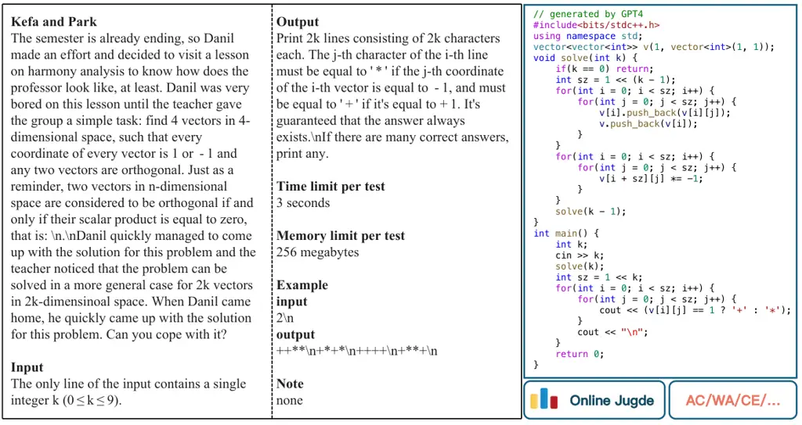
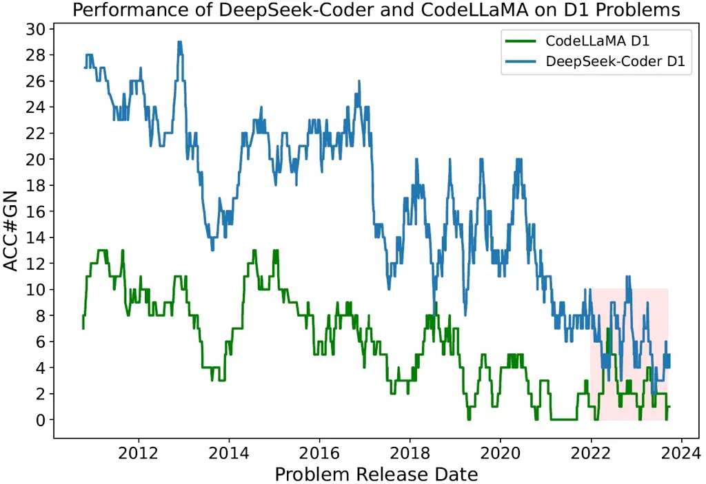
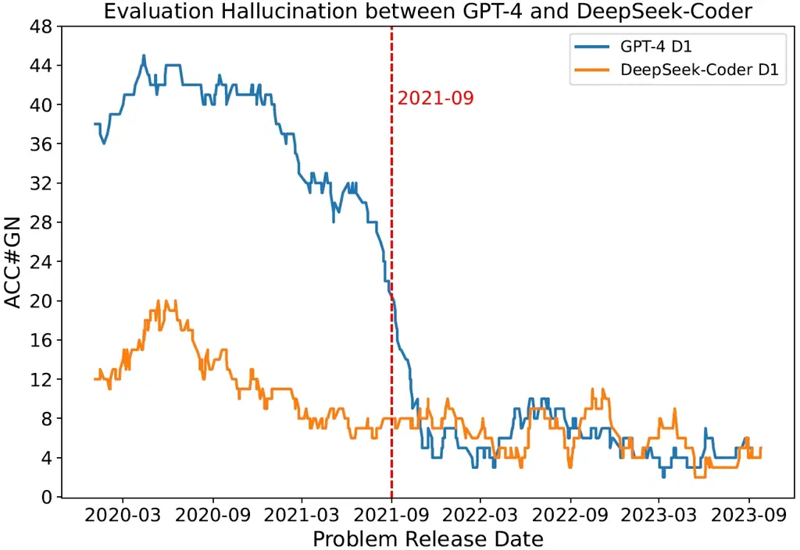
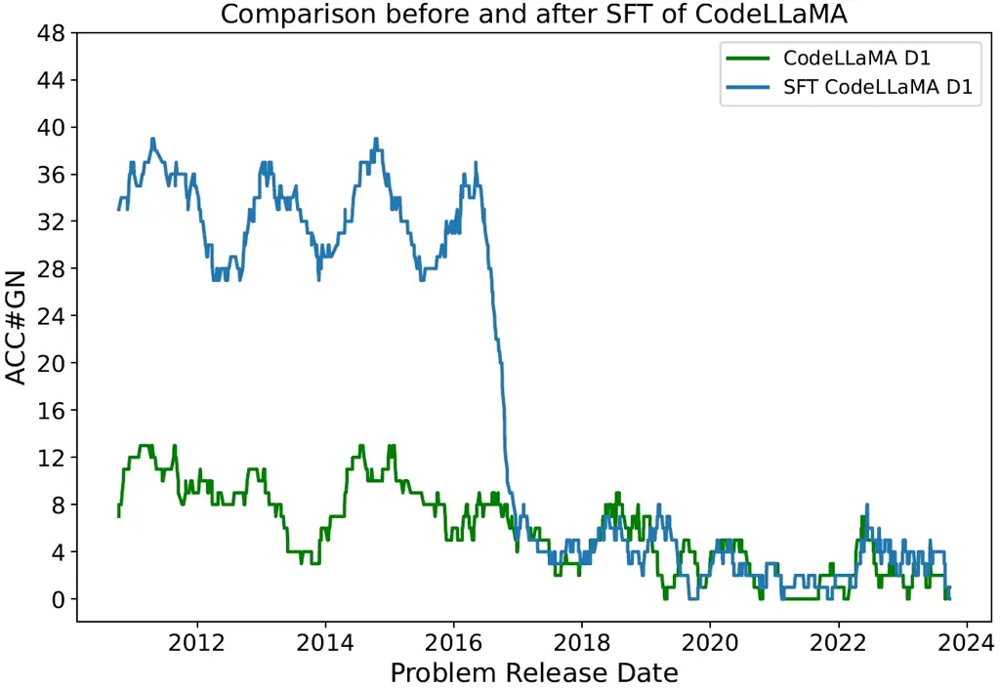
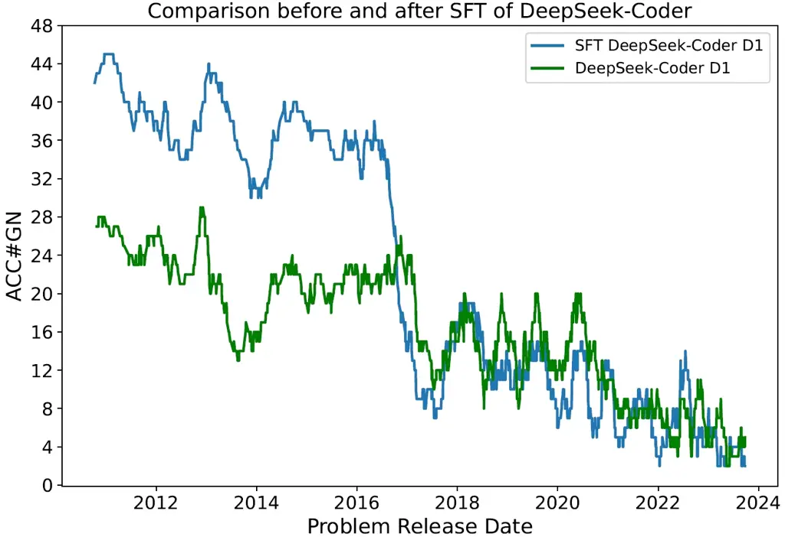

# Competition-Level Problems are Effective LLM Evaluators

Yiming Huang ^(†)^(†)thanks: Equal contribution.^(†)^(†)thanks: This
work was done during their internship at MSRA. Affiliation:  Microsoft
Research Asia    Zhenghao Lin¹¹footnotemark: 1 ²²footnotemark: 2
Affiliation:  Xiamen University    Xiao Liu ^(†)^(†)thanks:
Corresponding authors. Affiliation:  Microsoft Research Asia    Yeyun
Gong³³footnotemark: 3 Affiliation:  Microsoft Research Asia    Shuai Lu
Affiliation:  Microsoft Research Asia    Fangyu Lei    Yaobo Liang
Affiliation:  Microsoft Research Asia    Yelong Shen Affiliation: 
Microsoft Azure AI{xiaoliu2,yegong, wzchen}@microsoft.com,
chenlin@xmu.edu.cn    Chen Lin³³footnotemark: 3 Affiliation:  Xiamen
University    Nan Duan Affiliation:  Microsoft Research Asia    Weizhu
Chen³³footnotemark: 3 Affiliation:  Microsoft Azure AI{xiaoliu2,yegong,
wzchen}@microsoft.com, chenlin@xmu.edu.cn

###### Abstract

Large language models (LLMs) have demonstrated impressive reasoning
capabilities, yet there is ongoing debate about these abilities and the
potential data contamination problem recently. This paper aims to
evaluate the reasoning capacities of LLMs, specifically in solving
recent competition-level programming problems in Codeforces, which are
expert-crafted and unique, requiring deep understanding and robust
reasoning skills. We first provide a comprehensive evaluation of GPT-4’s
perceived zero-shot performance on this task, considering various
aspects such as problems’ release time, difficulties, and types of
errors encountered. Surprisingly, the perceived performance of GPT-4 has
experienced a cliff like decline in problems after September 2021
consistently across all the difficulties and types of problems, which
shows the potential data contamination, as well as the challenges for
any existing LLM to solve unseen complex reasoning problems. We further
explore various approaches such as fine-tuning, Chain-of-Thought
prompting and problem description simplification. Unfortunately, none of
them is able to consistently mitigate the challenges. Through our work,
we emphasize the importance of this excellent data source for assessing
the genuine reasoning capabilities of LLMs, and foster the development
of LLMs with stronger reasoning abilities and better generalization in
the future.

## 1 Introduction

The rise of LLMs has generated significant interest in the artificial
intelligence community. These models, notably GPT-4 OpenAI (2023), have
displayed impressive reasoning capabilities that are being harnessed in
various fields Bubeck et al. (2023). However, questions¹¹ 1
[https://twitter.com/keirp1/status/1724518513874739618](https://twitter.com/keirp1/status/1724518513874739618)
have been raised about how to accurately evaluate the reasoning
abilities of LLMs and the extent of data contamination issues Mialon
et al. (2023); Zhou et al. (2023).

Figure 1: The perceived zero-shot performance of GPT-4 sees a sharp
decline on problems of varying difficulties (D1, D2 and D3 means easy,
medium and difficult, respectively) in Codeforces after September 2021.

Regarding these issues, our study aims to assess the reasoning
capabilities of LLMs through their ability to generate algorithms for
solving competition-level programming problems. These questions are
meticulously crafted by experts to form rigorous competitions. They
possess high quality, are unique, and exhibit excellent discriminative
ability. The testing cases are also meticulously prepared. This
necessitates that LLMs deduce the solution from the presented scenario,
which requires a thorough understanding of algorithms, combined
reasoning and coding skills, and strong problem-solving abilities. These
problems thus present a significant challenge to both human coders and
LLMs. Consequently, competition-level programming problems serve as
effective tools for evaluating the two issues previously discussed: they
assess the reasoning abilities of LLMs and, due to the strict problem
selection process in competitions, reduce the likelihood of data
contamination in new problems.

Our research provides an in-depth analysis of the zero-shot performances
of GPT-4 and other code LLMs on competition-level programming problems
in Codeforces, considering factors such as release time, problem
difficulty, and the types of errors encountered. The main insights of
our study include: (1) GPT-4 performs significantly worse on programming
problems released after September 2021, casting doubt on its actual
reasoning abilities. (2) GPT-4 shows limited capability to solve
difficult problems, indicating potential weaknesses in complex
problem-solving. (3) GPT-4 struggles with the first test case,
suggesting errors may stem from its understanding of the problem at
hand. (4) The related phenomenon can be also observed in other LLMs,
indicating that insufficient reasoning ability may be a common problem.

To explore possible ways to enhance the zero-shot performances of these
LLMs on competition-level programming problems, we investigate several
methods to improve performance on unseen problems. These methods include
supervised fine-tuning with code-specific LLMs, Chain-of-Thought
prompting Wei et al. (2022), and problem statement simplification.
Specifically, we fine-tuned CodeLlamaRozière et al. (2023) and
DeepSeek-CoderAI (2023), which are specialized language models designed
to handle programming-related tasks. However, none of these methods
consistently mitigated the issue or resulted in noticeable performance
improvements, particularly for more difficult problems. This finding
indicates that difficult and unseen programming problems are effective
evaluators of LLMs.

Overall, the primary contributions of this study lie in proposing and
validating that recent competition-level programming problems serve as
an excellent data source for assessing the genuine reasoning
capabilities of LLMs. We aim to foster further research in this field by
innovating new approaches to address the challenge of complex reasoning
problems in LLMs and by establishing reliable evaluation benchmarks for
LLMs that minimize the risk of data contamination.

## 2 Problem Setup



Figure 2: The figure depicts the problem statement (left), comprising a
problem set in a narrative context for participants to decipher,
detailed input and output format specifications, and one or more example
input-output pairs. In some cases, additional notes may be provided to
assist competitors in understanding these example tests. This
information is fed into the LLM, aiming to generate relevant code
(right). The generated code is then submitted to an online judge for
correctness evaluation.

### 2.1 Competition-level Programming

Competition-level programming presents a unique arena for testing and
developing the reasoning abilities of AI models. In competitive
programming, a problem typically consists of a narrative that sets the
context, which models need to understand and convert into an algorithmic
problem. The challenge lies in comprehending the narrative, identifying
the underlying algorithmic issues, and implementing an efficient
solution in programming languages such as C++ and Java. Accepted
programs must satisfy stringent testing conditions, including producing
outputs that exactly match with test cases, executing within memory
limits, and terminating within time constraints. In contrast to prior
works Chen et al. (2021a); Austin et al. (2021); Cassano et al. (2023)
focusing on basic coding abilities, competition-level programming
problems require advanced reasoning and mathematical modeling skills,
essential for AI.

Unlike the previous works that focused on LeetCode²² 2
[https://leetcode.com/](https://leetcode.com/) Bubeck et al. (2023);
Shen et al. (2023); Sakib et al. (2023), we follow AlphaCode Li et al.
(2022) and choose Codeforces³³ 3
[https://codeforces.com/](https://codeforces.com/). Codeforces is
universally acknowledged by competitors and enthusiasts in the
International Collegiate Programming Competition⁴⁴ 4
[https://icpc.global/](https://icpc.global/) (ICPC) and the
International Olympiad in Informatics⁵⁵ 5
[https://ioinformatics.org/](https://ioinformatics.org/) (IOI) as a
popular and suitable platform for developing abilities for algorithm
contests. The regular contests hosted on this platform are crafted by
human experts, and contain plenty of intricate programming problems and
contests of high quality. These contests come with comprehensive and
robust test cases and exhibit a low degree of problem overlap. The
unique nature of these contest problems makes it highly unlikely to find
similar content on the internet before the competition concludes. As a
result, utilizing specific time-segmented datasets, like those from
contests conducted post the introduction of LLMs, serves as an effective
strategy to prevent data contamination Zhou et al. (2023).

Codeforces employs the Elo rating system⁶⁶ 6
[https://codeforces.com/blog/entry/102](https://codeforces.com/blog/entry/102)
to rank its users and problems, categorizing all problems into 28
distinct difficulties, ranging from 800 to 3500. Compared to commonly
utilized metrics such as the ratio of accepted submissions or users,
this difficulty rating mechanism is more suitable as it is based on the
ranking and performance of the participants during the competition.⁷⁷ 7
[https://codeforces.com/blog/entry/62865](https://codeforces.com/blog/entry/62865)
Hence, it is not subject to inaccuracies stemming from temporal changes,
repeated submissions, plagiarism, and other potential distortions.

### 2.2 Problem Definition

Figure 2 presents an example of the problem statement $`\pi`$. The input
of LLM is instantiated with the problem statement $`\pi`$ and a prompt
$`\rho`$ (like $`\rho_{1}`$ in Table 8). The LLM $`\Gamma`$ takes the
input to generate the code as $`\alpha=\Gamma(\rho(\pi))`$. The
generated code $`\alpha`$ is then evaluated by an online judge (OJ). The
evaluation process can be summarized in the following equation:

```math
\displaystyle\mathrm{OJ}(\alpha) \displaystyle=\mathrm{OJ}(\Gamma(\rho(\pi)))\in\text{\lx@text@lbrace AC, WA, CE, ...\lx@text@rbrace}
```

In this equation, $`\Gamma(\rho(\pi))`$ denotes the code generated by
LLM with the prompt $`\rho`$. The OJ platform then rigorously assesses
the code for its correctness, computational efficiency, and adherence to
specified input/output formats. With an extensive testing mechanism, the
platform employs a wide range of test cases and hidden scenarios to
ensure the code’s robustness across diverse scenarios. The platform
provides a spectrum of outcomes, $`\mathrm{OJ}(\Gamma(\rho(\pi)))`$,
offering a holistic evaluation of the code’s performance. This includes
results such as Accepted (AC), Wrong Answer (WA), and Compilation Error
(CE), among others.

### 2.3 Dataset Collection

The dataset is compiled from the Codeforces website, extracting all
publicly available problem statements from completed contests spanning
February 2010 through November 2023. For simplicity, problems requiring
interaction, featuring non-standard input/output formats, or
incompatible with C++ submission are excluded. For detailed
explanations, see Appendix B.

The analysis is confined to problems with difficulty levels ranging from
800 to 2400. Based on their difficulty levels, the dataset is divided
into three subsets: D1 (800-1100 difficulty, 1683 problems), D2
(1200-1600 difficulty, 1821 problems), and D3 (1700-2400 difficulty,
1453 problems). These problems encompass more than 20 distinct
categories of algorithms, as illustrated in Table 7. This diversity in
problem types further enhances the comprehensiveness of the dataset and
enables a comprehensive assessment of GPT-4’s problem-solving abilities
across a wide range of competition-level programming problems.

| Metric | D1     |        |            | D2     |       |            | D3     |       |            |
| ------ | ------ | ------ | ---------- | ------ | ----- | ---------- | ------ | ----- | ---------- |
|        | Time1  | Time2  | $`\Delta`$ | Time1  | Time2 | $`\Delta`$ | Time1  | Time2 | $`\Delta`$ |
| ACC#G  | 81.42% | 11.73% | -69.69%    | 43.72% | 0.00% | -43.72%    | 11.41% | 0.00% | -11.41%    |
| pass@1 | 78.11% | 10.54% | -67.57%    | 42.38% | 0.61% | -41.77%    | 9.45%  | 0.18% | -9.27%     |
| ACC1#1 | 78.05% | 9.38%  | -68.68%    | 43.37% | 0.00% | -43.37%    | 8.48%  | 0.00% | -8.48%     |
| ACC1#5 | 94.03% | 20.09% | -73.94%    | 69.02% | 3.06% | -65.96%    | 21.24% | 0.88% | -20.36%    |
| ACC2#5 | 88.34% | 11.83% | -76.51%    | 54.41% | 0.00% | -54.41%    | 12.36% | 0.00% | -12.36%    |
| ACC3#5 | 81.82% | 9.38%  | -72.44%    | 42.42% | 0.00% | -42.42%    | 7.51%  | 0.00% | -7.51%     |

Table 1: Performance of GPT-4 on different groups of problems: Time1 is
the problems released from October 2010 to September 2021, and Time2 is
the problems released from October 2021 to November 2023.

### 2.4 Experiment Details

| Metric          | Definition                                                                                                                |
| --------------- | ------------------------------------------------------------------------------------------------------------------------- |
| ACC#G           | Proportion of accepted solutions using greedy sampling (temperature $`t=0`$).                                             |
| ACC#GN          | The number of accepted solutions using greedy sampling (temperature $`t=0`$) within the sliding window.                   |
| ACC$`k`$\#$`n`$ | Proportion of problems with $`k`$ or more accepted solution with top-p samplings ($`t=0.7`$, $`p=0.95`$) for $`n`$ times. |
| pass@$`k`$      | Estimated proportion of problems with at least one accepted solution.                                                     |

Table 2: Definitions of evaluation metrics.

In Codeforces, each problem belongs to a contest. Once the contest
concludes, the problems are disclosed and become publicly submittable.
Therefore, we submit the solutions to the contests that have concluded
for evaluation.

To evaluate the results, we employ ACC#G, ACC#GN, ACC$`k`$\#$`n`$ and
pass@$`k`$ as defined in Table 2. Specifically, for ACC$`k`$\#$`n`$
metric, we consider two settings: (1) $`k=n=1`$ and (2)
$`k\in\{1,2,3\}`$ with $`n=5`$. Following Codex Chen et al. (2021b),
pass@$`k`$ is computed as

```math
k \displaystyle:=\mathop{\mathbb{E}}_{\text{Problems}}\left[1-\frac{{\binom{n-c}{k}}}{\binom{n}{k}}\right]
```

where $`n`$ is defined as the total number of generated samples per
problem used for evaluation, and $`c`$ represents the count of correct
samples out of $`n`$ that have successfully passed the unit tests. Here
we use $`k=1`$ and $`n=5`$ for pass@$`k`$.

In our experiment, we follow the zero-shot setting. To select an
appropriate prompt, we conduct preliminary experiments with three
prompts, $`\rho_{1}`$, $`\rho_{2}`$, and $`\rho_{3}`$, as listed in
Table 8, using two subsets of D1 problems: one from February to December
2010 and the other from January to October 2023, each comprising
approximately 100 problems. The standard deviations are 0.015 and 0.018,
respectively, indicating consistent performance. Therefore, we choose
$`\rho_{1}`$ as the prompt in the subsequent experiments. Furthermore,
we employ a sliding window approach for all temporal analyses to smooth
the data, addressing the sporadic release schedule of the problems. This
ensures a sufficient number of test problems at each time point, using a
window size of 51 (25 before and 25 after the time point).

## 3 Insights and Implications

### 3.1 Faltering on Unseen Problems

In this section, we delve into a temporal analysis of GPT-4
(gpt-4-0613)’s performance on programming problems. Figure 1 illustrates
GPT-4’s performance using the ACC#G metric. On problems released prior
to September 2021, GPT-4 exhibits minor fluctuations at different levels
across problems of varying difficulty. However, for problems released
after September 2021, a significant deviation from the normal
fluctuation range is observed. Interestingly, this timing coincides with
the cut-off date for the GPT-4 training data as announced by OpenAI⁸⁸ 8
[https://platform.openai.com/docs/models/gpt-4-and-gpt-4-turbo](https://platform.openai.com/docs/models/gpt-4-and-gpt-4-turbo).
We then calculate the average performance on problems before and after
September 2021, as shown in Table 1. On D1 problems, GPT-4’s ACC#G
plummets from 81.42% to 11.73%, marking a stark decrease of 69.69%. Even
more strikingly, the ACC#G drops to 0.00% on both D2 and D3 problems,
from 43.72% and 11.41%, respectively. To validate the reliability of the
conclusion, we also calculate the pass@1 metric, which exhibits a
similar trend. This observation raises thought-provoking questions about
the severity of the drop and the correlation between the data cut-off
date and the performance decline.

Figure 3: Random sampling enhances the probability of generating correct
solutions on previously encountered problems, but offers no assistance
for unseen problems.

To explore the model’s potential to generate correct solutions, we
perform random sampling multiple times and calculate the pass rate. The
average pass rate are shown in Table 1. As observed, multiple samplings
can enhance the chances of generating a correct solution. For instance,
on the unseen simple D1 problems, ACC1#5 improved by 10.71% compared to
ACC1#1. However, across all problems, the performance gap before and
after the cut-off date is more pronounced for ACC1#5 than for both
ACC1#1 and ACC#G. Figure 3 depicts the performance on D2 problems over
time. A notable decline in performance metrics is observed around
September 2021. This observation underscores the challenges that LLMs,
including the advanced GPT-4, face in addressing unseen programming
problems without similar pretraining data.

The observed decline in performance on problems outside the model’s
training range may stem from limitations in reasoning and
generalization. As highlighted by Yadlowsky et al. (2023), when
confronted with problems beyond their pretraining data, transformer
models exhibit various failure modes and their generalization abilities
deteriorate, even for simple problems. Similarly, Lu et al. (2023)
suggest that the exceptional abilities of large language models
primarily stem from in-context learning, and do not necessarily reflect
the emergence of reasoning abilities.

The observed performance drop on unseen problems raises serious
questions about GPT-4’s intrinsic reasoning and generalization
capabilities. This suggests a potential over-reliance on pattern
recognition and reproduction from training, as opposed to grasping
underlying principles and applying them to novel problems. This
observation aligns with recent debates on large models’ data
memorization tendencies Carlini et al. (2023); Yang et al. (2023).
Therefore, future evaluations should prioritize the minimization of
overlap between testing and training data to accurately assess a model’s
reasoning abilities, rather than simply its capacity for memorization.
Furthermore, it’s crucial to explore methods that enhance model
generalization and reduce reliance on pre-training data.

Figure 4: For problems released before September 2021, GPT-4’s ACC#G
showed a negative linear correlation with difficulty, followed by
consistently poor performance afterwards.

### 3.2 Limited Ability to Solve Difficult Problems

This section provides an analysis of performance in relation to the
problem difficulty. The results of ACC#G for problems with different
difficulties are reported for two distinct periods: from October 2010 to
September 2021, and from October 2021 to November 2023, as illustrated
in Figure 4.

For the results from October 2010 to September 2021, we calculate
Pearson correlation coefficient ($`r=-0.97`$) and the Kendall rank
correlation coefficient ($`\tau=-0.88`$), which indicate strong linear
correlations. Notably, when the difficulty level reaches 2400
(indicating greater challenge than approximately 57% of the problems on
Codeforces), the ACC#G drops to zero. However, from October 2021 to
November 2023, ACC#G shows a dramatic decrease across all difficulty
levels.

These findings reveal a significant limitation in the ability of GPT-4
to handle extremely complex problems. Despite its vast knowledge on code
and algorithms, GPT-4 lacks of the competence in solving very
challenging problems, particularly those with higher difficulty levels,
even in the context of previously encountered problems. This indicates a
potential area for further improvement and development in future
iterations of the model.

### 3.3 Struggling with The First Test Case

Figure 5: Error categories in GPT-4’s solutions on problems released
from 2010 to 2023.

In this section, we gather and analyze the errors returned by GPT-4 upon
submission to the Codeforces website, as outlined in Table 6. The most
common error is "Wrong answer on test 1", which on average accounts for
70% of the observed errors. Test 1 is the first test case, which almost
corresponds to or properly includes the example test case provided in
the problem statement. This suggests that the model often struggles at
the very beginning of problem-solving, possibly due to difficulties in
understanding the problem’s requirements or generating a correct
solution based on the given test case. As depicted in Figure 5, there is
a significant increase in the proportion of "Wrong answer on test 1"
errors for problems released between 2021 and 2023. This suggests that
GPT-4 is more likely to face challenges in understanding and reasoning
during at the onset of tackling unseen problems.

Other types of errors account for a smaller proportion, with an average
of 10%. They have shown little variation over time. This indicates that
GPT-4 demonstrates strong fundamental code-writing capabilities of
generating high-quality code.

### 3.4 Similar Phenomenon of Other Code LLMs



Figure 6: ACC#GN of CodeLlama and DeepSeek-Coder on D1 problems.

| Problem Release Date | CodeLlama      | DeepSeek-Coder  |
| -------------------- | -------------- | --------------- |
| Before 2023.3        | 10.30%         | 32.74%          |
| After 2023.3         | 4.52% (-5.78%) | 9.03% (-23.71%) |

Table 3: Comparison of ACC#G between CodeLlama and DeepSeek-Coder on D1
problems before and after March 2023.

We investigate whether the perceived performance degradation on unseen
programming problems is observed for other popular code LLMs, such as
CodeLlama-34B-Instruct Rozière et al. (2023) and
DeepSeek-Coder-33B-Instruct AI (2023).

We conduct tests on CodeLlama and DeepSeek-Coder using D1 problems,
following the settings in § 2.3, and the results are shown in Figure 6.
The experimental results indicate that CodeLlama consistently
underperforms compared to DeepSeek-Coder on D1 problems. Furthermore,
the performance of DeepSeek-Coder on D1 problems has been declining with
the progression of the problem release date. The ACC#GN of
DeepSeek-Coder has declined to a level that is on par with CodeLlama
when dealing with newly released problems, as highlighted in the red
area of Figure 6.

To precisely and intuitively detect this phenomenon, we calculate the
ACC#G of CodeLlama and DeepSeek-Coder on D1 problems, both before and
after March 2023, and present the results in Table 3. The results reveal
a significant difference in the average accuracy of CodeLlama and
DeepSeek-Coder before and after March 2023. Regarding the magnitude of
the decrease, DeepSeek-Coder, which previously exhibited superior
performance, demonstrates a more pronounced decline, with acceptance
rates falling below 10% after March 2023. Considering the release dates
of CodeLlama and DeepSeek-Coder, we speculate that most of the
programming problems after March 2023 are novel to them, which suggests
that they also not be able to perform well on unseen programming
problems like GPT4 does. This finding indicates that a fundamental
limitation of current code LLMs in generalizing effectively to complex
reasoning tasks.

### 3.5 Evaluation Hallucination of LLMs



Figure 7: Comparison of ACC#GN for GPT-4 and DeepSeek-Coder on D1
problems after 2020.

| Model          | 2020.1-2021.9    | 2021.9-2023.10  |
| -------------- | ---------------- | --------------- |
| GPT-4          | 73.19% (+50.52%) | 11.53% (-0.97%) |
| DeepSeek-Coder | 22.67%           | 12.50%          |

Table 4: Comparison of ACC#G between GPT-4 and DeepSeek-Coder over time
intervals, on D1 problems.

To further analyze the phenomenon, we compare GPT-4 with DeepSeek-Coder
on D1 problems as shown in Figure 7 and Table 4.

It is noteworthy that while GPT-4 surpasses DeepSeek-Coder in terms of
performance on problems that were released prior to September 2021, an
unexpected observation is that DeepSeek-Coder exhibits a performance
that is on par with GPT-4 when it comes to tackling problems that were
released after September 2021. Considering the previous work Yang et al.
(2023); Zhou et al. (2023), although GPT-4 may perform particularly well
on some previously seen problems due to its powerful capacity, it cannot
be well generalized on unseen programming problems, and its performance
is not significantly different from DeepSeek-Coder, which is
specifically trained for code. This phenomenon merits attention, which
is termed as “evaluation hallucination”.

Hence, a more equitable evaluation strategy would be to select
evaluation sets that all the models have not previously encountered.
However, finding such data adhering to stringent conditions is
challenging, as LLMs are typically pre-trained on extensive corpora
containing diverse content, leading to the potential issue of data
contamination. Therefore, if we could devote more attention to the data
source and timeline of the evaluation sets, such as the problems in
Codeforces, it could potentially mitigate the effects of evaluation
hallucination.

## 4 One Step Forward

In this section, we explore some approaches to mitigate the poor
performance on unseen problems.

### 4.1 Fine-tuning



Figure 8: Comparison of ACC#GN for CodeLlama on D1 problems before and
after fine-tuning.



Figure 9: Comparison of ACC#GN on D1 problems before and after
fine-tuning DeepSeek-Coder.

Fine-tuning is a commonly used method to improve performance on specific
downstream tasks. In this study, we employ the Description2Code dataset
OpenAI and Sutskever (2016) for fine-tuning. This dataset is compiled
from three competitive programming websites: Codeforces, CodeChef, and
HackerEarth, and contains problems published before 2017. CodeChef and
HackerEarth, similar to Codeforces, host online coding competitions, and
their problem sets are consistent in style and difficulty.

The dataset includes 2128 problems from Codeforces, 2435 problems from
HackerEarth, and 3201 problems from CodeChef, totaling 7764 problems.
However, due to some problems lacking corresponding C++ solutions, we
retained a total of 7000 problems for our study. Each problem has
approximately 10 C++ solutions, resulting in 70,000 pairs of
input-output sequences. These sequences are used for fine-tuning both
CodeLlama and DeepSeek-Coder in a supervised manner.

As shown in Figure 8 and Figure 9, we compare the performances of the
models before and after fine-tuning on D1 problems. We observe that,
even after fine-tuning with the same type of data, CodeLlama and
DeepSeek-Coder do not exhibit improved performance on recent problems,
particularly those post-2022. The significant improvement in ACC#GN
before 2017 may result from the models recalling relevant or identical
programming problems, rather than mastering the underlying reasoning
logic, leading to their inability to adapt well to new programming
challenges. Therefore, simple fine-tuning does not effectively enhance
the models’ performance on new programming problems.

### 4.2 Chain-of-Thought Prompting

In this section, we explore the application of Chain-of-Thought (CoT)
prompting Wei et al. (2022) to competition-level programming problems.
CoT involves prompting GPT-4 to generate an explanation of the algorithm
before coding, denoted as $`\rho_{cot}`$ in Table 8. We conduct
experiments on both the D1 and D3 problems released after October 2021.
For D1 problems, employing CoT increases the ACC#G from 11.54% to
16.21%, demonstrating a noticeable improvement. However, for D3
problems, using CoT fails to yield any improvement, leaving the ACC#G at
0.00%. This suggests that while CoT facilitates some improvement for
simple D1 problems, it is ineffective for the complex reasoning
challenges presented by D3 problems.

### 4.3 In-Context Learning

In this section, we enhance our experimental exploration into in-context
learning by integrating both fixed demonstrations and
retrieval-augmented demonstrations.

We use D1 problems released before September 2021 as source dataset and
those released after as test data. First, we apply the same method as
delineated in § 4.2 to tackle the source data and validate them on
Codeforces. We then retain accepted solutions, resulting in a collection
of 1048 problem and CoT response pairs. A demonstration example is
presented in Table 12.

In the fixed demonstration experiment, we randomly select three problems
to create 3-shot prompts. In the retrieval-augmented demonstration
experiment, we first generate embeddings for the statements of the
source and test data problems utilizing the OpenAI
text-embedding-ada-002 model. We then identify the top three problems in
the source data based on cosine similarity for each test problem,
incorporating them as example demonstrations within the prompts.

The experimental results, summarized in Table 5, show that the
retrieval-augmented 3-shot method’s accuracy is nearly identical to the
0-shot CoT, while the fixed 3-shot approach is even less effective. This
may be due to the highly specialized nature of competitive programming
problems, which makes finding valuable references challenging.
Furthermore, the model may struggle to acquire problem-solving skills
through context learning alone, and inappropriate demonstrations might
lead to adverse effects.

| N-shot Prompt | CoT | Retrieval | ACC#G  |
| ------------- | --- | --------- | ------ |
| 0-shot        | No  | No        | 11.54% |
| 0-shot        | Yes | No        | 16.21% |
| 3-shot        | Yes | No        | 13.73% |
| 3-shot        | Yes | Yes       | 16.48% |

Table 5: Accuracy of GPT-4 on D1 problems released after September 2021
using different experimental setups

### 4.4 Problem Statement Simplification

Intuitively, even experienced programming competition competitors
require time to understand problem statements. Therefore, we conduct a
simple experiment to assess whether comprehension of problem statements
hinders LLMs’ ability to excel at programming problems. We first
instruct GPT-4 to simplify the problem statement with $`\rho_{sip}`$ and
then generate the code with $`\rho_{sipgen}`$ as shown in Table 8. The
results are also evaluated on both the D1 and D3 problems released after
October 2021. However, for D1 problems, using the simplified problem
statement even brings a slight decline in ACC#G from 11.54% to 11.14%.
And the ACC#G for D3 problems still remains at 0.00%. Consequently, the
challenge of genuinely improving the model’s reasoning ability and
enhancing its performance on unseen problems represents a significant
direction for future research.

## 5 Related Work

#### Code LLMs.

Code intelligence is an important topic in AI research. Recently, code
LLMs Zhang et al. (2023b) have received widespread attention. Commercial
LLMs OpenAI (2023) have achieved tremendous success. Meanwhile, research
on open-source code LLMs is also thriving, such as CodeLlama Rozière
et al. (2023), StarCoder Li et al. (2023), CodeGeeX Zheng et al. (2023),
CodeFuse Di et al. (2023), WizardCoder Luo et al. (2023) and Lemur Xu
et al. (2023).

#### Reasoning on Code.

Programming competition is a specialized domain within the broader
landscape of programming problems. Unlike simpler tasks on code, such as
HumanEval Chen et al. (2021a), MBPP Austin et al. (2021),
MultiPL-E Cassano et al. (2023), competition-level programming problems
necessitate an advanced understanding of data structures, algorithms,
and problem-solving techniques. Enabling models to solve human-designed
algorithmic competition problems represents a meaningful research
direction, as it reflects the models’ integrated capabilities in
reasoning, coding, and problem-solving. AlphaCode Li et al. (2022)
simulate evaluations on 10 programming competitions on the Codeforces
platform, which is the first work in this topic. ALGO Zhang et al.
(2023a) can integrate with any existing code LLMs in a model-agnostic
manner, enhancing its code generation performance.

#### Reasoning on Other Subjects.

Researchers have proposed many benchmarks requiring various reasoning
skills, including commonsense reasoning (Talmor et al., 2018; Geva
et al., 2021), numerical reasoning (Dua et al., 2019), multi-hop
reasoning (Yang et al., 2018), arithmetic reasoning (Patel et al., 2021;
Cobbe et al., 2021), structured reasoning (Yu et al., 2018; Lei et al.,
2023), inductive reasoning (Sinha et al., 2019) and logical
reasoning (Yu et al., 2020). LLMs are also widely used in scientific
research in other fields (Wang et al., 2023), such as physics (Yeadon
and Halliday, 2023), chemistry (Castro Nascimento and Pimentel, 2023;
Bran et al., 2023), etc.

## 6 Conclusion

In this study, we utilize competition-level programming problems from
Codeforces to analyze the reasoning capabilities of LLMs. We find a
significant decrease in perceived performance of GPT-4 on unseen
problems, consistent across a range of difficulties, problem types, and
experimental settings. This decrease highlights concerns of data
contamination in benchmarks and the need for unseen tasks to properly
assess LLMs’ reasoning ability with complex challenges. Our research
also extends these insights to other open-source LLMs, revealing the
common difficulties these models face with complex, previously
unencountered reasoning tasks. This is indicative of the LLMs’ intrinsic
limitations in reasoning. As a primary probe, we explore several
straightforward strategies, but none of them consistently mitigated the
issues. Through our work, we hope to emphasize the critical need for
robust datasets to accurately evaluate LLMs’ reasoning abilities and to
inspire advancements in LLMs that demonstrate improved reasoning
abilities.

## Limitations

This study identifies expertly-designed, high-quality competition-level
programming problems as effective evaluation data for evaluating LLMs.
However, comparing to the existing benchmarks, the quantity of such
problems is limited. Constructing uncontaminated, high-quality
evaluation datasets and extending them to other tasks such as
mathematics still poses a challenge to researchers. The identification
and creation of such datasets are crucial for enhancing our
understanding of the LLMs in complex reasoning tasks. We will endeavor
to achieve this goal in our future work.

## References

- AI (2023) DeepSeek AI. 2023. Deepseek coder: Let the code write
  itself.
  [https://github.com/deepseek-ai/DeepSeek-Coder](https://github.com/deepseek-ai/DeepSeek-Coder).
- Austin et al. (2021) Jacob Austin, Augustus Odena, Maxwell Nye,
  Maarten Bosma, Henryk Michalewski, David Dohan, Ellen Jiang, Carrie
  Cai, Michael Terry, Quoc Le, et al. 2021. Program synthesis with large
  language models. _arXiv preprint arXiv:2108.07732_.
- Bran et al. (2023) Andres M Bran, Sam Cox, Andrew D White, and
  Philippe Schwaller. 2023. Chemcrow: Augmenting large-language models
  with chemistry tools. _arXiv preprint arXiv:2304.05376_.
- Bubeck et al. (2023) Sébastien Bubeck, Varun Chandrasekaran, Ronen
  Eldan, Johannes Gehrke, Eric Horvitz, Ece Kamar, Peter Lee, Yin Tat
  Lee, Yuanzhi Li, Scott Lundberg, et al. 2023. Sparks of artificial
  general intelligence: Early experiments with gpt-4. _arXiv preprint
  arXiv:2303.12712_.
- Carlini et al. (2023) Nicholas Carlini, Daphne Ippolito, Matthew
  Jagielski, Katherine Lee, Florian Tramer, and Chiyuan Zhang. 2023.
  Quantifying memorization across neural language models. In _The
  Eleventh International Conference on Learning Representations_.
- Cassano et al. (2023) Federico Cassano, John Gouwar, Daniel Nguyen,
  Sydney Nguyen, Luna Phipps-Costin, Donald Pinckney, Ming-Ho Yee,
  Yangtian Zi, Carolyn Jane Anderson, Molly Q Feldman, et al. 2023.
  Multipl-e: a scalable and polyglot approach to benchmarking neural
  code generation. _IEEE Transactions on Software Engineering_.
- Castro Nascimento and Pimentel (2023) Cayque Monteiro
  Castro Nascimento and André Silva Pimentel. 2023. Do large language
  models understand chemistry? a conversation with chatgpt. _Journal of
  Chemical Information and Modeling_, 63(6):1649–1655.
- Chen et al. (2021a) Mark Chen, Jerry Tworek, Heewoo Jun, Qiming Yuan,
  Henrique Ponde de Oliveira Pinto, Jared Kaplan, Harri Edwards, Yuri
  Burda, Nicholas Joseph, Greg Brockman, et al. 2021a. Evaluating large
  language models trained on code. _arXiv preprint arXiv:2107.03374_.
- Chen et al. (2021b) Mark Chen, Jerry Tworek, Heewoo Jun, Qiming Yuan,
  Henrique Ponde de Oliveira Pinto, Jared Kaplan, Harri Edwards, Yuri
  Burda, Nicholas Joseph, Greg Brockman, et al. 2021b. Evaluating large
  language models trained on code. _arXiv preprint arXiv:2107.03374_.
- Cobbe et al. (2021) Karl Cobbe, Vineet Kosaraju, Mohammad Bavarian,
  Mark Chen, Heewoo Jun, Lukasz Kaiser, Matthias Plappert, Jerry Tworek,
  Jacob Hilton, Reiichiro Nakano, et al. 2021. Training verifiers to
  solve math word problems. _arXiv preprint arXiv:2110.14168_.
- Di et al. (2023) Peng Di, Jianguo Li, Hang Yu, Wei Jiang, Wenting Cai,
  Yang Cao, Chaoyu Chen, Dajun Chen, Hongwei Chen, Liang Chen, Gang Fan,
  Jie Gong, Zi Gong, Wen Hu, Tingting Guo, Zhichao Lei, Ting Li, Zheng
  Li, Ming Liang, Cong Liao, Bingchang Liu, Jiachen Liu, Zhiwei Liu,
  Shaojun Lu, Min Shen, Guangpei Wang, Huan Wang, Zhi Wang, Zhaogui Xu,
  Jiawei Yang, Qing Ye, Gehao Zhang, Yu Zhang, Zelin Zhao, Xunjin Zheng,
  Hailian Zhou, Lifu Zhu, and Xianying Zhu. 2023. [Codefuse-13b: A
  pretrained multi-lingual code large language
  model](https://doi.org/10.48550/ARXIV.2310.06266). _CoRR_,
  abs/2310.06266.
- Dua et al. (2019) Dheeru Dua, Yizhong Wang, Pradeep Dasigi, Gabriel
  Stanovsky, Sameer Singh, and Matt Gardner. 2019. Drop: A reading
  comprehension benchmark requiring discrete reasoning over paragraphs.
  _arXiv preprint arXiv:1903.00161_.
- Geva et al. (2021) Mor Geva, Daniel Khashabi, Elad Segal, Tushar Khot,
  Dan Roth, and Jonathan Berant. 2021. Did aristotle use a laptop? a
  question answering benchmark with implicit reasoning strategies.
  _Transactions of the Association for Computational Linguistics_,
  9:346–361.
- Lei et al. (2023) Fangyu Lei, Qian Liu, Yiming Huang, Shizhu He, Jun
  Zhao, and Kang Liu. 2023. S3eval: A synthetic, scalable, systematic
  evaluation suite for large language models. _arXiv preprint
  arXiv:2310.15147_.
- Li et al. (2023) Raymond Li, Loubna Ben Allal, Yangtian Zi, Niklas
  Muennighoff, Denis Kocetkov, Chenghao Mou, Marc Marone, Christopher
  Akiki, Jia Li, Jenny Chim, Qian Liu, Evgenii Zheltonozhskii, Terry Yue
  Zhuo, Thomas Wang, Olivier Dehaene, Mishig Davaadorj, Joel
  Lamy-Poirier, João Monteiro, Oleh Shliazhko, Nicolas Gontier, Nicholas
  Meade, Armel Zebaze, Ming-Ho Yee, Logesh Kumar Umapathi, Jian Zhu,
  Benjamin Lipkin, Muhtasham Oblokulov, Zhiruo Wang, Rudra Murthy V,
  Jason Stillerman, Siva Sankalp Patel, Dmitry Abulkhanov, Marco Zocca,
  Manan Dey, Zhihan Zhang, Nour Moustafa-Fahmy, Urvashi Bhattacharyya,
  Wenhao Yu, Swayam Singh, Sasha Luccioni, Paulo Villegas, Maxim
  Kunakov, Fedor Zhdanov, Manuel Romero, Tony Lee, Nadav Timor, Jennifer
  Ding, Claire Schlesinger, Hailey Schoelkopf, Jan Ebert, Tri Dao,
  Mayank Mishra, Alex Gu, Jennifer Robinson, Carolyn Jane Anderson,
  Brendan Dolan-Gavitt, Danish Contractor, Siva Reddy, Daniel Fried,
  Dzmitry Bahdanau, Yacine Jernite, Carlos Muñoz Ferrandis, Sean Hughes,
  Thomas Wolf, Arjun Guha, Leandro von Werra, and Harm de Vries. 2023.
  [Starcoder: may the source be with
  you!](https://doi.org/10.48550/ARXIV.2305.06161) _CoRR_,
  abs/2305.06161.
- Li et al. (2022) Yujia Li, David Choi, Junyoung Chung, Nate Kushman,
  Julian Schrittwieser, Rémi Leblond, Tom Eccles, James Keeling, Felix
  Gimeno, Agustin Dal Lago, et al. 2022. Competition-level code
  generation with alphacode. _Science_, 378(6624):1092–1097.
- Lu et al. (2023) Sheng Lu, Irina Bigoulaeva, Rachneet Sachdeva,
  Harish Tayyar Madabushi, and Iryna Gurevych. 2023. Are emergent
  abilities in large language models just in-context learning? _arXiv
  preprint arXiv:2309.01809_.
- Luo et al. (2023) Ziyang Luo, Can Xu, Pu Zhao, Qingfeng Sun, Xiubo
  Geng, Wenxiang Hu, Chongyang Tao, Jing Ma, Qingwei Lin, and Daxin
  Jiang. 2023. [Wizardcoder: Empowering code large language models with
  evol-instruct](https://doi.org/10.48550/ARXIV.2306.08568). _CoRR_,
  abs/2306.08568.
- Mialon et al. (2023) Grégoire Mialon, Clémentine Fourrier, Craig
  Swift, Thomas Wolf, Yann LeCun, and Thomas Scialom. 2023. Gaia: a
  benchmark for general ai assistants. _arXiv preprint
  arXiv:2311.12983_.
- OpenAI (2023) OpenAI. 2023. [Gpt-4 technical
  report](http://arxiv.org/abs/2303.08774).
- OpenAI and Sutskever (2016) E. Caballero OpenAI and
  I. Sutskever. 2016. [Description2Code
  Dataset](https://doi.org/10.5281/zenodo.5665051).
- Patel et al. (2021) Arkil Patel, Satwik Bhattamishra, and Navin
  Goyal. 2021. Are nlp models really able to solve simple math word
  problems? _arXiv preprint arXiv:2103.07191_.
- Rozière et al. (2023) Baptiste Rozière, Jonas Gehring, Fabian
  Gloeckle, Sten Sootla, Itai Gat, Xiaoqing Ellen Tan, Yossi Adi, Jingyu
  Liu, Tal Remez, Jérémy Rapin, Artyom Kozhevnikov, Ivan Evtimov, Joanna
  Bitton, Manish Bhatt, Cristian Canton-Ferrer, Aaron Grattafiori,
  Wenhan Xiong, Alexandre Défossez, Jade Copet, Faisal Azhar, Hugo
  Touvron, Louis Martin, Nicolas Usunier, Thomas Scialom, and Gabriel
  Synnaeve. 2023. [Code llama: Open foundation models for
  code](https://doi.org/10.48550/ARXIV.2308.12950). _CoRR_,
  abs/2308.12950.
- Sakib et al. (2023) Fardin Ahsan Sakib, Saadat Hasan Khan, and AHM
  Karim. 2023. Extending the frontier of chatgpt: Code generation and
  debugging. _arXiv preprint arXiv:2307.08260_.
- Shen et al. (2023) Bo Shen, Jiaxin Zhang, Taihong Chen, Daoguang Zan,
  Bing Geng, An Fu, Muhan Zeng, Ailun Yu, Jichuan Ji, Jingyang Zhao,
  et al. 2023. Pangu-coder2: Boosting large language models for code
  with ranking feedback. _arXiv preprint arXiv:2307.14936_.
- Sinha et al. (2019) Koustuv Sinha, Shagun Sodhani, Jin Dong, Joelle
  Pineau, and William L Hamilton. 2019. Clutrr: A diagnostic benchmark
  for inductive reasoning from text. In _Proceedings of the 2019
  Conference on Empirical Methods in Natural Language Processing and the
  9th International Joint Conference on Natural Language Processing
  (EMNLP-IJCNLP)_, pages 4506–4515.
- Talmor et al. (2018) Alon Talmor, Jonathan Herzig, Nicholas Lourie,
  and Jonathan Berant. 2018. Commonsenseqa: A question answering
  challenge targeting commonsense knowledge. _arXiv preprint
  arXiv:1811.00937_.
- Wang et al. (2023) Hanchen Wang, Tianfan Fu, Yuanqi Du, Wenhao Gao,
  Kexin Huang, Ziming Liu, Payal Chandak, Shengchao Liu, Peter
  Van Katwyk, Andreea Deac, et al. 2023. Scientific discovery in the age
  of artificial intelligence. _Nature_, 620(7972):47–60.
- Wei et al. (2022) Jason Wei, Xuezhi Wang, Dale Schuurmans, Maarten
  Bosma, Fei Xia, Ed Chi, Quoc V Le, Denny Zhou, et al. 2022.
  Chain-of-thought prompting elicits reasoning in large language models.
  _Advances in Neural Information Processing Systems_, 35:24824–24837.
- Xu et al. (2023) Yiheng Xu, Hongjin Su, Chen Xing, Boyu Mi, Qian Liu,
  Weijia Shi, Binyuan Hui, Fan Zhou, Yitao Liu, Tianbao Xie,
  et al. 2023. Lemur: Harmonizing natural language and code for language
  agents. _arXiv preprint arXiv:2310.06830_.
- Yadlowsky et al. (2023) Steve Yadlowsky, Lyric Doshi, and Nilesh
  Tripuraneni. 2023. Pretraining data mixtures enable narrow model
  selection capabilities in transformer models. _arXiv preprint
  arXiv:2311.00871_.
- Yang et al. (2023) Shuo Yang, Wei-Lin Chiang, Lianmin Zheng, Joseph E
  Gonzalez, and Ion Stoica. 2023. Rethinking benchmark and contamination
  for language models with rephrased samples. _arXiv preprint
  arXiv:2311.04850_.
- Yang et al. (2018) Zhilin Yang, Peng Qi, Saizheng Zhang, Yoshua
  Bengio, William Cohen, Ruslan Salakhutdinov, and Christopher D
  Manning. 2018. Hotpotqa: A dataset for diverse, explainable multi-hop
  question answering. In _Proceedings of the 2018 Conference on
  Empirical Methods in Natural Language Processing_, pages 2369–2380.
- Yeadon and Halliday (2023) Will Yeadon and Douglas P Halliday. 2023.
  Exploring durham university physics exams with large language models.
  _arXiv preprint arXiv:2306.15609_.
- Yu et al. (2018) Tao Yu, Rui Zhang, Kai Yang, Michihiro Yasunaga,
  Dongxu Wang, Zifan Li, James Ma, Irene Li, Qingning Yao, Shanelle
  Roman, et al. 2018. Spider: A large-scale human-labeled dataset for
  complex and cross-domain semantic parsing and text-to-sql task. In
  _Proceedings of the 2018 Conference on Empirical Methods in Natural
  Language Processing_, pages 3911–3921.
- Yu et al. (2020) Weihao Yu, Zihang Jiang, Yanfei Dong, and Jiashi
  Feng. 2020. Reclor: A reading comprehension dataset requiring logical
  reasoning. _arXiv preprint arXiv:2002.04326_.
- Zhang et al. (2023a) Kexun Zhang, Danqing Wang, Jingtao Xia,
  William Yang Wang, and Lei Li. 2023a. Algo: Synthesizing algorithmic
  programs with generated oracle verifiers. _arXiv preprint
  arXiv:2305.14591_.
- Zhang et al. (2023b) Ziyin Zhang, Chaoyu Chen, Bingchang Liu, Cong
  Liao, Zi Gong, Hang Yu, Jianguo Li, and Rui Wang. 2023b. [A survey on
  language models for code](http://arxiv.org/abs/2311.07989).
- Zheng et al. (2023) Qinkai Zheng, Xiao Xia, Xu Zou, Yuxiao Dong, Shan
  Wang, Yufei Xue, Zihan Wang, Lei Shen, Andi Wang, Yang Li,
  et al. 2023. Codegeex: A pre-trained model for code generation with
  multilingual evaluations on humaneval-x. _arXiv preprint
  arXiv:2303.17568_.
- Zhou et al. (2023) Kun Zhou, Yutao Zhu, Zhipeng Chen, Wentong Chen,
  Wayne Xin Zhao, Xu Chen, Yankai Lin, Ji-Rong Wen, and Jiawei
  Han. 2023. Don’t make your llm an evaluation benchmark cheater. _arXiv
  preprint arXiv:2311.01964_.

## Appendix A More Results with Different Versions of GPT-4 APIs

In this study, we conduct an evaluation of two distinct API versions:
GPT-4 and GPT-4-turbo, to assess their performance on D1 problems. The
training data for GPT-4 extends up to September 2021, while that for
GPT-4-turbo reaches up to April 2023. These evaluations are visually
represented in Figure 10. Upon analysis of the results, it is observed
that on problems prior to September 2021, the GPT-4-turbo exhibits
marginally inferior performance compared to GPT-4. Between September
2021 and April 2023, GPT-4-turbo outperforms GPT-4 on D1 problems,
reflecting the benefits of its more recent training data. Nonetheless, a
decline in GPT-4’s performance is observed for newer problems within
this period, likely due to the scarcity of such recent data in its
training set.

Nevertheless, when faced with problems emerging after April 2023—thus
unencountered during their respective training periods—both APIs
demonstrate a decline in performance, albeit GPT-4-turbo marginally
outperforms GPT-4. Despite this relative improvement, the performance of
GPT-4-turbo on problems post-April 2023 noticeably regresses when
compared to its performance on problems covered by its training data.
This finding is consistent with the conclusions drawn in the § 3.1
"Faltering on Unseen Problems", which elucidates the challenges faced by
these models when confronted with novel questions that extend beyond
their training corpus.

Figure 10: Comparison of ACC#G for GPT-4 and GPT-4-turbo on D1 problems.

| Year    | WA1  | WA2  | WA3  | WA4+ | RE   | CE   | TLE  | MLE  |
| ------- | ---- | ---- | ---- | ---- | ---- | ---- | ---- | ---- |
| 2010    | 0.49 | 0.15 | 0.04 | 0.19 | 0.04 | 0.03 | 0.01 | 0.04 |
| 2011    | 0.53 | 0.13 | 0.10 | 0.06 | 0.07 | 0.06 | 0.04 | 0.01 |
| 2012    | 0.55 | 0.14 | 0.05 | 0.12 | 0.04 | 0.04 | 0.03 | 0.02 |
| 2013    | 0.63 | 0.13 | 0.06 | 0.07 | 0.03 | 0.03 | 0.04 | 0.01 |
| 2014    | 0.53 | 0.18 | 0.05 | 0.09 | 0.04 | 0.05 | 0.04 | 0.01 |
| 2015    | 0.62 | 0.10 | 0.02 | 0.14 | 0.03 | 0.02 | 0.04 | 0.02 |
| 2016    | 0.68 | 0.09 | 0.02 | 0.10 | 0.02 | 0.05 | 0.04 | 0.00 |
| 2017    | 0.66 | 0.13 | 0.05 | 0.08 | 0.03 | 0.03 | 0.03 | 0.02 |
| 2018    | 0.58 | 0.12 | 0.06 | 0.13 | 0.01 | 0.03 | 0.05 | 0.01 |
| 2019    | 0.67 | 0.11 | 0.04 | 0.06 | 0.02 | 0.05 | 0.02 | 0.02 |
| 2020    | 0.77 | 0.06 | 0.01 | 0.01 | 0.05 | 0.06 | 0.03 | 0.01 |
| 2021    | 0.82 | 0.07 | 0.02 | 0.01 | 0.02 | 0.04 | 0.02 | 0.00 |
| 2022    | 0.91 | 0.05 | 0.00 | 0.00 | 0.02 | 0.00 | 0.02 | 0.00 |
| 2023    | 0.90 | 0.03 | 0.00 | 0.00 | 0.03 | 0.01 | 0.02 | 0.01 |
| Average | 0.70 | 0.10 | 0.03 | 0.06 | 0.03 | 0.03 | 0.03 | 0.01 |

Table 6: Error category of GPT-4 from 2010 to 2023. The abbreviations
stand for: WA1, WA2, WA3, and WA4+ (Wrong Answers on Test 1, 2, 3, and 4
or above), RE (Runtime Error), CE (Compilation Error), TLE (Time Limit
Exceeded), and MLE (Memory Limit Exceeded).

## Appendix B Dataset Details

In the context of competitive programming challenges, a "non-standard
input/output format" typically refers to a situation where the program’s
input and output are not provided through standard methods such as
reading from standard input (stdin) or writing to standard output
(stdout), which are the conventional ways for programs to receive and
provide data during competitions. Instead, they might involve
interacting with files, graphical user interfaces, or network
connections, which are not commonly used in standard programming
contests (like https://codeforces.com/problemset/problem/120/A). To
filter out problems with non-standard input/output formats, we utilize
metadata from the problem descriptions on Codeforces, which indicate
whether a problem requires non-standard methods for input and output. By
checking this information, we can automatically exclude such problems
from our dataset to ensure the consistency of the test data.

Statistics of the types of problems in D1, D2, and D3 are shown in
Table 7.

| Tag                       | \#Problems | Tag                | \#Problems |
| ------------------------- | ---------- | ------------------ | ---------- |
| implementation            | 1746       | greedy             | 1441       |
| math                      | 1382       | brute force        | 825        |
| constructive algorithms   | 783        | dp                 | 577        |
| sortings                  | 514        | data structures    | 391        |
| strings                   | 381        | binary search      | 342        |
| number theory             | 309        | graphs             | 263        |
| dfs and similar           | 244        | two pointers       | 197        |
| combinatorics             | 179        | bitmasks           | 154        |
| geometry                  | 142        | trees              | 137        |
| games                     | 87         | dsu                | 84         |
| shortest paths            | 66         | \*special          | 58         |
| probabilities             | 52         | hashing            | 48         |
| divide and conquer        | 35         | flows              | 24         |
| graph matchings           | 22         | ternary search     | 22         |
| matrices                  | 22         | expression parsing | 19         |
| string suffix structures  | 10         | 2-sat              | 7          |
| chinese remainder theorem | 5          | schedules          | 4          |
| meet-in-the-middle        | 4          | fft                | 4          |

Table 7: Statistics of the types of problems in D1, D2, D3.

## Appendix C Prompt Details

Prompts used in this study are shown in Table 8.

| $`\rho_{1}`$      | You are given a problem, you need to write a C++ solution and explain the algorithm. {$`promblem\_name`$} {$`promblem\_description`$} Input specification: {$`input\_format`$} Output specification: {$`output\_format`$} Note: {$`note`$} Memory limit: {$`memory\_limit`$} Time limit: {$`time\_limit`$} Example: Input: {$`input_{i}`$} Output: {$`output_{i}`$} Please provide a C++ code in \`\`\`cpp\n…\n\`\`\`                                                                                                                                                                                                                              |
| ----------------- | -------------------------------------------------------------------------------------------------------------------------------------------------------------------------------------------------------------------------------------------------------------------------------------------------------------------------------------------------------------------------------------------------------------------------------------------------------------------------------------------------------------------------------------------------------------------------------------------------------------------------------------------------- |
| $`\rho_{2}`$      | Read the problem, write a C++ solution and explain the algorithm. {$`promblem\_name`$}: {$`promblem\_description`$} Input specification is{$`input\_format`$}. Output specification is {$`output\_format`$}. Note that {$`note`$}. Memory limit is{$`memory\_limit`$}. Time limit is {$`time\_limit`$}. Example $`i`$ input is{$`input_{i}`$}. Example $`i`$ output is{$`output_{i}`$}. Please provide a C++ code in \`\`\`cpp\n…\n\`\`\`                                                                                                                                                                                                          |
| $`\rho_{3}`$      | Finish the solution of this programming problem. {$`promblem\_name`$} {$`promblem\_description`$} Input specification: {$`input\_format`$} Output specification: {$`output\_format`$} Note: {$`note`$} Memory limit: {$`memory\_limit`$} Time limit: {$`time\_limit`$} Example: Input: {$`input_{i}`$} Output: {$`output_{i}`$} C++ code solution: \`\`\`cpp                                                                                                                                                                                                                                                                                       |
| $`\rho_{cot}`$    | You are given an algorithm problem. First, provide a detailed explanation of the algorithm solution, including the logic behind it, the time and space complexity, and any important considerations or edge cases. Then, implement the solution in C++ code, ensuring it is clean, efficient, and well-commented. {$`promblem\_name`$} {$`promblem\_description`$} Input specification: {$`input\_format`$} Output specification: {$`output\_format`$} Note: {$`note`$} Memory limit: {$`memory\_limit`$} Time limit: {$`time\_limit`$} Example: Input: {$`input_{i}`$} Output: {$`output_{i}`$} Please provide a C++ code in \`\`\`cpp\n…\n\`\`\` |
| $`\rho_{sip}`$    | Please extract the essential components from this algorithm problem for a C++ solution, removing any superfluous narrative or context. {$`promblem\_name`$} {$`promblem\_description`$} Input specification: {$`input\_format`$} Output specification: {$`output\_format`$} Note: {$`note`$}                                                                                                                                                                                                                                                                                                                                                       |
| $`\rho_{sipgen}`$ | You are given a problem, you need to write a C++ solution and explain the algorithm. {$`promblem\_simlified`$} Memory limit: {$`memory\_limit`$} Time limit: {$`time\_limit`$} Example: Input: {$`input_{i}`$} Output: {$`output_{i}`$} Please provide a C++ code in \`\`\`cpp\n…\n\`\`\`                                                                                                                                                                                                                                                                                                                                                          |

Table 8: Prompts used in this study.

## Appendix D Case Study

Some examples generated by GPT4 are shown in Appendices D, D, D, 12
and 13.

| Problem Name      | 1890 B: Qingshan Loves Strings              Accepted                                                                                                                                                                                                                                                                                                                                                                                                                                                                                                                                                                                                                                                                                                                                                                                                                                                                                                                                                                                                                                                                                                                                                                                                                                                                      |
| ----------------- | ------------------------------------------------------------------------------------------------------------------------------------------------------------------------------------------------------------------------------------------------------------------------------------------------------------------------------------------------------------------------------------------------------------------------------------------------------------------------------------------------------------------------------------------------------------------------------------------------------------------------------------------------------------------------------------------------------------------------------------------------------------------------------------------------------------------------------------------------------------------------------------------------------------------------------------------------------------------------------------------------------------------------------------------------------------------------------------------------------------------------------------------------------------------------------------------------------------------------------------------------------------------------------------------------------------------------- |
| Problem Statement | Problem Qingshan has a string $`s`$, while Daniel has a string $`t`$. Both strings only contain 0 and 1. A string $`a`$ of length $`k`$ is good if and only if $`a_{i}\neq a_{i+1}`$ for all $`i=1,2,\ldots,k-1`$. For example, 1, 101, 0101 are good, while 11, 1001, 001100 are not good. Qingshan wants to make $`s`$ good. To do this, she can do the following operation any number of times (possibly, zero): insert $`t`$ to any position of $`s`$ (getting a new $`s`$). Please tell Qingshan if it is possible to make $`s`$ good. Input Format The input consists of multiple test cases. The first line contains a single integer $`T`$ ($`1\leq T\leq 2000`$) — the number of test cases. The description of the test cases follows. The first line of each test case contains two integers $`n`$ and $`m`$ ($`1\leq n,m\leq 50`$) — the length of the strings $`s`$ and $`t`$, respectively. The second line of each test case contains a string $`s`$ of length $`n`$. The third line of each test case contains a string $`t`$ of length $`m`$. It is guaranteed that $`s`$ and $`t`$ only contain 0 and 1. Output Format For each test case, print "YES" (without quotes), if it is possible to make $`s`$ good, and "NO" (without quotes) otherwise. You can print letters in any case (upper or lower). |
| Code              | 1 \#include\<bits/stdc++.h\> 2 using namespace std; 3 4 bool isGood(string s) { 5 for(int i = 0; i \< s.size() - 1; i++) { 6 if(s\[i\] == s\[i+1\]) { 7 return false; 8 } 9 } 10 return true; 11 } 12 13 string solve(string s, string t) { 14 if(isGood(s)) { 15 return "YES"; 16 } 17 if(\!isGood(t)) { 18 return "NO"; 19 } 20 for(int i = 0; i \< s.size() - 1; i++) { 21 if(s\[i\] == s\[i+1\] && t\[0\] != s\[i\] && t\[t.size()-1\] != s\[i+1\]) { 22 s.insert(i+1, t); 23 i += t.size(); 24 } 25 } 26 if(isGood(s)) { 27 return "YES"; 28 } 29 return "NO"; 30 } 31 32 int main() { 33 int T; 34 cin \>\> T; 35 while(T–) { 36 int n, m; 37 cin \>\> n \>\> m; 38 string s, t; 39 cin \>\> s \>\> t; 40 cout \<\< solve(s, t) \<\< endl; 41 } 42 return 0; 43 }                                                                                                                                                                                                                                                                                                                                                                                                                                                                                                                                                   |

| Problem Name      | 1893 A: Anonymous Informant              Wrong answer on test 1                                                                                                                                                                                                                                                                                                                                                                                                                                                                                                                                                                                                                                                                                                                                                                                                                                                                                                                                                                                                                                                                                                                                                                                                                                                                                                                                                                                                                                                                                                                                                                                                                                      |
| ----------------- | ---------------------------------------------------------------------------------------------------------------------------------------------------------------------------------------------------------------------------------------------------------------------------------------------------------------------------------------------------------------------------------------------------------------------------------------------------------------------------------------------------------------------------------------------------------------------------------------------------------------------------------------------------------------------------------------------------------------------------------------------------------------------------------------------------------------------------------------------------------------------------------------------------------------------------------------------------------------------------------------------------------------------------------------------------------------------------------------------------------------------------------------------------------------------------------------------------------------------------------------------------------------------------------------------------------------------------------------------------------------------------------------------------------------------------------------------------------------------------------------------------------------------------------------------------------------------------------------------------------------------------------------------------------------------------------------------------- |
| Problem Statement | Problem You are given an array $`b_{1},b_{2},\ldots,b_{n}`$. An anonymous informant has told you that the array $`b`$ was obtained as follows: initially, there existed an array $`a_{1},a_{2},\ldots,a_{n}`$, after which the following two-component operation was performed $`k`$ times: A fixed point^(†) $`x`$ of the array $`a`$ was chosen. Then, the array $`a`$ was cyclically shifted to the left^(‡) exactly $`x`$ times. As a result of $`k`$ such operations, the array $`b_{1},b_{2},\ldots,b_{n}`$ was obtained. You want to check if the words of the anonymous informant can be true or if they are guaranteed to be false. ^(†)A number $`x`$ is called a fixed point of the array $`a_{1},a_{2},\ldots,a_{n}`$ if $`1\leq x\leq n`$ and $`a_{x}=x`$. ^(‡)A cyclic left shift of the array $`a_{1},a_{2},\ldots,a_{n}`$ is the array $`a_{2},\ldots,a_{n},a_{1}`$. Input Format Each test contains multiple test cases. The first line contains an integer $`t`$ ($`1\leq t\leq 10^{4}`$) — the number of test cases. The description of the test cases follows. The first line of each test case contains two integers $`n,k`$ ($`1\leq n\leq 2\cdot 10^{5}`$, $`1\leq k\leq 10^{9}`$) — the length of the array $`b`$ and the number of operations performed. The second line of each test case contains $`n`$ integers $`b_{1},b_{2},\ldots,b_{n}`$ ($`1\leq b_{i}\leq 10^{9}`$) — the elements of the array $`b`$. It is guaranteed that the sum of the values of $`n`$ for all test cases does not exceed $`2\cdot 10^{5}`$. Output Format For each test case, output "Yes" if the words of the anonymous informant can be true, and "No" if they are guaranteed to be false. |
| Code              | 1 \#include\<bits/stdc++.h\> 2 using namespace std; 3 4 void solve() { 5 int n, k; 6 cin \>\> n \>\> k; 7 vector\<int\> b(n); 8 for(int i=0; i\<n; i++) cin \>\> b\[i\]; 9 vector\<int\> prefix(n), suffix(n); 10 prefix\[0\] = b\[0\]; 11 suffix\[n-1\] = b\[n-1\]; 12 for(int i=1; i\<n; i++) prefix\[i\] = max(prefix\[i-1\], b\[i\]); 13 for(int i=n-2; i\>=0; i–) suffix\[i\] = max(suffix\[i+1\], b\[i\]); 14 bool ok = true; 15 for(int i=0; i\<n; i++) { 16 if(b\[i\] \> max((i\>0 ? prefix\[i-1\] : 0), (i\<n-1 ? suffix\[i+1\] : 0))) { 17 ok = false; 18 break; 19 } 20 if(i \> 0 && b\[i\] - b\[i-1\] \> 1) { 21 ok = false; 22 break; 23 } 24 } 25 if(b\[0\] != b\[n-1\]) ok = false; 26 cout \<\< (ok ? "Yes" : "No") \<\< "\n"; 27 } 28 29 int main() { 30 ios_base::sync_with_stdio(false); 31 cin.tie(NULL); 32 int t; 33 cin \>\> t; 34 while(t–) solve(); 35 return 0; 36 }                                                                                                                                                                                                                                                                                                                                                                                                                                                                                                                                                                                                                                                                                                                                                                                                       |

| Problem Name      | 1893 A: Anonymous Informant              Compilation error                                                                                                                                                                                                                                                                                                                                                                                                                                                                                                                                                                                                                                                                                                                                                                                                                                                                                                                                                                                                                                                                                                                                                                                                                                                                                                                |
| ----------------- | ------------------------------------------------------------------------------------------------------------------------------------------------------------------------------------------------------------------------------------------------------------------------------------------------------------------------------------------------------------------------------------------------------------------------------------------------------------------------------------------------------------------------------------------------------------------------------------------------------------------------------------------------------------------------------------------------------------------------------------------------------------------------------------------------------------------------------------------------------------------------------------------------------------------------------------------------------------------------------------------------------------------------------------------------------------------------------------------------------------------------------------------------------------------------------------------------------------------------------------------------------------------------------------------------------------------------------------------------------------------------- |
| Problem Statement | Problem You are given a set $`S`$, which contains the first $`n`$ positive integers: $`1,2,\ldots,n`$. You can perform the following operation on $`S`$ any number of times (possibly zero): Choose a positive integer $`k`$ where $`1\leq k\leq n`$, such that there exists a multiple of $`k`$ in $`S`$. Then, delete the smallest multiple of $`k`$ from $`S`$. This operation requires a cost of $`k`$. You are given a set $`T`$, which is a subset of $`S`$. Find the minimum possible total cost of operations such that $`S`$ would be transformed into $`T`$. We can show that such a transformation is always possible. Input Format The first line of the input contains a single integer $`t`$ ($`1\leq t\leq 10\,000`$) — the number of test cases. The description of the test cases follows. The first line contains a single positive integer $`n`$ ($`1\leq n\leq 10^{6}`$). The second line of each test case contains a binary string of length $`n`$, describing the set $`T`$. The $`i`$-th character of the string is ’1’ if and only if $`i`$ is an element of $`T`$, and ’0’ otherwise. It is guaranteed that the sum of $`n`$ over all test cases does not exceed $`10^{6}`$. Output Format For each test case, output one non-negative integer — the minimum possible total cost of operations such that $`S`$ would be transformed into $`T`$. |
| Code              | 1 \#include\<bits/stdc++.h\> 2 using namespace std; 3 4 int main() { 5 ios_base::sync_with_stdio(false); 6 cin.tie(NULL); 7 8 int t; 9 cin \>\> t; 10 while(t–) { 11 int n; 12 cin \>\> n; 13 string s; 14 cin \>\> s; 15 long long cost = 0, max_num = 0; 16 for(int i = n - 1; i \>= 0; i–) { 17 if(s\[i\] == ’1’) { 18 if(i + 1 \> max_num) { 19 cost += i + 1; 20 max_num = i + 1; 21 } 22 } else { 23 max_num = max(max_num, i + 1); 24 } 25 } 26 cout \<\< cost \<\< "\n"; 27 } 28 return 0; 29 }                                                                                                                                                                                                                                                                                                                                                                                                                                                                                                                                                                                                                                                                                                                                                                                                                                                                   |

| Problem Name      | 451 A: Game With Sticks             Accepted                                                                                                                                                                                                                                                                                                                                                                                                                                                                                                                                                                                                                                                                                                                                                                                                                                                                                                                                                                                                                                                                                                                                                                                                         |
| ----------------- | ---------------------------------------------------------------------------------------------------------------------------------------------------------------------------------------------------------------------------------------------------------------------------------------------------------------------------------------------------------------------------------------------------------------------------------------------------------------------------------------------------------------------------------------------------------------------------------------------------------------------------------------------------------------------------------------------------------------------------------------------------------------------------------------------------------------------------------------------------------------------------------------------------------------------------------------------------------------------------------------------------------------------------------------------------------------------------------------------------------------------------------------------------------------------------------------------------------------------------------------------------- |
| Problem Statement | Problem After winning gold and silver in IOI 2014, Akshat and Malvika want to have some fun. Now they are playing a game on a grid made of n horizontal and m vertical sticks. An intersection point is any point on the grid which is formed by the intersection of one horizontal stick and one vertical stick. In the grid shown below, n=3 and m=3. There are n+m=6 sticks in total (horizontal sticks are shown in red and vertical sticks are shown in green). There are n·m=9 intersection points, numbered from 1 to 9. The rules of the game are very simple. The players move in turns. Akshat won gold, so he makes the first move. During his/her move, a player must choose any remaining intersection point and remove from the grid all sticks which pass through this point. A player will lose the game if he/she cannot make a move (i.e. there are no intersection points remaining on the grid at his/her move). Assume that both players play optimally. Who will win the game? Input Format The first line of input contains two space-separated integers, n and m ($`1\leq n`$, $`m\leq 100`$). Output Format Print a single line containing "Akshat" or "Malvika" (without the quotes), depending on the winner of the game. |
| Response          | The problem can be solved using a simple observation. The game is essentially about removing rows and columns from a grid. Each move removes one row and one column. Therefore, the game ends when there are no rows or columns left, i.e., when the minimum of n and m reaches zero. Since Akshat starts the game, if the minimum of n and m is even, Malvika will make the last move and win the game. Otherwise, Akshat will make the last move and win the game. The time complexity of this solution is O(1) because it involves only a constant amount of computation. The space complexity is also O(1) because it uses only a constant amount of space. The code first reads the values of n and m. It then checks if the minimum of n and m is even. If it is, it prints "Malvika". Otherwise, it prints "Akshat". Here is the C++ code for the problem: 1 \#include\<bits/stdc++.h\> 2 using namespace std; 3 4 int main() { 5 int n, m; 6 cin \>\> n \>\> m; 7 // If the minimum of n and m is even, Malvika wins. Otherwise, Akshat wins. 8 if(min(n, m) % 2 == 0) { 9 cout \<\< "Malvika"; 10 } else { 11 cout \<\< "Akshat"; 12 } 13 return 0; 14 }                                                                                    |

Table 12: An example generated by GPT-4 with CoT prompt.

[TABLE]

Table 13: An simplified example generated by GPT-4

Table 11: An example of compilation error generated by GPT-4

Table 10: An wrong example generated by GPT-4

Table 9: An accepted example generated by GPT-4
