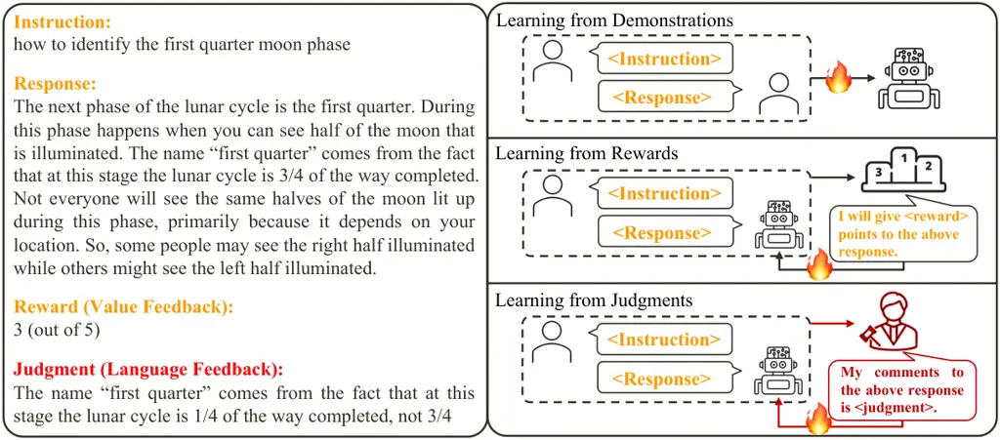

# Reasons to Reject? Aligning Language Models with Judgments

Weiwen Xu Deng Cai Zhisong Zhang Wai Lam Shuming Shi ^(†)^(†)thanks:
  Work done during an internship at Tencent AI Lab. The work described
in this paper is also partially supported by a grant from the Research
Grant Council of the Hong Kong Special Administrative Region, China
(Project Code: 14200719).^(†)^(†)thanks:   Corresponding author.
Email: [ {wwxu,wlam}@se.cuhk.edu.hk](mailto:) Email: [
{jcykcai,zhisonzhang,shumingshi}@tencent.com](mailto:)
Affiliation: Tencent AI Lab The Chinese University of Hong Kong

###### Abstract

As humans, we consistently interact with our peers and receive feedback
in the form of natural language. This language feedback allows us to
maintain appropriate behavior, and rectify potential errors. The
question arises naturally: can we use language feedback to align large
language models (LLMs)? In contrast to previous research that aligns
LLMs with scalar rewards, we present the first systematic exploration of
alignment through the lens of language feedback (i.e., judgment). We
start with an in-depth investigation of potential methods that can be
adapted for aligning LLMs with judgments, revealing that these methods
cannot fully capitalize on judgments. To facilitate more effective
utilization of judgments, we propose a novel framework, Contrastive
Unlikelihood Training (CUT), that allows for fine-grained inappropriate
content detection and correction based on judgments. Our results show
that, with merely 1317 off-the-shelf judgment data, CUT can beat the
175B DaVinci003 and surpass the best baseline by 50.84 points on
AlpacaEval using LLaMA2-13b. CUT can also align LLMs in an iterative
fashion using up-to-date model-specific judgments, improving performance
from 81.09 to 91.68 points on AlpacaEval using LLaMA2-chat-13b. Further
analysis suggests that judgments hold greater potential in LLM alignment
than rewards.¹¹ 1   Code available at:
[https://github.com/wwxu21/CUT](https://github.com/wwxu21/CUT)

## 1 Introduction

Large language models (LLMs) acquire substantial world knowledge and
reasoning capabilities through large-scale pre-training (Brown et al.,
2020; Du et al., 2022; Touvron et al., 2023). To unleash the power of
pre-trained LLMs for real-world applications, it is crucial to ensure
that LLMs can follow human preferences and values (Ouyang et al., 2022).
This process, known as alignment, is critical for making artificial
intelligence a helpful and reliable ally for humanity (Wang et al.,
2023b).

Figure 1 illustrates three paradigms to achieve alignment. The most
straightforward one is learning from demonstrations, wherein
demonstrations of desired responses to a set of instructions are
collected and used to fine-tune LLMs in a supervised fashion (Wei
et al., 2022; Ouyang et al., 2022). However, the performance gains
diminish rapidly as the data size increases (Zhou et al., 2023; Fu
et al., 2024). In contrast, learning from feedback (rewards or
judgements) offers a more scalable approach (Ouyang et al., 2022; Bai
et al., 2022a). One significant advantage of feedback over
demonstrations is that feedback can convey both positive and negative
aspects, enabling the model to discern desirable and undesirable
outcomes. In addition, feedback is tailored to the current model,
adhering to the principle of teaching according to the learner’s
aptitude.

Prior research on learning from feedback primarily focuses on value
feedback (i.e., scalar rewards), employing reinforcement learning (RL)
algorithms, such as PPO (Schulman et al., 2017), to optimize an LLM to
maximize the rewards of its generated responses. Nevertheless, scalar
rewards are information-sparse for solely indicating the goodness of a
response. On the other hand, language feedback (i.e., judgment) can
offer more nuanced commendations and critiques through natural language
expressions (Saunders et al., 2022). Specifically, judgments can
elucidate the specific aspects that are good or bad, the rationale
behind their evaluation, and suggestions for improvement. The above
suggests that aligning LLMs with judgments can be more advantageous.



Figure 1: The illustration of three paradigms for aligning LLMs.

In this study, we present an extensive investigation of potential
methods that can be adapted for aligning LLMs with judgments. To
facilitate a comprehensive aligning process, we propose a novel
framework, Contrastive Unlikelihood Training (CUT), that enables
fine-grained inappropriate content detection and correction based on
judgments. CUT detects inappropriate content in a response by
contrasting its generation probabilities under aligned and misaligned
conditions and further penalizes the inappropriate content with
unlikelihood training Welleck et al. (2020).

We carry out experiments for both offline and online alignment, wherein
the target LLM learns from the off-the-shelf judgments and the judgments
derived from self-generated responses, respectively. Extensive results
on offline alignment demonstrate the effectiveness of CUT in learning
from judgments in both cold-start (using unaligned base LLMs such as
LLaMA2) and warm-start (using aligned base LLMs such as LLaMA2-chat)
scenarios. Notably, when trained with only 1317 offline judgment data,
CUT attains a winning rate of 61.06 and outperforms the best baseline by
50.84 points on AlpacaEval using LLaMA2-13b. Furthermore, our online
alignment experiments show that CUT is capable of iteratively refining
LLMs using model-specific judgments, with a steady performance
improvement from 81.09 to 91.68 points on AlpacaEval using
LLaMA2-chat-13b. Our analysis comparing rewards and judgments suggests
that aligning LLMs with judgments offers significant potential and
warrants future research.

Our contributions can be summarized as follows: 1) We present the first
systematic exploration of aligning LLMs with judgments. 2) We introduce
a novel framework, CUT, that facilitates the alignment of LLMs through
fine-grained inappropriate content detection and correction based on
judgments. 3) Our results showcase the effectiveness of CUT in aligning
LLMs across cold-start and warm-start scenarios, generalist and
specialist applications, as well as offline and online settings. 4) Our
analysis indicates that judgments hold greater potential over rewards
for aligning LLMs.

## 2 Related Work

Existing approaches for learning from feedback can be classified into
two distinct categories: prompting and fine-tuning, differentiated by
whether updates to the LLMs’ parameters are absent or present.

Prompting. Prompting does not alter the parameters of LLMs. Instead, it
leverages judgments on previous responses to elicit improved responses
from LLMs (Welleck et al., 2022; Akyurek et al., 2023). Judgments can be
sourced from diverse aspects (Nathani et al., 2023) and the refinement
process can be iterated multiple times (Yang et al., 2022; Peng et al.,
2023a; Madaan et al., 2023). However, these methods rely on the
in-context learning capabilities of the LLMs and consume more
computation than single-pass generation (Brown et al., 2020; Liu et al.,
2023b).

Fine-tuning. Fine-tuning aims to train an LLM that can generate better
responses immediately. Scalar rewards have been extensively used through
the lens of RL, particularly PPO (Schulman et al., 2017; Ziegler et al.,
2019; Yang et al., 2023). However, PPO is known to be complex and
unstable (Zheng et al., 2023), which has attracted numerous efforts to
simplify or stabilize the training process (Ramamurthy et al., 2023;
Peng et al., 2023b; Dong et al., 2023; Touvron et al., 2023; Rafailov
et al., 2023; Yuan et al., 2023; Song et al., 2023; Hong et al., 2024).
Another strand of work, named Hindsight (Zhang et al., 2023; Liu et al.,
2023a), transforms scalar rewards to language instructions and teach
LLMs to generate responses of different qualities. There are also
attempts to leverage the results of prompting for training a better
model. That is, the improved response elicited by the judgment is
employed as new training data (Scheurer et al., 2022; Scheurer et al.,
2023; Yu et al., 2023). However, these methods still suffer from the
incapability to learn from mistakes, which is the core spirit of
learning from feedback.

## 3 Preliminaries

In this section, we first lay out a formal problem definition of
aligning LLMs with judgments and then present a survey of three
potential methods that can be adapted for tackling this problem.

### 3.1 Problem Setting

Suppose that there is a set of instruction-response-judgment triplets
$`(\bm{x},\bm{y},\bm{j})`$, where the instruction
$`\bm{x}=[x_{1},\ldots,x_{M}]`$, the response
$`\bm{y}=[y_{1},\ldots,y_{N}]`$, and the judgment
$`\bm{j}=[j_{1},\ldots,j_{Q}]`$ are token sequences of length $`M`$,
$`N`$, and $`Q`$, respectively. The response may exhibit flaws or be
considered entirely satisfactory. The judgment provides an analysis of
the strengths and weaknesses of the response, which can be drafted
either by humans or AI models (Akyurek et al., 2023; Li et al., 2023).
The goal of aligning LLMs with judgments is to enable LLMs to retain
appropriate behaviors mentioned in the strengths, and more importantly,
address the weaknesses to prevent future misbehavior.

Depending on whether the responses $`\bm{y}`$ are from the LLM to be
aligned, the learning process can be classified into two distinct types:
offline alignment and online alignment. In offline alignment, the target
LLM learns from an off-the-shelf, model-agnostic dataset. Conversely, in
online alignment, the target LLM reflects on its own outputs through
direct interactions with a judge. This online alignment process can be
conducted iteratively, akin to how humans continuously improve their
skills by receiving ongoing feedback from others over time.

[TABLE]

Table 1: The illustration of three categories of alignment data.
$`\bm{x}\xrightarrow{}\bm{y}`$ and
$`[\bm{x},\bm{j}]\xrightarrow{}\bm{y}`$ indicate if the response aligns
with the instruction or the combination of instruction and judgment,
respectively.

### 3.2 Potential Solutions

Forward Prediction refers to sequentially predicting the response and
its judgment (Chen et al., 2024), which was originally proposed in
dialogue generation (Weston, 2016; Li et al., 2017). It can be
seamlessly adapted to our problem. Specifically, the LLM is trained with
the maximum likelihood estimation (MLE) objective to first generate the
response $`\bm{y}`$ based on the instruction $`\bm{x}`$ and subsequently
generate the judgment $`\bm{j}`$ based on the combined sequence
$`[\bm{x},\bm{y}]`$.

```math
L_{f}=-\frac{1}{N}\sum_{t}\log p(y_{t}|y_{<t},\bm{x})-\frac{1}{Q}\sum_{t}\log p(j_{t}|j_{<t},\bm{y},\bm{x}) \tag{1}
```

Imitation learning from language feedback (ILF) asks the LLM to refine
the initial response $`\bm{y}`$ based on the feedback $`\bm{j}`$ to be
an improved response $`\hat{\bm{y}}`$.

```math
\hat{\bm{y}}=\textbf{LLM}(\bm{x},\bm{y},\bm{j}) \tag{2}
```

- •
  ILF-MLE: The improved response $`\hat{\bm{y}}`$ can be directly paired
  with the initial instruction $`\bm{x}`$ to fine-tune the LLM under the
  MLE objective (Bai et al., 2022b; Scheurer et al., 2022; Scheurer
  et al., 2023).

  ```math
  L_{i}^{mle}=-\frac{1}{N}\sum_{t}\log p(\hat{y}_{t}|\hat{y}_{<t},\bm{x}) \tag{3}
  ```

- •
  ILF-DPO: Yu et al. (2023) demonstrate that the improved response
  $`\hat{\bm{y}}`$ and the original response $`\bm{y}`$ can be used
  jointly as a pairwise comparison, where $`\hat{\bm{y}}`$ is a more
  preferred response to $`\bm{x}`$ compared to $`\bm{y}`$. As a result,
  preference learning algorithms, such as direct preference optimization
  (DPO) (Rafailov et al., 2023), can be adopted to fine-tune the LLM:
  $`L_{i}^{dpo}=\textbf{DPO}(\bm{x},\bm{y},\hat{\bm{y}})`$.

Hindsight rewrites the instruction $`\bm{x}`$ based on the scalar
rewards received by the response $`\bm{y}`$ (Zhang et al., 2023; Liu
et al., 2023a). For instance, if a response receives a scalar reward
below a certain threshold, the phrase “generate a good answer" is
appended to the original instruction. This approach can be naturally
extended to our problem setting. Concretely, the LLM is trained to
generate the response $`\bm{y}`$ conditioned on the sequence
$`[\bm{x},\bm{j}]`$.

```math
L_{h}=-\frac{1}{N}\sum_{t}\log p(y_{t}|y_{<t},\bm{x},\bm{j}) \tag{4}
```

However, in Forward Prediction, learning to generate judgments does not
necessarily translate into enhanced response generation, given that
response generation precedes judgment generation. The indirect usage of
judgment in ILF limits its capacity to spot and rectify weaknesses
underscored in judgments. Hindsight employs unsatisfactory responses as
MLE targets, which inevitably increases the risk of generating
unsatisfactory responses. In summary, we contend that existing methods
cannot fully capitalize on judgments, which motivates us to design a
better solution.

## 4 Contrastive Unlikelihood Training

To overcome the limitations mentioned in § 3, we propose CUT, a
fine-tuning framework to align LLMs with judgments. The core idea of CUT
is summarized as Learning from Contrasting. We contrast the response
generation under different conditions to shed light on the appropriate
behavior that the LLM should keep, as well as the specific content
necessitating adjustments. Based on these insights, we use MLE for
appropriate content and UT (Welleck et al., 2020) for inappropriate
content.

### 4.1 Incorporating Judgments for Alignment

We call an instruction-response pair “aligned" if the response follows
the instruction faithfully and satisfies human expectations
$`\bm{x}\xrightarrow{}\bm{y}`$. Otherwise, a judgment describes the
errors or deficiencies present in the response. Assuming the task is to
generate a response that intentionally fulfills the judgment, it can be
inferred that the response always aligns with the combined input of
instruction and judgment $`[\bm{x},\bm{j}]\xrightarrow{}\bm{y}`$. Based
on the idea, we construct three types of alignment data, depicted in
Table 1.

Align-P: The LLM produces a satisfactory response $`\bm{y}`$ to the
instruction $`\bm{x}`$. Therefore, a positive judgment $`\bm{j}`$ is
conferred to praise the commendable performance. The response $`\bm{y}`$
is aligned with the instruction $`\bm{x}`$ as well as the combined input
$`[\bm{x},\bm{j}]`$.

Align-N: The LLM makes some mistakes in its generation, resulting in an
unsatisfactory response $`\bm{y}`$. Consequently, a negative judgment
$`\bm{j}`$ details the corresponding critiques. For Align-N, $`\bm{y}`$
is not aligned with original instruction $`\bm{x}`$. However, when
considering $`\bm{x}`$ and $`\bm{j}`$ as a whole, $`\bm{y}`$ is indeed
aligned with the combined input $`[\bm{x},\bm{j}]`$.

Misalign: The authentic negative judgment in Align-N is substituted with
a fake positive judgment $`\bm{j}`$. In this case, the response
$`\bm{y}`$ is not aligned with either the original instruction
$`\bm{x}`$ or the combination of instruction and judgment
$`[\bm{x},\bm{j}]`$.

### 4.2 Learning from Contrasting

With the above three categories of alignment data. We can deduce two
notable contrasts that provide valuable insights to guide the alignment
of LLMs.

Figure 2: Generation probability of identical output text under Align-N
(left) and Misalign (right) contexts.

Align-N vs. Misalign: The major difference between these two is that
they show opposite polarities in the task of
$`[\bm{x},\bm{j}]\xrightarrow{}\bm{y}`$. Thanks to the strong in-context
learning capabilities of LLMs, the alignment flip from Align-N (aligned)
to Misalign (misaligned) is often accompanied by decreased generation
probabilities of the response, particularly for tokens that exhibit a
strong correlation with the authentic negative judgment. Figure 2
presents a simple example, wherein the response commits a minor
capitalization issue. The LLM assigns a considerably higher probability
for “a" when taking the authentic negative judgment $`\bm{j}^{-}`$
instead of the fake positive judgment $`\bm{j}^{+}`$ as additional
input, precisely at the point where the LLM commits the error.

To take advantage of the above contrast, we feed Align-N and Misalign
examples to the LLM to get token generation probabilities
$`p(y_{t}|\bm{y}_{<t},\bm{x},\bm{j}^{-})`$ and
$`p(y_{t}|\bm{y}_{<t},\bm{x},\bm{j}^{+})`$ separately. We consider the
tokens that display a substantially increased generation probability
when conditioned on $`\bm{j}^{-}`$ compared to $`\bm{j}^{+}`$ as
inappropriate tokens (e.g., “a” in Figure 2). Concretely, the following
criterion is adopted:

```math
\displaystyle U= \displaystyle\{t\;|\;p(y_{t}|\bm{y}_{<t},\bm{x},\bm{j}^{-})-\lambda\cdot p(y_{t}|\bm{y}_{<t},\bm{x},\bm{j}^{+})>0\} \tag{5}
```

where $`\lambda`$ is a hyperparameter to tradeoff the precision and
recall of detecting inappropriate tokens.

We apply the UT on the identified inappropriate tokens for pushing the
LLM to explore alternative generations. Motivated by the focal loss (Lin
et al., 2017), we introduce a dynamic weighting mechanism. This
mechanism is designed to modulate the penalty applied to inappropriate
tokens in proportion to their degree of inappropriateness. For other
tokens, we use the standard MLE loss:

```math
\displaystyle L_{1}= \displaystyle-\frac{1}{N}(\sum_{t\notin U}\log p(y_{t}|\bm{y}_{<t},\bm{x}) \tag{6}
```

```math
\displaystyle+\sum_{t\in U}\alpha p(y_{t}|\bm{y}_{<t},\bm{x},\bm{j}^{-})^{\gamma}\log(1-p(y_{t}|\bm{y}_{<t},\bm{x})))
```

where $`\alpha p(y_{t}|\bm{y}_{<t},\bm{x},\bm{j}^{-})^{\gamma}`$ is the
dynamic weight term. $`\alpha`$ and $`\gamma`$ are two hyper-parameters.
A higher value of $`p(y_{t}|\bm{y}_{<t},\bm{x},\bm{j}^{-})`$ suggests
that the response tokens have a stronger correlation with negative
judgments. Consequently, such tokens are more prone to be inappropriate
and are thus subjected to a larger unlikelihood penalty.

Align-P vs. Align-N: Despite both Align-P and Align-N are aligned in
terms of $`[\bm{x},\bm{j}]\xrightarrow{}\bm{y}`$, only Align-P is
aligned when solely considering the instruction
($`\bm{x}\xrightarrow{}\bm{y}`$). Essentially, it suggests that the LLM
should output different responses depending on whether a negative
judgment is incorporated or not. Therefore, the comparison provides
valuable information for the LLM to discern satisfactory and
unsatisfactory responses. Specifically, we train on this comparison with
the following MLE objective:

```math
\displaystyle\begin{aligned} L_{2}=&-\frac{\mathbbm{1}(\bm{x}\xrightarrow{}\bm{y})}{N}\sum_{t}\log p(y_{t}|\bm{y}_{<t},\bm{x})\\
&-\frac{(1-\mathbbm{1}(\bm{x}\xrightarrow{}\bm{y}))}{N}\sum_{t}\log p(y_{t}|\bm{y}_{<t},\bm{j},\bm{x})\end{aligned} \tag{7}
```

where $`\mathbbm{1}(\bm{x}\xrightarrow{}\bm{y})`$ is an indicator
function that returns $`1`$ if $`x`$ and $`y`$ are aligned, and $`0`$
otherwise.

Finally, the overall loss of CUT combines the losses from the two
contrasts: $`L_{\text{CUT}}=L_{1}+L_{2}`$.

### 4.3 Relation to Prior Solutions

We discuss the connections of CUT to prior solutions of learning from
judgments.

Forward Prediction hopes that the judgment generation could indirectly
boost its response generation abilities. In contrast, CUT directly
utilizes judgments to teach the LLM how to generate satisfactory
responses and avoid unsatisfactory ones.

ILF assumes judgments can always elicit improved responses. This
solution essentially learns from such pseudo improved response.
Conversely, CUT can directly learn from misaligned data.

Hindsight learns to generate responses of different qualities at the
risk of increasing the likelihood of unsatisfactory responses. In
comparison to Hindsight, CUT mitigates this issue by incorporating both
likelihood and unlikelihood training objectives.

## 5 Experiments

|                 |                    |           |       |           |       |            |       |            |     |
| --------------- | ------------------ | --------- | ----- | --------- | ----- | ---------- | ----- | ---------- | --- |
| Method          |                    | Objective | ARC   | HellaSwag | MMLU  | TruthfulQA | Avg.  | AlpacaEval |     |
| LLaMA2-13b      | Base               | \-        | 59.72 | 81.39     | 54.97 | 36.28      | 58.09 | 1.87       |     |
|                 | Forward Prediction | MLE       | 56.91 | 81.03     | 54.35 | 34.28      | 56.64 | 7.11       |     |
|                 | Hindsight          | MLE       | 58.11 | 81.33     | 55.33 | 35.61      | 57.60 | 10.22      |     |
|                 | ILF-MLE            | MLE       | 58.36 | 81.15     | 53.76 | 37.03      | 57.58 | 4.01       |     |
|                 | ILF-DPO            | DPO       | 58.79 | 81.07     | 55.48 | 41.84      | 59.3  | 3.11       |     |
|                 | CUT (ours)         | MLE+UT    | 60.84 | 81.44     | 55.78 | 49.33      | 61.85 | 61.06      |     |
| LLaMA2-chat-13b | Base               | \-        | 58.02 | 79.89     | 54.52 | 45.44      | 59.47 | 81.09      |     |
|                 | Forward Prediction | MLE       | 52.22 | 78.16     | 53.06 | 37.69      | 55.28 | 33.21      |     |
|                 | Hindsight          | MLE       | 53.92 | 78.58     | 54.15 | 39.01      | 56.42 | 36.67      |     |
|                 | ILF-MLE            | MLE       | 58.36 | 81.15     | 53.76 | 45.65      | 59.73 | 79.31      |     |
|                 | ILF-DPO            | DPO       | 58.81 | 80.04     | 54.98 | 51.51      | 61.34 | 83.22      |     |
|                 | CUT (ours)         | MLE+UT    | 58.45 | 79.86     | 55.00 | 52.58      | 61.47 | 90.73      |     |

Table 2: Results on General Instruction-following. Objective column
denotes the fine-tuning objective.

|                 |                    |        |        |        |           |
| --------------- | ------------------ | ------ | ------ | ------ | --------- |
| Model           |                    | rouge1 | rouge2 | rougeL | rougeLsum |
| LLaMA2-13b      | Base               | 12.91  | 6.33   | 10.10  | 10.87     |
|                 | Forward Prediction | 42.42  | 28.02  | 38.45  | 38.51     |
|                 | Hindsight          | 38.33  | 25.49  | 35.26  | 35.29     |
|                 | ILF-MLE            | 28.51  | 16.68  | 25.36  | 25.44     |
|                 | ILF-DPO            | 11.31  | 7.45   | 10.23  | 10.77     |
|                 | CUT (ours)         | 45.39  | 28.40  | 39.84  | 39.89     |
| LLaMA2-chat-13b | Base               | 29.21  | 15.00  | 22.78  | 23.44     |
|                 | Forward Prediction | 42.44  | 28.12  | 38.48  | 38.46     |
|                 | Hindsight          | 41.02  | 27.48  | 37.42  | 37.46     |
|                 | ILF-MLE            | 39.21  | 27.93  | 34.35  | 34.66     |
|                 | ILF-DPO            | 33.90  | 19.81  | 28.01  | 28.18     |
|                 | CUT (ours)         | 45.31  | 29.04  | 39.96  | 40.12     |

Table 3: Results on the summarization task.

To provide a comprehensive assessment of CUT, we implement it in two
alignment scenarios: offline alignment and online alignment. In the
offline alignment experiments, we perform extensive analysis on the
adaptability and universality of CUT across different model and task
configurations. In the online alignment experiments, we additionally
explore the possibility of building an automatic judgment model. Lastly,
to highlight the potential of aligning LLMs with judgments, we establish
a comparison between learning from rewards and learning from judgments.

Tasks. We experiment on both general instruction-following and a
specific NLP task (summarization). For Instruction following, we
evaluate models on both AlpacaEval and four additional conventional NLP
benchmarks: 25-shot ARC, 10-shot HellaSwag, 5-shot MMLU, and 0-shot
TruthfulQA. For AlpacaEval, we report the winning rate of the responses
generated by our models against DaVinci003 using GPT4 as the judge. The
four conventional NLP benchmarks are ranking-based and we report
accuracies. For Summarization, we use the dataset from Saunders et al.
(2022) and report ROUGE scores (Lin, 2004) on 1939 test examples. See
Appendix A.3 for more details.

Baselines. The baselines include the base model without further
fine-tuning, and the three groups of judgment-based alignment methods:
(1) The Forward Prediction method described in Eq. 1 (Weston, 2016); (2)
The Hindsight method described in Eq. 4 (Zhang et al., 2023); (3)
ILF-MLE described in Eq. 3 (Scheurer et al., 2022), and ILF-DPO (Yu
et al., 2023) that change the learning objective from MLE to DPO. The
details of the model implementations are provided in Appendix A.1.

### 5.1 Offline Alignment

The offline setting utilizes off-the-shelf instruction-response-judgment
triplets for alignment. This aims to validate and analyze CUT in
controlled environments prior to initiating the costly process of
model-specific judgment annotation. For instruction following, we train
models with 1317 examples from Shepherd (Wang et al., 2023a). For
summarization, we use the 10827 training examples with judgment
annotations from Saunders et al. (2022).

Results. The results of the general instruction-following and
summarization are presented in Table 2 and 3, respectively. For
cold-start scenarios (LLaMA2-13b as the base model), CUT improves the
winning rate on AlpacaEval from 1.87 to 61.06, where CUT beats the 175B
DaVinci003 and surpasses the best baseline (Hindsight) by 50.84 points.
Moreover, CUT improves the base model by 13.05 points on TruthfulQA.
This implies that CUT can effectively mitigate hallucinations.
Conversely, most baselines improve marginally or experience performance
drops on TruthfulQA. This is likely due to their application of the MLE
objective on error-prone responses, which reduces factuality in response
generation. In terms of ARC, HellaSwag, and MMLU, CUT remains
competitive with the base model, indicating CUT suffers less from the
alignment tax problem (Ouyang et al., 2022). For single NLP task (i.e.,
summarization) experiments, CUT surpasses the best baseline (i.e.,
Forward Prediction) by 1.38 rougeLsum scores. Overall, the results show
that CUT is effective in transforming LLMs into both performant
generalist and specialist models.

The performance superiority of CUT in warm-start scenarios
(LLaMA2-chat-13b as the base model) are consistent with the cold-start
ones. The two ILF methods (ILF-MLE and ILF-DPO) outperform methods from
Forward Prediction and Hindsight groups on AlpacaEval in warm-start but
perform worse in cold-start scenarios. This may be due to that ILF
methods heavily rely on the base model in producing high-quality
improved responses, making it less effective in cold-start scenarios.

|                                  |            |            |
| -------------------------------- | ---------- | ---------- |
| Model                            | Generalist | Specialist |
| LLaMA2-chat-13b                  | 45.44      | 23.44      |
| CUT                              | 52.58      | 40.12      |
| \- $`L_{1}`$                     | 39.01      | 37.46      |
| \- first part of $`L_{2}`$       | \-         | 26.37      |
| \- second part of $`L_{2}`$      | 47.24      | 33.92      |
| \- Inappropriate Token Detection | 0          | 0          |
| \- Dynamic Weighting             | 48.84      | 40.05      |

Table 4: Effect of CUT designs. We report the results on TruthfulQA
(Acc.) and summarization test set (rougeLsum) for general
instruction-following (Generalist) and Summarization (Specialist)
respectively. “-” indicates no Align-P examples in the Generalist
training set.

Ablation Study. To investigate the effectiveness of two contrasts
employed by CUT, we perform ablation studies by eliminating certain
training signals. The results are shown in Table 4. Removing the
contrast between Align-N and Misalign (- $`L_{1}`$) substantially
reduces the performance of TruthfulQA. This finding highlights that the
UT objective plays a crucial role in mitigating hallucinations. The
exclusion of the contrast between Align-P and Align-N can be implemented
in two ways. We can either remove the first part or the second part of
$`L_{2}`$. As seen, the impact of removing Align-P is more pronounced
than removing Align-N on the summarization task. This may be attributed
to the necessity of positive examples for adapting the LLM to a specific
task. Furthermore, we introduce an additional ablated variant in which
the inappropriate token detection (Eq. 5) is omitted (- Inappropriate
Token Detection). Concretely, we simply apply UT for all tokens in
misaligned responses instead. Intriguingly, we find that this approach
fails to converge during training. This observation underscores the
importance of inappropriate token detection. Lastly, removing the
dynamic weighting term
($`p(y_{t}|\bm{y}_{<t},\bm{x},\bm{j}^{-})^{\gamma}`$ in Eq. 6) also
impacts the effectiveness of CUT, particularly in general
instruction-following tasks.

|                           |       |       |       |       |            |
| ------------------------- | ----- | ----- | ----- | ----- | ---------- |
| Method                    | ARC   | HeSw  | MMLU  | TQA   | AlpacaEval |
| Different Model Size      |       |       |       |       |            |
| LLaMA2-7b-chat            | 51.45 | 78.63 | 43.60 | 43.71 | 71.40      |
| \+ CUT                    | 53.16 | 79.23 | 46.95 | 51.40 | 86.94      |
| LLaMA2-13b-chat           | 58.02 | 79.89 | 54.52 | 45.44 | 81.09      |
| \+ CUT                    | 58.45 | 79.86 | 55.00 | 52.58 | 90.73      |
| LLaMA2-70b-chat           | 65.27 | 83.89 | 63.07 | 53.09 | 92.70      |
| \+ CUT                    | 66.30 | 84.00 | 62.71 | 55.45 | 93.04      |
| Different Backbone Models |       |       |       |       |            |
| Mistral-7b-it-v1          | 53.67 | 74.00 | 54.66 | 55.54 | 69.33      |
| \+ CUT                    | 54.27 | 75.70 | 54.98 | 57.61 | 82.75      |
| gemma-7b-it               | 51.37 | 71.67 | 51.66 | 30.35 | 78.51      |
| \+ CUT                    | 51.96 | 72.53 | 52.28 | 30.72 | 81.96      |
| llama3-8b-it              | 62.20 | 78.83 | 65.81 | 51.65 | 93.79      |
| \+ CUT                    | 61.83 | 78.91 | 65.60 | 51.82 | 94.09      |

Table 5: Effect of CUT on different model sizes and different
instruction-tuned models. HeSw denotes HellaSwag and TQA denotes
TruthfulQA.

Adaptability of CUT. Table 5 presents the impact of CUT framework on a
diverse array of models, spanning across multiple model sizes and
various instruction-tuned backbone architectures. This examination
enables a multifaceted understanding of CUT’s effectiveness and its
potential scalability across different model configurations. The upper
part of Table 5 focuses on the model sizes, which are analyzed on the
LLaMA2-chat family across three distinct scales: 7B, 13B, and 70B. CUT
consistently improves the performance across all sizes of the
LLaMA2-chat models. This shows that CUT could be scaled up into larger
models. Progressing beyond model sizes, the bottom part of Table 5
broadens the scope to include various instruction-tuned backbone
models - Mistral-7b-instruct-v1 (Jiang et al., 2023), gemma-7b-it (Team
et al., 2024), and llama3-8b-instruct²² 2
[https://llama.meta.com/llama3](https://llama.meta.com/llama3). CUT
consistently elevates performance across almost all evaluated tasks.
This exploration extends the effectiveness of CUT beyond a single model
family, shedding light on its adaptability and utility across different
model architectures.

|                             |      |       |           |       |            |            |
| --------------------------- | ---- | ----- | --------- | ----- | ---------- | ---------- |
| Model                       | \#J  | ARC   | HellaSwag | MMLU  | TruthfulQA | AlpacaEval |
| LLaMA2-chat-13b             | \-   | 58.02 | 79.89     | 54.52 | 45.44      | 81.09      |
| CUT (ours)                  | 1317 | 58.45 | 79.86     | 55.00 | 52.58      | 90.73      |
| CUT 1+ (online iteration-1) | 1000 | 58.02 | 79.55     | 54.62 | 50.56      | 89.75      |
| CUT 2+ (online iteration-2) | 1000 | 57.94 | 79.18     | 54.83 | 51.67      | 90.23      |
| CUT 3+ (online iteration-3) | 1000 | 58.11 | 79.99     | 55.00 | 52.69      | 91.04      |
| CUT 4+ (online iteration-4) | 1000 | 58.36 | 79.23     | 55.02 | 52.56      | 91.68      |
| CUT 5+ (online iteration-5) | 1000 | 58.45 | 79.19     | 55.20 | 52.96      | 90.68      |

Table 6: The results of online iterative alignment. \#J denotes the
number of judgment data used in each iteration.

### 5.2 Online Alignment

In this section, we move to a more pragmatic scenario where the target
LLM directly learns from the judgments associated with its own
responses. As mentioned in § 3.1, the online alignment process can be
conducted iteratively, akin to how humans continuously refine their
behaviors through ongoing feedback. Specifically, we apply the following
three steps repeatedly:

- •
  Step 1: Collect a set of instructions $`\bm{x}`$, and obtain the
  responses $`\bm{y}`$ from the target model.
- •
  Step 2: Annotate judgments $`\bm{j}`$ for the responses.
- •
  Step 3: Apply CUT to fine-tune the target model with
  $`\{\bm{x},\bm{y},\bm{j}\}`$.

where the target LLM is LLaMA2-chat-13b. In each iteration, we sample
1000 distinct instructions from Stanford Alpaca (Taori et al., 2023). We
ask GPT4 for drafting judgments, which has been proven to produce
high-quality annotations (Cui et al., 2023). Annotation details are
elaborated in Appendix A.2. Note that most responses from
LLaMA2-chat-13b receive positive judgments, resulting in a large
proportion of Align-P examples. We found downsampling Align-P examples
is beneficial to the online alignment (see Appendix A.4). We evaluate
models on ARC, HellaSwag, MMLU, TruthfulQA, and AlpacaEval.

Figure 3: The results of online alignment with different AI judges.

Results. Table 6 shows the results of online iterative alignment. In the
first iteration, online alignment exhibits superior performance over
offline alignment on both TruthfulQA and AlpacaEval. This observation
implies that model-specific judgments are more effective for alignment.
More importantly, the alignment continues to improve with more
iterations, where the performance rises from 81.09 to 91.68 on
AlpacaEval after four iterations. However, the performance improvement
ceases at the fifth iteration. We speculate two possible explanations
for this occurrence: (1) the judgments provided by GPT-4 contain certain
inaccuracies, making them insufficient to effectively align a strong
target model like our CUT 4+. (2) The target model may exhibit a
knowledge deficiency in specific domains, such as mathematics and
science, which cannot be adequately addressed through judgments. We also
provide a case study in Appendix A.5.

#### 5.2.1 Training A Judgment Model

In the previous experiments, we show that CUT is effective in aligning
LLMs with judgments annotated by humans or GPT4. However, human
annotations can be very expensive. The use of GPT4 assumes that a very
strong LLM already exists. Next, we investigate the possibilities of
developing an AI judge based on the target LLM.

Setup. we train AI judges with different amounts of judgment data
$`\{3000,5000\}`$ collected in § 5.2. Then, we sample 1000 new
instructions from Stanford Alpaca, obtain the corresponding responses
from the target model (i.e., LLaMA2-chat-13b), and label judgments with
our AI judges. These new judgment triplets are used to align the target
model.

Results. Figure 3 shows that AI judge-5000, trained with 5000 judgment
data, is beneficial for aligning the target LLM, which leads to
improvements of 3.02 and 4.17 points compared to LLaMA2-chat-13b on
TruthfulQA and AlpacaEval respectively. In contrast, AI Judge-3000,
using a smaller training dataset, shows limited effectiveness. The
comparison suggests that training a capable AI judge necessitates a
moderate number of high-quality training instances. As a result, it is
feasible to train AI judges to align the LLM. However, the quality of
the AI judge remains a crucial factor in determining the success of this
endeavor.

Figure 4: Comparison between reward-based DPO and judgment-based CUT.

### 5.3 Judgment vs. Reward

Our work primarily focuses on aligning LLMs with judgments, whereas most
prior research explores rewards. In this section, we aim to provide a
direct comparison between these two paradigms. However, note that it is
hard to conduct a fair comparison due to the distinct data formats and
the potential variation in data quality.

Setup. We compare judgment-based CUT with the state-of-the-art
reward-based DPO (Rafailov et al., 2023). To maximize fairness, we
leverage UltraFeedback (Cui et al., 2023), which contains both reward
and judgment annotations produced by GPT4. Our preliminary experiments
show that CUT is not good using the original judgments in UltraFeedback.
We find that the reason is that the judgments in UltraFeedback tend to
commend the strengths of given responses. This type of judgment is
unsuitable for our CUT, as we primarily use judgments for inappropriate
token detection. Therefore, we re-collect judgments on the same
instruction-response pairs from GPT4 using our prompt (Appendix A.2).
Due to budget constraints, we randomly sample up to 3000 instructions
(with 4 responses each, totaling 12,000 pairs) for annotation. The
implementation details are as follows:

- •
  DPO: For each of the above instructions, we formulate preference data
  by enumerating all possible pairs of responses from the given four,
  excluding pairs with the same reward value.
- •
  CUT-UF: We fine-tune the base model on the above instruction-response
  pairs and their original judgments from UltraFeedback using CUT.
- •
  CUT: We use the same instruction-response pairs as CUT-UF but with our
  re-annotated judgments.

Results. Figure 4 (a) shows the effect of three alignment methods using
1000 instructions as the alignment data. We can observe that CUT
consistently improves over CUT-UF on all five tasks for two base models,
which verifies our assumption that CUT is more effective when using
critics as the judgment. Notably, CUT surpasses DPO by a large margin of
37.54 and 23.04 points on AlpacaEval for two base models, respectively.
This shows that CUT is more effective in aligning LLMs with limited
alignment data (i.e., 1000 instructions). Figure 4 (b) depicts the
trends when adding more data for CUT and DPO alignment. The performance
of CUT on these tasks is generally better or comparable to that of DPO
and demonstrates a positive correlation with the size of the training
data provided. The above observations suggest that judgments hold
greater potential than rewards in aligning LLMs. CUT is slightly worse
than DPO on ARC, and HellaSwag. We hypothesize that the performance
discrepancy is partly caused by the evaluation protocols: the four tasks
are ranking-based. As suggested Bansal et al. (2023), methods such as
DPO, which leverage ranking data in the alignment possess inherent
advantages in ranking-based tasks. We also provide a case study in
Appendix A.6.

## 6 Conclusion

We systematically explored the alignment of LLMs through the lens of
judgments. We investigated three potential methods that can be adapted
for aligning LLMs with judgments but found them unable to fully
capitalize on judgments. We proposed a novel framework CUT, that enables
direct and explicit learning from judgments and facilitates fine-grained
inappropriate content detection and correction. Extensive evaluations
demonstrated the effectiveness of our CUT in various settings, including
offline and online, specialist and generalist, as well as cold-start and
warm-start scenarios. For example, the online alignment experiments
showed that CUT can iteratively improve LLMs with up-to-date
model-specific judgments, akin to how humans progressively refine their
behaviors through ongoing feedback. Our analysis comparing rewards and
judgments suggested that aligning LLMs with judgments is a promising
research area.

## Limitations

##### Quality of Judgment Models

Despite the positive alignment results of our AI judge mentioned in
Figure 3, we find the quality of its generated judgments is not
satisfactory and significantly inferior to those generated by GPT4.
Therefore, we discuss from the point of judgment generation and identify
two limitations when interacting with AI judges:

- •
  AI judges often make inaccurate judgments, leading to potential
  misclassification of inappropriate tokens as appropriate and vice
  versa. This may increase the risk of hallucination. To address this
  issue, periodically involving human annotators to provide accurate
  judgments can be a good attempt to reduce the hallucinations
  accumulated during interactions with AI judges.
- •
  In an attempt to augment the training size, we incorporated the 1317
  judgment data from Shepherd for training the AI judge. However, after
  including Shepherd, the AI judge’s performance deteriorated, resulting
  in more illogical judgments such as "The original answer 100 is
  incorrect. The correct answer should be 100." We hypothesize that
  reasoning and math tasks from Shepherd are too complex for a 13b model
  to comprehend. Consequently, larger language models may be required to
  achieve better judgment generation quality, a notion supported by
  Saunders et al. (2022).

##### Size of Alignment Data

Due to budgetary constraints, our research currently involves
experiments utilizing several thousands of judgment data. In future
research endeavors, we would like to investigate the scaling law with an
expanded volume of judgment data.

## References

- Akyurek et al. (2023) Afra Feyza Akyurek, Ekin Akyurek, Ashwin Kalyan,
  Peter Clark, Derry Tanti Wijaya, and Niket Tandon. 2023. RL4F:
  Generating natural language feedback with reinforcement learning for
  repairing model outputs. In _Proc. of ACL_.
- Bai et al. (2022a) Yuntao Bai, Andy Jones, Kamal Ndousse, Amanda
  Askell, Anna Chen, Nova DasSarma, Dawn Drain, Stanislav Fort, Deep
  Ganguli, Tom Henighan, et al. 2022a. [Training a helpful and harmless
  assistant with reinforcement learning from human
  feedback](https://arxiv.org/abs/2204.05862). _ArXiv preprint_,
  abs/2204.05862.
- Bai et al. (2022b) Yuntao Bai, Saurav Kadavath, Sandipan Kundu, Amanda
  Askell, Jackson Kernion, Andy Jones, Anna Chen, Anna Goldie, Azalia
  Mirhoseini, Cameron McKinnon, et al. 2022b. [Constitutional ai:
  Harmlessness from ai feedback](https://arxiv.org/abs/2212.08073).
  _ArXiv preprint_, abs/2212.08073.
- Bansal et al. (2023) Hritik Bansal, John Dang, and Aditya
  Grover. 2023. [Peering through preferences: Unraveling feedback
  acquisition for aligning large language
  models](https://arxiv.org/abs/2308.15812). _ArXiv preprint_,
  abs/2308.15812.
- Brown et al. (2020) Tom B. Brown, Benjamin Mann, Nick Ryder, Melanie
  Subbiah, Jared Kaplan, Prafulla Dhariwal, Arvind Neelakantan, Pranav
  Shyam, Girish Sastry, Amanda Askell, Sandhini Agarwal, Ariel
  Herbert-Voss, Gretchen Krueger, Tom Henighan, Rewon Child, Aditya
  Ramesh, Daniel M. Ziegler, Jeffrey Wu, Clemens Winter, Christopher
  Hesse, Mark Chen, Eric Sigler, Mateusz Litwin, Scott Gray, Benjamin
  Chess, Jack Clark, Christopher Berner, Sam McCandlish, Alec Radford,
  Ilya Sutskever, and Dario Amodei. 2020. [Language models are few-shot
  learners](https://proceedings.neurips.cc/paper/2020/hash/1457c0d6bfcb4967418bfb8ac142f64a-Abstract.html).
  In _Advances in Neural Information Processing Systems 33: Annual
  Conference on Neural Information Processing Systems 2020, NeurIPS
  2020, December 6-12, 2020, virtual_.
- Chen et al. (2024) Kai Chen, Chunwei Wang, Kuo Yang, Jianhua Han,
  Lanqing HONG, Fei Mi, Hang Xu, Zhengying Liu, Wenyong Huang, Zhenguo
  Li, Dit-Yan Yeung, and Lifeng Shang. 2024. [Gaining wisdom from
  setbacks: Aligning large language models via mistake
  analysis](https://openreview.net/forum?id=aA33A70IO6). In _The Twelfth
  International Conference on Learning Representations_.
- Clark et al. (2018) Peter Clark, Isaac Cowhey, Oren Etzioni, Tushar
  Khot, Ashish Sabharwal, Carissa Schoenick, and Oyvind Tafjord. 2018.
  [Think you have solved question answering? try arc, the ai2 reasoning
  challenge](https://arxiv.org/abs/1803.05457). _ArXiv preprint_,
  abs/1803.05457.
- Cui et al. (2023) Ganqu Cui, Lifan Yuan, Ning Ding, Guanming Yao, Wei
  Zhu, Yuan Ni, Guotong Xie, Zhiyuan Liu, and Maosong Sun. 2023.
  [Ultrafeedback: Boosting language models with high-quality
  feedback](https://arxiv.org/abs/2310.01377). _ArXiv preprint_,
  abs/2310.01377.
- Dong et al. (2023) Hanze Dong, Wei Xiong, Deepanshu Goyal, Rui Pan,
  Shizhe Diao, Jipeng Zhang, Kashun Shum, and Tong Zhang. 2023. [Raft:
  Reward ranked finetuning for generative foundation model
  alignment](https://arxiv.org/abs/2304.06767). _ArXiv preprint_,
  abs/2304.06767.
- Du et al. (2022) Zhengxiao Du, Yujie Qian, Xiao Liu, Ming Ding,
  Jiezhong Qiu, Zhilin Yang, and Jie Tang. 2022. [GLM: General language
  model pretraining with autoregressive blank
  infilling](https://aclanthology.org/2022.acl-long.26). In _Proceedings
  of the 60th Annual Meeting of the Association for Computational
  Linguistics (Volume 1: Long Papers)_.
- Fu et al. (2024) Tingchen Fu, Deng Cai, Lemao Liu, Shuming Shi, and
  Rui Yan. 2024. Disperse-then-merge: Pushing the limits of instruction
  tuning via alignment tax reduction. In _Findings of the Association
  for Computational Linguistics: ACL 2024_.
- Gao et al. (2021) Leo Gao, Jonathan Tow, Stella Biderman, Sid Black,
  Anthony DiPofi, Charles Foster, Laurence Golding, Jeffrey Hsu, Kyle
  McDonell, Niklas Muennighoff, Jason Phang, Laria Reynolds, Eric Tang,
  Anish Thite, Ben Wang, Kevin Wang, and Andy Zou. 2021. A framework for
  few-shot language model evaluation.
- Hendrycks et al. (2021) Dan Hendrycks, Collin Burns, Steven Basart,
  Andy Zou, Mantas Mazeika, Dawn Song, and Jacob Steinhardt. 2021.
  [Measuring massive multitask language
  understanding](https://openreview.net/forum?id=d7KBjmI3GmQ). In _9th
  International Conference on Learning Representations, ICLR 2021,
  Virtual Event, Austria, May 3-7, 2021_.
- Hong et al. (2024) Jiwoo Hong, Noah Lee, and James Thorne. 2024.
  Reference-free monolithic preference optimization with odds ratio.
  _arXiv preprint arXiv:2403.07691_.
- Hu et al. (2022) Edward J. Hu, Yelong Shen, Phillip Wallis, Zeyuan
  Allen-Zhu, Yuanzhi Li, Shean Wang, Lu Wang, and Weizhu Chen. 2022.
  [Lora: Low-rank adaptation of large language
  models](https://openreview.net/forum?id=nZeVKeeFYf9). In _The Tenth
  International Conference on Learning Representations, ICLR 2022,
  Virtual Event, April 25-29, 2022_.
- Jiang et al. (2023) Albert Q Jiang, Alexandre Sablayrolles, Arthur
  Mensch, Chris Bamford, Devendra Singh Chaplot, Diego de las Casas,
  Florian Bressand, Gianna Lengyel, Guillaume Lample, Lucile Saulnier,
  et al. 2023. Mistral 7b. _arXiv preprint arXiv:2310.06825_.
- Lee et al. (2023) Ariel N Lee, Cole J Hunter, and Nataniel Ruiz. 2023.
  [Platypus: Quick, cheap, and powerful refinement of
  llms](https://arxiv.org/abs/2308.07317). _ArXiv preprint_,
  abs/2308.07317.
- Li et al. (2017) Jiwei Li, Alexander H. Miller, Sumit Chopra,
  Marc’Aurelio Ranzato, and Jason Weston. 2017. [Dialogue learning with
  human-in-the-loop](https://openreview.net/forum?id=HJgXCV9xx). In _5th
  International Conference on Learning Representations, ICLR 2017,
  Toulon, France, April 24-26, 2017, Conference Track Proceedings_.
- Li et al. (2023) Junlong Li, Shichao Sun, Weizhe Yuan, Run-Ze Fan, Hai
  Zhao, and Pengfei Liu. 2023. [Generative judge for evaluating
  alignment](https://arxiv.org/abs/2310.05470). _ArXiv preprint_,
  abs/2310.05470.
- Lin (2004) Chin-Yew Lin. 2004. [ROUGE: A package for automatic
  evaluation of summaries](https://aclanthology.org/W04-1013). In _Text
  Summarization Branches Out_.
- Lin et al. (2022) Stephanie Lin, Jacob Hilton, and Owain Evans. 2022.
  [TruthfulQA: Measuring how models mimic human
  falsehoods](https://aclanthology.org/2022.acl-long.229). In
  _Proceedings of the 60th Annual Meeting of the Association for
  Computational Linguistics (Volume 1: Long Papers)_.
- Lin et al. (2017) Tsung-Yi Lin, Priya Goyal, Ross Girshick, Kaiming
  He, and Piotr Dollár. 2017. Focal loss for dense object detection. In
  _Proceedings of the IEEE international conference on computer vision_,
  pages 2980–2988.
- Liu et al. (2023a) Hao Liu, Carmelo Sferrazza, and Pieter Abbeel.
  2023a. [Languages are rewards: Hindsight finetuning using human
  feedback](https://arxiv.org/abs/2302.02676). _ArXiv preprint_,
  abs/2302.02676.
- Liu et al. (2023b) Pengfei Liu, Weizhe Yuan, Jinlan Fu, Zhengbao
  Jiang, Hiroaki Hayashi, and Graham Neubig. 2023b. Pre-train, prompt,
  and predict: A systematic survey of prompting methods in natural
  language processing. _ACM Computing Surveys_, (9).
- Madaan et al. (2023) Aman Madaan, Niket Tandon, Prakhar Gupta, Skyler
  Hallinan, Luyu Gao, Sarah Wiegreffe, Uri Alon, Nouha Dziri, Shrimai
  Prabhumoye, Yiming Yang, et al. 2023. [Self-refine: Iterative
  refinement with self-feedback](https://arxiv.org/abs/2303.17651).
  _ArXiv preprint_, abs/2303.17651.
- Nathani et al. (2023) Deepak Nathani, David Wang, Liangming Pan, and
  William Yang Wang. 2023. [Maf: Multi-aspect feedback for improving
  reasoning in large language models](https://arxiv.org/abs/2310.12426).
  _ArXiv preprint_, abs/2310.12426.
- Ouyang et al. (2022) Long Ouyang, Jeffrey Wu, Xu Jiang, Diogo Almeida,
  Carroll Wainwright, Pamela Mishkin, Chong Zhang, Sandhini Agarwal,
  Katarina Slama, Alex Ray, et al. 2022. Training language models to
  follow instructions with human feedback. _Advances in Neural
  Information Processing Systems_.
- Peng et al. (2023a) Baolin Peng, Michel Galley, Pengcheng He, Hao
  Cheng, Yujia Xie, Yu Hu, Qiuyuan Huang, Lars Liden, Zhou Yu, Weizhu
  Chen, et al. 2023a. [Check your facts and try again: Improving large
  language models with external knowledge and automated
  feedback](https://arxiv.org/abs/2302.12813). _ArXiv preprint_,
  abs/2302.12813.
- Peng et al. (2023b) Baolin Peng, Linfeng Song, Ye Tian, Lifeng Jin,
  Haitao Mi, and Dong Yu. 2023b. [Stabilizing rlhf through advantage
  model and selective rehearsal](https://arxiv.org/abs/2309.10202).
  _ArXiv preprint_, abs/2309.10202.
- Rafailov et al. (2023) Rafael Rafailov, Archit Sharma, Eric Mitchell,
  Christopher D Manning, Stefano Ermon, and Chelsea Finn. 2023. [Direct
  preference optimization: Your language model is secretly a reward
  model](https://openreview.net/forum?id=HPuSIXJaa9). In _Thirty-seventh
  Conference on Neural Information Processing Systems_.
- Ramamurthy et al. (2023) Rajkumar Ramamurthy, Prithviraj Ammanabrolu,
  Kianté Brantley, Jack Hessel, Rafet Sifa, Christian Bauckhage,
  Hannaneh Hajishirzi, and Yejin Choi. 2023. Is reinforcement learning
  (not) for natural language processing: Benchmarks, baselines, and
  building blocks for natural language policy optimization. In _The
  Eleventh International Conference on Learning Representations_.
- Saunders et al. (2022) William Saunders, Catherine Yeh, Jeff Wu,
  Steven Bills, Long Ouyang, Jonathan Ward, and Jan Leike. 2022.
  [Self-critiquing models for assisting human
  evaluators](https://arxiv.org/abs/2206.05802). _ArXiv preprint_,
  abs/2206.05802.
- Scheurer et al. (2022) Jérémy Scheurer, Jon Ander Campos, Jun Shern
  Chan, Angelica Chen, Kyunghyun Cho, and Ethan Perez. 2022. [Training
  language models with natural language
  feedback](https://arxiv.org/abs/2204.14146). _ArXiv preprint_,
  abs/2204.14146.
- Scheurer et al. (2023) Jérémy Scheurer, Jon Ander Campos, Tomasz
  Korbak, Jun Shern Chan, Angelica Chen, Kyunghyun Cho, and Ethan
  Perez. 2023. [Training language models with language feedback at
  scale](https://arxiv.org/abs/2303.16755). _ArXiv preprint_,
  abs/2303.16755.
- Schulman et al. (2017) John Schulman, Filip Wolski, Prafulla Dhariwal,
  Alec Radford, and Oleg Klimov. 2017. [Proximal policy optimization
  algorithms](https://arxiv.org/abs/1707.06347). _ArXiv preprint_,
  abs/1707.06347.
- Song et al. (2023) Feifan Song, Bowen Yu, Minghao Li, Haiyang Yu, Fei
  Huang, Yongbin Li, and Houfeng Wang. 2023. [Preference ranking
  optimization for human alignment](https://arxiv.org/abs/2306.17492).
  _ArXiv preprint_, abs/2306.17492.
- Taori et al. (2023) Rohan Taori, Ishaan Gulrajani, Tianyi Zhang, Yann
  Dubois, Xuechen Li, Carlos Guestrin, Percy Liang, and Tatsunori B.
  Hashimoto. 2023. Stanford alpaca: An instruction-following llama
  model.
  [https://github.com/tatsu-lab/stanford_alpaca](https://github.com/tatsu-lab/stanford_alpaca).
- Team et al. (2024) Gemma Team, Thomas Mesnard, Cassidy Hardin, Robert
  Dadashi, Surya Bhupatiraju, Shreya Pathak, Laurent Sifre, Morgane
  Rivière, Mihir Sanjay Kale, Juliette Love, et al. 2024. Gemma: Open
  models based on gemini research and technology. _arXiv preprint
  arXiv:2403.08295_.
- Touvron et al. (2023) Hugo Touvron, Louis Martin, Kevin Stone, Peter
  Albert, Amjad Almahairi, Yasmine Babaei, Nikolay Bashlykov, Soumya
  Batra, Prajjwal Bhargava, Shruti Bhosale, et al. 2023. [Llama 2: Open
  foundation and fine-tuned chat
  models](https://arxiv.org/abs/2307.09288). _ArXiv preprint_,
  abs/2307.09288.
- Wang et al. (2023a) Tianlu Wang, Ping Yu, Xiaoqing Ellen Tan, Sean
  O’Brien, Ramakanth Pasunuru, Jane Dwivedi-Yu, Olga Golovneva, Luke
  Zettlemoyer, Maryam Fazel-Zarandi, and Asli Celikyilmaz. 2023a.
  [Shepherd: A critic for language model
  generation](https://arxiv.org/abs/2308.04592). _ArXiv preprint_,
  abs/2308.04592.
- Wang et al. (2023b) Yufei Wang, Wanjun Zhong, Liangyou Li, Fei Mi,
  Xingshan Zeng, Wenyong Huang, Lifeng Shang, Xin Jiang, and Qun Liu.
  2023b. [Aligning large language models with human: A
  survey](https://arxiv.org/abs/2307.12966). _ArXiv preprint_,
  abs/2307.12966.
- Wei et al. (2022) Jason Wei, Maarten Bosma, Vincent Y. Zhao, Kelvin
  Guu, Adams Wei Yu, Brian Lester, Nan Du, Andrew M. Dai, and Quoc V.
  Le. 2022. [Finetuned language models are zero-shot
  learners](https://openreview.net/forum?id=gEZrGCozdqR). In _The Tenth
  International Conference on Learning Representations, ICLR 2022,
  Virtual Event, April 25-29, 2022_.
- Welleck et al. (2020) Sean Welleck, Ilia Kulikov, Stephen Roller,
  Emily Dinan, Kyunghyun Cho, and Jason Weston. 2020. [Neural text
  generation with unlikelihood
  training](https://openreview.net/forum?id=SJeYe0NtvH). In _8th
  International Conference on Learning Representations, ICLR 2020, Addis
  Ababa, Ethiopia, April 26-30, 2020_.
- Welleck et al. (2022) Sean Welleck, Ximing Lu, Peter West, Faeze
  Brahman, Tianxiao Shen, Daniel Khashabi, and Yejin Choi. 2022.
  [Generating sequences by learning to
  self-correct](https://arxiv.org/abs/2211.00053). _ArXiv preprint_,
  abs/2211.00053.
- Weston (2016) Jason Weston. 2016. [Dialog-based language
  learning](https://proceedings.neurips.cc/paper/2016/hash/07563a3fe3bbe7e3ba84431ad9d055af-Abstract.html).
  In _Advances in Neural Information Processing Systems 29: Annual
  Conference on Neural Information Processing Systems 2016, December
  5-10, 2016, Barcelona, Spain_.
- Xu et al. (2023a) Weiwen Xu, Xin Li, Yang Deng, Wai Lam, and Lidong
  Bing. 2023a. [PeerDA: Data augmentation via modeling peer relation for
  span identification
  tasks](https://doi.org/10.18653/v1/2023.acl-long.484). In _Proceedings
  of the 61st Annual Meeting of the Association for Computational
  Linguistics (Volume 1: Long Papers)_, pages 8681–8699, Toronto,
  Canada. Association for Computational Linguistics.
- Xu et al. (2023b) Weiwen Xu, Xin Li, Wai Lam, and Lidong Bing. 2023b.
  [mPMR: A multilingual pre-trained machine reader at
  scale](https://doi.org/10.18653/v1/2023.acl-short.131). In
  _Proceedings of the 61st Annual Meeting of the Association for
  Computational Linguistics (Volume 2: Short Papers)_, pages 1533–1546,
  Toronto, Canada. Association for Computational Linguistics.
- Xu et al. (2023c) Weiwen Xu, Xin Li, Wenxuan Zhang, Meng Zhou, Wai
  Lam, Luo Si, and Lidong Bing. 2023c. [From cloze to comprehension:
  Retrofitting pre-trained masked language models to pre-trained machine
  reader](https://openreview.net/forum?id=BVN9Kgvwzv). In
  _Thirty-seventh Conference on Neural Information Processing Systems_.
- Yang et al. (2023) Kevin Yang, Dan Klein, Asli Celikyilmaz, Nanyun
  Peng, and Yuandong Tian. 2023. [Rlcd: Reinforcement learning from
  contrast distillation for language model
  alignment](https://arxiv.org/abs/2307.12950). _ArXiv preprint_,
  abs/2307.12950.
- Yang et al. (2022) Kevin Yang, Yuandong Tian, Nanyun Peng, and Dan
  Klein. 2022. [Re3: Generating longer stories with recursive
  reprompting and
  revision](https://aclanthology.org/2022.emnlp-main.296). In
  _Proceedings of the 2022 Conference on Empirical Methods in Natural
  Language Processing_.
- Yu et al. (2023) Tianshu Yu, Ting-En Lin, Yuchuan Wu, Min Yang, Fei
  Huang, and Yongbin Li. 2023. [Constructive large language models
  alignment with diverse feedback](https://arxiv.org/abs/2310.06450).
  _ArXiv preprint_, abs/2310.06450.
- Yuan et al. (2023) Zheng Yuan, Hongyi Yuan, Chuanqi Tan, Wei Wang,
  Songfang Huang, and Fei Huang. 2023. [Rrhf: Rank responses to align
  language models with human feedback without
  tears](https://arxiv.org/abs/2304.05302). _ArXiv preprint_,
  abs/2304.05302.
- Zellers et al. (2019) Rowan Zellers, Ari Holtzman, Yonatan Bisk, Ali
  Farhadi, and Yejin Choi. 2019. [HellaSwag: Can a machine really finish
  your sentence?](https://aclanthology.org/P19-1472) In _Proceedings of
  the 57th Annual Meeting of the Association for Computational
  Linguistics_.
- Zhang et al. (2023) Tianjun Zhang, Fangchen Liu, Justin Wong, Pieter
  Abbeel, and Joseph E Gonzalez. 2023. [The wisdom of hindsight makes
  language models better instruction
  followers](https://arxiv.org/abs/2302.05206). _ArXiv preprint_,
  abs/2302.05206.
- Zheng et al. (2023) Rui Zheng, Shihan Dou, Songyang Gao, Wei Shen,
  Binghai Wang, Yan Liu, Senjie Jin, Qin Liu, Limao Xiong, Lu Chen,
  et al. 2023. [Secrets of rlhf in large language models part i:
  Ppo](https://arxiv.org/abs/2307.04964). _ArXiv preprint_,
  abs/2307.04964.
- Zhou et al. (2023) Chunting Zhou, Pengfei Liu, Puxin Xu, Srini Iyer,
  Jiao Sun, Yuning Mao, Xuezhe Ma, Avia Efrat, Ping Yu, Lili Yu,
  et al. 2023. [Lima: Less is more for
  alignment](https://arxiv.org/abs/2305.11206). _ArXiv preprint_,
  abs/2305.11206.
- Ziegler et al. (2019) Daniel M Ziegler, Nisan Stiennon, Jeffrey Wu,
  Tom B Brown, Alec Radford, Dario Amodei, Paul Christiano, and Geoffrey
  Irving. 2019. [Fine-tuning language models from human
  preferences](https://arxiv.org/abs/1909.08593). _ArXiv preprint_,
  abs/1909.08593.

## Appendix A Appendix

### A.1 Implementations

We train our models using LoRA (Hu et al., 2022) and follow the best
configurations suggested by Platypus (Lee et al., 2023). The tradeoff
hyperparameter $`\lambda`$ is selected from $`\{1.1,1.2\}`$ and the
unlikelihood weight $`\alpha`$ and $`\gamma`$ is selected from
$`\{0.25,0.5,1\}`$ and $`\{0.25,0.5,1,2\}`$, respectively. We adopt the
Alpaca template (Taori et al., 2023) for fine-tuning and inference.
Figure 5 shows the templates when we apply CUT to align LLMs. Figure 6
shows the inference template, which does not necessitate judgments.

### A.2 Prompt for Judgment Annotation

Figure 8 illustrates the prompt employed to request GPT-4’s assistance
in annotating judgments. We consider the judgment that begins with the
keyword "Perfect." to be a positive judgment; otherwise, it is deemed a
negative judgment. GPT-4 demonstrates proficiency in fulfilling this
requirement. Figure 9 shows the template used for training AI judges.

Figure 5: The template used for aligning LLMs through CUT.

Figure 6: The inference template.

Figure 7: The effect of Align-P examples during online iteration.

Figure 8: The prompt for asking GPT4 in annotating judgment.

Figure 9: The template used for training AI judges.

### A.3 Offline Alignment Tasks

We conduct experiments on two tasks, a general instruction-following
task, and a specific NLP task (summarization):

- •
  General Instruction-following: We train models on the Shepherd dataset
  (Wang et al., 2023a), which consists of judgment data on diverse NLP
  tasks such as math word problems and commonsense reasoning. There are
  1317 examples in total. For evaluation, we report model performance on
  four ranking-based and one generation-based LLM benchmarks, where
  ranking-based evaluation tests an LLM’s ability to select the best
  response from a set of candidate responses, while generation-based
  evaluation assesses an LLM’s ability to generate high-quality
  responses. Following the Open LLM Leaderboard (Gao et al., 2021), the
  ranking-based benchmarks are 25-shot ARC (Clark et al., 2018), 10-shot
  HellaSwag (Zellers et al., 2019), 5-shot MMLU (Hendrycks et al.,
  2021), and 0-shot TruthfulQA (Lin et al., 2022) from the Open LLM
  Leaderboard (Gao et al., 2021). The generation-based benchmark is
  AlpacaEval³³ 3 Following conventions, GPT4 is utilized to judge the
  winning rate of the responses generated by our models against those
  produced by DaVinci003..
- •
  Summarization: We use the summarization dataset with judgment
  annotations produced by Saunders et al. (2022). We use the training
  split (10827 examples) to train our models and report ROUGE scores
  (Lin, 2004) on the test split (1939 examples).

### A.4 Downsampling Align-P

Mixing training data from different categories can substantially affect
the performance of trained models (Xu et al., 2023a; Xu et al., 2023b;
Xu et al., 2023c). As LLaMA2-chat has already undergone extensive
alignment training, its responses to the Stanford Alpaca instructions
are generally of high quality. In fact, 713 out of 1000 responses
generated by LLaMA2-chat receive positive judgments, resulting in a
substantial proportion of Align-P examples. To investigate the effect of
the proportion of Align-P examples, we undertake a downsampling process
for these examples. The performance of various downsampling ratios is
illustrated in Figure 7. Our findings indicate that maintaining a
moderate percentage of Align-P examples is crucial. We conjecture that
preserving a certain number of Align-P examples allows the model to
sustain its capacity to generate satisfactory responses, while too many
Align-P examples may lead to overfitting, thereby disrupting the
alignment process. In subsequent experiments, we keep a ratio of 0.25.

### A.5 Case Study: Online Alignment

|              |                                                                                                                                                                                                                                                                                                                                                                                                                                                                                                              |
| ------------ | ------------------------------------------------------------------------------------------------------------------------------------------------------------------------------------------------------------------------------------------------------------------------------------------------------------------------------------------------------------------------------------------------------------------------------------------------------------------------------------------------------------ |
| Instruction: | What color is the sky?                                                                                                                                                                                                                                                                                                                                                                                                                                                                                       |
| LLaMA2-chat: | The color of the sky is blue.                                                                                                                                                                                                                                                                                                                                                                                                                                                                                |
| CUT 1+:      | The color of the sky is blue.                                                                                                                                                                                                                                                                                                                                                                                                                                                                                |
| CUT 2+:      | The color of the sky is blue.                                                                                                                                                                                                                                                                                                                                                                                                                                                                                |
| CUT 3+:      | The color of the sky can vary depending on the time of day and atmospheric conditions, but on a typical day, the sky appears blue.                                                                                                                                                                                                                                                                                                                                                                           |
| CUT 4+:      | The color of the sky can vary depending on the time of day and atmospheric conditions, but on a typical day, the sky appears blue.                                                                                                                                                                                                                                                                                                                                                                           |
| Instruction: | What is the output of the given LATEX code? \documentclass{article} \begin{document} First document. This is a simple example, with no extra parameters or packages included. \end{document}                                                                                                                                                                                                                                                                                                                 |
| LLaMA2-chat: | The output of the given LATEX code is a document classified as an "article" with the file name "First document.tex". The document contains only one line of text "First document. This is a simple example, with no extra parameters or packages included.                                                                                                                                                                                                                                                   |
| CUT 1+:      | The output of the given LaTeX code is a standard article document with the text "First document".                                                                                                                                                                                                                                                                                                                                                                                                            |
| CUT 2+:      | The output of the given LaTeX code is a standard article document with the text "First document".                                                                                                                                                                                                                                                                                                                                                                                                            |
| CUT 3+:      | The output of the given LaTeX code is a standard article document with the text "First document".                                                                                                                                                                                                                                                                                                                                                                                                            |
| CUT 4+:      | Sure! Here’s the output of the given LaTeX code: First document. This is a simple example, with no extra parameters or packages included.                                                                                                                                                                                                                                                                                                                                                                    |
| Instruction: | Write a good Twitter Bio. Try to cover all the provided main points in your generated bio. Name: Jane Main points: - Architect - Interested in Tech Written in first person Use casual tone                                                                                                                                                                                                                                                                                                                  |
| LLaMA2-chat: | Hey there! I’m Jane, a passionate architect with a love for all things tech. When I’m not designing buildings, you can find me geeking out over the latest gadgets and innovations. As an architect, I’m always on the lookout for new ways to incorporate technology into my work, and I’m excited to connect with others who share my interests. Let’s build something amazing together! \#tech \#architecture \#innovation                                                                                |
| CUT 1+:      | Hey there, I’m Jane! I’m an architect with a passion for all things tech. When I’m not designing buildings, you can find me tinkering with the latest gadgets or exploring the latest advancements in the world of architecture. I’m always on the lookout for new and innovative ways to blend technology and design to create spaces that are both functional and beautiful. Follow me for a mix of architecture, tech, and design inspiration!                                                            |
| CUT 2+:      | Hey there, I’m Jane! I’m an architect with a passion for all things tech. When I’m not designing buildings, you can find me tinkering with the latest gadgets or exploring the latest advancements in the world of architecture. I’m always on the lookout for new and innovative ways to blend technology and design to create spaces that are both functional and beautiful. Follow me for a peek into my world of architecture, tech, and all things in between!                                          |
| CUT 3+:      | Hey there, I’m Jane! I’m an architect with a passion for all things tech. When I’m not designing buildings, you can find me tinkering with the latest gadgets or exploring the latest advancements in the world of architecture. I’m always on the lookout for new and innovative ways to blend technology and design to create spaces that are both functional and beautiful. Follow me for a peek into my world of architecture, tech, and all things in between!                                          |
| CUT 4+:      | Hey there, I’m Jane! I’m an architect with a passion for all things tech. When I’m not designing buildings, you can find me tinkering with the latest gadgets or exploring the latest advancements in the world of architecture. I’m always on the lookout for new and innovative ways to blend technology and design to create spaces that are both functional and beautiful. Follow me for a peek into my world of architecture, tech, and all things in between! \#architect \#tech \#innovation \#design |

Table 7: Case study for online iterative alignment. Some satisfactory
and unsatisfactory text segments are labeled in red and blue
respectively.

Table 7 presents three examples of model-generated responses after each
training iteration. In general, the responses produced by different
models do not display significant variations, as most content is
satisfactory even before training and kept unchanged in subsequent
iterations. Meanwhile, the generation quality exhibits a gradual
improvement, characterized by the correction of specific errors and the
inclusion of valuable improvements.

- •
  Case 1: CUT 3+ introduces a crucial constraint that influences the
  color of the sky.
- •
  Case 2: CUT 1+ amends a hallucination present in LLaMA2-chat’s
  response (the fabricated file name “First document.tex”), though it
  introduces an additional mistake elsewhere. Fortunately, CUT 4+ is
  capable of rectifying the newly introduced error and providing a
  concise and satisfactory response.
- •
  Case 3: CUT 1+/2+/3+ adds a sentence that closely resembles the style
  of a Twitter post. Moreover, CUT 4+ incorporates hashtags, further
  enhancing the resemblance to the typical format of a Twitter post.

### A.6 Case Study: CUT v.s. DPO

|              |                                                                                                                                                                                                                                                                                                                                                                                                                                                                                                                                                                                                                                                                                                                                                                                                                                                                                                                       |
| ------------ | --------------------------------------------------------------------------------------------------------------------------------------------------------------------------------------------------------------------------------------------------------------------------------------------------------------------------------------------------------------------------------------------------------------------------------------------------------------------------------------------------------------------------------------------------------------------------------------------------------------------------------------------------------------------------------------------------------------------------------------------------------------------------------------------------------------------------------------------------------------------------------------------------------------------- |
| Instruction: | How did US states get their names?                                                                                                                                                                                                                                                                                                                                                                                                                                                                                                                                                                                                                                                                                                                                                                                                                                                                                    |
| DPO:         | Good question! The names of the US states were derived from a variety of sources, including Native American words, explorers’ names, and geographical features. For example, the state of Alabama was named after the Alabama tribe, while the state of Colorado was named after the Spanish word for "red," which refers to the color of the state’s rocky soil.                                                                                                                                                                                                                                                                                                                                                                                                                                                                                                                                                     |
| CUT:         | The names of the US states were derived from a variety of sources, including Native American words, geographical features, and historical events. Here are some examples of how some of the states got their names: 1. Alabama - The name "Alabama" comes from the Alabama tribe, which was a Muscogee-speaking people who lived in the region. 2. Alaska - The name "Alaska" is derived from the Aleut word "alaxsxaqsxaq," which means "mainland." … 49. Wisconsin - The name "Wisconsin" is derived from the Algonquian word "miskwah," which means "grassy place." 50. Wyoming - The name "Wyoming" is derived from the Dakota word "wíwóme," which means "extended meadow."                                                                                                                                                                                                                                      |
| Instruction: | I’m trying to teach myself to have nicer handwriting. Can you help?                                                                                                                                                                                                                                                                                                                                                                                                                                                                                                                                                                                                                                                                                                                                                                                                                                                   |
| DPO:         | Of course! I’d be happy to help you improve your handwriting. What specific areas are you looking to work on? Do you want to focus on letter formation, spacing, or overall legibility?                                                                                                                                                                                                                                                                                                                                                                                                                                                                                                                                                                                                                                                                                                                               |
| CUT:         | Of course! Improving your handwriting can be a fun and rewarding process. Here are some tips to help you achieve nicer handwriting: 1. Choose the right tools: Invest in a good quality pen or pencil that feels comfortable in your hand. Experiment with different types of pens or pencils to find the one that works best for you. 2. Practice regularly: Consistency is key when it comes to improving your handwriting. Set aside some time each day to practice writing. Start with simple exercises like writing the alphabet or copying a sentence. … 10. Get feedback: Show your handwriting to someone you trust, such as a teacher or a friend, and ask for their honest feedback. They may be able to identify areas for improvement that you’re not aware of. Remember, improving your handwriting takes time and practice. Be patient and persistent, and you’ll see improvement over time. Good luck! |
| Instruction: | Write "Test"                                                                                                                                                                                                                                                                                                                                                                                                                                                                                                                                                                                                                                                                                                                                                                                                                                                                                                          |
| DPO:         | Sure! The word "test" has multiple meanings, but here are three possible interpretations: 1. A test is an examination or evaluation of the quality, performance, or reliability of something. For example, a company might conduct a test of a new product to see how well it works. 2. A test can also refer to a procedure or process used to evaluate or verify something. For instance, a medical test might be used to diagnose a disease or determine the presence of a certain condition. 3. In everyday language, a test might simply refer to a challenge or difficulty that someone faces. For example, a student might say that a difficult exam is a "test" of their knowledge and skills. Is there anything else you’d like to know about the word "test"?                                                                                                                                               |
| CUT:         | Test                                                                                                                                                                                                                                                                                                                                                                                                                                                                                                                                                                                                                                                                                                                                                                                                                                                                                                                  |

Table 8: Examples of responses generated by DPO and CUT respectively.

For a qualitative comparison of DPO and CUT, we perform a close
examination of the generated responses from two methods. We find that
DPO’s responses are more polite. However, CUT’s responses often exhibit
greater specificity (Case 1), offer more helpful information (Case 2),
and adhere more closely to the given instruction (Case 3), compared to
those produced by DPO.
