# GPT-4V(ision) is a Human-Aligned Evaluator for Text-to-3D Generation

Tong Wu¹¹footnotemark: 1 Affiliation: S-Lab, Nanyang Technological
University  Shanghai Artificial Intelligence Laboratory    Guandao
Yang¹¹footnotemark: 1    Zhibing Li¹¹footnotemark: 1 Affiliation: S-Lab,
Nanyang Technological University  Shanghai Artificial Intelligence
Laboratory    Kai Zhang Affiliation: The Chinese University of Hong Kong
  Stanford University   Adobe Research     Ziwei Liu    Leonidas Guibas
   Dahua Lin Affiliation: S-Lab, Nanyang Technological University 
Shanghai Artificial Intelligence Laboratory    Gordon Wetzstein

###### Abstract

^(†)^(†)footnotetext: ^(∗) Equal contribution.

Despite recent advances in text-to-3D generative methods, there is a
notable absence of reliable evaluation metrics. Existing metrics usually
focus on a single criterion each, such as how well the asset aligned
with the input text. These metrics lack the flexibility to generalize to
different evaluation criteria and might not align well with human
preferences. Conducting user preference studies is an alternative that
offers both adaptability and human-aligned results. User studies,
however, can be very expensive to scale. This paper presents an
automatic, versatile, and human-aligned evaluation metric for text-to-3D
generative models. To this end, we first develop a prompt generator
using GPT-4V to generate evaluating prompts, which serve as input to
compare text-to-3D models. We further design a method instructing GPT-4V
to compare two 3D assets according to user-defined criteria. Finally, we
use these pairwise comparison results to assign these models Elo
ratings. Experimental results suggest our metric strongly aligns with
human preference across different evaluation criteria. Our code is
available at
[https://github.com/3DTopia/GPTEval3D](https://github.com/3DTopia/GPTEval3D).

![[Uncaptioned
image]](arxiv-2401-04092--68c43b8fc3b4.figures/figure-1.webp)

Figure 1: We present a versatile and human-aligned evaluation metric for
text-to-3D generative methods. To this end, we design a prompt generator
that can produce a set of input prompts targeting an evaluator’s
demands. Moreover, we leverage GPT-4V to compare two 3D shapes according
to different evaluation criteria. Our method provides a scalable and
holistic way to evaluate text-to-3D models.

## 1 Introduction

The field of text-to-3D generative methods has seen remarkable progress
over the past year, driven by a series of breakthroughs. These include
advancements in neural 3D representations \[47, 42\], the development of
extensive datasets \[10, 14, 15\], the emergence of scalable generative
models \[24, 62, 56\], and the innovative application of text–image
foundational models for 3D generation \[51, 48\]. Given this momentum,
it’s reasonable to anticipate rapidly increasing research efforts and
advancements within the realm of text-to-3D generative models.

Despite recent advances, the development of adequate evaluation metrics
for text-to-3D generative models has not kept pace. This deficiency can
hinder progress in further improving these generative models. Existing
metrics often focus on a single criterion, lacking the versatility for
diverse 3D evaluation requirements. For instance, CLIP-based metrics
\[51, 29\] are designed to measure how well a 3D asset aligns with its
input text, but they may not be able to adequately assess geometric and
texture detail. This lack of flexibility leads to misalignment with
human judgment in evaluation criteria the metric is not designed for.
Consequently, many researchers rely on user studies for accurate and
comprehensive assessment. Although user studies are adaptable and can
accurately mirror human judgment, they can be costly, difficult to
scale, and time-consuming. As a result, most user studies have been
conducted on a very limited set of text-prompt inputs. This leads to a
question: Can we create automatic metrics that are versatile for various
evaluation criteria and align closely with human judgment?

Designing metrics that meet these criteria involves three essential
capabilities: generating input text prompts, understanding human
intention, and reasoning about the three-dimensional physical world.
Fortunately, Large Multimodal Models (LMMs), particularly GPT-4Vision
(GPT-4V) \[46\], have demonstrated considerable promise in fulfilling
these requirements \[71\]. Drawing inspiration from humans’ ability to
perform 3D reasoning tasks using 2D visual information under language
guidance, we posit that GPT-4V is capable of conducting similar 3D model
evaluation tasks.

In this paper, we present a proof-of-concept demonstrating the use of
GPT-4V to develop a customizable, scalable, and human-aligned evaluation
metric for text-to-3D generative tasks. Building such an evaluation
metric is similar to creating an examination, which requires two steps:
formulating the questions and evaluating the answers. To effectively
evaluate text-to-3D models, it is crucial to obtain a set of input
prompts that accurately reflect the evaluators’ needs. Relying on a
static, heuristically generated set of prompts is insufficient due to
the diverse and evolving nature of evaluator demands. Instead, we
developed a “meta-prompt” system, where GPT-4V generates a tailored set
of input prompts based on evaluation focus. Following the generation of
these input text prompts, our approach involves comparing 3D shapes
against user-defined criteria, akin to grading in an exam. We accomplish
this through designing an instruction template, which can guide GPT-4V
to compare two 3D shapes per user-defined criterion. With these
components, our system can automatically rank a set of text-to-3D models
by assigning each of these models an Elo rating. Finally, we provide
preliminary empirical evidence showing that our proposed framework can
surpass existing metrics in achieving better alignment with human
judgment in a diverse set of evaluation criteria. Results suggest that
our metric can efficiently provide an efficient and holistic evaluation
of text-to-3D generative models.

## 2 Related Work

#### Text-to-3D generation.

Text-to-image generation models have become increasingly powerful with
text-to-3D extensions being the next frontier (see \[48\] for a recent
survey). However, due to limited amounts of 3D data, text-to-3D has
mainly been driven by methods based on optimizing a NeRF representation
\[42\]. For example, Dreamfusion \[51\] optimizes a NeRF using
score-distillation-sampling-based (SDS) loss. The quality of such
optimization-based methods \[51, 66, 41, 37, 11, 68, 60, 63\], however,
is far behind that of text-to-image models \[54, 55, 56, 50\]. Compared
with their 2D counterparts, they are generally lacking diversity,
texture fidelity, shape plausibility, robustness, speed, and
comprehension of complex prompts. On the other hand, Point-E \[44\] and
Shap-E \[30\] train feed-forward 3D generative models on massive
undisclosed 3D data. Though they show promising results with fast
text-to-3D inference, their generated 3D assets look cartoonish without
geometric and texture details. Recently, we notice a rapid change in the
landscape of text-to-3D methods \[38, 39\] mainly due to the public
release of the large-scale Objaverse datasets \[17, 16\]. Feed-forward
methods trained on these datasets, e.g., Instant3D \[36\], have managed
to make a big jump in text-to-3D quality, narrowing the performance gap
between 3D and 2D generation. As we expect to see continuing progress in
this area, it is critical to have robust evaluation metrics closely
aligning with human judgment to measure different aspects of 3D
generative models, including shape plausibility and texture sharpness.
Such an evaluation metric can provide meaningful guidance for model
design choices and support fair comparisons among the research
community.

#### 3D Evaluation Metrics.

Evaluating 3D generative models is inherently challenging, requiring an
understanding of both physical 3D worlds and user intentions.
Traditional methods for evaluating unconditional or class-conditioned 3D
models typically measure the distance between distributions of generated
and reference shapes \[70, 40, 1, 21, 5, 9\]. However, these metrics are
not readily applicable to text-conditioned generative tasks due to the
difficulty in obtaining a comprehensive reference set, given the
vastness of natural language inputs \[6\]. To alleviate this issue,
prior work tried to curate a set of text prompts to evaluate key aspects
of text-conditioned generative tasks \[51, 22\]. Our work complements
this effort by creating a text-prompt generator using language
instruction. Additionally, prior studies utilized multimodal embeddings,
such as CLIP \[52\] and BLIP \[34, 35\], to aid the evaluation. For
instance, the CLIP Similarity metric \[51, 29\] employs CLIP embeddings
to assess text-to-3D alignment. However, these metrics are often
tailored to measure specific criteria, lacking the flexibility to adapt
to different requirements of text-to-3D evaluation. User preference
studies are considered the gold standard for evaluating text-to-3D
models, as adopted by many papers \[37, 53, 26, 5, 58, 63\]. While user
studies offer versatility and accuracy, they are costly, time-consuming,
and difficult to scale. Our automatic metrics can serve as an
alternative to user preference studies, aligning well with human
preferences while offering high customizability.

#### Large multimodality models.

Following the success of large language models (LLMs) \[8, 46, 12, 3,
25, 64\], the focus has shifted to large multimodal models (LMMs) as the
next frontier in artificial intelligence. Initial efforts of LMM involve
combining computer vision with LLMs by fine-tuning visual encoders to
align with language embeddings \[65, 2, 35, 34, 28, 18, 4\] or
converting visual information to text \[72, 67, 27, 59\]. Most of these
models are usually limited in scale. Recently, GPT-4V \[45\] has risen
as the leading LMMs, benefiting from training on an unprecedented scale
of data and computational resources. These LMMs have demonstrated a
range of emerging properties \[71\], including their capability as
evaluators for language and/or vision tasks \[74, 75, 23\]. In our work,
we explore the use of GPT-4V in evaluating 3D generative models, a
relatively under-explored application because GPT-4V cannot directly
consume 3D information.

## 3 Method Overview

The goal of our evaluation metric is to rank a set of text-to-3D models
based on user-defined criteria. Our method consists of two primary
components. First, we need to decide which text prompt to use as input
for the evaluation task. Toward this goal, we develop an automatic
prompt generator capable of producing text prompts with customizable
levels of complexity and creativity (Sec. 4). The second component is a
versatile 3D assets comparator (Sec. 5). It compares a pair of 3D shapes
generated from a given text prompt according to the input evaluation
criteria. Together, these components allow us to use the Elo rating
system to assign each of the models a score for ranking (Sec. 5.3).

## 4 Prompt Generation

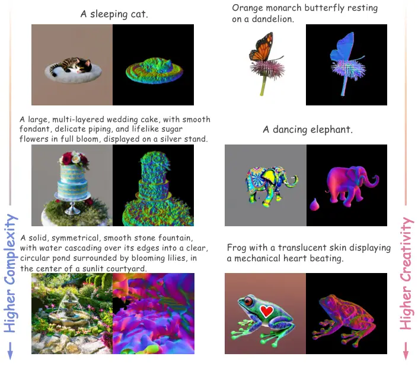

Figure 2: Controllable prompt generator. More complexity or more
creative prompts often lead to a more challenging evaluation setting.
Our prompt generator can produce prompts with various levels of
creativity and complexity. This allows us to examine text-to-3D models’
performance in different cases more efficiently.

Creating evaluation metrics for text-to-3D generative models requires
deciding which set of input text prompts we should use as input to these
models. Ideally, we would like to use all possible user input prompts,
but this is computationally infeasible. Alternatively, we would like to
build a generator capable of outputting prompts that can mimic the
actual distribution of user inputs. To achieve this, we first outline
the important components of an input prompt for text-to-3D models (Sec
4.1). Building on these components, we design a “meta-prompt” to
instruct GPT-4V how to leverage these components to generate an input
text prompt for text-to-3D models (Sec 4.2).

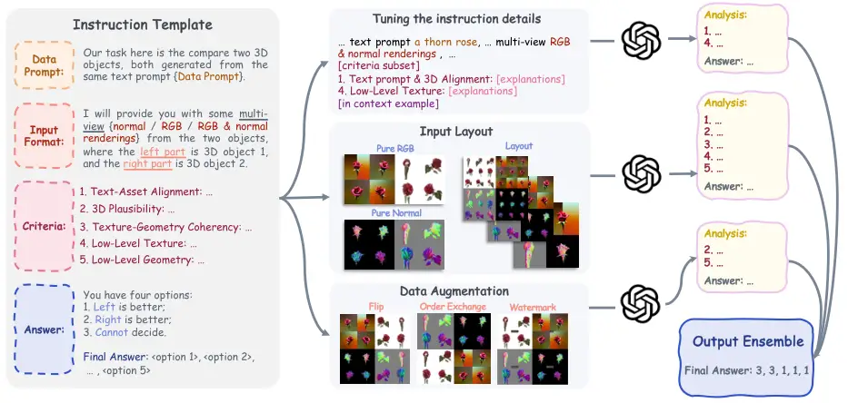

Figure 3: Illustration of how our method compares two 3D assets. We
create a customizable instruction template that contains necessary
information for GPT-4V to conduct comparison tasks for two 3D assets
(Sec. 5.1). We complete this template with different evaluation
criteria, input 3D images, and random seeds to create the final 3D-aware
prompts for GPT-4V. GPT-4V will then consume these inputs to output its
assessments. Finally, we assemble GPT-4V’s answers to create a robust
final estimate of the task (Sec. 5.2)

### 4.1 Prompt components

A typical input text prompt for text-to-3D models contains three
components: subjects, properties, and compositions. Subjects usually
involve nouns referring to objects or concepts the user would like to
instantiate in 3D. “Cats”, “fire”, and “universe” are all examples of
subjects. Properties include adjectives a user can use to describe the
subjects or their interactions, such as “mysterious” and “weathered”.
Finally, users will compose these concepts and properties together into
a sentence or clause. The composition varies from as simple as joining
different subjects and/or properties together with commas or as
thoughtful as writing it as a grammatically correct and fluent sentence.
In this work, we prompt GPT-4V to create a comprehensive list of words
for subjects and properties. This list of subjects and properties will
be used as building blocks to construct the “meta-prompt”, which is an
instruction for GPT-4V to generate input text-prompts by composing these
building blocks. Section B.1 contains more implementation details.

### 4.2 Meta-prompt

Provided with ingredients to create input prompts, we now need to
automatically compose these ingredients together according to the
evaluator-specified requirements. This requires the prompt generator to
understand and follow the evaluator’s instruction. In this paper, we use
GPT-4V’s ability to generate prompts following instructions.
Specifically, we would like to build a text instruction asking GPT-4V to
create a list of prompts that can be used as input for text-to-3D
models. We coin this instruction “meta-prompt”.

In order for GPT-4V to output prompts for text-to-3D models, we first
provide GPT-4V with the necessary ingredients, _i.e_. a list of subjects
and properties from the previous section. In addition to these, the
meta-prompt needs to include a description of how the evaluator wants
the output prompt set to be. For example, the evaluator might want to
focus on complex prompts containing multiple subject interactions and
properties, testing a text-to-3D models’ ability to generate complex
objects. One might also be curious about these models’ performance in
creative prompts involving subjects and descriptions that are not
commonly seen in the real world. How complex and creative the input
prompt can influence how challenging the evaluation task is. These two
axes, complexity and creativity, are examples of evaluator’s criteria.
Such criteria should be specified as language instructions attached to
the “meta-prompt” along with all the ingredients. With both the prompt
ingredient and the evaluator’s criteria properly included in the
meta-prompt, our GPT-4V-based prompt generator can now compose sentences
that adhere to the evaluator’s requirement. The appendix contains more
details about our meta-prompt and prompt generation pipeline (Sec B.1).

Figure 2 shows prompts outputted from our generator with instruction
asking for different complexity and creativity. We can see that high
complexity introduces a larger number of objects, multifaceted
descriptions, and occasionally, a completely broken scene. Similarly,
more creative prompts combine subjects, verbs, or adjectives in
unconventional ways. Text-to-3D models also tend to struggle with these
more creative prompts, failing to follow the description of these input
prompts exactly. This suggests that input prompts distribution can
greatly affect how challenging the evaluation task is. Being able to
control the distributions of the input prompt allows us to examine the
performance of these text-to-3D models through a more focused lens.

## 5 3D Assets Evaluator

Now we can sample a set of text prompts, $`\mathcal{T}=\{t_{i}\}_{i}`$,
using our generator. In this section, we will evaluate the performance
of a set of text-to-3D generative models using $`\mathcal{T}`$ as input
prompts. Given a set of these models, $`\mathcal{M}=\{M_{j}\}_{j}`$, we
use each model to generate one or more 3D shapes for each prompt. This
results in a set of tuples:
$`\{(M_{k},t_{k},M_{j}(t_{k},\mathbf{z}_{k}))|M_{k}\in\mathcal{M},t_{k}\in\mathcal{T}\}_{k}`$,
where $`\mathbf{z}_{k}`$ represents the random noise influencing the
shape generation. Our objective is to rank the text-to-3D models in
$`\mathcal{M}`$ based on a user-defined criterion. To accomplish this,
we first prompt GPT-4V to compare two 3D assets generated from the same
input text prompt (Sec 5.1 and Sec 5.2). We then use these pairwise
comparison results to assign each of the models an Elo rating reflecting
its performance (Sec 5.3).

### 5.1 Pairwise Comparison

At the core of our evaluation metric is the ability to answer the
following question: given a text prompt $`t`$, and two 3D shapes
generated from two different models, say $`M_{i}`$ and $`M_{j}`$, which
3D shape is better according to the evaluation criteria? As discussed in
previous sections, we hypothesize that one can leverage GPT-4V to
achieve this task. However, since GPT-4V is trained on language and
visual data, it lacks the ability to analyze 3D shapes directly.
Therefore, our input to GPT-4V should include both text instructions and
2D visual renderings that can capture 3D information.

Specifically, for each of the two 3D assets, we will create a large
image containing renderings of the 3D asset from four or nine
viewpoints. These two images will be concatenated together before
passing into GPT-4V along with the text instructions. GPT-4V will return
a decision of which of the two 3D assets is better according to the
instruction.

#### Text instruction.

We need to communicate three pieces of information for GPT-4V to compare
two 3D assets: instructions to complete a 3D comparison task, the
evaluation criteria, and descriptions of the output format. We found it
important to emphasize that the provided images are renders from
different viewpoints of a 3D object. In addition to a plain description
of the user-defined evaluation criteria, providing instruction about
what kind of image features one should use when analyzing for a
particular criteria is also useful. Finally, instead of requesting only
the answer of which shape is better directly, we also prompt GPT-4V to
explain how it arrives at its conclusion \[69, 7\].

#### Visual features of 3D shapes.

Once GPT-4V has been prompted to understand the evaluation criteria and
task of interest, we now need to feed the 3D shape into the GPT-4V
model. Specifically, we need to create images that can convey the
appearance and the geometry features of the 3D shapes. To achieve that,
for each 3D object, we create image renders of the object from various
viewpoints. For each of these viewpoints, we also render a surface
normal image. These normal surface renders will be arranged in the same
layout as the RGB render before being fed into GPT-4V. Using world-space
surface normal renders leads to better results because they provide
geometric information about the surface and allow reasoning for
correspondence between views. Appendix B.2 has more implementation
details.

### 5.2 Robust Ensemble

Even though GPT-4V is able to provide an answer to the pairwise shape
comparison problem, its response to the same input can vary from time to
time due to the probabilistic nature of its inference algorithm. In
other words, we can view our GPT-4V 3D shape comparator’s outputs as a
categorical distribution, and each response is a sample from the
distribution. As a result, a single response from GPT-4V might not
capture its true prior knowledge since it can be affected by the
variance during sampling. This is particularly the case when the
variance of the output distribution is high (_e.g_., when both choices
are equally likely). Note that this is not a weakness of GPT-4V as
similar situations can happen to human annotators when two objects are
equally good according to a criterion. In other words, we are not
interested in sampling one instance of how GPT-4V would make a decision.
Instead, estimating with what probability GPT-4V will choose this answer
is more useful.

One way to estimate such probability robustly from samples with variance
is through ensembling, a technique that has also been explored in other
tasks \[71\]. Specifically, we propose to ensemble outputs from multiple
slightly perturbed inputs. The key is to perturb input prompts to GPT-4V
without changing the task or evaluation criteria. The input includes the
text instruction, visual images, as well as the random seed. Our methods
deploy different perturbations, including changing random seeds, the
layout of renders, the number of rendered views, and the number of
evaluation criteria. Figure 3 illustrates how we perturb the input and
ensemble the results from these perturbed inputs together. Appendix D
includes more details.

| Methods            | Alignment | Plausibility | T-G Coherency | Tex Details | Geo Details | Average |
| ------------------ | --------- | ------------ | ------------- | ----------- | ----------- | ------- |
| PickScore \[33\]   | 0.667     | 0.484        | 0.458         | 0.510       | 0.588       | 0.562   |
| CLIP-S \[23\]      | 0.718     | 0.282        | 0.487         | 0.641       | 0.667       | 0.568   |
| CLIP-E \[23\]      | 0.813     | 0.426        | 0.581         | 0.529       | 0.658       | 0.628   |
| Aesthetic-S \[57\] | 0.795     | 0.410        | 0.564         | 0.769       | 0.744       | 0.671   |
| Aesthetic-E \[57\] | 0.684     | 0.297        | 0.555         | 0.813       | 0.684       | 0.611   |
| Ours               | 0.821     | 0.641        | 0.564         | 0.821       | 0.795       | 0.710   |

Table 1: Alignment with human judgment (higher is better). Here we
present Kendall’s tau ranking correlation \[31\] between rankings
provided by a metrics and those provided by human experts. Higher
correlation indicates better alignment with human judgment. We bold-face
the most aligned method and underline the second place for each
criterion. Our method achieves top-two performances for all evaluation
criteria, while prior metrics usually only do well for at most two
criteria.

| Metrics | Align. | Plaus. | T-G.  | Text. | Geo.  | Avg.  |
| ------- | ------ | ------ | ----- | ----- | ----- | ----- |
| PickS.  | 0.735  | 0.721  | 0.713 | 0.690 | 0.740 | 0.720 |
| CLIP    | 0.726  | 0.644  | 0.678 | 0.703 | 0.715 | 0.693 |
| Aest.   | 0.798  | 0.698  | 0.753 | 0.817 | 0.780 | 0.769 |
| Ours    | 0.810  | 0.826  | 0.729 | 0.843 | 0.735 | 0.789 |

Table 2: Pairwise rating agreements (higher is better). We measure the
average probability that the decision of the metric matches that of
human’s for each comparison. Our method achieves strong alignment across
most criteria.

### 5.3 Quantifying Performance

We have now obtained a list of comparisons among a set of models
$`\mathcal{M}`$. The comparisons are over a variety of sampled prompts
denoted as $`\mathcal{T}`$ according to the user-defined criteria. Our
goal is now to use this information to assign a number for each model in
$`\mathcal{M}`$ such that it best explains the observed result. Our
quantification method should consider the fact that the comparison
results are samples from a probability distribution, as discussed in the
previous subsection.

This problem is commonly studied in rating chess players, where a game
between two players can have different outcomes even if one player is
better than the other. In chess and many other competitions, the Elo
score \[19\] is perhaps the most widely adapted method to produce a
numerical estimation that reflects players’ performance. The Elo rating
system has also been adapted in prior works to evaluate image generative
models \[61, 43\]. In this paper, we adapt the version proposed by
Nichol et al. \[43\]. Specifically, let $`\sigma_{i}\in\mathbb{R}`$
denote the Elo score of the $`i^{\text{th}}`$ model in $`\mathcal{M}`$.
A higher score $`\sigma_{i}`$ indicates better performance. We assume
that the probability of model $`i`$ beats model $`j`$ is:

```math
\displaystyle\operatorname{Pr}(\text{``}i\text{ beats }j\text{''})=\left(1+10^{(\sigma_{j}-\sigma_{i})/400}\right)^{-1}. \tag{1}
```

Our goal is to find score $`\sigma_{i}`$ that can best explain the
observed comparison results given the abovementioned assumption. This
can be achieved via maximum likelihood estimation. Specifically, let
$`A`$ be a matrix where $`A_{ij}`$ denotes the number of times model
$`i`$ beats model $`j`$ in the list of comparisons. The final Elo score
for this set of models can be obtained by optimizing the following
objective:

```math
\displaystyle\sigma=\argmin_{\sigma}\sum_{i\neq j}A_{ij}\log\left(1+10^{(\sigma_{j}-\sigma_{i})/400}\right). \tag{2}
```

In this paper, we initialize $`\sigma_{i}=1000`$ and then use the Adam
optimizer \[32\] to minimize the loss to obtain the final Elo score.
Please refer to Sec B.3 for more mathematical intuition about the
formulation of the Elo score.

## 6 Results

In this section, we provide a preliminary evaluation of our metric’s
alignment with human judgment across different criteria. We first
introduce the experiment setup. We will discuss the main alignment
results in Sec. 6.1. We then explore how to use our metric to evaluate
different models holistically in Section 6.2. Finally, we briefly
showcase how to extend our models to different criteria in Section 6.3.

#### Text-to-3D generative models to benchmark.

We involve 13 generative models in the benchmark, including ten
optimization-based methods and three recently proposed feed-forward
methods. Please refer to Sec C for the complete list. We leverage each
method’s official implementations when available. Alternatively, we turn
to Threestudio’s implementation \[20\]. For methods designed mainly for
image-to-3D, we utilize Stable Diffusion XL \[49\] to generate images
conditioned on text as input to these models. All experiments are
conducted with default hyper-parameters provided by the code.

#### Baselines metrics.

We select three evaluation metrics with various considerations. 1) CLIP
similarity measures the cosine distance between the CLIP features \[52\]
of the multi-view renderings and the text prompt. This metric is chosen
because it is widely used in previous works as the metric for text–asset
alignment \[29, 51, 26\]. 2) Aesthetic score \[57\] is a linear
estimator on top of CLIP that predicts the aesthetic quality of
pictures. We choose this because it is trained on a large-scale dataset. 3) PickScore \[33\] is a CLIP-based scoring function trained on the
Pick-a-Pic dataset to predict human preferences over generated images.
To compute the metrics above, we uniformly sample 30 RGB renderings for
each of the generated assets. The CLIP similarity and aesthetic score
can be directly computed from the multi-view renderings and averaged for
each prompt. Since PickScore takes paired data as input for comparison,
we assign 30 paired renderings for each pair of objects before averaging
the PickScore results.

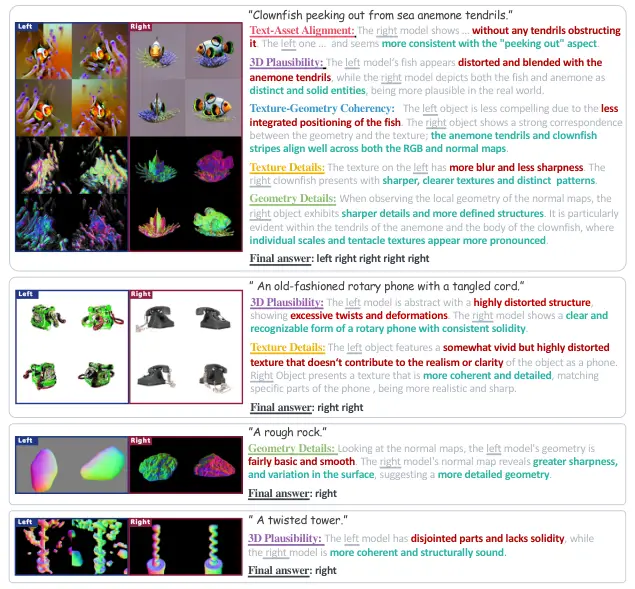

Figure 4: Examples of the analysis by GPT-4V. Given two 3D assets, we
ask GPT-4V to compare them on various aspects and provide an
explanation. We find that GPT-4V’s preference closely aligns with that
of humans.

#### Evaluation criteria.

While our method can potentially be applied to all user-defined
criteria, in this work we focus on the following five criteria, which we
believe are important for current text-to-3D evaluation tasks. 1)
Text–asset alignment: how well a 3D asset mirrors the input text
description. 2) 3D plausibility: whether the 3D asset is plausible in a
real or virtual environment. A plausible 3D asset should not contain
improbable parts such as multiple distorted faces (Janus problem) or
noisy geometry floaters. 3) Texture details: whether the textures and
appearance of the shape are realistic, high resolution, and have
appropriate saturation levels. 4) Geometry details: whether the geometry
makes sense and contains appropriate details. 5) Texture–geometry
coherency: whether geometry and textures agree with each other. For
example, eyes of a character should be on reasonable parts of the face
geometry.

#### Expert annotation.

To evaluate the performance of our method, we need to conduct user
preference studies to obtain ground truth preference data. Our user
studies will present the input text prompt alongside a pair of 3D assets
generated by different methods for the same input. The user will be
asked to identify which 3D asset satisfies the criteria of interest
better. We recruited 20 human experts who are graduate students
experienced in computer vision and graphics research to annotate the
data. We assigned 3 annotators per comparison question per evaluation
criteria. We compute a reference Elo rating using the formula in Sec.
5.3 using all expert annotations.

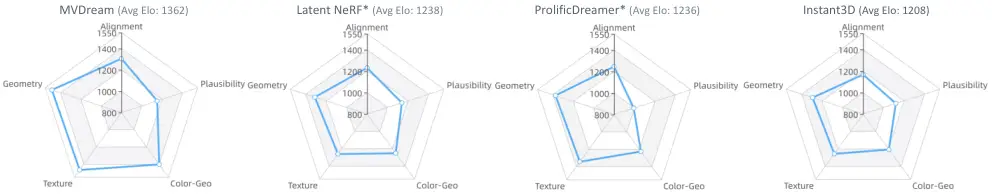

Figure 5: Holistic evaluation. Since our evaluation metric is
human-aligned in multiple criteria, we can evaluate text-to-3D models
more holistically. In this figure, we listed the Radar charts of the top
four text-to-3D models according to their averaged Elo scores across all
five criteria we evaluated. The Radar charts report the Elo rating for
each of the five criteria. These radar charts can provide relative
strengths and weaknesses among these models, providing guidance to
improve these models. \* indicates results from Threestudio
implementation.

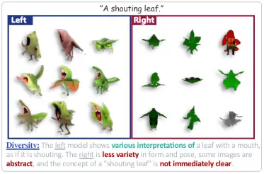

Figure 6: Diversity evaluation. Our method can be extended to evaluate
which text-to-3D models output more diverse 3D assets.

### 6.1 Alignment with Human Annotators.

In this section, we evaluate how well our proposed metric aligns with
human preference. To achieve that, we use each metric to assign a score
for each text-to-3D model for each evaluation criteria. Then, we compute
Kendell’s tau correlation \[31\] between the scores computed by the
metrics and the reference scores. Table 1 shows the ranking correlations
between scores predicted by different evaluation metrics and the
reference Elo scores computed from expert annotators. We can see that
our metrics achieve the best correlation in 4 out of 5 criteria, as well
as the best average correlation. Note that our method achieves
consistent performance across different criteria, while prior metrics
usually perform well in only one or two. This highlights that our method
is versatile in different evaluation criteria.

Our metric also shows strong human correlation for each 3D asset
comparison question, which is a harder task. To measure that, we assume
the response to each comparison question follows a Bernoulli
distribution with probability $`p`$ to select the first shape. Let
$`p_{i}`$ be the probability that the evaluation metric will select the
first shape at question $`i`$ and $`q_{i}`$ be that of a human
annotation. We measure the pairwise rating agreement using the
probability of a random sample from the metric agreeing with that from a
human: $`\frac{1}{N}\sum_{i=1}^{N}p_{i}q_{i}+(1-p_{i})(1-q_{i})`$. Table
2 shows that our method achieves top-two agreement across all but one
criteria. Figure 4 shows some exemplary outputs from our method. We can
see that GPT-4V is also able to provide some analysis justifying its
final choice.

### 6.2 Holistic Evaluation

The versatility of our method lands the provision to paint a holistic
picture of each text-to-3D model’s performance. Specifically, we compute
each model’s average Elo scores across each criterion and present the
Radar charts of the models achieving the top averaged Elo scores in
Figure 5. According to our metric, MVDream \[60\] won first place on all
five criteria. MVDream achieves about 100 more ELO scores than its
runner-ups. The second, the third, and the fourth places are taken by
Latent-NeRF \[41\], ProlificDreamer \[68\], and Instant3D \[36\]. These
models achieve similar averaged Elo scores, with differences of less
than 30 Elos. These three models achieve about 100 Elos more than the
next tiers of models, which score about 1100 Elos.

While Latent-NeRF, ProlificDreamer, and Instant3D achieve similar
overall scores, our metrics allow further analysis into the relative
strengths and weakness of each models. For example, ProlificDreamers
show strong performance in three criteria: alignment, geometry details,
and texture details. However, its performance in 3D Plausibility is
lagging behind when comparing with the other top-performing models.
Among these three models, Instant3D \[36\] is a feed-forward method that
takes a much shorter time compared to the top two methods. While our
evaluation metrics’ reliability can still be limited, we hope that such
a holistic picture can provide essential guidance for developing future
text-to-3D algorithms.

### 6.3 Extension to Other Criteria

While we focus our empirical studies in five criteria, our metric can be
adapted to evaluating a different criteria users might care about. For
example, it is important that a generative model can produce different
outputs given different random seeds. This aspect is commonly
underlooked by most text-to-3D metrics. With small modification of the
text and image prompt input into GPT-4V, our method can be applied to
evaluate diversity. Figure 6 shows the visual image we provide GPT-4V
when prompting it to answer the question about which model’s output has
more diversity. For each method, we produce 9 3D assets using different
random seeds. We render each of these assets from a fixed camera angle
to create the input image fed into GPT-4V. The text in Figure 6 is an
excerpt of GPT-4V’s answer. We can see that GPT-4V is able to provide a
reasonable judgment about which image contains renders of more diverse
3D assets. Currently, we are restricted to qualitative studies because
most existing text-to-3D models are still compute-intensive. We believe
that large-scale quantitative study is soon possible with more
compute-efficient text-to-3D models, such as Instant3D, becoming
available.

## 7 Discussion

In this paper, we have presented a novel framework leveraging GPT-4V to
establish a customizable, scalable, and human-aligned evaluation metric
for text-to-3D generative tasks. First, we propose a prompt generator
that can generate input prompts according to the evaluator’s needs.
Second, we prompt GPT-4V with an ensemble of customizable “3D-aware
prompts.” With these instructions, GPT-4V is able to compare two 3D
assets according to an evaluator’s need while remaining aligned to human
judgment across various criteria. With these two components, we are able
to rank text-to-3D models using the Elo system. Experimental results
confirm that our approach can outperform existing metrics in various
criteria.

#### Limitations and future work.

While promising, our work still faces several unresolved challenges.
First, due to limited resources, our experiment and user studies are
done on a relatively small scale. It’s important to scale up this study
to better verify the hypothesis. Second, GPT-4V’s responses are not
always true. For example, GPT-4V sometimes shows hallucinations—a
prevalent issue for many large pretrained models \[73\]. GPT-4V can also
process some systematic errors, such as bias toward certain image
positions \[75, 74\]. Such biases, if unknown, could induce errors in
our evaluation metric. While our ensembling technique can mitigate these
issues, how to solve them efficiently and fundamentally remains an
interesting direction. Third, a good metric should be “un-gamable”.
However one could potentially construct adversarial patterns to attack
GPT-4V. This way one might gain a high score without needing to produce
high-quality 3D assets. Last, while our method is more scalable than
conducting user preference studies, we can be limited by computation,
such as GPT-4V API access limits. Our method also requires a
quadratically growing number of comparisons, which might not scale well
when evaluating a large number of models when compute is limited. It
would be interesting to leverage GPT-4V to intelligently select input
prompts to improve efficiency.

#### Acknowledgement.

This project was in part supported by Google, Samsung, Stanford HAI,
Vannevar Bush Faculty Fellowship, ARL grant W911NF-21-2-0104, and
Shanghai AI Lab. We would love to thank members of Stanford
Computational Imaging Lab, Stanford Geometric Computation Group,
Shanghai AI Lab, and Adobe Research for useful feedback and discussion.

## References

- \[1\] Panos Achlioptas, Olga Diamanti, Ioannis Mitliagkas, and
  Leonidas J. Guibas. Learning representations and generative models for
  3d point clouds. In _International Conference on Machine
  Learning_, 2017.
- \[2\] Jean-Baptiste Alayrac, Jeff Donahue, Pauline Luc, Antoine Miech,
  Iain Barr, Yana Hasson, Karel Lenc, Arthur Mensch, Katie Millican,
  Malcolm Reynolds, Roman Ring, Eliza Rutherford, Serkan Cabi, Tengda
  Han, Zhitao Gong, Sina Samangooei, Marianne Monteiro, Jacob Menick,
  Sebastian Borgeaud, Andy Brock, Aida Nematzadeh, Sahand Sharifzadeh,
  Mikolaj Binkowski, Ricardo Barreira, Oriol Vinyals, Andrew Zisserman,
  and Karen Simonyan. Flamingo: a visual language model for few-shot
  learning. _ArXiv_, abs/2204.14198, 2022.
- \[3\] Rohan Anil, Andrew M. Dai, Orhan Firat, Melvin Johnson, Dmitry
  Lepikhin, Alexandre Tachard Passos, Siamak Shakeri, Emanuel Taropa,
  Paige Bailey, Z. Chen, Eric Chu, J. Clark, Laurent El Shafey, Yanping
  Huang, Kathleen S. Meier-Hellstern, Gaurav Mishra, Erica Moreira, Mark
  Omernick, Kevin Robinson, Sebastian Ruder, Yi Tay, Kefan Xiao,
  Yuanzhong Xu, Yujing Zhang, Gustavo Hernandez Abrego, Junwhan Ahn,
  Jacob Austin, Paul Barham, Jan A. Botha, James Bradbury, Siddhartha
  Brahma, Kevin Michael Brooks, Michele Catasta, Yongzhou Cheng, Colin
  Cherry, Christopher A. Choquette-Choo, Aakanksha Chowdhery, C Crépy,
  Shachi Dave, Mostafa Dehghani, Sunipa Dev, Jacob Devlin, M. C. D’iaz,
  Nan Du, Ethan Dyer, Vladimir Feinberg, Fan Feng, Vlad Fienber, Markus
  Freitag, Xavier García, Sebastian Gehrmann, Lucas González, Guy
  Gur-Ari, Steven Hand, Hadi Hashemi, Le Hou, Joshua Howland, An Ren Hu,
  Jeffrey Hui, Jeremy Hurwitz, Michael Isard, Abe Ittycheriah, Matthew
  Jagielski, Wen Hao Jia, Kathleen Kenealy, Maxim Krikun, Sneha
  Kudugunta, Chang Lan, Katherine Lee, Benjamin Lee, Eric Li, Mu-Li Li,
  Wei Li, Yaguang Li, Jun Yu Li, Hyeontaek Lim, Han Lin, Zhong-Zhong
  Liu, Frederick Liu, Marcello Maggioni, Aroma Mahendru, Joshua Maynez,
  Vedant Misra, Maysam Moussalem, Zachary Nado, John Nham, Eric Ni,
  Andrew Nystrom, Alicia Parrish, Marie Pellat, Martin Polacek, Alex
  Polozov, Reiner Pope, Siyuan Qiao, Emily Reif, Bryan Richter, Parker
  Riley, Alexandra Ros, Aurko Roy, Brennan Saeta, Rajkumar Samuel, Renee
  Marie Shelby, Ambrose Slone, Daniel Smilkov, David R. So, Daniela
  Sohn, Simon Tokumine, Dasha Valter, Vijay Vasudevan, Kiran Vodrahalli,
  Xuezhi Wang, Pidong Wang, Zirui Wang, Tao Wang, John Wieting, Yuhuai
  Wu, Ke Xu, Yunhan Xu, Lin Wu Xue, Pengcheng Yin, Jiahui Yu, Qiaoling
  Zhang, Steven Zheng, Ce Zheng, Wei Zhou, Denny Zhou, Slav Petrov, and
  Yonghui Wu. Palm 2 technical report. _ArXiv_, abs/2305.10403, 2023.
- \[4\] Anas Awadalla, Irena Gao, Josh Gardner, Jack Hessel, Yusuf
  Hanafy, Wanrong Zhu, Kalyani Marathe, Yonatan Bitton, Samir Yitzhak
  Gadre, Shiori Sagawa, Jenia Jitsev, Simon Kornblith, Pang Wei Koh,
  Gabriel Ilharco, Mitchell Wortsman, and Ludwig Schmidt. Openflamingo:
  An open-source framework for training large autoregressive
  vision-language models. _ArXiv_, abs/2308.01390, 2023.
- \[5\] Sherwin Bahmani, Jeong Joon Park, Despoina Paschalidou,
  Xingguang Yan, Gordon Wetzstein, Leonidas J. Guibas, and Andrea
  Tagliasacchi. Cc3d: Layout-conditioned generation of compositional 3d
  scenes. _ArXiv_, abs/2303.12074, 2023.
- \[6\] Eslam Mohamed Bakr, Pengzhan Sun, Xiaogian Shen, Faizan Farooq
  Khan, Li Erran Li, and Mohamed Elhoseiny. Hrs-bench: Holistic,
  reliable and scalable benchmark for text-to-image models. In
  _Proceedings of the IEEE/CVF International Conference on Computer
  Vision_, pages 20041–20053, 2023.
- \[7\] Maciej Besta, Nils Blach, Ales Kubicek, Robert Gerstenberger,
  Lukas Gianinazzi, Joanna Gajda, Tomasz Lehmann, Michal Podstawski,
  Hubert Niewiadomski, Piotr Nyczyk, et al. Graph of thoughts: Solving
  elaborate problems with large language models. _arXiv preprint
  arXiv:2308.09687_, 2023.
- \[8\] Tom B. Brown, Benjamin Mann, Nick Ryder, Melanie Subbiah, Jared
  Kaplan, Prafulla Dhariwal, Arvind Neelakantan, Pranav Shyam, Girish
  Sastry, Amanda Askell, Sandhini Agarwal, Ariel Herbert-Voss, Gretchen
  Krueger, T. J. Henighan, Rewon Child, Aditya Ramesh, Daniel M.
  Ziegler, Jeff Wu, Clemens Winter, Christopher Hesse, Mark Chen, Eric
  Sigler, Mateusz Litwin, Scott Gray, Benjamin Chess, Jack Clark,
  Christopher Berner, Sam McCandlish, Alec Radford, Ilya Sutskever, and
  Dario Amodei. Language models are few-shot learners. _ArXiv_,
  abs/2005.14165, 2020.
- \[9\] Eric Chan, Connor Z. Lin, Matthew Chan, Koki Nagano, Boxiao Pan,
  Shalini De Mello, Orazio Gallo, Leonidas J. Guibas, Jonathan
  Tremblay, S. Khamis, Tero Karras, and Gordon Wetzstein. Efficient
  geometry-aware 3d generative adversarial networks. _2022 IEEE/CVF
  Conference on Computer Vision and Pattern Recognition (CVPR)_, pages
  16102–16112, 2021.
- \[10\] Angel X Chang, Thomas Funkhouser, Leonidas Guibas, Pat
  Hanrahan, Qixing Huang, Zimo Li, Silvio Savarese, Manolis Savva,
  Shuran Song, Hao Su, et al. Shapenet: An information-rich 3d model
  repository. _arXiv preprint arXiv:1512.03012_, 2015.
- \[11\] Rui Chen, Yongwei Chen, Ningxin Jiao, and Kui Jia. Fantasia3d:
  Disentangling geometry and appearance for high-quality text-to-3d
  content creation. _arXiv preprint arXiv:2303.13873_, 2023.
- \[12\] Aakanksha Chowdhery, Sharan Narang, Jacob Devlin, Maarten
  Bosma, Gaurav Mishra, Adam Roberts, Paul Barham, Hyung Won Chung,
  Charles Sutton, Sebastian Gehrmann, Parker Schuh, Kensen Shi, Sasha
  Tsvyashchenko, Joshua Maynez, Abhishek Rao, Parker Barnes, Yi Tay,
  Noam M. Shazeer, Vinodkumar Prabhakaran, Emily Reif, Nan Du, Benton C.
  Hutchinson, Reiner Pope, James Bradbury, Jacob Austin, Michael Isard,
  Guy Gur-Ari, Pengcheng Yin, Toju Duke, Anselm Levskaya, Sanjay
  Ghemawat, Sunipa Dev, Henryk Michalewski, Xavier García, Vedant Misra,
  Kevin Robinson, Liam Fedus, Denny Zhou, Daphne Ippolito, David Luan,
  Hyeontaek Lim, Barret Zoph, Alexander Spiridonov, Ryan Sepassi, David
  Dohan, Shivani Agrawal, Mark Omernick, Andrew M. Dai, Thanumalayan
  Sankaranarayana Pillai, Marie Pellat, Aitor Lewkowycz, Erica Moreira,
  Rewon Child, Oleksandr Polozov, Katherine Lee, Zongwei Zhou, Xuezhi
  Wang, Brennan Saeta, Mark Díaz, Orhan Firat, Michele Catasta, Jason
  Wei, Kathleen S. Meier-Hellstern, Douglas Eck, Jeff Dean, Slav Petrov,
  and Noah Fiedel. Palm: Scaling language modeling with pathways. _J.
  Mach. Learn. Res._, 24:240:1–240:113, 2022.
- \[13\] Jacob Cohen. A coefficient of agreement for nominal scales.
  _Educational and psychological measurement_, 20(1):37–46, 1960.
- \[14\] Matt Deitke, Dustin Schwenk, Jordi Salvador, Luca Weihs, Oscar
  Michel, Eli VanderBilt, Ludwig Schmidt, Kiana Ehsani, Aniruddha
  Kembhavi, and Ali Farhadi. Objaverse: A universe of annotated 3d
  objects. _arXiv preprint arXiv:2212.08051_, 2022.
- \[15\] Matt Deitke, Ruoshi Liu, Matthew Wallingford, Huong Ngo, Oscar
  Michel, Aditya Kusupati, Alan Fan, Christian Laforte, Vikram Voleti,
  Samir Yitzhak Gadre, Eli VanderBilt, Aniruddha Kembhavi, Carl
  Vondrick, Georgia Gkioxari, Kiana Ehsani, Ludwig Schmidt, and Ali
  Farhadi. Objaverse-xl: A universe of 10m+ 3d objects. _arXiv preprint
  arXiv:2307.05663_, 2023a.
- \[16\] Matt Deitke, Ruoshi Liu, Matthew Wallingford, Huong Ngo, Oscar
  Michel, Aditya Kusupati, Alan Fan, Christian Laforte, Vikram Voleti,
  Samir Yitzhak Gadre, et al. Objaverse-xl: A universe of 10m+ 3d
  objects. _arXiv preprint arXiv:2307.05663_, 2023b.
- \[17\] Matt Deitke, Dustin Schwenk, Jordi Salvador, Luca Weihs, Oscar
  Michel, Eli VanderBilt, Ludwig Schmidt, Kiana Ehsani, Aniruddha
  Kembhavi, and Ali Farhadi. Objaverse: A universe of annotated 3d
  objects. In _Proceedings of the IEEE/CVF Conference on Computer Vision
  and Pattern Recognition_, pages 13142–13153, 2023c.
- \[18\] Danny Driess, F. Xia, Mehdi S. M. Sajjadi, Corey Lynch,
  Aakanksha Chowdhery, Brian Ichter, Ayzaan Wahid, Jonathan Tompson,
  Quan Ho Vuong, Tianhe Yu, Wenlong Huang, Yevgen Chebotar, Pierre
  Sermanet, Daniel Duckworth, Sergey Levine, Vincent Vanhoucke, Karol
  Hausman, Marc Toussaint, Klaus Greff, Andy Zeng, Igor Mordatch, and
  Peter R. Florence. Palm-e: An embodied multimodal language model. In
  _International Conference on Machine Learning_, 2023.
- \[19\] Arpad E Elo. The proposed uscf rating system, its development,
  theory, and applications. _Chess Life_, 22(8):242–247, 1967.
- \[20\] Yuan-Chen Guo, Ying-Tian Liu, Ruizhi Shao, Christian Laforte,
  Vikram Voleti, Guan Luo, Chia-Hao Chen, Zi-Xin Zou, Chen Wang, Yan-Pei
  Cao, and Song-Hai Zhang. threestudio: A unified framework for 3d
  content generation, 2023.
- \[21\] Zekun Hao, Arun Mallya, Serge J. Belongie, and Ming-Yu Liu.
  Gancraft: Unsupervised 3d neural rendering of minecraft worlds. _2021
  IEEE/CVF International Conference on Computer Vision (ICCV)_, pages
  14052–14062, 2021.
- \[22\] Yuze He, Yushi Bai, Matthieu Lin, Wang Zhao, Yubin Hu, Jenny
  Sheng, Ran Yi, Juanzi Li, and Yong jin Liu. T3bench: Benchmarking
  current progress in text-to-3d generation. _ArXiv_,
  abs/2310.02977, 2023.
- \[23\] Jack Hessel, Ari Holtzman, Maxwell Forbes, Ronan Le Bras, and
  Yejin Choi. Clipscore: A reference-free evaluation metric for image
  captioning. _arXiv preprint arXiv:2104.08718_, 2021.
- \[24\] Jonathan Ho, Ajay Jain, and Pieter Abbeel. Denoising diffusion
  probabilistic models. _Advances in neural information processing
  systems_, 33:6840–6851, 2020.
- \[25\] Jordan Hoffmann, Sebastian Borgeaud, Arthur Mensch, Elena
  Buchatskaya, Trevor Cai, Eliza Rutherford, Diego de Las Casas, Lisa
  Anne Hendricks, Johannes Welbl, Aidan Clark, Tom Hennigan, Eric
  Noland, Katie Millican, George van den Driessche, Bogdan Damoc,
  Aurelia Guy, Simon Osindero, Karen Simonyan, Erich Elsen, Jack W. Rae,
  Oriol Vinyals, and L. Sifre. Training compute-optimal large language
  models. _ArXiv_, abs/2203.15556, 2022.
- \[26\] Lukas Höllein, Ang Cao, Andrew Owens, Justin Johnson, and
  Matthias Nießner. Text2room: Extracting textured 3d meshes from 2d
  text-to-image models. _ArXiv_, abs/2303.11989, 2023.
- \[27\] Yushi Hu, Hang Hua, Zhengyuan Yang, Weijia Shi, Noah A. Smith,
  and Jiebo Luo. Promptcap: Prompt-guided task-aware image captioning.
  _ArXiv_, abs/2211.09699, 2022.
- \[28\] Shaohan Huang, Li Dong, Wenhui Wang, Yaru Hao, Saksham Singhal,
  Shuming Ma, Tengchao Lv, Lei Cui, Owais Khan Mohammed, Qiang Liu,
  Kriti Aggarwal, Zewen Chi, Johan Bjorck, Vishrav Chaudhary, Subhojit
  Som, Xia Song, and Furu Wei. Language is not all you need: Aligning
  perception with language models. _ArXiv_, abs/2302.14045, 2023.
- \[29\] Ajay Jain, Ben Mildenhall, Jonathan T Barron, Pieter Abbeel,
  and Ben Poole. Zero-shot text-guided object generation with dream
  fields. In _Proceedings of the IEEE/CVF Conference on Computer Vision
  and Pattern Recognition_, pages 867–876, 2022.
- \[30\] Heewoo Jun and Alex Nichol. Shap-e: Generating conditional 3d
  implicit functions. _arXiv preprint arXiv:2305.02463_, 2023.
- \[31\] M. G. Kendall. A new measure of rank correlation.
  _Biometrika_, 30:81–93, 1938.
- \[32\] Diederik P. Kingma and Jimmy Ba. Adam: A method for stochastic
  optimization. _CoRR_, abs/1412.6980, 2014.
- \[33\] Yuval Kirstain, Adam Polyak, Uriel Singer, Shahbuland Matiana,
  Joe Penna, and Omer Levy. Pick-a-pic: An open dataset of user
  preferences for text-to-image generation. _arXiv preprint
  arXiv:2305.01569_, 2023.
- \[34\] Junnan Li, Dongxu Li, Caiming Xiong, and Steven C. H. Hoi.
  Blip: Bootstrapping language-image pre-training for unified
  vision-language understanding and generation. In _International
  Conference on Machine Learning_, 2022.
- \[35\] Junnan Li, Dongxu Li, Silvio Savarese, and Steven C. H. Hoi.
  Blip-2: Bootstrapping language-image pre-training with frozen image
  encoders and large language models. _ArXiv_, abs/2301.12597, 2023a.
- \[36\] Jiahao Li, Hao Tan, Kai Zhang, Zexiang Xu, Fujun Luan, Yinghao
  Xu, Yicong Hong, Kalyan Sunkavalli, Greg Shakhnarovich, and Sai Bi.
  Instant3d: Fast text-to-3d with sparse-view generation and large
  reconstruction model. *https://arxiv.org/abs/2311.06214*, 2023b.
- \[37\] Chen-Hsuan Lin, Jun Gao, Luming Tang, Towaki Takikawa, Xiaohui
  Zeng, Xun Huang, Karsten Kreis, Sanja Fidler, Ming-Yu Liu, and
  Tsung-Yi Lin. Magic3d: High-resolution text-to-3d content creation. In
  _Proceedings of the IEEE/CVF Conference on Computer Vision and Pattern
  Recognition (CVPR)_, pages 300–309, 2023.
- \[38\] Yuan Liu, Cheng Lin, Zijiao Zeng, Xiaoxiao Long, Lingjie Liu,
  Taku Komura, and Wenping Wang. Syncdreamer: Learning to generate
  multiview-consistent images from a single-view image. _arXiv preprint
  arXiv:2309.03453_, 2023.
- \[39\] Xiaoxiao Long, Yuan-Chen Guo, Cheng Lin, Yuan Liu, Zhiyang Dou,
  Lingjie Liu, Yuexin Ma, Song-Hai Zhang, Marc Habermann, Christian
  Theobalt, and Wenping Wang. Wonder3d: Single image to 3d using
  cross-domain diffusion, 2023.
- \[40\] David Lopez-Paz and Maxime Oquab. Revisiting classifier
  two-sample tests. _arXiv: Machine Learning_, 2016.
- \[41\] Gal Metzer, Elad Richardson, Or Patashnik, Raja Giryes, and
  Daniel Cohen-Or. Latent-nerf for shape-guided generation of 3d shapes
  and textures. _arXiv preprint arXiv:2211.07600_, 2022.
- \[42\] Ben Mildenhall, Pratul P Srinivasan, Matthew Tancik, Jonathan T
  Barron, Ravi Ramamoorthi, and Ren Ng. Nerf: Representing scenes as
  neural radiance fields for view synthesis. _Communications of the
  ACM_, 65(1):99–106, 2021.
- \[43\] Alex Nichol, Prafulla Dhariwal, Aditya Ramesh, Pranav Shyam,
  Pamela Mishkin, Bob McGrew, Ilya Sutskever, and Mark Chen. Glide:
  Towards photorealistic image generation and editing with text-guided
  diffusion models. _arXiv preprint arXiv:2112.10741_, 2021.
- \[44\] Alex Nichol, Heewoo Jun, Prafulla Dhariwal, Pamela Mishkin, and
  Mark Chen. Point-e: A system for generating 3d point clouds from
  complex prompts. _arXiv preprint arXiv:2212.08751_, 2022.
- \[45\] OpenAI. Gpt-4v(ision) system card. _OpenAI_, 2023a.
- \[46\] R OpenAI. Gpt-4 technical report. _arXiv_, pages 2303–08774,
  2023b.
- \[47\] Jeong Joon Park, Peter Florence, Julian Straub, Richard
  Newcombe, and Steven Lovegrove. Deepsdf: Learning continuous signed
  distance functions for shape representation. In _Proceedings of the
  IEEE/CVF conference on computer vision and pattern recognition_, pages
  165–174, 2019.
- \[48\] Ryan Po, Wang Yifan, and Vladislav Golyanik et al. State of the
  art on diffusion models for visual computing. In _arxiv_, 2023.
- \[49\] Dustin Podell, Zion English, Kyle Lacey, A. Blattmann, Tim
  Dockhorn, Jonas Muller, Joe Penna, and Robin Rombach. Sdxl: Improving
  latent diffusion models for high-resolution image synthesis. _ArXiv_,
  abs/2307.01952, 2023a.
- \[50\] Dustin Podell, Zion English, Kyle Lacey, Andreas Blattmann, Tim
  Dockhorn, Jonas Müller, Joe Penna, and Robin Rombach. Sdxl: Improving
  latent diffusion models for high-resolution image synthesis. _arXiv
  preprint arXiv:2307.01952_, 2023b.
- \[51\] Ben Poole, Ajay Jain, Jonathan T. Barron, and Ben Mildenhall.
  Dreamfusion: Text-to-3d using 2d diffusion. _arXiv_, 2022.
- \[52\] Alec Radford, Jong Wook Kim, Chris Hallacy, Aditya Ramesh,
  Gabriel Goh, Sandhini Agarwal, Girish Sastry, Amanda Askell, Pamela
  Mishkin, Jack Clark, Gretchen Krueger, and Ilya Sutskever. Learning
  transferable visual models from natural language supervision. In
  _International Conference on Machine Learning_, 2021.
- \[53\] Amit Raj, Srinivas Kaza, Ben Poole, Michael Niemeyer, Nataniel
  Ruiz, Ben Mildenhall, Shiran Zada, Kfir Aberman, Michael Rubinstein,
  Jonathan T. Barron, Yuanzhen Li, and Varun Jampani. Dreambooth3d:
  Subject-driven text-to-3d generation. _ArXiv_, abs/2303.13508, 2023.
- \[54\] Aditya Ramesh, Mikhail Pavlov, Gabriel Goh, Scott Gray, Chelsea
  Voss, Alec Radford, Mark Chen, and Ilya Sutskever. Zero-shot
  text-to-image generation. In _International Conference on Machine
  Learning_, pages 8821–8831. PMLR, 2021.
- \[55\] Aditya Ramesh, Prafulla Dhariwal, Alex Nichol, Casey Chu, and
  Mark Chen. Hierarchical text-conditional image generation with clip
  latents. _arXiv preprint arXiv:2204.06125_, 1(2):3, 2022.
- \[56\] Robin Rombach, Andreas Blattmann, Dominik Lorenz, Patrick
  Esser, and Björn Ommer. High-resolution image synthesis with latent
  diffusion models. In _Proceedings of the IEEE/CVF conference on
  computer vision and pattern recognition_, pages 10684–10695, 2022.
- \[57\] Christoph Schuhmann, Romain Beaumont, Richard Vencu, Cade
  Gordon, Ross Wightman, Mehdi Cherti, Theo Coombes, Aarush Katta,
  Clayton Mullis, Mitchell Wortsman, Patrick Schramowski, Srivatsa
  Kundurthy, Katherine Crowson, Ludwig Schmidt, Robert Kaczmarczyk, and
  Jenia Jitsev. Laion-5b: An open large-scale dataset for training next
  generation image-text models. _ArXiv_, abs/2210.08402, 2022.
- \[58\] Ho Youn Seo, Hayeon Kim, Gwanghyun Kim, and Se Young Chun.
  Ditto-nerf: Diffusion-based iterative text to omni-directional 3d
  model. _ArXiv_, abs/2304.02827, 2023.
- \[59\] Zhenwei Shao, Zhou Yu, Mei Wang, and Jun Yu. Prompting large
  language models with answer heuristics for knowledge-based visual
  question answering. _2023 IEEE/CVF Conference on Computer Vision and
  Pattern Recognition (CVPR)_, pages 14974–14983, 2023.
- \[60\] Yichun Shi, Peng Wang, Jianglong Ye, Long Mai, Kejie Li, and
  Xiao Yang. Mvdream: Multi-view diffusion for 3d generation.
  _arXiv:2308.16512_, 2023.
- \[61\] Zhan Shi, Xu Zhou, Xipeng Qiu, and Xiaodan Zhu. Improving image
  captioning with better use of captions. _arXiv preprint
  arXiv:2006.11807_, 2020.
- \[62\] Yang Song, Jascha Sohl-Dickstein, Diederik P Kingma, Abhishek
  Kumar, Stefano Ermon, and Ben Poole. Score-based generative modeling
  through stochastic differential equations. _arXiv preprint
  arXiv:2011.13456_, 2020.
- \[63\] Jiaxiang Tang, Jiawei Ren, Hang Zhou, Ziwei Liu, and Gang Zeng.
  Dreamgaussian: Generative gaussian splatting for efficient 3d content
  creation. _ArXiv_, abs/2309.16653, 2023.
- \[64\] Hugo Touvron, Thibaut Lavril, Gautier Izacard, Xavier Martinet,
  Marie-Anne Lachaux, Timothée Lacroix, Baptiste Rozière, Naman Goyal,
  Eric Hambro, Faisal Azhar, Aurelien Rodriguez, Armand Joulin, Edouard
  Grave, and Guillaume Lample. Llama: Open and efficient foundation
  language models. _ArXiv_, abs/2302.13971, 2023.
- \[65\] Maria Tsimpoukelli, Jacob Menick, Serkan Cabi, S. M. Ali
  Eslami, Oriol Vinyals, Felix Hill, and Zacharias Janssen. Multimodal
  few-shot learning with frozen language models. In _Neural Information
  Processing Systems_, 2021.
- \[66\] Haochen Wang, Xiaodan Du, Jiahao Li, Raymond A. Yeh, and Greg
  Shakhnarovich. Score jacobian chaining: Lifting pretrained 2d
  diffusion models for 3d generation. _arXiv preprint arXiv:2212.00774_,
  2022a.
- \[67\] Zhenhailong Wang, Manling Li, Ruochen Xu, Luowei Zhou, Jie Lei,
  Xudong Lin, Shuohang Wang, Ziyi Yang, Chenguang Zhu, Derek Hoiem,
  Shih-Fu Chang, Mohit Bansal, and Heng Ji. Language models with image
  descriptors are strong few-shot video-language learners. _ArXiv_,
  abs/2205.10747, 2022b.
- \[68\] Zhengyi Wang, Cheng Lu, Yikai Wang, Fan Bao, Chongxuan Li, Hang
  Su, and Jun Zhu. Prolificdreamer: High-fidelity and diverse text-to-3d
  generation with variational score distillation. _arXiv preprint
  arXiv:2305.16213_, 2023.
- \[69\] Jason Wei, Xuezhi Wang, Dale Schuurmans, Maarten Bosma, Ed Huai
  hsin Chi, F. Xia, Quoc Le, and Denny Zhou. Chain of thought prompting
  elicits reasoning in large language models. _ArXiv_,
  abs/2201.11903, 2022.
- \[70\] Guandao Yang, Xun Huang, Zekun Hao, Ming-Yu Liu, Serge J.
  Belongie, and Bharath Hariharan. Pointflow: 3d point cloud generation
  with continuous normalizing flows. _2019 IEEE/CVF International
  Conference on Computer Vision (ICCV)_, pages 4540–4549, 2019.
- \[71\] Zhengyuan Yang, Linjie Li, Kevin Lin, Jianfeng Wang,
  Chung-Ching Lin, Zicheng Liu, and Lijuan Wang. The dawn of lmms:
  Preliminary explorations with gpt-4v (ision). _arXiv preprint
  arXiv:2309.17421_, 9, 2023.
- \[72\] Andy Zeng, Adrian S. Wong, Stefan Welker, Krzysztof
  Choromanski, Federico Tombari, Aveek Purohit, Michael S. Ryoo, Vikas
  Sindhwani, Johnny Lee, Vincent Vanhoucke, and Peter R. Florence.
  Socratic models: Composing zero-shot multimodal reasoning with
  language. _ArXiv_, abs/2204.00598, 2022.
- \[73\] Muru Zhang, Ofir Press, Will Merrill, Alisa Liu, and Noah A.
  Smith. How language model hallucinations can snowball. _ArXiv_,
  abs/2305.13534, 2023a.
- \[74\] Xinlu Zhang, Yujie Lu, Weizhi Wang, An Yan, Jun Yan, Lianke
  Qin, Heng Wang, Xifeng Yan, William Yang Wang, and Linda Ruth Petzold.
  Gpt-4v (ision) as a generalist evaluator for vision-language tasks.
  _arXiv preprint arXiv:2311.01361_, 2023b.
- \[75\] Lianmin Zheng, Wei-Lin Chiang, Ying Sheng, Siyuan Zhuang,
  Zhanghao Wu, Yonghao Zhuang, Zi Lin, Zhuohan Li, Dacheng Li, Eric
  Xing, et al. Judging llm-as-a-judge with mt-bench and chatbot arena.
  _arXiv preprint arXiv:2306.05685_, 2023.

## Appendix A Overview

This supplementary material includes additional details about our
experiment and methods, which can not be fully covered in the main paper
due to limited space. We first provide more details about the method,
including our meta-prompts and comparison prompts, in Section B.
Experiment details, such as baselines and data, are included in Section
C. We also provide detailed ablation studies about the effectiveness of
different ways to prompt GPT-4V and ensemble its output (Section D).
More experimental results are provided in Section E. Finally, we
demonstrate some failure cases of our methods in Section F.

## Appendix B Method Details

We will include detailed descriptions about how we implement the two
components of our method: prompt generator (in Sec. B.1) and 3D assets
evaluator (in Sec B.2). Section B.3 provides additional details about
how we use the elo rating.

### B.1 Prompt Generator

Our prompt generation pipeline includes a conversation with GPT-4V. We
aim to design a conversation pipeline that can provide GPT-4V with the
necessary context of the prompt generation task while remaining
customizable so that evaluators can adapt this conversation to their
need.

Our first prompt describes the task of generating text prompt for
text-to-3D generative models. For example, what’s the typical length of
each prompt and how do we want the distribution of the final collection
of prompts look like. We also include a description of how an evaluator
might want to control this generator in this prompt. Please see Figure
S7-S8 for this opening prompt.

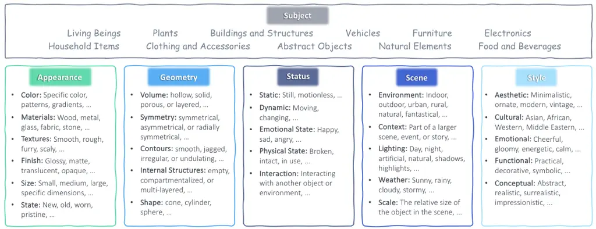

Figure S1: Subjects and properties provided for the prompt generator.

Now that GPT-4V has some basic understanding of the task, we will
further provide it with necessary components needed to composed the
prompt. First, we provide with GPT-4V a list of ten main categories from
which it’s able to select subjects of the prompt from (see Figure S1,
first box). These categories are chosen to include the most common
classes of objects users are interested in generating in text-to-3D
tasks. The goal is to make our generator aware of a comprehensive list
of potential options, reducing the risk of our prompt generator being
unintentionally biased toward certain categories when performing
in-context learning with exemplary prompts. These ten categories focuses
on what one might wish to generate (_i.e_. the subjects mentioned in
Section 4.1 of the main paper).

In addition to choosing what to generate, the text-to-3D generative
model user also might want to specify a certain state the subject is in
(_e.g_. “a sleeping cat” as opposed to “a cat”). Such description is
referred to as the properties in Section 4.1 of the main paper. To
achieve this, we additionally provide GPT-4V a list of descriptions of
different properties a user of text-to-3d model might be interested in
including (see Figure S1, second row, where each column include list of
properties under one of the five aspects we listed). Note that this
specific instruction will base on the subjects and a given level of
creativity and complexity the evaluator specifies, which will be
attached to the beginning of prompt. Please see Figure S7-S8 for the
complete detailed prompt.

Finally, we will provide our prompt generator with a list of exemplary
prompt where it can model the output from. Users can curate this list of
prompt according to their need. In our case, we include the prompts by
Dreamfusion \[51\].

With these exemplary prompts and our provided instruction designed to be
customizable according to different scenarios, GPT-4V is now able to
provide a list of prompts according to the evaluator’s input. Examples
of the generated prompts from different levels of creativity and
complexity are shown in Figure S2. We can see that users can create
prompts with different difficulties and focus using our prompt
generator. While we only focus on only two different axes (_i.e_.
creativity and complexity) in this work, but our prompt generating
pipeline can be easily adapted to other needs as the evaluators can
change various part of our conversations accordingly.

Figure S2: Examples of the generated prompts with different levels of
creativity and complexity.

### B.2 3D Assets Evaluator

In the instruction for the GPT-4V evaluator, we first explain the task
and the definition of each criterion. Then, we asked to take a close
look at the input pairs of multi-view images and normal maps before
providing its analysis and final comparisons. Finally, we specify a
specific output format for GPT-4V to follow. In our output format, we
also require GPT-4V to provide a short reasoning of why it commit to
certain choices, inspired by prompting technique such as
chain-of-thought \[69\]. Specifying an output format can also help us
better collect results at a larger scale. An example of such an
instruction is shown in Figure S3.

Note that the description of the criteria can be adjusted according to
evaluation task. In additional, one can also include in-context learning
by breaking down this single text-prompt into multiple pieces, where the
following pieces provide exemplary answer of the comparison task in
hand. While we believe this can potentially provide a better
performance, we only use a single text-prompt and a single image for
each pairwise comparison due to limited API access.

Figure S3: An example of prompts used to guide the GPT-4V evaluator.

In additional to the text instruction, we also need to render images
from different view-points to input into GPT-4V. For each text-to-3D
model, we provide one, four, or nine renders with camera evenly
distributed surroundingly. Note that different text-to-3D generative
models might use different coordinate systems, and GPT-4V might prefer
certain views of the object than others. We leave it to the evaluator or
the text-to-3D model developer to adjust the coordinate system to allow
GPT-4V to make the best judgment.

Finally, we create several slightly perturbed version of the input
instruction and images to obtain multiple outcomes from GPT-4V. We will
ensemble these outcomes to provide a more accurate estimate, as
suggested by Yang et al. \[71\]. Specifically, we perturb the visual
information with three versions: including pure RGB renders, pure
surface normal maps, and containing both. For text instructions, we
experiment with three versions: 1) GPT-4V is required to evaluate a full
list of six criteria, 2) include only the criteria of interest, and 3)
explicitly ask GPT-4V to evaluate geometry first. We also perturb the
number of render views in three versions: 1) only a single view-point; 2) four view-points in a 2x2 layout, and 3) 9 view-points in a 3x3
layout. Finally, we also augment the visual information in three
ways: 1) horizontally flipping the left-right order of the objects; 2)
vertically flipping the up-down order of the RGB images and normal maps
and 3) adding visual watermark into the image \[71\]. A detailed
ablation will be provided in the later section (Sec R1).

### B.3 ELO Rating

Comparing two 3D assets can yield different outputs depending on the
evaluator or the criteria. This is because human preference is highly
subjective and stochastic. We need to model such stochasticity when
designing a rating that correctly reflects how much a text-to-3D method
is preferred by human evaluators. Such stochasticity is also encountered
when two chess players are playing against each other. Since a stronger
player can sill lose to a weaker player when the stronger player he or
she is having a bad day. In other words, the outcome of comparisons can
be noisy. Fortunately, the ELO rating system is designed to create a
rating that can reflect the true player’s performance while the
comparison results are noisy. We will provide some basic intuition of
how our ELO system worked for completeness and please refer to prior
literatures for more details \[43, 19\].

The ELO rating system tries to assign a number, $`\sigma_{i}`$ for the
$`i^{\text{th}}`$ player, which reflects the strength of this player.
Let’s examine the case when two players, $`i`$ and $`j`$, play together
and assume without loss of generality that $`\sigma_{i}>\sigma_{j}`$.
The probability of $`i^{\text{th}}`$ player winning the game should be
larger when the difference between $`\sigma_{i}`$ and $`\sigma_{j}`$ is
larger. One way to define such probability of winning is the following:

```math
\displaystyle\operatorname{Pr}(\text{``}i\text{ beats player }j\text{''})=\frac{1}{1+10^{\frac{\sigma_{j}-\sigma_{i}}{c}}}, \tag{3}
```

where $`c`$ controls the scale of the difference (_i.e_. if the
difference is $`c`$ then the probability of winning will be $`1/11`$).
From this formula, if $`\sigma_{i}=\sigma_{j}`$, then the probability
that player $`i`$ wins over player $`j`$ is exactly $`1/2`$. It’s also
easy to see that

```math
\displaystyle\operatorname{Pr}(\text{``}i\text{ beats }j\text{''})+\operatorname{Pr}(\text{``}j\text{ beats }i\text{''}) \tag{4}
```

```math
\displaystyle= \displaystyle\frac{1}{1+10^{\frac{\sigma_{j}-\sigma_{i}}{c}}}+\frac{1}{1+10^{\frac{\sigma_{i}-\sigma_{j}}{c}}}=1. \tag{5}
```

During experiment, we observe that $`i`$ beats $`j`$ for $`A_{ij}`$
number of times and $`j`$ beats $`i`$ for $`A_{ji}`$ number of times.
The idea is to find the assignment of $`\sigma_{i}`$ and $`\sigma_{j}`$
such that it best reflects the empirical observation. Specifically, we
achieve this by maximum likelihood estimation:

```math
\displaystyle\max_{\sigma_{i,j}}\operatorname{Pr}(A_{ij},A_{ji}|\sigma_{i},\sigma_{j})
```

```math
\displaystyle= \displaystyle\max_{\sigma_{i,j}}\log\left(\operatorname{Pr}(\text{``}i\text{ beats }j\text{''})^{A_{ij}}\operatorname{Pr}(\text{``}j\text{ beats }i\text{''})^{A_{ji}}\right)
```

```math
\displaystyle= \displaystyle\max_{\sigma_{i,j}}A_{ij}\log\left(\operatorname{\operatorname{Pr}(\text{``}i\text{ beats }j\text{''})}\right)+A_{ji}\log\left(\operatorname{\operatorname{Pr}(\text{``}j\text{ beats }i\text{''})}\right)
```

```math
\displaystyle= \displaystyle\min_{\sigma_{i,j}}A_{ij}\log\left(1+10^{\frac{\sigma_{j}-\sigma_{i}}{c}}\right)+A_{ji}\log\left(1+10^{\frac{\sigma_{i}-\sigma_{j}}{c}}\right).
```

Equation (1) in the main paper can be directly derived from the equation
above by summing over all pairs of $`i\neq j`$. In practice, we will
initialize $`\sigma_{i}=1000`$ for all $`i`$ and use Adam optimizer to
optimize $`\sigma_{i}`$ for this loss for $`10000`$ iterations with a
learning rate of $`0.1`$. Since Elo score is invariant to adding or
subtracting a constant, we further calibrate our scores by setting
Dreamfusion \[51\] to have an Elo of 1000 for all criteria.

Note that this method consider the setting where the outcomes include
only $`i`$ wins or $`j`$ wins. In our case, there are non trivial number
of 3D assets pairs from which the human annotator cannot determine which
is better. To handle these cases, we follow Nichol et al. \[43\] to add
a win to both methods. This can effectively dilate the number of winning
times. Our $`A_{ij}`$ counts the number of times text-to-3D generative
model $`i`$ wins over model $`j`$ over any captions. This can be adapted
in this theoretical framework by considering the distribution of input
text-prompts:

```math
\displaystyle\operatorname{Pr}(\text{``}i\text{ beats player }j\text{''})=\int\operatorname{Pr}(\text{``}i\text{ beats player }j\text{''}|t)P(t)dt,
```

where $`t`$ denotes an input text prompt. Following most Elo systems, we
choose $`c=400`$.

## Appendix C Experimental Details

In this section we will provide some additional experiment details. We
provide a detailed list of text-to-3d generative models for benchmarking
in Section C.1. Additional detail about our user studies is provided in
Section C.2.

### C.1 Text-to-image Models

We involve 13 generative models in the benchmark, including ten
optimization-based methods and three recently proposed feed-forward
methods. Please refer to the supplementary for the complete list of
methods. For optimized-base methods, we include DreamFusion \[51\], SJC
\[66\], Latent-Nerf \[41\], Magic3D \[37\], Fantasia3D \[11\], Prolific
Dreamer \[68\], DreamGaussian \[63\], MVDream \[60\], SyncDreamer \[38\]
and Wonder3D \[39\]. For feed-forward methods, we include PointE \[44\],
Shap-E \[30\], and Instant3D \[36\]. We leverage each method’s official
implementations when available. Alternatively, we turn to Threestudio’s
implementation \[20\]. For methods designed mainly for image-to-3D, we
utilize Stable Diffusion XL \[49\] to generate images conditioned on
text as input to these models. Experiments are conducted with default
hyper-parameters.

### C.2 User study details

In this paper, we mainly rely on labels provided by expert annotators.
Our expert annotators are all graduate students with computer graphic
background (_e.g_. they all have experience looking at surface normal
maps). We recruit twenty such expert annotators from this background.
For 13 methods, we create pairwise comparison between each pair of
methods (so $`78`$ method pairs). For each method pairs of methods, we
sample $`3`$ captions from the caption generators. For each of these
$`234`$ comparisons, we assign three different experts to rank all
criteria. The experts are asked to pick a shape that performs better
according to certain criteria or indicate that these two shapes are
indistinguishable. Each user will fill out a query form that includes
the same description we provided with GPT-4V. Different from what we
provided with GPT-4V, expert annotators are able to see video of 360
rotated render of the object in RGB and in surface normals. The
annotator can control the video (_e.g_. replaying to certain point) to
exame the 3D shape in more details. The video is rendered in 1024x2048
resolution. In our setting, expert annotators are provided with more
information comparing to what we provided to GPT-4V. Our expert
annotators achieve reasonable agreement with greater than 0.53 Cohen
kappa \[13\].

One disadvantage of expert annotation is that it’s difficult to get by
so we are only able to obtain a small scale of such annotation. On the
contrary, one can obtain larger-scale annotation from general users.
We’ve also conducted some preliminary exploration conducting user
preference studies with general users. Unfortunately, we found that data
collected from general users are very noisy. Specifically, we recruited
about 53 users and performed the same user studies as done with the
expert. In addition to the instruction provided with GPT-4V, we also
provide examples comparison and requires the user to go through a short
training session. The average user agreement (measured by Cohen’s kappa)
among these users can barely reach 0.3. This can potentially be caused
by the fact that general users do not have experience reasoning about 3D
asset information, so computer graphics terms (_e.g_. texture, surface
normal, or geometry), become harder to understand. As a result, we
leverage expert user data as reference labels in this paper. How to
conduct large-scale user studies with more available annotators remains
a very interesting future work direction.

## Appendix D Ablation Studies

In this section, we will examines key technical design choices of our
methods. Specifically, we will focus our ablation on different ways to
perturb the input data to create ensemble results (Section 5.2 of main
paper). We first carry out an ablation study on different ways to
perturb the input (Section D.1). Then we show an ablation on how to
ensemble these perturbations together (Section D.2).

Due to limited API access, we are not able to obtain enough GPT-4V
queries to compute method-level human alignment scores as in Table 1 or
the pair-level alignment score in Table 2 in the main papers. To address
this limitation, we use an alternative metric in the ablation. For each
variant of our methods, we randomly sample 78 different comparisons of
3D assets. For each comparison, we compute the probability that our
GPT-4V 3D asset evaluator would select one shape versus the other. We
denote such empirically estimated probability as $`p_{i}`$ for our
method’s variant to choose one shape at the $`i^{\text{th}}`$
comparison. Let $`q_{i}`$ be the same probability estimated from expert
annotation data. We return the following L1-distance as an estimation of
how our method is mis-alignment with human judgment:

```math
\displaystyle\operatorname{L1-dist}(p,q)=\frac{2}{N}\sum_{i=1}^{N}|p_{i}-q_{i}|, \tag{6}
```

where $`N`$ is the number of comparisons here. Note that the lower this
metric is, the better alignment with human judgement.

| Methods            |                 | Alignment ($`\downarrow`$) | Plausibility ($`\downarrow`$) | Color-Geo ($`\downarrow`$) | Texture ($`\downarrow`$) | Geometry ($`\downarrow`$) |
| ------------------ | --------------- | -------------------------- | ----------------------------- | -------------------------- | ------------------------ | ------------------------- |
| Visual Information | Pure RGB        | 0.523                      | 0.564                         | -                          | 0.354                    | -                         |
|                    | Pure Normal     | 0.674                      | 0.654                         | -                          | -                        | 0.579                     |
|                    | RGB + Normal    | 0.518                      | 0.672                         | 0.628                      | 0.444                    | 0.510                     |
| Text Instruction   | Joint           | 0.518                      | 0.672                         | 0.628                      | 0.444                    | 0.510                     |
|                    | Separate        | 0.451                      | 0.597                         | 0.610                      | 0.433                    | 0.528                     |
|                    | Geo-first       | 0.682                      | 0.646                         | 0.662                      | 0.487                    | 0.505                     |
| View number        | 1               | 0.592                      | 0.644                         | 0.603                      | 0.423                    | 0.438                     |
|                    | 2x2             | 0.518                      | 0.672                         | 0.628                      | 0.444                    | 0.510                     |
|                    | 3x3             | 0.546                      | 0.582                         | 0.654                      | 0.503                    | 0.559                     |
| Augmentation       | Horizontal Flip | 0.615                      | 0.702                         | 0.676                      | 0.522                    | 0.651                     |
|                    | Vertical Flip   | 0.764                      | 0.695                         | 0.754                      | 0.738                    | 0.708                     |
|                    | Watermark       | 0.605                      | 0.559                         | 0.597                      | 0.577                    | 0.492                     |

Table R1: Ablation studies on different visual and textual input to
GPT-4V. We mark rank one, rank two, and rank three in each criterion
with increasingly lighter shades of blue, and the same baseline (RGB +
Normal, 2x2, Joint) is marked in gray.

### D.1 Ablation for GPT-4V Input Perturbation

We conduct ablations on different ways to perturn the inputs for GPT-4V.
We will investigate four different categories of perturbations,
including visual information, text instruction, view number, and
augmentation. The main results are summarized in Table R1.

#### Visual Information

The visual information can include RGB images, normal maps, or both of
them. Purely using RGB as input can benefit the perception of texture
details, probably because GPT-4V can spend more computational power on
the presentation of the textures. However, not all the criteria can be
evaluated merely from the RGB information. As a result, skip evaluation
of alignment on those criteria, namely “Color-Geo” and “Geometry”. Only
presenting the normal maps to GPT-4V does not bring much improvement for
its alignment to human choices even for “Geometry Details”. We can see
that RGB renders seem to play the most important role for GPT-4V to make
human-aligned decisions. Surface normal render is required to perform
many evaluations of criteria about geometries.

#### Text Instruction

We experiment different way to input user criteria into the text
instruction. Jointly inputting all criteria into a same text prompt can
significantly reduce the number of API calls required. An example of
this kind of text instruction can be seen in Figure S3. We also try to
evaluate only one criterion at a time. One can see a clear improvement
for most of the degrees thanks to the more focused analysis, especially
for “Text-Asset Alignment”. This presents a trade-off between compute
and accuracy.

#### View number

The number of views denotes how many multi-view images are shown at the
same time. Given the assumption that the visual context size is fixed
for GPT-4V \[45\], this ablation explores the trade-off between the
perception of global coherency and local details. Presenting only one
view at a time can largely improve GPT-4V’s ability in evaluating
low-level criteria like “Texture-Geometry Alignment”, “Texture Details”,
and “Geometry Details”. However, the scarcity of views leads to
challenges in evaluating the global criteria like “Text-Asset Alignment”
and “3D Plausibility”. Increasing view numbers to four or nine will
largely alleviate this problem.

#### Augmentation

In the study, we have also experimented with various visual augmentation
techniques \[71\], which refers to changing the visual input slightly
without changing the key information contained in the image. We
experiment with three augmentation methods: horizontal flipping of
object positions (_i.e_. “Horizontal Flip”), the rearrangement of RGB
images in conjunction with their respective normal maps (_i.e_.
“Verticle Flip”), and the inclusion of watermark annotations to indicate
the “left” and “right” objects (_i.e_. “Watermark”). Adding watermarks
slightly improves the alignment. This can be a result of watermarks
reducing the ambiguity happened when we refer to certain image positions
from the text instruction.

#### Other findings.

Another interesting finding is that the results get worse when the
normal maps are emphasized in the inputs. For example, in the setting of
“Geo-first”, we first provide the surface normal and ask questions
involving geometries before providing the full RGB renders and asking
the rest of questions. The setting of “Pure Normal” also emphasizes
surface normal map by not including the RGB renders. These settings both
lead to slightly worse result than the baseline method.

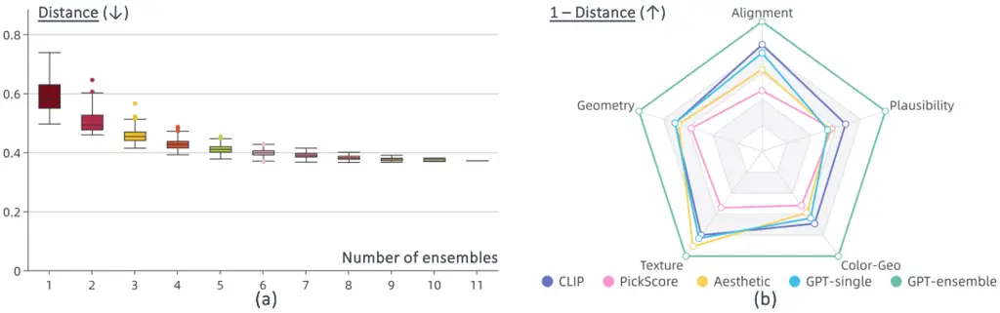

Figure S4: Ablation studies of the robust ensemble. (a) highlights a
consistent improvement in performance with an increase in ensemble size,
together with the decrease in the differences among various ensemble
strategies. (b) shows how the robust ensemble significantly improves
human alignment across all dimensions.

### D.2 Ablation for Output Ensemble.

In this section, we want to explore what is the best way to combine
different perturbations together. The exploration space of such
combinations is huge as there are $`n^{k}`$ numbers of ways to combine
$`n`$ ways to perturb the input together to create $`k`$ ensembles.
Interestingly, we observed that the variance of the L1-distance reduces
as we increase the number of ensembles increases. This is depicted from
Figure S4-(a) shows the distribution of the L1-distance when ensembling
different number of results together. We can see that the alignment
performance is not sensitive to particular choice of input perturbations
when the number of ensembles is large enough. To achieve the most
effective results, we will incorporate a combination of various view
numbers, augmentations, visual information, and individual queries for
specific criteria, selecting 4-5 strategies overall for the final
combination. Figure S4-(b) that ensembling these strategies together
results in a metric outperforms all the previous metrics when measured
in L1-distance.

## Appendix E Additional Results

In this section, we will provide additional results which do not fit in
the original paper.

### E.1 Ranking

|     |                  |              |                  |                  |                  |
| --- | ---------------- | ------------ | ---------------- | ---------------- | ---------------- |
|     | Alignment        | Plausibility | Color-Geo        | Texture          | Geometry         |
| 1st | MVDream          | MVDream      | MVDream          | MVDream          | MVDream          |
| 2nd | Prolific Dreamer | Latent-NeRF  | Latent-NeRF      | Prolific Dreamer | Prolific Dreamer |
| 3rd | Latent-NeRF      | Instant3D    | Prolific Dreamer | Latent-NeRF      | Latent-NeRF      |
| 4th | Instant3D        | Dreamfusion  | Instant3D        | Instant3D        | Instant3D        |

Table R2: Top-4 methods for different criteria according to our metrics.

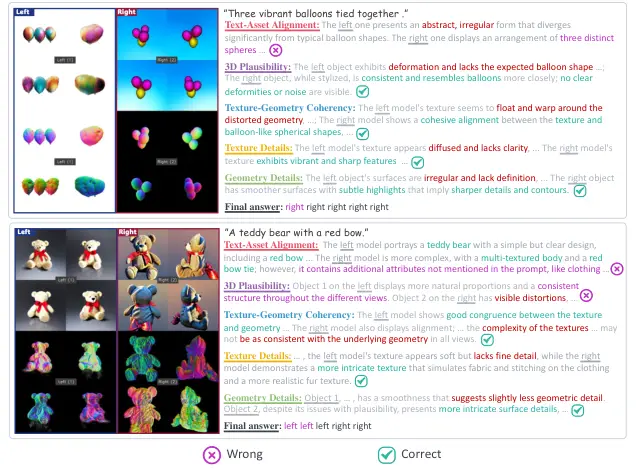

Figure S5: Failure cases. The analysis of GPT-4V can sometimes be
partially wrong. We show several typical examples for the “Text-Asset
Alignment” and “3D Plausibility” criteria.

While the results of our method are still largely limited by API request
limits, we would like to show some preliminary results for how existing
text-to-3D generative models perfrm according to our methods in
different criteria. Table R2 shows the top four methods according to
GPT-4V in all six criteria. We can see that MVDream \[60\] is ranked the
first across various criteria. Latent-NeRF \[41\] is able to achieve
strong performance, ranked second or third across all criteria.
Similarly, Prolific dreamer \[68\] achieves comparable performance as
latent-NeRF except for Plausibility. Finally, Instant3D \[36\] is ranked
the fourth places in all but Plausibility. Instant3D is ranked the third
place in Plausibility, above Prolific dreamer. Dreamfusion \[51\] is
able to achieve good Plausibility, probably thanks to its geometry
regularization.

### E.2 GPT-4V Comparison Examples

In Figure S6, we show some more examples of GPT-4V’s analysis and
answers to this task (using “left / right / equal” instead of “1 / 2 /
3” for better clarity. These examples demonstrate how the evaluator is
able to make comparisons of the paired visual input based on close
observations and detailed analysis.

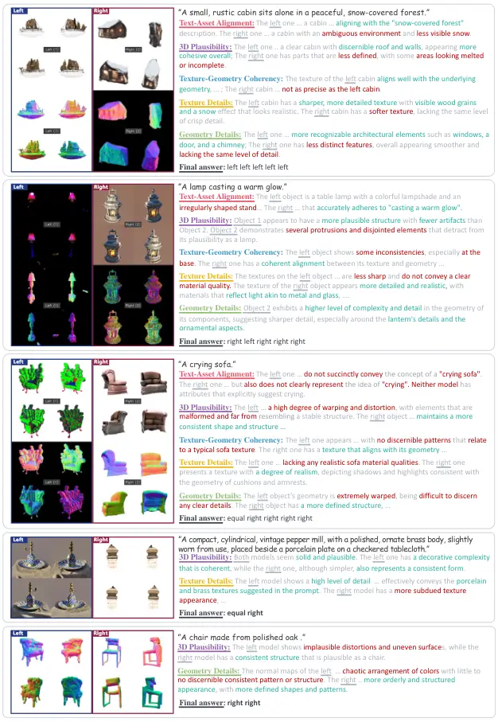

Figure S6: Additional examples of the analysis by GPT-4V.

## Appendix F Failure cases

We present some typical failure cases in Figure S5. In the first
instance, GPT-4V fails to detect the mismatch in the number of balloons
between the two objects, thereby highlighting its limitations in
accurately counting specific quantities. In the second instance, both
objects exhibit significant issues with their underlying geometries, The
object on the left presents severe 3D plausibility problems, as
evidenced by the presence of multiple faces and leg. Both objects are
plagued by low-level geometric noise. GPT-4V demonstrates sensitivity to
low-level noise, consequently overlooking the overarching issue with the
object on the left. Such problems can potentially be rectified if one
can provide a larger number of views to GPT-4V.

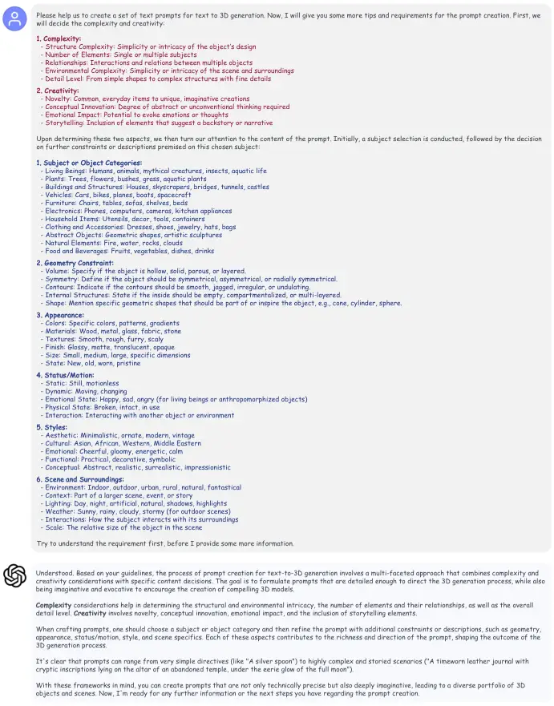

Figure S7: Examples of guiding GPT for automatic prompt generation.
(Part 1/2)

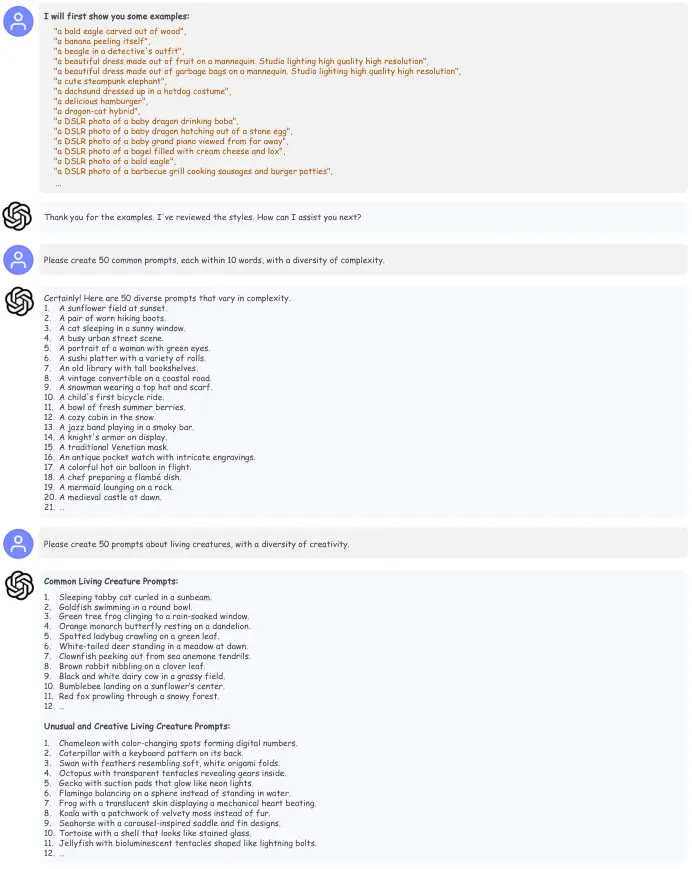

Figure S8: Examples of guiding GPT for automatic prompt generation.
(Part 2/2)
