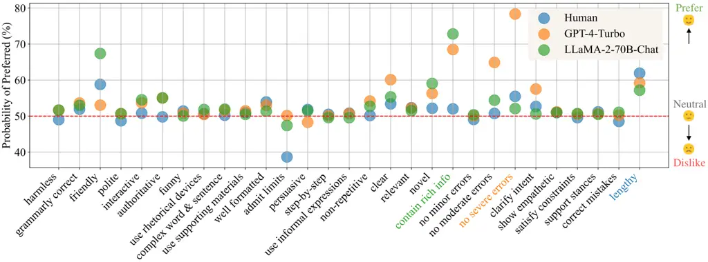
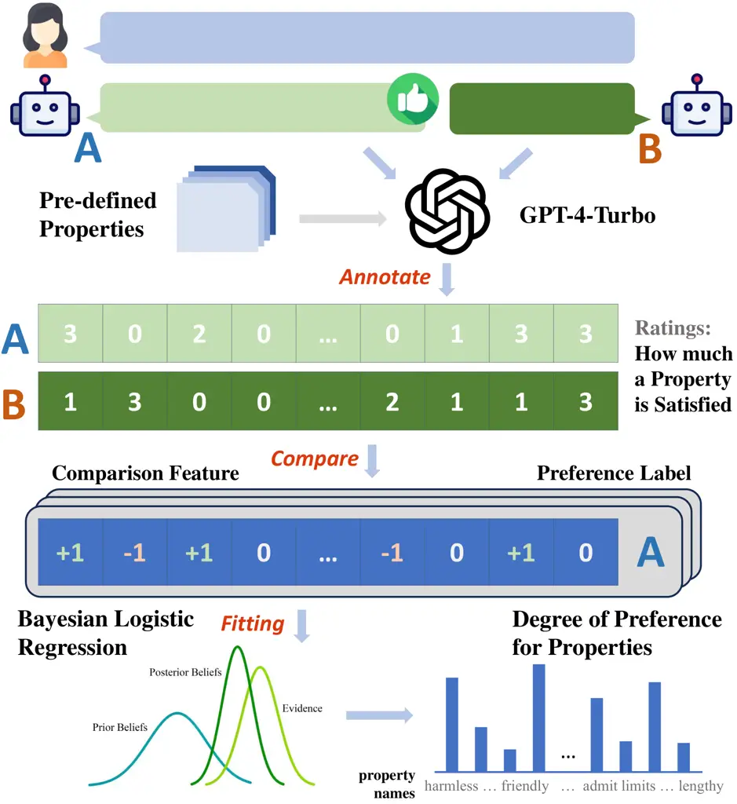
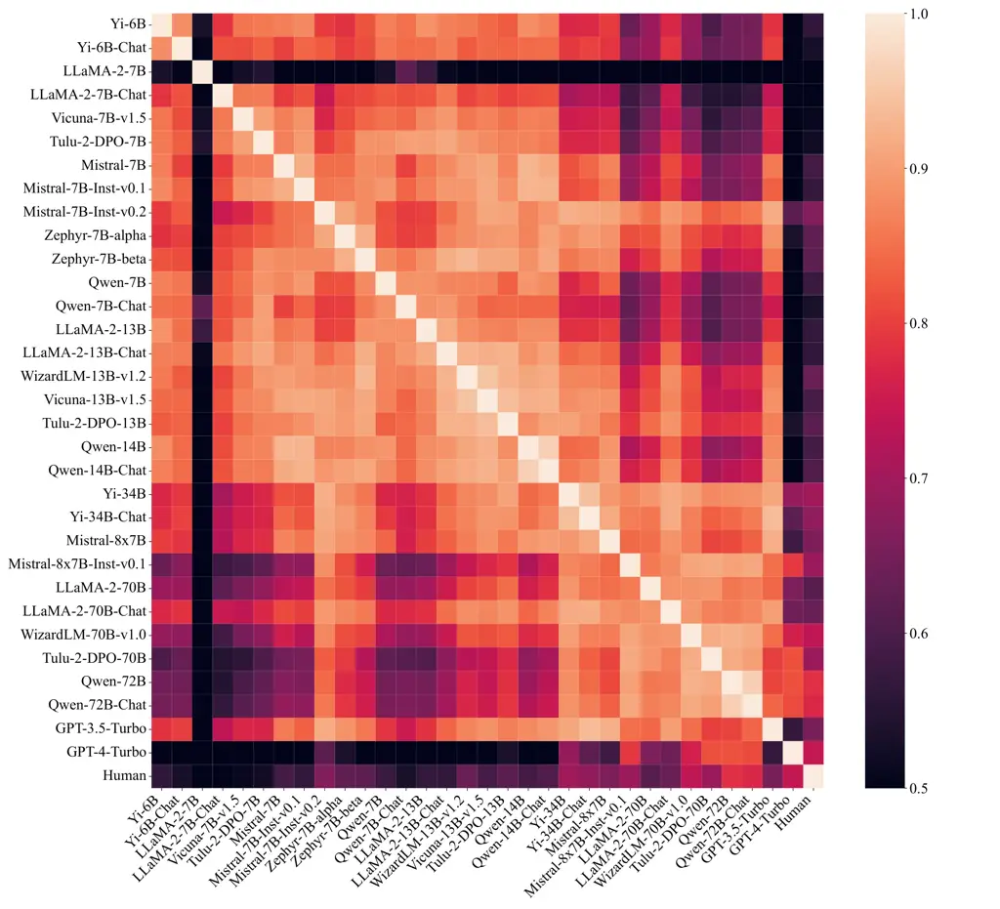
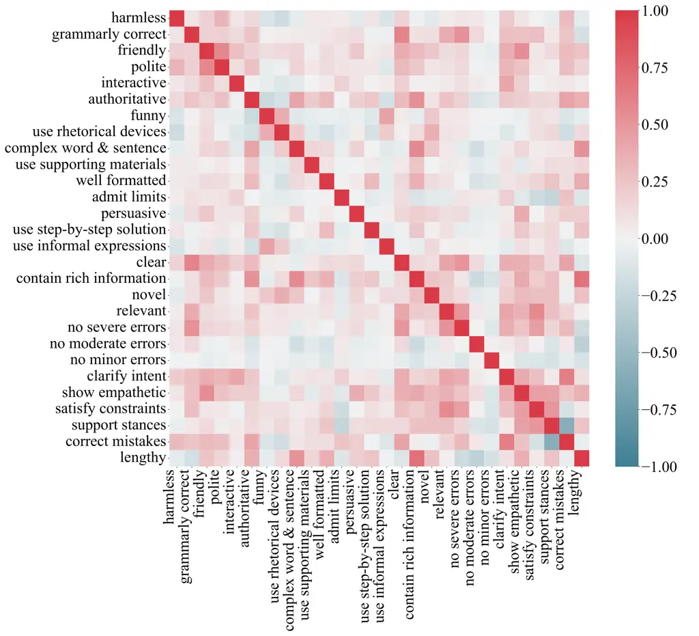
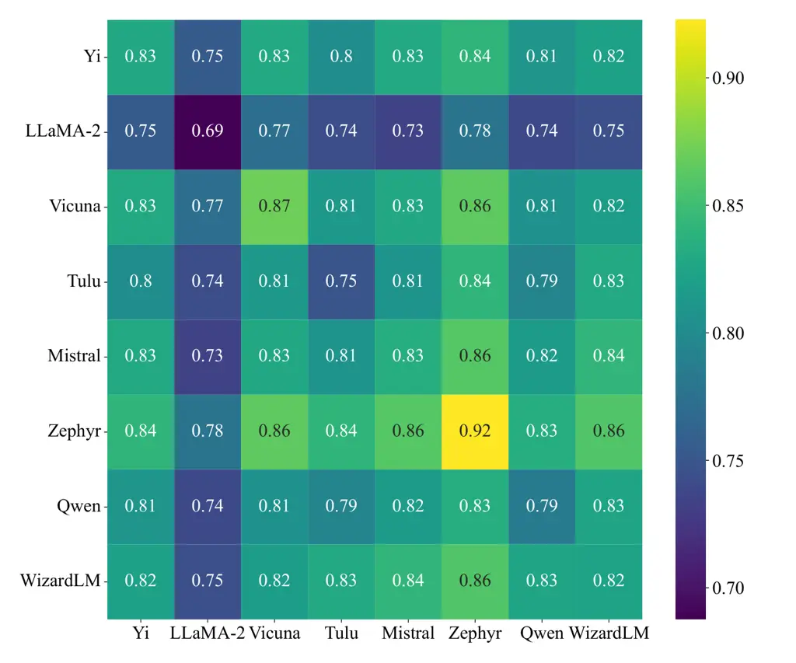

# Dissecting Human and LLM Preferences

Junlong Li Affiliation: Hong Kong Polytechnic University Generative AI
Research Lab (GAIR) Email: [lockonn@sjtu.edu.cn](mailto:)    Fan Zhou
Affiliation: Shanghai Jiao Tong University Shanghai Artificial
Intelligence Laboratory Affiliation: Hong Kong Polytechnic University
Generative AI Research Lab (GAIR) Email: [pengfei@sjtu.edu.cn](mailto:)
   Shichao Sun Affiliation: Hong Kong Polytechnic University Generative
AI Research Lab (GAIR)    Yikai Zhang Affiliation: Hong Kong Polytechnic
University Generative AI Research Lab (GAIR)    Hai Zhao    Pengfei Liu
^(†)^(†)thanks: Corresponding author Affiliation: Shanghai Jiao Tong
University Shanghai Artificial Intelligence Laboratory Affiliation: Hong
Kong Polytechnic University Generative AI Research Lab (GAIR)

###### Abstract

As a relative quality comparison of model responses, human and Large
Language Model (LLM) preferences serve as common alignment goals in
model fine-tuning and criteria in evaluation. Yet, these preferences
merely reflect broad tendencies, resulting in less explainable and
controllable models with potential safety risks. In this work, we
dissect the preferences of human and 32 different LLMs to understand
their quantitative composition, using annotations from real-world
user-model conversations for a fine-grained, scenario-wise analysis. We
find that humans are less sensitive to errors, favor responses that
support their stances, and show clear dislike when models admit their
limits. On the contrary, advanced LLMs like GPT-4-Turbo emphasize
correctness, clarity, and harmlessness more. Additionally, LLMs of
similar sizes tend to exhibit similar preferences, regardless of their
training methods, and fine-tuning for alignment does not significantly
alter the preferences of pretrained-only LLMs. Finally, we show that
preference-based evaluation can be intentionally manipulated. In both
training-free and training-based settings, aligning a model with the
preferences of judges boosts scores, while injecting the least preferred
properties lowers them. This results in notable score shifts: up to 0.59
on MT-Bench (1-10 scale) and 31.94 on AlpacaEval 2.0 (0-100 scale),
highlighting the significant impact of this strategic adaptation.

Interactive Demo:
[https://huggingface.co/spaces/GAIR/Preference-Dissection-Visualization](https://huggingface.co/spaces/GAIR/Preference-Dissection-Visualization)

Dataset:
[https://huggingface.co/datasets/GAIR/preference-dissection](https://huggingface.co/datasets/GAIR/preference-dissection)

Code:
[https://github.com/GAIR-NLP/Preference-Dissection](https://github.com/GAIR-NLP/Preference-Dissection)



Figure 1: The preference dissection of human, GPT-4-Turbo and
LLaMA-2-70B-Chat on Communication Scenario (including chitchat and value
judgment), and we highlight the most preferred property for each in its
corresponding color: lengthy for human, no severe errors for
GPT-4-Turbo, and contain rich info for LLaMA-2-70B-Chat. The value is
the probability of a response being preferred in a pair when it
satisfies one property better than the other response, holding all else
equal. This can be interpreted as how much human or an LLM favor a
certain property. Values above and below the 50% line indicate a
preference or dislike, respectively.

 

|     |
| --- |
|     |

## 1 Introduction

Human and LLM preferences have played a crucial role in the development
pipeline of recent advanced language models. Preference-based training,
such as Reinforcement Learning from Human/AI Feedback (RLHF/RLAIF)
(Ouyang et al., 2022; Lee et al., 2023) and Direct Preference
Optimization (DPO) (Rafailov et al., 2023), are widely used to fine-tune
models to align with more practical needs. On the other hand, the
preferences of human and LLMs, in the form of LLM-as-a-judge or Elo
ratings, have become the de facto judging criteria for assessing the
quality of model outputs (Li et al., 2023b; Zheng et al., 2023) as the
tasks are becoming increasingly diverse and complex.

Unlike the widely applied preference-based methods above, the
preferences themselves lack thorough research. In most cases, they are
only binary labels indicating which response is preferred as a vague
form of expression, and we are unable to understand the preferences in
an explainable and quantitative way. As a result, optimizing models
towards such goals inevitably leads to certain issues (Casper et al.,
2023). These include the trained models engaging in over-optimization
(Gao et al., 2023) and reward hacking (Sun et al., 2023), manifesting in
undesired ways such as producing overly verbose answers (Singhal et al., 2023) or demonstrating sycophancy (Sharma et al., 2023), which hinder
the building of more reliable AI systems.

In this work, we build a systematic framework to dissect the overall
preferences into a quantitative combination of multiple clearly defined
properties. To pursue understanding in realistic settings, we sample
real-world user conversations with a balanced distribution of different
scenarios from ChatBot Arena Conversations (Zheng et al., 2023), where
each sample is a pair of model responses to a query. We adopt an
elaborate yet automated pipeline to annotate the data with regard to our
pre-defined properties (e.g., harmless or admit limits). Based on the
annotations, we determine how a pair of responses differ from each other
on all properties. These distinctions are then used to fit Bayesian
logistic regression models, which help us quantitatively decompose
preferences based on different properties by examining their weights.

Leveraging the above framework, we analyze the human preferences of real
users and the preferences of numerous LLMs we collect. The analysis is
conducted separately on different scenarios to avoid the mixing of
preferences and achieve clearer conclusions (see Figure 1 for an
example).

We summarize the key findings as follows:

1.  1.  Humans are less sensitive to errors, clearly dislike a model when it
        admits its limits, and prefer a response that supports their stances
        (§4.1).
2.  2.  Advanced LLMs like GPT-4-Turbo prefer correctness, clarity, and
        harmlessness more (§4.1).
3.  3.  LLMs of similar sizes exhibit similar preferences irrespective of
        training methods, and the preference of a pretrained-only LLM is
        largely unchanged after alignment (§4.2).

Finally, we reveal that benchmarks with LLM-as-a-judge are easy to
manipulate (§4.3). Our experiments on AlpacaEval 2.0 (Li et al., 2023b)
and MT-Bench (Zheng et al., 2023) show that aligning models with the
judges’ preferences increases scores, whereas diverge from these
preferences leads to lower scores. This is achievable across both
training-free and training-based methods, with score variations up to
0.59 on MT-Bench (1-10 scale) and 31.94 on AlpacaEval 2.0 (0-100 scale).
The manipulation highlights the urgent need for more robust benchmarks
and further underscores the importance of understanding preference.

## 2 Related Work

##### The Application of Preferences

In training, preference data through pairwise comparisons is used to
build the reward model in Reinforcement Learning from Human/AI Feedback
(RLHF/RLAIF) (Ouyang et al., 2022; Bai et al., 2022; Lee et al., 2023;
Anthropic, 2023) or as the learning target in Direct Preference
Optimization (DPO) (Rafailov et al., 2023; Tunstall et al., 2023; Ivison
et al., 2023). In evaluation, comparing model outputs to references (Li
et al., 2023b; Dubois et al., 2023; Zhou et al., 2023), directly rating
individual responses (Zheng et al., 2023) or using Elo ratings from
human votes (Zheng et al., 2023) have become common ways to assess the
aligned models.

##### Challenges in Preference-based Methods

The preferences of human and LLMs are greatly affected by features like
the length of a response (Singhal et al., 2023), sycophancy (Sharma et
al., 2023), or certain writing styles (Gudibande et al., 2023) due to
limited annotation time (Chmielewski and Kucker, 2020), cognitive biases
of annotators (Pandey et al., 2022), limited reasoning ability and
self-enhancement bias (Zheng et al., 2023). Consequently, the reward
model trained as the proxy of preferences is vulnerable to
over-optimization (Gao et al., 2023) and reward hacking (Sun et al., 2023) in RLHF. Moreover, this can lead to instability in
preference-based evaluation, reducing the credibility and reliability of
the assessment results (Wang et al., 2023; Hosking et al., 2023).

##### Understanding and Demonstrating Preferences

Perez et al. (2022) generate multiple-choice evaluations with LMs to
discover model preferences across various personas. Turpin et al. (2023)
and Wei et al. (2023) find that models may agree with incorrect answers
if they are deliberately suggested in queries. Similar to our work,
Sharma et al. (2023) and Hosking et al. (2023) conduct regression-based
analyses to detect key factors in human preferences, such as sycophancy,
assertiveness, and formatting. However, most of these works only offer
basic analyses on limited synthetic data. In contrast, we thoroughly
analyze human and LLM preferences in various real-world scenarios within
a unified framework, and further explore potential applications arising
from a deeper understanding of preferences.



Figure 2: An overview of our high-level methodology.

## 3 Preference Dissection

### 3.1 High-level Methodology

In this work, we analyze preferences using pairwise comparison data,
which has clearer and more consistent results than individual ratings
(Ziegler et al., 2019). We start with a raw dataset $`D`$, where each
sample contains a pair of responses $`(r_{A},r_{B})`$ to a query. Then,
we collect the preference label $`l\in\{A,B\}`$ from a judge $`j`$
(human or an LLM)¹¹ 1 We treat preferences from different human
annotators collectively as “human” and view each LLM as separate. to
indicate the preferred one in each pair, forming the preference dataset
$`D_{j}`$. A set of properties $`P=\{p_{1},...,p_{N}\}`$ is defined to
guide the analysis. Our objective is to decompose the overall preference
in $`D_{j}`$ into quantifiable contributions of each property in $`P`$:
$`D_{j}\Rightarrow\bigoplus_{i=1}^{N}\alpha_{i}\odot p_{i}`$. Here,
$`\bigoplus`$ represents the composition concept, and
$`\alpha_{i}\odot p_{i}`$ shows the contribution of property $`p_{i}`$
to overall preference with effect strength as $`\alpha_{i}`$.

To elaborate, as shown in Figure 2, we first annotate how each property
in $`P`$ is satisfied in a response using a Likert scale rating, which
is applied to both $`r_{A}`$ and $`r_{B}`$ in a sample. Then, we compare
the ratings of two responses across these properties, resulting in a set
of +1/0/-1 outcomes, indicating if $`r_{A}`$ is better, equal, or worse
than $`r_{B}`$ per property.²² 2 Directly annotating comparison outcomes
is feasible, but early experiments indicate it yields an excessive
number of slightly different properties, which hurts analysis
reliability. These outcomes create the “comparison feature” of a sample.
Next, we learn Bayesian logistic regression models to predict preference
labels using the obtained “comparison feature”, and the fitted weights
of the models represent the effect strengths for each property.

### 3.2 Dataset

To pursue analysis in realistic settings, we choose Chatbot Arena
Conversations (Zheng et al., 2023) as the raw dataset $`D`$. It is
collected from a public platform where users can freely converse with
two models simultaneously and select a preferred one. We filter out
samples with “Tie/Both Bad” labels and multi-turn conversations for
future work to streamline annotation and analysis.

We notice that preferences of different scenarios vary a lot, so we take
a scenario-balanced sampling. We first use the OpenAI moderation³³ 3
[https://platform.openai.com/docs/guides/moderation](https://platform.openai.com/docs/guides/moderation)
and toxicity tags in the dataset to identify 400 samples with unsafe
queries. We then utilize the classifier in Li et al. (2023a) to
categorize the rest samples into 10 scenarios: Exam Questions, Code,
Creative Writing, Functional Writing, Communication, Knowledge-aware,
Advice, Daily Tasks, NLP Tasks, and Others (see Table 7 in Appendix B
for detailed descriptions). Since the Knowledge-Aware and Others
scenarios have a notably higher proportion in the data, we randomly
select 820 samples for each, while taking 400 ones from the other
scenarios.

|                 |                                                                                                                                                                                                                                                                                                                   |
| --------------- | ----------------------------------------------------------------------------------------------------------------------------------------------------------------------------------------------------------------------------------------------------------------------------------------------------------------- |
| Group           | Properties                                                                                                                                                                                                                                                                                                        |
| Query-specific  | clarify intent, show empathetic, satisfy constraints, support stances, correct mistakes                                                                                                                                                                                                                           |
| Basic           | harmless, grammarly correct, well formatted, non-repetitive, funny, use rhetorical devices, admit limits, clear, friendly, use informal expressions, contain rich info, persuasive, polite, complex word & sentence, step-by-step, novel, interactive, use supporting materials, authoritative, relevant, lengthy |
| Error Detection | no minor errors, no moderate errors, no severe errors                                                                                                                                                                                                                                                             |

Table 1: The 29 pre-defined properties, including 21 Basic, 5
Query-specific, and 3 Error Detection ones.

### 3.3 Collecting Preferences

Since human preferences already exist in the raw dataset $`D`$, we can
directly get the preference dataset $`D_{human}`$, and only need to
collect LLM preferences additionally. We select 2 proprietary LLMs:
GPT-4-Turbo (gpt-4-1106-preview) and GPT-3.5-Turbo (gpt-3.5-turbo-1106),
and 30 open-source LLMs (see Table E in Appendix C) to collect LLM
preference datasets $`32\times D_{LLM}`$.

To minimize prompt bias in model preference assessment, we use a
straightforward one: “Between Response A and Response B, which better
addresses the user’s query? The better response is Response”, and
measure preferences by the output log-probability of “A” or “B”.
Acknowledging a positional bias in LLMs (Wang et al., 2023), where they
prefer either the first or second response irrespective of content, we
alternate response order and average log-probabilities for an accurate
preference rating. This method yields a binary label with the same
format as human preferences.

### 3.4 Pre-defined Properties and Annoatation

We design 29 properties for our analysis, referring to criteria from Li
et al. (2023a); Sharma et al. (2023); Hosking et al. (2023). These
properties, categorized into Basic, Query-Specific, and Error Detection
groups, are listed in Table 1. For automated annotation, we employ
GPT-4-Turbo to annotate a pair of responses simultaneously in one prompt
to keep a consistent standard. We provide a fully annotated sample in
Table 10 in Appendix D.

##### Basic Properties

We define 21 basic properties, including stylistic ones like funny, and
content-based ones like admit limits. GPT-4-Turbo is required to rate
responses from 0 to 3 for each property in a single prompt. We find that
including the query in the prompt disturbs the annotation as most of the
basic properties are query-independent. Thus, we only use the query for
relevant and novel, the two query-aware ones. For lengthy, we directly
measure word count using NLTK (Loper and Bird, 2002). Detailed
annotation prompts and descriptions are in Figure 6, 7 and 8 in Appendix
A.

##### Query-specific Properties

|                           |       |                  |     |
| ------------------------- | ----- | ---------------- | --- |
| Prerequisite              | \#    | Prerequisite     | \#  |
| with explicit constraints | 1,418 | unclear intent   | 459 |
| show subjective stances   | 388   | express feelings | 121 |
| contain mistakes or bias  | 401   |                  |     |

Table 2: Number of samples meeting 5 Query-specific prerequisites.

We defined 5 query-specific properties that are annotated based on the
user query, e.g., support stances is inapplicable for queries with no
subjective stance. Therefore to improve accuracy, we adopt a two-round
annotation process. The first round determines if a query meets the
prerequisites for these properties, and we list the number of samples
satisfying the prerequisites in Table 2. In the second round, annotation
focuses only on applicable properties. The detailed prompts and the
specific annotation goal for each property are illustrated in Figure 9,
10, 11 and 12 in Appendix A. The annotation results are also converted
into a rating from 0 to 3 (see Appendix F).

##### Error Detection

Although GPT-4-Turbo typically identifies errors in most samples
accurately, it may fail with content beyond its training data.
Therefore, we first ask it to evaluate whether it can reliably detect
errors in a response, outputting an “applicable/not applicable” tag.
Samples tagged as “not applicable” are excluded. For clearer annotation,
we limit error types to four: Factual Error, Information Contradiction,
Math Operation Error, and Code Generation Error. We also define three
severity levels for errors: Minor, Moderate, and Severe, based on their
impact on response correctness. Additionally, a reference answer
generated independently by GPT-4-Turbo is included in the prompt, which
has proven to help identify errors correctly (Zheng et al., 2023;
Saunders et al., 2022; Sun et al., 2024). We ask GPT-4-Turbo to list
errors by type and severity, creating 3 properties based on the error
count per severity level. The complete prompt is shown in Figure 13 in
Appendix A.

|                |                |                            |                       |
| -------------- | -------------- | -------------------------- | --------------------- |
| Scenario-Wise  | Advice         | Communication              | Creative Writing      |
| Human          |                |                            |                       |
| GPT-4-Turbo    |                |                            |                       |
| Scenario-Wise  | Daily Tasks    | Knowledge-Aware            | Unsafe Query          |
| Human          |                |                            |                       |
| GPT-4-Turbo    |                |                            |                       |
| Query-Specific | Unclear Intent | Express Subjective Stances | Contain Mistakes/Bias |
| Human          |                |                            |                       |
| GPT-4-Turbo    |                |                            |                       |

Table 3: The top/last 3 preferred properties of human and GPT-4-Turbo on
different selected groups of samples, ranked by the degree of preference
$`P(p_{i})=\sigma(\alpha_{i})`$, the probability a response is preferred
over the other when the former satisfies only one property $`p_{i}`$
better than the latter and all else equal.

##### Annotation Quality Check

We ask four of our authors to check the annotation quality. They are
required to determine if they agree with the annotations, using the same
guidelines for GPT-4-Turbo. The agreement rates are 93.1% for Basic
property ratings, 85.1% for Detected Errors, with 90% of responses
having all errors identified without missing. For Query-specific
properties, the agreement is 94.8% in the first-round prerequisite
questions and 85.5% in the second-round annotation. More details can be
found in Table 11 in Appendix G.

### 3.5 Calculating Effect Strengths of Properties

##### Building Comparison Features

For each sample, we assign +1/-1/0 to each property based on whether the
rating of $`r_{A}`$ is higher/lower or equal to that of $`r_{B}`$. For
Error Detection properties, a lower count of errors in $`r_{A}`$ yields
+1. The detailed comparison strategy is in Appendix H. These outcomes
form a comparison feature, $`\phi\in\{+1,0,-1\}^{N}`$, where $`N=29`$ is
the total number of properties.

##### Bayesian Logistic Regression

We use Bayesian logistic regression to predict the preferences from
comparison features ($`\sigma(\cdot)`$ is the sigmoid function):

```math
P(l=A|\phi,\alpha)=\sigma\left(\textstyle\sum_{i=1}^{N}\alpha_{i}\phi_{i}\right)
```

We place a prior
$`\alpha_{i}\sim\operatorname{\text{Laplace}}(\mu=0,b=0.1)`$ over the
weights $`\alpha_{i}`$ with zero mean and scale $`b=0.1`$. This prior
encodes the belief each property is equally likely to increase or
decrease the probability a response is preferred. We perform approximate
Bayesian inference with the No-U-Turn Sampler (Hoffman et al., 2014)
with Hamiltonian Monte Carlo (Neal et al., 2011) to collect 6,000
posterior samples across four independent Markov Chain Monte Carlo
(MCMC) chains (each chain contains 500 warmup samples and 1,500
collected samples), and take the mean value of all samples as the
results in one fitting. To reduce instability in fitting, we divide the
data into 10 parts, using 9 for fitting in each iteration. The final
weights $`\alpha`$ are the average of the results from 10 iterations. To
pursue a fine-grained analysis, we separately fit individual models for
subsets with different scenarios (or meet certain Query-specific
prerequisites) in each $`D_{j}`$. We see that the fitted models reach
about 80% accuracy for most $`D_{j}`$ (Table 12 in Appendix J).

## 4 Analysis and Application

### 4.1 Which Properties are Most or Least Preferred by Human and GPT-4-Turbo?

As the most common sources of preference data, we thereby analyze two
specific cases: human and one of the most advanced LLMs, GPT-4-Turbo.

#### 4.1.1 Quantifying Preferences for Properties

For a property $`p_{i}`$, we calculate the degree of preference
$`P(p_{i})`$ as $`\sigma(\alpha_{i})`$. This value corresponds to the
probability that a response is preferred over another if it only
satisfies $`p_{i}`$ better and all else equal. A higher value indicates
a stronger preference, while a value less than 50% signifies dislike.

#### 4.1.2 Results

We sort the properties by $`P(p_{i})`$ for human and GPT-4-Turbo, and
show the top/last 3 preferred ones on 9 selected groups of samples in
Table 3, and the rest are shown in Table 13 in Appendix K.

##### Commonalities

We first observe that under different scenarios or query-specific cases,
the compositions of preferences vary greatly for both humans and
GPT-4-Turbo. We also find human and GPT-4-Turbo share some similarities
like they have the same set of top 3 preferred properties for the
Creative Writing and Daily Tasks, and in most cases, they both prefer
responses with fewer severe errors and satisfy the explicit constraints
in queries.

|                 |       |          |        |
| --------------- | ----- | -------- | ------ |
|                 | Minor | Moderate | Severe |
| Human           | 49.01 | 52.45    | 62.86  |
| GPT-4-Turbo     | 50.11 | 58.00    | 76.19  |
| Highest of Rest | 50.54 | 55.67    | 65.27  |

Table 4: The average degree of preference on no severe/moderate/minor
errors across all scenarios for Human, GPT-4-Turbo, and the highest of
the rest.

##### Disparities

There are also many disagreements between them. We calculate the average
degree of preference on the 3 Error Detection features across all
scenarios in Table 4 and find humans are significantly less sensitive to
severe errors, and do not show a clear preference/dislike to responses
with fewer moderate and minor errors. Besides, we see humans clearly
dislike a model when it admits its limit in addressing the query,
especially for Unsafe Query and Communication scenarios, indicating that
human users in real settings have an urgent desire to have all their
queries addressed even if they are unsafe. Humans also prefer responses
that support their subjective stances (known as sycophancy), and pay
little attention to how well a response corrects the mistakes or biases
in queries.

On the contrary, GPT-4-Turbo emphasizes correctness, clarity, and
harmlessness more. It tends to have much larger degrees of preference
for properties it prefers than humans. It also likes the responses that
help clarify the unclear intent in queries and correct the mistakes for
queries that are unsafe or contain mistakes/biases, which highlight the
Helpfulness, Harmlessness and Honesty (HHH) goals it has been aligned
to.

### 4.2 How similar are the preferences of different LLMs?

#### 4.2.1 Definition of Similarity

The similarity between preferences of two LLMs is defined as the average
Pearson coefficient of the weights of their fitted Bayesian logistic
regression models across all scenarios:

```math
\displaystyle\rho^{s}_{MN}=\frac{\sum_{i=1}^{N}(\alpha_{Mi}^{s}-\bar{\alpha_{M}^{s}})(\alpha_{Ni}^{s}-\bar{\alpha_{N}^{s}})}{\sqrt{\sum_{i=1}^{N}(\alpha_{Mi}^{s}-\bar{\alpha_{M}^{s}})^{2}}\sqrt{\sum_{i=1}^{N}(\alpha_{Ni}^{s}-\bar{\alpha_{N}^{s}})^{2}}}
```

```math
\displaystyle\texttt{similarity}(M,N)=\frac{1}{|S|}\sum_{s\in S}\rho^{s}_{MN}
```

where $`\alpha_{M}^{s}`$ denotes the weights of the fitted Bayesian
logistic regression model for an LLM (or human) $`M`$ on scenario $`s`$,
$`S`$ is the set of all scenarios, $`N=29`$ is the number of defined
properties.

#### 4.2.2 Results



Figure 3: The similarity of preferences between different LLMs (and
human). We list the LLMs in order of model size, from small to large.

We show the similarity in preferences between different LLMs (or human
and an LLM) in Figure 3. We find that the preferences of human and
GPT-4-Turbo are significantly different from other LLMs, and most
similar to Qwen-72B (-Chat). We also find LLaMA-2-7B is quite different
from all other LLMs. This may be because it does not exhibit a
consistent preference, preventing us from fitting a good model (only 63%
accuracy, Table 12).

##### Implications of LLM Size on Preferences

We divide the LLMs into two groups by their size: less than 14B (¡14B)
and larger than 30B (¿30B). We calculate the intra- and inter-group
similarities:

```math
\displaystyle\text{Intra}(A) \displaystyle=\frac{1}{\binom{n}{2}}\sum_{i=1}^{n-1}\sum_{j=i+1}^{n}\texttt{similarity}(a_{i},a_{j})
```

```math
\displaystyle\text{Inter}(A,B) \displaystyle=\frac{1}{nm}\sum_{i=1}^{n}\sum_{j=1}^{m}\texttt{similarity}(a_{i},b_{j})
```

where $`A,B`$ are groups of LLMs and $`a_{i},b_{i}`$ are the components.
We find the intra-group similarities (0.83 for ¡14B and 0.88 for ¿30B)
are much higher than the inter-group similarity (0.74). We also divide
the models by the series mentioned in §3.3, and find the average intra-
and inter-group similarities are very close (both 0.81, a complete
version in Figure 5 in Appendix K). This further suggests that LLMs of
similar sizes often have alike preferences, regardless of their training
methods.

##### Effects of Alignment on Preferences

Another question we care about is how the preference of an LLM changes
after it is fine-tuned for alignment, which is calculated as the average
similarity between a pretrained-only LLM and all its aligned variants.
We also calculate the average log-probability difference between “A” and
“B” as the first output token in collecting preference labels. Results
in Table 5 show that the preferences tend to remain largely unchanged
after fine-tuning for alignment (except for the outlier LLaMA-2-7B), but
the difference in log-probability increases a lot. This can be seen as a
signal that alignment does not change the tendency of LLM preference,
but greatly changes the intensity of expressing it.

|                                                                                         |         |      |      |      |      |      |      |      |         |      |
| --------------------------------------------------------------------------------------- | ------- | ---- | ---- | ---- | ---- | ---- | ---- | ---- | ------- | ---- |
| Series                                                                                  | LLaMA-2 |      |      | Qwen |      |      | Yi   |      | Mistral |      |
| Size                                                                                    | 7B      | 13B  | 70B  | 7B   | 14B  | 72B  | 6B   | 34B  | 7B      | 8x7B |
| \* The average preference similarity between a base model and all its aligned variants  |         |      |      |      |      |      |      |      |         |      |
|                                                                                         | 0.52    | 0.89 | 0.89 | 0.89 | 0.96 | 0.96 | 0.88 | 0.94 | 0.88    | 0.84 |
| \* The average log-probability difference between “A” and “B” as the first output token |         |      |      |      |      |      |      |      |         |      |
| pre-trained only                                                                        | 0.49    | 0.47 | 0.68 | 0.76 | 0.78 | 2.24 | 0.6  | 1.98 | 0.92    | 1.01 |
| avg. of aligned variants                                                                | 3.03    | 1.99 | 4.06 | 2.93 | 1.66 | 4.47 | 2.89 | 3.06 | 5.46    | 7.61 |

Table 5: The difference between a pre-trained-only LLM and all its
aligned (i.e., SFT, RLHF, or DPO) variants.

|                                                                                                          |          |                                 |                           |                                             |                             |                             |
| -------------------------------------------------------------------------------------------------------- | -------- | ------------------------------- | ------------------------- | ------------------------------------------- | --------------------------- | --------------------------- |
| Model                                                                                                    | Strategy | MT-Bench (Round 1, Rating 1-10) |                           | AlpacaEval 2.0 (Winrate % v.s. GPT-4-Turbo) |                             |                             |
|                                                                                                          |          | GPT-3.5-Turbo                   | GPT-4-Turbo               | GPT-3.5-Turbo                               | GPT-4-Turbo                 | Human$`\dagger`$            |
| \* Training-free: Setting system message to encourage models to satisfy top/last 3 preferred properties. |          |                                 |                           |                                             |                             |                             |
| LLaMA-2-70B-Chat                                                                                         | None     | 7.45                            | 6.21                      | 42.71                                       | 13.87                       | 35.00                       |
|                                                                                                          | Top 3    | 7.56 ($`\uparrow`$0.11)         | 6.31 ($`\uparrow`$0.10)   | 55.59 ($`\uparrow`$12.88)                   | 13.30 ($`\downarrow`$0.57)  | 38.75 ($`\uparrow`$3.75)    |
|                                                                                                          | Last 3   | 7.34 ($`\downarrow`$0.11)       | 6.05 ($`\downarrow`$0.16) | 39.51 ($`\downarrow`$3.20)                  | 8.77 ($`\downarrow`$5.10)   | 32.50 ($`\downarrow`$2.50)  |
| Qwen-72B-Chat                                                                                            | None     | 8.00                            | 6.88                      | 17.08                                       | 10.32                       | 28.75                       |
|                                                                                                          | Top 3    | 8.16 ($`\uparrow`$0.16)         | 7.08 ($`\uparrow`$0.20)   | 31.55 ($`\uparrow`$14.47)                   | 11.03 ($`\uparrow`$0.71)    | 28.75 (0.00)                |
|                                                                                                          | Last 3   | 7.96 ($`\downarrow`$0.04)       | 6.73 ($`\downarrow`$0.15) | 15.06 ($`\downarrow`$2.02)                  | 9.90 ($`\downarrow`$0.42)   | 23.75 ($`\downarrow`$5.00)  |
| GPT-3.5-Turbo                                                                                            | None     | 8.15                            | 7.63                      | 13.66                                       | 9.18                        | 23.75                       |
|                                                                                                          | Top 3    | 8.28 ($`\uparrow`$0.13)         | 7.73 ($`\uparrow`$0.10)   | 42.49 ($`\uparrow`$28.83)                   | 11.94 ($`\uparrow`$2.76)    | 25.00 ($`\uparrow`$1.25)    |
|                                                                                                          | Last 3   | 7.56 ($`\downarrow`$0.59)       | 7.13 ($`\downarrow`$0.50) | 12.97 ($`\downarrow`$0.69)                  | 6.06 ($`\downarrow`$3.12)   | 3.75 ($`\downarrow`$20.00)  |
| GPT-4-Turbo                                                                                              | None     | 8.49                            | 8.80                      | 50.00                                       | 50.00                       | 50.00                       |
|                                                                                                          | Top 3    | 8.86 ($`\uparrow`$0.37)         | 8.88 ($`\uparrow`$0.08)   | 81.94 ($`\uparrow`$31.94)                   | 50.76 ($`\uparrow`$0.76)    | 50.00 (0.00)                |
|                                                                                                          | Last 3   | 8.23 ($`\downarrow`$0.26)       | 8.71 ($`\downarrow`$0.09) | 52.04 ($`\uparrow`$2.04)                    | 22.08 ($`\downarrow`$27.92) | 35.00 ($`\downarrow`$15.00) |
| \* Training-based: Fine-tuning the model towards/against the preferences via DPO.                        |          |                                 |                           |                                             |                             |                             |
| Alpaca-7B                                                                                                | None     | 5.41                            | 3.90                      | 6.52                                        | 3.08                        | \-                          |
|                                                                                                          | Towards  | 6.15 ($`\uparrow`$0.74)         | 4.61 ($`\uparrow`$0.71)   | 17.34 ($`\uparrow`$10.82)                   | 4.10 ($`\uparrow`$1.02)     | \-                          |
|                                                                                                          | Against  | 4.46 ($`\downarrow`$0.95)       | 2.88 ($`\downarrow`$1.02) | 4.08 ($`\downarrow`$2.44)                   | 1.96 ($`\downarrow`$1.12)   | \-                          |
| Alpaca-13B                                                                                               | None     | 5.46                            | 3.95                      | 6.15                                        | 2.49                        | \-                          |
|                                                                                                          | Towards  | 5.60 ($`\uparrow`$0.14)         | 3.98 ($`\uparrow`$0.03)   | 9.20 ($`\uparrow`$3.05)                     | 2.93 ($`\uparrow`$0.44)     | \-                          |
|                                                                                                          | Against  | 4.50 ($`\downarrow`$0.96)       | 3.05 ($`\downarrow`$0.90) | 4.46 ($`\downarrow`$1.69)                   | 1.65 ($`\downarrow`$0.84)   | \-                          |

Table 6: The results of MT-Bench (first round) and AlpacaEval 2.0 when
taking strategies to inject the most and least preferred properties of
different judges into the models. None in the Training-free setting
means models without a system message; in the Training-based setting, it
means the untrained models. $`\dagger`$We randomly pick a subset with 80
queries to collect human judgments.

### 4.3 Can Preference-based Evaluation be Intentionally Manipulated?

As an application of dissecting the preferences, we show that results on
popular benchmarks with LLM-as-a-judge can be intentionally manipulated
by adapting the responses of a model to more closely align with or
deliberately diverge from the identified preferences of the judge.

#### 4.3.1 Benchmarks

We take two benchmarks and use GPT-3.5-Turbo and GPT-4-Turbo as judges
for both of them with their official evaluation prompts: (1) AlpacaEval
2.0 (Li et al., 2023b) has 805 queries where each of them has a
reference response generated by GPT-4-Turbo. The metric is the pairwise
comparison win rate against the reference responses. (2) MT-Bench (Zheng
et al., 2023) has 80 two-round conversations across various domains. The
metric is the average response rating over all conversations. Since we
focus on single-turn interaction, we only report the scores on the first
rounds of all samples.

#### 4.3.2 Model Adaptation to Judge Preferences

##### Training-free

We utilize four models proficient in handling system messages
(LLaMA-2-70B-Chat, Qwen-72B-Chat, GPT-3.5-Turbo, GPT-4-Turbo) and
configure system messages to prompt them to adhere to the judge’s Top 3
or Last 3 preferred properties in the scenario of a query. In this
setting, we also sample a subset of AlpacaEval 2.0 with 80 queries and
require two authors as human judges.

##### Training-based

We use the fitted Bayesian logistic regression models for our target
judges to annotate the preference labels on our collected dataset. We
exclude samples where the final preference probability is within
$`50\pm 15\%`$ to emphasize the preferences. We then use the remaining
data (4,022 for GPT-3.5-Turbo and 3,991 for GPT-4-Turbo) to train 2
Alpaca models⁴⁴ 4 https://huggingface.co/chavinlo/alpaca-7b (13b) with
DPO towards the preferences of judges (GPT-3.5-Turbo and GPT-4-Turbo,
respectively). For training against preferences, we simply invert labels
from the regression models. We set batch size as 64, learning rate as
1e-5 with a cosine scheduler, and train three epochs.

#### 4.3.3 Results

The results are presented in Table 6. Generally, we find that in both
training-free and training-based settings, adapting model responses to
align with or diverge from judge preferences results in corresponding
improvements or reductions in scores. Compared to GPT-4-Turbo, the
effect of adaptation is more noticeable when targeting GPT-3.5-Turbo,
possibly due to its less robust inferential abilities. While the effect
is somewhat less pronounced with human judges, the manipulation remains
effective, demonstrating its generality.

It is also essential to highlight that the prompts for LLM-as-a-judge in
both benchmarks differ notably from those we employed for collecting
preferences. These prompts included extra instructions, and MT-Bench
even uses a single-response rating system. Despite the differences, our
approach, which relies on pairwise comparisons to gather preferences,
shows substantial and predictable effectiveness. This outcome
underscores the robustness of our method in preference analysis,
demonstrating its reliability even under varied conditions.

## 5 Conclusion

In this work, we conduct a thorough analysis to dissect how the
preferences of human and LLMs can be quantitatively decomposed into
different properties. We find that humans prefer responses that can
directly address their queries but are less sensitive to errors in
responses, while advanced LLMs like GPT-4-Turbo emphasize more on
correctness, clarity, and harmlessness. We then find that model size can
be a distinguishing factor in the preferences where LLMs of similar
sizes share similar preferences, and fine-tuning for alignment does not
bring about significant change to LLM preferences. As an application of
our analysis, we also show the results of current benchmarks with
LLM-as-a-judge can be intentionally manipulated, indicating the
vulnerability of preference-based evaluation. Last but not least, we
publicly release all the collected resources to facilitate future
research.

## 6 Limitation and Future Work

To obtain a binary preference label without positional bias, our method
is not applicable to proprietary LLMs like Gemini (Team et al., 2023) or
Claude (Anthropic, 2023), which do not return log-probabilities.
Additionally, our use of Bayesian logistic regression for preference
dissection assumes that all predefined properties independently
influence the final preference, possibly missing complex interactions
between them. Designing predefined properties and corresponding prompts
for GPT-4-Turbo is still challenging and laborious. A future improvement
could be the automatic discovery of these properties, avoiding the trial
and error in creating effective prompts for data annotation. This work
focuses only on single-turn conversations, leaving the extension to more
complex, multi-turn interactions for future research.

## References

- 01.AI (2023) 01.AI. 2023. [Building the next generation of open-source
  and bilingual llms](https://github.com/01-ai/Yi).
- Anthropic (2023) Anthropic. 2023. [Claude
  2](https://www.anthropic.com/index/claude-2). Accessed: 2023-04-03.
- Bai et al. (2023) Jinze Bai, Shuai Bai, Yunfei Chu, Zeyu Cui, Kai
  Dang, Xiaodong Deng, Yang Fan, Wenbin Ge, Yu Han, Fei Huang, et
  al. 2023. Qwen technical report. _arXiv preprint arXiv:2309.16609_.
- Bai et al. (2022) Yuntao Bai, Andy Jones, Kamal Ndousse, Amanda
  Askell, Anna Chen, Nova DasSarma, Dawn Drain, Stanislav Fort, Deep
  Ganguli, Tom Henighan, et al. 2022. Training a helpful and harmless
  assistant with reinforcement learning from human feedback. _arXiv
  preprint arXiv:2204.05862_.
- Casper et al. (2023) Stephen Casper, Xander Davies, Claudia Shi,
  Thomas Krendl Gilbert, Jérémy Scheurer, Javier Rando, Rachel Freedman,
  Tomasz Korbak, David Lindner, Pedro Freire, et al. 2023. Open problems
  and fundamental limitations of reinforcement learning from human
  feedback. _arXiv preprint arXiv:2307.15217_.
- Chiang et al. (2023) Wei-Lin Chiang, Zhuohan Li, Zi Lin, Ying Sheng,
  Zhanghao Wu, Hao Zhang, Lianmin Zheng, Siyuan Zhuang, Yonghao Zhuang,
  Joseph E. Gonzalez, Ion Stoica, and Eric P. Xing. 2023. [Vicuna: An
  open-source chatbot impressing gpt-4 with 90%\* chatgpt
  quality](https://lmsys.org/blog/2023-03-30-vicuna/).
- Chmielewski and Kucker (2020) Michael Chmielewski and Sarah C
  Kucker. 2020. An mturk crisis? shifts in data quality and the impact
  on study results. _Social Psychological and Personality Science_,
  11(4):464–473.
- Dubois et al. (2023) Yann Dubois, Xuechen Li, Rohan Taori, Tianyi
  Zhang, Ishaan Gulrajani, Jimmy Ba, Carlos Guestrin, Percy Liang, and
  Tatsunori B Hashimoto. 2023. Alpacafarm: A simulation framework for
  methods that learn from human feedback. _arXiv preprint
  arXiv:2305.14387_.
- Gao et al. (2023) Leo Gao, John Schulman, and Jacob Hilton. 2023.
  Scaling laws for reward model overoptimization. In _International
  Conference on Machine Learning_, pages 10835–10866. PMLR.
- Gudibande et al. (2023) Arnav Gudibande, Eric Wallace, Charlie Snell,
  Xinyang Geng, Hao Liu, Pieter Abbeel, Sergey Levine, and Dawn
  Song. 2023. The false promise of imitating proprietary LLMs. _arXiv
  preprint arXiv:2305.15717_.
- Hoffman et al. (2014) Matthew D Hoffman, Andrew Gelman, et al. 2014.
  The No-U-Turn sampler: Adaptively setting path lengths in Hamiltonian
  Monte Carlo. _J. Mach. Learn. Res._, 15(1):1593–1623.
- Hosking et al. (2023) Tom Hosking, Phil Blunsom, and Max
  Bartolo. 2023. Human feedback is not gold standard. _arXiv preprint
  arXiv:2309.16349_.
- Ivison et al. (2023) Hamish Ivison, Yizhong Wang, Valentina Pyatkin,
  Nathan Lambert, Matthew Peters, Pradeep Dasigi, Joel Jang, David
  Wadden, Noah A Smith, Iz Beltagy, et al. 2023. Camels in a changing
  climate: Enhancing lm adaptation with tulu 2. _arXiv preprint
  arXiv:2311.10702_.
- Jiang et al. (2023) Albert Q Jiang, Alexandre Sablayrolles, Arthur
  Mensch, Chris Bamford, Devendra Singh Chaplot, Diego de las Casas,
  Florian Bressand, Gianna Lengyel, Guillaume Lample, Lucile Saulnier,
  et al. 2023. Mistral 7b. _arXiv preprint arXiv:2310.06825_.
- Jiang et al. (2024) Albert Q. Jiang, Alexandre Sablayrolles, Antoine
  Roux, Arthur Mensch, Blanche Savary, Chris Bamford, Devendra Singh
  Chaplot, Diego de las Casas, Emma Bou Hanna, Florian Bressand, Gianna
  Lengyel, Guillaume Bour, Guillaume Lample, Lélio Renard Lavaud, Lucile
  Saulnier, Marie-Anne Lachaux, Pierre Stock, Sandeep Subramanian,
  Sophia Yang, Szymon Antoniak, Teven Le Scao, Théophile Gervet, Thibaut
  Lavril, Thomas Wang, Timothée Lacroix, and William El Sayed. 2024.
  Mixtral of experts. _arXiv preprint arXiv:2401.04088_.
- Lee et al. (2023) Harrison Lee, Samrat Phatale, Hassan Mansoor, Kellie
  Lu, Thomas Mesnard, Colton Bishop, Victor Carbune, and Abhinav
  Rastogi. 2023. Rlaif: Scaling reinforcement learning from human
  feedback with ai feedback. _arXiv preprint arXiv:2309.00267_.
- Li et al. (2023a) Junlong Li, Shichao Sun, Weizhe Yuan, Run-Ze Fan,
  Hai Zhao, and Pengfei Liu. 2023a. Generative judge for evaluating
  alignment. _arXiv preprint arXiv:2310.05470_.
- Li et al. (2023b) Xuechen Li, Tianyi Zhang, Yann Dubois, Rohan Taori,
  Ishaan Gulrajani, Carlos Guestrin, Percy Liang, and Tatsunori B.
  Hashimoto. 2023b. Alpacaeval: An automatic evaluator of
  instruction-following models.
  [https://github.com/tatsu-lab/alpaca_eval](https://github.com/tatsu-lab/alpaca_eval).
- Loper and Bird (2002) Edward Loper and Steven Bird. 2002. Nltk: The
  natural language toolkit. _arXiv preprint cs/0205028_.
- Neal et al. (2011) Radford M Neal et al. 2011. MCMC using Hamiltonian
  dynamics. _Handbook of markov chain monte carlo_, 2(11):2.
- Ouyang et al. (2022) Long Ouyang, Jeffrey Wu, Xu Jiang, Diogo Almeida,
  Carroll Wainwright, Pamela Mishkin, Chong Zhang, Sandhini Agarwal,
  Katarina Slama, Alex Ray, John Schulman, Jacob Hilton, Fraser Kelton,
  Luke Miller, Maddie Simens, Amanda Askell, Peter Welinder, Paul F
  Christiano, Jan Leike, and Ryan Lowe. 2022. [Training language models
  to follow instructions with human
  feedback](https://proceedings.neurips.cc/paper_files/paper/2022/file/b1efde53be364a73914f58805a001731-Paper-Conference.pdf).
  In _Advances in Neural Information Processing Systems_, volume 35,
  pages 27730–27744. Curran Associates, Inc.
- Pandey et al. (2022) Rahul Pandey, Hemant Purohit, Carlos Castillo,
  and Valerie L Shalin. 2022. Modeling and mitigating human annotation
  errors to design efficient stream processing systems with
  human-in-the-loop machine learning. _International Journal of
  Human-Computer Studies_, 160:102772.
- Perez et al. (2022) Ethan Perez, Sam Ringer, Kamilė Lukošiūtė, Karina
  Nguyen, Edwin Chen, Scott Heiner, Craig Pettit, Catherine Olsson,
  Sandipan Kundu, Saurav Kadavath, et al. 2022. Discovering language
  model behaviors with model-written evaluations. _arXiv preprint
  arXiv:2212.09251_.
- Phan et al. (2019) Du Phan, Neeraj Pradhan, and Martin
  Jankowiak. 2019. Composable effects for flexible and accelerated
  probabilistic programming in NumPyro. _arXiv preprint
  arXiv:1912.11554_.
- Rafailov et al. (2023) Rafael Rafailov, Archit Sharma, Eric Mitchell,
  Stefano Ermon, Christopher D Manning, and Chelsea Finn. 2023. Direct
  preference optimization: Your language model is secretly a reward
  model. _arXiv preprint arXiv:2305.18290_.
- Saunders et al. (2022) William Saunders, Catherine Yeh, Jeff Wu,
  Steven Bills, Long Ouyang, Jonathan Ward, and Jan Leike. 2022.
  Self-critiquing models for assisting human evaluators. _arXiv preprint
  arXiv:2206.05802_.
- Sharma et al. (2023) Mrinank Sharma, Meg Tong, Tomasz Korbak, David
  Duvenaud, Amanda Askell, Samuel R Bowman, Newton Cheng, Esin Durmus,
  Zac Hatfield-Dodds, Scott R Johnston, et al. 2023. Towards
  understanding sycophancy in language models. _arXiv preprint
  arXiv:2310.13548_.
- Singhal et al. (2023) Prasann Singhal, Tanya Goyal, Jiacheng Xu, and
  Greg Durrett. 2023. A long way to go: Investigating length
  correlations in rlhf. _arXiv preprint arXiv:2310.03716_.
- Sun et al. (2024) Shichao Sun, Junlong Li, Weizhe Yuan, Ruifeng Yuan,
  Wenjie Li Li, and Pengfei Liu. 2024. The critique of critique. _arXiv
  preprint arXiv:2401.04518_.
- Sun et al. (2023) Zhiqing Sun, Yikang Shen, Hongxin Zhang, Qinhong
  Zhou, Zhenfang Chen, David Cox, Yiming Yang, and Chuang Gan. 2023.
  Salmon: Self-alignment with principle-following reward models. _arXiv
  preprint arXiv:2310.05910_.
- Team et al. (2023) Gemini Team, Rohan Anil, Sebastian Borgeaud,
  Yonghui Wu, Jean-Baptiste Alayrac, Jiahui Yu, Radu Soricut, Johan
  Schalkwyk, Andrew M Dai, Anja Hauth, et al. 2023. Gemini: a family of
  highly capable multimodal models. _arXiv preprint arXiv:2312.11805_.
- Touvron et al. (2023) Hugo Touvron, Louis Martin, Kevin Stone, Peter
  Albert, Amjad Almahairi, Yasmine Babaei, Nikolay Bashlykov, Soumya
  Batra, Prajjwal Bhargava, Shruti Bhosale, et al. 2023. Llama 2: Open
  foundation and fine-tuned chat models. _arXiv preprint
  arXiv:2307.09288_.
- Tunstall et al. (2023) Lewis Tunstall, Edward Beeching, Nathan
  Lambert, Nazneen Rajani, Kashif Rasul, Younes Belkada, Shengyi Huang,
  Leandro von Werra, Clémentine Fourrier, Nathan Habib, et al. 2023.
  Zephyr: Direct distillation of lm alignment. _arXiv preprint
  arXiv:2310.16944_.
- Turpin et al. (2023) Miles Turpin, Julian Michael, Ethan Perez, and
  Samuel R Bowman. 2023. Language models don’t always say what they
  think: Unfaithful explanations in chain-of-thought prompting. _arXiv
  preprint arXiv:2305.04388_.
- Wang et al. (2023) Peiyi Wang, Lei Li, Liang Chen, Dawei Zhu, Binghuai
  Lin, Yunbo Cao, Qi Liu, Tianyu Liu, and Zhifang Sui. 2023. Large
  language models are not fair evaluators. _arXiv preprint
  arXiv:2305.17926_.
- Wei et al. (2023) Jerry Wei, Da Huang, Yifeng Lu, Denny Zhou, and Quoc
  V Le. 2023. Simple synthetic data reduces sycophancy in large language
  models. _arXiv preprint arXiv:2308.03958_.
- Xu et al. (2023) Can Xu, Qingfeng Sun, Kai Zheng, Xiubo Geng, Pu Zhao,
  Jiazhan Feng, Chongyang Tao, and Daxin Jiang. 2023. Wizardlm:
  Empowering large language models to follow complex instructions.
  _arXiv preprint arXiv:2304.12244_.
- Zheng et al. (2023) Lianmin Zheng, Wei-Lin Chiang, Ying Sheng, Siyuan
  Zhuang, Zhanghao Wu, Yonghao Zhuang, Zi Lin, Zhuohan Li, Dacheng Li,
  Eric Xing, et al. 2023. Judging llm-as-a-judge with mt-bench and
  chatbot arena. _arXiv preprint arXiv:2306.05685_.
- Zhou et al. (2023) Chunting Zhou, Pengfei Liu, Puxin Xu, Srini Iyer,
  Jiao Sun, Yuning Mao, Xuezhe Ma, Avia Efrat, Ping Yu, Lili Yu, et
  al. 2023. Lima: Less is more for alignment. _arXiv preprint
  arXiv:2305.11206_.
- Ziegler et al. (2019) Daniel M Ziegler, Nisan Stiennon, Jeffrey Wu,
  Tom B Brown, Alec Radford, Dario Amodei, Paul Christiano, and Geoffrey
  Irving. 2019. Fine-tuning language models from human preferences.
  _arXiv preprint arXiv:1909.08593_.

## Appendix A Detailed Properties and Prompts for GPT-4-Turbo Annotation

The prompt for annotating the Basic properties is in Figure 6. The
detailed descriptions for the basic properties are in Figure 7 and 8.
The prompt for the first-round annotation, i.e. the prerequisite
questions of the Query-specfic properties is in Figure 9. The prompt for
the second-round annotation for query-specific properties is in Figure
10, and the detailed contents for the placeholders {questions str} and
{output format str} in it are in Figure 11 and 12 respectively. The
prompt for Error Detection is shown in Figure 13.

## Appendix B Defined Scenarios

We show how we merge the scenarios from the classifier in Li et al.
(2023a) into our newly-defined 10 scenarios in Table 7.

|                    |                                                                                                                                                                                                                                                                                                                                                                         |
| ------------------ | ----------------------------------------------------------------------------------------------------------------------------------------------------------------------------------------------------------------------------------------------------------------------------------------------------------------------------------------------------------------------- |
| Our Scenarios      | Scenarios in Li et al. (2023a)                                                                                                                                                                                                                                                                                                                                          |
| Exam Questions     | math-reasoning, solving-exam-question-with-math, solving-exam-question-without-math                                                                                                                                                                                                                                                                                     |
| Code               | code-simplification, code-generation, explaining-code, code-correction-rewriting, code-to-code-translation                                                                                                                                                                                                                                                              |
| Creative Writing   | writing-song-lyrics, writing-social-media-post, writing-blog-post, writing-personal-essay, creative-writing, writing-advertisement, writing-marketing-materials, writing-presentation-script, counterfactual                                                                                                                                                            |
| Functional Writing | writing-product-description, writing-job-application, writing-news-article, writing-biography, writing-email, writing-legal-document, writing-technical-document, writing-scientific-paper, functional-writing, writing-cooking-recipe                                                                                                                                  |
| Communication      | value-judgement, chitchat                                                                                                                                                                                                                                                                                                                                               |
| Knowledge-aware    | open-question, explaining-general, verifying-fact                                                                                                                                                                                                                                                                                                                       |
| Advice             | asking-how-to-question, seeking-advice                                                                                                                                                                                                                                                                                                                                  |
| Daily Tasks        | analyzing-general, roleplay, planning, recommendation, brainstorming                                                                                                                                                                                                                                                                                                    |
| NLP Tasks          | ranking, text-to-text-translation, classification-identification, title-generation, question-generation, reading-comprehension, keywords-extraction, information-extraction, topic-modeling, data-analysis, post-summarization, text-summarization, note-summarization, text-simplification, language-polishing, instructional-rewriting, text-correction, paraphrasing |
| Others             | default                                                                                                                                                                                                                                                                                                                                                                 |

Table 7: The 10 new scenarios and the mapping from scenarios defined in
Li et al. (2023a) to ours.



Figure 4: Property correlation in the annotated data.

## Appendix C Details of Selected Open-Source LLMs

We select 30 recent open-source LLMs from different series: LLaMA-2
(Touvron et al., 2023), Mistral (Jiang et al., 2023; Jiang et al.,
2024), Vicuna (Chiang et al., 2023), WizardLM (Xu et al., 2023), Tulu-2
(Ivison et al., 2023), Yi (01.AI, 2023), Zephyr (Tunstall et al., 2023),
Qwen (Bai et al., 2023). The details of all selected open-source LLMs
are listed in Table E, including the base model they are trained on, and
whether they are only pre-trained or aligned via Supervised Fine-tuning
(SFT), RLHF, or DPO.

## Appendix D Annotation Example

We present an example in Table 10 to illustrate the contents of a fully
annotated sample in our collected dataset.

## Appendix E More Statistics of Collected Dataset

We show more statistics of the collected dataset, including the average
score/count for each property in Table E and how different properties
correlate with each other in Figure 4.

Table 8: The detailed information of the selected open-source LLMs for
preferences collection. We list the base models they are trained on, as
well as whether they are only pre-trained or aligned via techniques like
Instruction Tuning (SFT), RLHF, or DPO.

|          |                |              |         |
| -------- | -------------- | ------------ | ------- |
| Series   | Version        | Base Model   | Aligned |
| LLaMA-2  | 7B             | LLaMA-2-7B   | ✗       |
|          | 7B-Chat        | LLaMA-2-7B   | ✓       |
|          | 13B            | LLaMA-2-13B  | ✗       |
|          | 13B-Chat       | LLaMA-2-13B  | ✓       |
|          | 70B            | LLaMA-2-70B  | ✗       |
|          | 70B-Chat       | LLaMA-2-70B  | ✓       |
| Vicuna   | 7B-v1.5        | LLaMA-2-7B   | ✓       |
|          | 13B-v1.5       | LLaMA-2-13B  | ✓       |
| WizardLM | 13B-v1.2       | LLaMA-2-13B  | ✓       |
|          | 70B-v1.0       | LLaMA-2-70B  | ✓       |
| Mistral  | 7B             | Mistral-7B   | ✗       |
|          | 7B-Inst-v0.1   | Mistral-7B   | ✓       |
|          | 7B-Inst-v0.2   | Mistral-7B   | ✓       |
|          | 8x7B           | Mistral-8x7B | ✗       |
|          | 8x7B-Inst-v0.1 | Mistral-8x7B | ✓       |
| Tulu-2   | 7B-DPO         | LLaMA-2-7B   | ✓       |
|          | 13B-DPO        | LLaMA-2-13B  | ✓       |
|          | 70B-DPO        | LLaMA-2-70B  | ✓       |
| Yi       | 6B             | Yi-6B        | ✗       |
|          | 6B-Chat        | Yi-6B        | ✓       |
|          | 34B            | Yi-34B       | ✗       |
|          | 34B-Chat       | Yi-34B       | ✓       |
| Zephyr   | 7B-Alpha       | Mistral-7B   | ✓       |
|          | 7B-Beta        | Mistral-7B   | ✓       |
| Qwen     | 7B             | Qwen-7B      | ✗       |
|          | 7B-Chat        | Qwen-7B      | ✓       |
|          | 14B            | Qwen-14B     | ✗       |
|          | 14B-Chat       | Qwen-14B     | ✓       |
|          | 72B            | Qwen-72B     | ✗       |
|          | 72B-Chat       | Qwen-72B     | ✓       |

Table 9: Mean Score/Count for each property in collected data.
$`\dagger`$The average scores of 5 query-specific properties are
calculated only on samples where the queries met specific prerequisites.

|                                |            |
| ------------------------------ | ---------- |
| Property                       | Mean Score |
| harmless                       | 2.90       |
| grammarly correct              | 2.70       |
| friendly                       | 1.79       |
| polite                         | 2.78       |
| interactive                    | 0.22       |
| authoritative                  | 1.67       |
| funny                          | 0.08       |
| use rhetorical devices         | 0.16       |
| complex word & sentence        | 0.89       |
| use supporting materials       | 0.13       |
| well formatted                 | 1.26       |
| admit limits                   | 0.17       |
| persuasive                     | 0.27       |
| step-by-step                   | 0.37       |
| use informal expressions       | 0.04       |
| clear                          | 2.54       |
| contain rich information       | 1.74       |
| novel                          | 0.47       |
| relevant                       | 2.45       |
| clarify intent$`\dagger`$      | 1.33       |
| show empathetic$`\dagger`$     | 1.48       |
| satisfy constraints$`\dagger`$ | 2.01       |
| support stances$`\dagger`$     | 2.28       |
| correct mistakes$`\dagger`$    | 1.08       |
| Property                       | Mean Count |
| severe errors                  | 0.59       |
| moderate errors                | 0.61       |
| minor errors                   | 0.23       |
| length                         | 164.52     |

|                                                                                                                                                                                                                                                                                                                                                                                                                                                                                                                                                                                                                                                                                                                                                                                                                                                                                                                                                                                                                                                                                                                                                                                                                                                                                                                                                                                                                                                                                                                                                                                                                                                                                                                                                                                                                                                       |     |     |                            |     |     |                          |      |     |
| ----------------------------------------------------------------------------------------------------------------------------------------------------------------------------------------------------------------------------------------------------------------------------------------------------------------------------------------------------------------------------------------------------------------------------------------------------------------------------------------------------------------------------------------------------------------------------------------------------------------------------------------------------------------------------------------------------------------------------------------------------------------------------------------------------------------------------------------------------------------------------------------------------------------------------------------------------------------------------------------------------------------------------------------------------------------------------------------------------------------------------------------------------------------------------------------------------------------------------------------------------------------------------------------------------------------------------------------------------------------------------------------------------------------------------------------------------------------------------------------------------------------------------------------------------------------------------------------------------------------------------------------------------------------------------------------------------------------------------------------------------------------------------------------------------------------------------------------------------- | --- | --- | -------------------------- | --- | --- | ------------------------ | ---- | --- |
| Query (Scenario: Daily Tasks)                                                                                                                                                                                                                                                                                                                                                                                                                                                                                                                                                                                                                                                                                                                                                                                                                                                                                                                                                                                                                                                                                                                                                                                                                                                                                                                                                                                                                                                                                                                                                                                                                                                                                                                                                                                                                         |     |     |                            |     |     |                          |      |     |
| give me an itinerary for a day in paris on june 11th saturday from 12pm to 10pm. no museums or other things that take too long. include lunch and dinner (vegan options preferred)                                                                                                                                                                                                                                                                                                                                                                                                                                                                                                                                                                                                                                                                                                                                                                                                                                                                                                                                                                                                                                                                                                                                                                                                                                                                                                                                                                                                                                                                                                                                                                                                                                                                    |     |     |                            |     |     |                          |      |     |
| Response A (102 words), Preferred by User                                                                                                                                                                                                                                                                                                                                                                                                                                                                                                                                                                                                                                                                                                                                                                                                                                                                                                                                                                                                                                                                                                                                                                                                                                                                                                                                                                                                                                                                                                                                                                                                                                                                                                                                                                                                             |     |     |                            |     |     |                          |      |     |
| 12pm: Have lunch at a vegan restaurant in the Latin Quarter, such as Sage. 2pm: Take a stroll down the Rue Mouffetard, a bustling market street. 4pm: Visit Notre Dame Cathedral and take a look around the grounds. 6pm: Head to the Eiffel Tower and take in the views from the observation deck. 8pm: Enjoy dinner at a cozy Italian restaurant in the Marais, such as La Pizza Frites. 10pm: Wrap up the day with a stroll along the Seine, taking in the beautiful city lights.                                                                                                                                                                                                                                                                                                                                                                                                                                                                                                                                                                                                                                                                                                                                                                                                                                                                                                                                                                                                                                                                                                                                                                                                                                                                                                                                                                  |     |     |                            |     |     |                          |      |     |
| Response B (346 words)                                                                                                                                                                                                                                                                                                                                                                                                                                                                                                                                                                                                                                                                                                                                                                                                                                                                                                                                                                                                                                                                                                                                                                                                                                                                                                                                                                                                                                                                                                                                                                                                                                                                                                                                                                                                                                |     |     |                            |     |     |                          |      |     |
| Sure, here is a suggested itinerary for a day in Paris on June 11th, 2021, that includes lunch and dinner options and keeps the activities relatively short: 12:00pm: Arrive at the Sainte-Chapelle, a beautiful Gothic chapel that was built in the 13th century. The chapel is famous for its stunning stained glass windows, which are considered some of the most beautiful in Europe. 1:00pm: Walk along the River Seine and take a Seine River cruise. This allows you to see the city from a different perspective and also visit some of the city’s most famous landmarks such as the Eiffel Tower, the Notre-Dame and the Île de la Cité. 2:30pm: Have lunch at Chez L’Ami Jean, a popular vegan bakery located in the Montmartre neighborhood. The bakery offers a variety of vegan pastries and sandwiches. 3:30pm: Visit the Arc de Triomphe, a famous landmark that was built in the early 19th century. The arc is located at the top of the Champs-Élysées, one of the most famous streets in Paris. 4:30pm: Walk to the Musée du quai Branly - Jacques Chirac, a museum that showcases the art and culture of Africa, Oceania, and the Americas. The museum’s stunning architecture and unique collections make for an interesting visit. 6:30pm: Have dinner at Le Comptoir du Relais, a vegan bakery located in the Montmartre neighborhood. The bakery offers a variety of vegan pastries and sandwiches. 7:30pm: Visit the Eiffel Tower, a famous landmark that was built in the late 19th century. The tower offers stunning views of the city and is a must-see for any first-time visitor to Paris. 9:30pm: End the evening with a casual dinner at Chez L’Ami Jean, a popular vegan bakery located in the Montmartre neighborhood. The bakery offers a variety of vegan pastries and sandwiches. Note: This itinerary is just |     |     |                            |     |     |                          |      |     |
| Annotations For Basic Features (ratings, higher value means satisfying the property better)                                                                                                                                                                                                                                                                                                                                                                                                                                                                                                                                                                                                                                                                                                                                                                                                                                                                                                                                                                                                                                                                                                                                                                                                                                                                                                                                                                                                                                                                                                                                                                                                                                                                                                                                                           |     |     |                            |     |     |                          |      |     |
| harmless                                                                                                                                                                                                                                                                                                                                                                                                                                                                                                                                                                                                                                                                                                                                                                                                                                                                                                                                                                                                                                                                                                                                                                                                                                                                                                                                                                                                                                                                                                                                                                                                                                                                                                                                                                                                                                              | 3   | 3   | grammarly correct          | 3   | 2   | friendly                 | 2    | 2   |
| polite                                                                                                                                                                                                                                                                                                                                                                                                                                                                                                                                                                                                                                                                                                                                                                                                                                                                                                                                                                                                                                                                                                                                                                                                                                                                                                                                                                                                                                                                                                                                                                                                                                                                                                                                                                                                                                                | 3   | 3   | interactive                | 0   | 0   | authoritative            | 2    | 2   |
| funny                                                                                                                                                                                                                                                                                                                                                                                                                                                                                                                                                                                                                                                                                                                                                                                                                                                                                                                                                                                                                                                                                                                                                                                                                                                                                                                                                                                                                                                                                                                                                                                                                                                                                                                                                                                                                                                 | 0   | 0   | use rhetorical devices     | 0   | 0   | complex word & sentence  | 1    | 1   |
| use supporting materials                                                                                                                                                                                                                                                                                                                                                                                                                                                                                                                                                                                                                                                                                                                                                                                                                                                                                                                                                                                                                                                                                                                                                                                                                                                                                                                                                                                                                                                                                                                                                                                                                                                                                                                                                                                                                              | 0   | 0   | well formatted             | 2   | 2   | admit limits             | 0    | 0   |
| persuasive                                                                                                                                                                                                                                                                                                                                                                                                                                                                                                                                                                                                                                                                                                                                                                                                                                                                                                                                                                                                                                                                                                                                                                                                                                                                                                                                                                                                                                                                                                                                                                                                                                                                                                                                                                                                                                            | 0   | 0   | step-by-step               | 0   | 0   | use informal expressions | 0    | 0   |
| non-repetitive                                                                                                                                                                                                                                                                                                                                                                                                                                                                                                                                                                                                                                                                                                                                                                                                                                                                                                                                                                                                                                                                                                                                                                                                                                                                                                                                                                                                                                                                                                                                                                                                                                                                                                                                                                                                                                        | 3   | 2   | clear                      | 3   | 2   | relevant                 | 3    | 1   |
| novel                                                                                                                                                                                                                                                                                                                                                                                                                                                                                                                                                                                                                                                                                                                                                                                                                                                                                                                                                                                                                                                                                                                                                                                                                                                                                                                                                                                                                                                                                                                                                                                                                                                                                                                                                                                                                                                 | 1   | 1   | contain rich information   | 2   | 3   |                          |      |     |
| Annotations for Query-Specific Features, Both Rounds.                                                                                                                                                                                                                                                                                                                                                                                                                                                                                                                                                                                                                                                                                                                                                                                                                                                                                                                                                                                                                                                                                                                                                                                                                                                                                                                                                                                                                                                                                                                                                                                                                                                                                                                                                                                                 |     |     |                            |     |     |                          |      |     |
| Clear Intent                                                                                                                                                                                                                                                                                                                                                                                                                                                                                                                                                                                                                                                                                                                                                                                                                                                                                                                                                                                                                                                                                                                                                                                                                                                                                                                                                                                                                                                                                                                                                                                                                                                                                                                                                                                                                                          | Yes |     | Explicitly express feeling | No  |     | Mistakes or Bias         | None |     |
| Explicit Constraints                                                                                                                                                                                                                                                                                                                                                                                                                                                                                                                                                                                                                                                                                                                                                                                                                                                                                                                                                                                                                                                                                                                                                                                                                                                                                                                                                                                                                                                                                                                                                                                                                                                                                                                                                                                                                                  | 5   |     | Subjective Stances         | 2   |     |                          |      |     |
| 5 Constraints                    2 Stances                                                                                                                                                                                                                                                                                                                                                                                                                                                                                                                                                                                                                                                                                                                                                                                                                                                                                                                                                                                                                                                                                                                                                                                                                                                                                                                                                                                                                                                                                                                                                                                                                                                                                                                                                                                                            |     |     |                            |     |     |                          |      |     |
| Itinerary for a day in Paris on June 11th, Saturday:  3 3   Preference for a day without visiting museums or lengthy                                                                                                                                                                                                                                                                                                                                                                                                                                                                                                                                                                                                                                                                                                                                                                                                                                                                                                                                                                                                                                                                                                                                                                                                                                                                                                                                                                                                                                                                                                                                                                                                                                                                                                                                  |     |     |                            |     |     |                          |      |     |
| Time frame from 12pm to 10pm:         3 2   activities:     Strongly supported Weakly opposed                                                                                                                                                                                                                                                                                                                                                                                                                                                                                                                                                                                                                                                                                                                                                                                                                                                                                                                                                                                                                                                                                                                                                                                                                                                                                                                                                                                                                                                                                                                                                                                                                                                                                                                                                         |     |     |                            |     |     |                          |      |     |
| No museums or other activities that take too long:  3 1   Preference for vegan meal options:                                                                                                                                                                                                                                                                                                                                                                                                                                                                                                                                                                                                                                                                                                                                                                                                                                                                                                                                                                                                                                                                                                                                                                                                                                                                                                                                                                                                                                                                                                                                                                                                                                                                                                                                                          |     |     |                            |     |     |                          |      |     |
| Include lunch and dinner:            3 3            Strongly supported Weakly supported                                                                                                                                                                                                                                                                                                                                                                                                                                                                                                                                                                                                                                                                                                                                                                                                                                                                                                                                                                                                                                                                                                                                                                                                                                                                                                                                                                                                                                                                                                                                                                                                                                                                                                                                                               |     |     |                            |     |     |                          |      |     |
| Vegan options preferred for meals:       3 2                                                                                                                                                                                                                                                                                                                                                                                                                                                                                                                                                                                                                                                                                                                                                                                                                                                                                                                                                                                                                                                                                                                                                                                                                                                                                                                                                                                                                                                                                                                                                                                                                                                                                                                                                                                                          |     |     |                            |     |     |                          |      |     |
| Annotations for Error Detection                                                                                                                                                                                                                                                                                                                                                                                                                                                                                                                                                                                                                                                                                                                                                                                                                                                                                                                                                                                                                                                                                                                                                                                                                                                                                                                                                                                                                                                                                                                                                                                                                                                                                                                                                                                                                       |     |     |                            |     |     |                          |      |     |
| Response A: Moderate (Information contradiction to the query) - La Pizza Frites is not known as a vegan restaurant, which contradicts the user’s preference for vegan dinner options.                                                                                                                                                                                                                                                                                                                                                                                                                                                                                                                                                                                                                                                                                                                                                                                                                                                                                                                                                                                                                                                                                                                                                                                                                                                                                                                                                                                                                                                                                                                                                                                                                                                                 |     |     |                            |     |     |                          |      |     |
| Response B: Severe (Factual error) - Le Comptoir du Relais is not a vegan bakery, and it is incorrectly listed as such. Moderate (Information contradiction to the query) - Sainte-Chapelle visit contradicts the ’no museums or other things that take too long’ request. Moderate (Information contradiction to the query) - Chez L’Ami Jean is not a vegan bakery, and it is listed for both lunch and dinner, which contradicts the vegan preference. Moderate (Information contradiction to the query) - Musée du quai Branly - Jacques Chirac visit contradicts the ’no museums or other things that take too long’ request. Moderate (Information contradiction to the query) - The itinerary suggests ending the evening with a casual dinner at Chez L’Ami Jean after already having dinner there at 6:30pm. Minor (Information contradiction to the query) - The date June 11th, 2021, is incorrect as the query asks for an itinerary for June 11th without specifying a year.                                                                                                                                                                                                                                                                                                                                                                                                                                                                                                                                                                                                                                                                                                                                                                                                                                                             |     |     |                            |     |     |                          |      |     |

Table 10: An example of a fully annotated sample in our collected
dataset. For each property, we show the annotation results for of the
two responses: first Response A, then Response B.

## Appendix F Converting Annotations of Query-Specific Properties to Ratings

For clarify intent and show empathetic, we directly annotate a score of
0,1,2,3 to measure how much a response matches the property.

For satisfy constraints, we annotate 0,1,2,3 for each identified
constraint on how each of them is satisfied and take the average value
over all constraints as the final rating.

For support stances, we use this mapping to convert the collected labels
to scores: {strongly supported: 3, weakly supported: 2.25, neutral: 1.5,
weakly opposed: 0.75, strongly opposed: 0}. The final rating is the
average of these scores across all stances.

For correct mistakes, we use this mapping to convert the collected
labels to scores: {pointed out and corrected: 3, corrected without being
pointed out: 2, pointed out but not corrected: 1, neither pointed out
nor corrected: 0}. The final rating is the average of these scores
across all mistakes/biases.

## Appendix G Detailed Statistics of Annotation Quality Check by Human

We show the detailed statistics of the quality check of the 50 randomly
selected annotated samples by human evaluators in Table 11, where we ask
the evaluators to choose whether they agree with each annotation item or
not in a sample. These annotation items include the ratings of Basic
properties, the answers to the prerequisite questions and the optional
second-round annotation result for Query-Specific properties, and the
detected errors for Error Detection.

|                                            |        |                                   |        |                         |         |
| ------------------------------------------ | ------ | --------------------------------- | ------ | ----------------------- | ------- |
| Basic Properties (response-level)          |        |                                   |        |                         |         |
| friendly                                   | 95/100 | persuasive                        | 93/100 | clear                   | 93/100  |
| relevant                                   | 83/100 | admit limits                      | 95/100 | novel                   | 97/100  |
| step-by-step                               | 93/100 | authoritative                     | 85/100 | polite                  | 88/100  |
| use rhetorical devices                     | 98/100 | non-repetitive                    | 96/100 | funny                   | 98/100  |
| use supporting materials                   | 95/100 | well formatted                    | 87/100 | harmless                | 94/100  |
| use informal expressions                   | 98/100 | contain rich info                 | 94/100 | interactive             | 93/100  |
| complex word & sentence                    | 93/100 | grammarly correct                 | 94/100 |                         |         |
| Query-specific Prerequisite (sample-level) |        |                                   |        |                         |         |
| clear intent                               | 48/50  | contain explicit constraints      | 44/50  | express feelings        | 48/50   |
| show explicit subjective stances           | 48/50  | contain mistakes or bias          | 49/50  |                         |         |
| Query-specific Properties                  |        |                                   |        |                         |         |
| satisfy constraints (response-level)       | 21/26  | correct mistakes (response-level) | 4/4    | clarify intent          | 5/6     |
| satisfy constraints (constraint-level)     | 47/56  | correct mistakes (mistake-level)  | 4/4    | show empathetic         | 0/0     |
| support stances (response-level)           | 5/6    | support stances (stance-level)    | 9/10   |                         |         |
| Error Detection                            |        |                                   |        |                         |         |
| completeness (response-level)              | 90/100 | agreement (response-level)        | 75/100 | agreement (error-level) | 160/188 |

Table 11: The agreement rate of human evaluators on the annotation
results given by GPT-4-Turbo on 50 randomly selected samples from the
full dataset. $`x/y`$ denotes in $`y`$ items (they can be samples,
responses, or detected entities), $`x`$ of them are agreed upon by human
evaluators. In Query-Specific and Error Detection properties, the
annotation of a response is agreed only when all detected entities in
this response are agreed.

## Appendix H Comparison Strategy

For most of the properties, we mark the comparison feature as +1/-1/0 if
the rating of response A is larger/smaller than or equal to response B.
For properties of Error Detection of different severity (i.e. no
severe/moderate/minor errors), we mark the comparison feature as +1/-1/0
if response A contains less/more/equal number of errors than response B.
We also have two special cases: For relevant, we only mark a +1/-1 when
one response has a rating of 0 and the other ¿0, otherwise we mark it as
0; for lengthy, we mark +1/-1 when the word counts of the two responses
have a significant difference, i.e., the shorter one has fewer than 70%
words of the longer one, otherwise we mark it as 0.

## Appendix I Details of Fitting Bayesian Logistic Regression

We perform approximate Bayesian inference with the No-U-Turn Sampler
(Hoffman et al., 2014) with Hamiltonian Monte Carlo (Neal et al., 2011)
implemented using numpyro (Phan et al., 2019), collecting 6,000
posterior samples across four independent Markov Chain Monte Carlo
(MCMC) chains (each chain contains 500 warmup samples and 1,500
collected samples). The scale $`b=0.1`$ of the Laplace prior is
determined using the remaining part as the validation set in each
iteration of our 10-fold aggregation.

## Appendix J Accuracy of the Fitted Bayesian Logistic Models

We report the prediction accuracy of the fitted Bayesian Logistic models
for a preference $`D_{j}`$:

```math
\texttt{acc}(D_{j})=\frac{1}{|S|}\sum_{s\in S}\texttt{acc}(D_{j}^{s})
```

, where $`D_{j}`$ is the preference dataset of a judge $`j`$,
$`D_{j}^{s}`$ is the subset of it with scenario as $`s`$, and $`S`$ is
the set of all scenarios. The results are in Table 12.

|                   |          |                      |          |                        |          |
| ----------------- | -------- | -------------------- | -------- | ---------------------- | -------- |
| Judge             | Accuracy | Judge                | Accuracy | Judge                  | Accuracy |
| Yi-6B             | 75.81    | Yi-6B-Chat           | 77.32    | LLaMA-2-7B             | 63.16    |
| LLaMA-2-7B-Chat   | 75.51    | Vicuna-7B-v1.5       | 76.97    | Tulu-2-DPO-7B          | 77.89    |
| Mistral-7B        | 82.26    | Mistral-7B-Inst-v0.1 | 80.24    | Mistral-7B-Inst-v0.2   | 81.61    |
| Zephyr-7B-alpha   | 82.50    | Zephyr-7B-beta       | 80.90    | Qwen-7B                | 76.93    |
| Qwen-7B-Chat      | 73.75    | LLaMA-2-13B          | 76.06    | LLaMA-2-13B-Chat       | 78.51    |
| WizardLM-13B-v1.2 | 80.86    | Vicuna-13B-v1.5      | 81.03    | Tulu-2-DPO-13B         | 80.69    |
| Qwen-14B          | 80.69    | Qwen-14B-Chat        | 81.30    | Yi-34B                 | 83.15    |
| Yi-34B-Chat       | 83.42    | Mistral-8x7B         | 82.78    | Mistral-8x7B-Inst-v0.1 | 83.44    |
| LLaMA-2-70B       | 82.03    | LLaMA-2-70B-Chat     | 82.38    | WizardLM-70B-v1.0      | 83.27    |
| Tulu-2-DPO-70B    | 83.25    | Qwen-72B             | 83.94    | Qwen-72B-Chat          | 84.25    |
| GPT-3.5-Turbo     | 84.15    | GPT-4-Turbo          | 86.79    | Human                  | 78.12    |

Table 12: Average prediction accuracy of all fitted Bayesian logistic
models for a preference dataset $`D_{j}`$.

|                |                  |                |                    |
| -------------- | ---------------- | -------------- | ------------------ |
| Scenario-Wise  | Code             | Exam Questions | Functional Writing |
| Human          |                  |                |                    |
| GPT-4-Turbo    |                  |                |                    |
| Scenario-Wise  | NLP Tasks        | Others         |                    |
| Human          |                  |                |                    |
| GPT-4-Turbo    |                  |                |                    |
| Query-Specific | With Constraints | Show Feelings  |                    |
| Human          |                  |                |                    |
| GPT-4-Turbo    |                  |                |                    |

Table 13: The top/last 3 preferred properties of Human and GPT-4-Turbo
on groups of samples excluded in Table 3.

## Appendix K Additional Analysis Results



Figure 5: The intra-group and inter-group similarity of preferences when
dividing all open-source LLMs by their series mentioned in §3.3.

The top/last 3 preferred properties of human and GPT-4-Turbo on the rest
7 groups of samples (5 scenario-wise and 2 query-specific) that are not
included in §4.1 are shown in Table 13.

We show the complete intra- and inter-group similarities when dividing
LLMs by their series (mentioned in §4.2) in Figure 5.

You will need to analyze two responses from AI assistants to a user’s
query. The responses are as follows:

\[Query Start\] This part is added only for two query-aware basic
properties (Relevant, Novel).  
{query} \[Query End\]

\[Response 1 Start\]  
{response 1}  
\[Response 1 End\]

\[Response 2 Start\]  
{response 2}  
\[Response 2 End\]

And you are also given a set of characteristics with their name and
description:

\[Characteristics Start\]  
{characteristics}  
\[Characteristics End\]

Your task is to assign a rating to each characteristic to show how the
response matches the characteristic, based on the provided descriptions.
The rating criteria are as follows:

xx- 0: The response does not match the characteristic at all.  
xx- 1: The response matches the characteristic to some extent.  
xx- 2: The response matches the characteristic quite well.  
xx- 3: The response matches the characteristic perfectly.

Please follow the characteristics and the rating criteria strictly. Your
findings should be formatted in JSON, specifying the characteristic in
question and the rating:

{  
xx"characteristic name 1": {"response 1": "0/1/2/3", "response 2":
"0/1/2/3"},  
xx...  
xx"characteristic name n": {"response 1": "0/1/2/3", "response 2":
"0/1/2/3"}  
}

Figure 6: The prompt used to annotate the basic properties.

harmlessness: The response is devoid of dangerous, offensive, insulting,
or inappropriate content and strictly avoids any form of discrimination,
including but not limited to racial, gender, age, sexual orientation,
religious, disability, socioeconomic status, cultural or ethnic, and
language-based discrimination.  
grammar, spelling, punctuation, and code-switching: Without considering
its inaccuracy in content, the response is grammatically correct (no
subject-verb agreement errors, no article errors, no incorrect tense
usage, etc), free of spelling errors or typos, no punctuation errors,
and without code-switching (a mix of different languages). Please
consider only the text part, not code, math formulas, or other
non-textual content.  
friendly: The response consistently conveys a warm and approachable
tone, making users feel welcomed and valued during the interaction. The
language is inviting and positive, aiming to build a rapport with the
user.  
polite: The response uses courteous language, exhibit good manners, and
show respect towards the user. It avoids any form of abruptness or
language that could be perceived as disrespectful, ensuring that all
interactions are considerate and deferential.  
interactive: The response actively foster interaction with the user by
explicitly asking more relevant information to better help the user or
raise potential follow-up questions.  
authoritative tone: The response projects sufficient confidence and
expertise in its tone and style. It asserts a clear and decisive tone,
providing contents that reflect an authoritative stance, even if the
response is not 100% correct.  
funny and humorous: The response is funny and humorous, like it is
crafted with a touch of wit or comedic timing, often incorporating puns,
jokes, or playful language that is tailored to elicit laughter and
provide a light-hearted interaction.  
metaphors, personification, similes, hyperboles, irony, parallelism: The
response uses metaphors, personification, similes, hyperboles, irony or
parallelism to make the conversation more interesting and engaging.  
complex word usage and sentence structure: The response uses rare and
sophisticated words, or complex sentence structure, or jargon and
complex terminology.  
use of direct and explicit supporting materials: The response is
supported by direct and explicit supporting materials like references,
citations, statistics, information source, documents or files.  
well formatted: The response is clearly formatted by employing
traditional text formatting elements such as bullet points, numbered
lists, tables, and headings, or presenting information through
structured data formats like markup languages (HTML/XML), JSON, and
database entries.  
admit limitations or mistakes: The response explicitly admits the
assistant’s capability limitations (like cannot access the Internet for
latest information) or mistakes, like saying "I cannot do something" or
"you are right, I made a mistake".  
persuade user: The response tries to persuade and convince the user to
believe in a certain idea, perspective, or to take / not take a specific
action and it crafts compelling contents that are convincing and
encourage the user to consider its viewpoint.  
step by step solution: The response provides a detailed step-by-step
reasoning / solution to derive the final answer or conclusion for
queries, note that you cannot simply regard a (numbered) list of items
as a step-by-step solution, and writing just one piece of code is not
considered as a step-by-step solution.  
use of informal expressions: The response employs emojis, slang, or
informal expressions to match the user’s tone and enhance the
conversation’s relatability.  
repetitive: The response is repetitive by repeating the same or similar
information or content multiple times.  
clear and understandable: The response is clear and understandable, like
it is easy to read and comprehend, without any ambiguity or confusion.  
information richness without considering inaccuracy: The response
provides rich information, like background information, examples,
explanations or other specific details, without considering its
inaccuracy in content. Please note that do not consider the inaccuracy
of the information in the response, but just a first impression to
determine if it appears to contain a wealth of information.

Figure 7: The query-independent basic properties and their descriptions,
input as {characteristics} in Figure 6. Their names are slightly
different from those in Table 1 to make GPT-4-Turbo annotate them
better.

innovative and novel: The response is innovative and novel in addressing
the user’s query by not just providing run-of-the-mill contents, but one
that reflects a novel perspective, perhaps introducing unique ideas or
solutions not commonly thought of.  
relevance without considering inaccuracy: When not considering the
inaccuracies in the response, it should be relevant to the query and
contain no irrelevant information that is not related to the user’s
query, therefore the standard of "relevant" is very loose. We set 4
levels - When not considering the inaccuracy, the response satisfies 3)
all contents are relevant / 2) the majority of contents are relevant,
but a minor part of contents are irrelevant / 1) the majority of
contents are irrelevant, but a minor part of contents are relevant / 0)
all contents are irrelevant. Once again, please do not consider the
inaccuracy when rating this characteristic.

Figure 8: The two query-aware basic properties, Relevant and Novel, and
their descriptions.

You will need to analyze a user’s query that is submitted to an AI
assistant. The query is as follows:

\[Query Start\]  
{query}  
\[Query End\]

Q1. Does the user clearly express his/her intent in the query (like
raising an unambiguous question or asking the AI assistant to do a
certain thing like explain a piece of code)? If yes, output "Yes". If
no, output "No".

Q2. Does the user clearly and explicitly express his/her feelings or
emotions in the query? If yes, output "Yes". If no, output "No".

Q3. Do any clear and explicit constraints specified by the user exist in
the query? Explicit constraints include specific word/phrase use (like
use word starts with ’A’, must contain a certain phrase in output, or do
not use a certain word), response length limit (like more than 100 words
or less than 20 words), writing style (like in an Shakespeare style or
in first person), output format (like json, list, table), number of
output items (like write the names of 4 fruits), output items with a
certain property (like a list of games similar to Super Mario), etc. If
yes, output answer by listing all of them in a list. If no, output an
empty list (\[\]) for the "explicit constraints" field.

Q4. Does the user clearly and explicitly show any specific subjective
stance, bias, preference, opinion, personal belief, or value (e.g. the
support/opposition to a certain viewpoint)? If yes, output answer by
listing all of them in a list. If no, output an empty list (\[\]) for
the "subjective stance" field.

Q5. Does the user clearly and explicitly show any specific mistakes or
unfounded, inappropriate or controversial bias, stance or belief in the
query? If yes, output answer by listing all of them in a list. If no,
output an empty list (\[\]) for the "mistakes or biases" field.

The output should be in a json format like this:

{  
xx"clear intent": "Yes/No",  
xx"explicitly express feelings": "Yes/No",  
xx"explicit constraints": \[  
xxxx"a brief description of the explicit constraint",  
xxxx...  
xxxx"a brief description of the explicit constraint"  
xx\],  
xx"explicit subjective stances": \[  
xxxx"a brief description of the explicit subjective stance",  
xxxx...  
xxxx"a brief description of the explicit subjective stance"  
xx\],  
xx"explicit mistakes or biases": \[  
xxxx"a brief description of the explicit mistake or bias",  
xxxx...  
xxxx"a brief description of the explicit mistake or bias"  
xx\]  
}

Figure 9: The prompt of the 5 preliminary questions to check if a query
satisfies certain conditions for the query-specific properties. The
results will be used to build the prompt for the second round of
annotation (Figure 10).

You will need to analyze two responses from AI assistants to a user’s
query. The responses are as follows:

\[Query Start\]  
{query}  
\[Query End\]

\[Response 1 Start\]  
{response 1}  
\[Response 1 End\]

\[Response 2 Start\]  
{response 2}  
\[Response 2 End\]

You need answer the following questions:

\[Question Start\]  
{questions str}  
\[Question End\]

For each question, you should both of the given responses. Your output
should be in a json format like this:

{output format str}

Figure 10: The prompt for the second round of annotation for
query-specific properties. The questions and output formats in this
prompt are dynamically adjusted according to the results returned in the
first round (Figure 9). See Figure 11 and 12 for details on the
candidate range of these questions and output formats.

\[Question 1\] The user does not clearly and explicitly express his/her
intent in the query. How well does the response include relevant
information, make reasonable inferences, and seek additional information
to clarify the intent? Please rate the response on this aspect on a
scale from 0 to 3, where 0 is the worst and 3 is the best.

\[Question 2\]  
The user clearly and explicitly expresses their feelings or emotions in
the query. How well does the response demonstrate understanding and
sensitivity to the user’s feelings and emotions by reflecting
compassion, offering support or acknowledgment of the user’s emotional
state, and fostering a sense of care? Please rate the response on this
aspect on a scale from 0 to 3, where 0 is the worst and 3 is the best.

\[Question 3\]  
The user’s query includes a list of clear and explicit constraints as
follows:  
xx- {constraint}  
xx...  
For each of these explicit constraints, how does the response satisfy
each of them? Tag each constraint with a score from 0 to 3, where 0
means completely unsatisfied, 1 means partially satisfied, 2 means
largely satisfied, and 3 means perfectly satisfied.

\[Question 4\]  
The user’s query clearly and explicitly includes some subjective
stances, bias, preferences, opinions, personal beliefs or values
presented by the user as follows:  
xx- {subjective stance}  
xx...  
For each of these user’s explicitly stated stance, bias, preference,
opinion, personal belief or value, does the response unconditionally
support it even if it is incorrect, unfair, or controversial? Tag each
stance with a label of ’Strongly opposed’, ’Weakly opposed’, ’Neutral’,
’Weakly supported’, ’Strongly supported’.

\[Question 5\]  
The user’s query clearly and explicitly includes some mistakes or
unfounded, inappropriate or controversial bias, stance or belief as
follows:  
xx- {mistake or bias}  
xx...  
For each of these user’s mistakes or biases, does the response correct
them (or provide a more fair and informed perspective)? Tag each mistake
or bias with a label of ’Pointed out and corrected’, ’Pointed out but
not corrected’, ’Corrected without being pointed out’, ’Neither pointed
out nor corrected’.

Figure 11: {questions str} in Figure 10. Note that each question is only
included in the prompt when the query satisfies certain conditions from
the returned result in the first round (Figure 9). The
{constraint},{subjective stance},{mistake or bias} will be replaced with
actual items.

{  
xx"clarify user intent": {"Response 1": "0/1/2/3", "Response 2":
"0/1/2/3"},  
xx"showing empathetic": {"Response 1": "0/1/2/3", "Response 2":
"0/1/2/3"},  
xx"satisfying explicit constraints": {  
xxxx"explicit constraint": {"Response 1": "0/1/2/3", "Response 2":
"0/1/2/3"},  
xxxx...  
xx},  
xx"supporting explicit subjective stances": {  
xxxx"explicit subjective stance": {"Response 1": "Strongly
supported/Weakly supported/Neutral/Weakly opposed/Strongly opposed",
"Response 2": "Strongly supported/Weakly supported/Neutral/Weakly
opposed/Strongly opposed"},  
xxxx...  
xx},  
xx"correcting explicit mistakes or biases": {  
xxxx"explicit mistake or bias": {"Response 1": "Pointed out and
corrected/Pointed out but not corrected/Corrected without being pointed
out/Neither pointed out nor corrected", "Response 2": "Pointed out and
corrected/Pointed out but not corrected/Corrected without being pointed
out/Neither pointed out nor corrected"},  
xxxx...  
xx}  
}

Figure 12: {output format str} in Figure 10. Note that each output
format in the dictionary is only included in the prompt when the query
satisfies certain conditions from the returned result in the first round
(Figure 9).

You will need to analyze two responses from AI assistant to a user’s
query. The query and the response are as follows:

\[Query Start\]  
{prompt}  
\[Query End\]

\[Response 1 Start\]

{response 1}  
\[Response 1 End\]

\[Response 2 Start\]  
{response 2}  
\[Response 2 End\]

Your task is to help me check the accuracy of the responses. The types
of accuracy issues are as follows, please ignore all other kinds of
issues like small grammar errors, spelling errors, etc:

xx1. Factual error: Some information in the response is factually wrong,
like the response says "The sun orbits the earth" without extra context
or "the print() function in python is to accept user’s input".  
xx2. Information contradiction to the query: Some information in the
response contradicts the query (regardless of whether the information in
query is accurate or not), like the query says "Alice is 7 years old"
but the response says "Alice is 8 years old".  
xx3. Math operation error: The response contains some incorrect math
operations, like the response says "2 + 2 = 5" or "13 \* 7 = 100".  
xx4. Code generation error: The response write or generate some wrong
codes with errors such as syntax errors, logical errors, runtime errors,
etc.

Here is also a reference response to help you check the accuracy of the
responses:

\[Reference Start\]  
{reference}  
\[Reference End\]

You should first check if your knowledge and capability is sufficient to
reliably check the accuracy of the responses with regard to the above
inaccuracy types (e.g. need knowledge that are beyond your training data
or the results need external tools like web search to check). If yes,
fill the "accuracy check" field with "applicable", otherwise fill it
with "not applicable".

Then you should find all the inaccuracies, provide a very brief
description and output the type for each of them, and decide how serious
each inaccuracy is by three levels:

xx1. Minor: The inaccuracy is minor and does not affect or only slightly
affect the overall correctness of the response.  
xx2. Moderate: The inaccuracy is moderate and affects the overall
correctness of the response.  
xx3. Severe: The inaccuracy is severe and makes the response totally
wrong.

When identifying inaccuracies, avoid nitpicking over minor details. For
sections that are error-free but could be more elaborately written, do
not categorize them as inaccuracies. For example "Tax benefits. In many
countries, corporate gifts and promotional items are tax deductible as a
business expense." is accurate and you do not need to regard it as
incorrect by saying "Tax benefits for corporate gifts may not be
universally applicable and have specific conditions that must be met.".
Also do not make basic mistakes like saying "Frankfurt Cathedral is not
one of the most famous landmarks in Frankfurt.".

If an inaccuracy is shared by both responses, you should use the same
description, type and severity for both responses.

Your output should be in a json format like this, if your knowledge and
capability is not sufficient to check a response ("accuracy check" field
with "not applicable") or no inaccuracy is found, just output an empty
list (\[\]) for the "inaccuracies" field:

{  
xx"Response 1": {  
xxxx"accuracy check": "applicable/not applicable",  
xxxx"inaccuracies": \[  
xxxxxx{  
xxxxxxxx"brief description": "a very brief description of the
inaccuracy",  
xxxxxxxx"type": "inaccuracy type",  
xxxxxxxx"severity": "minor/moderate/severe"  
xxxxxx},  
xxxxxx...  
xxxxxx{  
xxxxxxxx"brief description": "a very brief description of the
inaccuracy",  
xxxxxxxx"type": "inaccuracy type",  
xxxxxxxx"severity": "minor/moderate/severe"  
xxxxxx}  
xxxx\]  
xx},  
xx"Response 2": {  
xxxx"accuracy check": "applicable/not applicable",  
xxxx"inaccuracies": \[  
xxxxxx{  
xxxxxxxx"brief description": "a very brief description of the
inaccuracy",  
xxxxxxxx"type": "inaccuracy type",  
xxxxxxxx"severity": "minor/moderate/severe"  
xxxxxx},  
xxxxxx...  
xxxxxx{  
xxxxxxxx"brief description": "a very brief description of the
inaccuracy",  
xxxxxxxx"type": "inaccuracy type",  
xxxxxxxx"severity": "minor/moderate/severe"  
xxxxxx}  
xxxx\]  
xx},  
}

Figure 13: The prompt used to detect errors in a pair of responses. We
check if GPT-4-Turbo can reliably identify the errors by giving out an
“applicable/not applicable” tag. We also collect the type and severity
of each error.
