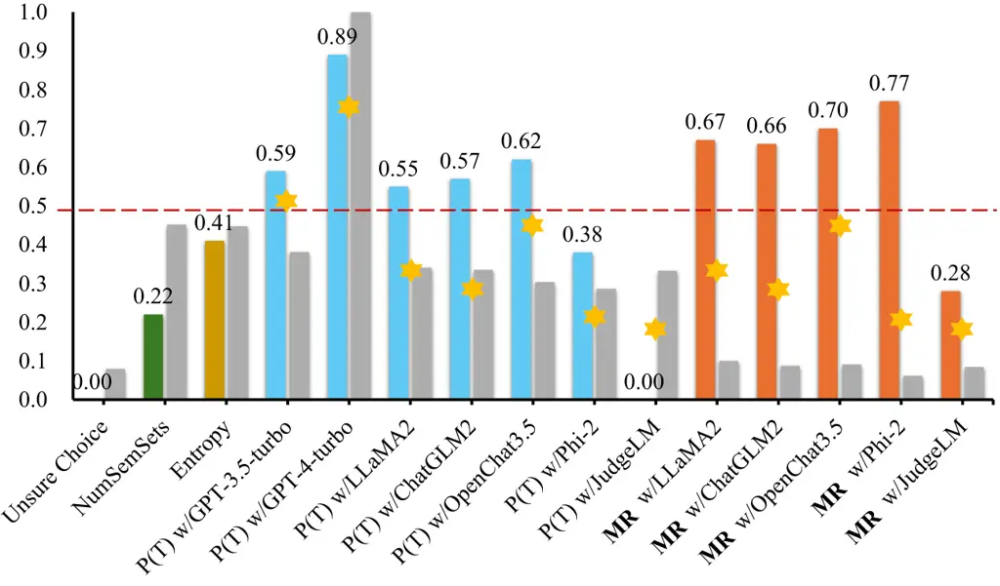
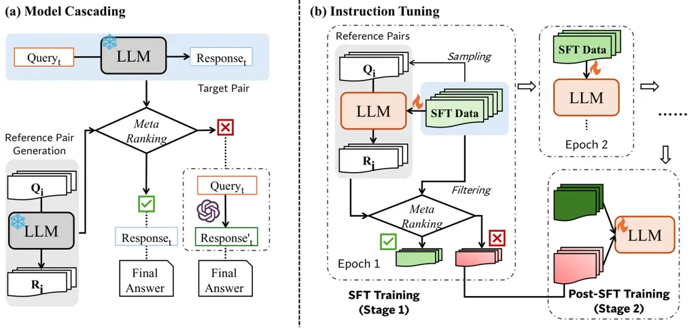
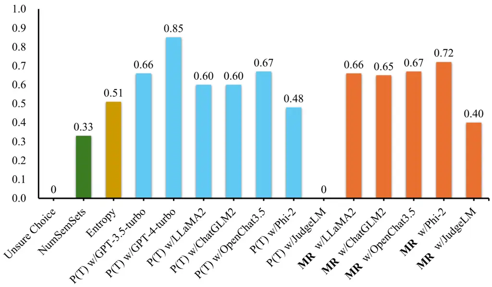

# Enabling Weak LLMs to Judge Response Reliability via Meta Ranking

Zijun Liu Boqun Kou Peng Li Ming Yan Ji Zhang Fei Huang Yang Liu
Affiliation:  Department of Computer Science and Technology, Tsinghua
University, Beijing, China Affiliation:  Weiyang College, Tsinghua
University, Beijing, China Affiliation:  Institute of Intelligent
Computing, Alibaba Group Affiliation:  Institute for AI Industry
Research (AIR), Tsinghua University, Beijing, China

###### Abstract

^(†)^(†)footnotetext: \* Corresponding authors: P.Li
([pengli09@gmail.com](mailto:pengli09@gmail.com)) and Y.Liu
([liuyang2011@tsinghua.edu.cn](mailto:liuyang2011@tsinghua.edu.cn))

Despite the strong performance of large language models (LLMs) across a
wide range of tasks, they still have reliability issues. Previous
studies indicate that strong LLMs like GPT-4-turbo excel in evaluating
the reliability of responses from LLMs, but face efficiency and local
deployment issues. Thus, to enable weak LLMs to effectively assess the
reliability of LLM responses, we propose a novel
cross-query-comparison-based method called _Meta Ranking_ (MR). Unlike
previous few-shot methods that solely based on in-context learning
capabilities in LLMs, MR assesses reliability by pairwisely ranking the
target query-response pair with multiple reference query-response pairs.
We found that MR is highly effective in error detection for LLM
responses, where weak LLMs, such as Phi-2, could surpass strong
baselines like GPT-3.5-turbo, requiring only five reference samples and
significantly improving efficiency. We further demonstrate that MR can
enhance strong LLMs’ performance in two practical applications: model
cascading and instruction tuning. In model cascading, we combine open-
and closed-source LLMs to achieve performance comparable to GPT-4-turbo
with lower costs. In instruction tuning, we use MR for iterative
training data filtering, significantly reducing data processing time and
enabling LLaMA-7B and Phi-2 to surpass Alpaca-13B with fewer training
tokens. These results underscore the high potential of MR in both
efficiency and effectiveness.¹¹ 1 The source code is available at
[https://github.com/THUNLP-MT/MetaRanking](https://github.com/THUNLP-MT/MetaRanking).

Figure 1: Overview of our proposed _Meta Ranking_ (MR) method. (a) Left:
The table summarizes MR and previous judgement methods with different
backbone models. (b) Right: The sub-figure illustrates different
methods. “$`\widehat{\text{S}}_{\text{t}}`$” denotes the estimated score
for the target query-response pair. “Query*(i)” (Q*(i)), “Response*(i)”
(R*(i)), and “Score*(i)” (S*(i)) ($`i=1,2`$) denote the references and
its score (e.g., +1 for correct and -1 for incorrect responses). MR
takes two query-response pairs for cross-query comparison on reliability
with language models, then aggregates the estimated score of the target
query and response.

## 1 Introduction

Large language models (LLMs) have demonstrated strong performance in
various tasks (OpenAI, 2023; Touvron et al., 2023b; Du et al., 2022).
However, they still face reliability challenges. For example, these
models often produce responses that seem plausible but are factually
incorrect, a phenomenon known as “hallucination” (Huang et al., 2023).
Fine-tuning and alignment techniques have been extensively studied to
mitigate this issue (Ouyang et al., 2022; Wang et al., 2023; Rafailov
et al., 2023; Yang et al., 2023; Gupta et al., 2024). Recent studies
sadly demonstrate that hallucination is inevitable (Xu et al., 2024).
Consequently, instead of resolving it directly, we focus on developing
techniques to discriminate the reliability of responses from LLMs.

Recent research has highlighted the potential of strong LLMs in
evaluating response reliability (Zheng et al., 2023a). Highly capable
models, such as GPT-4 (OpenAI, 2023), have shown effective in assessing
the quality of LLM responses through few-shot in-context learning
(ICL) (Yin et al., 2023). However, these models are often prohibitively
large, resulting in high computational and monetary costs. Also, most of
these models are closed-source, which limits their deployment in local
environments. On the other hand, weak models, are often better choices
for efficiency and local setup. However, their performance is usually
lower, probably due to the inherent low capacity in ICL (Figure 1 (a)).
This raises a critical question: _How can we enable weak LLMs to
effectively judge the reliability of LLM responses?_

To address this question, we propose a novel method named _Meta Ranking_
(MR). Inspired from the idea of pairwise ranking on responses to the
same query (Wang et al., 2024b; Ke et al., 2023; Zhu et al., 2023a), we
raised a core hypothesis of MR, that the reliability of a response can
be discerned by comparing the query-response pair with other pairs of
known reliability. Unlike traditional methods that let an LLM directly
judge the response to a query, MR involves cross-query comparison of the
target query-response pair with multiple reference pairs (Figure 1 (b)).
Specifically, MR utilizes a fixed set of query-response pairs with
pre-determined scores as reference. For any given target query-response
pair, the LLM determines whether this pair is more reliable than each of
the reference pairs. A voting mechanism is then employed to aggregate
these comparisons and reach a final judgment. Here, “reliable”
encompasses attributes such as correctness and quality as required by
the context. Theoretically, it avoids item perturbation problems in
few-shot ICL (Zhao et al., 2021) and over-confidence in judgement (Xiong
et al., 2024) for language models. Experimental results demonstrate that
MR enables weak LLMs to effectively judge the reliability of LLM
responses on reasoning tasks, which is previously limited to those
strong LLMs.

Moreover, we showcase the application of MR with a weak LLM in two
practical scenarios for validation: (1) enhancing LLM inference through
_model cascading_ between open- and closed-source LLMs, where queries
are routed to the appropriate LLM based on reliability assessments. It
demands high efficiency of the judgement process. MR achieves
performance comparable to GPT-4-turbo while consuming less than half API
tokens. And (2) iteratively filtering training datasets to improve LLMs
during _instruction tuning_, which prefers local deployment. MR leads to
advancements over existing data selection methods on the Alpaca-52k
dataset (Taori et al., 2023), in terms of effectiveness and efficiency.

In summary, our contributions are threefold:

1.  1.  We introduce _Meta Ranking_ (MR), a novel method for assessing the
        reliability of LLM responses through cross-query comparison with
        reference query-response pairs.
2.  2.  We demonstrate that MR enables weak LLMs to judge the reliability of
        LLM responses, surpassing previous uncertainty estimation and
        prompting methods even with some strong LLMs, on effectiveness and
        efficiency.
3.  3.  Additionally, we explore two practical applications of MR, improving
        strong LLMs in both inference and training, respectively. These
        results underscore the considerable potential of our proposed method
        in both efficiency and effectiveness.

## 2 Meta Ranking

This section demonstrates how cross-query comparisons could reveal the
reliability of the target query-response pair with limited reference
examples from the same source LLM. The intuition is as follows: Taking
correctness assessment as an example, _the target pair is likely to be
correct when ranked closer to a correct reference pair and likely to be
incorrect otherwise_, as shown in Figure 3. Below, we outline the
specific steps and considerations accordingly.

Formally, suppose we have $`N`$ reference query-response pairs

```math
\mathcal{X}=\left\{(Q_{i},R_{i},S_{i})\right\}, \tag{1}
```

where $`i=1,\cdots,N`$, $`Q_{i}`$ and $`R_{i}`$ are the $`i`$-th
reference query and response, respectively. For each pair of
$`(Q_{i},R_{i})`$, we have a score $`S_{i}`$ that represents its
reliability. We aim to evaluate the reliability $`S_{\mathrm{t}}`$ of a
target response $`R_{\mathrm{t}}`$ to the target query
$`Q_{\mathrm{t}}`$. For binary classification scenarios (e.g.,
correctness assessment), $`S_{i},S_{\mathrm{t}}\in\{+1,-1\}`$, where
$`+1`$ denotes the response is $`\mathrm{True}`$ and $`-1`$ denotes
$`\mathrm{False}`$.

##### Cross-Query Comparison

The basic operation of Meta Ranking is to compare the target
query-response pair with each of the reference query-response pairs. For
brevity, we denote the target query-response pair as
$`P_{\mathrm{t}}=(Q_{\mathrm{t}},R_{\mathrm{t}})`$, and the $`i`$-th
reference query-response pair as $`P_{i}=(Q_{i},R_{i})`$. Then, the
cross-query comparison operation and its result are denoted as follows:

```math
r_{i}=\mathrm{MR}\left(P_{\mathrm{t}},P_{i}\right),i=1,\cdots,N, \tag{2}
```

where $`r_{i}\in\{\pm 1,0\}`$, $`+1`$, $`0`$, and $`-1`$ denote the
target pair is better than, equal to, or worse than the $`i`$-th
reference pair, respectively. In practice, $`\mathrm{MR}(\cdot,\cdot)`$
is implemented by directly prompting LLMs or using the relative
magnitude of quality estimation scores of each response to its query.

##### Aggregation

The final judgement is obtained by aggregating the comparison results to
arrive at the estimated reliability score of the target query-response
pair. Specifically, we will upvote if the target air is ranked higher
than a reference pair, i.e., $`r_{i}=+1`$, and downvote when ranked
lower. Also, ranking higher than a correct reference and than an
incorrect reference will result in different voting values. For each
comparison between the target and the $`i`$-th reference pair, the
individual voting value is

```math
s_{i}=S_{i}\cdot\delta_{\mathrm{sgn}(S_{i})\cdot r_{i}},i=1,\cdots,N, \tag{3}
```

where $`\mathrm{sgn}(S_{i})\cdot r_{i}\in\{\pm 1,0\}`$, and thus
$`\delta_{\pm 1}`$ and $`\delta_{0}`$ are hyperparameters. For instance,
in terms of correctness, $`\delta_{+1}`$ is the absolute voting value
when the target pair is ranked higher than a correct reference
($`\mathrm{sgn}(S_{i})=r_{i}=+1`$), or lower than an incorrect one
($`\mathrm{sgn}(S_{i})=r_{i}=-1`$). Note that we require that
$`\delta_{+1}>0,\delta_{-1}<0`$. Formally, we denote the total vote
value as $`s`$:

```math
s=\sum_{i=1}^{N}s_{i}=\sum_{i=1}^{N}S_{i}\cdot\delta_{\mathrm{sgn}(S_{i})\cdot r_{i}}, \tag{4}
```

And we say the target response is reliable if $`s\geq 0`$ and unreliable
otherwise. Thus, the estimated target reliability score
$`\widehat{S_{\mathrm{t}}}\approx\mathrm{sgn}(s)`$ for correctness
assessment. The entire algorithmic process is shown in Appendix B. In
practice, $`N`$ is usually small due to efficiency and the limited
labeled data.

For theoretical validation, when cross-query comparison reveals the
actual relation between $`S_{i}`$ and $`S_{\mathrm{t}}`$, we show that
$`\mathrm{sgn}(\delta_{r_{i}})\equiv\mathrm{sgn}(S_{\mathrm{t}}-S_{i})`$
under reasonable constraints in Appendix C.1, where
$`\mathrm{sgn}(\cdot)`$ is the sign function. Thus,
$`\mathrm{sgn}(s)\approx\mathrm{sgn}(S_{\mathrm{t}}-S_{\mathrm{avg}})`$,
where $`S_{\mathrm{avg}}=\frac{1}{N}\sum_{i}S_{i}`$. Hence, a negative
$`s`$ means subpar reliability of the target response, and vice versa.

Under the formulation, there are several interesting properties of MR.
First, MR is model-agnostic and permutation-agnostic towards references,
which is different from few-shot ICL methods that fluctuate with the
order of examples (Zhao et al., 2021). Second, MR avoids the
over-confidence issue in LLM judgement (Xiong et al., 2024), because
each reference pair is considered equally with the target pair.
Moreover, MR could be extended to continuous metrics
($`S_{i}\in\mathbb{R}`$, e.g., BLEU (Papineni et al., 2002)) directly
without modification, and the final judgement of the reliability is
still determined by the sign of $`s`$.

Figure 2: Example illustrations of MR process. The correctness of the
target response ($`\text{R}_{\text{t}}`$) is considered according to
comparisons with reference query-response pairs.



Figure 3: The precision scores and inference time (gray bars) in error
detection experiments for target responses from LLaMA-2 on the MMLU
dataset. The dashed red line represents the random selection. We used
examples in the development set as reference for few-shot methods. Stars
denote the performance on MMLU of underlying LLMs of each method.

## 3 Main Experiment: Error Detection with Meta Ranking

In the following section, we empirically demonstrate that Meta Ranking
can effectively judge the reliability of LLM responses concerning
correctness. We leverage error detection on responses generated by LLMs
for reasoning tasks for validation. Our findings indicate that the MR
approach maintains consistent efficacy across varying base models,
response accuracies, and languages.

### 3.1 Settings

The error detection task requires identifying whether a response from an
LLM is incorrect given the query. The settings are as follows, and
implementation details are in Appendix B.1:

Datasets: We randomly selected two subjects of each category in the MMLU
dataset (Hendrycks et al., 2021b; Hendrycks et al., 2021a) and one
subject of each category in the CMMLU dataset (Li et al., 2023a) as the
Chinese benchmark. The datasets contain multi-choice questions from
various areas, and each subject has five examples in the development
set.

Evaluation Metrics: We adopted micro scores as the main metric to
report, that scores are calculated across the whole MMLU or CMMLU
dataset. We report precision for performance and seconds per iteration
for inference time on a single A800 GPU (Figure 3). Inference time are
normalized that P(T) with GPT-4-turbo is the unit. And F1 scores are in
Appendix B.1. AUROC-style metrics are not applicable because the MR
algorithm uses a static threshold 0.

Response Generation: For different accuracy levels, we chose
LLaMA-2-chat-7B (Touvron et al., 2023b) and OpenChat-3.5 (Wang et al.,
2024a) to generate responses for English questions, and
ChatGLM-2-6B (Zeng et al., 2023) and Yi-6B-Chat (01.AI, 2023) for
Chinese ones. We first performed the target response generation on the
test set, and then used the same model to generate responses for
reference on the development set.

MR Settings: We prompted LLaMA-2, ChatGLM-2, OpenChat-3.5,
GPT-3.5-turbo, and Phi-2 to judge on different query-response pairs with
Meta Ranking. We also tested an LLM-as-a-Judge-tuned model
JudgeLM-7B-v1 (Zhu et al., 2023a) in MR to see if the fine-tuning for
the evaluation of responses to the same query helps. By setting each
label $`S_{i}`$ with the value $`\pm 1`$
($`\{\mathrm{True},\mathrm{False}\}\sim\{+1,-1\}`$), we apply MR on this
task by identifying incorrect responses depending on MR results on the
query-response pairs according to Algorithm 1.

Baselines: We compare our method against several baselines with few-shot
ICL to ensure a comprehensive evaluation, including (1) appending an
Unsure Choice (Kadavath et al., 2022), (2) a black-box uncertainty
estimation method NumSemSets (Lin et al., 2023), (3) a white-box method
Entropy (Han et al., 2024), and (4) P(True) (P(T)) (Kadavath et al., 2022) which directly asks an LLM about the correctness of a
query-response pair.

|                       |           |              |            |      |
| --------------------- | --------- | ------------ | ---------- | ---- |
| Method                | MMLU (En) |              | CMMLU (Zh) |      |
|                       | LLaMA-2   | OpenChat-3.5 | ChatGLM-2  | Yi   |
| Random Selection      | 0.50      | 0.50         | 0.50       | 0.50 |
| P(T) w/ OpenChat-3.5  | 0.62      | 0.38         | 0.31       | 0.35 |
| P(T) w/ GPT-3.5-turbo | 0.59      | 0.65         | 0.22       | 0.21 |
| MR w/ Phi-2           | 0.77      | 0.73         | 0.69       | 0.52 |
| MR w/ GPT-3.5-turbo   | 0.78      | 0.79         | 0.75       | 0.73 |

Table 1: The micro precision scores on error detection experiments on
the MMLU and CMMLU datasets with responses generated by different LLMs.
The bold font denotes best results. LLMs in the second row of the header
are sources of responses.

Figure 4: The change of precision scores with the number of reference
pairs on the MMLU dataset with target responses from LLaMA-2.

### 3.2 Discussion

##### Effectiveness of Meta Ranking

MR is effective across different LLM backbones, which might attribute to
the position agnosticism to reference and judgement without
overconfidence. In Figure 3, we report results of all baselines and MR
in error detection on LLaMA-2-generated responses, and the actual
performance of LLMs on MMLU. Impressively, we found that MR with Phi-2
notably exceeds all baseline methods, except for P(T) with GPT-4-turbo,
reaching a precision score of 0.77, more than double the performance of
P(T) with Phi-2 and reaching 88% GPT-4-turbo performance. With LLaMA-2
and ChatGLM-2, MR exceeds P(T) significantly. However, JudgeLM performs
not as well as other pretrained or general instruction-tuned LLMs in the
MR results and fails to generalize for the P(T) method. It might be the
fine-tuning process limits its generalization. We also depict F1 scores
in Appendix B.1 to indicate MR is not biased to identify most responses
as incorrect ones. In short, MR consistently outperforms the random
baseline to a greater margin than P(T), except for P(T) with
GPT-4-turbo. GPT-4-turbo could accurately detect the error, probably
relying on its strong reasoning capabilities and
generalizability (OpenAI, 2023).

##### Performance of MR with Weak LLMs

In Figure 3, the performance of P(T) across different models displays a
positive correlation with their actual performance on reasoning tasks,
while MR has demonstrated strong robustness across models with different
capabilities. We further investigate the performance of LLMs with
different capabilities across languages and tasks. In Table 1, we select
top performing P(T) and MR methods and report the precision score across
all target responses on the MMLU and CMMLU datasets. We omit GPT-4-turbo
for the cost and its unparalleled capabilities to open-source models we
have tested. From results, P(T) with OpenChat-3.5 performs worse than
random selection when facing more accurate responses on MMLU. In
contrast, MR shows significant generalizability with weak models, e.g.,
the 2.7B Phi-2, across different accuracy levels of responses,
impressively surpassing P(T) w/ GPT-3.5-turbo and OpenChat-3.5 on
responses in different accuracy levels. It positively indicates the
effectiveness of weak LLMs in accurately detecting reasoning errors in
LLM responses.

##### Impact of the Number of Reference Pairs

In Figure 4, we illustrate the change of precision scores with the
number of reference pairs, where MR exhibits that it could function with
far less labeled data compared to previous methods. Notably, other
uncertainty-based methods are incompatible with the 1-shot setting since
there are usually no correct examples for calibration. Upon the ablation
study, we observe that reducing five examples to one leads to a slightly
decreased performance of MR, indicating the robustness of the
cross-query comparison. Also, the result highlights the effectiveness of
MR with limited labeled data compared to P(T). Without reference
examples, P(T) faces a great performance drop even with capable models
(e.g., GPT-3.5-turbo and OpenChat-3.5), showing inferior performance to
random selection. It is also worth noting that uncertainty-based methods
like NumSemSets and Entropy usually require hundreds of examples for
calibration on distinguishing errors (Han et al., 2024; Mielke et al.,
2022), explaining the relative low results of these uncertainty-based
methods in Figure 3 when there are only five examples for reference.

##### Performance on Non-English Tasks

In Table 1, the overall results on Chinese reasoning problems are
significantly lower than on English ones, demonstrating that non-English
languages do influence error detection performance. However, MR exhibits
strong robustness across languages, though P(T) performs worse than
random selection in all CMMLU results. Please also see Appendix D.1 for
experiments on Japanese as a representative low-resource language, which
causes much lower performance in judgement due to multilingual
capacities of LLMs.



Figure 5: Two applications of Meta Ranking for inference- and
training-time LLM enhancement, respectively. (a) Model Cascading (left):
MR identifies reliability of responses and routes unsolved queries from
open-source LLMs towards closed-source LLMs for better results. (b)
Instruction Tuning (right): MR filters low-quality data after each epoch
in SFT and then tune LLMs with low- and high-quality data. MR results
depend on the reference pairs generated from the LLM on samples of the
training dataset. $`Q_{\mathrm{i}},R_{\mathrm{i}}`$ denote reference
query-response pairs for the MR algorithm, and Query*(t), Response*(t)
denote the target pair.

## 4 Applications of Meta Ranking

In this section, we present two practical applications to further
validate the effectiveness of Meta Ranking, as shown in Figure 5. Each
application is implemented by collecting reference query-response pairs
and setting reference reliability scores. (a) With the assessment of the
correctness of responses from open-source LLMs to the given queries, we
identify and route unsolved queries to stronger closed-source LLMs. It
could achieve better efficiency and remaining performance of
closed-source models. However, it demands the model used for judgement
is weaker than the open-source LLM in deployment, otherwise it is better
in place to respond to queries. (b) By evaluating the quality of
instruction data, we can refine the supervised fine-tuning (SFT) for LLM
instruction tuning, whose key factor is the quality of training
data (Liu et al., 2024). By filtering low-quality data after each epoch
and further introducing post-SFT training with mere instruction data, we
achieve significant improvement against state-of-the-art SFT data
selection methods. For data related application, the method is better to
be locally deployed. Thus, we decide MR with weak LLMs is suitable for
judgement for these.

### 4.1 Model Cascading

Since LLMs exhibit varying degrees of accuracy across various tasks, we
propose using MR within a model cascading system. As depicted in
Figure 5 (a), this system employs MR to assess the reliability of
generated responses from open-source LLMs. Queries with responses deemed
unreliable by MR are routed to more powerful, but also more costly,
closed-source LLMs for better answers. This system aims to achieve
performance similar to that of closed-source models with improved
efficiency.

#### 4.1.1 Implementation

Assuming both the development and the test sets are drawn from the same
underlying distribution. Given that the MR method requires reference
query-response pairs, we first feed the queries in the development set
to the open-source LLM and evaluate the generated responses against the
ground truth. Formally, for every query $`Q_{i}`$, let
$`R_{i}^{(\theta)}`$ represent the response generated by an open-source
LLM (parameterized by $`\theta`$), and $`S_{i}^{(\theta)}`$ denote the
evaluation result according to the ground truth to $`Q_{i}`$ and an
appropriate metric. By applying the model to each query in the
development set with $`N`$ samples, we produce responses
$`\left\{R_{i}^{(\theta)}\right\}_{i=1}^{N}`$ and form a set of
reference query-response pairs
$`\mathcal{X}=\left\{P_{i}^{(\theta)}=(Q_{i},R_{i}^{(\theta)})\right\}_{i=1}^{N}`$,
along with associated evaluation results
$`\left\{S_{i}^{(\theta)}\right\}_{i=1}^{N}`$.

There are two reasonable ways to derive reliability scores for
$`\mathcal{X}`$ in MR. The first is to directly define
$`S_{i}\triangleq S_{i}^{(\theta)}`$, which we term MR$`(\theta)`$. The
second option is to compute the responses from the closed-source LLM
($`\Theta`$) and their evaluation results
$`\left\{S_{i}^{(\Theta)}\right\}_{i=1}^{N}`$. We could define the label
as follows:

```math
S_{i}\triangleq S_{i}^{(\theta)}-S_{i}^{(\Theta)}, \tag{5}
```

which grants positive scores only when the response from open-source
LLMs is better than the one from closed-source LLM, since the model
cascading causes performance improvement vice versa. We denote it by
MR$`(\Delta)`$, which considers the gap between open- and closed-source
LLMs.

Accordingly, we can obtain estimated reliability for
$`P_{t}^{(\theta)}`$ from the MR approach during inference on test sets.
If the assessment indicates $`R_{t}`$ as an unreliable response, we
direct $`Q_{t}`$ to a closed-source large language model (such as
GPT-4-turbo) to secure a more precise response. Conversely, we preserve
the original response for a positive MR result. Ideally, this approach
can enhance performance with moderate costs, as it is generally observed
that a poorly accurate response from open-source LLMs often corresponds
to a difficult query, which requires strong LLMs to respond, and vice
versa.

|                   |                |           |         |             |       |               |                  |
| ----------------- | -------------- | --------- | ------- | ----------- | ----- | ------------- | ---------------- |
| Model             | Routing        | Reasoning |         | Translation |       | Average       | \#Token (API)    |
|                   | Strategy       | English   | Chinese | Zh-En       | En-Zh |               | (Relative Value) |
| Phi-2             | -              | 22.48     | 24.84   | 42.32       | 23.18 | 28.21         | -                |
| LLaMA-2 (①)       | -              | 34.37     | 32.86   | 58.53       | 51.33 | 44.27         | -                |
| ChatGLM-2 (②)     |                | 30.48     | 49.71   | 58.43       | 63.30 | 50.48         |                  |
| Ensemble (①&②)    |                | 35.44     | 43.47   | 31.35       | 46.54 | 39.20         |                  |
| GPT-3.5-turbo (③) |                | 52.91     | 54.09   | 63.67       | 69.14 | 59.95         | 1.00             |
| ①/② $`+`$ ③       | Entropy        | 38.75     | 47.03   | 58.32       | 65.45 | 52.39 (+1.91) | 0.38             |
|                   | Random         | 41.89     | 48.32   | 58.97       | 64.83 | 53.50 (+3.02) | 0.45             |
|                   | MR$`(\Delta)`$ | 44.30     | 48.67   | 59.80       | 65.87 | 54.66 (+4.18) | 0.24             |
|                   | MR$`(\theta)`$ | 48.62     | 52.76   | 61.36       | 67.10 | 57.46 (+6.98) | 0.42             |
| OpenChat-3.5 (④)  | -              | 45.42     | 40.19   | 61.35       | 60.77 | 51.93         | -                |
| Yi (⑤)            |                | 42.08     | 61.96   | 60.87       | 62.07 | 56.74         |                  |
| Ensemble (④&⑤)    |                | 45.68     | 48.24   | 11.16       | 62.90 | 41.99         |                  |
| GPT-4-turbo (⑥)   |                | 72.86     | 62.82   | 64.73       | 69.95 | 67.59         | 1.00             |
| ④/⑤ $`+`$ ⑥       | Random         | 46.64     | 61.96   | 61.29       | 63.74 | 58.41 (+1.67) | 0.44             |
|                   | MR$`(\Delta)`$ | 57.68     | 61.93   | 61.60       | 67.61 | 62.21 (+5.47) | 0.23             |
|                   | MR$`(\theta)`$ | 64.68     | 61.93   | 62.60       | 68.11 | 64.33 (+7.59) | 0.43             |

Table 2: The overall results in model cascading experiments. All routing
strategies are implemented with Phi-2, whose results are gray. “Overall”
denotes the macro average value across tasks. The bold font denotes the
best result using model cascading and the underlined numbers denote the
best result for each setting. The number in the parentheses denotes the
improvement over the best among open-source LLMs and the ensemble
baseline without model cascading. For notation, we use serial numbers to
represent LLMs, e.g., “①/② $`+`$ ③” represents model cascading from
LLaMA-2 or ChatGLM-2 to GPT-3.5-turbo.

#### 4.1.2 Experiment

##### Settings

We leverage reasoning and translation tasks to validate the
effectiveness of model cascading. We use the same datasets for reasoning
tasks as Section 3 and randomly sampled test and development set from
the FLORES-200 dataset (NLLB Team et al., 2022). For MR, we prompt Phi-2
in reasoning tasks, and in translation tasks, we adopt
wmt22-cometkiwi-da (Rei et al., 2022b) for reference-free quality
estimation and thus compare the estimated scores between translations.
Due to the diverse LLM capabilities and language biases, we have tested
two combinations: (1) LLaMA-2 for English and ChatGLM-2 for Chinese
tasks, with GPT-3.5-turbo as the closed-source model; (2) OpenChat-3.5
for English and Yi for Chinese problems, with GPT-4-turbo as the API.
For baselines, we validate the logits ensemble of the open-source models
and implement model cascading with strategies of entropy-based
uncertainty estimation (Han et al., 2024). We omit the result of the
latter for OpenChat-3.5 and Yi since it results in almost no routed
queries, probably because the uncertainty threshold is too high to
determine false answers.

##### Effectiveness of Cascading Guidance from MR

In Table 2, we report the average accuracy on reasoning tasks and the
average among BLEU, BLEURT (Sellam et al., 2020; Pu et al., 2021), and
COMET (Rei et al., 2022a) scores on translation tasks. With the model
cascading approach, we observe significant improvement against single
open-source LLMs. MR$`(\theta)`$ and MR$`(\Delta)`$ manage to gain the
highest performance improvement across tasks and languages with less
than half token consumption. Moreover, MR$`(\Delta)`$ consistently
outperforms random selection with nearly half of the token consumption,
demonstrating the effectiveness of Equation (5). We also demonstrate
actual deployment costs and inference speeds in Appendix B.2 and found
MR-based model cascading costs much lower in monetary expenditure.

##### Relation with Error Detection Performance

The performance of our model cascading mechanism is closely related to
the effectiveness of error detection. For instance, in Table 2, MR
outperforms Random and Entropy on absolute performance and token
consumption, which denotes MR detects errors in a larger quantity and
with higher precision, respectively. It suggests that error detection
with MR is also robust on open-ended generation tasks with continuous
labels, e.g., translation.

### 4.2 Instruction Tuning

Recent studies show that the quality of instruction data is essential to
SFT performance (Zhou et al., 2023). For better instruction tuning on
LLMs, we introduce an iterative training data filtering process based on
_Meta Ranking_ and a post-SFT training stage, as shown in Figure 5 (b).
The basic intuition is to continuously filter low-quality data, letting
LLMs concisely learn from more reliable and fewer training samples at
the first stage, and utilize less reliable data samples at the second
stage for contrastive learning. MR makes it possible by judging the
quality of instruction data rapidly with generated responses from an LLM
that reflect its capabilities during training, and is better for local
deployment with weak LLMs.

#### 4.2.1 Implementation

The application contains two stages (Figure 5 (b)): (1) SFT with MR
guided data selection and (2) post-SFT training with both estimated low-
and high-quality data from the last epoch at stage 1.

For the first stage, besides regular SFT, we extract a small set of
queries from the training set and, after each epoch, ask the tuned LLM
to respond to those queries. With the generated responses and the
queries as reference, the MR method could judge whether a single sample
in the original training dataset matches the quality of the reference.
For simplicity in MR, we set the reliability score of all reference
pairs to 1. Thus, we could filter training data samples that fail the
judgment, i.e. unreliable, improving training efficiency and,
potentially, LLM performance.

For the second stage, we want to utilize both the filtered low-quality
and the high-quality data to further train the LLM. Since post-SFT
training methods (e.g., PPO (Ouyang et al., 2022), DPO (Rafailov et al.,
2023)) require multiple responses of diverse human preferences or
quality to the same query, they are not compatible. Recently, Ethayarajh
et al. (2024) proposed Kahneman-Tversky Optimization (KTO) to align LLMs
towards desired and away from undesired query-response pairs
contrastively. However, we are aware that their objective is misaligned
with our requirement because the low-quality data is derived from the
SFT dataset, which is not completely negative. Therefore, in order to
incorporate both high- and low-quality data as positive and partially
positive samples, we propose positive-KTO (pKTO). Intuitively, pKTO
differs from KTO only in dealing with low-quality data, where pKTO
regulates the reward of these data with MSE loss instead of decreasing
it unlimitedly. Please refer to Appendix C.2 for the detailed
implementation and comparisons with DPO and KTO.

|                        |          |                |             |
| ---------------------- | -------- | -------------- | ----------- |
| Method                 | MT-Bench | AlpacaEval 2.0 | \#Token (M) |
| Alpaca-13B             | 4.53     | 2.65           | \-          |
| Guanaco-13B            | \-       | 3.47           | \-          |
| Phi-2                  | 4.52     | 2.34           | \-          |
| LLaMA-7B               | 2.62     | 0.43           | \-          |
| Phi-2-Based Results    |          |                |             |
| Full                   | 4.42     | 3.26           | 13.293      |
| Longest                | 4.56     | 3.32           | (1.008      |
| Deita                  | 4.33     | 3.18           | (9.609      |
| Deita (9k)             | 4.64     | 3.29           | (3.981      |
| MR (Stage 1)           | 4.70     | 3.56           | (7.509      |
| \+ pKTO (Stage 2)      | 4.77     | 3.47           | (1.205      |
| LLaMA-7B-Based Results |          |                |             |
| Full                   | 4.36     | 2.53           | 13.293      |
| Longest                | 4.18     | 2.35           | (1.008      |
| Deita                  | 4.37     | 2.60           | (9.609      |
| Deita (9k)             | 4.48     | 2.86           | (3.981      |
| MR (Stage 1)           | 4.52     | 2.93           | (2.412      |
| \+ pKTO (Stage 2)      | 4.69     | 3.24           | (0.907      |

Table 3: Results on instruction tuning experiments, where MR is
implemented with Phi-2. The bold font denotes best results. “Full”
denotes the whole dataset.

|                                 |          |        |      |
| ------------------------------- | -------- | ------ | ---- |
| Method                          | MT-Bench |        |      |
|                                 | Turn 1   | Turn 2 | Avg. |
| LLaMA-13B                       | 3.26     | 1.95   | 2.61 |
| Phi-2                           | 6.37     | 2.66   | 4.52 |
| Alpaca-13B                      | 4.98     | 4.09   | 4.53 |
| Falcon-40B-instruct             | 5.81     | 4.53   | 5.17 |
| Phi-2-Based post-SFT Results    |          |        |      |
| MR (Stage 1)                    | 6.33     | 3.08   | 4.70 |
|   + KTO (( (Stage 2)            | 6.12     | 2.94   | 4.53 |
|   + pKTO (Stage 2)              | 6.27     | 3.26   | 4.77 |
| LLaMA-7B-Based post-SFT Results |          |        |      |
| MR (Stage 1)                    | 5.47     | 3.58   | 4.52 |
|   + KTO (( (Stage 2)            | 5.15     | 3.60   | 4.38 |
|   + pKTO (Stage 2)              | 5.45     | 3.93   | 4.69 |

Table 4: The multi-turn evaluation results from MT-Bench on instruction
tuning experiments, which is unfolded from the second column in Table 3.
“Avg.” denotes the average score of different turns in MT-Bench. The
bold font denotes the best result for each base model.

#### 4.2.2 Experiment

##### Settings

In all experiments, we only use the Alpaca-52k (Taori et al., 2023)
dataset with 52,002 samples from text-davinci-003 (Brown et al., 2020),
which is also the target pairs for MR. We utilize AlpacaEval 2.0 (Li
et al., 2023b) and MT-Bench (Zheng et al., 2023a) to benchmark
instruction following capabilities. We select strong baselines on SFT
data selection, including Deita (Liu et al., 2024) and Longest (Zhao
et al., 2024). Please refer to Appendix B.3 for implementation details.
For base models, we choose Phi-2 and LLaMA-7B (Touvron et al., 2023a)
for instruction tuning. For Phi-2, our method starts with the original
52k dataset. For LLaMA, Chen et al. (2024) empirically find a 9k subset
of Alpaca is the most proper for SFT. We thus adopt the scorer from
Deita and extract the top 9k data, noted by Deita (9k), as the initial
training set for LLaMA at stage 1.

##### High-Quality SFT Data Filtering Guided by MR (Stage 1)

We report overall results and training tokens (calculated by LLaMA
tokenizer) in Table 3. For each base model, we found MR guided iterative
training data filtering leads to significant improvement in both
benchmarks with fewer training tokens. In the first stage of MR guided
data selection, our method iteratively filters low-quality data after
each epoch. After stage 1, Phi-2 and LLaMA already surpass all
baselines, indicating MR effectively picks high-quality training samples
in a curriculum way (Bengio et al., 2009), which helps align LLMs better
compared to selecting data at the beginning for SFT in baseline methods.
We also observed significant lower data processing time of MR compared
to Deita in Appendix B.3.

##### Post-SFT Training through MR-Filtered Data (Stage 2)

We also notice a significant enhancement of stage 2 in Table 3. We
report the detailed scores on each turn of LLM responses from MT-Bench
in Table 4. From empirical results, pKTO enhances the second-turn
communication of LLMs to a great extent while preserving the
instruction-following abilities from SFT at stage 1, which is indicated
by the slight drops in first-turn scores. In contrast, KTO fails at this
setting, which is aligned with our hypothesis in Section 4.2.1. By
incorporating the low- and high-quality data distinguished from MR,
stage 2 further elicits LLMs’ capacity, especially for multi-turn
scenarios.

## 5 Related Work

##### Evaluation of LLM Responses

Extensive research has been conducted to evaluate responses from LLMs.
Studies have focused on estimating uncertainty to gauge the potential
reliability of LLM responses (Kuhn et al., 2023; Rafailov et al., 2023).
Furthermore, LLMs are capable of providing uncertainty scores from
itself by fine-tuning (Chen et al., 2023; Gupta et al., 2024), which
usually requires an amount of training data, or black-box
measurements (Lin et al., 2023). However, these methods often require an
amount of labeled data for calibration to determine a threshold (Han
et al., 2024). Additionally, the LLM-as-a-judge approach effectively
assesses the accuracy of LLM responses from strong LLMs (Zheng et al.,
2023a) with manual prompting rules. Contrarily, our Meta Ranking method
leverages weak LLMs and a training-free judgment based on cross-query
comparisons with much fewer examples.

##### Model Cascading with LLMs

Recent studies on model cascading focus on how LLMs can selectively call
tools or stronger models only in difficult situations for better
efficiency. Tool calls or another trial happens on external feedback
from environment (Lin et al., 2023; Shinn et al., 2023). For tasks with
explicit criteria, e.g., coding, LLMs can call stronger models after
their failure (Zhang et al., 2023; Yue et al., 2024). Selection can also
be achieved through fine-tuning (Erbacher et al., 2024) or uncertainty
estimation (Han et al., 2024; Gupta et al., 2024). In our approach, MR
decides to route queries on complicated open-ended tasks, and we also
validate it on coding tasks in Appendix D.3.

##### Data-Efficient Training for LLMs

Coresets (Mirzasoleiman et al., 2020) are used in machine learning for a
long period. For LLMs, several data selection methods are developed for
SFT (Liu et al., 2024; Zhou et al., 2023; Li et al., 2023b; Chen et al., 2024) and post-SFT stages (Gulcehre et al., 2023; Aksitov et al., 2023).
Inspired by the latter, we introduce MR guided instruction tuning, where
training data are filtered iteratively based on MR results after each
epoch, and used in post-SFT training.

## 6 Conclusion

We present _Meta Ranking_ (MR), a novel method effectively enabling weak
LLMs to judge the reliability of LLM responses. By comparing a target
query-response pair with a small number of reference pairs, MR
outperforms strong baselines in error detection without fine-tuning.
Furthermore, the method significantly enhances strong LLMs’ performance
and efficiency in two practical application scenarios, model cascading
and instruction tuning. These findings highlight the potential of MR for
broader inference- and training-time applications with LLMs.

## Limitations

There are several limitations to our work that we would like to
acknowledge:

First, we have not explored deep in the compatibility between the model
training process and the Meta Ranking (MR) method. Different model
training strategies may affect the effectiveness of MR. It is an
interesting direction for future work to study how to better integrate
MR with the alignment process (e.g., SFT and post-SFT training) on LLMs.

Also, we have not focused on finding potential applications of the Meta
Ranking method for strong models. Our current experiments focus on
enabling weak LLMs to judge the reliability of LLM responses due to its
superior efficiency and effectiveness. It remains an open question of
what practical usage could incorporate MR with strong models like
GPT-4-turbo. Exploring the potential applications of MR for strong
models is also a direction for future work.

In conclusion, while our proposed Meta Ranking method has shown
promising results in enabling weak LLMs to judge the reliability of
individual responses and enhancing LLM performance in practical
applications, there are still spaces to be explored. We hope that future
research can address these limitations and further improve the method.

## References

- 01.AI (2023) 01.AI. 2023. Yi: Building the Next Generation of
  Open-Source and Bilingual LLMs.
  [https://github.com/01-ai/Yi](https://github.com/01-ai/Yi).
- Aksitov et al. (2023) Renat Aksitov, Sobhan Miryoosefi, Zonglin Li,
  Daliang Li, Sheila Babayan, Kavya Kopparapu, Zachary Fisher, Ruiqi
  Guo, Sushant Prakash, Pranesh Srinivasan, Manzil Zaheer, Felix Yu, and
  Sanjiv Kumar. 2023. [ReST meets ReAct: Self-Improvement for Multi-Step
  Reasoning LLM Agent](https://arxiv.org/abs/2312.10003). _Computing
  Research Repository_, arXiv:2312.10003.
- Bengio et al. (2009) Yoshua Bengio, Jérôme Louradour, Ronan Collobert,
  and Jason Weston. 2009. [Curriculum
  learning](https://doi.org/10.1145/1553374.1553380). In _Proceedings of
  the 26th Annual International Conference on Machine Learning_, ICML
  ’09, page 41–48, New York, NY, USA. Association for Computing
  Machinery.
- Brown et al. (2020) Tom B. Brown, Benjamin Mann, Nick Ryder, Melanie
  Subbiah, Jared Kaplan, Prafulla Dhariwal, Arvind Neelakantan, Pranav
  Shyam, Girish Sastry, Amanda Askell, Sandhini Agarwal, Ariel
  Herbert-Voss, Gretchen Krueger, Tom Henighan, Rewon Child, Aditya
  Ramesh, Daniel M. Ziegler, Jeffrey Wu, Clemens Winter, Christopher
  Hesse, Mark Chen, Eric Sigler, Mateusz Litwin, Scott Gray, Benjamin
  Chess, Jack Clark, Christopher Berner, Sam McCandlish, Alec Radford,
  Ilya Sutskever, and Dario Amodei. 2020. Language models are few-shot
  learners. In _Proceedings of the 34th International Conference on
  Neural Information Processing Systems_, NIPS’20, Red Hook, NY, USA.
  Curran Associates Inc.
- Chen et al. (2023) Jiefeng Chen, Jinsung Yoon, Sayna Ebrahimi, Sercan
  Arik, Tomas Pfister, and Somesh Jha. 2023. [Adaptation with
  self-evaluation to improve selective prediction in
  LLMs](https://doi.org/10.18653/v1/2023.findings-emnlp.345). In
  _Findings of the Association for Computational Linguistics: EMNLP
  2023_, pages 5190–5213, Singapore. Association for Computational
  Linguistics.
- Chen et al. (2024) Lichang Chen, Shiyang Li, Jun Yan, Hai Wang, Kalpa
  Gunaratna, Vikas Yadav, Zheng Tang, Vijay Srinivasan, Tianyi Zhou,
  Heng Huang, and Hongxia Jin. 2024. [Alpagasus: Training a Better
  Alpaca Model with Fewer
  Data](https://openreview.net/forum?id=FdVXgSJhvz). In _The Twelfth
  International Conference on Learning Representations_.
- Du et al. (2022) Zhengxiao Du, Yujie Qian, Xiao Liu, Ming Ding,
  Jiezhong Qiu, Zhilin Yang, and Jie Tang. 2022. [GLM: General language
  model pretraining with autoregressive blank
  infilling](https://doi.org/10.18653/v1/2022.acl-long.26). In
  _Proceedings of the 60th Annual Meeting of the Association for
  Computational Linguistics (Volume 1: Long Papers)_, pages 320–335,
  Dublin, Ireland. Association for Computational Linguistics.
- Erbacher et al. (2024) Pierre Erbacher, Louis Falissar, Vincent
  Guigue, and Laure Soulier. 2024. [Navigating Uncertainty: Optimizing
  API Dependency for Hallucination Reduction in Closed-Book Question
  Answering](https://arxiv.org/abs/2401.01780). _Computing Research
  Repository_, arXiv:2401.01780.
- Ethayarajh et al. (2024) Kawin Ethayarajh, Winnie Xu, Niklas
  Muennighoff, Dan Jurafsky, and Douwe Kiela. 2024. [KTO: Model
  Alignment as Prospect Theoretic
  Optimization](https://arxiv.org/abs/2402.01306). _Computing Research
  Repository_, arXiv:2402.01306.
- Fadeeva et al. (2023) Ekaterina Fadeeva, Roman Vashurin, Akim Tsvigun,
  Artem Vazhentsev, Sergey Petrakov, Kirill Fedyanin, Daniil Vasilev,
  Elizaveta Goncharova, Alexander Panchenko, Maxim Panov, Timothy
  Baldwin, and Artem Shelmanov. 2023. [LM-polygraph: Uncertainty
  estimation for language
  models](https://doi.org/10.18653/v1/2023.emnlp-demo.41). In
  _Proceedings of the 2023 Conference on Empirical Methods in Natural
  Language Processing: System Demonstrations_, pages 446–461, Singapore.
  Association for Computational Linguistics.
- Gulcehre et al. (2023) Caglar Gulcehre, Tom Le Paine, Srivatsan
  Srinivasan, Ksenia Konyushkova, Lotte Weerts, Abhishek Sharma, Aditya
  Siddhant, Alex Ahern, Miaosen Wang, Chenjie Gu, Wolfgang Macherey,
  Arnaud Doucet, Orhan Firat, and Nando de Freitas. 2023. [Reinforced
  Self-Training (ReST) for Language
  Modeling](https://arxiv.org/abs/2308.08998). _Computing Research
  Repository_, arXiv:2308.08998. Version 2.
- Gupta et al. (2024) Neha Gupta, Harikrishna Narasimhan, Wittawat
  Jitkrittum, Ankit Singh Rawat, Aditya Krishna Menon, and Sanjiv
  Kumar. 2024. [Language model cascades: Token-level uncertainty and
  beyond](https://openreview.net/forum?id=KgaBScZ4VI). In _The Twelfth
  International Conference on Learning Representations_.
- Han et al. (2024) Jiuzhou Han, Wray Buntine, and Ehsan Shareghi. 2024.
  [Towards Uncertainty-Aware Language
  Agent](https://arxiv.org/abs/2401.14016). _Computing Research
  Repository_, arXiv:2401.14016. Version 2.
- Hao et al. (2023) Shibo Hao, Tianyang Liu, Zhen Wang, and Zhiting
  Hu. 2023. [ToolkenGPT: Augmenting Frozen Language Models with Massive
  Tools via Tool
  Embeddings](https://openreview.net/forum?id=BHXsb69bSx). In
  _Thirty-seventh Conference on Neural Information Processing Systems_.
- Hendrycks et al. (2021a) Dan Hendrycks, Collin Burns, Steven Basart,
  Andrew Critch, Jerry Li, Dawn Song, and Jacob Steinhardt. 2021a.
  [Aligning {AI} With Shared Human
  Values](https://openreview.net/forum?id=dNy_RKzJacY). In
  _International Conference on Learning Representations_.
- Hendrycks et al. (2021b) Dan Hendrycks, Collin Burns, Steven Basart,
  Andy Zou, Mantas Mazeika, Dawn Song, and Jacob Steinhardt. 2021b.
  [Measuring Massive Multitask Language
  Understanding](https://openreview.net/forum?id=d7KBjmI3GmQ). In
  _Proceedings of the 9th International Conference on Learning
  Representations_.
- Huang et al. (2023) Lei Huang, Weijiang Yu, Weitao Ma, Weihong Zhong,
  Zhangyin Feng, Haotian Wang, Qianglong Chen, Weihua Peng, Xiaocheng
  Feng, Bing Qin, and Ting Liu. 2023. [A Survey on Hallucination in
  Large Language Models: Principles, Taxonomy, Challenges, and Open
  Questions](https://arxiv.org/abs/2311.05232). _Computing Research
  Repository_, arXiv:2311.05232.
- Kadavath et al. (2022) Saurav Kadavath, Tom Conerly, Amanda Askell,
  Tom Henighan, Dawn Drain, Ethan Perez, Nicholas Schiefer, Zac
  Hatfield-Dodds, Nova DasSarma, Eli Tran-Johnson, Scott Johnston, Sheer
  El-Showk, Andy Jones, Nelson Elhage, Tristan Hume, Anna Chen, Yuntao
  Bai, Sam Bowman, Stanislav Fort, Deep Ganguli, Danny Hernandez, Josh
  Jacobson, Jackson Kernion, Shauna Kravec, Liane Lovitt, Kamal Ndousse,
  Catherine Olsson, Sam Ringer, Dario Amodei, Tom Brown, Jack Clark,
  Nicholas Joseph, Ben Mann, Sam McCandlish, Chris Olah, and Jared
  Kaplan. 2022. [Language Models (Mostly) Know What They
  Know](https://arxiv.org/abs/2207.05221). _Computing Research
  Repository_, arXiv:2207.05221.
- Ke et al. (2023) Pei Ke, Bosi Wen, Zhuoer Feng, Xiao Liu, Xuanyu Lei,
  Jiale Cheng, Shengyuan Wang, Aohan Zeng, Yuxiao Dong, Hongning Wang,
  Jie Tang, and Minlie Huang. 2023. [CritiqueLLM: Scaling LLM-as-Critic
  for Effective and Explainable Evaluation of Large Language Model
  Generation](https://arxiv.org/abs/2311.18702). _Computing Research
  Repository_, arXiv:2311.18702.
- Kuhn et al. (2023) Lorenz Kuhn, Yarin Gal, and Sebastian
  Farquhar. 2023. [Semantic Uncertainty: Linguistic Invariances for
  Uncertainty Estimation in Natural Language
  Generation](https://openreview.net/forum?id=VD-AYtP0dve). In _The
  Eleventh International Conference on Learning Representations_.
- Kurihara et al. (2022) Kentaro Kurihara, Daisuke Kawahara, and
  Tomohide Shibata. 2022. [JGLUE: Japanese general language
  understanding evaluation](https://aclanthology.org/2022.lrec-1.317).
  In _Proceedings of the Thirteenth Language Resources and Evaluation
  Conference_, pages 2957–2966, Marseille, France. European Language
  Resources Association.
- Li et al. (2023a) Haonan Li, Yixuan Zhang, Fajri Koto, Yifei Yang, Hai
  Zhao, Yeyun Gong, Nan Duan, and Timothy Baldwin. 2023a. [CMMLU:
  Measuring massive multitask language understanding in
  Chinese](https://arxiv.org/abs/2306.09212). _Computing Research
  Repository_, arXiv:2306.09212.
- Li et al. (2023b) Xuechen Li, Tianyi Zhang, Yann Dubois, Rohan Taori,
  Ishaan Gulrajani, Carlos Guestrin, Percy Liang, and Tatsunori B.
  Hashimoto. 2023b. AlpacaEval: An Automatic Evaluator of
  Instruction-following Models.
  [https://github.com/tatsu-lab/alpaca_eval](https://github.com/tatsu-lab/alpaca_eval).
- Li et al. (2023a) Yuanzhi Li, Sébastien Bubeck, Ronen Eldan, Allie Del
  Giorno, Suriya Gunasekar, and Yin Tat Lee. 2023a. [Textbooks Are All
  You Need II: phi-1.5 technical
  report](https://arxiv.org/abs/2309.05463). _Computing Research
  Repository_, arXiv:2309.05463.
- Li et al. (2023b) Yunshui Li, Binyuan Hui, Xiaobo Xia, Jiaxi Yang, Min
  Yang, Lei Zhang, Shuzheng Si, Junhao Liu, Tongliang Liu, Fei Huang,
  and Yongbin Li. 2023b. [One Shot Learning as Instruction Data
  Prospector for Large Language
  Models](https://arxiv.org/abs/2312.10302). _Computing Research
  Repository_, arXiv:2312.10302.
- Lin et al. (2023) Bill Yuchen Lin, Yicheng Fu, Karina Yang, Faeze
  Brahman, Shiyu Huang, Chandra Bhagavatula, Prithviraj Ammanabrolu,
  Yejin Choi, and Xiang Ren. 2023. SwiftSage: A Generative Agent with
  Fast and Slow Thinking for Complex Interactive Tasks. In
  _Thirty-seventh Conference on Neural Information Processing Systems_.
- Lin et al. (2023) Zhen Lin, Shubhendu Trivedi, and Jimeng Sun. 2023.
  [Generating with Confidence: Uncertainty Quantification for Black-box
  Large Language Models](https://arxiv.org/abs/2305.19187). _Computing
  Research Repository_, arXiv:2305.19187. Version 2.
- Liu et al. (2024) Wei Liu, Weihao Zeng, Keqing He, Yong Jiang, and
  Junxian He. 2024. [What Makes Good Data for Alignment? A Comprehensive
  Study of Automatic Data Selection in Instruction
  Tuning](https://openreview.net/forum?id=BTKAeLqLMw). In _The Twelfth
  International Conference on Learning Representations_.
- Malinin and Gales (2021) Andrey Malinin and Mark Gales. 2021.
  [Uncertainty Estimation in Autoregressive Structured
  Prediction](https://openreview.net/forum?id=jN5y-zb5Q7m). In
  _International Conference on Learning Representations_.
- Mielke et al. (2022) Sabrina J. Mielke, Arthur Szlam, Emily Dinan, and
  Y-Lan Boureau. 2022. [Reducing conversational agents’ overconfidence
  through linguistic calibration](https://doi.org/10.1162/tacl_a_00494).
  _Transactions of the Association for Computational Linguistics_,
  10:857–872.
- Mirzasoleiman et al. (2020) Baharan Mirzasoleiman, Jeff Bilmes, and
  Jure Leskovec. 2020. [Coresets for data-efficient training of machine
  learning
  models](https://proceedings.mlr.press/v119/mirzasoleiman20a.html). In
  _Proceedings of the 37th International Conference on Machine
  Learning_, volume 119 of _Proceedings of Machine Learning Research_,
  pages 6950–6960. PMLR.
- NLLB Team et al. (2022) NLLB Team, Marta R. Costa-jussà, James Cross,
  Onur Çelebi, Maha Elbayad, Kenneth Heafield, Kevin Heffernan, Elahe
  Kalbassi, Janice Lam, Daniel Licht, Jean Maillard, Anna Sun, Skyler
  Wang, Guillaume Wenzek, Al Youngblood, Bapi Akula, Loic Barrault,
  Gabriel Mejia-Gonzalez, Prangthip Hansanti, John Hoffman, Semarley
  Jarrett, Kaushik Ram Sadagopan, Dirk Rowe, Shannon Spruit, Chau Tran,
  Pierre Andrews, Necip Fazil Ayan, Shruti Bhosale, Sergey Edunov,
  Angela Fan, Cynthia Gao, Vedanuj Goswami, Francisco Guzmán, Philipp
  Koehn, Alexandre Mourachko, Christophe Ropers, Safiyyah Saleem, Holger
  Schwenk, and Jeff Wang. 2022. [No Language Left Behind: Scaling
  Human-Centered Machine
  Translation](http://arxiv.org/abs/arXiv:1902.01382). _Computing
  Research Repository_, arXiv:1902.01382. Version 3.
- OpenAI (2023) OpenAI. 2023. [GPT-4 Technical
  Report](https://arxiv.org/abs/2303.08774). _Computing Research
  Repository_, arXiv:2303.08774. Version 4.
- Ouyang et al. (2022) Long Ouyang, Jeffrey Wu, Xu Jiang, Diogo Almeida,
  Carroll Wainwright, Pamela Mishkin, Chong Zhang, Sandhini Agarwal,
  Katarina Slama, Alex Ray, John Schulman, Jacob Hilton, Fraser Kelton,
  Luke Miller, Maddie Simens, Amanda Askell, Peter Welinder, Paul F
  Christiano, Jan Leike, and Ryan Lowe. 2022. [Training language models
  to follow instructions with human
  feedback](https://proceedings.neurips.cc/paper_files/paper/2022/file/b1efde53be364a73914f58805a001731-Paper-Conference.pdf).
  In _Advances in Neural Information Processing Systems_, volume 35,
  pages 27730–27744. Curran Associates, Inc.
- Papineni et al. (2002) Kishore Papineni, Salim Roukos, Todd Ward, and
  Wei-Jing Zhu. 2002. [Bleu: a method for automatic evaluation of
  machine translation](https://doi.org/10.3115/1073083.1073135). In
  _Proceedings of the 40th Annual Meeting of the Association for
  Computational Linguistics_, pages 311–318, Philadelphia, Pennsylvania,
  USA. Association for Computational Linguistics.
- Post (2018) Matt Post. 2018. [A call for clarity in reporting BLEU
  scores](https://doi.org/10.18653/v1/W18-6319). In _Proceedings of the
  Third Conference on Machine Translation: Research Papers_, pages
  186–191, Brussels, Belgium. Association for Computational Linguistics.
- Pu et al. (2021) Amy Pu, Hyung Won Chung, Ankur Parikh, Sebastian
  Gehrmann, and Thibault Sellam. 2021. [Learning compact metrics for
  MT](https://doi.org/10.18653/v1/2021.emnlp-main.58). In _Proceedings
  of the 2021 Conference on Empirical Methods in Natural Language
  Processing_, pages 751–762, Online and Punta Cana, Dominican Republic.
  Association for Computational Linguistics.
- Rafailov et al. (2023) Rafael Rafailov, Archit Sharma, Eric Mitchell,
  Christopher D Manning, Stefano Ermon, and Chelsea Finn. 2023. [Direct
  Preference Optimization: Your Language Model is Secretly a Reward
  Model](https://openreview.net/forum?id=HPuSIXJaa9). In _Thirty-seventh
  Conference on Neural Information Processing Systems_.
- Rei et al. (2022a) Ricardo Rei, José G. C. de Souza, Duarte Alves,
  Chrysoula Zerva, Ana C Farinha, Taisiya Glushkova, Alon Lavie, Luisa
  Coheur, and André F. T. Martins. 2022a. [COMET-22: Unbabel-IST 2022
  submission for the metrics shared
  task](https://aclanthology.org/2022.wmt-1.52). In _Proceedings of the
  Seventh Conference on Machine Translation (WMT)_, pages 578–585, Abu
  Dhabi, United Arab Emirates (Hybrid). Association for Computational
  Linguistics.
- Rei et al. (2022b) Ricardo Rei, Marcos Treviso, Nuno M. Guerreiro,
  Chrysoula Zerva, Ana C Farinha, Christine Maroti, José G. C. de Souza,
  Taisiya Glushkova, Duarte Alves, Luisa Coheur, Alon Lavie, and André
  F. T. Martins. 2022b. [CometKiwi: IST-unbabel 2022 submission for the
  quality estimation shared
  task](https://aclanthology.org/2022.wmt-1.60). In _Proceedings of the
  Seventh Conference on Machine Translation (WMT)_, pages 634–645, Abu
  Dhabi, United Arab Emirates (Hybrid). Association for Computational
  Linguistics.
- Sellam et al. (2020) Thibault Sellam, Dipanjan Das, and Ankur
  Parikh. 2020. [BLEURT: Learning robust metrics for text
  generation](https://doi.org/10.18653/v1/2020.acl-main.704). In
  _Proceedings of the 58th Annual Meeting of the Association for
  Computational Linguistics_, pages 7881–7892, Online. Association for
  Computational Linguistics.
- Shinn et al. (2023) Noah Shinn, Federico Cassano, Ashwin Gopinath,
  Karthik R Narasimhan, and Shunyu Yao. 2023. [Reflexion: language
  agents with verbal reinforcement
  learning](https://openreview.net/forum?id=vAElhFcKW6). In
  _Thirty-seventh Conference on Neural Information Processing Systems_.
- Taori et al. (2023) Rohan Taori, Ishaan Gulrajani, Tianyi Zhang, Yann
  Dubois, Xuechen Li, Carlos Guestrin, Percy Liang, and Tatsunori B.
  Hashimoto. 2023. Stanford Alpaca: An Instruction-following LLaMA
  model.
  [https://github.com/tatsu-lab/stanford_alpaca](https://github.com/tatsu-lab/stanford_alpaca).
- Touvron et al. (2023a) Hugo Touvron, Thibaut Lavril, Gautier Izacard,
  Xavier Martinet, Marie-Anne Lachaux, Timothée Lacroix, Baptiste
  Rozière, Naman Goyal, Eric Hambro, Faisal Azhar, Aurelien Rodriguez,
  Armand Joulin, Edouard Grave, and Guillaume Lample. 2023a. [LLaMA:
  Open and Efficient Foundation Language
  Models](https://arxiv.org/abs/2302.13971). _Computing Research
  Repository_, arXiv:2302.13971.
- Touvron et al. (2023b) Hugo Touvron, Louis Martin, Kevin Stone, Peter
  Albert, Amjad Almahairi, Yasmine Babaei, Nikolay Bashlykov, Soumya
  Batra, Prajjwal Bhargava, Shruti Bhosale, Dan Bikel, Lukas Blecher,
  Cristian Canton Ferrer, Moya Chen, Guillem Cucurull, David Esiobu,
  Jude Fernandes, Jeremy Fu, Wenyin Fu, Brian Fuller, Cynthia Gao,
  Vedanuj Goswami, Naman Goyal, Anthony Hartshorn, Saghar Hosseini, Rui
  Hou, Hakan Inan, Marcin Kardas, Viktor Kerkez, Madian Khabsa, Isabel
  Kloumann, Artem Korenev, Punit Singh Koura, Marie-Anne Lachaux,
  Thibaut Lavril, Jenya Lee, Diana Liskovich, Yinghai Lu, Yuning Mao,
  Xavier Martinet, Todor Mihaylov, Pushkar Mishra, Igor Molybog, Yixin
  Nie, Andrew Poulton, Jeremy Reizenstein, Rashi Rungta, Kalyan Saladi,
  Alan Schelten, Ruan Silva, Eric Michael Smith, Ranjan Subramanian,
  Xiaoqing Ellen Tan, Binh Tang, Ross Taylor, Adina Williams, Jian Xiang
  Kuan, Puxin Xu, Zheng Yan, Iliyan Zarov, Yuchen Zhang, Angela Fan,
  Melanie Kambadur, Sharan Narang, Aurelien Rodriguez, Robert Stojnic,
  Sergey Edunov, and Thomas Scialom. 2023b. [Llama 2: Open Foundation
  and Fine-Tuned Chat Models](https://arxiv.org/abs/2307.09288).
  _Computing Research Repository_, arXiv:2307.09288. Version 2.
- Wang et al. (2024a) Guan Wang, Sijie Cheng, Xianyuan Zhan, Xiangang
  Li, Sen Song, and Yang Liu. 2024a. [OpenChat: Advancing Open-source
  Language Models with Mixed-Quality
  Data](https://openreview.net/forum?id=AOJyfhWYHf). In _The Twelfth
  International Conference on Learning Representations_.
- Wang et al. (2024b) Yidong Wang, Zhuohao Yu, Zhengran Zeng, Linyi
  Yang, Wenjin Yao, Cunxiang Wang, Hao Chen, Chaoya Jiang, Rui Xie,
  Jindong Wang, Xing Xie, Wei Ye, Shikun Zhang, and Yue Zhang. 2024b.
  [PandaLM: An Automatic Evaluation Benchmark for LLM Instruction Tuning
  Optimization](https://openreview.net/forum?id=5Nn2BLV7SB). In _The
  Twelfth International Conference on Learning Representations_.
- Wang et al. (2023) Yizhong Wang, Yeganeh Kordi, Swaroop Mishra, Alisa
  Liu, Noah A. Smith, Daniel Khashabi, and Hannaneh Hajishirzi. 2023.
  [Self-instruct: Aligning language models with self-generated
  instructions](https://doi.org/10.18653/v1/2023.acl-long.754). In
  _Proceedings of the 61st Annual Meeting of the Association for
  Computational Linguistics (Volume 1: Long Papers)_, pages 13484–13508,
  Toronto, Canada. Association for Computational Linguistics.
- Xiong et al. (2024) Miao Xiong, Zhiyuan Hu, Xinyang Lu, YIFEI LI, Jie
  Fu, Junxian He, and Bryan Hooi. 2024. [Can LLMs express their
  uncertainty? an empirical evaluation of confidence elicitation in
  LLMs](https://openreview.net/forum?id=gjeQKFxFpZ). In _The Twelfth
  International Conference on Learning Representations_.
- Xu et al. (2024) Ziwei Xu, Sanjay Jain, and Mohan Kankanhalli. 2024.
  [Hallucination is Inevitable: An Innate Limitation of Large Language
  Models](https://arxiv.org/abs/2401.11817). _Computing Research
  Repository_, arXiv:2401.11817.
- Yan et al. (2023) Yiming Yan, Tao Wang, Chengqi Zhao, Shujian Huang,
  Jiajun Chen, and Mingxuan Wang. 2023. [BLEURT has universal
  translations: An analysis of automatic metrics by minimum risk
  training](https://doi.org/10.18653/v1/2023.acl-long.297). In
  _Proceedings of the 61st Annual Meeting of the Association for
  Computational Linguistics (Volume 1: Long Papers)_, pages 5428–5443,
  Toronto, Canada. Association for Computational Linguistics.
- Yang et al. (2023) Yuqing Yang, Ethan Chern, Xipeng Qiu, Graham
  Neubig, and Pengfei Liu. 2023. [Alignment for
  Honesty](https://arxiv.org/abs/2312.07000). _Computing Research
  Repository_, arXiv:2312.07000.
- Yin et al. (2023) Zhangyue Yin, Qiushi Sun, Qipeng Guo, Jiawen Wu,
  Xipeng Qiu, and Xuanjing Huang. 2023. [Do large language models know
  what they don’t
  know?](https://doi.org/10.18653/v1/2023.findings-acl.551) In _Findings
  of the Association for Computational Linguistics: ACL 2023_, pages
  8653–8665, Toronto, Canada. Association for Computational Linguistics.
- Yue et al. (2024) Murong Yue, Jie Zhao, Min Zhang, Liang Du, and Ziyu
  Yao. 2024. [Large language model cascades with mixture of thought
  representations for cost-efficient
  reasoning](https://openreview.net/forum?id=6okaSfANzh). In _The
  Twelfth International Conference on Learning Representations_.
- Zeng et al. (2023) Aohan Zeng, Xiao Liu, Zhengxiao Du, Zihan Wang,
  Hanyu Lai, Ming Ding, Zhuoyi Yang, Yifan Xu, Wendi Zheng, Xiao Xia,
  Weng Lam Tam, Zixuan Ma, Yufei Xue, Jidong Zhai, Wenguang Chen,
  Zhiyuan Liu, Peng Zhang, Yuxiao Dong, and Jie Tang. 2023. [GLM-130B:
  An Open Bilingual Pre-trained
  Model](https://openreview.net/forum?id=-Aw0rrrPUF). In _The Eleventh
  International Conference on Learning Representations_.
- Zhang et al. (2023) Jieyu Zhang, Ranjay Krishna, Ahmed H. Awadallah,
  and Chi Wang. 2023. [EcoAssistant: Using LLM Assistant More Affordably
  and Accurately](https://arxiv.org/abs/2310.03046). _Computing Research
  Repository_, arXiv:2310.03046.
- Zhao et al. (2024) Hao Zhao, Maksym Andriushchenko, Francesco Croce,
  and Nicolas Flammarion. 2024. [Long Is More for Alignment: A Simple
  but Tough-to-Beat Baseline for Instruction
  Fine-Tuning](https://arxiv.org/abs/2402.04833). _Computing Research
  Repository_, arXiv:2402.04833.
- Zhao et al. (2021) Zihao Zhao, Eric Wallace, Shi Feng, Dan Klein, and
  Sameer Singh. 2021. [Calibrate before use: Improving few-shot
  performance of language
  models](https://proceedings.mlr.press/v139/zhao21c.html). In
  _Proceedings of the 38th International Conference on Machine
  Learning_, volume 139 of _Proceedings of Machine Learning Research_,
  pages 12697–12706. PMLR.
- Zheng et al. (2023a) Lianmin Zheng, Wei-Lin Chiang, Ying Sheng, Siyuan
  Zhuang, Zhanghao Wu, Yonghao Zhuang, Zi Lin, Zhuohan Li, Dacheng Li,
  Eric Xing, Hao Zhang, Joseph E. Gonzalez, and Ion Stoica. 2023a.
  [Judging LLM-as-a-Judge with MT-Bench and Chatbot
  Arena](https://openreview.net/forum?id=uccHPGDlao). In _Thirty-seventh
  Conference on Neural Information Processing Systems Datasets and
  Benchmarks Track_.
- Zheng et al. (2023b) Qinkai Zheng, Xiao Xia, Xu Zou, Yuxiao Dong, Shan
  Wang, Yufei Xue, Zihan Wang, Lei Shen, Andi Wang, Yang Li, Teng Su,
  Zhilin Yang, and Jie Tang. 2023b. [CodeGeeX: A Pre-Trained Model for
  Code Generation with Multilingual Evaluations on
  HumanEval-X](https://arxiv.org/abs/2303.17568). _Computing Research
  Repository_, arXiv:2303.17568.
- Zhou et al. (2023) Chunting Zhou, Pengfei Liu, Puxin Xu, Srini Iyer,
  Jiao Sun, Yuning Mao, Xuezhe Ma, Avia Efrat, Ping Yu, LILI YU, Susan
  Zhang, Gargi Ghosh, Mike Lewis, Luke Zettlemoyer, and Omer Levy. 2023.
  [LIMA: Less Is More for
  Alignment](https://openreview.net/forum?id=KBMOKmX2he). In
  _Thirty-seventh Conference on Neural Information Processing Systems_.
- Zhu et al. (2023a) Lianghui Zhu, Xinggang Wang, and Xinlong Wang.
  2023a. [JudgeLM: Fine-tuned Large Language Models are Scalable
  Judges](https://arxiv.org/abs/2310.17631). _Computing Research
  Repository_, arXiv:2310.17631.
- Zhu et al. (2023b) Wenhao Zhu, Yunzhe Lv, Qingxiu Dong, Fei Yuan,
  Jingjing Xu, Shujian Huang, Lingpeng Kong, Jiajun Chen, and Lei Li.
  2023b. [Extrapolating Large Language Models to Non-English by Aligning
  Languages](https://arxiv.org/abs/2308.04948). _Computing Research
  Repository_, arXiv:2308.04948. Version 2.

## Appendix A Broader Impact



Figure 6: The F1 score of all methods on error detection experiments for
target responses from LLaMA-2 on the MMLU dataset.

The Meta Ranking (MR) method presented in this paper has the potential
to significantly influence the field of LLMs and their applications.
Here, we discuss the broader impact of our work in several key areas:

##### Data and LLM Response Curation:

Meta Ranking enables the use of smaller, less resource-intensive models
for response judgement, which previously required large, expensive
models. Thus, MR is more cost-efficient and practical for landing in
real-world scenarios. Also, MR does not inherently incorporate risks in
the methodology, while the language model MR utilizes could contain
potential risks from its pre-train data. The application of MR,
including model cascading and instruction tuning, may result in risky
results due to the nature of the application. However, MR could actually
be used in risk mitigation for LLMs by identifying and filtering LLM
responses with potential risks.

##### LLM Inference and Training:

The MR method can improve the efficiency and effectiveness of LLM
inference and training. By routing queries to the most appropriate LLMs
based on reliability assessments, MR can save computational resources
and improve response times, making LLMs more practical for real-world
applications. Additionally, the iterative training data refinement
enabled by MR can lead to more accurate and reliable LLMs, which is
crucial for maintaining public trust in AI systems.

In conclusion, the Meta Ranking method not only enhances the
capabilities of weak LLMs but also has the potential to transform how we
develop, deploy, and interact with AI systems, leading to a more
reliable, efficient, and equitable integration of AI in various aspects
of our lives.

## Appendix B Implementation Details

Input : Target query-response pair
$`P_{\mathrm{t}}=(Q_{\mathrm{t}},R_{\mathrm{t}})`$, reference
query-response pairs $`\mathcal{X}=\{P_{i}=(Q_{i},R_{i})\}_{i=1}^{N}`$,
and the reliability score $`S_{i}`$ for each $`P_{i}`$, hyperparameters
$`\delta_{+1}`$, $`\delta_{0}`$, and $`\delta_{-1}`$

Output : A boolean indicator $`\mathcal{I}`$ of the reliability of the
target response ($`\mathrm{True}`$ indicates reliable)

$`s\leftarrow 0`$;

for _$`i\leftarrow 1`$ to $`N`$_ do

   $`r\leftarrow\mathrm{MR}\left(P_{\mathrm{t}},P_{i}\right)`$;

   $`r\leftarrow\mathrm{sgn}(S_{i})\times r`$;

   $`s\leftarrow s+S_{i}\times\delta_{r}`$;

end for

if _$`s\geq 0`$_ then $`\mathcal{I}\leftarrow\mathrm{True}`$ else
$`\mathcal{I}\leftarrow\mathrm{False}`$;

Algorithm 1 Meta Ranking

We demonstrate the detailed process of Meta Ranking in Algorithm 1.
Under this core technique, we elaborate on the implementation details of
the experiments below.

For general settings, all experiments in this paper were conducted on
two types of servers: 8\*A800 and 8\*V100. The A800 server is equipped
with 8 NVIDIA A800-SXM4-80GB GPUs. The V100 server features 8 NVIDIA
Tesla V100-PCIE-32GB GPUs. For open-source LLMs, we use Phi-2 to denote
Phi-2 (2.7B)²² 2
[https://huggingface.co/microsoft/phi-2](https://huggingface.co/microsoft/phi-2) (Li
et al., 2023a), LLaMA to denote LLaMA-7B³³ 3
[https://huggingface.co/huggyllama/llama-7b](https://huggingface.co/huggyllama/llama-7b) (Touvron
et al., 2023a), LLaMA-2 to denote LLaMA-2-7B-chat⁴⁴ 4
[https://huggingface.co/meta-llama/Llama-2-7b-chat](https://huggingface.co/meta-llama/Llama-2-7b-chat) (Touvron
et al., 2023b), ChatGLM-2 for ChatGLM2-6B⁵⁵ 5
[https://huggingface.co/THUDM/chatglm2-6b](https://huggingface.co/THUDM/chatglm2-6b) (Zeng
et al., 2023), OpenChat-3.5 for OpenChat-3.5 (7B)⁶⁶ 6
[https://huggingface.co/openchat/openchat_3.5](https://huggingface.co/openchat/openchat_3.5) (Wang
et al., 2024a), Yi for Yi-6B-Chat⁷⁷ 7
[https://huggingface.co/01-ai/Yi-6B-Chat](https://huggingface.co/01-ai/Yi-6B-Chat) (01.AI,
2023), and GPT-3.5-turbo and GPT-4-turbo for GPT-3.5-turbo-1106 and
GPT-4-1106-preview (OpenAI, 2023). For reproduction, we set the
temperature to 0 for LLM generation without specification. And the
maximum number of tokens for LLM generation is set to 512.

For clarification, we have ensured that the use of pretrained and
instruction-tuned LLMs and datasets is consistent with their intended
use and licenses. Furthermore, the derivatives of these data and
instruction-tuned models based on MR should not be used in consideration
of the original access conditions and ethical guidelines.

|                              |       |        |       |       |        |       |                     |                     |
| ---------------------------- | ----- | ------ | ----- | ----- | ------ | ----- | ------------------- | ------------------- |
| Model                        | Zh-En |        |       | En-Zh |        |       | \#Token (Local)     | \#Token (API)       |
|                              | BLEU  | BLEURT | COMET | BLEU  | BLEURT | COMET | ($`\times 10^{4}`$) | ($`\times 10^{4}`$) |
| Phi-2                        | 08.1  | 49.60  | 69.27 | 02.5  | 23.28  | 43.77 | 49.82               | -                   |
| LLaMA-2 (①)                  | 20.1  | 71.13  | 84.35 | 22.7  | 55.30  | 75.99 | 17.52               |                     |
| ChatGLM-2 (②)                | 20.8  | 70.52  | 83.97 | 36.3  | 68.21  | 85.40 | 07.43               |                     |
| OpenChat-3.5 (④)             | 24.4  | 73.85  | 85.80 | 32.1  | 66.24  | 83.97 | 08.92               |                     |
| Yi (⑤)                       | 23.8  | 73.39  | 85.41 | 31.1  | 69.16  | 85.94 | 06.78               |                     |
| GPT-3.5-turbo (③)            | 27.8  | 76.04  | 87.16 | 45.7  | 73.12  | 88.59 | -                   | 08.72               |
| GPT-4-turbo (⑥)              | 29.6  | 77.04  | 87.55 | 46.9  | 73.86  | 89.08 |                     | 08.78               |
| MR (①/② $`+`$ ③)             | 23.7  | 74.17  | 86.20 | 41.6  | 71.70  | 88.00 | 08.28               | 04.01               |
| MR$`(\Delta)`$ (①/② $`+`$ ③) | 21.3  | 72.70  | 86.20 | 29.5  | 70.77  | 87.35 | 08.28               | 02.26               |
| MR (④/⑤ $`+`$ ⑥)             | 25.5  | 75.52  | 86.79 | 43.3  | 72.66  | 88.38 | 07.86               | 03.22               |
| MR$`(\Delta)`$ (④/⑤ $`+`$ ⑥) | 24.4  | 74.30  | 86.11 | 42.6  | 72.19  | 88.05 | 07.86               | 02.07               |

Table 5: Detailed results on translation tasks in Table 2. “\#Token
(Local)” denotes the total number of prompt and generated tokens during
inference of open-source LLMs.

### B.1 Error Detection

##### Detailed Settings

For the MMLU dataset (Hendrycks et al., 2021b), we randomly selected
subjects in each category, including “Abstract Algebra” and “College
Mathematics” for STEM, “Prehistory” and “Moral Scenarios” for
humanities, “Econometrics” and “Professional Psychology” for social
sciences, and “Global Facts” and “Professional Accounting” for others.
For the CMMLU dataset (Li et al., 2023a), we select “College Actuarial
Science” for STEM, “World History” for Humanities, “Security Study” for
social sciences, “Traditional Chinese Medicine” for China-specific
subjects, and “Human Sexuality” for others. We use the five examples in
the development set as the reference pairs, along with generated
responses for the reference query-response pair in MR. We assign the
hyper-parameter in MR as following:
$`\delta_{+1}=1,\delta_{0}=1,\delta_{-1}=-0.5`$ for MMLU, and
$`\delta_{+1}=1,\delta_{0}=0.5,\delta_{-1}=-0.25`$ for CMMLU. We
calculate the accuracy by exactly matching the generated choice (e.g.,
A, B, C, or D) with the ground truth. We measured the inference speed on
a single A800 GPU.

##### Baseline Implementations

For (1) Unsure Choice (Kadavath et al., 2022), we include an additional
option, “(E) Not Sure”, allowing the LLM to admit uncertainty in a
zero-shot manner on questions it might answer incorrectly. For
uncertainty measurement (2) NumSemSets (Lin et al., 2023), given that
the responses of different choices inherently form semantic sets (Kuhn
et al., 2023), we sample five times on each question with the same LLM
with the temperature of 0.8, and decide on an incorrect answer if the
number of semantic sets is larger than all correct examples. (3)
Entropy (Han et al., 2024) measures uncertainty of LLM responses in a
white-box way. A response is decided wrong when its entropy is lower
than all correct examples, following the calibration method in Han
et al. (2024). Lastly, (4) P(T): the P(True) (Kadavath et al., 2022)
baseline directly asks an LLM about the correctness of a query-response
pair, thus able to be implemented on different LLMs, including the
aforementioned open-source LLMs and closed-source GPT-3.5-turbo-1106 and
GPT-4-1106-preview. We implement Entropy and P(T) in a few-shot manner,
with examples in the development set. We shuffled the few-shot examples
to eliminate the positional bias. For the one-shot experiments in
Figure 4, we use the first sample in the development set.

##### Biases in Error Detection

To validate the potential biases in the error detection experiments
(e.g., judging all responses as false ones) in Figure 3, we report the
micro F1 scores under the identical setting in Figure 6. We can observe
that the F1 results approximately follow the trend of precision scores
in Figure 3, and for MR methods, the F1 scores are close to or surpass
GPT-3.5-turbo, demonstrating unbiased judgement for correct and
incorrect responses.

### B.2 Model Cascading

Figure 7: The overall results and estimated costs in model cascading
experiments. Additionally, we use the width of circles to illustrate the
latency of inference (Sec./Iter.) relatively. We devide the two settings
into subfigures. “(fs)” denotes few-shot results. Methods closer to the
top-left corner and with smaller circles are more ideal.

##### Detailed Settings

For the translation dataset construction, we randomly extracted 400
parallel sentences from the dev-test set as the test set and 20
sentences from the development set, respectively, in Chinese and English
from Flores-200 (NLLB Team et al., 2022). For evaluation, we adopt
SacreBLEU (Post, 2018) for BLEU calculation⁸⁸ 8 The signature is
“nrefs:1+case:mixed+eff:no+smooth:exp +version:2.3.1”., BLEURT-20 (Pu
et al., 2021) for BLEURT scores (Yan et al., 2023), and wmt22-comet-da⁹⁹
9
[https://huggingface.co/Unbabel/wmt22-comet-da](https://huggingface.co/Unbabel/wmt22-comet-da)
for COMET scores (Rei et al., 2022a). We report the detailed results of
translation tasks in Table 5. For MR implementation, we use Phi-2 as the
backbone model. We follow the same implementation of MR from error
detection experiments (Appendix B.1) on reasoning tasks. For translation
tasks, we set $`\delta_{+1}=1,\delta_{0}=0,\delta_{-1}=-1`$ in
Algorithm 1. We implement the cross-query comparison with the
reference-free quality estimation model wmt22-cometkiwi-da¹⁰¹⁰ 10
[https://huggingface.co/Unbabel/wmt22-cometkiwi-da](https://huggingface.co/Unbabel/wmt22-cometkiwi-da) (Rei
et al., 2022b).

##### Baseline Implementations

For the logit ensemble baseline, we map the vocabulary from one LLM to
another. Thus, we can add logits from different LLMs with an equal
magnitude. We adopt the manner from Hao et al. (2023) to train a single
token for LLMs to identify the language of generation from the
multilingual Alpaca dataset released by Zhu et al. (2023b). Thus, LLMs
can automatically switch LLMs for Chinese and English tasks, resulting
in the combinations of LLaMA-2 and ChatGLM-2 as well as OpenChat-3.5 and
Yi as a complete system, as depicted in Section 4.1. Thus, we view the
results of model cascading in the same row of Table 2 as a whole.

##### Cost Estimation

In model cascading experiments (under the same setting of Table 2), we
estimate the cost of each model and method in Figure 7 in US dollars,
with the reference of the pricing of AWS cloud servers, from which we
estimate the cost of local running LLMs, and the OpenAI pricing on
GPT-3.5-turbo and GPT-4-turbo.¹¹¹¹ 11 [AWS server
pricing](https://aws.amazon.com/ec2/) and [OpenAI
pricing](https://openai.com/pricing/) URLs. We also measure the average
inference time for each sample for each method, and the network latency
is contained for closed-source GPT-3.5-turbo and GPT-4-turbo.
Empirically, we demonstrate that model cascading with MR achieves
comparable performance to closed-source LLMs with moderate costs on real
money.

### B.3 Instruction Tuning

Figure 8: Training Samples of different methods on the Alpaca-52k
dataset during SFT (stage 1).

| Method     | \#Token ($`\times 10^{5}`$) |
| ---------- | --------------------------- |
| Full       | 132.93                      |
| Longest    | 10.08                       |
| Deita      | 96.09                       |
| Deita (9k) | 39.81                       |
| MR         | 87.14                       |
| MR (9k)    | 33.19                       |

Table 6: The overall number of training tokens in the SFT (stage 1) and
post-SFT (stage 2) training process of all methods, which is calculated
by the LLaMA-2 tokenizer.

##### Detailed Settings

For the instruction dataset, we use Alpaca 52k (Taori et al., 2023). We
use the default setting of the MT-Bench (Zheng et al., 2023a) and
AlpacaEval 2.0 (Li et al., 2023b) benchmarks. Since AlpacaEval 2.0 uses
a non-zero temperature for evaluation, thus we run the evaluation for
three times and report the median value. We follow the original
hyper-parameter setting as (Taori et al., 2023) for all baselines and
our method at stage 1, except we use a batch size of 128 for fine-tuning
Phi-2 and of 256 for fine-tuning LLaMA. The number of training epochs is
3 for all baselines and our method at stage 1. Our method at stage 2
uses the same hyper-parameters as KTO (Ethayarajh et al., 2024). For MR
implementation, we use Phi-2 as the backbone model and set
$`\delta_{+1}=1,\delta_{0}=0,\delta_{-1}=-1`$ in Algorithm 1.
Specifically, we duplicate the training data at the third epoch for
Phi-2 on our method at stage 1 due to compatibility issues with the
cosine learning rate scheduler.

##### Baseline Implementations

For baselines, we followed Longest (Zhao et al., 2024) to select 1k
samples with the longest responses; Deita (Liu et al., 2024) provides
distilled scorers from GPT-3.5 for scoring each training sample, and we
extract 30k samples with the highest scores. For Deita (9k), we apply
the same scorers for the top 9k samples.

##### Training Tokens Comparison Results

We demonstrate the training samples in Figure 8 and the overall training
tokens in Table 6. MR denotes our method at stage 1, and “Full” denotes
the whole Alpaca dataset. We exhibit that our method achieves superior
performance in Table 3 with a moderate amount of training samples and
tokens. For clarity, Alpaca-13B in Table 3 and Table 4 is LLaMA-13B
fine-tuned on the whole Alpaca dataset.

##### Data Processing Time of MR and Deita

We demonstrate the data processing time of Deita (Liu et al., 2024) and
MR on Phi-2-based models in Figure 9. We omitted results on LLaMA-based
models because MR guided instruction tuning for LLaMA uses only 9k data
samples, compared to 52k for Phi-2. Data processing stands for the
process of scoring each data point in the instruction dataset for Deita
and the process that MR judges each data point and filter unreliable
ones after each SFT epoch, as illustrated in Figure 5. We found that MR
also has much lower costs in terms of data processing time, which is
mainly because MR utilizes only 2.7B Phi-2 model as the judge, but Deita
uses 2 7B models to grade each data point.

Figure 9: The data processing time of Deita and MR in the instruction
tuning experiments on Phi-2-based models.

## Appendix C Mathematical Arguments and Steps

### C.1 Explanation on Meta Ranking Methodology

In this section, we provide the proof for

```math
\mathrm{sgn}(\Delta s_{i})=\mathrm{sgn}(S_{\mathrm{t}}-S_{i}),\mathrm{if}\ S_{\mathrm{t}}-S_{i}\neq 0,S_{i}\neq 0, \tag{6}
```

and theoretically explain why the Meta Ranking process could
approximately determine the reliability of the response of a
query-response pair, according to Section 2. From Equation (3), we note
that
$`\mathrm{sgn}(\Delta s_{i})=\mathrm{sgn}(S_{i})\cdot\mathrm{sgn}(\delta_{\mathrm{sgn}(S_{i})\cdot r_{i}})`$,
when $`S_{i}\neq 0`$.

Recall that $`r_{i}\in\{\pm 1,0\}`$, which represents the MR results of
the reliability of the target query-response pair
$`(Q_{\mathrm{t}},R_{\mathrm{t}})`$ with another pair $`(Q_{i},R_{i})`$.
Therefore,
$`\mathrm{sgn}(r_{i})=\mathrm{sgn}(S_{\mathrm{t}}-S_{i})\neq 0`$ is
valid when MR results are correct.

Note that we have set hyper-parameters $`\delta_{+1}>0>\delta_{-1}`$,
indicating
$`\mathrm{sgn}(\delta_{\mathrm{sgn}(S_{i})\cdot r_{i}})=\mathrm{sgn}(S_{i})\cdot\mathrm{sgn}(r_{i})`$,
when $`S_{i}\neq 0`$. Given the values of the $`\mathrm{sgn}`$ function,
we notice that

```math
\displaystyle\mathrm{sgn}(\delta_{\mathrm{sgn}(S_{i})\cdot r_{i}}) \displaystyle=\mathrm{sgn}(r_{i})\cdot\mathrm{sgn}(S_{i}) \tag{7}
```

```math
\displaystyle=\mathrm{sgn}(r_{i})/\mathrm{sgn}(S_{i})
```

```math
\displaystyle=\mathrm{sgn}(S_{\mathrm{t}}-S_{i})/\mathrm{sgn}(S_{i}).
```

Identically, we arrive at

```math
\displaystyle\mathrm{sgn}(\Delta s_{i}) \displaystyle=\mathrm{sgn}(S_{i})\cdot\mathrm{sgn}(\delta_{\mathrm{sgn}(S_{i})\cdot r_{i}}) \tag{8}
```

```math
\displaystyle=\mathrm{sgn}(S_{\mathrm{t}}-S_{i}).
```

When $`S_{i}=0`$, in case of correctness, it indicates the $`i`$-th
query-response pair stands neutral. Intuitively, it is hard to tell the
correctness of the target pair based on whatever MR results due to the
lack of understanding of what correctness is. This also matches the
formulation of Equation (3).

Furthermore, consider Equation (4). Given

```math
S_{\mathrm{t}}-S_{\mathrm{avg}}=\frac{1}{N}\sum_{i=1}^{N}(S_{\mathrm{t}}-S_{i}) \tag{9}
```

and Equation (6), we can similarly view $`\mathrm{sgn}(s)`$ as an
approximation of the sign of $`S_{\mathrm{t}}-S_{\mathrm{avg}}`$ by
viewing $`\mathrm{sgn}(\Delta s_{i})`$ as the approximation of
$`\mathrm{sgn}(S_{\mathrm{t}}-S_{i})`$.

In summary, the signed agreement ensures that the expression
$`S_{\mathrm{t}}-S_{\mathrm{avg}}`$ is legitimately approximated based
on the MR method.

### C.2 Difference on the objective of pKTO, KTO, and DPO

DPO (Rafailov et al., 2023) and KTO (Ethayarajh et al., 2024) are shown
to be effective on post-SFT training with specific datasets. As
described in Section 2, we propose positive-KTO (pKTO) to alleviate the
misalignment of KTO’s objective. pKTO’s objective is as follows:

```math
\mathcal{L}_{\mathrm{pKTO}}(\pi_{\theta},\pi_{\mathrm{ref}})=\mathbb{E}_{(Q,R)\in\mathcal{X}}[\lambda_{\mathbb{I}((Q,R)\in\mathcal{X}_{\mathrm{high}})}\\
\cdot\sigma(v(Q,R))], \tag{10}
```

where

```math
\displaystyle z_{\mathrm{ref}} \displaystyle=\mathbb{E}_{(Q^{\prime},\cdot),(\cdot,R^{\prime})\in D}
```

```math
\displaystyle[\beta\mathcal{L}_{\mathrm{KL}}(\pi_{\theta}(R^{\prime}|Q^{\prime})||\pi_{\mathrm{ref}}(R^{\prime}|Q^{\prime}))],
```

```math
\displaystyle r(Q,R) \displaystyle=z_{\mathrm{ref}}-\beta\mathrm{log}\frac{\pi_{\theta}(R|Q)}{\pi_{\mathrm{ref}}(R|Q)},
```

```math
\displaystyle v(Q,R) \displaystyle=\begin{cases}r(Q,R)&\text{if }(Q,R)\in\mathcal{X}_{\mathrm{high}}\\
\mathcal{L}_{\mathrm{MSE}}(r(Q,R))&\text{if }(Q,R)\in\mathcal{X}_{\mathrm{low}}\end{cases},
```

$`\mathcal{X}=\{(Q_{i},R_{i})\}_{i=1}^{N_{\mathcal{X}}}`$ represents the
training set, $`\mathcal{X}_{\mathrm{high}},\mathcal{X}_{\mathrm{low}}`$
denote the high- and low-quality querie-response pairs from MR results
respectively, $`\mathcal{L}_{\mathrm{MSE}}`$ and
$`\mathcal{L}_{\mathrm{KL}}`$ are the mean squared error (MSE) and KL
loss respectively, $`\sigma`$ is the sigmoid function, $`\pi_{\theta}`$
is the trained model, $`\pi_{\mathrm{ref}}`$ is the reference model
which is a copy of untrained $`\pi_{\theta}`$ on default, and
$`\lambda_{\{0,1\}},\beta`$ are hyper-parameters. We followed the
original KTO Ethayarajh et al. (2024) for implementation.

In our formulation, we can rewrite the objective of KTO by

```math
\mathcal{L}_{\mathrm{KTO}}(\pi_{\theta},\pi_{\mathrm{ref}})=\mathbb{E}_{(Q,R)\in\mathcal{X}}\lambda_{\mathbb{I}((Q,R)\in\mathcal{X}_{\mathrm{high}}}\\
\cdot\sigma(v_{\mathrm{KTO}}(Q,R)), \tag{11}
```

where

```math
v_{\mathrm{KTO}}(Q,R)=\begin{cases}r(Q,R)&\text{if }(Q,R)\in\mathcal{X}_{\mathrm{high}}\\
-r(Q,R)&\text{if }(Q,R)\in\mathcal{X}_{\mathrm{low}}\end{cases}.
```

Thus, the main difference between pKTO and KTO is the handling of
low-quality data for LLM training. In pKTO, a MSE loss is applied to the
reward function $`r(Q,R)`$ for data samples in
$`\mathcal{X}_{\mathrm{low}}`$, which aims to limit the variation of the
discrepancy between the predicted and reference policies in
$`\mathrm{log}\frac{\pi_{\theta}(R|Q)}{\pi_{\mathrm{ref}}(R|Q)}`$. This
encourages the policy to improve its performance without potentially
unlearning important knowledge within $`D_{\mathrm{low}}`$. On the other
hand, KTO simply takes the negative of $`r(Q,R)`$ for undesired data
samples, driving the policy away. This difference in the treatment of
low-quality regions leads to distinct optimization behaviors and can
impact the overall performance and suitable scenarios, which aligns with
the experimental results in Table 3.

The Direct Preference Optimization (DPO) approach, which is another
variant in this domain, can also be contrasted with pKTO and KTO. DPO
modifies the objective to focus on both policy improvement and
preference learning, which can be written as:

```math
\mathcal{L}_{\mathrm{DPO}}(\pi{\theta},\pi_{\mathrm{ref}})=\mathbb{E}_{(Q,R)\in\mathcal{X}}\\
[-\mathrm{log}\sigma(\beta\mathrm{log}\frac{\pi_{\theta}(R_{\mathrm{bad}}|Q)}{\pi_{\mathrm{ref}}(R_{\mathrm{bad}}|Q)}\\
-\beta\mathrm{log}\frac{\pi_{\theta}(R_{\mathrm{good}}|Q)}{\pi_{\mathrm{ref}}(R_{\mathrm{good}}|Q)})], \tag{12}
```

where $`R_{\mathrm{bad}}`$ and $`R_{\mathrm{good}}`$ denote a relatively
good and bad response pair to the same query $`Q`$, in terms of
correctness, human preferences, etc. This definition limits its
generalization to incorporate queries with single responses.

In summary, while pKTO, KTO, and DPO share similarities in their overall
structure, their distinct treatments of reward functions and their
requirements of data set them apart, leading to different trade-offs in
policy optimization in different scenarios.

| Method                   | Precision | F1   |
| ------------------------ | --------- | ---- |
| P(T) w/ OpenChat-3.5     | 0.03      | 0.07 |
| MR w/ Phi-2              | 0.34      | 0.51 |
| MR w/ Phi-2 (fine-tuned) | 0.55      | 0.63 |

Table 7: Results on error detection experiments on Japanese reasoning
tasks.

|                           |             |          |               |
| ------------------------- | ----------- | -------- | ------------- |
| Model                     | Routing     | Accuracy | \#Token (API) |
|                           | Strategy    |          |               |
| LLaMA-2-chat-7B (①)       | -           | 34.37    | -             |
| ASPIRE (②)                |             | 34.37    |               |
| LLaMA-2-chat-13B          |             | 35.12    |               |
| confucius-multisample (③) |             | 34.05    |               |
| GPT-3.5-turbo-1106 (④)    |             | 52.91    | 1.00          |
| ② $`+`$ ④                 | Uncertainty | 42.30    | 0.25          |
| ③ $`+`$ ④                 | Direct      | 36.05    | 0.12          |
| ① $`+`$ ④                 | MR          | 48.76    | 0.38          |

Table 8: The result of model cascading on different fine-tuning-based
methods on the MMLU dataset. “\#Token (API)” denote the GPT-3.5-turbo
token consumption in relative values. The bold font denotes the best
result using model cascading and the underlined numbers denote the best
result for each setting.

## Appendix D Additional Experiments

### D.1 Error Detection on Japanese reasoning tasks

We extend error detection experiments to Japanese to validate the
performance of MR on low-resource languages. We use the JCommonsenseQA
dataset Kurihara et al. (2022) and OpenChat for response generation,
which has reached an accuracy of 0.74. We report the precision and F1
score of MR with Phi-2 in Table 8, with best-performing methods with
open-source LLMs in Figure 3. We observe that the P(T) with OpenChat-3.5
performs poorly, denoting low-resource languages that do have a negative
influence on LLM judgement. Though MR with Phi-2 faces performance drops
to a smaller extent compared to results in Table 1, it still fails to
outperform random selection.

We then utilize the training set of JCommonsenseQA and MMLU (Hendrycks
et al., 2021b) to fine-tune Phi-2 on cross-query comparisons, with the
prompt template in Appendix F, denoted as “Phi-2 (fine-tuned)” in
Table 8. We follow the same setting for fine-tuning as Appendix B.3. We
found that the fine-tuning greatly influences MR’s performance on
low-resource languages. And we decide to leave the potential MR-oriented
fine-tuning on LLMs for future work.

### D.2 Model Cascading with Fine-tuned LLMs

As summarized by Fadeeva et al. (2023), there are a few training-based
methods for uncertainty estimation (Malinin and Gales, 2021), which can
be utilized in model cascading. Following the ASPIRE framework (Chen
et al., 2023), which leverages parameter-efficient training, we tuned
LLaMA-2-chat-7B and the calibration process proposed by Han et al.
(2024), that a response is considered incorrect when its uncertainty
value is lower than all correct examples. There is also another training
technique named alignment for honesty (Yang et al., 2023), which trains
LLMs towards acknowledgment of their unknown queries. We tested an
honesty-aligned model titled “Confucius” based on LLaMA-2-chat-13B.¹²¹²
12 The “Confucius” model is released on
[GAIR/confucius-multisample](https://huggingface.co/GAIR/confucius-multisample)
and under [Llama 2 license](https://ai.meta.com/llama/license/). We
route the query to GPT-3.5 when the model outputs that it does not know
the answer, which we termed the “direct” strategy for model cascading.

The results on the MMLU dataset are shown in Table 8, where
fine-tuning-based methods provide only marginal improvement in the model
cascading experiment.

### D.3 Model Cascading on Code Translation Tasks

We adopted the approach proposed by Codegeex (Zheng et al., 2023b) to
assess performance on its HumanEval-X dataset. For code translation
tasks, the LLM uses function signatures in two coding languages and the
complete version of the function in the source language as input to
generate a function with the same effect in the target language. In our
method, we utilized the example arguments in the function signature to
feed into the function in the source language and from generation,
yielding a twin of outputs. Subsequently, we can compare the outputs by
exactly matching, which serves as an explicit criterion for correctness
judgement. In MR (Algorithm 1), the label of a query-response pair is
defined as the match rate of generated and source functions in this
case.

The result from Python to Java is shown in Table 9. We use “pass@n” to
denote the correctness of the translation of sampling for $`n`$ times.
Please refer to Appendix F for prompt details. The result of MR has
surpassed GPT-3.5-turbo by routing queries from OpenChat-3.5 to
GPT-3.5-turbo, indicating the effectiveness of MR on tasks with explicit
criteria (e.g., exactly matching for function outputs).

|                   |          |        |         |          |                  |
| ----------------- | -------- | ------ | ------- | -------- | ---------------- |
| Model             | Routing  | Pass@1 | Pass@10 | Pass@100 | \#Token (API)    |
|                   | Strategy |        |         |          | (Relative Value) |
| LLaMA-2           | -        | 21.12  | 34.56   | 44.35    | -                |
| OpenChat-3.5 (①)  |          | 39.15  | 56.54   | 60.63    |                  |
| ChatGLM-2         |          | 9.02   | 17.14   | 26.53    |                  |
| Yi                |          | 19.45  | 35.83   | 46.05    |                  |
| GPT-3.5-turbo (②) |          | 52.12  | 59.43   | 62.01    | 1.00             |
| ① $`+`$ ②         | MR w/    | 53.23  | 61.37   | 62.80    | 0.56             |
| output matching   |          |        |         |          |                  |

Table 9: The result of model cascading on the code translation
(Python-Java) task. The bold font denotes the best result using model
cascading and the underlined numbers denote the best result for each
setting.

## Appendix E Case Study

### E.1 Model Cascading Trajectories

Please refer to Table 10, Table 11, and Table 13 for cases of
trajectories in the model cascading experiments (Section 4.1).

### E.2 Refined Training Data

We sampled three data points from filtered training data and the data
after refinement in the instruction tuning experiment (Section 4.2). We
exhibit them in Table 12.

## Appendix F Prompt Templates

We demonstrate all prompt templates we used in error detection, model
cascading, and instruction tuning tasks in Table 14. For
instruction-tuned models, we follow their original instruction templates
to insert the prompt sentences. For reference examples, we directly
append the examples in the same format as the incoming query and
response and concatenate them as a suffix for language models.

[TABLE]

Table 10: A case in model cascading experiments on the MMLU dataset
(Section 4.1). The query routes to GPT-4-turbo and gets corrected.

[TABLE]

Table 11: A case in model cascading experiments on the MMLU dataset
(Section 4.1). This reasoning query does not route to GPT-3.5-turbo.

[TABLE]

Table 12: A few cases of filtered and unfiltered training data from the
final epoch in the instruction tuning experiment on Phi-2. These samples
are used in stage 2 for pKTO training in Section 4.2. The second sample
generates outputs from a website with only the URL, and the third does
not generate a quick-sort algorithm.

[TABLE]

Table 13: A few cases in model cascading experiments (Section 4.1) on
Zh-En translation tasks. All cases route the query from open-source LLMs
to closed-source ones. However, the third case failed to gain
improvement.

[TABLE]

Table 14: Instruction and prompt templates used in different datasets
and tasks. We use E.D. to denote error detection tasks, M.C. to denote
model cascading tasks, and I.T. to stand for instruction tuning. “(GPT)”
denotes the prompt is used for closed-source LLMs such as GPT-3.5-turbo
and GPT-4-turbo.
