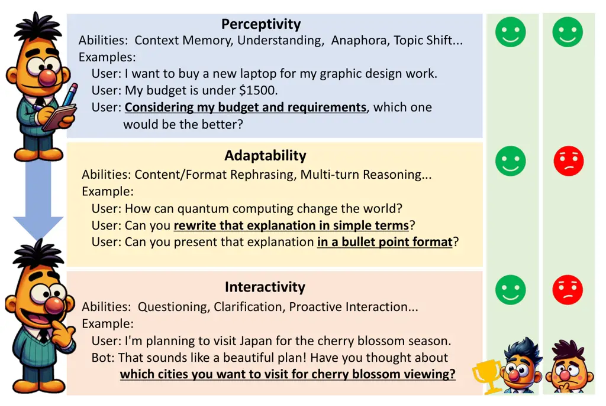

# MT-Bench-101: A Fine-Grained Benchmark for Evaluating Large Language Models in Multi-Turn Dialogues

Ge Bai Email: <bg427839@taobao.com>    Jie Liu Affiliation: Shanghai AI
Laboratory Email: <xingyuanbu@gmail.com>    Xingyuan Bu    Yancheng He
   Jiaheng Liu    Zhanhui Zhou Affiliation: Shanghai AI Laboratory   
Zhuoran Lin, Wenbo Su, Tiezheng Ge, Bo Zheng, Wanli Ouyang
Affiliation: Alibaba Group The Chinese University of Hong Kong
Affiliation: Shanghai AI Laboratory

###### Abstract

The advent of Large Language Models (LLMs) has drastically enhanced
dialogue systems. However, comprehensively evaluating the dialogue
abilities of LLMs remains a challenge. Previous benchmarks have
primarily focused on single-turn dialogues or provided coarse-grained
and incomplete assessments of multi-turn dialogues, overlooking the
complexity and fine-grained nuances of real-life dialogues. To address
this issue, we introduce MT-Bench-101, specifically designed to evaluate
the fine-grained abilities of LLMs in multi-turn dialogues. By
conducting a detailed analysis of real multi-turn dialogue data, we
construct a three-tier hierarchical ability taxonomy comprising 4208
turns across 1388 multi-turn dialogues in 13 distinct tasks. We then
evaluate 21 popular LLMs based on MT-Bench-101, conducting comprehensive
analyses from both ability and task perspectives and observing differing
trends in LLMs performance across dialogue turns within various tasks.
Further analysis indicates that neither utilizing common alignment
techniques nor chat-specific designs has led to obvious enhancements in
the multi-turn abilities of LLMs. Extensive case studies suggest that
our designed tasks accurately assess the corresponding multi-turn
abilities. The data and code are available at
[https://github.com/mtbench101/mt-bench-101](https://github.com/mtbench101/mt-bench-101).

^(†)^(†)footnotetext: $`*`$ Equal contribution. $`{\dagger}`$
Corresponding author.

## 1 Introduction

Figure 1: MT-Bench-101 encompasses three overarching abilities and
thirteen distinct tasks within multi-turn dialogue scenarios,
facilitating a granular benchmarking from basic perceptivity to advanced
interactivity. On the right, a model with a broader range of abilities
is considered better in multi-turn scenarios.

Large Language Models (LLMs) based chatbots have made remarkable
advances and significantly enhanced dialogue systems. Several benchmarks
have been introduced to assess the capabilities of Large Language Models
(LLMs) in single-turn dialogues, e.g., MMLU Hendrycks et al. (2020),
BBH Srivastava et al. (2022), and AlpacaEval Li et al. (2023b). However,
daily dialogues between users and chatbots usually involve multi-turn
conversations Gudibande et al. (2023); Zheng et al. (2023), which
include multiple utterances as part of the dialogue history. Therefore,
it is essential to evaluate the proficiency of LLMs in generating
coherent responses utilizing multiple utterances  Lan et al. (2020).
Early studies like MT-bench Zheng et al. (2024) mainly focus on two-turn
dialogues and coarse-grained abilities, not sufficiently covering the
complexity of real-world multi-turn dialogue scenarios. This indicates a
considerable scope for improvement in current benchmarks for multi-turn
dialogues, underscoring the urgent need to develop a comprehensive
benchmark that can effectively compare the chat abilities of LLMs in
multi-turn dialogues.

In this paper, we introduce MT-Bench-101, a new benchmark designed
specifically for evaluating the chat capabilities of LLMs in multi-turn
dialogues, as shown in Figure 1. During the ability modeling process for
multi-turn dialogue, we undertake a systematical analysis combining
real-world multi-turn dialogue data Gudibande et al. (2023); Zheng
et al. (2023) with the teaching taxonomy from educational
psychology Alexander (2018); Marchel (2007). This integrated approach
has culminated in the formulation of a three-tier hierarchical ability
taxonomy which is both data-driven and rooted in psychological
frameworks.

Figure 2 illustrates the overall framework of our ability taxonomy. The
first layer outlines three progressive overarching abilities which are
depicted in Figure 1. Perceptivity is the most fundamental ability,
reflecting the model’s accuracy in understanding context. Adaptability
is built upon this foundation, indicating the model’s ability to respond
effectively to user feedback. Finally, Interactivity captures the
capacity of models for proactive engagement with humans, which is
crucial for excelling in multi-turn interactions. The second tier
specifies seven detailed abilities, while the third tier further
decomposes these abilities into 13 distinct tasks. This taxonomy
provides evaluation results across three levels from general to
detailed, allowing for the identification of deficiencies in models at
varying levels of granularity. For each third-tier task, we meticulously
design specific prompts and utilize GPT-4 for data generation. In total,
MT-Bench-101 encompasses 4208 turns within 1388 multi-turn dialogues.

For evaluation, we utilize golden context as dialogue history allowing
LLMs to generate more fluid and rational dialogues, and we follow Zheng
et al., 2024; Dubois et al., 2024; Duan et al., 2023 to utilize GPT-4 as
a stand-in for human raters to score for each turn. We design unique
scoring guidelines for each task and use the lowest round score as the
total score for the dialogue to allow for a more rational assessment.

We then perform extensive experiments on MT-Bench-101 to assess the
multi-turn chat ability of existing LLMs, including 2 close-sourced LLMs
and 19 open-sourced LLMs. Our findings include:

- •
  We identify adaptability and interactivity as the key deficiencies of
  existing LLMs, and GPT-4 is the most powerful model for multi-turn
  dialogues.
- •
  The average performance of models within various tasks exhibits
  differing trends with the progression of turns, reflecting the
  distinct characteristics of the abilities.
- •
  Model performance improves as the model size increases. However,
  neither utilizing common alignment techniques (such as RLHF) nor
  chat-specific designs has resulted in significant enhancements in the
  multi-turn abilities of LLMs.
- •
  The agreement between GPT-4 and human expert evaluations reached 87%,
  utilizing our designed evaluation approach.

Figure 2: Our three-tier hierarchical ability taxonomy of multi-turn
dialogues.

## 2 Related Work

##### LLMs for Multi-turn Dialogues

Recent advancements in LLMs such as GPT-3.5/GPT-4 (Ouyang et al., 2022;
OpenAI, 2022; OpenAI, 2023) have garnered significant attention Liu
et al. (2024a); Wang et al. (2023d); Feng et al. (2022); Bu et al.
(2021); Peng et al. (2023); Sun et al. (2024); Guo et al. (2024b); Guo
et al. (2023); Li et al. (2024a); Lyu et al. (2024). To enhance the
multi-turn capabilities of open-sourced LLMs, initial efforts begin with
collecting human-ChatGPT dialogues (Gudibande et al., 2023), leading to
the creation of Vicuna (Chiang et al., 2023). RealChat (Zheng et al., 2023) later expands the data to 1 million conversations. To generate
more sophisticated datasets, Baize (Xu et al., 2023) and UltraChat Ding
et al. (2023) employ alternating GPT interactions. Parrot (Sun et al., 2023) trains a model to simulate the user, thereby generating improved
data. Further, Cue-CoT and ICL-AIF (Wang et al., 2023a; Fu et al., 2023)
enhance model capabilities for multi-turn interactions through
In-Context-Learning (ICL) (Brown et al., 2020) and Chain-of-Thought
(CoT) (Wei et al., 2022) algorithms.

##### Benchmarks for Multi-turn LLMs

Most benchmarks evaluate LLMs through single-turn
instructions (Hendrycks et al., 2020), missing the nuance of human
conversation. To investigate multi-turn ability, ABC-Eval (Finch et al., 2022) relies on labor-intensive human evaluations. AlpacaEval (Li
et al., 2023b) and PandaLM (Wang et al., 2023c) attempt to automatically
assess open-ended instructions, but they remain confined to single-turn
settings. MT-Bench (Zheng et al., 2024) and MT-Bench++ (Sun et al., 2023) expand multi-turn evaluations across eight topics. BotChat (Duan
et al., 2023) and MINT (Wang et al., 2023b) focus on specialized tasks
such as dialogue generation abilities. Despite these efforts, there
remains a notable gap in fine-grained evaluations for multi-turn
interactions.

|                           |       |                                                                                                    |
| ------------------------- | ----- | -------------------------------------------------------------------------------------------------- |
| Task                      | Abbr. | Description                                                                                        |
| Context Memory            | CM    | Recall early dialogue details to address the user’s current question.                              |
| Anaphora Resolution       | AR    | Identify pronoun referents throughout a multi-turn dialogue.                                       |
| Separate Input            | SI    | The first turn outlines the task requirements and the following turns specify the task input.      |
| Topic Shift               | TS    | Recognize and focus on the new topic when users unpredictably switch topics.                       |
| Content Confusion         | CC    | Avoid interference from similar-looking queries with distinct meanings in the dialogue’s history.  |
| Content Rephrasing        | CR    | Rephrase the content of the last response according to the user’s newest requirement.              |
| Format Rephrasing         | FR    | Rephrase the format of the last response according to the user’s newest requirement.               |
| Self-correction           | SC    | Recorrect the last response according to the user feedback.                                        |
| Self-affirmation          | SA    | Preserve the last response against inaccurate user feedback.                                       |
| Mathematical Reasoning    | MR    | Collaboratively solve complex mathematical problems with users across dialogue turns.              |
| General Reasoning         | GR    | Collaboratively solve complex general reasoning problems with users across dialogue turns.         |
| Instruction Clarification | IC    | Seek clarification by asking further questions on ambiguous user queries.                          |
| Proactive Interaction     | PI    | Propose questions in reaction to user statements to spark their interest to continue the dialogue. |

Table 1: The 13 tasks for multi-turn dialogues within MT-Bench-101.

##### Benchmarks for Fine-grained Abilities

The advent of general LLMs has highlighted the need for more
comprehensive evaluation.  Hendrycks et al., 2020 introduces MMLU with
an extensive suite of 57 tasks spanning social science and STEM.
Subsequent benchmarks (Huang et al., 2024; Li et al., 2023a; Zhong
et al., 2023; Srivastava et al., 2022; Yu et al., 2023; Li et al.,
2024c; Guo et al., 2024a) aim to rigorously assess LLMs’ knowledge and
logic. ConceptMath (Wu et al., 2024) and FollowBench (Jiang et al.,
2023b) develop a hierarchical framework for evaluating model
capabilities.

## 3 MT-Bench-101

This section begins with a detailed description of the three-tier
hierarchical ability taxonomy for multi-turn dialogues. Following that,
we explain the methodology used to collect the dataset. Finally, we
present an analysis of the dataset’s statistics.

### 3.1 Hierarchical Ability Taxonomy

After analyzing real dialogues from ShareGPT Gudibande et al. (2023) and
RealChat Zheng et al. (2023) and the teaching taxonomy of multi-turn
dialogues from educational psychology Alexander (2018); Marchel (2007);
Peng et al. (2020); Gao et al. (2018), we have developed a hierarchical
taxonomy of abilities crucial for chatbots to engage effectively in
multi-turn dialogues with human users. This taxonomy is structured into
three levels, with the third level encompassing 13 distinct tasks. Table
1 provides a brief one-sentence description for each third-level task.
This section will deliver a detailed explanation of these three-level
abilities and tasks. We also provide cases for each task in the Appendix
F.

#### 3.1.1 Perceptivity

Perceptivity requires chatbots to adeptly track and use historical
dialogue data to provide logical and consistent responses, encompassing
the following three core abilities.

##### Context Memory:

To ensure continuity and relevance in dialogues, chatbots must exhibit a
robust context memory capability. This involves accurately retrieving
and utilizing past dialogue information to address current user
inquiries. We named Context Memory (CM) for the third-level ability.

##### Context Understanding:

Anaphora Resolution (AR). It is common for users to use demonstrative
pronouns (e.g., "these," "it") in dialogues. A key ability for chatbots
is to identify the referents of these pronouns accurately to generate
appropriate responses; Separate Input (SI). Dialogues typically unfold
over several turns, with the initial turn outlining the task
requirements and subsequent turns specifying the task input.
Understanding the relationship between instructions and inputs is
demanded for effective chatbots.

##### Context Interference:

Topic Shift (TS). Users might unpredictively switch topics in multi-turn
dialogues. This task assesses the chatbot’s ability to recognize a topic
shift and ignore unrelated preceding information, thereby concentrating
on the new topic at hand; Content Confusion (CC) centers on the
chatbot’s skill in managing situations where users pose questions that,
while textually similar in history questions, necessitate distinct
responses.

#### 3.1.2 Adaptability

Chatbots adjust their early responses with the user’s new requirements
(Rephrasing), new conditions, and hypotheses (Reasoning) and can correct
or insist on answers according to user-challenging feedback (Reflective)
in user-triggered dialogue.

##### Rephrasing:

Content Rephrasing (CR) requires chatbots to have a thorough
understanding of the text to rephrase the content of the last response
based on the user’s latest requirement (e.g., summarizing this
paragraph). Format Rephrasing (FR) involves a transformation in
structure while preserving the original information (e.g., converting
this paragraph into a list format).

##### Reflection:

Self-correction (SC). Upon receiving user feedback indicating skepticism
or errors in the last response, the chatbot will correct mistakes, and
provide a more accurate subsequent response. Within our dataset, this
task is limited to instances where the chatbot’s initial reply was
erroneous or not precise, and the user’s critique is deemed valid.
Self-affirmation (SA). Unlike self-correction task, self-affirmation
comes into play when the chatbot’s initial response is correct or
accurate, yet it encounters incorrect feedback from the user. In such
cases, the chatbot needs to identify the inaccuracies in the user’s
feedback and adhere to its original response.

##### Reasoning:

Mathematical Reasoning (MR). Effective reasoning across multiple
dialogue turns is essential in solving mathematical problems, as users
may introduce new conditions or hypotheses as the conversation
progresses. General Reasoning (GR) encompasses a variety of reasoning
challenges, e.g. puzzles, inductive reasoning, and deductive reasoning.
Chatbots are required to work alongside users through successive
dialogue turns to address these issues.

#### 3.1.3 Interactivity

Chatbots proactively propose questions to guide the dialogue or gather
information for better responses in chatbot-triggered dialogue.

##### Questioning:

Instruction Clarification (IC) targets scenarios where the user’s
initial question is unclear. The chatbot needs to ask follow-up
questions to obtain more information. This iterative intent
clarification process may span several turns to ensure the chatbot fully
grasps the user’s intent. Proactive Interaction (PI) assesses the
chatbot’s ability to craft suitable follow-up questions or comments in
reaction to user statements, thereby sparking the user’s interest to
continue the dialogue.

### 3.2 Data Collection

|              |             |         |         |              |
| ------------ | ----------- | ------- | ------- | ------------ |
| Benchmark    | \#Dialogues | \#Turns | \#Tasks | Fine-grained |
| AlpacaEval   | 805         | 805     | 1       | ✗            |
| MT-Bench     | 80          | 160     | 1       | ✗            |
| MT-Bench++   | 80          | 640     | 1       | ✗            |
| BotChat      | 547         | 547     | 1       | ✗            |
| MINT         | 568         | 568     | 3       | ✗            |
| MT-Bench-101 | 1388        | 4208    | 13      | ✓            |

Table 2: Data statistics.

We tailored unique data generation prompts for each task based on its
specific characteristics and utilized GPT-4 to construct data. In
detail, the prompts included data generation rules and used manually
crafted examples as guidance for GPT-4. This ensured the generated data
met the specific needs of each task. Our benchmark covers 30 diverse
topics, including health, history, science, finance, law, humanities,
arts, and others. The Appendix A shows a complete list of topics and the
prompts used for data generation.

For each task, we utilized GPT-4 to generate over 1000 samples. These
samples were then rigorously curated by human annotators to form the
final dataset. For each piece of data, it underwent screening by five
annotators, and we ultimately retained only the data that all annotators
deemed to be of high quality. The primary criteria for curation are
shown in the Appendix A.

### 3.3 Data Statistics

Table 2 shows the key statistics of our MT-Bench-101. This benchmark
features a comprehensive hierarchical taxonomy for multi-turn dialogues
with 13 distinct tasks, 1388 dialogues, and 4208 turns. Detailed
statistics for each task can be found in the Appendix B. Additionally,
we provide a comparative analysis between MT-Bench-101 and existing
dialogue evaluation benchmarks. This comparison highlights that
MT-Bench-101 is the first dataset to specifically focus on fine-grained
multi-turn dialogue abilities, notable for its extensive volume of data
and diversity of tasks.

### 3.4 Evaluation

In multi-turn dialogues, new turns rely on the interaction between
humans and chatbots in the preceding turns. This phenomenon is
especially significant in tasks with strong interactivity such as
instruction clarification and proactive interaction. Hence, we leverage
our meticulously curated dataset as the golden context for dialogue
history, as opposed to relying on self-predicted context from LLM
subjects. This approach facilitates the creation of smoother, more
rational dialogues. Moreover, evaluating only the newest response of the
LLMs while maintaining consistency with the conversation history also
promotes fair evaluation.

|                            |      |              |               |      |              |      |              |      |            |      |           |      |               |      |
| -------------------------- | ---- | ------------ | ------------- | ---- | ------------ | ---- | ------------ | ---- | ---------- | ---- | --------- | ---- | ------------- | ---- |
| Model                      |      | Perceptivity |               |      |              |      | Adaptability |      |            |      |           |      | Interactivity |      |
|                            |      | Memory       | Understanding |      | Interference |      | Rephrasing   |      | Reflection |      | Reasoning |      | Questioning   |      |
|                            | Avg. | CM           | SI            | AR   | TS           | CC   | CR           | FR   | SC         | SA   | MR        | GR   | IC            | PI   |
| Llama2-7B-Chat             | 6.53 | 7.64         | 6.21          | 7.92 | 8.23         | 8.50 | 8.32         | 8.56 | 8.45       | 4.97 | 1.88      | 3.83 | 5.23          | 5.11 |
| Qwen-7B-Chat               | 7.12 | 7.65         | 7.75          | 8.73 | 8.42         | 8.76 | 8.89         | 9.16 | 8.49       | 7.28 | 2.25      | 3.57 | 5.41          | 6.24 |
| ChatGLM2-6B                | 5.56 | 6.14         | 4.69          | 7.27 | 6.13         | 6.26 | 7.47         | 7.98 | 6.97       | 4.19 | 2.11      | 3.00 | 5.16          | 4.90 |
| ChatGLM3-6B                | 6.47 | 7.16         | 5.42          | 8.21 | 7.43         | 8.03 | 8.38         | 8.81 | 7.40       | 5.63 | 2.60      | 3.21 | 6.19          | 5.61 |
| InternLM2-Chat-7B-SFT      | 6.69 | 7.51         | 6.26          | 8.01 | 8.06         | 8.70 | 8.50         | 8.50 | 7.68       | 6.16 | 3.47      | 4.48 | 4.92          | 4.76 |
| Yi-6B-Chat                 | 6.93 | 7.57         | 5.27          | 8.69 | 8.37         | 8.76 | 8.43         | 8.44 | 7.49       | 7.85 | 2.18      | 3.80 | 7.30          | 6.00 |
| Mistral-7B-Instruct-v0.2   | 6.95 | 7.66         | 5.64          | 8.09 | 8.30         | 9.35 | 8.69         | 8.59 | 8.16       | 7.33 | 2.58      | 4.52 | 5.80          | 5.66 |
| Vicuna-13B-v1.5            | 6.37 | 7.06         | 5.62          | 7.81 | 7.45         | 8.79 | 7.96         | 7.72 | 7.47       | 6.70 | 2.31      | 4.03 | 5.05          | 4.80 |
| Baize-13B-v2               | 6.12 | 6.78         | 5.15          | 7.86 | 7.40         | 8.07 | 7.96         | 8.15 | 7.24       | 6.32 | 1.67      | 3.69 | 4.35          | 4.95 |
| UltraLM-13B-v2.0           | 4.61 | 4.66         | 4.89          | 5.99 | 6.49         | 8.48 | 2.87         | 2.53 | 6.70       | 5.27 | 1.46      | 2.34 | 4.13          | 4.11 |
| Llama2-13B-Chat            | 7.15 | 8.03         | 7.11          | 9.00 | 9.39         | 8.81 | 9.07         | 9.11 | 7.63       | 7.60 | 1.75      | 3.16 | 6.07          | 6.23 |
| Qwen-14B-Chat              | 7.82 | 8.33         | 8.36          | 9.04 | 9.22         | 9.50 | 9.12         | 9.39 | 8.41       | 7.97 | 3.50      | 4.55 | 8.21          | 6.12 |
| Baichuan2-13B-Chat         | 7.00 | 7.71         | 6.38          | 8.92 | 8.36         | 9.07 | 9.10         | 8.95 | 7.75       | 6.57 | 2.50      | 3.65 | 6.95          | 5.15 |
| InternLM2-Chat-20B-SFT     | 6.95 | 7.35         | 6.44          | 8.08 | 8.05         | 9.10 | 8.59         | 8.55 | 7.62       | 7.36 | 4.05      | 5.24 | 4.99          | 4.99 |
| Yi-34B-Chat                | 8.10 | 8.55         | 6.79          | 9.34 | 9.84         | 9.34 | 9.08         | 9.38 | 9.01       | 9.04 | 4.07      | 5.90 | 8.51          | 6.39 |
| Mixtral-8x7B-Instruct-v0.1 | 7.38 | 7.86         | 5.94          | 8.49 | 9.01         | 9.52 | 8.91         | 9.01 | 8.69       | 7.78 | 4.19      | 5.14 | 6.03          | 5.36 |
| GPT-3.5                    | 7.99 | 8.77         | 7.67          | 7.67 | 9.68         | 9.87 | 9.56         | 9.51 | 9.18       | 7.23 | 4.48      | 5.31 | 8.57          | 6.32 |
| GPT-4                      | 8.86 | 8.88         | 8.99          | 9.58 | 9.83         | 9.98 | 9.54         | 9.57 | 9.36       | 9.52 | 7.15      | 7.17 | 9.00          | 6.64 |
| Avg.                       | 6.92 | 7.52         | 6.37          | 8.26 | 7.72         | 8.24 | 8.36         | 8.44 | 7.98       | 6.93 | 3.61      | 4.84 | 6.22          | 5.52 |

Table 3: The performance of different LLMs on the 13 multi-turn dialogue
tasks in our MT-Bench-101. Due to space constraints, the 13 tasks are
represented by their corresponding acronyms.

Figure 3: Performance of various LLMs for each ability dimension.

Following MT-Bench (Zheng et al., 2024), we employ GPT-4 for evaluation
in our benchmark. We tailor different evaluation prompts (see Appendix
C) for each task and develop fine-grained scoring guidelines detailing
what is required for each score level or grade. Then GPT-4 scores each
turn of the chatbot’s responses from 1 to 10 and gives detailed
justifications. Additionally, our evaluation process utilizes a
minimum-score-taking metric, where the lowest score of a turn is
considered the final score for the entire dialogue. This approach is
consistent with human intuition, as discussed in section 4.5, because a
single failed response can compromise the entire dialogue in closely
related conversational contexts. Moreover, this metric prevents models
from achieving inflated scores by simply learning patterns from the
golden context. This phenomenon will be further explored in section 4.2.

Li et al. 2024b; He et al. 2022 point out that there is self-bias in LLM
judges (e.g., GPT-4 Judge prefers GPT-4 answers). We also provide a
leaderboard with Qwen-72B-Chat as the judge model in the Appendix D,
showing that this problem is minor in our benchmark, with the rankings
of GPT-4-Judge and Qwen-72B-Judge being consistent.

## 4 Experiments

### 4.1 Experimental Setup

##### Settings

We utilize the golden contexts as dialogue histories in all experiments
unless otherwise specified. For each LLM, we apply the corresponding
chat format and the system prompt while setting the temperature and
sampling parameter as their official configures. As for LLM-Judge(GPT-4
and Qwen-72B-Chat), we set the temperature to 0.6. Additional details on
the experimental setup and implementation can be found in the
Appendix C.

##### Models

We evaluate 21 popular LLMs on MT-Bench-101, including 2 close-sourced
LLMs (i.e., GPT-3.5/ GPT-4 (OpenAI, 2023)) and 19 open-sourced LLMs
(i.e., Llama2-Chat (7B, 13B) (Touvron et al., 2023), Mistral-Instruct
(7B, 8x7B, DPO) (Jiang et al., 2023a), Qwen-Chat (7B, 14B) (Bai et al.,
2023), Yi-Chat (6B, 34B) (Yi, 2023), ChatGLM2-6B/ChatGLM3-6B (Du et al.,
2022), InternLM2-Chat (7B, 20B, RLHF) (Team, 2023),
Vicuna-13B-v1.5 (Chiang et al., 2023), Baichuan2-Chat-13B (Baichuan,
2023)), UltraLM-13B-v2.0 (Ding et al., 2023), and Baize-v2-13B (Xu
et al., 2023). More details of these evaluated models can be seen in the
Appendix E.

(a)

(b)

(c)

(d)

Figure 4: Model performance across dialogue turns.

(a) Llama2

(b) Qwen

(c) Yi

(d) InternLM

Figure 5: Performance of various sizes of models.

### 4.2 Main Results

##### Task Dimensional Analysis

Table 3 presents the performance of different language models on the 13
multi-turn dialogue tasks in our MT-Bench-101. Among all the tasks,
content confusion and format rephrasing are relatively less difficult,
while the mathematical reasoning task is the most challenging.
Furthermore, closed-source models consistently exhibit superior
performance compared to open-source counterparts across all evaluated
tasks. GPT-4 emerges as the top-performing model across the entire
spectrum of tasks with an average score of 8.86, while Yi-34B with an
average score of 8.10 ranks as the second-best performer overall.

##### Ability Dimensional Analysis

Table 3 further indicates that model performances across tasks within
the same ability tend to be similar, inspiring us to assess the overall
performance of various models from the perspective of the abilities.
Figure 3 illustrates the performance of different LLMs across seven
ability dimensions, where the score for each ability is the average
score across its respective tasks. Most LLMs demonstrate a widespread
proficiency in rephrasing and resistance to interference. However, the
reasoning and questioning abilities of LLMs are still in need of
enhancement. In addition, the performance of models in memory surpasses
that in understanding ability. This discrepancy arises because memory is
primarily concerned with the recall of information, whereas
understanding encompasses the grasping of meaning, representing a deeper
level of cognitive processing. Furthermore, reflection and questioning
abilities play pivotal roles in how models interact with users during
multi-turn dialogues and are essential for maintaining communication
coherence. Consequently, models that excel in reflection and questioning
not only show proficiency in individual tasks but also suggest a higher
level of overall conversational intelligence and are often rewarded with
higher overall scores.

##### Chat-Specific Models

As shown in Table 3, the chat-specific language models Baize, and
UltraLM do not demonstrate exceptional performance on our benchmark. In
fact, their capabilities appear to be outstripped by other large
language models of comparable size. Such insights indicate that despite
being specialized for conversational tasks, these chat-specific models
require further development to effectively handle the multi-turn
scenarios.

##### Per-Turn Performance

To investigate the impact of turn count on model performance across
different tasks, we calculated the average scores of models for each
dialogue turn within various tasks. As shown in Figure 4(a) and 4(b), in
content rephrasing, format rephrasing, context memory, and anaphora
resolution tasks, the average performance of models show a decline
between the first turn and subsequent turns. This suggests that in
multi-turn dialogue tasks, models tend to exhibit a greater propensity
to forget the content of previous turns or to develop comprehension
biases as the conversation progresses. Figure 4(b) also illustrates a
notable decrease in performance from the first to the second turn in
topic shift and content confusion tasks. This drop is attributed to the
second turn marking the onset of interference, leading to confusion for
the model.

(a) Separate Input

(b) Instruction Clarification

Figure 6: Comparison of model performance across dialogue turns using
golden or self-predicted context.

As shown in Figure 4(c), we note an upward trend in model performance as
the number of turns increases in separate input, directive
clarification, and proactive interaction. This phenomenon does not
reflect a true enhancement in performance throughout the dialogue.
Rather, it occurs because using the golden context as historical
information allows the model to learn the current conversational style
and response patterns from the golden context, resulting in an illusory
improvement in performance. This phenomenon will be analyzed in detail
below. Similarly, as shown in Figure 4(d), in mathematical reasoning
tasks, the model also benefits from the golden context by adopting the
reasoning format and solution paradigms (such as the step-by-step
paradigm). Conversely, in general reasoning tasks, where there is no
fixed paradigm to follow, the model’s performance tends to decline as
the dialogue progresses due to the increasing complexity.

### 4.3 Further Analysis

##### Effect of Model Size

Figure 5 presents a comprehensive comparison across four groups of
models varying in size. The trend of increasing model size is associated
with a universal improvement in performance on multi-turn dialogue
tasks. Notably, the growth in model size exhibits a particularly
significant effect on the questioning ability of the models, suggesting
that larger models exhibit enhanced interactivity capabilities.

##### Effect of Human Preference Alignment

Several techniques Ouyang et al. (2022); Rafailov et al. (2024); Zhou
et al. (2023); Zhou et al. (2024a); Zhou et al. (2024b); Liu et al.
(2024b) have been proposed to align language models with human values.
We study the effect of RLHF/DPO on multi-turn dialogues by comparing
three pairs of open-source models, each pair consisting of versions
trained with Supervised Fine-Tuning (SFT) and enhanced with RLHF/DPO
techniques. Table 4 shows that the application of RLHF/DPO techniques
results in marginal improvements for the InternLM2-Chat models, with the
7B and 20B versions experiencing score increases of 0.16 and 0.10,
respectively. In contrast, the Mistral-7B model shows a performance
decrease of 0.06. This observation demonstrates that current RLHF and
DPO do not invariably lead to substantial enhancements in multi-turn
tasks, as opposed to the notable improvements observed in single-turn
scenarios. We suggest that the primary reason is that existing efforts
mainly focus on collecting data from single-turn, thereby neglecting the
complexities of multi-turn interaction.

|                    |     |          |      |            |
| ------------------ | --- | -------- | ---- | ---------- |
| Model              | SFT | RLHF/DPO | Avg. | $`\Delta`$ |
| InternLM2-Chat-7B  | ✓   |          | 6.69 | \-         |
| InternLM2-Chat-7B  |     | ✓        | 6.85 | +0.16      |
| InternLM2-Chat-20B | ✓   |          | 6.95 | \-         |
| InternLM2-Chat-20B |     | ✓        | 7.05 | +0.10      |
| Mistral-7B         | ✓   |          | 6.95 | \-         |
| Mistral-7B         |     | ✓        | 6.89 | -0.06      |

Table 4: Performance of SFT and RLHF/DPO.

##### Effect of the Golden Context

We employ ChatGLM3-6B on separate input and instruction clarification
tasks with the golden context or self-predicted context as historical
conversational information to evaluate the effect of the context. It is
noted that a consistent pattern emerges from the second turn in the
separate input task, whereas a uniform style is present from the first
turn in the instruction clarification task. Figure 6 shows that using
the golden context as historical information leads to an increase in the
model’s scores overturns. This improvement is attributed to the golden
context supplying the model with data for in-context learning, enabling
it to learn the specific patterns and styles from context. Conversely,
employing self-predicted context as dialogue history results in the
accumulation and propagation of errors from earlier incorrect responses,
causing a gradual decline in scores. Furthermore, as discussed in
section 3.4, using self-predicted context as historical information
compromises the coherence of the dialogue, Due to these observed
phenomena, our evaluation protocol employs the golden context and the
lowest score across the turns as the metrics for assessing overall
dialogue performance.

Figure 7: Model responses and their corresponding evaluations in
separate input and self-affirmation tasks.

### 4.4 Case Study

We provide some cases to show that GPT-4 evaluation aligns well with the
corresponding abilities and scoring criteria. Figure 7 shows that in
separate input, LLMs frequently encounter two types of errors: (1)
Generating premature responses without having received the detailed
content of the task, and (2) Forgetting the initial requirements of the
task, resulting in responses that stray from the original task
objectives. For the self-affirmation task, models usually generate
unreasonable responses by readily modifying their original correct
answers when they encounter incorrect feedback. Detailed case studies
for the remaining tasks can be found in the Appendix F.

### 4.5 Human Evaluation

We randomly sampled 100 dialogues from MT-Bench-101 and recruited five
expert human annotators to assess the overall quality of multi-turn
dialogues based on whether the responses of LLMs met the requirements of
the corresponding tasks. Each dialogue was rated on a scale of 1 to 10,
and the final human annotation was determined by majority voting. We
then adopt the agreement metric from Zheng et al., 2024 to verify our
auto-evaluation method’s effectiveness, which defines the agreement
between two types of judges as the probability of randomly selected
individuals (but not identical) of each type agreeing on a randomly
selected question. As shown in Table 5, utilizing our evaluation prompt
and detailed scoring guidelines, which specify the criteria for each
score level or grade, the agreement between GPT-4 and human expert
evaluations reached 87%, even surpassing the internal agreement among
human experts of 80%. Additionally, we found that eliminating scoring
criteria or adopting average values instead of minimum values as scoring
metrics led to reduced evaluation agreement with human experts. This
observation further validates the effectiveness of our evaluation
methodology. We also calculate the Fleiss’ Kappa (Scott, 1955), a
statistical measure of inter-rater reliability, to further justify our
conclusions in the Appendix G.

|                            |           |            |
| -------------------------- | --------- | ---------- |
| Evaluation Method          | Agreement | $`\Delta`$ |
| Human Experts              | 80%       | 0%         |
| MT-Bench-101               | 87%       | +7%        |
| w/o scoring guidelines     | 77%       | -3%        |
| w/o minimum values metrics | 75%       | -5%        |

Table 5: Agreement between human experts and various evaluation methods.
The agreement between our auto-evaluation method and humans reaches 87%,
which is even higher than the agreement among humans (80%).

## 5 Conclusion

This paper introduces a comprehensive hierarchical taxonomy of
multi-turn chat abilities based on existing human-LLMs interaction data
and educational insights. We evaluate 21 LLMs using our MT-Bench-101,
revealing that neither alignment techniques nor chat designs notably
improve their multi-turn abilities. Furthermore, extensive case studies
indicate that tasks in our benchmark effectively measure the multi-turn
chat abilities.

## 6 Limitations

With LLM technologies rapidly evolving, new multi-turn capabilities are
likely to emerge. Consequently, the findings of this study may not
encompass all multi-turn abilities. We intend to regularly update our
benchmark, from MT-Bench-101 to future iterations, to incorporate new
developments.

## 7 Ethics Statement

We collected and annotated data using GPT-4 and had it reviewed by
humans. Additionally, we obtained the participants’ informed consent and
ensured their privacy and autonomy. All participants were fully aware of
and consented to the annotation process. We have taken rigorous steps to
ensure that the dataset is devoid of offensive content or personal
identity information. However, there might still be residual errors or
biases due to inadvertent mistakes by GPT-4 or oversights by annotators.
We have made our best effort to rectify these issues, but it’s
challenging to eliminate them entirely. These issues may be present in
all similar datasets. Furthermore, the dataset will be publicly
available and could be misused for training, which might make our
benchmark less effective. As LLMs continue to evolve, the current
capability taxonomy for multi-turn dialogues might be incomplete. In
response, we will continue to release updated versions of the dataset to
address data leaks and extend capabilities. Lastly, the dataset released
in this work is intended solely for research and may not be suitable for
commercial use without additional verification.

## References

- Alexander (2018) Robin Alexander. 2018. Developing dialogic teaching:
  Genesis, process, trial. _Research papers in education_,
  33(5):561–598.
- Bai et al. (2023) Jinze Bai, Shuai Bai, Yunfei Chu, Zeyu Cui, Kai
  Dang, Xiaodong Deng, Yang Fan, Wenbin Ge, Yu Han, Fei Huang, Binyuan
  Hui, Luo Ji, Mei Li, Junyang Lin, Runji Lin, Dayiheng Liu, Gao Liu,
  Chengqiang Lu, Keming Lu, Jianxin Ma, Rui Men, Xingzhang Ren,
  Xuancheng Ren, Chuanqi Tan, Sinan Tan, Jianhong Tu, Peng Wang, Shijie
  Wang, Wei Wang, Shengguang Wu, Benfeng Xu, Jin Xu, An Yang, Hao Yang,
  Jian Yang, Shusheng Yang, Yang Yao, Bowen Yu, Hongyi Yuan, Zheng Yuan,
  Jianwei Zhang, Xingxuan Zhang, Yichang Zhang, Zhenru Zhang, Chang
  Zhou, Jingren Zhou, Xiaohuan Zhou, and Tianhang Zhu. 2023. Qwen
  technical report. _arXiv preprint arXiv:2309.16609_.
- Baichuan (2023) Baichuan. 2023. [Baichuan 2: Open large-scale language
  models](https://arxiv.org/abs/2309.10305). _arXiv preprint
  arXiv:2309.10305_.
- Brown et al. (2020) Tom Brown, Benjamin Mann, Nick Ryder, Melanie
  Subbiah, Jared D Kaplan, Prafulla Dhariwal, Arvind Neelakantan, Pranav
  Shyam, Girish Sastry, Amanda Askell, et al. 2020. Language models are
  few-shot learners. _Advances in neural information processing
  systems_, 33:1877–1901.
- Bu et al. (2021) Xingyuan Bu, Junran Peng, Junjie Yan, Tieniu Tan, and
  Zhaoxiang Zhang. 2021. Gaia: A transfer learning system of object
  detection that fits your needs. In _Proceedings of the IEEE/CVF
  Conference on Computer Vision and Pattern Recognition_, pages 274–283.
- Chiang et al. (2023) Wei-Lin Chiang, Zhuohan Li, Zi Lin, Ying Sheng,
  Zhanghao Wu, Hao Zhang, Lianmin Zheng, Siyuan Zhuang, Yonghao Zhuang,
  Joseph E. Gonzalez, Ion Stoica, and Eric P. Xing. 2023. [Vicuna: An
  open-source chatbot impressing gpt-4 with 90%\* chatgpt
  quality](https://lmsys.org/blog/2023-03-30-vicuna/).
- Ding et al. (2023) Ning Ding, Yulin Chen, Bokai Xu, Yujia Qin, Zhi
  Zheng, Shengding Hu, Zhiyuan Liu, Maosong Sun, and Bowen Zhou. 2023.
  Enhancing chat language models by scaling high-quality instructional
  conversations. _arXiv preprint arXiv:2305.14233_.
- Du et al. (2022) Zhengxiao Du, Yujie Qian, Xiao Liu, Ming Ding,
  Jiezhong Qiu, Zhilin Yang, and Jie Tang. 2022. Glm: General language
  model pretraining with autoregressive blank infilling. In _Proceedings
  of the 60th Annual Meeting of the Association for Computational
  Linguistics (Volume 1: Long Papers)_, pages 320–335.
- Duan et al. (2023) Haodong Duan, Jueqi Wei, Chonghua Wang, Hongwei
  Liu, Yixiao Fang, Songyang Zhang, Dahua Lin, and Kai Chen. 2023.
  Botchat: Evaluating llms’ capabilities of having multi-turn dialogues.
  _arXiv preprint arXiv:2310.13650_.
- Dubois et al. (2024) Yann Dubois, Chen Xuechen Li, Rohan Taori, Tianyi
  Zhang, Ishaan Gulrajani, Jimmy Ba, Carlos Guestrin, Percy S Liang, and
  Tatsunori B Hashimoto. 2024. Alpacafarm: A simulation framework for
  methods that learn from human feedback. _Advances in Neural
  Information Processing Systems_, 36.
- Feng et al. (2022) Weixin Feng, Xingyuan Bu, Chenchen Zhang, and Xubin
  Li. 2022. Beyond bounding box: Multimodal knowledge learning for
  object detection. _arXiv preprint arXiv:2205.04072_.
- Finch et al. (2022) Sarah E Finch, James D Finch, and Jinho D
  Choi. 2022. Don’t forget your abc’s: Evaluating the state-of-the-art
  in chat-oriented dialogue systems. _arXiv preprint arXiv:2212.09180_.
- Fu et al. (2023) Yao Fu, Hao Peng, Tushar Khot, and Mirella
  Lapata. 2023. Improving language model negotiation with self-play and
  in-context learning from ai feedback. _arXiv preprint
  arXiv:2305.10142_.
- Gao et al. (2018) Yuan Gao, Xingyuan Bu, Yang Hu, Hui Shen, Ti Bai,
  Xubin Li, and Shilei Wen. 2018. Solution for large-scale hierarchical
  object detection datasets with incomplete annotation and data
  imbalance. _arXiv preprint arXiv:1810.06208_.
- Gudibande et al. (2023) Arnav Gudibande, Eric Wallace, Charlie Snell,
  Xinyang Geng, Hao Liu, Pieter Abbeel, Sergey Levine, and Dawn
  Song. 2023. The false promise of imitating proprietary llms. _arXiv
  preprint arXiv:2305.15717_.
- Guo et al. (2023) Hongcheng Guo, Jian Yang, Jiaheng Liu, Liqun Yang,
  Linzheng Chai, Jiaqi Bai, Junran Peng, Xiaorong Hu, Chao Chen,
  Dongfeng Zhang, et al. 2023. Owl: A large language model for it
  operations. _arXiv preprint arXiv:2309.09298_.
- Guo et al. (2024a) Jiawei Guo, Ziming Li, Xueling Liu, Kaijing Ma,
  Tianyu Zheng, Zhouliang Yu, Ding Pan, Yizhi Li, Ruibo Liu, Yue Wang,
  et al. 2024a. Codeeditorbench: Evaluating code editing capability of
  large language models. _arXiv preprint arXiv:2404.03543_.
- Guo et al. (2024b) Jinyang Guo, Jianyu Wu, Zining Wang, Jiaheng Liu,
  Ge Yang, Yifu Ding, Ruihao Gong, Haotong Qin, and Xianglong Liu.
  2024b. Compressing large language models by joint sparsification and
  quantization. _ICML_.
- He et al. (2022) Tianxing He, Jingyu Zhang, Tianle Wang, Sachin Kumar,
  Kyunghyun Cho, James Glass, and Yulia Tsvetkov. 2022. On the blind
  spots of model-based evaluation metrics for text generation. _arXiv
  preprint arXiv:2212.10020_.
- Hendrycks et al. (2020) Dan Hendrycks, Collin Burns, Steven Basart,
  Andy Zou, Mantas Mazeika, Dawn Song, and Jacob Steinhardt. 2020.
  Measuring massive multitask language understanding. _arXiv preprint
  arXiv:2009.03300_.
- Huang et al. (2024) Yuzhen Huang, Yuzhuo Bai, Zhihao Zhu, Junlei
  Zhang, Jinghan Zhang, Tangjun Su, Junteng Liu, Chuancheng Lv, Yikai
  Zhang, Yao Fu, et al. 2024. C-eval: A multi-level multi-discipline
  chinese evaluation suite for foundation models. _Advances in Neural
  Information Processing Systems_, 36.
- Jiang et al. (2023a) Albert Q Jiang, Alexandre Sablayrolles, Arthur
  Mensch, Chris Bamford, Devendra Singh Chaplot, Diego de las Casas,
  Florian Bressand, Gianna Lengyel, Guillaume Lample, Lucile Saulnier,
  et al. 2023a. Mistral 7b. _arXiv preprint arXiv:2310.06825_.
- Jiang et al. (2023b) Yuxin Jiang, Yufei Wang, Xingshan Zeng, Wanjun
  Zhong, Liangyou Li, Fei Mi, Lifeng Shang, Xin Jiang, Qun Liu, and Wei
  Wang. 2023b. Followbench: A multi-level fine-grained constraints
  following benchmark for large language models. _arXiv preprint
  arXiv:2310.20410_.
- Lan et al. (2020) Tian Lan, Xian-Ling Mao, Wei Wei, and Heyan
  Huang. 2020. Which kind is better in open-domain multi-turn dialog,
  hierarchical or non-hierarchical models? an empirical study. _arXiv
  preprint arXiv:2008.02964_.
- Li et al. (2023a) Haonan Li, Yixuan Zhang, Fajri Koto, Yifei Yang, Hai
  Zhao, Yeyun Gong, Nan Duan, and Timothy Baldwin. 2023a. Cmmlu:
  Measuring massive multitask language understanding in chinese. _arXiv
  preprint arXiv:2306.09212_.
- Li et al. (2024a) Shilong Li, Yancheng He, Hangyu Guo, Xingyuan Bu,
  Ge Bai, Jie Liu, Jiaheng Liu, Xingwei Qu, Yangguang Li, Wanli Ouyang,
  Wenbo Su, et al. 2024a. Graphreader: Building graph-based agent to
  enhance long-context abilities of large language models. _arXiv
  preprint arXiv:2406.14550_.
- Li et al. (2024b) Tianle Li, Wei-Lin Chiang, Evan Frick, Lisa Dunlap,
  Banghua Zhu, Joseph E. Gonzalez, and Ion Stoica. 2024b. [From live
  data to high-quality benchmarks: The arena-hard
  pipeline](https://lmsys.org/blog/2024-04-19-arena-hard/).
- Li et al. (2023b) Xuechen Li, Tianyi Zhang, Yann Dubois, Rohan Taori,
  Ishaan Gulrajani, Carlos Guestrin, Percy Liang, and Tatsunori B.
  Hashimoto. 2023b. Alpacaeval: An automatic evaluator of
  instruction-following models.
  [https://github.com/tatsu-lab/alpaca_eval](https://github.com/tatsu-lab/alpaca_eval).
- Li et al. (2024c) Yizhi Li, Ge Zhang, Xingwei Qu, Jiali Li, Zhaoqun
  Li, Zekun Wang, Hao Li, Ruibin Yuan, Yinghao Ma, Kai Zhang, et al.
  2024c. Cif-bench: A chinese instruction-following benchmark for
  evaluating the generalizability of large language models. _arXiv
  preprint arXiv:2402.13109_.
- Liu et al. (2024a) Jiaheng Liu, Zhiqi Bai, Yuanxing Zhang, Chenchen
  Zhang, Yu Zhang, Ge Zhang, Jiakai Wang, Haoran Que, Yukang Chen, Wenbo
  Su, et al. 2024a. E2-llm: Efficient and extreme length extension of
  large language models. _arXiv preprint arXiv:2401.06951_.
- Liu et al. (2024b) Jie Liu, Zhanhui Zhou, Jiaheng Liu, Xingyuan Bu,
  Chao Yang, Zhong Han-Sen, and Wanli Ouyang. 2024b. Iterative
  length-regularized direct preference optimization: A case study on
  improving 7b language models to gpt-4 level. _arXiv preprint
  arXiv:2406.11817_.
- Lyu et al. (2024) Weimin Lyu, Xiao Lin, Songzhu Zheng, Lu Pang, Haibin
  Ling, Susmit Jha, and Chao Chen. 2024. Task-agnostic detector for
  insertion-based backdoor attacks. _arXiv preprint arXiv:2403.17155_.
- Marchel (2007) Carol A Marchel. 2007. Learning to talk/talking to
  learn: Teaching critical dialogue. _Teaching Educational Psychology_,
  2(1):1–15.
- OpenAI (2022) OpenAI. 2022. [Introducing
  chatgpt](https://openai.com/blog/chatgpt).
- OpenAI (2023) OpenAI. 2023. Gpt-4 technical report. _PREPRINT_.
- Ouyang et al. (2022) Long Ouyang, Jeffrey Wu, Xu Jiang, Diogo Almeida,
  Carroll Wainwright, Pamela Mishkin, Chong Zhang, Sandhini Agarwal,
  Katarina Slama, Alex Ray, et al. 2022. Training language models to
  follow instructions with human feedback. _Advances in Neural
  Information Processing Systems_, 35:27730–27744.
- Peng et al. (2020) Junran Peng, Xingyuan Bu, Ming Sun, Zhaoxiang
  Zhang, Tieniu Tan, and Junjie Yan. 2020. Large-scale object detection
  in the wild from imbalanced multi-labels. In _Proceedings of the
  IEEE/CVF conference on computer vision and pattern recognition_, pages
  9709–9718.
- Peng et al. (2023) Junran Peng, Qing Chang, Haoran Yin, Xingyuan Bu,
  Jiajun Sun, Lingxi Xie, Xiaopeng Zhang, Qi Tian, and Zhaoxiang
  Zhang. 2023. Gaia-universe: Everything is super-netify. _IEEE
  Transactions on Pattern Analysis and Machine Intelligence_,
  45(10):11856–11868.
- Rafailov et al. (2024) Rafael Rafailov, Archit Sharma, Eric Mitchell,
  Christopher D Manning, Stefano Ermon, and Chelsea Finn. 2024. Direct
  preference optimization: Your language model is secretly a reward
  model. _Advances in Neural Information Processing Systems_, 36.
- Scott (1955) William A Scott. 1955. Reliability of content analysis:
  The case of nominal scale coding. _Public opinion quarterly_, pages
  321–325.
- Srivastava et al. (2022) Aarohi Srivastava, Abhinav Rastogi, Abhishek
  Rao, Abu Awal Md Shoeb, Abubakar Abid, Adam Fisch, Adam R Brown, Adam
  Santoro, Aditya Gupta, Adrià Garriga-Alonso, et al. 2022. Beyond the
  imitation game: Quantifying and extrapolating the capabilities of
  language models. _arXiv preprint arXiv:2206.04615_.
- Sun et al. (2024) Tao Sun, Linzheng Chai, Yuwei Yin Jian Yang,
  Hongcheng Guo, Jiaheng Liu, Bing Wang, Liqun Yang, and Zhoujun
  Li. 2024. Unicoder: Scaling code large language model via universal
  code. _ACL_.
- Sun et al. (2023) Yuchong Sun, Che Liu, Jinwen Huang, Ruihua Song,
  Fuzheng Zhang, Di Zhang, Zhongyuan Wang, and Kun Gai. 2023. Parrot:
  Enhancing multi-turn chat models by learning to ask questions. _arXiv
  preprint arXiv:2310.07301_.
- Team (2023) InternLM Team. 2023. Internlm: A multilingual language
  model with progressively enhanced capabilities.
  [https://github.com/InternLM/InternLM](https://github.com/InternLM/InternLM).
- Touvron et al. (2023) Hugo Touvron, Louis Martin, Kevin Stone, Peter
  Albert, Amjad Almahairi, Yasmine Babaei, Nikolay Bashlykov, Soumya
  Batra, Prajjwal Bhargava, Shruti Bhosale, et al. 2023. Llama 2: Open
  foundation and fine-tuned chat models. _arXiv preprint
  arXiv:2307.09288_.
- Wang et al. (2023a) Hongru Wang, Rui Wang, Fei Mi, Yang Deng, Zezhong
  Wang, Bin Liang, Ruifeng Xu, and Kam-Fai Wong. 2023a. Cue-cot:
  Chain-of-thought prompting for responding to in-depth dialogue
  questions with llms. In _Findings of the Association for Computational
  Linguistics: EMNLP 2023_, pages 12047–12064.
- Wang et al. (2023b) Xingyao Wang, Zihan Wang, Jiateng Liu, Yangyi
  Chen, Lifan Yuan, Hao Peng, and Heng Ji. 2023b. Mint: Evaluating llms
  in multi-turn interaction with tools and language feedback. _arXiv
  preprint arXiv:2309.10691_.
- Wang et al. (2023c) Yidong Wang, Zhuohao Yu, Zhengran Zeng, Linyi
  Yang, Cunxiang Wang, Hao Chen, Chaoya Jiang, Rui Xie, Jindong Wang,
  Xing Xie, et al. 2023c. Pandalm: An automatic evaluation benchmark for
  llm instruction tuning optimization. _arXiv preprint
  arXiv:2306.05087_.
- Wang et al. (2023d) Zekun Moore Wang, Zhongyuan Peng, Haoran Que,
  Jiaheng Liu, Wangchunshu Zhou, Yuhan Wu, Hongcheng Guo, Ruitong Gan,
  Zehao Ni, Man Zhang, Zhaoxiang Zhang, Wanli Ouyang, Ke Xu, Wenhu Chen,
  Jie Fu, and Junran Peng. 2023d. Rolellm: Benchmarking, eliciting, and
  enhancing role-playing abilities of large language models. _arXiv
  preprint arXiv: 2310.00746_.
- Wei et al. (2022) Jason Wei, Xuezhi Wang, Dale Schuurmans, Maarten
  Bosma, Fei Xia, Ed Chi, Quoc V Le, Denny Zhou, et al. 2022.
  Chain-of-thought prompting elicits reasoning in large language models.
  _Advances in Neural Information Processing Systems_, 35:24824–24837.
- Wu et al. (2024) Yanan Wu, Jie Liu, Xingyuan Bu, Jiaheng Liu, Zhanhui
  Zhou, Yuanxing Zhang, Chenchen Zhang, Zhiqi Bai, Haibin Chen, Tiezheng
  Ge, et al. 2024. Conceptmath: A bilingual concept-wise benchmark for
  measuring mathematical reasoning of large language models. _arXiv
  preprint arXiv:2402.14660_.
- Xu et al. (2023) Canwen Xu, Daya Guo, Nan Duan, and Julian
  McAuley. 2023. Baize: An open-source chat model with
  parameter-efficient tuning on self-chat data. _arXiv preprint
  arXiv:2304.01196_.
- Yi (2023) Yi. 2023. Yi: Building the next generation of open-source
  and bilingual llms.
  [https://github.com/01-ai/Yi](https://github.com/01-ai/Yi).
- Yu et al. (2023) Jifan Yu, Xiaozhi Wang, Shangqing Tu, Shulin Cao,
  Daniel Zhang-Li, Xin Lv, Hao Peng, Zijun Yao, Xiaohan Zhang, Hanming
  Li, et al. 2023. Kola: Carefully benchmarking world knowledge of large
  language models. _arXiv preprint arXiv:2306.09296_.
- Zheng et al. (2023) Lianmin Zheng, Wei-Lin Chiang, Ying Sheng, Tianle
  Li, Siyuan Zhuang, Zhanghao Wu, Yonghao Zhuang, Zhuohan Li, Zi Lin,
  Eric Xing, et al. 2023. Lmsys-chat-1m: A large-scale real-world llm
  conversation dataset. _arXiv preprint arXiv:2309.11998_.
- Zheng et al. (2024) Lianmin Zheng, Wei-Lin Chiang, Ying Sheng, Siyuan
  Zhuang, Zhanghao Wu, Yonghao Zhuang, Zi Lin, Zhuohan Li, Dacheng Li,
  Eric Xing, et al. 2024. Judging llm-as-a-judge with mt-bench and
  chatbot arena. _Advances in Neural Information Processing
  Systems_, 36.
- Zhong et al. (2023) Wanjun Zhong, Ruixiang Cui, Yiduo Guo, Yaobo
  Liang, Shuai Lu, Yanlin Wang, Amin Saied, Weizhu Chen, and Nan
  Duan. 2023. Agieval: A human-centric benchmark for evaluating
  foundation models. _arXiv preprint arXiv:2304.06364_.
- Zhou et al. (2024a) Zhanhui Zhou, Jie Liu, Zhichen Dong, Jiaheng Liu,
  Chao Yang, Wanli Ouyang, and Yu Qiao. 2024a. Emulated disalignment:
  Safety alignment for large language models may backfire! _arXiv
  preprint arXiv:2402.12343_.
- Zhou et al. (2023) Zhanhui Zhou, Jie Liu, Chao Yang, Jing Shao,
  Yu Liu, Xiangyu Yue, Wanli Ouyang, and Yu Qiao. 2023. Beyond
  one-preference-for-all: Multi-objective direct preference
  optimization. _arXiv preprint arXiv:2310.03708_.
- Zhou et al. (2024b) Zhanhui Zhou, Zhixuan Liu, Jie Liu, Zhichen Dong,
  Chao Yang, and Yu Qiao. 2024b. Weak-to-strong search: Align large
  language models via searching over small language models. _arXiv
  preprint arXiv:2405.19262_.

## Appendix A Details on the Data Generation

Our dataset is generated encompassing a wide range of 30 topics, which
are medicine, health, history, science, technology, digital, automotive,
astronomy, geography, lifestyle, literature, politics, physics,
chemistry, biology, finance, stocks, law, humanities, entertainment,
music, gaming, fashion, film and television, celebrities, sports, art,
computer science, environment, and psychology. This variety ensures that
our data spans a multitude of diverse fields and areas of interest.

After generating preliminary data using GPT-4, we manually filtered the
data samples by human annotators to form the final dataset. The primary
criteria for curation are as follows:

1\. Ensure that our dataset precisely adheres to the data generation
rules outlined for each specific task.

2\. Ensure that our dataset encompasses samples from 30 different
topics, with a minimum of 10 distinct topics covered for each task.

3\. Remove similar dialogues with only variations in several keywords.

4\. Remove questions regarding real-time issues (such as today’s
weather) and those involving up-to-date knowledge after 2022.

5\. Remove dialogues that contain common sense errors, offensive
content, and any personal identity information.

Figures 8 to 20 show the prompts we utilize for data generation. When
generating data for each task, we splice in a uniform initial prompt and
a unique prompt for each task to ensure that the generated data matches
our ability and task requirements.

Figure 8: The initial instructions for data generation.

Figure 9: The unique prompt for the context memory task.

Figure 10: The unique prompt for the separate input task.

Figure 11: The unique prompt for the format rephrasing task.

Figure 12: The unique prompt for the content rephrasing task.

Figure 13: The unique prompt for the anaphora resolution task.

Figure 14: The unique prompt for the content confusion task.

Figure 15: The unique prompt for the topic shift task.

Figure 16: The unique prompt for the self-correction task.

Figure 17: The unique prompt for the self-affirmation task.

Figure 18: The unique prompt for the general reasoning task.

Figure 19: The unique prompt for the instruction clarification task.

Figure 20: The unique prompt for the proactive interaction task.

## Appendix B Detials on Data Statistics

Table 6 demonstrates the statistics information for each task as well as
the overall statistics of MT-Bench-101. Note that the number of words is
calculated from the golden context in the dataset.

|                          |         |        |               |       |              |        |            |       |            |       |           |       |             |       |
| ------------------------ | ------- | ------ | ------------- | ----- | ------------ | ------ | ---------- | ----- | ---------- | ----- | --------- | ----- | ----------- | ----- |
| Statistics               |         | Memory | Understanding |       | Interference |        | Rephrasing |       | Reflection |       | Reasoning |       | Questioning |       |
|                          | Overall | CM     | SI            | AR    | TS           | CC     | CR         | FR    | SC         | SA    | MR        | GR    | IC          | PI    |
| Total \# Dialogues       | 1388    | 80     | 149           | 153   | 83           | 147    | 136        | 74    | 77         | 73    | 108       | 71    | 150         | 87    |
| Total \# Turns           | 4208    | 319    | 620           | 560   | 249          | 352    | 389        | 197   | 154        | 146   | 224       | 218   | 426         | 354   |
| Avg. \# Turns per Dialog | 3.03    | 3.99   | 4.16          | 3.66  | 3.00         | 2.39   | 2.86       | 2.66  | 2.00       | 2.00  | 2.07      | 3.07  | 2.84        | 4.07  |
| Avg. \# Words per Dialog | 202.0   | 235.9  | 214.0         | 214.1 | 145.7        | 353.9  | 321.4      | 191.4 | 79.2       | 85.4  | 175.8     | 157.3 | 142.5       | 127.1 |
| Avg. \# Words per Turn   | 66.64   | 59.15  | 84.76         | 58.49 | 48.56        | 147.80 | 112.4      | 71.91 | 39.60      | 42.71 | 51.44     | 51.22 | 50.18       | 31.22 |
| Max. \# Words in Dialog  | 817     | 351    | 817           | 397   | 219          | 749    | 588        | 355   | 183        | 175   | 348       | 331   | 344         | 254   |
| Max. \# Words in Turn    | 323     | 323    | 237           | 229   | 109          | 300    | 323        | 229   | 105        | 103   | 263       | 141   | 153         | 53    |

Table 6: The data statistics for our MT-Bench-101. Each task is
represented by its initial capital letter.

## Appendix C Details on Evaluation

Figures 21 to 34 show the prompts we utilize for evaluation. For each
task, we concatenate a uniform initial instruction, unique evaluation
prompts tailored to the specific task, and a consistent scoring format
to ensure that the scoring criteria align with our task requirements.

It’s also noteworthy that in format rephrasing, content rephrasing,
anaphora resolution, self-affirmation, self-correction, and context
memory tasks, models generate responses directly from the second turn of
dialogue, utilizing the golden context from the first turn as historical
dialogue information. This approach is adopted due to the task
characteristics, where the assessment of the respective abilities begins
from the second turn of dialogue. While models need to utilize the
dialogue history from the first turn in subsequent turns, directly
responding to the content of the first turn lacks practical
significance.

Figure 21: The initial instructions for evaluation.

Figure 22: The scoring format for evaluation.

Figure 23: The evaluation prompt for context memory task.

Figure 24: The evaluation prompt for anaphora resolution task.

Figure 25: The evaluation prompt for separate input task.

Figure 26: The evaluation prompt for topic shift task.

Figure 27: The evaluation prompt for content confusion task.

Figure 28: The evaluation prompt for rephrasing task.

Figure 29: The evaluation prompt for self-correction task.

Figure 30: The evaluation prompt for self-affirmation task.

Figure 31: The evaluation prompt for mathematical reasoning task.

Figure 32: The evaluation prompt for general reasoning task.

Figure 33: The evaluation prompt for instruction clarification task.

Figure 34: The evaluation prompt for proactive interactions task.

## Appendix D Additional results utilizing Qwen-72B-Chat

We evaluated the top 5 models in our benchmark using an open-source
Qwen-72B-Chat, and the results in Table 7 show that GPT-4 is still the
most powerful model and the rankings of GPT-4-Judge and Qwen-72B-Judge
are consistent. This also shows that Qwen-72B-Chat is a good alternative
evaluator. It is open-source, free to use, and won’t be updated or taken
down in the future.

|                            |      |      |      |      |      |      |      |      |      |      |      |      |      |      |
| -------------------------- | ---- | ---- | ---- | ---- | ---- | ---- | ---- | ---- | ---- | ---- | ---- | ---- | ---- | ---- |
| Model                      | Avg. | CM   | SI   | AR   | TS   | CC   | CR   | FR   | SC   | SA   | MR   | GR   | IC   | PI   |
| GPT-4                      | 8.75 | 8.74 | 8.96 | 9.20 | 8.77 | 8.85 | 8.79 | 8.81 | 9.14 | 9.10 | 8.25 | 7.87 | 8.82 | 8.51 |
| Yi-34B-Chat                | 8.60 | 8.66 | 8.77 | 9.04 | 8.72 | 8.78 | 8.71 | 8.81 | 8.97 | 8.95 | 7.77 | 7.41 | 8.78 | 8.42 |
| GPT-3.5                    | 8.49 | 8.42 | 8.96 | 8.98 | 8.69 | 8.87 | 8.60 | 8.78 | 8.99 | 8.37 | 7.34 | 7.57 | 8.57 | 8.17 |
| Qwen-14B-Chat              | 8.40 | 8.03 | 8.85 | 8.91 | 8.51 | 8.71 | 8.55 | 8.69 | 8.92 | 8.43 | 7.47 | 7.52 | 8.56 | 8.03 |
| Mixtral-8x7B-Instruct-v0.1 | 8.32 | 8.10 | 7.85 | 8.92 | 8.65 | 8.76 | 8.47 | 8.62 | 9.01 | 8.42 | 7.10 | 7.67 | 8.57 | 8.01 |

Table 7: The results using Qwen-72B-Chat as the judge model.

## Appendix E Model Details

All details about the evaluated models are presented in Table 8.

|           |                            |                                                                                                                                |
| --------- | -------------------------- | ------------------------------------------------------------------------------------------------------------------------------ |
| Model     |                            | Model Link                                                                                                                     |
| Llama2    | Llama2-7B-Chat             | [https://huggingface.co/meta-llama/Llama-2-7b-chat-hf](https://huggingface.co/meta-llama/Llama-2-7b-chat-hf)                   |
|           | Llama2-13B-Chat            | [https://huggingface.co/meta-llama/Llama-2-13b-chat-hf](https://huggingface.co/meta-llama/Llama-2-13b-chat-hf)                 |
| Mistral   | Mistral-7B-Instruct-v0.2   | [https://huggingface.co/mistralai/Mistral-7B-Instruct-v0.2](https://huggingface.co/mistralai/Mistral-7B-Instruct-v0.2)         |
|           | Mixtral-8x7B-Instruct-v0.1 | [https://huggingface.co/mistralai/Mixtral-8x7B-Instruct-v0.1](https://huggingface.co/mistralai/Mixtral-8x7B-Instruct-v0.1)     |
|           | Mistral-PairRM-DPO         | [https://huggingface.co/snorkelai/Snorkel-Mistral-PairRM-DPO](https://huggingface.co/snorkelai/Snorkel-Mistral-PairRM-DPO)     |
| Qwen      | Qwen-7B-Chat               | [https://huggingface.co/Qwen/Qwen-7B-Chat](https://huggingface.co/Qwen/Qwen-7B-Chat)                                           |
|           | Qwen-14B-Chat              | [https://huggingface.co/Qwen/Qwen-14B-Chat](https://huggingface.co/Qwen/Qwen-14B-Chat)                                         |
| Yi        | Yi-6B-Chat                 | [https://huggingface.co/01-ai/Yi-6B-Chat](https://huggingface.co/01-ai/Yi-6B-Chat)                                             |
|           | Yi-34B-Chat                | [https://huggingface.co/01-ai/Yi-34B-Chat](https://huggingface.co/01-ai/Yi-34B-Chat)                                           |
| ChatGLM   | ChatGLM2-6B                | [https://huggingface.co/THUDM/chatglm2-6b](https://huggingface.co/THUDM/chatglm2-6b)                                           |
|           | ChatGLM3-6B                | [https://huggingface.co/THUDM/chatglm3-6b](https://huggingface.co/THUDM/chatglm3-6b)                                           |
| InternLM2 | InternLM2-Chat-7B-SFT      | [https://huggingface.co/internlm/internlm2-chat-7b-sft](https://huggingface.co/internlm/internlm2-chat-7b-sft)                 |
|           | InternLM2-Chat-20B-SFT     | [https://huggingface.co/internlm/internlm2-chat-20b-sft](https://huggingface.co/internlm/internlm2-chat-20b-sft)               |
|           | InternLM2-Chat-7B-RLHF     | [https://huggingface.co/internlm/internlm2-chat-7b](https://huggingface.co/internlm/internlm2-chat-7b)                         |
|           | InternLM2-Chat-20B-RLHF    | [https://huggingface.co/internlm/internlm2-chat-20b](https://huggingface.co/internlm/internlm2-chat-20b)                       |
| Vicuna    | Vicuna-13B-v1.5            | [https://huggingface.co/lmsys/vicuna-13b-v1.5](https://huggingface.co/lmsys/vicuna-13b-v1.5)                                   |
| Baize     | Baize-v2-13B               | [https://huggingface.co/project-baize/baize-v2-13b](https://huggingface.co/project-baize/baize-v2-13b)                         |
| UltraChat | UltraLM-13B-v2.0           | [https://huggingface.co/openbmb/UltraLM-13b-v2.0](https://huggingface.co/openbmb/UltraLM-13b-v2.0)                             |
| Baichuan2 | Baichuan2-13B-Chat         | [https://huggingface.co/baichuan-inc/Baichuan2-13B-Chat](https://huggingface.co/baichuan-inc/Baichuan2-13B-Chat)               |
| GPT       | GPT3.5-turbo               | [https://platform.openai.com/docs/models/gpt-3-5-turbo](https://platform.openai.com/docs/models/gpt-3-5-turbo)                 |
|           | GPT4-turbo                 | [https://platform.openai.com/docs/models/gpt-4-and-gpt-4-turbo](https://platform.openai.com/docs/models/gpt-4-and-gpt-4-turbo) |

Table 8: Model Links.

|                                                     |                     |
| --------------------------------------------------- | ------------------- |
| Type of judges                                      | Fleiss’ Kappa score |
| Agreement among humans                              | 0.672               |
| Agreement of GPT4 and humans (over all annotations) | 0.676               |
| Agreement of GPT4 and humans (average)              | 0.681               |
| Agreement of GPT4 and humans (majority voting)      | 0.699               |

Table 9: Fleiss’ Kappa score of GPT4 and humans.

## Appendix F More Cases

Figures 35 to 45 show cases corresponding to each task, each reflecting
the classical error of the model response. These cases show that our
task design can accurately assess the corresponding ability of LLMs.

## Appendix G Fleiss’ Kappa between GPT-4 and Humans

To evaluate the agreement between humans and GPT-4, we also provide
Fleiss’ Kappa score, which is an inter-annotator agreement metric.
Specifically, we compute (1) The Fleiss’ Kappa for the five raters; (2)
The average Fleiss’ Kappa between GPT-4 and each individual rater; (3)
The Fleiss’ Kappa between GPT-4 and the majority vote of 5 human
annotators. (4) The Fleiss’ Kappa of GPT4 and humans over all
annotations. As shown in Table 9, the agreement between GPT-4 and humans
is still higher than that among humans.

Figure 35: Case of context memory task.

Figure 36: Case of anaphora resolution task.

Figure 37: Case of topic shift task.

Figure 38: Case of content confusion task.

Figure 39: Case of content rephrasing task.

Figure 40: Case of format rephrasing task.

Figure 41: Case of self-correction task.

Figure 42: Case of mathematical reasoning task.

Figure 43: Case of general reasoning task.

Figure 44: Case of instruction clarification task.

Figure 45: Case of proactive interaction task.
