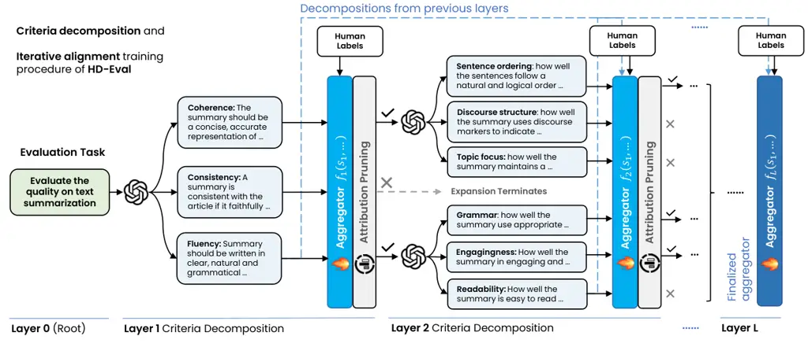
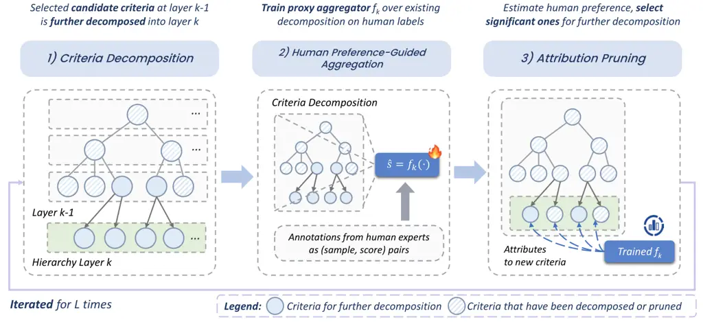
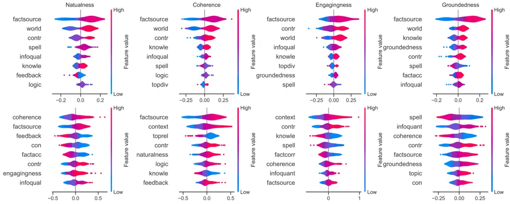

# HD-Eval: Aligning Large Language Model Evaluators Through Hierarchical Criteria Decomposition

Yuxuan Liu ^(†)^(†)thanks: ˜Work done during internship at Microsoft.
Affiliation:  Peking University Email: <yx.liu@stu.pku.edu.cn>   
Tianchi Yang Affiliation:  Microsoft Corporation    Shaohan Huang
Affiliation:  Microsoft Corporation    Zihan Zhang Affiliation: 
Microsoft Corporation    Haizhen Huang Affiliation:  Microsoft
Corporation    Furu Wei Affiliation:  Microsoft Corporation    Weiwei
Deng Affiliation:  Microsoft Corporation    Feng Sun Affiliation: 
Microsoft Corporation    Qi Zhang Affiliation:  Microsoft Corporation

###### Abstract

Large language models (LLMs) have emerged as a promising alternative to
expensive human evaluations. However, the alignment and coverage of
LLM-based evaluations are often limited by the scope and potential bias
of the evaluation prompts and criteria. To address this challenge, we
propose HD-Eval, a novel framework that iteratively aligns LLM-based
evaluators with human preference via Hierarchical Criteria
Decomposition. HD-Eval inherits the essence from the evaluation mindset
of human experts and enhances the alignment of LLM-based evaluators by
decomposing a given evaluation task into finer-grained criteria,
aggregating them according to estimated human preferences, pruning
insignificant criteria with attribution, and further decomposing
significant criteria. By integrating these steps within an iterative
alignment training process, we obtain a hierarchical decomposition of
criteria that comprehensively captures aspects of natural language at
multiple levels of granularity. Implemented as a white box, the human
preference-guided aggregator is efficient to train and more explainable
than relying solely on prompting, and its independence from model
parameters makes it applicable to closed-source LLMs. Extensive
experiments on three evaluation domains demonstrate the superiority of
HD-Eval in further aligning state-of-the-art evaluators and providing
deeper insights into the explanation of evaluation results and the task
itself.

## 1 Introduction

With the rapid development of LLMs and rising significance on NLG
evaluations, an emerging line of works explores utilizing LLM as
reference-free text quality evaluators Kocmi and Federmann (2023); Wang
et al. (2023a); Fu et al. (2023); Liu et al. (2023a). To leverage the
instruction following capability of LLMs, existing works utilize a
single piece of criteria (as a prompt) to evaluate a given sample. Given
the superior instruction-following capability and immense knowledge
obtained through pre-training, LLM-based evaluators substantially
outperform previous automatic evaluation metrics Yuan et al. (2021);
Zhong et al. (2022), and opens a promising alternative for human
evaluation.

However, despite their achievements, an emerging line of research
questions the alignment and trustworthiness of LLM judgments. As recent
studies point out, these approaches are limited by the bias of prompt
design Wang et al. (2023a), resulting in potential biases in its
judgments Wang et al. (2023b), demanding per-task calibration on
evaluation prompts to mitigate Liu et al. (2023b).



Figure 1: Overall framework of HD-Eval. Starting from the evaluation
task, HD-Eval iteratively decomposes it to different aspects, trains an
aggregator, then select significant criteria with attribution pruning
for further expansion at the next layer. The aggregator and
decomposition are finalized after reaching the maximum layer count.

One core limitation of using a single criterion to evaluate text quality
is that it may not capture the complexity and diversity of human
evaluations and judgments. Human thinking is not linear or monolithic,
but rather comprehensive and naturally follows a hierarchical order
Tversky and Kahneman (1974). When we read a book, we may evaluate it
from different perspectives, such as plot, characters, style, and theme,
each of which can further be naturally divided into more specific
criteria.

Hierarchical thinking Haupt (2018) allows humans to resolve complex
problems by first breaking them down into more tangible sub-problems,
and then integrating the solutions at different levels of abstraction
Buzan and Buzan (2006). Correspondingly, mainstream human evaluation
protocols also leverage hierarchical critiques Freitag et al. (2021).

Our core motivation is to empower the alignment of LLM-based evaluators
by rooting the evaluation mindset of human experts into design, while
also harnessing state-of-the-art generic capabilities of LLMs. Drawing
inspirations from the above, we propose HD-Eval, a novel framework to
align LLM-based evaluator towards human preference through Hierarchical
Criteria Decomposition.

Specifically, the design of critical components of HD-Eval inherits the
essence of the human evaluation mindset: task decomposition, analysis of
all sub-tasks, and a final comprehensive evaluation. Correspondingly, we
propose 3 crucial stages: (1) Hierarchical Criteria Decomposition, where
we decompose an evaluation task into a hierarchy of evaluation criteria,
each focusing on different evaluation aspects with various granularity;
(2) Human Preference-Guided Aggregation, where we aggregate evaluation
results at each hierarchy to obtain a final judgment, with respect to
the estimated preference of human experts on different hierarchies; (3)
Attribution Pruning, to dynamically attribute human expert’s preference
on existing criteria to efficiently prune the space of decomposition,
focus on significant aspects, thus improving its fidelity.

To align an LLM-based evaluator toward human preference, we propose
Iterative Alignment Training Framework to seamlessly integrate the 3
stages above in a layer-wise iterative fashion. When the training
process of HD-Eval completes, we obtain a pair of finalized criteria
decomposition and human preference-guided aggregator, which could be
applied to evaluation samples upon application.

We highlight the following key contributions of HD-Eval as follows:

1.  1.  We propose HD-Eval, a novel framework that aligns LLM-based
        evaluators towards human preference via comprehensively decomposing
        criteria into multiple levels of hierarchy.
2.  2.  Implemented as white-box, judgments made by aggregators of HD-Eval
        are more controllable and explainable than solely prompting LLMs.
3.  3.  The design of HD-Eval ensures its applicability to both open-source
        and API-hosted LLMs.
4.  4.  Comprehensive experiments on three evaluation domains demonstrate
        the superior capability of HD-Eval in aligning LLM-based evaluators.

## 2 Methodology



Figure 2: Illustration on hierarchical criteria decomposition and
iterative alignment training of HD-Eval. A formal description of the
iterative alignment training procedure of HD-Eval is elaborated in
Algorithm 1.

### 2.1 Hierarchical Criteria Decomposition

To leverage the hierarchical thinking of human evaluation mindset and
mitigate potential bias, we propose Hierarchical Criteria Decomposition
to obtain a hierarchy of evaluation criteria. This analogy of human
evaluation mindset naturally reciprocates an alignment between LLMs and
expert evaluations.

#### Criteria Decomposition with LLMs

As illustrated in Figure 1, HD-Eval iteratively decomposes an evaluation
task into a hierarchy of criteria. To obtain such decomposition, we
prompt LLMs to obtain a decomposition of a single criteria, by providing
backgrounds of the evaluation task $`\mathcal{T}`$ and the parent
evaluation criteria $`\mathcal{C}^{l-1}_{j}`$:

```math
\{\mathcal{C}^{l}_{1},...,\mathcal{C}^{l}_{m}\}=LLM(\mathcal{T},\mathcal{C}^{l-1}_{j}), \tag{1}
```

where the $`j`$-th evaluation criteria at hierarchy level $`l-1`$ is
further decomposed into a series of sub-criteria
$`\{\mathcal{C}^{l}_{1},...,\mathcal{C}^{l}_{m}\}`$ by the LLM. By
iteratively performing this decomposition starting from the overall task
as root node, we naturally obtain a tree-structured hierarchy of
evaluation criteria, focusing on different evaluation levels and
aspects.

#### Hierarchy-Aware Prompting

To leverage the hierarchical decomposition of criteria, we propose
Hierarchy-Aware Prompting to preserve the hierarchical relations when
evaluating a decomposed criteria (node). Specifically, when evaluating a
single aspect (child), we also provide information from its parent node.
This prompt design reserves the local hierarchical information (i.e.,
links), while refrains excessive and irrelevant information, providing
LLMs a better grasp of the criteria¹¹ 1 Full prompts are provided in
Appendix G..

### 2.2 Human Preference-Guided Aggregation

After obtaining decomposed sub-criteria from parent criteria with
HD-Eval, we propose Human Preference-Guided Aggregation to adequately
address the importance of each decomposed criteria to obtain a final
verdict. A concurrent work on decomposition Saha et al. (2023) prompt
the LLM itself for such verdict. However, it potentially suffers from
the inherent bias of LLMs Wang et al. (2023b), and also fail to address
human preference.

To overcome these limitations, we adapt white-box aggregator to estimate
how human experts value each decomposed criteria. The aggregator
$`f_{\theta}`$ serves as a human preference estimator to aggregate
scores on different sub-criteria for comprehensive evaluation. The
aggregator is trained as a regressor
$`f_{\theta}:\mathbb{R}^{|\mathcal{C}|}\to\mathbb{R}^{p}`$, to map
evaluation scores from decomposed criteria to human expert scores²² 2
Human score label ($`s_{k}\in\mathbb{R}^{p}`$) is a numeric vector
containing evaluation scores for a total of $`p`$ evaluation aspects.
for a training sample, using MSE objective:

```math
\hat{s}_{k}=f_{\theta}(a^{1,1}_{k},...,a^{1,n}_{k},...,a^{L,1}_{k},...,a^{L,m}_{k}), \tag{2}
```

where $`a^{i,j}_{k}`$ denotes the evaluation score (ranged in 0-5) for
the $`j`$-th criteria of the $`i`$-th layer to sample $`k`$
($`\hat{s}_{k}\in\mathbb{R}^{p}`$). Equation 2 essentially learns to
assign attention to scores from different decomposed criterion, which is
in equal to implicitly estimating how human experts value each
decomposed criterion.

|                                                                                       |           |          |             |          |         |          |           |          |         |          |
| ------------------------------------------------------------------------------------- | --------- | -------- | ----------- | -------- | ------- | -------- | --------- | -------- | ------- | -------- |
| Metrics                                                                               | Coherence |          | Consistency |          | Fluency |          | Relevance |          | Average |          |
|                                                                                       | $`r`$     | $`\rho`$ | $`r`$       | $`\rho`$ | $`r`$   | $`\rho`$ | $`r`$     | $`\rho`$ | $`r`$   | $`\rho`$ |
| ROUGE-1                                                                               | 0.178     | 0.168    | 0.037       | 0.028    | 0.045   | 0.009    | 0.288     | 0.291    | 0.137   | 0.124    |
| ROUGE-2                                                                               | 0.143     | 0.152    | 0.025       | 0.011    | 0.029   | -0.006   | 0.209     | 0.240    | 0.101   | 0.099    |
| ROUGE-L                                                                               | 0.141     | 0.134    | 0.026       | 0.015    | 0.052   | 0.022    | 0.262     | 0.264    | 0.120   | 0.109    |
| BertScore                                                                             | 0.302     | 0.285    | 0.093       | 0.071    | 0.174   | 0.119    | 0.389     | 0.372    | 0.239   | 0.212    |
| PRISM                                                                                 | 0.188     | 0.184    | 0.067       | 0.039    | 0.074   | 0.053    | 0.290     | 0.290    | 0.154   | 0.141    |
| CTC                                                                                   | 0.220     | 0.181    | 0.531       | 0.407    | 0.494   | 0.305    | 0.259     | 0.127    | 0.376   | 0.255    |
| BartScore                                                                             | 0.423     | 0.403    | 0.350       | 0.317    | 0.303   | 0.250    | 0.415     | 0.386    | 0.373   | 0.339    |
| UniEval                                                                               | 0.545     | 0.588    | 0.602       | 0.439    | 0.601   | 0.460    | 0.464     | 0.478    | 0.553   | 0.491    |
| GPT-4 Eval                                                                            | 0.547     | 0.542    | 0.507       | 0.458    | 0.479   | 0.460    | 0.609     | 0.592    | 0.538   | 0.513    |
| Iterative alignment training on $`\textbf{25}\%`$ of all human expert preference data |           |          |             |          |         |          |           |          |         |          |
| HD-Eval-NN                                                                            | 0.655     | 0.644    | 0.573       | 0.457    | 0.562   | 0.437    | 0.601     | 0.577    | 0.598   | 0.529    |
| Iterative alignment training on $`\textbf{50}\%`$ of all human expert preference data |           |          |             |          |         |          |           |          |         |          |
| HD-Eval-NN                                                                            | 0.668     | 0.657    | 0.604       | 0.451    | 0.580   | 0.435    | 0.619     | 0.599    | 0.617   | 0.535    |

Table 1: Segment-level Pearson ($`r`$) and Spearman ($`\rho`$) human
correlations of aspects on SummEval.

### 2.3 Attribution Pruning

The core motivation for attribution pruning is to ensure most searching
efforts (i.e., deeper decomposition) are focused on the most significant
evaluation aspects. While it is feasible to obtain a full tree-like
hierarchical decomposition, it brings higher costs and might potentially
introduce noisy or redundant criteria. However, it is non-trivial to
assign importance to each generated criteria, as it demands domain
expertise from human experts.

To remedy the demand on domain expertise, we propose Attribution Pruning
to objectively select the most significant criteria and further support
it with augmented evidence, through continuing decomposing it into
finer-grained criteria. As illustrated in Figure 1, after generating a
new sub-criteria sets $`C_{i}`$ at the $`i`$-th iteration, we train a
proxy aggregator $`f_{i}(\cdot)`$ to approximate human expert’s
preference on newly generated criteria. Through training
$`f_{i}(\cdot)`$, the human preference of each sub-criteria to the final
verdict is implicitly assigned, which could be quantitatively measured
with a saliency function $`g(\cdot)`$, with which we objectively
attribute then select a significant subset of criteria within $`C_{i}`$
to further decompose at the $`i+1`$-th iteration (we denote this subset
as $`C_{D}^{i+1}`$):

```math
\mathcal{C}_{D}^{i+1}=\mathrm{argtop}k_{\mathcal{C}_{D}\in\mathcal{C}_{i}}\left[g\left(f_{i}(\mathcal{C})\right)\right], \tag{3}
```

where $`\mathcal{C}=\cup_{i}\mathcal{C}_{i}`$ denote existing criteria
set, and $`k`$ controls the maximum count of new criteria³³ 3 Since
criteria on upper levels are already being decomposed, we only select
$`\mathcal{C}_{D}^{i+1}`$ within $`\mathcal{C}_{i}`$.. Since
$`f_{i}(\cdot)`$ is a white-box, $`g(\cdot)`$ could be implemented as
attribution methods⁴⁴ 4 We adapt permutation importance in this paper,
since criteria whose score has larger permutation importance are more
crucial to making the final comprehensive judgement. (e.g., permutation
importance Altmann et al. (2010), Shapley additive explanations
(Lundberg and Lee, 2017)), which provides superior controllability and
explainability, compared to prompting or tuning of LLMs.

### 2.4 Iterative Alignment Training Framework

Combining the above, we propose an Iterative Alignment Training
Framework for HD-Eval, as summarized in Figure 2. We seamlessly
integrate critical components, i.e. criteria decomposition, human
preference-guided aggregation, and attribution pruning in a per-layer
iterative fashion.

Specifically, In $`j`$-th training iteration, we first perform criteria
decomposition to each of criteria in candidates $`\mathcal{C}_{D}^{j}`$
selected from the last step with pruning, obtaining a set of new
criteria $`\mathcal{C}_{j}`$ for $`j`$-th layer. We then train a new
proxy aggregator $`f_{j}(\cdot)`$ to estimate human preference, and
finally perform attribution pruning based on $`f_{j}(\cdot)`$ to select
significant criteria $`\mathcal{C}_{D}^{j+1}`$ for decomposition at the
next iteration. When this iterative alignment training completes, we
obtain a pair of finalized aggregator and criteria decomposition, which
could be applied to new candidate evaluation samples upon application.
The exact learning process of HD-Eval is formally summarized in
Algorithm 1.

## 3 Experiments

|                                                                                       |             |          |           |          |              |          |              |          |         |          |
| ------------------------------------------------------------------------------------- | ----------- | -------- | --------- | -------- | ------------ | -------- | ------------ | -------- | ------- | -------- |
| Metrics                                                                               | Naturalness |          | Coherence |          | Engagingness |          | Groundedness |          | Average |          |
|                                                                                       | $`r`$       | $`\rho`$ | $`r`$     | $`\rho`$ | $`r`$        | $`\rho`$ | $`r`$        | $`\rho`$ | $`r`$   | $`\rho`$ |
| ROUGE-1                                                                               | 0.158       | 0.143    | 0.205     | 0.206    | 0.305        | 0.319    | 0.264        | 0.264    | 0.233   | 0.233    |
| ROUGE-2                                                                               | 0.175       | 0.168    | 0.186     | 0.247    | 0.281        | 0.337    | 0.260        | 0.311    | 0.225   | 0.266    |
| ROUGE-L                                                                               | 0.172       | 0.145    | 0.198     | 0.205    | 0.299        | 0.306    | 0.286        | 0.293    | 0.239   | 0.237    |
| BertScore                                                                             | 0.226       | 0.209    | 0.214     | 0.233    | 0.317        | 0.335    | 0.291        | 0.317    | 0.262   | 0.273    |
| PRISM                                                                                 | 0.040       | -0.010   | 0.098     | 0.081    | 0.241        | 0.220    | 0.178        | 0.159    | 0.139   | 0.113    |
| CTC                                                                                   | 0.232       | 0.195    | 0.343     | 0.296    | 0.540        | 0.542    | 0.422        | 0.398    | 0.384   | 0.358    |
| BartScore                                                                             | -0.072      | -0.053   | -0.107    | -0.079   | -0.105       | -0.084   | -0.217       | -0.197   | -0.125  | -0.103   |
| UniEval                                                                               | 0.342       | 0.450    | 0.571     | 0.616    | 0.573        | 0.615    | 0.523        | 0.590    | 0.502   | 0.568    |
| GPT-4 Eval                                                                            | 0.584       | 0.607    | 0.562     | 0.590    | 0.594        | 0.605    | 0.530        | 0.556    | 0.567   | 0.590    |
| Iterative alignment training on $`\textbf{25}\%`$ of all human expert preference data |             |          |           |          |              |          |              |          |         |          |
| HD-Eval-NN                                                                            | 0.647       | 0.672    | 0.588     | 0.613    | 0.682        | 0.702    | 0.471        | 0.498    | 0.597   | 0.621    |
| Iterative alignment training on $`\textbf{50}\%`$ of all human expert preference data |             |          |           |          |              |          |              |          |         |          |
| HD-Eval-NN                                                                            | 0.648       | 0.674    | 0.584     | 0.607    | 0.682        | 0.701    | 0.549        | 0.568    | 0.616   | 0.638    |

Table 2: Turn-level Pearson ($`r`$) and Spearman ($`\rho`$) human
correlations of aspects on Topical-Chat.

### 3.1 Experimental Setup

#### Datasets and Evaluations

We evaluate the performance of HD-Eval on three NLG evaluation scenario:
Summarization (SummEval Fabbri et al. (2021)), Conversation
(Topical-Chat Gopalakrishnan et al. (2019)) and Data-to-Text (SFRES and
SFHOT Wen et al. (2015)). For assessing human alignment, we report
dataset (segment) level meta-evaluation results on both Pearson’s $`r`$
and Spearman’s $`\rho`$ coefficient with human annotations. For each
dataset, a $`50\%`$ proportion is held out for testing, while the rest
is applied for training⁵⁵ 5 We explore utilizing different percentages
of training data in our experiments. Detailed count of training data
will be reported under different experimental settings..

#### Baselines

We compare our HD-Eval against a series of automatic evaluation
baselines, including ROUGE (Lin, 2004), BERTScore (Zhang\* et al.,
2020), PRISM (Thompson and Post, 2020), BartScore (Yuan et al., 2021),
and UniEval (Zhong et al., 2022). For LLM-based evaluation, we select
GPT-4 Evaluation Liu et al. (2023a), representing state-of-the-art
LLM-based evaluators.

#### Models and Configurations

We adopt OpenAI’s GPT-4 model OpenAI (2023) (GPT-4-32K) and LLama-2
families (Touvron et al., 2023)⁶⁶ 6 Comprehensive studies on Llama-based
HD-Eval are presented in Appendix B due to space limitations. as LLM in
this study. For the aggregator, we experiment with multiple white-box
implementations, including Linear Regression (LR), Decision Tree (DT),
Random Forest (RF), and shallow MLPs (NN). For criteria decomposition,
we apply a maximum layer of $`3`$, and a child count of $`4`$ for parent
nodes. Detailed implementations are listed in Appendix C.2.

### 3.2 Experimental Results

#### Human Alignment

Meta evaluation results for HD-Eval on evaluating summarization is
listed in Table 1. We train our HD-Eval under two data settings,
representing HD-Eval data and/or resource-constraint scenarios. As
illustrated in Table 1, HD-Eval substantially improved the human
relevance of evaluation over GPT-4, resulting in a $`15\%`$ improvement
on Pearson’s correlation overall, and over $`20\%`$ in coherence and
fluency. When training with only half of human expert annotations, the
performance of HD-Eval remains on-par or marginally off, demonstrating
the effectiveness of the iterative alignment training process.

Similarly, in evaluating natural language conversations (Table 2),
HD-Eval improves the alignment of GPT-4 by uplifting both the Pearson
and Spearman correlation over $`8\%`$, and maintained on-par performance
on 3 of 4 evaluation aspects when training with only half of human
preference data.

We finally test HD-Eval on a more challenging evaluation task, i.e.
evaluating the naturalness of data-to-text generations. As illustrated
in Table 3, HD-Eval obtained more than $`15\%`$ improvement in human
correlations on both correlation coefficients and only lost around
$`3\%`$ performance with only half of the training data available. These
results highlight the effectiveness and efficiency of HD-Eval in
aligning LLM-based evaluators.

|                                                           |       |          |       |          |         |          |
| --------------------------------------------------------- | ----- | -------- | ----- | -------- | ------- | -------- |
| Metrics                                                   | SFRES |          | SFHOT |          | Average |          |
|                                                           | $`r`$ | $`\rho`$ | $`r`$ | $`\rho`$ | $`r`$   | $`\rho`$ |
| ROUGE-1                                                   | 0.074 | 0.092    | 0.035 | 0.031    | 0.055   | 0.062    |
| ROUGE-2                                                   | 0.094 | 0.073    | 0.060 | 0.042    | 0.077   | 0.051    |
| ROUGE-L                                                   | 0.059 | 0.067    | 0.048 | 0.038    | 0.063   | 0.043    |
| BertScore                                                 | 0.164 | 0.145    | 0.103 | 0.087    | 0.134   | 0.116    |
| PRISM                                                     | 0.146 | 0.126    | 0.164 | 0.131    | 0.155   | 0.129    |
| BartScore                                                 | 0.280 | 0.255    | 0.133 | 0.095    | 0.207   | 0.175    |
| CTC                                                       | 0.100 | 0.086    | 0.181 | 0.160    | 0.141   | 0.123    |
| UniEval                                                   | 0.381 | 0.354    | 0.350 | 0.305    | 0.366   | 0.330    |
| GPT-4 Eval                                                | 0.414 | 0.347    | 0.436 | 0.364    | 0.425   | 0.356    |
| Iterative alignment training on $`\textbf{25}\%`$ of data |       |          |       |          |         |          |
| HD-Eval-NN                                                | 0.453 | 0.363    | 0.494 | 0.420    | 0.474   | 0.392    |
| Iterative alignment training on $`\textbf{50}\%`$ of data |       |          |       |          |         |          |
| HD-Eval-NN                                                | 0.470 | 0.389    | 0.510 | 0.432    | 0.490   | 0.411    |

Table 3: Segment-level Pearson ($`r`$) and Spearman ($`\rho`$)
correlations on Data-to-Text generation tasks.

{forest}

Figure 3: A case study for criteria decomposition on Topical-Chat.
White, blue and orange boxes denote decomposed criteria at 1^(st),
2^(nd) and 3^(rd) hierarchy. Underlined denote criteria being selected
with attribution pruning.

#### Ablation Study

In Table 4, we provide an ablation study on key components of HD-Eval.
We first investigate the effectiveness of hierarchical criteria
decomposition, by removing layers of hierarchy in a bottom-up fashion.
As illustrated in the table, the human relevance drops consistently on
both correlation measurements with layers being removed, demonstrating
the significance of criteria decomposition. We then replaced the human
preference-guided aggregator with a numeric average on all labels, and
its performance dropped significantly ($`p<0.05`$). These results verify
that the crucial design components of HD-Eval positively contribute to
human alignment.

|                                                           |          |          |             |          |       |          |
| --------------------------------------------------------- | -------- | -------- | ----------- | -------- | ----- | -------- |
| Metrics                                                   | SummEval |          | TopicalChat |          | SFHOT |          |
|                                                           | $`r`$    | $`\rho`$ | $`r`$       | $`\rho`$ | $`r`$ | $`\rho`$ |
| Iterative alignment training on $`\textbf{50}\%`$ of data |          |          |             |          |       |          |
| HD-Eval-NN                                                | 0.617    | 0.535    | 0.616       | 0.638    | 0.510 | 0.432    |
|   w/o Layer 3                                             | 0.611    | 0.534    | 0.600       | 0.624    | 0.470 | 0.356    |
|   w/o Layer 2,3                                           | 0.576    | 0.516    | 0.535       | 0.543    | 0.448 | 0.346    |
|   w/o Layer 1,2,3                                         | 0.538    | 0.513    | 0.567       | 0.590    | 0.436 | 0.364    |
|   w/o Aggregator                                          | 0.555    | 0.530    | 0.600       | 0.615    | 0.406 | 0.313    |

Table 4: Ablations on each proposed module of HD-Eval. We report Pearson
($`r`$) and Spearman ($`\rho`$) correlations on all NLG evaluation tasks
explored in this study.

#### Aggregator Implementation

We explore various implementations of human preference estimator in
HD-Eval. As listed in Table 5, more capable aggregators like random
forest or shallow NNs contribute to a better alignment in general, while
a simplistic linear regression also stays on-par on most tasks, and even
excels at Data-to-Text tasks.

|                                                           |          |          |             |          |       |          |
| --------------------------------------------------------- | -------- | -------- | ----------- | -------- | ----- | -------- |
| Metrics                                                   | SummEval |          | TopicalChat |          | SFHOT |          |
|                                                           | $`r`$    | $`\rho`$ | $`r`$       | $`\rho`$ | $`r`$ | $`\rho`$ |
| Iterative alignment training on $`\textbf{25}\%`$ of data |          |          |             |          |       |          |
| HD-Eval-LR                                                | 0.568    | 0.521    | 0.495       | 0.519    | 0.448 | 0.390    |
| HD-Eval-DT                                                | 0.488    | 0.442    | 0.401       | 0.398    | 0.397 | 0.347    |
| HD-Eval-RF                                                | 0.607    | 0.502    | 0.589       | 0.602    | 0.413 | 0.366    |
| HD-Eval-NN                                                | 0.598    | 0.529    | 0.591       | 0.621    | 0.494 | 0.420    |
| Iterative alignment training on $`\textbf{50}\%`$ of data |          |          |             |          |       |          |
| HD-Eval-LR                                                | 0.583    | 0.534    | 0.599       | 0.617    | 0.512 | 0.443    |
| HD-Eval-DT                                                | 0.505    | 0.430    | 0.525       | 0.549    | 0.330 | 0.274    |
| HD-Eval-RF                                                | 0.614    | 0.504    | 0.615       | 0.626    | 0.480 | 0.397    |
| HD-Eval-NN                                                | 0.617    | 0.535    | 0.616       | 0.638    | 0.510 | 0.432    |

Table 5: Exploring HD-Eval varying implementation of aggregator. We
report Pearson ($`r`$) and Spearman ($`\rho`$) correlations on all NLG
evaluation tasks in this study.

## 4 Analysis

### 4.1 Case Study

To investigate the effect of hierarchical criteria decomposition, we
present a case study on evaluating natural language conversation. In our
experiments, we explore decomposing an NLG evaluation task into a
maximum of 3 hierarchies (layers). As illustrated in Figure 3, the
highest layer of HD-Eval resembles high-level evaluation aspects
focusing on holistic evaluations, e.g. naturalness and coherence. These
holistic criteria are then elaborated and supported with finer-grained
decomposition at layer 2, focusing on more specific aspects. The last
layer further expands attributed significant ones to finest-grained
criteria. These results demonstrate the capability of HD-Eval in
generating hierarchical criteria decomposition for NLG evaluations. A
complete case study is presented in Appendix H.

Figure 4: Performance of HD-Eval under different training data counts on
Topical-Chat, averaged over 5 seeds.

Figure 5: Criteria efficiency of HD-Eval on Topical-Chat. Results are
averaged over 5 random samples.

Figure 6: Explainability on preference estimation of HD-Eval-NN based on
permutation importance.

### 4.2 Data Efficiency

In Section 3.2, we demonstrate HD-Eval is significant in aligning
LLM-based evaluators. However, this also requires annotations from
experts. To test HD-Eval under different amounts of data, we sweep
training data percentage from $`5\%`$ to full corpus. As illustrated in
Figure 4, more data generally benefits HD-Eval in improving human
alignment, as it provides more evidence to infer the underlying pattern
of human mindsets. A stronger regressor reduces the demand on human
labels (e.g. only training on $`5\%`$ of data is sufficient for
HD-Eval-NN). This intriguing feature ensures an efficient deployment and
uncovers the fact that such alignment is rather superficial, which
corroborates with Zhou et al. (2023). Once we obtain a decomposition,
the remaining efforts on addressing human preference are thereby light,
since it should be shared implicitly as a ‘consensus’ within human
experts.

### 4.3 Criteria Efficiency

While the search space of HD-Eval has already been significantly reduced
with attribution pruning, we investigate whether a post-pruning could be
performed on top of it. To investigate, we first sort all decomposed
criteria (nodes) via significance, then progressively add them and train
proxy aggregators. Results are illustrated in Figure 5. Generally, since
more information is provided, increasing criteria counts contribute to a
better alignment. However, it is also proven feasible to achieve a
comparable performance by only keeping the most significant ones for
better efficiency⁷⁷ 7 While post-pruning greatly benefits efficiency,
this does not undermine the significance of criteria decomposition,
since with which we search for fine-grained candidate criteria..

### 4.4 Explainability of HD-Eval

In this subsection, we discuss the explainability of the evaluation
results generated with HD-Eval. To provide a lens of interpretation, we
implement human preference-guided aggregators in a lightweight,
white-box fashion, providing us with possibilities in post-hoc
explanations. We experiment with two attribution approaches: permutation
importance (Altmann et al., 2010) and Sharply additive explanations
(Lundberg and Lee, 2017).

As illustrated in Figure 6 and 7,HD-Eval successfully assigned
importance to various decomposed criteria as an estimation of human
preference for different evaluation aspects, indicating the
effectiveness in the human preference-guided aggregation process of
HD-Eval. These results also provide a lens into understanding underlying
human preference from evaluation. For instance, we mine and uncover
multiple crucial key objectives for dialogue generation, including
factual correctness (factcorr), content richness (contr), factual source
(factsource), which are shared by all target evaluation aspects. These
findings above not only improve our understanding of human preference in
evaluation but also provide key grasps into directions of refining
candidate models (e.g., LLMs).

Figure 7: Explainability on human preference estimation of HD-Eval based
on SHAP.

## 5 Related Work

#### Automatic Text Evaluation

Conventional metrics like BLEU (Papineni et al., 2002) and ROUGE (Lin, 2004) assess candidate quality by statistically comparing n-grams with a
reference text, but their human alignment is criticized (Freitag et al.,
2022). In contrast, embedding-based metrics, using PLM embeddings like
BERT (Devlin et al., 2019), gauge similarity between candidate and
reference (Zhang\* et al., 2020; Zhao et al., 2019), yet they are
limited by their reliance on a similarity-based approach and the quality
and diversity of references.

More recent research aims to enhance PLMs through fine-tuning on human
(Rei et al., 2020) or synthetic (Zhong et al., 2022) labels, or
pretraining on domain-relevant documents (Yuan et al., 2021). However,
metrics in these studies either emphasize a single dimension (Wang
et al., 2020; Huang et al., 2020) or are limited in human relevance
(Mehri and Eskenazi, 2020; Zhong et al., 2022).

#### LLM-Based Evaluators

As LLMs gain prominence, recent research delves into the development of
LLM-based evaluators. Early investigations involve initial explorations
on LLMs, including prompting methods and model variants (Fu et al.,
2023; Kocmi and Federmann, 2023; Wang et al., 2023a; Chen et al., 2023;
Liu et al., 2023a).

A subsequent line of studies aims to address extant limitations within
these evaluators, with a focus on factors such as factuality (Min
et al., 2023), interpretability (Lu et al., 2023), mitigation of
position bias (Wang et al., 2023b), and alignment to human evaluation
standards (Liu et al., 2023b). Another strand of works explores
empowering LLM-based evaluation methodologies. This involves efforts
directed at generalization to underrepresented languages (Hada et al.,
2023), grounding evaluations into error spans (Fernandes et al., 2023),
incorporating interactive discussions (Chan et al., 2023), and human
collaboration (Li et al., 2023). Diverging from these approaches, we
focus on the iterative alignment of LLM-based evaluators through
hierarchical criteria decomposition and are the first to break down
evaluation into a hierarchy of criteria at different granularity.

## 6 Conclusion

Drawing inspiration from human evaluation mindsets, we propose HD-Eval,
a novel framework that empowers LLM-based evaluators through explainable
alignment. Through criteria decomposition, human preference-guided
aggregation, and attribution pruning, the criteria obtained with HD-Eval
demonstrates a comprehensive focus on different levels of details.
Extensive experiments on three NLG evaluation tasks demonstrate the
effectiveness of HD-Eval. Detailed analysis shows the efficiency and
explainability of HD-Eval, and opens up brand new perspectives in
understanding preferences of human evaluations.

## Limitations

Below, we make an elaborate discussion about the current limitations of
this work and share our perspectives on further directions.

1.  1.  Currently, criteria decomposition in this work is solely done with
        LLMs in this work due to the lack of domain knowledge and limited
        resources. Ideally, HD-Eval would exploit its full potential by
        leveraging human-in-the-loop to assist the criteria decomposition
        and iterative pruning procedure. Also, it could be potentially
        beneficial to employ expert-written guidelines for each evaluation
        aspect. We leave this as a promising direction for future work.
2.  2.  The underlying assumption of HD-Eval is that an evaluation task is
        decomposable, i.e., it could be hierarchically decomposed to aspects
        at multiple detail levels. While this claim is natural as it follows
        the essence of human evaluation mindsets, it remains elusive whether
        we can always optimally decompose a task hierarchically, which
        demands future investigations and possible improvements.
3.  3.  Limited by scope and budget, we did not perform exhaustive research
        on prompt engineering for LLM-based evaluators in HD-Eval. As
        evidenced by multiple concurrent works, LLM-based evaluators are
        sensitive to prompts and would enjoy a performance uplift with
        carefully engineered prompts. We believe these research efforts are
        orthogonal with HD-Eval, and propose HD-Eval as a methodology that
        is able to adapt to different prompts and leverage more advanced
        prompt designs in the future.

## Ethnics Statement

HD-Eval aims to improve the evaluation of natural language generation
systems by using a novel framework that aligns LLM-based evaluators with
human preference. This work has the potential to benefit the research
community and society by providing more reliable and transparent metrics
for assessing the quality of NLG outputs.

This work also acknowledges the possible risks and challenges associated
with using LLMs for evaluation, such as the potential bias against the
contents generated by different systems, the ethical and legal
implications of using LLMs that may contain sensitive or harmful
information, and the computational and environmental costs of training
and deploying LLMs.

All language models and human annotations applied throughout this study
are publicly available, and properly cited in relevant sections of this
paper.

## References

- Almazrouei et al. (2023) Ebtesam Almazrouei, Hamza Alobeidli,
  Abdulaziz Alshamsi, Alessandro Cappelli, Ruxandra Cojocaru, Merouane
  Debbah, Etienne Goffinet, Daniel Heslow, Julien Launay, Quentin
  Malartic, et al. 2023. Falcon-40b: an open large language model with
  state-of-the-art performance. _Findings of the Association for
  Computational Linguistics: ACL_, 2023:10755–10773.
- Altmann et al. (2010) André Altmann, Laura Toloşi, Oliver Sander, and
  Thomas Lengauer. 2010. Permutation importance: a corrected feature
  importance measure. _Bioinformatics_, 26(10):1340–1347.
- Buzan and Buzan (2006) Tony Buzan and Barry Buzan. 2006. _The mind map
  book_. Pearson Education.
- Chan et al. (2023) Chi-Min Chan, Weize Chen, Yusheng Su, Jianxuan Yu,
  Wei Xue, Shanghang Zhang, Jie Fu, and Zhiyuan Liu. 2023. Chateval:
  Towards better llm-based evaluators through multi-agent debate. _arXiv
  preprint arXiv:2308.07201_.
- Chen et al. (2023) Yi Chen, Rui Wang, Haiyun Jiang, Shuming Shi, and
  Ruifeng Xu. 2023. Exploring the use of large language models for
  reference-free text quality evaluation: A preliminary empirical study.
  _arXiv preprint arXiv:2304.00723_.
- Chiang and Lee (2023) Cheng-Han Chiang and Hung-yi Lee. 2023. [A
  closer look into using large language models for automatic
  evaluation](https://aclanthology.org/2023.findings-emnlp.599). In
  _Findings of the Association for Computational Linguistics: EMNLP
  2023_, pages 8928–8942, Singapore. Association for Computational
  Linguistics.
- Devlin et al. (2019) Jacob Devlin, Ming-Wei Chang, Kenton Lee, and
  Kristina Toutanova. 2019. BERT: Pre-training of deep bidirectional
  transformers for language understanding. In _Proceedings of the 2019
  Conference of the North American Chapter of the Association for
  Computational Linguistics: Human Language Technologies, Volume 1 (Long
  and Short Papers)_, pages 4171–4186. Association for Computational
  Linguistics.
- Fabbri et al. (2021) Alexander R Fabbri, Wojciech Kryściński, Bryan
  McCann, Caiming Xiong, Richard Socher, and Dragomir Radev. 2021.
  Summeval: Re-evaluating summarization evaluation. _Transactions of the
  Association for Computational Linguistics_, 9:391–409.
- Fernandes et al. (2023) Patrick Fernandes, Daniel Deutsch, Mara
  Finkelstein, Parker Riley, André FT Martins, Graham Neubig, Ankush
  Garg, Jonathan H Clark, Markus Freitag, and Orhan Firat. 2023. The
  devil is in the errors: Leveraging large language models for
  fine-grained machine translation evaluation. _arXiv preprint
  arXiv:2308.07286_.
- Freitag et al. (2021) Markus Freitag, George Foster, David Grangier,
  Viresh Ratnakar, Qijun Tan, and Wolfgang Macherey. 2021. Experts,
  errors, and context: A large-scale study of human evaluation for
  machine translation. _Transactions of the Association for
  Computational Linguistics_, 9:1460–1474.
- Freitag et al. (2022) Markus Freitag, Ricardo Rei, Nitika Mathur,
  Chi-kiu Lo, Craig Stewart, Eleftherios Avramidis, Tom Kocmi, George
  Foster, Alon Lavie, and André FT Martins. 2022. Results of wmt22
  metrics shared task: Stop using bleu–neural metrics are better and
  more robust. In _Proceedings of the Seventh Conference on Machine
  Translation (WMT)_, pages 46–68.
- Fu et al. (2023) Jinlan Fu, See-Kiong Ng, Zhengbao Jiang, and Pengfei
  Liu. 2023. Gptscore: Evaluate as you desire. _arXiv preprint
  arXiv:2302.04166_.
- Gekhman et al. (2023) Zorik Gekhman, Jonathan Herzig, Roee Aharoni,
  Chen Elkind, and Idan Szpektor. 2023. Trueteacher: Learning factual
  consistency evaluation with large language models. _arXiv preprint
  arXiv:2305.11171_.
- Gopalakrishnan et al. (2019) Karthik Gopalakrishnan, Behnam
  Hedayatnia, Qinlang Chen, Anna Gottardi, Sanjeev Kwatra, Anu
  Venkatesh, Raefer Gabriel, and Dilek Hakkani-Tür. 2019. [Topical-chat:
  Towards knowledge-grounded open-domain
  conversations](https://doi.org/10.21437/INTERSPEECH.2019-3079). In
  _Interspeech 2019, 20th Annual Conference of the International Speech
  Communication Association, Graz, Austria, 15-19 September 2019_, pages
  1891–1895. ISCA.
- Hada et al. (2023) Rishav Hada, Varun Gumma, Adrian de Wynter,
  Harshita Diddee, Mohamed Ahmed, Monojit Choudhury, Kalika Bali, and
  Sunayana Sitaram. 2023. Are large language model-based evaluators the
  solution to scaling up multilingual evaluation? _arXiv preprint
  arXiv:2309.07462_.
- Haupt (2018) Grietjie Haupt. 2018. Hierarchical thinking: a cognitive
  tool for guiding coherent decision making in design problem solving.
  _International Journal of Technology and Design Education_,
  28(1):207–237.
- Huang et al. (2020) Lishan Huang, Zheng Ye, Jinghui Qin, Liang Lin,
  and Xiaodan Liang. 2020. Grade: Automatic graph-enhanced coherence
  metric for evaluating open-domain dialogue systems. In _Proceedings of
  the 2020 Conference on Empirical Methods in Natural Language
  Processing (EMNLP)_, pages 9230–9240.
- Kocmi and Federmann (2023) Tom Kocmi and Christian Federmann. 2023.
  Large language models are state-of-the-art evaluators of translation
  quality. _arXiv preprint arXiv:2302.14520_.
- Li et al. (2023) Qintong Li, Leyang Cui, Lingpeng Kong, and Wei
  Bi. 2023. Collaborative evaluation: Exploring the synergy of large
  language models and humans for open-ended generation evaluation.
  _arXiv preprint arXiv:2310.19740_.
- Lin (2004) Chin-Yew Lin. 2004. Rouge: A package for automatic
  evaluation of summaries. In _Text summarization branches out_, pages
  74–81.
- Liu et al. (2023a) Yang Liu, Dan Iter, Yichong Xu, Shuohang Wang,
  Ruochen Xu, and Chenguang Zhu. 2023a. G-eval: Nlg evaluation using
  gpt-4 with better human alignment. _arXiv preprint arXiv:2303.16634_.
- Liu et al. (2023b) Yuxuan Liu, Tianchi Yang, Shaohan Huang, Zihan
  Zhang, Haizhen Huang, Furu Wei, Weiwei Deng, Feng Sun, and Qi Zhang.
  2023b. Calibrating llm-based evaluator. _arXiv preprint
  arXiv:2309.13308_.
- Lu et al. (2023) Qingyu Lu, Baopu Qiu, Liang Ding, Liping Xie, and
  Dacheng Tao. 2023. Error analysis prompting enables human-like
  translation evaluation in large language models: A case study on
  chatgpt. _arXiv preprint arXiv:2303.13809_.
- Lundberg and Lee (2017) Scott M Lundberg and Su-In Lee. 2017. A
  unified approach to interpreting model predictions. _Advances in
  neural information processing systems_, 30.
- Mehri and Eskenazi (2020) Shikib Mehri and Maxine Eskenazi. 2020. Usr:
  An unsupervised and reference free evaluation metric for dialog
  generation. In _Proceedings of the 58th Annual Meeting of the
  Association for Computational Linguistics_, pages 681–707.
- Min et al. (2023) Sewon Min, Kalpesh Krishna, Xinxi Lyu, Mike Lewis,
  Wen-tau Yih, Pang Wei Koh, Mohit Iyyer, Luke Zettlemoyer, and Hannaneh
  Hajishirzi. 2023. Factscore: Fine-grained atomic evaluation of factual
  precision in long form text generation. _arXiv preprint
  arXiv:2305.14251_.
- OpenAI (2023) OpenAI. 2023. Gpt-4 technical report. _arXiv preprint
  arXiv:2303.08774_.
- Papineni et al. (2002) Kishore Papineni, Salim Roukos, Todd Ward, and
  Wei-Jing Zhu. 2002. Bleu: a method for automatic evaluation of machine
  translation. In _Proceedings of the 40th annual meeting of the
  Association for Computational Linguistics_, pages 311–318.
- Pedregosa et al. (2011) Fabian Pedregosa, Gaël Varoquaux, Alexandre
  Gramfort, Vincent Michel, Bertrand Thirion, Olivier Grisel, Mathieu
  Blondel, Peter Prettenhofer, Ron Weiss, Vincent Dubourg, et al. 2011.
  Scikit-learn: Machine learning in python. _the Journal of machine
  Learning research_, 12:2825–2830.
- Rei et al. (2020) Ricardo Rei, Craig Stewart, Ana C Farinha, and Alon
  Lavie. 2020. Comet: A neural framework for mt evaluation. In
  _Proceedings of the 2020 Conference on Empirical Methods in Natural
  Language Processing (EMNLP)_, pages 2685–2702.
- Saha et al. (2023) Swarnadeep Saha, Omer Levy, Asli Celikyilmaz, Mohit
  Bansal, Jason Weston, and Xian Li. 2023. Branch-solve-merge improves
  large language model evaluation and generation. _arXiv preprint
  arXiv:2310.15123_.
- Shen et al. (2023) Chenhui Shen, Liying Cheng, Xuan-Phi Nguyen, Yang
  You, and Lidong Bing. 2023. [Large language models are not yet
  human-level evaluators for abstractive
  summarization](https://aclanthology.org/2023.findings-emnlp.278). In
  _Findings of the Association for Computational Linguistics: EMNLP
  2023_, pages 4215–4233, Singapore. Association for Computational
  Linguistics.
- Thompson and Post (2020) Brian Thompson and Matt Post. 2020. Automatic
  machine translation evaluation in many languages via zero-shot
  paraphrasing. In _Proceedings of the 2020 Conference on Empirical
  Methods in Natural Language Processing (EMNLP)_, pages 90–121.
- Touvron et al. (2023) Hugo Touvron, Louis Martin, Kevin Stone, Peter
  Albert, Amjad Almahairi, Yasmine Babaei, Nikolay Bashlykov, Soumya
  Batra, Prajjwal Bhargava, Shruti Bhosale, et al. 2023. Llama 2: Open
  foundation and fine-tuned chat models. _arXiv preprint
  arXiv:2307.09288_.
- Tversky and Kahneman (1974) Amos Tversky and Daniel Kahneman. 1974.
  Judgment under uncertainty: Heuristics and biases. _Science_, 185:1124
  – 1131.
- Wang et al. (2020) Alex Wang, Kyunghyun Cho, and Mike Lewis. 2020.
  Asking and answering questions to evaluate the factual consistency of
  summaries. In _Proceedings of the 58th Annual Meeting of the
  Association for Computational Linguistics_, pages 5008–5020.
- Wang et al. (2023a) Jiaan Wang, Yunlong Liang, Fandong Meng, Haoxiang
  Shi, Zhixu Li, Jinan Xu, Jianfeng Qu, and Jie Zhou. 2023a. Is chatgpt
  a good nlg evaluator? a preliminary study. _arXiv preprint
  arXiv:2303.04048_.
- Wang et al. (2023b) Peiyi Wang, Lei Li, Liang Chen, Dawei Zhu,
  Binghuai Lin, Yunbo Cao, Qi Liu, Tianyu Liu, and Zhifang Sui. 2023b.
  Large language models are not fair evaluators. _arXiv preprint
  arXiv:2305.17926_.
- Wen et al. (2015) Tsung-Hsien Wen, Milica Gasic, Nikola Mrkšić,
  Pei-Hao Su, David Vandyke, and Steve Young. 2015. Semantically
  conditioned lstm-based natural language generation for spoken dialogue
  systems. In _Proceedings of the 2015 Conference on Empirical Methods
  in Natural Language Processing_, pages 1711–1721.
- Yuan et al. (2021) Weizhe Yuan, Graham Neubig, and Pengfei Liu. 2021.
  Bartscore: Evaluating generated text as text generation. _Advances in
  Neural Information Processing Systems_, 34:27263–27277.
- Zhang\* et al. (2020) Tianyi Zhang\*, Varsha Kishore\*, Felix Wu\*,
  Kilian Q. Weinberger, and Yoav Artzi. 2020. [Bertscore: Evaluating
  text generation with
  bert](https://openreview.net/forum?id=SkeHuCVFDr). In _International
  Conference on Learning Representations_.
- Zhao et al. (2019) Wei Zhao, Maxime Peyrard, Fei Liu, Yang Gao,
  Christian M Meyer, and Steffen Eger. 2019. Moverscore: Text generation
  evaluating with contextualized embeddings and earth mover distance. In
  _Proceedings of the 2019 Conference on Empirical Methods in Natural
  Language Processing and the 9th International Joint Conference on
  Natural Language Processing (EMNLP-IJCNLP)_, pages 563–578.
- Zhong et al. (2022) Ming Zhong, Yang Liu, Da Yin, Yuning Mao, Yizhu
  Jiao, Pengfei Liu, Chenguang Zhu, Heng Ji, and Jiawei Han. 2022.
  Towards a unified multi-dimensional evaluator for text generation. In
  _Proceedings of the 2022 Conference on Empirical Methods in Natural
  Language Processing_, pages 2023–2038.
- Zhou et al. (2023) Chunting Zhou, Pengfei Liu, Puxin Xu, Srini Iyer,
  Jiao Sun, Yuning Mao, Xuezhe Ma, Avia Efrat, Ping Yu, Lili Yu,
  et al. 2023. Lima: Less is more for alignment. _arXiv preprint
  arXiv:2305.11206_.

## Appendix A Extended Analysis

In this subsection, we provide an extended analysis of the
explainability of evaluations of HD-Eval. Results are presented in
Figure 8 and 9. In Figure 8, we perform permutation importance analysis
on other implementations of HD-Eval in addition to Figure 6. In figure
9, we perform a detailed visualization of SHAP (Shapley additive
explanation values) on HD-Eval-NN and HD-Eval-RF.

From these results, we observe that Tree-based (DT, RF) and
Regression-based (LR, NN) demonstrate similar traits in assigning
importance to decomposed criteria. However, our conclusion still holds
that a set of underlying evaluation criteria are shared as critical
contributors to all evaluation aspects, e.g. content richness (contr)
and factual source (factsource). We believe the explainability of
HD-Eval provides a valuable perspective in understanding inherent
preferences for human experts, which has potential on both qualifying
human evaluations (e.g. estimating annotator bias) and providing
detailed supporting evidence for improving NLG systems.

## Appendix B Discussions On Smaller LLMs

Most previous research on LLM-based evaluations reveals that
reference-free text quality evaluation is indeed a challenging task that
demands immense pre-training knowledge and emergent capabilities of
LLMs.

Particularly, only a very few most capable LLMs (e.g. GPT-4 OpenAI
(2023)) could be prompted as a strong evaluator, and zero-shot
performances of smaller LLMs (e.g. Llama (Touvron et al., 2023) or
Falcon-40B (Almazrouei et al., 2023)) are largely undesired in following
instructions on evaluation (Chiang and Lee, 2023). As studied in Shen
et al. (2023), even the most capable LLama-2-Chat-70B correlates poorly
with human evaluations, falling behind dedicated-tuned small neural
evaluators (Zhong et al., 2022).

|                                                           |        |          |       |          |       |          |       |          |
| --------------------------------------------------------- | ------ | -------- | ----- | -------- | ----- | -------- | ----- | -------- |
| Metrics                                                   | Nat.   |          | Coh.  |          | Eng.  |          | Grd.  |          |
|                                                           | $`r`$  | $`\rho`$ | $`r`$ | $`\rho`$ | $`r`$ | $`\rho`$ | $`r`$ | $`\rho`$ |
| Iterative alignment training on $`\textbf{50}\%`$ of data |        |          |       |          |       |          |       |          |
| Llama2-7B-Chat                                            | 0.078  | 0.233    | 0.257 | 0.360    | 0.594 | 0.605    | 0.062 | 0.127    |
| +HD-Eval-RF                                               | 0.355  | 0.377    | 0.378 | 0.371    | 0.463 | 0.462    | 0.241 | 0.227    |
| \+HD-Eval-NN                                              | 0.245  | 0.266    | 0.208 | 0.269    | 0.176 | 0.239    | 0.046 | 0.104    |
| Gain (%)                                                  | 355.1  | 61.8     | 47.1  | 3.1      | -22.1 | -23.6    | 288.7 | 78.7     |
| Llama2-13B-Chat                                           | 0.371  | 0.378    | 0.295 | 0.302    | 0.594 | 0.605    | 0.269 | 0.296    |
| +HD-Eval-RF                                               | 0.353  | 0.375    | 0.378 | 0.383    | 0.528 | 0.524    | 0.357 | 0.362    |
| \+HD-Eval-NN                                              | 0.391  | 0.386    | 0.255 | 0.250    | 0.364 | 0.400    | 0.165 | 0.160    |
| Gain (%)                                                  | -4.9   | -0.8     | 28.1  | 26.8     | -11.1 | -13.4    | 32.7  | 22.3     |
| Iterative alignment training on $`\textbf{80}\%`$ of data |        |          |       |          |       |          |       |          |
| Llama2-7B-Chat                                            | 0.018  | 0.159    | 0.209 | 0.333    | 0.602 | 0.616    | 0.105 | 0.073    |
| +HD-Eval-RF                                               | 0.420  | 0.397    | 0.495 | 0.436    | 0.469 | 0.469    | 0.245 | 0.203    |
| \+HD-Eval-NN                                              | 0.501  | 0.450    | 0.508 | 0.442    | 0.453 | 0.412    | 0.216 | 0.219    |
| Gain (%)                                                  | 2233.3 | 149.7    | 136.8 | 30.9     | -22.1 | -23.9    | 133.3 | 178.1    |
| Llama2-13B-Chat                                           | 0.484  | 0.471    | 0.336 | 0.397    | 0.602 | 0.616    | 0.232 | 0.248    |
| \+HD-Eval-RF                                              | 0.412  | 0.411    | 0.454 | 0.472    | 0.455 | 0.462    | 0.327 | 0.334    |
| +HD-Eval-NN                                               | 0.550  | 0.529    | 0.470 | 0.505    | 0.523 | 0.543    | 0.256 | 0.244    |
| Gain (%)                                                  | 13.6   | 12.3     | 39.9  | 27.2     | -13.1 | -11.9    | 10.3  | -1.6     |

Table 6: Exploring HD-Eval on Topical-Chat with smaller LLMs. We report
Pearson ($`r`$) and Spearman ($`\rho`$) correlations. Gain (%) denote
the relative performance gain from best overall performing system
(marked in bold). We highlight relative performance gains over 30%
through HD-Eval with bold.

|                                                           |       |          |        |          |        |          |       |          |
| --------------------------------------------------------- | ----- | -------- | ------ | -------- | ------ | -------- | ----- | -------- |
| Metrics                                                   | Coh.  |          | Con.   |          | Flu.   |          | Rel.  |          |
|                                                           | $`r`$ | $`\rho`$ | $`r`$  | $`\rho`$ | $`r`$  | $`\rho`$ | $`r`$ | $`\rho`$ |
| Iterative alignment training on $`\textbf{20}\%`$ of data |       |          |        |          |        |          |       |          |
| Llama2-7B-Chat                                            | 0.097 | 0.096    | 0.008  | 0.005    | 0.034  | 0.024    | 0.134 | 0.130    |
| \+HD-Eval-RF                                              | 0.054 | 0.053    | 0.058  | 0.049    | 0.025  | 0.010    | 0.151 | 0.150    |
| +HD-Eval-NN                                               | 0.138 | 0.132    | 0.130  | 0.061    | 0.111  | 0.071    | 0.130 | 0.123    |
| Gain (%)                                                  | 42.3  | 37.5     | 1525.0 | 1120.0   | 226.5  | 195.8    | -3.0  | -5.4     |
| Llama2-13B-Chat                                           | 0.268 | 0.246    | 0.134  | 0.114    | 0.138  | 0.124    | 0.132 | 0.118    |
| +HD-Eval-RF                                               | 0.267 | 0.227    | 0.244  | 0.130    | 0.197  | 0.137    | 0.278 | 0.212    |
| \+HD-Eval-NN                                              | 0.299 | 0.277    | 0.141  | 0.100    | 0.160  | 0.098    | 0.250 | 0.220    |
| Gain (%)                                                  | -0.4  | -7.7     | 82.1   | 14.0     | 42.8   | 10.5     | 110.6 | 79.7     |
| Llama2-70B-Chat                                           | 0.392 | 0.383    | 0.277  | 0.232    | 0.248  | 0.217    | 0.304 | 0.254    |
| \+HD-Eval-RF                                              | 0.408 | 0.367    | 0.249  | 0.214    | 0.233  | 0.164    | 0.409 | 0.370    |
| +HD-Eval-NN                                               | 0.454 | 0.418    | 0.306  | 0.206    | 0.311  | 0.214    | 0.451 | 0.421    |
| Gain (%)                                                  | 15.8  | 9.1      | 10.5   | -11.2    | 25.4   | -1.4     | 48.4  | 65.7     |
| Iterative alignment training on $`\textbf{50}\%`$ of data |       |          |        |          |        |          |       |          |
| Llama2-7B-Chat                                            | 0.064 | 0.064    | 0.010  | 0.017    | 0.001  | 0.032    | 0.127 | 0.133    |
| +HD-Eval-RF                                               | 0.118 | 0.124    | 0.131  | 0.182    | 0.062  | 0.055    | 0.216 | 0.200    |
| \+HD-Eval-NN                                              | 0.103 | 0.109    | 0.169  | 0.100    | 0.085  | 0.081    | 0.147 | 0.140    |
| Gain (%)                                                  | 84.4  | 93.8     | 1210.0 | 970.6    | 6100.0 | 71.9     | 70.1  | 50.4     |
| Llama2-13B-Chat                                           | 0.235 | 0.219    | 0.119  | 0.109    | 0.142  | 0.110    | 0.148 | 0.148    |
| +HD-Eval-RF                                               | 0.296 | 0.230    | 0.272  | 0.140    | 0.181  | 0.100    | 0.332 | 0.281    |
| \+HD-Eval-NN                                              | 0.282 | 0.258    | 0.214  | 0.146    | 0.158  | 0.064    | 0.263 | 0.252    |
| Gain (%)                                                  | 26.0  | 5.0      | 128.6  | 28.4     | 27.5   | -9.1     | 124.3 | 89.9     |
| Llama2-70B-Chat                                           | 0.367 | 0.360    | 0.253  | 0.225    | 0.255  | 0.199    | 0.268 | 0.234    |
| \+HD-Eval-RF                                              | 0.392 | 0.372    | 0.364  | 0.278    | 0.284  | 0.214    | 0.386 | 0.348    |
| +HD-Eval-NN                                               | 0.418 | 0.383    | 0.381  | 0.286    | 0.347  | 0.210    | 0.457 | 0.432    |
| Gain (%)                                                  | 13.9  | 6.4      | 50.6   | 27.1     | 36.1   | 5.5      | 70.5  | 84.6     |

Table 7: Exploring HD-Eval on SummEval with smaller LLMs. We report
Pearson ($`r`$) and Spearman ($`\rho`$) correlations. Gain (%) denote
the relative performance gain from best overall performing system
(marked in bold). We highlight relative performance gains over 30%
through HD-Eval with bold.

To exploit the full potential of smaller language models in zero-shot
evaluation, we explore empowering them with HD-Eval. We experimented
with LLama2-Chat-7B and LLama2-Chat-13B⁸⁸ 8 We kept everything identical
to our main experiments - same data splits, same aggregator and
decomposition setting, and permutation importance for attribution
pruning, except we prompt Llama for evaluation scores to each
sub-criteria.. (Touvron et al., 2023), and results⁹⁹ 9 In these tables,
we mark the relative gains from the best overall performing
implementation, which may not always correspond to the best performer
for a specific aspect. We aim to present an overall effect of HD-Eval on
Llama models. are illustrated in Table 6 and 7. On Topical-Chat, aligned
with HD-Eval, the human alignment of 7B-sized models substantially
improved, achieving a 30% or even more than 100% improvement in
evaluating the naturalness, coherence, and groundedness of
conversations. Different from GPT-4, the engagingness did not obtain
performance gains from hierarchical decomposition. We conjecture this
phenomenon still, roots back into poorer instruction following the
capability of smaller models, where they fail to understand
finer-grained, detailed evaluation aspects, as they may receive less
prior knowledge in these fields.

Similarly, HD-Eval also empowers the human alignment in the evaluation
of summarization quality, achieving significant gains for all 7B, 13B,
and 70B variants, highlighting the universal applicability of HD-Eval,
especially when existing prompting-based methods all fall short on
smaller models due to their weaker instruction following capability
(Chiang and Lee, 2023; Shen et al., 2023).

Despite the gains, it is noteworthy to point out that these smaller LMs
are not strong zero-shot evaluators so far. We believe a specialized and
dedicated tuning (Gekhman et al., 2023) on instruction following in
evaluation would be a promising aid and would pursue in future
endeavors.

Figure 8: Explaiability on human preference estimation of HD-Eval, based
on permutation importance (LR) and weights (Tree-Based implementations),
on Topical-Chat.



Figure 9: Explaiability on human preference estimation of HD-Eval-RF and
HD-Eval-NN, based on shapley additive values, on Topical-Chat. A total
count of 100 samples are randomly selected for attribution.

## Appendix C Configuration Details

### C.1 Algorithmic Formulation

 Require: Large language model $`LLM`$, development set $`D`$, human
labels $`S\in\mathbb{R}^{|D|\cdot p}`$, aggregator
$`f_{\theta}(\cdot)`$, saliency function $`g(\cdot)`$, maximum
hierarchical decomposition layer $`L`$, decomposition prompt template
$`T_{d}`$, evaluation prompt template $`T_{e}`$, max decomposition child
count $`k`$ (for any arbitrary criteria).

 Initialize: An empty $`A:\{A_{1},...,A_{L}\}`$ for storing fine-grained
evaluation results at each hierarchy.

1:  for iteration $`j`$ in $`L`$ do

2:   Initialize $`C_{j}`$ as an empty set

3:   for $`c`$ in $`C_{D}^{j}`$ do

4:    // Criteria decomposition

5:    Obtain its decomposition as $`LLM(T_{d},c)`$ and add to $`C_{j}`$

6:   end for

7:   for sample $`d`$ in $`D`$ do

8:    for criteria $`c_{i}`$ in $`C_{j}`$ do

9:     // Fine-grained evaluation

10:     Obtain evaluation scores $`a^{j,i}_{d}\in\mathbb{R}`$ with
hierarchy-aware evaluation prompt $`T_{e}`$ and $`LLM`$

11:     Append the results $`a^{j,i}_{d}`$ to cache $`A_{d}`$

12:    end for

13:   end for

14:   // Human preference-guided aggregation

15:   Train proxy aggregator
$`f_{j}:\mathbb{R}^{|\cup_{r<j}C_{r}|}\to\mathbb{R}^{p}`$ over $`A`$ and
target $`S`$

16:   // Attribution pruning

17:   Identify significant criteria in $`C_{j}`$ to decompose at the
next later:
$`C_{D}^{j+1}=\mathrm{argtop}k_{c\in\mathcal{C}_{j}}\left[g\left(f_{j}(c)\right)\right]`$.

18:  end for

 Return: Hierarchical criteria decomposition $`\{C_{1},...,C_{L}\}`$,
Finalized aggregator $`f_{L}`$

Algorithm 1 Iterative Alignment Training of HD-Eval

For a concise understanding of HD-Eval, we provide a formal algorithmic
description in Algorithm 1.

### C.2 Configurations

For hierarchical criteria decomposition, we consider a maximum of 3
layers across this study. Details on the decomposition process are
listed below.

1.  1.  For the first layer, we adopt reference decomposition (multiple
        evaluation aspects) from human experts in the labeled data we apply.
2.  2.  For the second layer, we expand all nodes in layer 1, each to a
        maximum of 4 child. This is based on the assumption that the
        reference evaluation aspects designated by human experts are
        significant and demand further in-depth deliberate evaluation.
3.  3.  For the third layer, we apply attribution pruning as elaborated in
        the paper to select nodes (criteria) to further decompose.

### C.3 Implementation

For GPT-4 in HD-Eval, we sample with Temperature of $`0.0`$ and Top-P of
$`1.0`$, returning a maximum of $`32`$ tokens. Hierarchical criteria
decomposition is performed with the Creative mode of Microsoft Bing
Chat¹⁰¹⁰ 10 [bing.com/chat](https://bing.com/chat), which is also
powered by GPT-4.

All aggregators are implemented with the scikit-learn (Pedregosa et al., 2011) library. For DT and RF, we apply their default built-in
parameters. For NN, we adopt a 3-layer shallow MLP architecture, with
ReLU activation. Aggregators are trained to regress all decomposed
criteria, to fit on a set of human-annotated evaluations as
$`f_{\theta}:\mathbb{R}^{m}\to\mathbb{R}^{n}`$, where $`n`$ denote human
annotation count for a sample, and $`m=\sum_{i=1}^{L}|\mathcal{C}_{i}|`$
equals to the total count of decomposed criteria¹¹¹¹ 11 A separate
aggregator is trained for evaluating groundedness of Topical-Chat, as it
has different evaluation protocols and ranges from others..

### C.4 Licences

All large language models and human annotations applied throughout this
study are publicly available, and properly cited in relevant sections of
this paper. We acknowledge their contribution to advancing NLG research,
and enlist the open-source licenses for artifacts applied in this study
below:

1.  1.  LLama-2¹²¹² 12
        [https://huggingface.co/meta-llama/Llama-2-7b-chat-hf](https://huggingface.co/meta-llama/Llama-2-7b-chat-hf)
        models are licensed from Meta¹³¹³ 13
        [https://ai.meta.com/resources/models-and-libraries/llama-downloads/](https://ai.meta.com/resources/models-and-libraries/llama-downloads/).
2.  2.  SummEval¹⁴¹⁴ 14
        [https://github.com/Yale-LILY/SummEval](https://github.com/Yale-LILY/SummEval)
        is licensed under MIT.
3.  3.  Topical-Chat¹⁵¹⁵ 15
        [https://github.com/alexa/Topical-Chat](https://github.com/alexa/Topical-Chat)
        is licensed under Apache-2.0.
4.  4.  SFHOT, SFRES are licensed under MIT.

## Appendix D Case Study on Ranking

In this section, we present a case study on leveraging HD-Eval for
ranking given multiple NLG candidates. We select the SummEval Fabbri
et al. (2021) benchmark, as it has multiple summaries for a document
from different NLG systems, which suits well for ranking them w.r.t
quality. We primarily compare HD-Eval with GPT-4 based evaluation Liu
et al. (2023a).

We first calculate the exact match in ranking order on all samples
(which is a very strict standard compared to Spearman rank correlation),
and the accuracy of HD-Eval is $`36.7\%`$, significantly higher than
$`24.8\%`$ of GPT-4 Eval. Performance gains can be sourced into multiple
design improvements in HD-Eval: 1) The hierarchical decomposition
captures fine-grained multi-aspect details of candidate samples, being
more comprehensive; 2) The aggregator improves the alignment to human
judgements; And 3) more importantly, we provide a continuous score as
output, rather than discrete judgements from prompting, which excels at
distinguishing candidates of similar quality.

|                                                                                                                                                                                                                                                                                                                                                                                                                                                       |           |       |      |
| ----------------------------------------------------------------------------------------------------------------------------------------------------------------------------------------------------------------------------------------------------------------------------------------------------------------------------------------------------------------------------------------------------------------------------------------------------- | --------- | ----- | ---- |
| Generated Summary to a News Article                                                                                                                                                                                                                                                                                                                                                                                                                   | Coherence |       |      |
|                                                                                                                                                                                                                                                                                                                                                                                                                                                       | Human     | GPT-4 | Ours |
| Paul merson has restarted his row with burnley on sunday . Townsend was brought on in the 83rd minute for tottenham . Andros townsend scores england ’s equaliser in their 1-1 friendly draw . Townsend hit a stunning equaliser for england against italy .                                                                                                                                                                                          | 2.33      | 3.0   | 2.93 |
| Paul merson has restarted his row with andros townsend after the tottenham midfielder was brought on with only seven minutes remaining in his team ’s 0-0 draw with burnley on sunday . ’ Paul merson had another dig at andros townsend after his appearance for tottenham against burnley . Townsend was brought on in the 83rd minute for tottenham as they drew 0-0 against burnley .                                                             | 1.67      | 2.0   | 2.67 |
| Tottenham drew 0-0 with Burnley at Turf Moor on Sunday . Andros Townsend was brought on in the 83rd minute for Tottenham . Paul Merson criticised Townsend ’s call-up to the England squad last week . Townsend hit back at Merson on Twitter after scoring for England against Italy .                                                                                                                                                               | 4.00      | 2.0   | 3.29 |
| Paul merson has restarted his row with andros townsend . The tottenham midfielder was brought on with only seven minutes remaining in his team ’s 0-0 draw with burnley . Townsend was brought on in the 83rd minute for tottenham as they drew 0-0 with burnley .                                                                                                                                                                                    | 3.33      | 3.0   | 3.34 |
| Paul merson has restarted his row with andros townsend after the tottenham midfielder was brought on with only seven minutes remaining in his team ’s 0-0 draw with burnley . Merson initially angered townsend for writing in his sky sports column that ‘ if andros townsend can get in ( the england team ) then it opens it up to anybody . ’ Paul merson had another dig at andros townsend after his appearance for tottenham against burnley . | 2.67      | 2.0   | 3.30 |
| Paul merson has restarted his row with andros townsend after the tottenham midfielder was brought on with only seven minutes remaining in his team ’s 0-0 draw with burnley on sunday . Townsend was brought on in the 83rd minute for tottenham as they drew 0-0 against burnley . Townsend hit back at merson on twitter after scoring for england against italy .                                                                                  | 3.33      | 3.0   | 3.89 |
| Paul merson has restarted his row with andros townsend after the tottenham midfielder was brought on with only seven minutes remaining in his team ’s 0 - 0 draw with burnley on sunday . \# rubberdub \# 7minutes , ’ merson put on twitter . Merson initially angered townsend for writing in his sky sports column that ’ if andros townsend can get in ( the england team ) then it opens it up to anybody .                                      | 1.00      | 2.0   | 2.10 |
| Ranking:   Human (4, 5, 0, 1, 3, 1, 6)   GPT-4 (0, 3, 3, 0, 3, 0, 3)   HD-Eval (4, 5, 3, 1, 2, 0, 6)                                                                                                                                                                                                                                                                                                                                                  |           |       |      |

Table 8: Case study on evaluating the coherence of summary (the
corresponding article is omitted due to space)

|                                   |           |              |           |              |           |              |           |              |
| --------------------------------- | --------- | ------------ | --------- | ------------ | --------- | ------------ | --------- | ------------ |
|                                   | COH-$`r`$ | COH-$`\rho`$ | CON-$`r`$ | CON-$`\rho`$ | FLU-$`r`$ | FLU-$`\rho`$ | REL-$`r`$ | REL-$`\rho`$ |
| HD-Eval (Ours) - Average of Human | 0.668     | 0.657        | 0.604     | 0.457        | 0.580     | 0.435        | 0.619     | 0.599        |
| Expert1-Expert2                   | 0.737     | 0.725        | 0.891     | 0.750        | 0.711     | 0.569        | 0.621     | 0.554        |
| Expert1-Expert3                   | 0.601     | 0.614        | 0.904     | 0.806        | 0.727     | 0.601        | 0.490     | 0.460        |
| Expert2-Expert3                   | 0.597     | 0.605        | 0.945     | 0.825        | 0.722     | 0.570        | 0.501     | 0.473        |
| Average Human-Human corr.         | 0.645     | 0.648        | 0.913     | 0.794        | 0.720     | 0.580        | 0.537     | 0.496        |
| Average MTurk-Expert corr.        | 0.003     | 0.009        | -0.005    | -0.025       | 0.044     | 0.019        | 0.065     | 0.090        |

Table 9: Expert-Expert, Expert-Human (MTurk) correlation performance on
SummEval

Furthermore, we present a case study on evaluating coherence of summary.
As illustrated Table 8, GPT-4 is limited by ineffectiveness in
distinguishing summary of similar quality, limited by the discrete
output from prompting, thus performs poorly in ranking. However, with
human preference guided aggregation, HD-Eval produces continuous
evaluation scores, which largely improves the ranking.

## Appendix E Comparison to Human Evaluation

In this section, we discuss the performance ceiling of automatic
evaluation by studying the human performance in SummEval, which includes
3 annotations from human experts (representing human performance
ceiling) and 5 annotation from Amazon MTurk Crowd-sourcing (representing
average human performance).

As illustrated in Table 9, for human experts there are some
discrepancies on the judgements of coherence and relevance, where
HD-Eval demonstrates similar performance, while their judgements on
consistency are mostly concordant. Noteworthy, the average human
performance (i.e., ratings from crowd-sourcers on Amazon MTurk) compared
to experts is very poor, as no correlation is shown between MTurk
evaluation and expert evaluations. The high thresholds for qualified
human evaluation further highlights the significance of HD-Eval as a
promising alternative.

## Appendix F Discussions on Concurrent works

We discuss and highlight the improvements of our work over a concurrent
work on decomposition Saha et al. (2023):

1.  1.  Multi-granularity hierarchical decomposition. Saha et al. (2023)
        only decomposes a task into a single layer, while we propose a more
        comprehensive hierarchical decomposition to capture different levels
        of evaluation. Our ablations (Table 4) also show its superiority
        beyond single-layer decomposition.
2.  2.  Introduction of Attribution pruning, where we objectively select and
        dynamically refine the decomposition, reducing the noise of criteria
        decomposition.
3.  3.  Explainable aggregation. Saha et al. (2023) feeds all results as a
        prompt to the LLM to obtain a final verdict. However, this does not
        address human preference and is also limited by the LLM’s bias (due
        to LLM’s preference in how to aggregate these results). In contrast,
        we apply white box aggregators that could be better post-hoc
        explained and controlled (Chapter 4).

## Appendix G Listing of Prompts

### G.1 Criteria Decomposition

During the Hierarchical Criteria Decomposition procedure in HD-Eval, we
decompose criteria into finer-grained ones by jointly drafting the
finer-grained criteria and their definitions with LLMs. An example
prompt template and use case on SummEval is illustrated in Figure 10.
Note that the prompt provided here is an example, and one may freely
adapt other prompting designs and methods, as long as it accomplishes
reasonable decomposition.

### G.2 Hierarchy-Aware Evaluation

Below, we provide a complete example of the evaluation prompt templates
applied for LLMs across this study, in Figure 11, 12, and 13. As
illustrated in these figures, to preserve the hierarchical information,
we prompt LLMs with both the parent criteria as well as the child
criteria, while detailing the child criteria with a detailed definition.

## Appendix H Case Study on Criteria Decomposition

In this section, we present a complete case study on the criteria
decomposition process of HD-Eval. Specifically, we provide examples of
all evaluation domains in this study, as illustrated in Table 10, 11 and 12. As demonstrated in these tables, we observe HD-Eval is capable of
hierarchically decomposing evaluation criteria into finer-grained ones
and capable of generating a definition alongside to further elaborate
it.


Figure 10: Prompt for Hierarchical Criteria Decomposition in HD-Eval. We
include a generic template for criteria decomposition, as well as an
actual example for SummEval.

|                       |                                                                                                                                                       |
| --------------------- | ----------------------------------------------------------------------------------------------------------------------------------------------------- |
| Criteria              | Criteria Decomposition and Definition                                                                                                                 |
| Layer 2 Decomposition |                                                                                                                                                       |
| gram                  | Grammar and syntax: The response should follow the rules of grammar and syntax, without any ungrammatical or awkward constructions.                   |
| spell                 | Spelling and punctuation: The response should have correct spelling and punctuation, without any typos or errors.                                     |
| div                   | Lexical choice and diversity: The response should use appropriate and varied words, without any repetition or misuse of vocabulary.                   |
| topic                 | Topic relevance: The response should be relevant to the topic of the dialogue.                                                                        |
| logic                 | Logical flow: The response should have a logical flow of ideas, without any abrupt changes in topic or logic.                                         |
| context               | Context consistency: The response should be consistent with the context of the dialogue.                                                              |
| contr                 | Content richness: The response should provide rich and useful content, without any generic or vague statements.                                       |
| emo                   | Emotional engagement: The response should be emotionally engaging, without any emotionally inappropriate statements.                                  |
| feedback              | Feedback: The responsiveness and attentiveness of the dialogues to the user’s input and feedback.                                                     |
| userinv               | User involvement: The response should involve the user in the dialogue, without any one-sided or self-centered statements.                            |
| factcon               | Factual consistency: The response should be factually consistent, without any factual errors or contradictions.                                       |
| factacc               | Factual accuracy: The response should be factually accurate, without any without any false or misleading information.                                 |
| knowle                | Knowledge: The plausibility and reasonableness of the knowledge in the dialogues.                                                                     |
| con                   | Consistency: The response should be consistent with the user’s input and feedback.                                                                    |
| world                 | World knowledge: The response should demonstrate knowledge of the world, without any statements that are inconsistent with the real world.            |
| Layer 3 Decomposition |                                                                                                                                                       |
| infoquant             | Information quantity: The response shoulf convey adequate information, without being too brief or too verbose.                                        |
| infoqual              | Information quality: The response should provide accurate, reliable, and credible content, and supported by evidence or sources.                      |
| topdiv                | Topic diversity: The response should adequate cover topics of dialogue history, without any repetition or narrow focus.                               |
| toprel                | Topic relevance: The response should match the user’s query and dialogue context, without any inconsistent or off-topic statements.                   |
| spcorr                | Spelling correctness: The response should have correct spelling, without any typos or errors.                                                         |
| puncorr               | Punctuation correctness: The response should have correct punctuation, without any missing or incorrect punctuation.                                  |
| factcorr              | Factual correctness: The response should be factually correct, without any false or misleading information.                                           |
| factsource            | Factual source: The response should be supported by reliable and credible evidence or sources, without any unsupported information or hallucinations. |
| factrel               | Factual relevance: The response should be relevant to the user’s query and dialogue context, being helpful instead of distracting                     |
| length                | Length: The response should be of adequate length, without being too brief or too verbose.                                                            |
| tone                  | Tone: The response should be polite, friendly, and empathetic, without any rude or offensive statements.                                              |
| engage                | Engagement: The response should be engaging and encourage further interaction, without any generic or vague statements.                               |

Table 10: A complete case study for criteria decomposition on
Topical-Chat.

|                       |                                                                                                                                                                                          |
| --------------------- | ---------------------------------------------------------------------------------------------------------------------------------------------------------------------------------------- |
| Criteria              | Criteria Decomposition and Definition                                                                                                                                                    |
| Layer 2 Decomposition |                                                                                                                                                                                          |
| ord                   | Sentence ordering: how well the sentences in the summary follow a natural and logical order.                                                                                             |
| struc                 | Discourse structure: how well the summary uses discourse markers (such as however, therefore, etc.) to indicate the relations between sentences.                                         |
| focus                 | Topic focus: how well the summary maintains a consistent topic throughout.                                                                                                               |
| fact                  | Factuality: how well the summary preserves the factual information from the original article without introducing errors or distortions.                                                  |
| entcon                | Entity consistency: how well the summary uses consistent names and references for entities (such as people, places, etc.) across sentences.                                              |
| tmpcon                | Temporal consistency: how well the summary uses consistent tense and aspect for events across sentences.                                                                                 |
| gram                  | Grammar: how well the summary use appropriate vocabulary, syntax and punctuation, and convey the main information and meaning of the article, without grammatical errors.                |
| engage                | Engagingness: how well the summary is engaging and interesting to read.                                                                                                                  |
| read                  | Readability: how well the summary is easy to read and understand by humans, without errors or awkward expressions.                                                                       |
| cov                   | Coverage: how well the summary includes all or most of the important information from the original article.                                                                              |
| red                   | Redundancy: how well the summary avoids repeating information that has already been mentioned or implied.                                                                                |
| nov                   | Novelty: how well the summary introduces new information that is not explicitly stated in the original article but can be inferred or deduced.                                           |
| Layer 3 Decomposition |                                                                                                                                                                                          |
| vocab                 | Vocabulary: how well the summary uses appropriate vocabulary and expressions, without mis-spelling.                                                                                      |
| syntax                | Syntax: how well the summary uses appropriate sentence structure and word order.                                                                                                         |
| punc                  | Punctuation: how well the summary uses appropriate punctuation.                                                                                                                          |
| len                   | Length and form: how well the summary is of appropriate length and form to encourage the readers, without being too brief of overly redundant.                                           |
| smooth                | Smoothness: how well the summary is smooth and natural to read, without awkward expressions.                                                                                             |
| logic                 | Logic: how well the summary is logical and coherent, without abrupt changes in topic or meaning. A good summary should accurately reflect the logical structure of the original article. |
| form                  | Form and genre: how well the summary is of appropriate form and genre to encourage the readers, without being a stack of bullet points.                                                  |
| clarity               | Clarity: how well the summary is clear and easy to understand, without ambiguity or confusion.                                                                                           |
| nat                   | Naturalness: how well the summary is natural and fluent to read, without awkward transitions or wording.                                                                                 |

Table 11: A complete case study for criteria decomposition on SummEval.

|                       |                                                                                                                        |
| --------------------- | ---------------------------------------------------------------------------------------------------------------------- |
| Criteria              | Criteria Decomposition and Definition                                                                                  |
| Layer 2 Decomposition |                                                                                                                        |
| cov                   | Coverage: how well the text includes all or most of the important information from the data experssion.                |
| prec                  | Precision: how accurate and faithful is the text to the data expression.                                               |
| rel                   | Relevance: how relevant and salient is the information in the text to the data expression.                             |
| gram                  | Grammaticality: How well does the text follow the rules of grammar and syntax?                                         |
| read                  | Readability: How easy is it to read and understand the text?                                                           |
| sty                   | Style: How well does the text follow the style of the data expression?                                                 |
| Layer 3 Decomposition |                                                                                                                        |
| datacmp               | Data completeness: The proportion of data elements that are mentioned in the text.                                     |
| datacrr               | Data correctness: The accuracy of the information in the text compared to the data.                                    |
| datared               | Data redundancy: The absence of repeated or unnecessary information in the text.                                       |
| lec                   | Lexical correctness: The appropriateness and diversity of the words and phrases used in the text.                      |
| num                   | Numerical correctness: The clarity and accuracy of the numerical values and units in the text.                         |
| ref                   | Reference correctness: The accuracy and consistency of the references to entities in the text.                         |
| contsel               | Content selection: The selection and ordering of the most important and relevant information from the data expression. |
| contorg               | Content organization: The coherence and organization of the information in the text.                                   |
| contadp               | Content adaptation: The adaptation of the information in the text to the target audience.                              |
| syn                   | Syntactic correctness: The correctness of the syntactic structure of the text.                                         |
| punc                  | Punctuation correctness: The correctness of the punctuation in the text.                                               |
| clar                  | Clarity: The simplicity and directness of the language and expressions in the text.                                    |
| flu                   | Fluency: The smoothness and naturalness of the flow and rhythm of the text.                                            |

Table 12: A complete case study for criteria decomposition on
Data-to-Text tasks.


Figure 11: Hierarchy-Aware Evaluation Prompts for Topical-Chat.


Figure 12: Hierarchy-Aware Evaluation Prompts for SummEval.


Figure 13: Hierarchy-Aware Evaluation Prompts for Data-to-text tasks.
