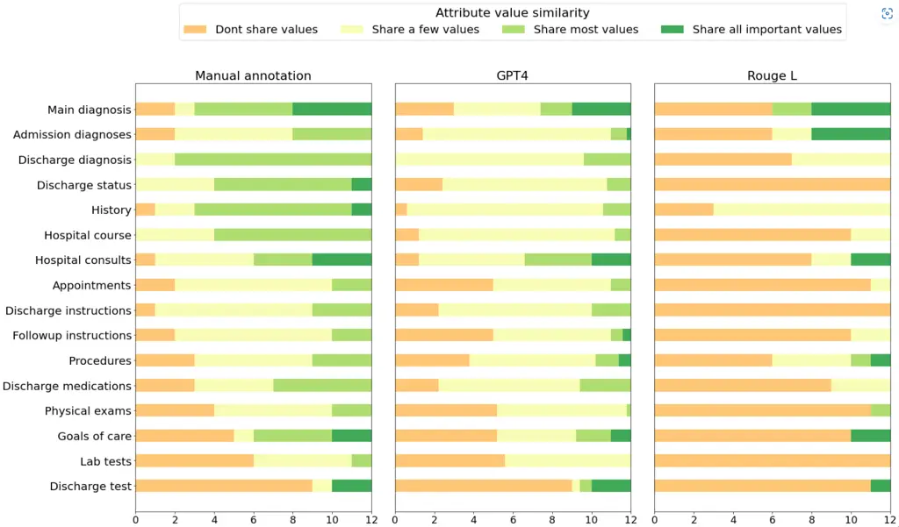
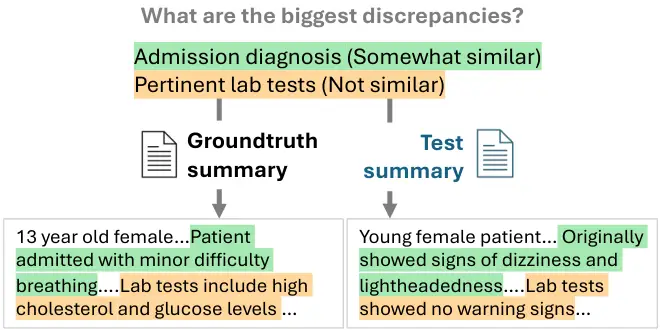
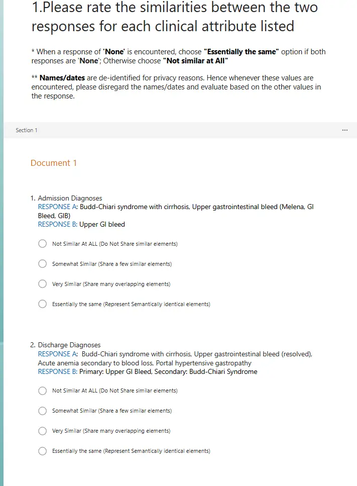

¹ ¹ ² ¹ ³ ³ ¹ ¹ ¹                  ¹ Microsoft Research
                 ² Carnegie Mellon University                  ³
Microsoft Health and Life Sciences

# Attribute Structuring Improves LLM-Based Evaluation of Clinical Text Summaries

Zelalem Gero Email: <zelalemgero@microsoft.com>    Chandan Singh
Email: <chansingh@microsoft.com>    Yiqing Xie
Email: <yiqingxi@andrew.cmu.edu>    Sheng Zhang
Email: <zhang.sheng@microsoft.com>    Praveen Subramanian
Email: <praveen.s@microsoft.com>    Paul Vozila
Email: <paulvozila@microsoft.com>    Tristan Naumann
Email: <tristan@microsoft.com>    Jianfeng Gao
Email: <jfgao@microsoft.com>    Hoifung Poon
Email: <hoifung@microsoft.com>

###### Abstract

Summarizing clinical text is crucial in health decision-support and
clinical research. Large language models (LLMs) have shown the potential
to generate accurate clinical text summaries, but still struggle with
issues regarding grounding and evaluation, especially in safety-critical
domains such as health. Holistically evaluating text summaries is
challenging because they may contain unsubstantiated information. Here,
we explore a general mitigation framework using Attribute Structuring
(AS), which structures the summary evaluation process. It decomposes the
evaluation process into a grounded procedure that uses an LLM for
relatively simple structuring and scoring tasks, rather than the full
task of holistic summary evaluation. Experiments show that AS
consistently improves the correspondence between human annotations and
automated metrics in clinical text summarization. Additionally, AS
yields interpretations in the form of a short text span corresponding to
each output, which enables efficient human auditing, paving the way
towards trustworthy evaluation of clinical information in
resource-constrained scenarios.

^(†)^(†)year: 2024^(†)^(†)workshop: Attribute Structuring for LLM-Based
Evaluation

###### keywords

Large language model, Summarization, Structuring, Medical

#### Data and Code Availability

We release our full code at
[https://github.com/microsoft/attribute-structuring](https://github.com/microsoft/attribute-structuring).
All analyzed data comes from the freely available discharge notes in
MIMIC-III (Johnson et al., 2016).

## 1 Introduction

Automatic medical text summarization has emerged as a critical task for
real-world impact in natural-language processing amidst widespread
physician fatigue and burnout. Meanwhile, pre-trained large language
models (LLMs) have shown impressive proficiency in a range of complex
natural language processing tasks (Brown et al., 2020; dubey2024llama;
OpenAI, 2023), including in text summarization (Liu et al., 2022; Zhang
et al., 2024). However, evaluating these summaries is challenging, as
they rely on human effort to track different attributes and facts.

LLMs may be able to help automate this evaluation. LLMs have previously
been used to provide practical evaluations in a variety of evaluation
settings (Liu et al., 2023; Fu et al., 2023). However, these evaluations
have been imperfect: yielding relatively low correlation with human
judgments, showing bias (Zheng et al., 2023; Wang et al., 2023), or more
generally struggling with long-form nuanced evaluation, as is often the
case in summarization (Zhong et al., 2022).

Figure 1: Overview of Attribute Structuring LLM evaluation for clinical
summarization. AS uses a human-given ontology to extract attributes from
summaries and then to individually score them.

To address these issues, structuring the scoring process can help to
ground the evaluation, and help an LLM decompose a complex evaluation
process into simpler, more accurate steps. Following this intuition, we
introduce a simple structuring process, which we call Attribute
Structuring (AS) (Fig. 1). Given a groundtruth summary and a summary to
be evaluated, AS leverages an LLM to score a summary through prompting.
Rather than directly asking the LLM for a score, we ask it to provide a
score for each pair of attributes, one from the groundtruth and another
from the summary to be evaluated. We extract 16 attributes derived from
a clinical ontology for each summary; the attributes are shown to define
the elements of quality in the context of a clinical discharge summary
in a large scale study (Savvopoulos et al., 2018).

Unlike previous methods such as FActScore (Min et al., 2023), AS does
not require a reliable knowledge source to verify each attribute, but
instead relies on the pre-specified ontology to capture relevant aspects
of a summary. DocLens  (Xie et al., 2024), similar to our work, performs
a fine-grained evaluation of medical text using various generation
models and shows that such scoring has higher agreement with the
judgements of medical experts. However, DocLens relies on the model to
generate the important attributes rather than a clinical ontology.

We perform experiments on clinical summarization tasks using discharge
notes from MIMIC-III (Johnson et al., 2016) and various LLMs. We find
that that Attribute Structuring helps reduce the gap between automated
metrics and human annotators. In addition, AS enables auditing the
evaluation for a particular summary by providing grounding for each
attribute, in the form of a short text span in the input.

## 2 Methods and experimental setup

### 2.1 Methods: Attribute Structuring

Fig. 1 shows the various steps of the Attribute Structuring (AS)
pipeline. The pipeline takes in two summaries: a groundtruth summary and
a generated summary (which we are trying to evaluate). Additionally, it
uses a set of attributes that are important for the task at hand. These
attributes comes from an ontology that utilizes domain knowledge to
define the elements of quality, in our case the context of a clinical
discharge summary in a large scale study (Savvopoulos et al., 2018),
e.g. Admission diagnosis or Goals of care.

Each step in the pipeline is achieved by prompting an LLM. In the first
step, the Attribute Structuring pipeline first extracts text for each
attribute in the ontology from both summaries. Then, for each pair of
extracted attributes, it generates a similarity score by prompting an
LLM to compare them on a scale of 1–4 (all prompts are provided in
Appendix A).

In a final (optional) interpretation step, an LLM can be used to ground
the scores for each attribute using text spans in the input. This can be
achieved by directly prompting an LLM to find a text span that led to
the extracted text for each attribute. This step is made possible by the
Attribute Structuring structuring process.

### 2.2 Experimental setup

#### Dataset

We analyze discharge summaries for 300 expert selected MIMIC-III notes
 (Johnson et al., 2016) and release scripts to process and use this
data. The notes are selected based on the quality of their discharge
summaries, where quality is defined as having most of the important
attributes and contain patient data that can be verified from the
clinical notes. To avoid context size bias, we select MIMIC notes with
no more than 4,000 tokens (measured with tiktoken’s p50_base tokenizer¹¹
1
[https://github.com/openai/tiktoken](https://github.com/openai/tiktoken)).

#### Models

We evaluate 6 different LLMs: GPT-4o (OpenAI, 2023) gpt4-0314,
GPT-3.5 (Ouyang et al., 2022) gpt-3.5-turbo-0613, all accessed securely
through the Azure OpenAI API. We also evaluate several
instruction-finetuned models: LLaMA-2 70B (Touvron et al., 2023), and
LLaMA-3.1 \[8B, 70B\] (dubey2024llama). We compare methods for scoring
with two popular metrics: BERT-Score (Zhang et al., 2019), and
ROUGE-L (Lin, 2004).

Figure 2: Distribution of scores across different attributes. Attribute
Structuring enables auditing which aspects of discharge summaries are
generally accurate (e.g. Main diagnosis) and which are often inaccurate
(e.g. Lab test).

#### Annotations and metrics

On a subset of our selected notes, five blinded human annotators (all
are expert medical coders) evaluate the similarities between the
extracted text for each attribute. They score 16 attributes for 24 total
documents (12 test summaries generated by GPT-4 and 12 test summaries
generated by LLaMA-3 70B), for a total of 384 attribute labels. Each
label is scored on a 4-point scale: Not similar:attributes don’t share
similar elements, Somewhat similar: attributes share a few elements,
Very similar: attributes share most elements, Essentially the same:
attributes share all important elements. We evaluate the match between
the manually annotated attribute labels and the automated attribute
labels using Pearson correlation, Spearman (rank) correlation, root
mean-squared-error (RMSE), and assess inter-annotator agreement with
Fleiss’ Kappa (fleiss1971measuring).

## 3 Results

#### Main result: AS improves evaluation quality

Figure 3: Example interpretation of document similarity. Scores for each
element of the ontology can be analyzed and grounded in quotes from the
source summaries for better understanding.

Table 1 shows how well different scoring methods match the annotations
provided by humans (the inter-annotator Fleiss’ Kappa score is 0.71).
Attribute Structuring yields a considerable improvement for all metrics.
Scoring with GPT-4 yields the best match with human annotators both in
Pearson and Spearman correlations and has the least RMSE error. Even a
traditional scoring metric, ROUGE-L, shows significant improvement when
attributes are structured before scoring.

The enhanced correlations across all metrics substantiate that
attribute-based, fine-grained scoring outperforms holistic
methodologies.

Fig. 2 shows the breakdown of similarities across attributes for
different metrics. Some attributes, such as Main diagnosis are more
often correctly identified in the test summaries, whereas others, such
as Lab test and Discharge test are rarely correct. Aggregating these
attribute evaluations through AS allows for improved evaluation compared
to evaluating an entire summary at once.

|            |             |                       |                        |
| ---------- | ----------- | --------------------- | ---------------------- |
|            | RMSE ↓      | Pearson correlation ↑ | Spearman correlation ↑ |
|            | Default/AS  | Default/AS            | Default/AS             |
| ROUGE-L    | 0.17 / 0.12 | 0.48 / 0.70           | 0.36 / 0.70            |
| BERT-Score | 0.52 / 0.22 | 0.13 / 0.70           | 0.28 / 0.80            |
| GPT-4      | 1.10 / 0.06 | 0.54 / 0.91           | 0.43 / 0.81            |

Table 1: Main result: Attribute Structuring improves the match between
automated scoring metrics and human annotators. For all methods,
attribute structuring is performed by prompting GPT-4.

|                 |          |
| --------------- | -------- |
| Summarizer      | AS Score |
| LLaMA-2 (70B)   | 82.8     |
| GPT-3.5         | 90.0     |
| LLaMA-3.1 (8B)  | 91.8     |
| GPT-4-0314      | 93.4     |
| GPT-4o          | 95.3     |
| LLaMA-3.1 (70B) | 95.7     |

Table 2: Automatic evaluation scores using different LLMs for generating
summaries.

#### Analysis: AS scores can be used to evaluate the quality of summaries

In settings where there aren’t manual annotations, we can use AS score
to evaluate the quality of summaries generated by LLMs. In Table 2, we
can see that AS scores for summaries generated by six LLMs are
consistent with the expected quality of the individual models.

#### Analysis: Attribute Structuring facilitates interpretation

Going beyond aggregate interpretations, Fig. 3 shows an example of how
similarity can be audited for a single pair of summaries. Unlike posthoc
feature importance (Lundberg and Lee, 2017; Ribeiro et al., 2016), or
intrinsically interpretable models (Rudin et al., 2021; Singh et al.,
2023), our interpretable grounding comes directly from an LLM, similar
to recent works that use LLMs to generate explanations (MacNeil et al.,
2022; Chen et al., 2024) and ground those explanations in evidence (Xue
et al., 2023; Gero et al., 2023). Since AS decomposes similarity into a
series of attributes, the attributes can each be audited by directly
prompting an LLM (here, GPT-4) to find a text span that serves as
evidence for the extracted attribute in each document. Fig. 3 shows text
spans for two discrepancies: Admission diagnosis and Pertinent lab
tests, which are only partially retained in the test summary.

## 4 Discussion

Attribute Structuring constitutes an important step towards safely
deploying LLMs in healthcare settings. As LLMs continue to generally
improve, their ability to produce and evaluate clinical summaries with
AS is likely to improve as well. Going forward, Attribute Structuring
can be harnessed in a variety of ways to improve clinical NLP
summarization, e.g. for evaluating free-form text such as
conversations (Tu et al., 2024) or improving model distillation by
helping to filter effective summaries (Wu et al., 2023; Toma et al.,
2023).

One limitation of Attribute Structuring is that it incurs a high
computational cost as multiple LLM calls are chained together; however,
these costs may continue to decrease as models become more
efficient (Dao et al., 2022). Another limitation is that LLMs (and
thereby Attribute Structuring) continue to be sensitive to prompts,
increasing the need for methods to make LLMs more amenable to
prompting (Ouyang et al., 2022; Zhou et al., 2023; Zhang et al., 2023)
and to make finding strong prompts easier (Shin et al., 2020; Singh
et al., 2022; Xu et al., 2023; Morris et al., 2023). Additionally, AS
relies on a human-given ontology for evaluation, but could be made more
general by developing methods to automatically define extract and define
an ontology for a given domain.

## References

- Brown et al. (2020) Tom Brown, Benjamin Mann, Nick Ryder, Melanie
  Subbiah, Jared D Kaplan, Prafulla Dhariwal, Arvind Neelakantan, Pranav
  Shyam, Girish Sastry, Amanda Askell, et al. Language models are
  few-shot learners. _Advances in neural information processing
  systems_, 33:1877–1901, 2020.
- Touvron et al. (2023) Hugo Touvron, Louis Martin, Kevin Stone, Peter
  Albert, Amjad Almahairi, Yasmine Babaei, Nikolay Bashlykov, Soumya
  Batra, Prajjwal Bhargava, Shruti Bhosale, et al. Llama 2: Open
  foundation and fine-tuned chat models. _arXiv preprint
  arXiv:2307.09288_, 2023.
- OpenAI (2023) OpenAI. Gpt-4 technical report. _ArXiv_, 2023. URL
  [https://arxiv.org/pdf/2303.08774.pdf](https://arxiv.org/pdf/2303.08774.pdf).
- Liu et al. (2022) Yixin Liu, Alexander R Fabbri, Pengfei Liu, Yilun
  Zhao, Linyong Nan, Ruilin Han, Simeng Han, Shafiq Joty, Chien-Sheng
  Wu, Caiming Xiong, et al. Revisiting the gold standard: Grounding
  summarization evaluation with robust human evaluation. _arXiv preprint
  arXiv:2212.07981_, 2022.
- Zhang et al. (2024) Tianyi Zhang, Faisal Ladhak, Esin Durmus, Percy
  Liang, Kathleen McKeown, and Tatsunori B Hashimoto. Benchmarking large
  language models for news summarization. _Transactions of the
  Association for Computational Linguistics_, 12:39–57, 2024.
- Liu et al. (2023) Yang Liu, Dan Iter, Yichong Xu, Shuohang Wang,
  Ruochen Xu, and Chenguang Zhu. Gpteval: Nlg evaluation using gpt-4
  with better human alignment. _arXiv preprint arXiv:2303.16634_, 2023.
- Fu et al. (2023) Jinlan Fu, See-Kiong Ng, Zhengbao Jiang, and Pengfei
  Liu. Gptscore: Evaluate as you desire. _arXiv preprint
  arXiv:2302.04166_, 2023.
- Zheng et al. (2023) Lianmin Zheng, Wei-Lin Chiang, Ying Sheng, Siyuan
  Zhuang, Zhanghao Wu, Yonghao Zhuang, Zi Lin, Zhuohan Li, Dacheng Li,
  Eric Xing, Hao Zhang, Joseph E. Gonzalez, and Ion Stoica. Judging
  LLM-as-a-judge with MT-bench and chatbot arena. In _Thirty-seventh
  Conference on Neural Information Processing Systems Datasets and
  Benchmarks Track_, 2023. URL
  [https://openreview.net/forum?id=uccHPGDlao](https://openreview.net/forum?id=uccHPGDlao).
- Wang et al. (2023) Lucy Lu Wang, Yulia Otmakhova, Jay DeYoung,
  Thinh Hung Truong, Bailey E Kuehl, Erin Bransom, and Byron C Wallace.
  Automated metrics for medical multi-document summarization disagree
  with human evaluations. _arXiv preprint arXiv:2305.13693_, 2023.
- Zhong et al. (2022) Ming Zhong, Yang Liu, Da Yin, Yuning Mao, Yizhu
  Jiao, Pengfei Liu, Chenguang Zhu, Heng Ji, and Jiawei Han. Towards a
  unified multi-dimensional evaluator for text generation. _arXiv
  preprint arXiv:2210.07197_, 2022.
- Savvopoulos et al. (2018) Stavros Savvopoulos, Tara Sampalli, Ruth
  Harding, Gail Blackmore, Sandra Janes, Kothai Kumanan, Rick Gibson,
  and Chris MacKnight. Development of a quality scoring tool to assess
  quality of discharge summaries. _Journal of Family Medicine and
  Primary Care_, 7(2):394, 2018.
- Min et al. (2023) Sewon Min, Kalpesh Krishna, Xinxi Lyu, Mike Lewis,
  Wen-tau Yih, Pang Wei Koh, Mohit Iyyer, Luke Zettlemoyer, and Hannaneh
  Hajishirzi. Factscore: Fine-grained atomic evaluation of factual
  precision in long form text generation. _arXiv preprint
  arXiv:2305.14251_, 2023.
- Xie et al. (2024) Yiqing Xie, Sheng Zhang, Hao Cheng, Pengfei Liu,
  Zelalem Gero, Cliff Wong, Tristan Naumann, Hoifung Poon, and Carolyn
  Rose. Doclens: Multi-aspect fine-grained evaluation for medical text
  generation, 2024.
- Johnson et al. (2016) Alistair EW Johnson, Tom J Pollard, Lu Shen,
  Li-wei H Lehman, Mengling Feng, Mohammad Ghassemi, Benjamin Moody,
  Peter Szolovits, Leo Anthony Celi, and Roger G Mark. MIMIC-III, a
  freely accessible critical care database. _Scientific data_,
  3(1):1–9, 2016.
- Ouyang et al. (2022) Long Ouyang, Jeffrey Wu, Xu Jiang, Diogo Almeida,
  Carroll Wainwright, Pamela Mishkin, Chong Zhang, Sandhini Agarwal,
  Katarina Slama, Alex Ray, et al. Training language models to follow
  instructions with human feedback. _Advances in Neural Information
  Processing Systems_, 2022. URL
  [https://openreview.net/forum?id=TG8KACxEON](https://openreview.net/forum?id=TG8KACxEON).
- Jiang et al. (2023) Albert Q Jiang, Alexandre Sablayrolles, Arthur
  Mensch, Chris Bamford, Devendra Singh Chaplot, Diego de las Casas,
  Florian Bressand, Gianna Lengyel, Guillaume Lample, Lucile Saulnier,
  et al. Mistral 7b. _arXiv preprint arXiv:2310.06825_, 2023.
- Jiang et al. (2024) Albert Q Jiang, Alexandre Sablayrolles, Antoine
  Roux, Arthur Mensch, Blanche Savary, Chris Bamford, Devendra Singh
  Chaplot, Diego de las Casas, Emma Bou Hanna, Florian Bressand, et al.
  Mixtral of experts. _arXiv preprint arXiv:2401.04088_, 2024.
- Zhang et al. (2019) Tianyi Zhang, Varsha Kishore, Felix Wu, Kilian Q
  Weinberger, and Yoav Artzi. Bertscore: Evaluating text generation with
  bert. _arXiv preprint arXiv:1904.09675_, 2019.
- Lin (2004) Chin-Yew Lin. Rouge: A package for automatic evaluation of
  summaries. In _Text summarization branches out_, pages 74–81, 2004.
- Lundberg and Lee (2017) Scott M Lundberg and Su-In Lee. A unified
  approach to interpreting model predictions. In _Advances in Neural
  Information Processing Systems_, pages 4768–4777, 2017.
- Ribeiro et al. (2016) Marco Tulio Ribeiro, Sameer Singh, and Carlos
  Guestrin. Why should i trust you?: Explaining the predictions of any
  classifier. In _Proceedings of the 22nd ACM SIGKDD International
  Conference on Knowledge Discovery and Data Mining_, pages 1135–1144.
  ACM, 2016.
- Rudin et al. (2021) Cynthia Rudin, Chaofan Chen, Zhi Chen, Haiyang
  Huang, Lesia Semenova, and Chudi Zhong. Interpretable machine
  learning: Fundamental principles and 10 grand challenges. _arXiv
  preprint arXiv:2103.11251_, 2021.
- Singh et al. (2023) Chandan Singh, Armin Askari, Rich Caruana, and
  Jianfeng Gao. Augmenting interpretable models with large language
  models during training. _Nature Communications_, 14(1):7913, 2023.
- MacNeil et al. (2022) Stephen MacNeil, Andrew Tran, Dan Mogil, Seth
  Bernstein, Erin Ross, and Ziheng Huang. Generating diverse code
  explanations using the gpt-3 large language model. In _Proceedings of
  the 2022 ACM Conference on International Computing Education
  Research-Volume 2_, pages 37–39, 2022.
- Chen et al. (2024) Yanda Chen, Chandan Singh, Xiaodong Liu, Simiao
  Zuo, Bin Yu, He He, and Jianfeng Gao. Towards consistent
  natural-language explanations via explanation-consistency finetuning.
  _arXiv preprint arXiv:2401.13986_, 2024.
- Xue et al. (2023) Tianci Xue, Ziqi Wang, Zhenhailong Wang, Chi Han,
  Pengfei Yu, and Heng Ji. Rcot: Detecting and rectifying factual
  inconsistency in reasoning by reversing chain-of-thought. _arXiv
  preprint arXiv:2305.11499_, 2023.
- Gero et al. (2023) Zelalem Gero, Chandan Singh, Hao Cheng, Tristan
  Naumann, Michel Galley, Jianfeng Gao, and Hoifung Poon.
  Self-verification improves few-shot clinical information extraction.
  _arXiv preprint arXiv:2306.00024_, 2023.
- Tu et al. (2024) Tao Tu, Anil Palepu, Mike Schaekermann, Khaled Saab,
  Jan Freyberg, Ryutaro Tanno, Amy Wang, Brenna Li, Mohamed Amin, Nenad
  Tomasev, et al. Towards conversational diagnostic ai. _arXiv preprint
  arXiv:2401.05654_, 2024.
- Wu et al. (2023) Chaoyi Wu, Xiaoman Zhang, Ya Zhang, Yanfeng Wang, and
  Weidi Xie. Pmc-llama: Further finetuning llama on medical papers.
  _arXiv preprint arXiv:2304.14454_, 2023.
- Toma et al. (2023) Augustin Toma, Patrick R Lawler, Jimmy Ba, Rahul G
  Krishnan, Barry B Rubin, and Bo Wang. Clinical camel: An open-source
  expert-level medical language model with dialogue-based knowledge
  encoding. _arXiv preprint arXiv:2305.12031_, 2023.
- Singh et al. (2024) Chandan Singh, Jeevana Priya Inala, Michel Galley,
  Rich Caruana, and Jianfeng Gao. Rethinking interpretability in the era
  of large language models. _arXiv preprint arXiv:2402.01761_, 2024.
- Dao et al. (2022) Tri Dao, Dan Fu, Stefano Ermon, Atri Rudra, and
  Christopher Ré. Flashattention: Fast and memory-efficient exact
  attention with io-awareness. _Advances in Neural Information
  Processing Systems_, 35:16344–16359, 2022.
- Zhou et al. (2023) Wenxuan Zhou, Sheng Zhang, Hoifung Poon, and Muhao
  Chen. Context-faithful prompting for large language models. _arXiv
  preprint arXiv:2303.11315_, 2023.
- Zhang et al. (2023) Qingru Zhang, Chandan Singh, Liyuan Liu, Xiaodong
  Liu, Bin Yu, Jianfeng Gao, and Tuo Zhao. Tell your model where to
  attend: Post-hoc attention steering for llms. _arXiv preprint
  arXiv:2311.02262_, 2023.
- Shin et al. (2020) Taylor Shin, Yasaman Razeghi, Robert L Logan IV,
  Eric Wallace, and Sameer Singh. Autoprompt: Eliciting knowledge from
  language models with automatically generated prompts. _arXiv preprint
  arXiv:2010.15980_, 2020.
- Singh et al. (2022) Chandan Singh, John X Morris, Jyoti Aneja,
  Alexander M Rush, and Jianfeng Gao. Explaining patterns in data with
  language models via interpretable autoprompting. _arXiv preprint
  arXiv:2210.01848_, 2022.
- Xu et al. (2023) Benfeng Xu, Quan Wang, Zhendong Mao, Yajuan Lyu,
  Qiaoqiao She, and Yongdong Zhang. $`k`$ nn prompting: Beyond-context
  learning with calibration-free nearest neighbor inference. _arXiv
  preprint arXiv:2303.13824_, 2023.
- Morris et al. (2023) John X Morris, Chandan Singh, Alexander M Rush,
  Jianfeng Gao, and Yuntian Deng. Tree prompting: efficient task
  adaptation without fine-tuning. _arXiv preprint
  arXiv:2310.14034_, 2023.

## Appendix A Appendix

|           |                |                                 |              |              |               |                |         |       |
| --------- | -------------- | ------------------------------- | ------------ | ------------ | ------------- | -------------- | ------- | ----- |
|           |                | Scorer (with GPT-4 structuring) |              |              |               |                |         |       |
|           |                | AVG                             | LLaMA-2 (7B) | Mistral (7B) | LLaMA-2 (70B) | Mixtral (8x7B) | GPT-3.5 | GPT-4 |
| Generator | LLaMA-2 (7B)   | 45.97                           | 65.4         | 47.1         | 49.0          | 38.5           | 40.3    | 35.5  |
|           | Mistral        | 46.37                           | 66.1         | 47.7         | 49.2          | 38.7           | 40.8    | 35.7  |
|           | LLaMA-2 (70B)  | 49.70                           | 66.7         | 50.6         | 54.3          | 43.4           | 43.6    | 39.6  |
|           | Mixtral (8x7B) | 51.30                           | 68.4         | 52.4         | 54.9          | 46.0           | 44.9    | 41.2  |
|           | GPT-3.5        | 52.78                           | 73.1         | 53.7         | 56.7          | 45.9           | 45.7    | 41.6  |
|           | GPT-4          | 56.02                           | 73.8         | 56.9         | 61.2          | 51.2           | 48.8    | 44.2  |

Table A1: Automatic evaluation scores using different LLMs for
generating and evaluating summaries. All use GPT-4 for structuring and
different LLMs for scoring the attributes. The relative rankings of
different LLMs generators is preserved across different columns. Results
are for a subset of 30 randomly chosen notes.

|                |                     |                   |
| -------------- | ------------------- | ----------------- |
| Generator      | Mixtral structuring | GPT-4 structuring |
| LLaMA-2 (7B)   | 36.2                | 38.5              |
| Mistral        | 37.4                | 38.7              |
| LLaMA-2 (70B)  | 38.4                | 43.4              |
| Mixtral (8x7B) | 39.2                | 46.0              |
| GPT-3.5        | 39.4                | 45.9              |
| GPT-4          | 45.1                | 51.2              |

Table A2: Automatic evaluation scores using different LLMs for
structuring summaries yield similar rankings between generator models,
although GPT-4 structuring generally yields higher scores. Both use
Mixtral (8x7B) for scoring. Results are for a subset of 30 randomly
chosen notes.

### A.1 Prompts

Here we include the prompts we used to:

- •
  Generate summaries
- •
  Structure to extract attributes ,and
- •
  Score each pair of attributes.
- •
  A prompt to score without structuring as a baseline.

1. Generation prompt:  
   Prompt = “You are tasked with generating a high quality clinical
   discharge summary for the provided input text INPUT_DOC. The summary has
   to be very relevant to the input document and cover the most important
   aspects of the input. Follow the following steps:  
   Step 1: Generate the most common sections that usually appear in a
   clinical discharge summary. Step 2: Not all the sections from Step 1
   will have content. See which of those sections have contents from the
   INPUT_DOC. Remove the sections that don’t have information.  
   Step 3 : Use the following concepts to generate appropriate content.
   These are not Sections. Concepts: patient information and service type,
   diagnosis given at the time of admission, brief summary of initial
   presentation and diagnostic evaluation, pertinent physical findings
   relevant to diagnoses, goals of care; level of treatment,code
   status(e.g. curative,life-prolonging palliative, and symptomatic
   palliative), course in hospital; synotpic,problem-based description of
   sequential events and respective evaluations, treatments, and prognoses,
   hospital consults; description of specialty and/or allied health
   consults, procedures in hospital; a list of procedures with key findings
   and date, principal discharge diagnosis or main reason for admission and
   all additional pertinent diagnoses where applicable, discharge
   medications with specific description of new, altered, and discontinued
   medications and rationale for changes, lab tests and investigative
   results, tests ordered during the hospitalization that are pending at
   the time of discharge, outcome of care/condition at discharge; sense of
   the patient health status at discharge includes functional status, and
   cognitive status, outstanding issues for follow-up and recommendations
   to a recipient health-care provider during discharge, appointments after
   discharge including person responsible for scheduling, care provider,
   discharge instructions; list of information/education provided to the
   patient during discharge, main author of the discharge summary or
   attending clinician.

Step 4: Put the generated content in a coherent order. Format in such a
way that the dishcarge summary has an excellent coherence, fluency, and
consistency. Remember to use the sections you generated in Step 1, don’t
make the concepts in Step 2 as a section, they are just suggestive
concepts not sections.

Step 5: Remove sections with no information. Dont put ’not specified’ or
’not mentioned’ or ’none specified’ in a section. Just remove everything
for that section including the section header.  
Step 5: Return the final discharge summary with all the remaining
sections that have contents. Remember to remove sections with no
information. Context : ”

2. Structuring prompt:  
   We use ResponseSchema from langchain to inform the model what each
   attribute description is.

ad_diag_schema  
= ResponseSchema(name = ’ad_diag’, description=’preliminary or working
diagnosis given at the time of admission’)

dc_diag_schema  
= ResponseSchema(name = ’dc_diag’, description=’the list of principal
discharge diagnosis or main reason for admission and all additional
pertinent diagnoses where applicable’)

main_diag_schema  
= ResponseSchema(name = ’main_diag’, description=’diagnosis mostly
accountable for the largest portion of the patient”s stay, responsible
for the greatest part of the length of stay ’)

history_schema  
= ResponseSchema(name = ’history’, description=’a brief summary of
initial presentation and diagnostic evaluation’)

physical_schema  
= ResponseSchema(name = ’physical’, description=’pertinent physical
findings relevant to diagnoses ’)

goals_schema  
=ResponseSchema(name = ’goals’, description=’goals of care; level of
treatment,code status(e.g. curative,life-prolonging palliative, and
symptomatic palliative)’)

course_schema  
= ResponseSchema(name = ’course’, description=’course in hospital;
synotpic,problem-based description of sequential events and respective
evaluations, treatments, and prognoses ’)

consults_schema  
= ResponseSchema(name = ’consults’, description=’hospital consults;
description of specialty and/or allied health consults’)

procedures_schema  
= ResponseSchema(name = ’procedures’, description=’procedures in
hospital; a list of procedures with key findings and date’)

ds_med_schema  
= ResponseSchema(name = ’ds_med’, description=’a list of all discharge
medications with specific description of new, altered, and discontinued
medications and rationale for changes’)

lab_schema  
= ResponseSchema(name = ’lab’, description=’pertinent lab tests and
investigative results’)

ds_test_schema  
= ResponseSchema(name = ’ds_test’, description=’tests ordered during the
hospitalization that are pending at the time of discharge ’)

ds_status_schema  
= ResponseSchema(name = ’ds_status’, description=’outcome of
care/condition at discharge; sense of the patient health status at
discharge includes functional status, and cognitive status’)

followup_schema  
= ResponseSchema(name = ’followup’, description=’outstanding issues for
follow-up and recommendations to a recipient health-care provider during
discharge’)

appt_schema  
= ResponseSchema(name = ’appt’, description=’appointments after
discharge including person responsible for scheduling, care provider ’)

instruct_schema  
= ResponseSchema(name = ’instruct’, description=’discharge instructions;
list of information/education provided to the patient during discharge’)

author_schema  
= ResponseSchema(name = ’author’, description=’main author of the
discharge summary or attending clinician’)

prompt = “You are an expert in information extraction and structuring
from clinical notes. Given a clinical note, create a structured output.
For a given variable, if you can not determine/find a value, return
NONE. Dont add any extra text, just the structured value. Here is the
note: INPUT_DOC. format_instructions ”

3. Structured attribute Scoring Prompt:

prompt = “You will be given a python dictionary containing a clinical
variable as a key and a list containing two values for the variable as
values.

Your task is to rate how similar the values are given the variable.
Compare value1 and value2 for semantic similarity(similarity in meaning)
given the variable and the criteria below. Two values can be very
similar in meaning even if they are phrased differently. Also remember
that this is a clinical document, take that into account. When scoring
the similarity between two clinical terminologies, assign a value from 1
to 4, where 1 signifies a lack of similarity and 4 indicates identical
meanings. Consider the context, clinical relevance, and semantic
alignment between the terminologies. If the terminologies convey vastly
different meanings, assign a score of 1. A score of 2 is appropriate for
terminologies that, while related, represent different concepts or
emphasize distinct elements. A score of 3 should be used for
terminologies with substantial semantic overlaps but minor differences.
Finally, if the terminologies are semantically equivalent and
interchangeable, warranting no clinical distinction, assign a score of 4. Ensure that the assessment reflects the degrees of similarity in
meaning, irrespective of syntactical differences, context, or minor
variances in expression.

Please make sure you read and understand these instructions carefully.
Return the similarity score. Return only the score, don’t include any
other extra text.”

4. Document scoring without structuring prompt

prompt = “You will be given two clinical discharge summaries, summary1
and summary2.

Your task is to rate how similar the two summaries are from 1-10. 1 is
not similar while 10 is essentially identical. Focus on the following
important clinical variables when performing the comparison: How similar
is the diagnosis, how similar are the goals, how similar is hospital
course and history, how similar are the medications administered, how
similar are the physical condition diagnoses, how similar are the
followup consults and procedures, how similar are the lab tests
performed, how similar are the patients discharge status, is the
follow-up instructions similar, are there any similar appointments, and
instructions only return the score, dont add any extra text Here are the
inputs discharge summaries: summary1: \[value1\] summary2: \[value2\].”

### A.2 Prompts given to human annotators

Fig. A1 shows a sample interface given to human annotators. Human
annotators were presented values for attributes through a web interface
along with the prompt “For each attribute listed on the left, two
possible values are provided(different colors). Please rate the semantic
similarity between the values.”. Annotators are three machine learning
researchers that are authors of the current study.

Figure A1: Annotation interface screenshot.
