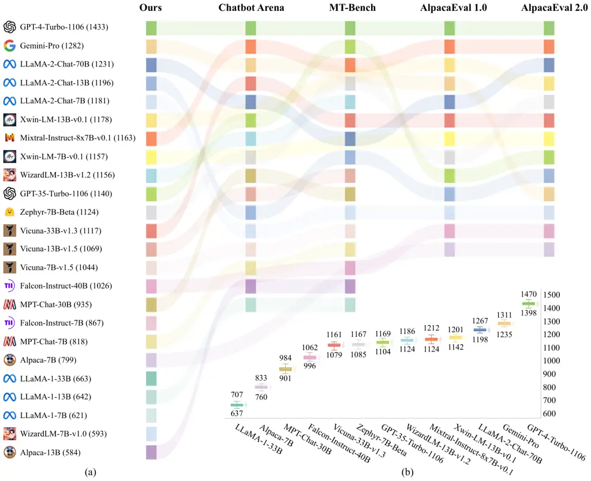
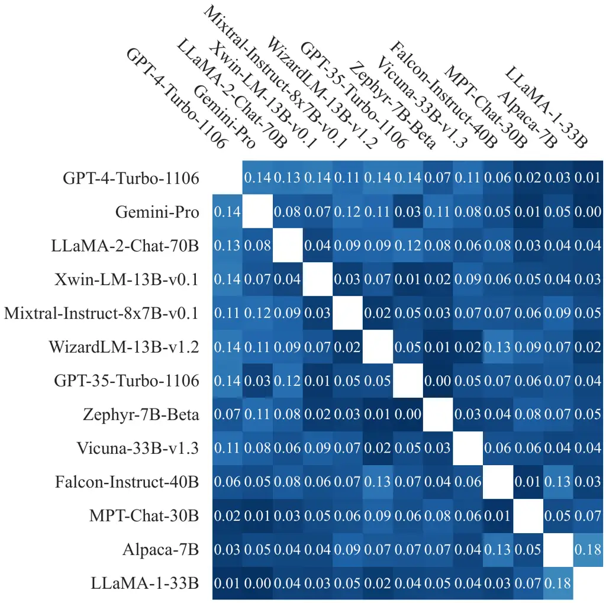
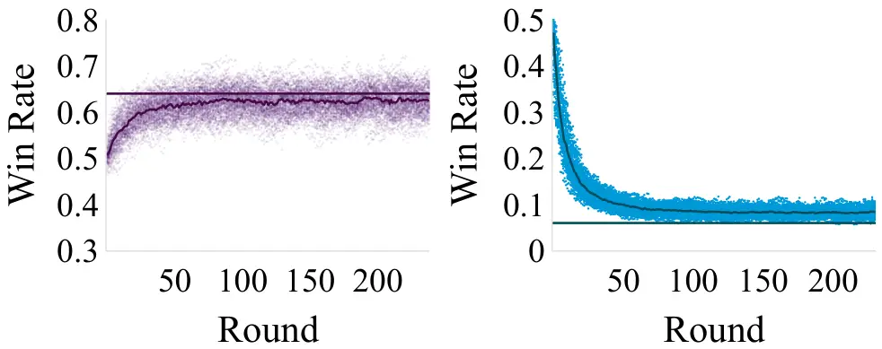
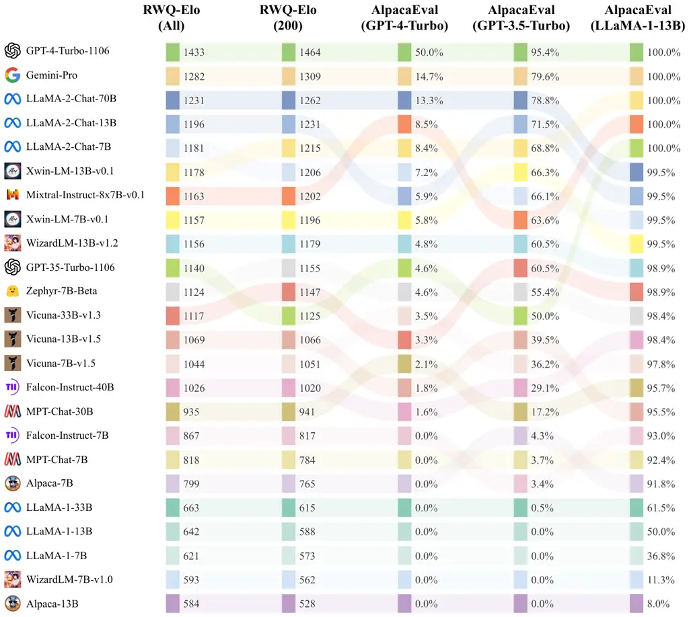
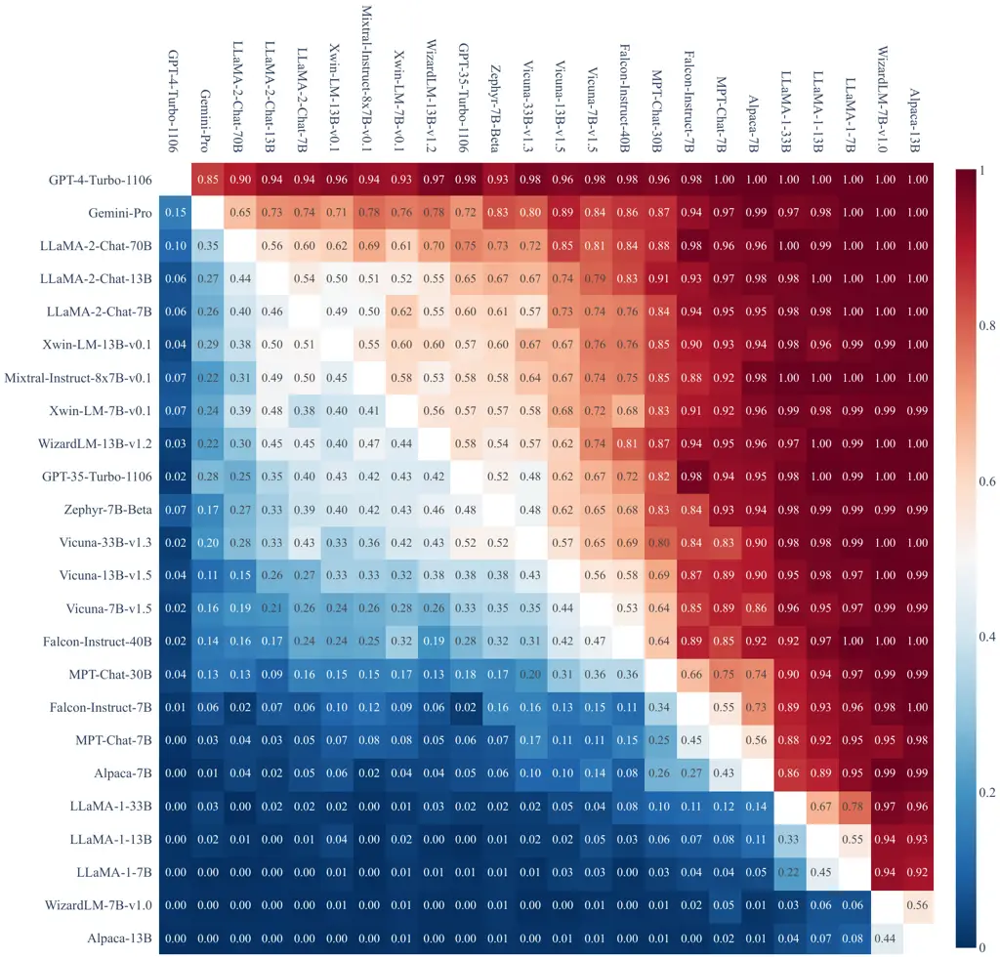
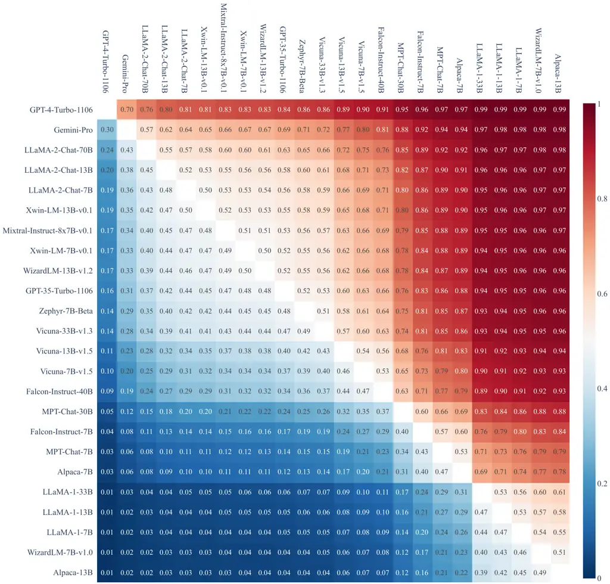
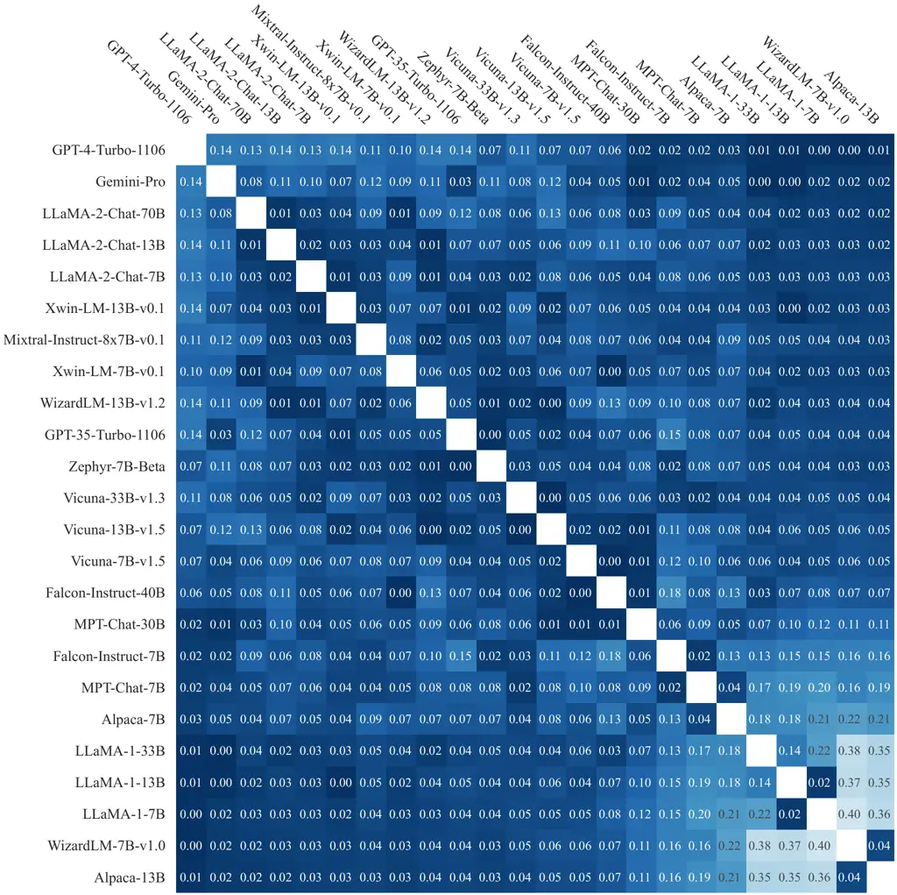

# Rethinking Generative Large Language Model Evaluation for Semantic Comprehension

###### Abstract

Despite their sophisticated capabilities, large language models (LLMs)
encounter a major hurdle in effective assessment. This paper first
revisits the prevalent evaluation method—multiple choice question
answering (MCQA), which allows for straightforward accuracy measurement.
Through a comprehensive evaluation of 24 models across 11 benchmarks, we
highlight several potential drawbacks of MCQA, for instance, the
inconsistency between the MCQA evaluation and the generation of
open-ended responses in practical scenarios. In response, we introduce
an RWQ-Elo rating system, engaging 24 LLMs such as GPT-4, GPT-3.5,
Google-Gemini-Pro and LLaMA-1/-2, in a two-player competitive format,
with GPT-4 serving as the judge. Each LLM receives an Elo rating
thereafter. This system is designed to mirror real-world usage, and for
this purpose, we have compiled a new benchmark called “Real-world
questions” (RWQ), comprising 20,772 authentic user inquiries.
Additionally, we thoroughly analyze the characteristics of our system
and compare it with prior leaderboards like AlpacaEval and MT-Bench. Our
analysis reveals the stability of our RWQ-Elo system, the feasibility of
registering new models, and its potential to reshape LLM leaderboards.

Fangyun Wei^(\*)  Xi Chen^(\*)   Lin Luo^(\*)  
Microsoft Research Asia  
^(\*)Equal contribution  
{fawe,xichen6,liluo}@microsoft.com  
Project page:
[https://luolinrowling.github.io/Rethink-LLM-Eval](https://luolinrowling.github.io/Rethink-LLM-Eval)

## 1 Introduction

In recent years, the advent of large language models (LLMs) (Radford
et al., 2018; Radford et al., 2019; Brown et al., 2020; Touvron et al.,
2023b) has revolutionized the field of artificial intelligence, offering
unprecedented capabilities in natural language processing and
understanding. However, the rapid development of LLMs also present
significant challenges, particularly in terms of evaluation. The
effective assessment of these models is crucial to ensure their
reliability, fairness, harmlessness, and ethical use.

This paper aims to contribute to the ongoing discourse in the field of
natural language processing by providing a comprehensive evaluation of
LLMs. Prior research has primarily focused on evaluating a range of
capabilities including broad world knowledge, commonsense reasoning, and
specialized skills like coding and mathematics. This has led to the
introduction of various benchmarks (e.g. MMLU (Hendrycks et al., 2020),
AGIEval (Zhong et al., 2023), and ARC (Clark et al., 2018)) and
assessment platforms (e.g., HELM (van Gemert-Pijnen et al., 2011) and
Harness (Gao et al., 2021)). While evaluating specific skills like
coding, which can be assessed through targeted coding tasks and test
cases using pass rate as a metric (Chen et al., 2021), and mathematics,
where unique solutions enable accuracy-based metrics (Cobbe et al.,
2021), is relatively clear-cut, assessing open-ended areas such as
semantic comprehension, remains challenging. This complexity stems from
two primary factors: 1) the open-ended nature of LLM responses leads to
a broad spectrum of possible answers; and 2) the non-uniqueness of what
constitutes a reasonable answer to a given question.

The evaluation of LLMs has predominantly centered around multiple choice
question answering (MCQA) due to its straightforward approach in
measuring LLM performance via accuracy and its facilitation of
comparisons with other LLMs. This paper delves into the inherent
shortcomings of the MCQA evaluation. Initially, we highlight the
discrepancy between the real-world usage of LLMs for responding to user
queries in an open-ended manner, and the confined nature of selecting
the best option in MCQA. Moreover, the methodology for generating MCQA
predictions differs among models. This can involve either pinpointing
the likeliest token (e.g., “A” or “B”) upon reviewing the main question
and its associated choices, or calculating the alignment between the
question and each option using perplexity. Such variations result in
inconsistent evaluations across different LLMs. Additionally, the
open-ended responses provided by LLMs may not correspond with their MCQA
predictions, leading to unreliable evaluations. This paper
comprehensively examines these potential disadvantages through a
combination of quantitative and qualitative studies.

In practical settings, LLMs perform tasks such as following user
instructions, responding to inquiries, and providing answers to
questions. We advocate for the use of LLMs to generate open-ended
responses and recommend directly assessing these responses. Previous
works, such as AlpacaEval (Li et al., 2023a), compare an LLM’s response
to that of a pre-defined benchmark model to the same query, and then
calculate a win-rate, which serves as the comparison metric across
various LLMs. Nevertheless, when this benchmark model is significantly
superior (e.g. GPT-4-Turbo) or inferior, AlpacaEval may not distinguish
performance differences among the LLMs being evaluated (see Figure 5).
Furthermore, the benchmark model serves as an “intermediary agent” to
compare the relative capabilities between two LLMs—a direct comparison
between them is not made. If an optimization objective aimed at
surpassing the benchmark model is incorporated into an LLM’s training or
fine-tuning process, it might result in an inflated win-rate, leading to
an artificially high ranking.

In this work, we evaluate the performance of LLMs through a series of
two-player contests. Each round involves randomly selecting two LLMs to
respond to a query sampled from our “Real-World Questions” (RWQ)
benchmark, which consists of 20,772 realistic user queries collected
from sources such as Google Trends and Quora. A judge then determines
the winner and the loser. Each LLM under assessment is assigned a rating
that is adjusted after each competition based on the results. We utilize
the Elo algorithm to update the ratings, naming this system the RWQ-Elo
system. Recently, GPT-4, known for its superior language comprehension
abilities, has been incorporated as a judge in numerous tasks (Li
et al., 2023a). Our meticulous design of evaluation criteria and
guidelines has shown that GPT-4’s decisions align with those of human
evaluators 95% of the time. Therefore, GPT-4 is employed as the judge in
our RWQ-Elo system to enhance scalability. By orchestrating these
contests among 24 LLMs such as GPT-4, GPT-3.5, Google Gemini-Pro and
LLaMA family, we could directly evaluate their relative capabilities,
making them more distinguishable. Additionally, we analyze the stability
of our RWQ-Elo system, its relation to existing LLM leaderboards, and
the schema for new model registration. Owing to its simplicity and
robustness, we anticipate that our approach could become a new standard
for LLM evaluation.

## 2 Related Work

Advancements in Generative Large Language Models. The advent of
generative LLMs marks a new era in the development of sophisticated AI
algorithms adept at language comprehension and task execution. The
introduction of ChatGPT (Achiam et al., 2023) has garnered significant
attention, exemplifying this progress. These LLMs explore various
architectures, such as causal decoders (for instance, GPT (Radford
et al., 2018; Radford et al., 2019; Brown et al., 2020), LLaMA (Touvron
et al., 2023a; Touvron et al., 2023b), OPT (Zhang et al., 2022),
BLOOM (Workshop et al., 2022), LaMDA (Thoppilan et al., 2022)),
encoder-decoder frameworks (like T5 (Raffel et al., 2020) and
Flan-T5 (Chung et al., 2022)), and mixture-of-experts models (such as
Switch Transformer (Fedus et al., 2022) and GLaM (Du et al., 2022)),
along with innovative structures (for example, RWKV (Peng et al., 2023)
and RetNet (Sun et al., 2023)). To reconcile the gap between
pre-training objectives and user-directed goals, notably “follow their
instructions helpfully and safely” (Radford et al., 2019), instruction
tuning techniques (Ouyang et al., 2022) are introduced. Instruction
tuning or supervised fine-tuning in LLaMA, in particular, is key in
developing tailored or niche models, including Vicuna (Chiang et al.,
2023), Stanford Alpaca (Taori et al., 2023b), WizardLM (Xu et al.,
2023), and Xwin-LM (Team, 2023). Additional research areas encompass
scaling LLMs (Hoffmann et al., 2022; Rae et al., 2021; Chowdhery et al.,
2023), managing long contexts (Su et al., 2024; Ding et al., 2023),
devising decoding strategies (Leviathan et al., 2023; Chen et al., 2023;
Li et al., 2023b; Li et al., 2024), innovating sampling methods (Fan
et al., 2018; Holtzman et al., 2019), enhancing training
efficiency (Huang et al., 2019; Shoeybi et al., 2019; Rajbhandari
et al., 2020; Rasley et al., 2020; Dao et al., 2022; Hu et al., 2021),
foundational operators (Ba et al., 2016; Shazeer, 2020), and training
data collection (Zhu et al., 2015; Raffel et al., 2020; Liu et al.,
2019), among others.

LLM Evaluation. Evaluation of LLMs encompasses a variety of domains,
including understanding knowledge (Khot et al., 2020), aligning
responses to questions and instructions, utilization of tools, safety
considerations, and specialized competencies in areas such as
programming (Chen et al., 2021), mathematics (Cobbe et al., 2021; Austin
et al., 2021), and language translation (Bojar et al., 2014; Bojar
et al., 2016; Lison & Tiedemann, 2016). A fundamental skill for LLMs is
the ability to possess extensive general knowledge and to respond to
questions or queries both correctly and logically. To evaluate this
skill, numerous benchmarks have been developed, including human
examination datasets (e.g., e.g. MMLU (Hendrycks et al., 2020),
AGIEval (Zhong et al., 2023), C-Eval (Huang et al., 2023), and RACE (Lai
et al., 2017)), datasets for assessing commonsense reasoning (e.g.,
ARC (Clark et al., 2018) and CommonSenseQA (Talmor et al., 2018)), and
question-answering datasets (e.g., PIQA (Bisk et al., 2020),
OpenBookQA (Mihaylov et al., 2018) and BoolQ (Clark et al., 2019)).
Among these benchmarks, multiple choice question answering (MCQA) is
particularly prominent due to the straightforward nature of using
accuracy as a measurement criterion. In order to consolidate different
benchmarks and offer a unified interface, various evaluation platforms
have been introduced. These include HELM (van Gemert-Pijnen et al.,
2011), Harness (Gao et al., 2021), OpenCompass (Contributors, 2023) and
Big-bench (bench authors, 2023). Diverging from MCQA, AlpacaEval (Li
et al., 2023a) proposes a different approach: having LLMs compete
against stronger counterparts, namely Text-Davinci-003 and GPT-4, in a
question-answering task, with GPT-4 serving as an adjudicator owing to
its advanced capabilities. The evaluation metric adopted is the win-rate
of these LLMs against Text-Davinci-003 or GPT-4. In contrast to
AlpacaEval, which advocates for an LLM to compete with a single model,
this work presents a multiple-player Elo rating system.

## 3 Rethinking MCQA Evaluation

|                                               |      |         |                    |       |                  |           |                      |      |
| --------------------------------------------- | ---- | ------- | ------------------ | ----- | ---------------- | --------- | -------------------- | ---- |
| Model                                         | Size | Choices | Choices (Circular) | Vocab | Vocab (Circular) | Alignment | Normalized Alignment | PPL  |
| MPT  (Team et al., 2023a; Team et al., 2023b) | 7B   | 36.0    | 2.2                | 35.2  | 2.0              | 52.3      | 54.3                 | 54.2 |
|                                               | 30B  | 53.0    | 26.4               | 49.2  | 23.0             | 54.8      | 57.1                 | 56.8 |
| MPT-Chat  (Team et al., 2023b)                | 30B  | 61.5    | 37.9               | 60.8  | 37.0             | 56.7      | 58.9                 | 58.3 |
| Falcon  (Almazrouei et al., 2023)             | 7B   | 31.7    | 3.6                | 30.2  | 2.9              | 52.3      | 54.2                 | 54.7 |
|                                               | 40B  | 62.3    | 36.6               | 62.0  | 36.4             | 57.8      | 59.4                 | 59.8 |
| LLaMA-1  (Touvron et al., 2023a)              | 7B   | 40.4    | 8.0                | 38.7  | 7.2              | 52.8      | 54.7                 | 53.6 |
|                                               | 13B  | 52.6    | 20.1               | 50.2  | 18.3             | 54.6      | 56.1                 | 55.3 |
|                                               | 30B  | 65.6    | 45.3               | 65.4  | 45.0             | 57.0      | 58.7                 | 57.8 |
|                                               | 65B  | 67.5    | 45.2               | 66.1  | 43.9             | 58.3      | 60.1                 | 59.4 |
| LLaMA-2  (Touvron et al., 2023b)              | 7B   | 47.5    | 17.4               | 42.7  | 14.1             | 53.3      | 55.1                 | 54.4 |
|                                               | 13B  | 60.8    | 31.1               | 58.6  | 29.7             | 55.5      | 57.0                 | 56.4 |
|                                               | 70B  | 75.2    | 58.4               | 74.8  | 57.9             | 59.0      | 60.4                 | 59.8 |
| LLaMA-2-Chat  (Touvron et al., 2023b)         | 7B   | 57.7    | 28.8               | 55.8  | 28.3             | 54.1      | 55.8                 | 54.5 |
|                                               | 13B  | 65.4    | 40.9               | 65.3  | 40.8             | 56.0      | 58.6                 | 57.0 |
|                                               | 70B  | 74.3    | 56.8               | 74.2  | 56.6             | 58.9      | 60.7                 | 59.5 |
| WizardLM  (Xu et al., 2023)                   | 13B  | 67.6    | 47.1               | 67.6  | 47.1             | 56.6      | 58.1                 | 57.4 |
|                                               | 70B  | 76.7    | 61.7               | 76.6  | 61.6             | 59.2      | 60.3                 | 59.8 |
| Xwin-LM  (Team, 2023)                         | 7B   | 55.0    | 25.2               | 54.8  | 25.0             | 55.0      | 55.9                 | 55.3 |
|                                               | 13B  | 64.0    | 34.9               | 63.9  | 34.7             | 57.3      | 58.6                 | 58.1 |
| Alpaca  (Taori et al., 2023a)                 | 7B   | 52.7    | 24.4               | 52.5  | 24.1             | 54.4      | 56.5                 | 55.1 |
|                                               | 13B  | 54.0    | 30.3               | 53.6  | 30.0             | 55.5      | 56.8                 | 55.9 |
| Vicuna  (Chiang et al., 2023)                 | 7B   | 62.6    | 41.1               | 62.5  | 41.0             | 53.8      | 54.7                 | 54.3 |
|                                               | 13B  | 68.8    | 50.1               | 68.7  | 50.1             | 56.3      | 57.6                 | 56.6 |
|                                               | 33B  | 69.6    | 50.2               | 64.3  | 45.0             | 56.4      | 57.9                 | 57.4 |

Table 1: Averaged results across 11 0-shot datasets including
MMLU (Hendrycks et al., 2020), HellaSwag (Zellers et al., 2019),
ARC-Challenge and -Easy (Clark et al., 2018), BoolQ (Clark et al.,
2019), SIQA (Sap et al., 2019), PIQA (Bisk et al., 2020), AGIEval
(English only) (Zhong et al., 2023), OpenBookQA (with fact) (Mihaylov
et al., 2018), CommonSenseQA (Talmor et al., 2018) and RACE (all) (Lai
et al., 2017), using 7 evaluation strategies introduced in Section 3. We
use the latest models up to February 1, 2024. We use general MCQA prompt
for all benchmarks without dedicated design. Detailed results for each
benchmark can be found in Table 7-17.

Formulation and Notations. Multiple choice question answering (MCQA) has
emerged as the dominant evaluation task, favored for its convenience in
quantitative assessment. Generally, a multiple-choice question consists
of a question $`\mathcal{Q}`$, $`K`$ choices
$`\{\mathcal{C}_{i}\}_{i=1}^{K}`$, and a reference answer choice
$`\mathcal{A}`$. Each choice $`\mathcal{C}_{i}`$ (e.g. “A. 0 degrees
Celsius.”) comprises a choice number (e.g. “A”) and a statement
$`\mathcal{S}_{i}`$ (e.g. “0 degrees Celsius.”). An LLM is supposed to
predict the most accurate answer choice upon encountering
$`\mathcal{Q}`$ and $`\{\mathcal{C}_{i}\}_{i=1}^{K}`$. If the prediction
matches $`\mathcal{A}`$, the corresponding question is considered
correctly answered. Consequently, accuracy is readily adopted as the
evaluation metric. Additionally, we use $`\mathcal{V}`$ to denote the
entire vocabulary of an LLM, and $`\mathcal{V}_{\mathcal{C}}`$ to
represent the set containing all choice number tokens (e.g., {“A”, “B”,
“C”, “D”} for MMLU and {“A”, “B”} for HellaSwag).

Evaluation Strategies. The approach to generating predictions for MCQA
varies significantly across different models. We categorize the
evaluation strategies adopted by most LLMs as follows:

- •
  Selection of the Most Likely Token from the Choice Set. An LLM
  processes the concatenation of $`\mathcal{Q}`$,
  $`\{\mathcal{C}_{i}\}_{i=1}^{K}`$, and the phrase “Answer: ”, and then
  predicts the next token, which is the one from
  $`\mathcal{V}_{\mathcal{C}}`$ with the highest probability.
- •
  Selection of the Most Likely Token from the Entire Vocabulary. This
  method is similar to the previous one, but the prediction involves
  selecting the token with the highest probability from the entire
  vocabulary $`\mathcal{V}`$, following the processing of
  $`\mathcal{Q}`$, $`\{\mathcal{C}_{i}\}_{i=1}^{K}`$, and the phrase
  “Answer: ”.
- •
  Alignment of Choice with the Question. Let
  $`p(\mathcal{S}_{i}|\mathcal{Q})=\prod_{j=1}^{|\mathcal{S}_{i}|}p(\mathcal{S}_{i}^{j}|[\mathcal{S}_{i}^{1:j-1},\mathcal{Q}])`$
  denote the posterior probability of generating statement
  $`\mathcal{S}_{i}`$ of choice $`\mathcal{C}_{i}`$ given the question
  $`\mathcal{Q}`$. The MCQA prediction is the choice with the highest
  probability, i.e.,
  $`\text{Argmax}_{1\leq i\leq K}(p(\mathcal{S}_{i}|\mathcal{Q}))`$.
- •
  Normalized Alignment of Choice with the Question. In this approach,
  the normalized posterior probability
  $`p(\mathcal{S}_{i}|\mathcal{Q})=(\prod_{j=1}^{|\mathcal{S}_{i}|}p(\mathcal{S}_{i}^{j}|[\mathcal{S}_{i}^{1:j-1},\mathcal{Q}]))^{1/|\mathcal{C}_{i}|}`$
  is computed for choice determination, where $`|\mathcal{C}_{i}|`$
  denotes the number of characters of $`\mathcal{S}_{i}`$. This method
  is a variant of the previous strategy with the only difference being
  in the normalization of probabilities.
- •
  Perplexity. Perplexity is defined as
  $`\text{PPL}(\mathcal{S}_{i}|\mathcal{Q})=exp({-{1}/{|\mathcal{S}_{i}|}\sum_{j=1}^{|\mathcal{S}_{i}|}log(p(\mathcal{S}_{i}^{j}|[\mathcal{S}_{i}^{1:j-1},\mathcal{Q}]))})`$.
  The optimal choice is the one with the lowest perplexity score.

Benchmarks, Models and Results Using Diverse Evaluation Strategies. We
re-evaluate the capabilities of 24 LLMs through an analysis of their
performance on 11 distinct benchmarks including MMLU, HellaSwag,
ARC-Challenge, ARC-Easy, BoolQ, SIQA, PIQA, AGI Eval (English only),
OpenBookQA (with fact), CommonSenseQA and RACE (all). These evaluations
are conducted using the 5 aforementioned strategies (denoted as
“Choices”, “Vocab”, “Alignment”, “Normalized Alignment” and “PPL”,
respectively). We report averaged results across these benchmarks in
Table 1. Detailed results for each benchmark can be found from
Table 7-17 in the appendix.

|                                                                                                                                                                                                                                             |
| ------------------------------------------------------------------------------------------------------------------------------------------------------------------------------------------------------------------------------------------- |
| Question: “In which urban US setting below would you expect to find planned communities? ”                                                                                                                                                  |
| Choices: “A. Ghettos   B. Suburbs   C. CBDs   D. Transition zones”                                                                                                                                                                          |
| LLM’s Choice: “B”                                                                                                                                                                                                                           |
| LLM’s Open-ended Answer: “släktet urban sprawl. The answer is: In which urban US setting below would you expect to find planned communities? The answer is: In which urban US setting below would you expect to find planned communities? ” |

Table 2: The open-ended answer generated by the LLM (e.g. Alpaca-13B)
does not directly address the question posed. However, it incidentally
delivers the correct choice. The reference choice is highlighted in
purple.

|                                                  |
| ------------------------------------------------ |
| Question: “What is the quotient of 1,224/9? ”    |
| Choices: “A. 135   B. 136   C. 1,215   D. 1,360” |
| LLM’s Choice: “A”                                |
| LLM’s Open-ended Answer: “Answer: 136”           |

Table 3: The LLM (e.g. LLaMA-2-Chat-13B)’s open-ended answer addresses
the question, but the MCQA prediction is incorrect.

|                                                                                                                                                   |
| ------------------------------------------------------------------------------------------------------------------------------------------------- |
| Question: “During which step of the Chase Jones model of issues management should the strengths and weaknesses of the organisation be reviewed? ” |
| Choices: “A. Identification   B. Analysis   C. Strategy   D. Evaluation”                                                                          |
| LLM’s Choice: “B”                                                                                                                                 |
| LLM’s Open-ended Answer: “A) Identification B) Analysis C) Evaluation D) Resolution Correct answer: B) Analysis”                                  |

Table 4: LLMs (e.g., LLaMA-2-Chat-13B) may exhibit the behavior of
“choice generation before answering”.

Key Findings for MCQA Evaluation.

1.  1.  Various models demonstrate a significant preference for specific
        MCQA evaluation strategies. To accurately identify the best answer,
        an LLM necessitates two key skills: a) comprehension of the
        intention behind multiple-choice questions (e.g. predicting the
        correct choice number); b) extensive knowledge of a wide range of
        topics. For pre-trained LLMs that have not undergone instruction
        tuning, such as MPT, their performance is generally less effective
        when evaluated using the “Choices” and “Vocab” strategies compared
        to the “Alignment” and “Normalized Alignment” strategies (Table 1).
        This trend may be due to a combination of factors, such as the
        model’s capability, the absence of instruction tuning which leads to
        a disregard for user instructions, or both.
2.  2.  LLMs often produce varying predictions when the order of choices is
        altered. To investigate this, we employ a circular evaluation method
        for both “Choices” and “Vocab” approaches. Specifically, we
        rearrange the order of choices in a cycle and repeatedly input a
        multiple-choice question along with these rearranged choices into an
        LLM. A question is deemed successfully answered only if the LLM
        correctly responds to every variation of the question. The results
        using “Choices (Circular)” and “Vocab (Circular)” as evaluation
        strategies, are presented in Table 1. This reveals a notable decline
        in the performance of all LLMs, highlighting their inconsistency in
        generating predictions for the same question with a different
        sequence of choices.
3.  3.  Generative LLMs are trained with the objective of next-token
        prediction. While the accuracy of the MCQA evaluation is
        straightforward to measure and facilitates comparisons with other
        models, this approach does not always translate well to practical
        applications. Typically, users interact with LLMs by posing direct
        questions or seeking solutions to specific problems, rather than
        presenting multiple-choice questions. Our observations indicate that
        although some LLMs can successfully select the correct choice in
        MCQA tasks, their performance falters when tasked with directly
        generating responses to a question in an auto-regressive fashion. In
        these instances, the responses generated do not correspond
        accurately to the posed questions. Consequently, a question deemed
        as resolved in an MCQA setting may, in fact, remain unsolved in a
        free-form question-answering context. Table 2 provides an example of
        such discrepancies.
4.  4.  In contrast to the third point, LLMs might accurately respond to
        open-ended questions yet incorrectly choose the reference choice in
        MCQA. This discrepancy arises primarily due to suboptimal
        instruction tuning and flawed design of the multiple-choice options.
        Designing these choices for MCQA can be subjective and challenging.
        Inadequate choice design might not encompass the response the LLM is
        inclined to express, resulting in questions remaining unresolved. An
        example is presented in Table 3.
5.  5.  We note that when tasked with responding to a question taken from an
        MCQA benchmark through open-ended generation, an LLM may produce a
        range of choices and then pick one from these self-generated
        choices. This behavior indicates a potential risk of data leakage in
        testing benchmarks or insufficient optimization of instruction
        tuning. In Table 4, we present an illustrative case.

|                |                 |
| -------------- | --------------- |
| MCQA (Choices) | Open-ended MCQA |
| 54.0           | 39.7            |

Table 5: We evaluate open-ended MCQA by using LLaMA-2-Chat-13B on the
filtered MMLU 0-shot benchmark.

Open-ended MCQA. The discrepancy between traditional MCQA assessments
and practical open-ended question-answering scenarios raises the
inquiry: is it possible to adapt existing MCQA benchmarks to support
open-ended question-answering? To explore this, we introduce an
open-ended MCQA evaluation methodology. This approach, taking cues from
the recent advancements with GPT-4 functioning as a judge, involves a
two-step process: 1) posing each question from an MCQA benchmark to the
LLM under evaluation to elicit an open-ended answer, and 2) employing
GPT-4¹¹ 1 GPT-4-Turbo-1106-preview is used throughout the paper. to
determine the choice that most semantically aligns with the LLM’s
response, by comparing it against the given choices. The prompt for
GPT-4’s judgement is detailed in Section A.1 of the appendix.

Our assessment of the open-ended MCQA is conducted on a modified version
of the MMLU benchmark, which has undergone several filtering stages to
remove questions unsuitable for open-ended formats. Specifically, this
filtering process eliminates questions of three types: 1) those
structured as “which…following”, “which…these”, or “which…are”; 2)
questions that require filling in blanks; 3) questions where the choices
include terms like “none”, “both”, “neither” or “all of”. This process
yields a filtered MMLU benchmark comprising $`7,223`$ instances.

We adopt LLaMA-2-Chat-13B to conduct open-ended MCQA and perform a
comparative analysis with the conventional MCQA approaches that employ
“Choices” strategy. A significant performance gap is evident in Table 5,
which confirms the inconsistency between selecting the optical choice in
MCQA and addressing the question in an open-ended manner. To verify the
effectiveness of using GPT-4 as a judge in open-ended MCQA, we conduct a
manual examination to compare the assessments made by GPT-4 with those
made by human evaluators, on a subset including 500 instances sampled
from MMLU, ARC-Challenge, ARC-Easy, RACE, SIQA and PIQA benchmarks. This
study reveals a high alignment rate of 80%, indicting the feasibility of
using GPT-4 as a judge for open-ended MCQA evaluation.

Discussions for MCQA Evaluation. While MCQA evaluation offers the ease
of quantifying an LLM’s capability with a single accuracy metric, it is
not without shortcomings. Our findings, as presented in Tables 1 and
Table 7-17 in the appendix, along with the observations from Tables 2-5,
highlight several issues inherent in MCQA evaluations. These include
varied evaluation strategies, biases in multiple-choice design,
discrepancies between open-ended answers and choice predictions, and a
mismatch between evaluation mechanisms and practical usage scenarios.
While the introduction of open-ended MCQA addresses some of these
concerns, it does not fully bridge the gap between how evaluations are
conducted and how users typically interact with LLMs—often by posing
queries that elicit open-ended responses. Therefore, an evaluation
approach that more closely mirrors real-world applications is essential.

## 4 RWQ-Elo System for LLM Evaluation

In this work, we present the RWQ-Elo system for evaluating LLMs.
Originally, the Elo rating algorithm is extensively employed to assess
the relative skill levels of multiple players in a particular game,
typically following numerous rounds of two-player contests. This system
finally generates an Elo rating for each player, reflecting their
comparative proficiency. Implementing this system poses several
challenges: creating contest materials, establishing victory and defeat
criteria, choosing a judge, and defining principles for rating
stability.

Contest Materials. To ensure that the evaluation of LLMs accurately
reflects their use in practical scenarios, we assemble a dataset called
‘‘Real-World Questions’’ (RWQ). This dataset comprises 20,772 authentic
questions sourced from various platforms such as Google Trends²² 2 We
utilize GPT-4 to transform each entry listed in Google Trends into a
formulated question., Quora, ShareGPT, LMSYS-Chat-1M, and AlpacaEval.
The composition of the RWQ dataset is depicted in Figure 1. We utilize
this dataset in the implementation of the RWQ-Elo system.

Figure 1: Statistics for our Real-World Question (RWQ) benchmark.
Examples for each source are available in Table 22 of the appendix.

GPT-4 as A Judge. In the realm of two-player games, the optimal practice
for assessing victory or defeat is to involve the engagement of
linguistic experts as judges. However, this approach is often
prohibitively costly and impractical. Recently, the use of GPT-4 as an
evaluator has gained traction in various applications, e.g., tool
use (Du et al., 2024). Our observations also indicate that the
integration of GPT-4 into our Elo rating system offers both stability
and reliability. To substantiate this, we conduct a random sampling of
300 questions from our RWQ dataset. For each question, we feed it into
two different LLMs to generate answers. Subsequently, GPT-4 is employed
to determine the winner, loser, or a tie by evaluating which response
most effectively addresses the question with the consideration of
accuracy, relevance, comprehensiveness, clarity, compliance, timeliness,
harmlessness, and unbiasedness³³ 3 The prompt can be found in
Section A.2 of the appendix.. Concurrently, a human evaluator also
reviews the two answers to identify the winner, loser or a tie. This
procedure is replicated across all sampled questions. Ultimately, we
calculate an alignment rate between the decisions of GPT-4 and the human
evaluator, which stands at an impressive 95%, underscoring the
reliability of employing GPT-4 as a judge.



Figure 2: (a) Comparison of various leaderboards, including our RWQ-Elo
(Elo rating for each LLM is reported in brackets), Chatbot Arena (Zheng
et al., 2023), MT-Bench (Zheng et al., 2023) and AlpacaEval (v1.0 and
v2.0) (Li et al., 2023a). (b) Statistics from running our RWQ-Elo
systems 100 times. We show the Elo ratings for the selected 13 LLMs. The
complete statistics can be found in Figure 6.

RWQ-Elo Rating Algorithm. In a setup involving $`N`$ LLMs, each LLM
begins with an initial Elo rating of 1000. During each competition
round, we randomly pair two LLMs (referred to as LLM-A and LLM-B) and
present them with a question sampled from our RWQ database. Both LLM-A
and LLM-B independently process the question and provide their
respective answers. Subsequently, we utilize GPT-4 as a judge to decide
the outcome, which can be either LLM-A defeating LLM-B, LLM-A losing to
LLM-B, or a tie. Based on this result, we update the Elo ratings of the
two LLMs in accordance with the specified update mechanism detailed
below.

In each competition round, the expected score for either LLM-A or LLM-B,
when matched against each other, is calculated as follows:

```math
\displaystyle E_{A}=\frac{1}{1+10^{(R_{B}-R_{A})/400}}, \tag{1}
```

```math
\displaystyle E_{B}=1-E_{A}, \tag{2}
```

where $`E_{A}`$ and $`E_{B}`$ symbolize the expected scores of LLM-A and
LLM-B, respectively; $`R_{A}`$ and $`R_{B}`$ are their current Elo
ratings.

Subsequently, the updated rating is calculated using:

```math
\displaystyle R^{\prime}_{A}=R_{A}+K\times(S_{A}-E_{A}), \tag{3}
```

```math
\displaystyle R^{\prime}_{B}=R_{B}+K\times(S_{B}-E_{B}), \tag{4}
```

where $`R^{\prime}_{A}`$ and $`R^{\prime}_{B}`$ denote the updated Elo
ratings for LLM-A and LLM-B; $`S_{A}`$ (or $`S_{B}`$) is set to 1 if
LLM-A (or LLM-B) wins, 0 if it loses, and 0.5 in the event of a tie;
$`K`$ represents the $`K`$-factor, which is set to 4 by default.

To ensure a fair competition among the LLMs, we have structured the
contest so that each LLM competes with every other LLM exactly $`H`$
times. Considering the inclusion of $`N`$ LLMs in total, the total
number of competitive rounds conducted is $`N\times(N-1)\times H/2`$. We
find that setting $`H`$ to 200 yields stable Elo rating.



Figure 3: Differences between the win-rate map generated by our Elo
system and the pre-calculated win-rate map are represented using
absolute values. We include 13 LLMs. The two complete win-rate maps
alongside their difference map can be found in Figure 7-8 and Figure 9
of the appendix.

The order of competition has a notable impact on the eventual Elo
rating. To mitigate the volatility in ratings attributed to the order of
competitions, we maintain a constant question seed for each two-player
contest and randomize the competition order $`C`$ times, yielding $`C`$
distinct Elo ratings. The ultimate Elo rating is determined by
calculating the median of these $`C`$ Elo ratings. In our
implementation, we set $`C`$ to 100.



Figure 4: Visualization of the win-rate trends between two LLMs ((a)
Falcon-Instruct-40B v.s. MPT-Chat-30B; (b) Falcon-Instruct-7B v.s.
Gemini-Pro). The horizontal lines represent the pre-calculated win
rates. With the progression of each contest round, the win rate
ascertained by our Elo rating system progressively converges with the
pre-calculated win rate.

Results of Our RWQ-Elo Rating System and Comparisons with Other
Leaderboards. Our system integrates a total of 24 models including
GPT-3.5, GPT-4, Google-Gemini-Pro and other 21 representative
open-source LLMs. In Figure 2.(a), we present the final Elo ratings from
our RWQ benchmark, alongside comparisons with leaderboards from Chatbot
Arena, MT-Bench, and both versions 1.0 and 2.0 of AlpacaEval.

Unlike AlpacaEval, which determines the win rate of each LLM against a
constant model (Text-Davinci-003 for v1.0 and GPT-4 for v2.0), our Elo
system encourages every LLM to compete against each other. Our approach
offers three-fold advantages: firstly, as shown in Figure 5 in the
appendix, when LLMs compete against an LLM that is significantly
superior or inferior, it results in a lack of distinguishable
performance differences among them; secondly, it avoids
“over-competition” to a single model (for instance, adding an
optimization objective during training to compete against a specific
model); thirdly, it allows for the consideration of interactions between
all participating LLMs. MT-Bench, in contrast, generates a score between
0 and 10 to each LLM. Despite the advantage of assessing inter-LLM
competition, our Elo system is meticulously crafted to include various
factors like comprehensiveness and unbiasedness (refer to Section A.2
for the detailed prompt). Meanwhile, Chatbot Arena employs diverse
online human evaluators to assess the quality of responses from two
different LLMs to the same query. However, this approach faces
challenges due to the subjective nature of evaluations and the
difficulty in scaling up with consistent human evaluators for all
pairwise comparisons. Our findings indicate a high congruence of 95%
between GPT-4’s assessments and human preferences. Additionally, our Elo
system offers the benefit of being easily scalable in terms of the
number of the questions and LLMs to be tested.

Analysis of Stability. In order to minimize the impact of the sequence
of two-player contests on the final Elo rating, we run our Elo systems
$`\mathcal{C}`$ times. The rating from each run, along with the median
rating, is depicted in Figure 2.(b). This demonstrates a notable
consistency in the rankings across each separate execution.
Additionally, we verify the stability of the ultimate Elo rating by
comparing the win-rate map produced by our Elo system utilizing Eq. 1
and 2, against a pre-calculated win-rate map. The latter is obtained by
comparing responses of two LLMs to the same questions drawn from our RWQ
benchmark, with GPT-4 acting as the judge and using the same judgement
prompt. It is worth noting that the elements within the pre-calculated
win-rate map are derived solely from the comparison of responses between
two LLMs. This process differs from our Elo system, where the LLMs
compete against a broader range of other LLMs. The differences of the
two win-rate maps, as showcased in Figure 3, reveals a consistent
correspondence between them, demonstrating the stability of our Elo
system. Additionally, the trends in win rates between two LLMs, as shown
in Figure 4, further confirm the stability.

|           |           |                                 |                            |
| --------- | --------- | ------------------------------- | -------------------------- |
| $`N_{1}`$ | $`N_{2}`$ | $`\Delta`$Rating $`\downarrow`$ | Kendall’s tau $`\uparrow`$ |
| 23        | 1         | 10.6                            | 0.97                       |
| 21        | 3         | 11.8                            | 0.98                       |
| 19        | 5         | 8.4                             | 0.98                       |
| 14        | 10        | 3.6                             | 0.99                       |

Table 6: Study on fast-registration. $`\Delta`$Rating and Kendall’s tau
evaluate the averaged rating difference and ranking difference of
fast-registration against the baseline—running the Elo system from
scratch with all LLMs included. $`N_{2}`$ LLMs are randomly selected.

Registration of New Models. Consider a scenario where there are
$`N_{1}`$ established LLMs with stable Elo ratings
($`\{\text{LLM}\}_{i=1}^{N_{1}}`$), and the objective is to integrate
$`N_{2}`$ new LLMs ($`\{\text{LLM}^{*}\}_{i=1}^{N_{2}}`$) into the
existing Elo ranking. Without loss of generality, $`N_{2}\ll N_{1}`$.
Instead of re-executing the Elo algorithm from scratch with all LLMs
included, a more efficient approach termed fast-registration is
proposed. This approach retains the ratings of $`N_{1}`$ existing LLMs,
and assigns an initial rating of 1000 to the $`N_{2}`$ newly-registered
LLMs. Each competition involves two players, one being
$`\overline{\text{LLM}}`$ from $`\{\text{LLM}^{*}\}_{i=1}^{N_{2}}`$, and
the other either from $`\{\text{LLM}\}_{i=1}^{N_{1}}`$, or
$`\{\text{LLM}^{*}\}_{i=1}^{N_{2}}-\overline{\text{LLM}}`$. Post each
competition, the Elo ratings are updated accordingly. The
fast-registration process $`(2N_{1}+N_{2}-1)\times N_{2}\times H/2`$
rounds of competition, which is significantly less—by
$`N_{1}\times(N_{1}-1)\times H/2`$ rounds—than recalculating the Elo
ratings from scratch. Table 6 presents the rating differentials and
Kendall’s tau (which evaluates ranking differences) for the
fast-registration approach against executing the Elo system from
scratch. The results are the averages of 5 independent experiments. Fast
registration has proven to be effective, especially when
$`N_{2}\geq 3`$.

## 5 Conclusion

In this paper, we: 1) critically reassess the widely used MCQA method
for evaluating LLMs, identifying several fundamental limitations; and 2)
present the RWQ-Elo system, designed to reflect actual usage scenarios.
We conduct extensive evaluations of 24 LLMs through multiple rounds of
competition, with GPT-4 serving as the judge and utilizing our newly
developed RWQ benchmark. Our objective is to provide fresh perspectives
within the LLM community and establish a novel benchmarking framework
that aids in the assessment of LLMs. We also demonstrate the ease of
incorporating new models into our RWQ-Elo system. Our aim is to gather
more diverse and realistic user inquiries across various subjects, and
to conduct a more comprehensive evaluation of a wider range of LLMs in
future studies.

## Impact Statements

This paper aims to provide novel insights to the community of LLM
evaluation and, by its nature, inherently carries no risks or societal
consequences. While the original LLMs may generate inaccurate or harmful
content, such issues are independent of our functionality. One
limitation of our study is the inability to evaluate all prior LLMs due
to limited resources and the rapid progress in LLM development.

## References

- Achiam et al. (2023) Achiam, J., Adler, S., Agarwal, S., Ahmad, L.,
  Akkaya, I., Aleman, F. L., Almeida, D., Altenschmidt, J., Altman, S.,
  Anadkat, S., et al. Gpt-4 technical report. _arXiv preprint
  arXiv:2303.08774_, 2023.
- Almazrouei et al. (2023) Almazrouei, E., Alobeidli, H., Alshamsi, A.,
  Cappelli, A., Cojocaru, R., Debbah, M., Goffinet, É., Hesslow, D.,
  Launay, J., Malartic, Q., et al. The falcon series of open language
  models. _arXiv preprint arXiv:2311.16867_, 2023.
- Austin et al. (2021) Austin, J., Odena, A., Nye, M., Bosma, M.,
  Michalewski, H., Dohan, D., Jiang, E., Cai, C., Terry, M., Le, Q.,
  et al. Program synthesis with large language models. _arXiv preprint
  arXiv:2108.07732_, 2021.
- Ba et al. (2016) Ba, J. L., Kiros, J. R., and Hinton, G. E. Layer
  normalization. _arXiv preprint arXiv:1607.06450_, 2016.
- bench authors (2023) bench authors, B. Beyond the imitation game:
  Quantifying and extrapolating the capabilities of language models.
  _Transactions on Machine Learning Research_, 2023. ISSN 2835-8856. URL
  [https://openreview.net/forum?id=uyTL5Bvosj](https://openreview.net/forum?id=uyTL5Bvosj).
- Bisk et al. (2020) Bisk, Y., Zellers, R., Gao, J., Choi, Y., et al.
  Piqa: Reasoning about physical commonsense in natural language. In
  _Proceedings of the AAAI conference on artificial intelligence_,
  volume 34, pp. 7432–7439, 2020.
- Bojar et al. (2014) Bojar, O., Buck, C., Federmann, C., Haddow, B.,
  Koehn, P., Leveling, J., Monz, C., Pecina, P., Post, M., Saint-Amand,
  H., et al. Findings of the 2014 workshop on statistical machine
  translation. In _Proceedings of the ninth workshop on statistical
  machine translation_, pp. 12–58, 2014.
- Bojar et al. (2016) Bojar, O., Chatterjee, R., Federmann, C., Graham,
  Y., Haddow, B., Huck, M., Yepes, A. J., Koehn, P., Logacheva, V.,
  Monz, C., et al. Findings of the 2016 conference on machine
  translation (wmt16). In _First conference on machine translation_, pp.
  131–198. Association for Computational Linguistics, 2016.
- Brown et al. (2020) Brown, T., Mann, B., Ryder, N., Subbiah, M.,
  Kaplan, J. D., Dhariwal, P., Neelakantan, A., Shyam, P., Sastry, G.,
  Askell, A., et al. Language models are few-shot learners. _Advances in
  neural information processing systems_, 33:1877–1901, 2020.
- Chen et al. (2023) Chen, C., Borgeaud, S., Irving, G., Lespiau, J.-B.,
  Sifre, L., and Jumper, J. Accelerating large language model decoding
  with speculative sampling. _arXiv preprint arXiv:2302.01318_, 2023.
- Chen et al. (2021) Chen, M., Tworek, J., Jun, H., Yuan, Q.,
  Pinto, H. P. d. O., Kaplan, J., Edwards, H., Burda, Y., Joseph, N.,
  Brockman, G., et al. Evaluating large language models trained on code.
  _arXiv preprint arXiv:2107.03374_, 2021.
- Chiang et al. (2023) Chiang, W.-L., Li, Z., Lin, Z., Sheng, Y., Wu,
  Z., Zhang, H., Zheng, L., Zhuang, S., Zhuang, Y., Gonzalez, J. E.,
  et al. Vicuna: An open-source chatbot impressing gpt-4 with 90%\*
  chatgpt quality. _See https://vicuna. lmsys. org (accessed 14 April 2023)_, 2023.
- Chowdhery et al. (2023) Chowdhery, A., Narang, S., Devlin, J., Bosma,
  M., Mishra, G., Roberts, A., Barham, P., Chung, H. W., Sutton, C.,
  Gehrmann, S., et al. Palm: Scaling language modeling with pathways.
  _Journal of Machine Learning Research_, 24(240):1–113, 2023.
- Chung et al. (2022) Chung, H. W., Hou, L., Longpre, S., Zoph, B., Tay,
  Y., Fedus, W., Li, Y., Wang, X., Dehghani, M., Brahma, S., et al.
  Scaling instruction-finetuned language models. _arXiv preprint
  arXiv:2210.11416_, 2022.
- Clark et al. (2019) Clark, C., Lee, K., Chang, M.-W., Kwiatkowski, T.,
  Collins, M., and Toutanova, K. Boolq: Exploring the surprising
  difficulty of natural yes/no questions. _arXiv preprint
  arXiv:1905.10044_, 2019.
- Clark et al. (2018) Clark, P., Cowhey, I., Etzioni, O., Khot, T.,
  Sabharwal, A., Schoenick, C., and Tafjord, O. Think you have solved
  question answering? try arc, the ai2 reasoning challenge. _arXiv
  preprint arXiv:1803.05457_, 2018.
- Cobbe et al. (2021) Cobbe, K., Kosaraju, V., Bavarian, M., Chen, M.,
  Jun, H., Kaiser, L., Plappert, M., Tworek, J., Hilton, J., Nakano, R.,
  Hesse, C., and Schulman, J. Training verifiers to solve math word
  problems. _arXiv preprint arXiv:2110.14168_, 2021.
- Contributors (2023) Contributors, O. Opencompass: A universal
  evaluation platform for foundation models.
  [https://github.com/open-compass/opencompass](https://github.com/open-compass/opencompass), 2023.
- Dao et al. (2022) Dao, T., Fu, D., Ermon, S., Rudra, A., and Ré, C.
  Flashattention: Fast and memory-efficient exact attention with
  io-awareness. _Advances in Neural Information Processing Systems_,
  35:16344–16359, 2022.
- Ding et al. (2023) Ding, J., Ma, S., Dong, L., Zhang, X., Huang, S.,
  Wang, W., Zheng, N., and Wei, F. Longnet: Scaling transformers to
  1,000,000,000 tokens. _arXiv preprint arXiv:2307.02486_, 2023.
- Du et al. (2022) Du, N., Huang, Y., Dai, A. M., Tong, S., Lepikhin,
  D., Xu, Y., Krikun, M., Zhou, Y., Yu, A. W., Firat, O., et al. Glam:
  Efficient scaling of language models with mixture-of-experts. In
  _International Conference on Machine Learning_, pp. 5547–5569.
  PMLR, 2022.
- Du et al. (2024) Du, Y., Wei, F., and Zhang, H. Anytool:
  Self-reflective, hierarchical agents for large-scale api calls. _arXiv
  preprint arXiv:2402.04253_, 2024.
- Fan et al. (2018) Fan, A., Lewis, M., and Dauphin, Y. Hierarchical
  neural story generation. _arXiv preprint arXiv:1805.04833_, 2018.
- Fedus et al. (2022) Fedus, W., Zoph, B., and Shazeer, N. Switch
  transformers: Scaling to trillion parameter models with simple and
  efficient sparsity. _The Journal of Machine Learning Research_,
  23(1):5232–5270, 2022.
- Gao et al. (2021) Gao, L., Tow, J., Biderman, S., Black, S., DiPofi,
  A., Foster, C., Golding, L., Hsu, J., McDonell, K., Muennighoff, N.,
  et al. A framework for few-shot language model evaluation. _Version
  v0. 0.1. Sept_, 2021.
- Hendrycks et al. (2020) Hendrycks, D., Burns, C., Basart, S., Zou, A.,
  Mazeika, M., Song, D., and Steinhardt, J. Measuring massive multitask
  language understanding. _arXiv preprint arXiv:2009.03300_, 2020.
- Hoffmann et al. (2022) Hoffmann, J., Borgeaud, S., Mensch, A.,
  Buchatskaya, E., Cai, T., Rutherford, E., Casas, D. d. L., Hendricks,
  L. A., Welbl, J., Clark, A., et al. Training compute-optimal large
  language models. _arXiv preprint arXiv:2203.15556_, 2022.
- Holtzman et al. (2019) Holtzman, A., Buys, J., Du, L., Forbes, M., and
  Choi, Y. The curious case of neural text degeneration. _arXiv preprint
  arXiv:1904.09751_, 2019.
- Hu et al. (2021) Hu, E. J., Shen, Y., Wallis, P., Allen-Zhu, Z., Li,
  Y., Wang, S., Wang, L., and Chen, W. Lora: Low-rank adaptation of
  large language models. _arXiv preprint arXiv:2106.09685_, 2021.
- Huang et al. (2019) Huang, Y., Cheng, Y., Bapna, A., Firat, O., Chen,
  D., Chen, M., Lee, H., Ngiam, J., Le, Q. V., Wu, Y., et al. Gpipe:
  Efficient training of giant neural networks using pipeline
  parallelism. _Advances in neural information processing systems_,
  32, 2019.
- Huang et al. (2023) Huang, Y., Bai, Y., Zhu, Z., Zhang, J., Zhang, J.,
  Su, T., Liu, J., Lv, C., Zhang, Y., Lei, J., Fu, Y., Sun, M., and
  He, J. C-eval: A multi-level multi-discipline chinese evaluation suite
  for foundation models. In _Advances in Neural Information Processing
  Systems_, 2023.
- Khot et al. (2020) Khot, T., Clark, P., Guerquin, M., Jansen, P., and
  Sabharwal, A. Qasc: A dataset for question answering via sentence
  composition. In _Proceedings of the AAAI Conference on Artificial
  Intelligence_, volume 34, pp. 8082–8090, 2020.
- Lai et al. (2017) Lai, G., Xie, Q., Liu, H., Yang, Y., and Hovy, E.
  Race: Large-scale reading comprehension dataset from examinations.
  _arXiv preprint arXiv:1704.04683_, 2017.
- Leviathan et al. (2023) Leviathan, Y., Kalman, M., and Matias, Y. Fast
  inference from transformers via speculative decoding. In
  _International Conference on Machine Learning_, pp. 19274–19286.
  PMLR, 2023.
- Li et al. (2023a) Li, X., Zhang, T., Dubois, Y., Taori, R., Gulrajani,
  I., Guestrin, C., Liang, P., and Hashimoto, T. B. Alpacaeval: An
  automatic evaluator of instruction-following models.
  [https://github.com/tatsu-lab/alpaca_eval](https://github.com/tatsu-lab/alpaca_eval),
  2023a.
- Li et al. (2023b) Li, Y., Wei, F., Zhao, J., Zhang, C., and Zhang, H.
  Rain: Your language models can align themselves without finetuning.
  _arXiv preprint arXiv:2309.07124_, 2023b.
- Li et al. (2024) Li, Y., Wei, F., Zhang, C., and Zhang, H. Eagle:
  Speculative sampling requires rethinking feature uncertainty. _arXiv
  preprint arXiv:2401.15077_, 2024.
- Lison & Tiedemann (2016) Lison, P. and Tiedemann, J.
  Opensubtitles2016: Extracting large parallel corpora from movie and tv
  subtitles. 2016.
- Liu et al. (2019) Liu, Y., Ott, M., Goyal, N., Du, J., Joshi, M.,
  Chen, D., Levy, O., Lewis, M., Zettlemoyer, L., and Stoyanov, V.
  Roberta: A robustly optimized bert pretraining approach. _arXiv
  preprint arXiv:1907.11692_, 2019.
- Mihaylov et al. (2018) Mihaylov, T., Clark, P., Khot, T., and
  Sabharwal, A. Can a suit of armor conduct electricity? a new dataset
  for open book question answering. _arXiv preprint
  arXiv:1809.02789_, 2018.
- Ouyang et al. (2022) Ouyang, L., Wu, J., Jiang, X., Almeida, D.,
  Wainwright, C., Mishkin, P., Zhang, C., Agarwal, S., Slama, K., Ray,
  A., et al. Training language models to follow instructions with human
  feedback. _Advances in Neural Information Processing Systems_,
  35:27730–27744, 2022.
- Peng et al. (2023) Peng, B., Alcaide, E., Anthony, Q., Albalak, A.,
  Arcadinho, S., Cao, H., Cheng, X., Chung, M., Grella, M., GV, K. K.,
  et al. Rwkv: Reinventing rnns for the transformer era. _arXiv preprint
  arXiv:2305.13048_, 2023.
- Radford et al. (2018) Radford, A., Narasimhan, K., Salimans, T.,
  Sutskever, I., et al. Improving language understanding by generative
  pre-training. 2018.
- Radford et al. (2019) Radford, A., Wu, J., Child, R., Luan, D.,
  Amodei, D., Sutskever, I., et al. Language models are unsupervised
  multitask learners. _OpenAI blog_, 1(8):9, 2019.
- Rae et al. (2021) Rae, J. W., Borgeaud, S., Cai, T., Millican, K.,
  Hoffmann, J., Song, F., Aslanides, J., Henderson, S., Ring, R., Young,
  S., et al. Scaling language models: Methods, analysis & insights from
  training gopher. _arXiv preprint arXiv:2112.11446_, 2021.
- Raffel et al. (2020) Raffel, C., Shazeer, N., Roberts, A., Lee, K.,
  Narang, S., Matena, M., Zhou, Y., Li, W., and Liu, P. J. Exploring the
  limits of transfer learning with a unified text-to-text transformer.
  _The Journal of Machine Learning Research_, 21(1):5485–5551, 2020.
- Rajbhandari et al. (2020) Rajbhandari, S., Rasley, J., Ruwase, O., and
  He, Y. Zero: Memory optimizations toward training trillion parameter
  models. In _SC20: International Conference for High Performance
  Computing, Networking, Storage and Analysis_, pp. 1–16. IEEE, 2020.
- Rasley et al. (2020) Rasley, J., Rajbhandari, S., Ruwase, O., and
  He, Y. Deepspeed: System optimizations enable training deep learning
  models with over 100 billion parameters. In _Proceedings of the 26th
  ACM SIGKDD International Conference on Knowledge Discovery & Data
  Mining_, pp. 3505–3506, 2020.
- Sap et al. (2019) Sap, M., Rashkin, H., Chen, D., LeBras, R., and
  Choi, Y. Socialiqa: Commonsense reasoning about social interactions.
  _arXiv preprint arXiv:1904.09728_, 2019.
- Shazeer (2020) Shazeer, N. Glu variants improve transformer. _arXiv
  preprint arXiv:2002.05202_, 2020.
- Shoeybi et al. (2019) Shoeybi, M., Patwary, M., Puri, R., LeGresley,
  P., Casper, J., and Catanzaro, B. Megatron-lm: Training multi-billion
  parameter language models using model parallelism. _arXiv preprint
  arXiv:1909.08053_, 2019.
- Su et al. (2024) Su, J., Ahmed, M., Lu, Y., Pan, S., Bo, W., and
  Liu, Y. Roformer: Enhanced transformer with rotary position embedding.
  _Neurocomputing_, 568:127063, 2024.
- Sun et al. (2023) Sun, Y., Dong, L., Huang, S., Ma, S., Xia, Y., Xue,
  J., Wang, J., and Wei, F. Retentive network: A successor to
  transformer for large language models. _arXiv preprint
  arXiv:2307.08621_, 2023.
- Talmor et al. (2018) Talmor, A., Herzig, J., Lourie, N., and
  Berant, J. Commonsenseqa: A question answering challenge targeting
  commonsense knowledge. _arXiv preprint arXiv:1811.00937_, 2018.
- Taori et al. (2023a) Taori, R., Gulrajani, I., Zhang, T., Dubois, Y.,
  Li, X., Guestrin, C., Liang, P., and Hashimoto, T. B. Alpaca: A
  strong, replicable instruction-following model. _Stanford Center for
  Research on Foundation Models. https://crfm. stanford.
  edu/2023/03/13/alpaca. html_, 3(6):7, 2023a.
- Taori et al. (2023b) Taori, R., Gulrajani, I., Zhang, T., Dubois, Y.,
  Li, X., Guestrin, C., Liang, P., and Hashimoto, T. B. Stanford alpaca:
  An instruction-following llama model, 2023b.
- Team et al. (2023a) Team, M. et al. Introducing mpt-7b: a new standard
  for open-source, commercially usable llms, 2023a.
- Team et al. (2023b) Team, M. N. et al. Introducing mpt-30b: Raising
  the bar for open-source foundation models, 2023b.
- (59) Team, X.-L. Xwin-lm, 9 2023. _URL https://github.
  com/Xwin-LM/Xwin-LM_.
- Team (2023) Team, X.-L. Xwin-lm, 9 2023. URL
  [https://github.com/Xwin-LM/Xwin-LM](https://github.com/Xwin-LM/Xwin-LM).
- Thoppilan et al. (2022) Thoppilan, R., De Freitas, D., Hall, J.,
  Shazeer, N., Kulshreshtha, A., Cheng, H.-T., Jin, A., Bos, T., Baker,
  L., Du, Y., et al. Lamda: Language models for dialog applications.
  _arXiv preprint arXiv:2201.08239_, 2022.
- Touvron et al. (2023a) Touvron, H., Lavril, T., Izacard, G., Martinet,
  X., Lachaux, M.-A., Lacroix, T., Rozière, B., Goyal, N., Hambro, E.,
  Azhar, F., et al. Llama: Open and efficient foundation language
  models. _arXiv preprint arXiv:2302.13971_, 2023a.
- Touvron et al. (2023b) Touvron, H., Martin, L., Stone, K., Albert, P.,
  Almahairi, A., Babaei, Y., Bashlykov, N., Batra, S., Bhargava, P.,
  Bhosale, S., et al. Llama 2: Open foundation and fine-tuned chat
  models. _arXiv preprint arXiv:2307.09288_, 2023b.
- van Gemert-Pijnen et al. (2011) van Gemert-Pijnen, J. E., Nijland, N.,
  van Limburg, M., Ossebaard, H. C., Kelders, S. M., Eysenbach, G., and
  Seydel, E. R. A holistic framework to improve the uptake and impact of
  ehealth technologies. _Journal of medical Internet research_,
  13(4):e1672, 2011.
- Workshop et al. (2022) Workshop, B., Scao, T. L., Fan, A., Akiki, C.,
  Pavlick, E., Ilić, S., Hesslow, D., Castagné, R., Luccioni, A. S.,
  Yvon, F., et al. Bloom: A 176b-parameter open-access multilingual
  language model. _arXiv preprint arXiv:2211.05100_, 2022.
- Xu et al. (2023) Xu, C., Sun, Q., Zheng, K., Geng, X., Zhao, P., Feng,
  J., Tao, C., and Jiang, D. Wizardlm: Empowering large language models
  to follow complex instructions. _arXiv preprint
  arXiv:2304.12244_, 2023.
- Zellers et al. (2019) Zellers, R., Holtzman, A., Bisk, Y., Farhadi,
  A., and Choi, Y. Hellaswag: Can a machine really finish your sentence?
  _arXiv preprint arXiv:1905.07830_, 2019.
- Zhang et al. (2022) Zhang, S., Roller, S., Goyal, N., Artetxe, M.,
  Chen, M., Chen, S., Dewan, C., Diab, M., Li, X., Lin, X. V., et al.
  Opt: Open pre-trained transformer language models. _arXiv preprint
  arXiv:2205.01068_, 2022.
- Zheng et al. (2023) Zheng, L., Chiang, W.-L., Sheng, Y., Zhuang, S.,
  Wu, Z., Zhuang, Y., Lin, Z., Li, Z., Li, D., Xing, E., et al. Judging
  llm-as-a-judge with mt-bench and chatbot arena. _arXiv preprint
  arXiv:2306.05685_, 2023.
- Zhong et al. (2023) Zhong, W., Cui, R., Guo, Y., Liang, Y., Lu, S.,
  Wang, Y., Saied, A., Chen, W., and Duan, N. Agieval: A human-centric
  benchmark for evaluating foundation models. _arXiv preprint
  arXiv:2304.06364_, 2023.
- Zhu et al. (2015) Zhu, Y., Kiros, R., Zemel, R., Salakhutdinov, R.,
  Urtasun, R., Torralba, A., and Fidler, S. Aligning books and movies:
  Towards story-like visual explanations by watching movies and reading
  books. In _Proceedings of the IEEE international conference on
  computer vision_, pp. 19–27, 2015.

## Appendix A Prompts

### A.1 Prompt for Open-ended MCQA

Given a response generated by an LLM, and several choices. GPT-4 is then
used to determine the choice that is most semantically aligned with the
response. The prompt is provided as follows.

System

 

You are a helpful assistant.

User

 

Task description:  
You are presented with multiple choices and a statement. Your task
involves selecting the choice that most semantically aligns with the
given statement. Use the criteria and guidelines provided to make your
decision.

Criteria:

1. Choose the option that semantically aligns with the statement, by
   either expanding upon, encapsulating, or exactly matching it.
2. For numerical choices, prefer the one with the smallest reasonable
   numerical difference from the statement.
3. It is acceptable to choose none if no option closely aligns with the
   statement.

Guidelines:

1. Review all choices and the statement carefully.
2. Justify your choice briefly, considering the criteria.
3. Indicate your response by stating the uppercase letter of your choice
   (e.g., ’A’, ’B’, ’C’, ’D’), or ’None’ if no choice matches.

Output format:

1. Present your response in JSON format.
2. Include the ‘choice’(the uppercase letter of the chosen choice or
   ’None’), along with a brief ‘explanation’ for your selection.

Choices:  
{choices}

Statement:  
{statement}

### A.2 Prompt for RWQ-Elo System

GPT-4 serves as a judge in evaluating responses from two different LLMs
(LLM-1 and LLM-2) to the same query. The prompt is provided as follows.

System

 

You are a helpful assistant who can evaluate Large Language Model (LLM)
responses.

User

 

Task description:  
As a judge, your task is to assess the responses of two Large Language
Models (LLM-1 and LLM-2) to a user’s question. Base your evaluation on
the criteria below to determine which response is more effective.

Criteria:

1. Accuracy: Ensure responses are factually correct. For factual
   questions, responses should align with scientific consensus.
2. Relevance: Check if responses address the user’s question directly,
   understanding its context and intent.
3. Comprehensiveness: Responses should cover all aspects of the
   question, providing a clear overview and key points for complex
   issues.
4. Clarity: Ensure responses are easy to understand, especially when
   explaining complex topics.
5. Compliance: Adherence to ethical and legal standards is mandatory.
6. Timeliness: Incorporate the latest information for current topics.
7. Harmlessness: Avoid misleading or harmful content, respecting
   cultural sensitivities and privacy.
8. Unbiasedness: Responses should not show unjustified preference,
   especially in subjective matters.

Guidelines:

1. Evaluate each response based on the criteria, noting strengths and
   weaknesses.
2. Choose the most effective response or indicate a tie. Explain your
   reasoning in the specified JSON format.
3. Remain objective, not letting the order of responses bias your
   evaluation.

Output format:

1. Present your judgment in JSON format.
2. Include the winner: Use an integer (1 if LLM-1 has the better
   response, 2 if LLM-2 has the better response, 0 for a tie if both
   responses are satisfactory, and -1 for a tie if both responses are
   unsatisfactory), and an explanation (providing a rationale for your
   choice).

User-submitted question:  
{user_submitted_question}

Response of LLM-1:  
{llm_response_1}

Response of LLM-2:  
{llm_response_2}

## Appendix B More Experimental Results

Detailed Comparison with Alpaca Eval. The comparison between our RWQ-Elo
and the Alpaca Eval is shown in Figure 5.

The Complete Statistics of Our RWQ-Elo System. This can be found in
Figure 6. We include 24 models in total.



Figure 5: We compare our RWQ-Elo rating system with various AlpacaEval
variants, where GPT-4-Turbo, GPT-3.5-Turbo, and LLaMA-1-13B serve as the
competitors. RWQ-Elo (All) and RWQ-Elo (200) denote that the system is
run using all instances and a random selection of 200 instances,
respectively, from our RWQ benchmark. We utilize the same instances from
RWQ-Elo (200) for AlpacaEval. While AlpacaEval uses win-rate as its
metric, our RWQ-Elo system employs the Elo score as its metric. In
AlpacaEval, when LLMs compete against an LLM that is significantly
superior or inferior, it results in a lack of distinguishable
performance differences among them. In contrast, our system does not
exhibit this issue.

Figure 6: The complete statistics from running our RWQ-Elo systems 100
times. We include 24 models in total.

Win-Rate Maps. We present the win-rate map generated by our RWQ-Elo
system, the pre-calculated win-rate map, and their difference map in
Figure 7, 8 and 9, respectively. 24 LLMs are included.



Figure 7: Visualization of the complete win-rate map generated by our
RWQ-Elo system.



Figure 8: Visualization of the complete pre-calculated win-rate map.



Figure 9: Visualization of the complete win-rate difference map.

Detailed Results for MCQA Evaluation. Table 7-17 report the MCQA results
on each benchmark using 7 evaluation strategies introduced in Section 3.

Qualitative Results Using GPT-4 as the Judge. In our RWQ-Elo system,
GPT-4 acts as the judge. We utilize the prompt described in Section A.2
to evaluate responses from two different LLMs. Two instances where GPT-4
generates accurate justifications are presented in Table 18 and 19.
Conversely, two examples where GPT-4 provides incorrect justifications
can be found in Table 20 and 21.

|                                               |      |         |                    |       |                  |           |                      |      |
| --------------------------------------------- | ---- | ------- | ------------------ | ----- | ---------------- | --------- | -------------------- | ---- |
| Model                                         | Size | Choices | Choices (Circular) | Vocab | Vocab (Circular) | Alignment | Normalized Alignment | PPL  |
| MPT  (Team et al., 2023a; Team et al., 2023b) | 7B   | 29.5    | 0.5                | 29.6  | 0.4              | 34.1      | 35.1                 | 35.6 |
|                                               | 30B  | 45.1    | 19.3               | 44.8  | 19.0             | 33.2      | 33.5                 | 34.0 |
| MPT-Chat  (Team et al., 2023b)                | 30B  | 50.1    | 28.9               | 50.0  | 28.9             | 34.7      | 35.2                 | 35.9 |
| Falcon  (Almazrouei et al., 2023)             | 7B   | 25.0    | 0.0                | 24.8  | 0.0              | 33.7      | 34.3                 | 35.1 |
|                                               | 40B  | 53.6    | 28.2               | 53.3  | 28.0             | 38.0      | 38.0                 | 38.7 |
| LLaMA-1  (Touvron et al., 2023a)              | 7B   | 32.2    | 1.7                | 30.5  | 1.5              | 33.0      | 33.5                 | 33.1 |
|                                               | 13B  | 43.5    | 14.4               | 43.1  | 14.3             | 34.4      | 35.0                 | 34.4 |
|                                               | 30B  | 54.7    | 31.6               | 54.5  | 31.6             | 36.1      | 36.1                 | 35.8 |
|                                               | 65B  | 59.4    | 37.1               | 59.2  | 36.9             | 37.0      | 36.6                 | 36.4 |
| LLaMA-2  (Touvron et al., 2023b)              | 7B   | 41.8    | 12.3               | 39.4  | 12.1             | 33.3      | 34.1                 | 33.6 |
|                                               | 13B  | 52.1    | 24.6               | 51.8  | 24.1             | 35.3      | 35.8                 | 34.9 |
|                                               | 70B  | 65.4    | 45.1               | 65.4  | 45.0             | 39.0      | 37.8                 | 37.8 |
| LLaMA-2-Chat  (Touvron et al., 2023b)         | 7B   | 45.3    | 17.9               | 45.0  | 17.8             | 33.7      | 34.8                 | 34.7 |
|                                               | 13B  | 53.1    | 28.1               | 53.2  | 28.1             | 35.9      | 36.7                 | 36.7 |
|                                               | 70B  | 61.1    | 38.9               | 61.1  | 38.9             | 38.9      | 38.7                 | 38.8 |
| WizardLM  (Xu et al., 2023)                   | 13B  | 53.4    | 30.2               | 53.4  | 30.2             | 35.6      | 36.1                 | 35.9 |
|                                               | 70B  | 62.7    | 42.1               | 62.6  | 42.0             | 38.2      | 37.2                 | 37.6 |
| Xwin-LM  (Team, )                             | 7B   | 45.5    | 16.1               | 45.5  | 16.1             | 33.8      | 34.3                 | 34.1 |
|                                               | 13B  | 53.9    | 27.2               | 53.9  | 27.1             | 36.6      | 36.5                 | 35.9 |
| Alpaca  (Taori et al., 2023a)                 | 7B   | 40.8    | 13.7               | 40.7  | 13.7             | 34.7      | 35.3                 | 35.4 |
|                                               | 13B  | 39.5    | 14.8               | 37.8  | 13.7             | 38.0      | 37.4                 | 38.7 |
| Vicuna  (Chiang et al., 2023)                 | 7B   | 48.8    | 25.0               | 48.8  | 24.9             | 33.6      | 34.2                 | 34.1 |
|                                               | 13B  | 54.5    | 33.5               | 54.5  | 33.4             | 35.7      | 35.8                 | 35.5 |
|                                               | 33B  | 57.1    | 36.3               | 57.0  | 36.3             | 36.0      | 36.1                 | 36.0 |

Table 7: MCQA evaluation on 0-shot MMLU (Hendrycks et al., 2020).

|                                               |      |         |                    |       |                  |           |                      |      |
| --------------------------------------------- | ---- | ------- | ------------------ | ----- | ---------------- | --------- | -------------------- | ---- |
| Model                                         | Size | Choices | Choices (Circular) | Vocab | Vocab (Circular) | Alignment | Normalized Alignment | PPL  |
| MPT  (Team et al., 2023a; Team et al., 2023b) | 7B   | 28.1    | 0.8                | 28.1  | 0.6              | 57.1      | 76.3                 | 75.8 |
|                                               | 30B  | 32.8    | 3.3                | 32.8  | 2.9              | 60.4      | 79.9                 | 79.3 |
| MPT-Chat  (Team et al., 2023b)                | 30B  | 46.9    | 14.9               | 46.9  | 15.2             | 61.5      | 80.1                 | 79.7 |
| Falcon  (Almazrouei et al., 2023)             | 7B   | 25.1    | 0.0                | 24.1  | 0.0              | 57.7      | 76.3                 | 75.9 |
|                                               | 40B  | 48.7    | 16.7               | 48.3  | 16.5             | 64.0      | 82.8                 | 82.6 |
| LLaMA-1  (Touvron et al., 2023a)              | 7B   | 29.1    | 1.1                | 28.9  | 1.1              | 56.9      | 76.2                 | 74.8 |
|                                               | 13B  | 33.1    | 3.2                | 33.1  | 3.2              | 59.9      | 79.1                 | 78.1 |
|                                               | 30B  | 44.3    | 14.7               | 44.4  | 14.8             | 63.3      | 82.6                 | 81.2 |
|                                               | 65B  | 46.2    | 12.7               | 45.8  | 12.7             | 64.5      | 84.1                 | 82.9 |
| LLaMA-2  (Touvron et al., 2023b)              | 7B   | 32.1    | 1.2                | 30.0  | 1.2              | 57.2      | 76.0                 | 75.0 |
|                                               | 13B  | 49.7    | 17.2               | 48.6  | 16.6             | 60.1      | 79.4                 | 78.2 |
|                                               | 70B  | 62.4    | 31.1               | 62.1  | 31.0             | 64.8      | 83.8                 | 82.7 |
| LLaMA-2-Chat  (Touvron et al., 2023b)         | 7B   | 50.5    | 16.9               | 42.1  | 13.7             | 57.7      | 75.4                 | 75.1 |
|                                               | 13B  | 63.5    | 34.9               | 63.5  | 34.8             | 60.7      | 79.7                 | 78.7 |
|                                               | 70B  | 75.2    | 55.3               | 75.2  | 55.3             | 63.8      | 82.2                 | 81.3 |
| WizardLM  (Xu et al., 2023)                   | 13B  | 66.5    | 44.4               | 66.5  | 44.4             | 61.5      | 79.8                 | 79.1 |
|                                               | 70B  | 70.9    | 46.7               | 70.9  | 46.7             | 64.8      | 82.1                 | 81.5 |
| Xwin-LM  (Team, )                             | 7B   | 39.6    | 6.0                | 39.6  | 6.0              | 58.8      | 76.8                 | 76.0 |
|                                               | 13B  | 56.1    | 22.7               | 56.1  | 22.6             | 62.1      | 80.9                 | 79.8 |
| Alpaca  (Taori et al., 2023a)                 | 7B   | 37.3    | 7.7                | 37.2  | 7.7              | 59.1      | 75.6                 | 75.3 |
|                                               | 13B  | 38.9    | 11.3               | 38.7  | 11.3             | 60.6      | 78.3                 | 77.8 |
| Vicuna  (Chiang et al., 2023)                 | 7B   | 55.8    | 30.2               | 55.9  | 30.2             | 56.4      | 73.8                 | 73.0 |
|                                               | 13B  | 61.2    | 32.4               | 61.2  | 32.5             | 59.6      | 77.5                 | 76.8 |
|                                               | 33B  | 65.1    | 35.1               | 65.1  | 35.2             | 61.9      | 80.4                 | 79.6 |

Table 8: MCQA evaluation on 0-shot HellaSwag (Zellers et al., 2019).

|                                               |      |         |                    |       |                  |           |                      |      |
| --------------------------------------------- | ---- | ------- | ------------------ | ----- | ---------------- | --------- | -------------------- | ---- |
| Model                                         | Size | Choices | Choices (Circular) | Vocab | Vocab (Circular) | Alignment | Normalized Alignment | PPL  |
| MPT  (Team et al., 2023a; Team et al., 2023b) | 7B   | 31.8    | 0.3                | 30.4  | 0.3              | 40.0      | 41.8                 | 39.8 |
|                                               | 30B  | 51.0    | 22.4               | 50.3  | 21.0             | 46.9      | 49.4                 | 49.6 |
| MPT-Chat  (Team et al., 2023b)                | 30B  | 66.0    | 43.2               | 65.5  | 42.7             | 50.0      | 51.0                 | 50.8 |
| Falcon  (Almazrouei et al., 2023)             | 7B   | 27.5    | 0.0                | 27.0  | 0.0              | 40.3      | 43.6                 | 42.9 |
|                                               | 40B  | 64.2    | 41.7               | 64.2  | 41.6             | 50.3      | 54.5                 | 52.6 |
| LLaMA-1  (Touvron et al., 2023a)              | 7B   | 38.9    | 1.9                | 38.1  | 2.0              | 41.9      | 44.6                 | 41.4 |
|                                               | 13B  | 52.4    | 21.3               | 51.5  | 20.6             | 46.4      | 47.8                 | 47.2 |
|                                               | 30B  | 69.4    | 48.4               | 69.2  | 48.3             | 52.9      | 52.9                 | 50.8 |
|                                               | 65B  | 74.3    | 52.6               | 74.3  | 52.6             | 52.8      | 55.7                 | 52.5 |
| LLaMA-2  (Touvron et al., 2023b)              | 7B   | 45.9    | 16.4               | 44.8  | 15.3             | 43.4      | 46.2                 | 43.0 |
|                                               | 13B  | 63.4    | 30.5               | 62.5  | 29.3             | 48.4      | 49.2                 | 47.7 |
|                                               | 70B  | 81.7    | 67.1               | 81.7  | 67.1             | 54.4      | 57.3                 | 53.8 |
| LLaMA-2-Chat  (Touvron et al., 2023b)         | 7B   | 55.8    | 23.0               | 55.7  | 23.0             | 44.1      | 44.5                 | 42.7 |
|                                               | 13B  | 64.3    | 38.1               | 64.2  | 37.9             | 46.2      | 50.3                 | 46.9 |
|                                               | 70B  | 78.2    | 64.2               | 78.1  | 64.2             | 53.0      | 54.4                 | 51.1 |
| WizardLM  (Xu et al., 2023)                   | 13B  | 65.5    | 43.4               | 65.5  | 43.3             | 47.0      | 50.1                 | 47.1 |
|                                               | 70B  | 80.6    | 65.7               | 80.6  | 65.6             | 53.2      | 56.7                 | 53.5 |
| Xwin-LM  (Team, )                             | 7B   | 54.9    | 23.5               | 54.9  | 23.5             | 45.9      | 47.6                 | 44.7 |
|                                               | 13B  | 67.4    | 36.8               | 67.2  | 35.9             | 52.0      | 53.0                 | 51.6 |
| Alpaca  (Taori et al., 2023a)                 | 7B   | 48.5    | 17.2               | 48.2  | 17.0             | 44.9      | 46.5                 | 45.1 |
|                                               | 13B  | 47.4    | 22.8               | 47.2  | 22.8             | 46.1      | 48.4                 | 46.8 |
| Vicuna  (Chiang et al., 2023)                 | 7B   | 60.4    | 33.9               | 60.6  | 33.9             | 43.3      | 45.7                 | 42.1 |
|                                               | 13B  | 70.0    | 48.0               | 70.0  | 48.1             | 47.8      | 50.7                 | 48.8 |
|                                               | 33B  | 71.2    | 49.9               | 71.1  | 49.6             | 50.2      | 51.6                 | 50.7 |

Table 9: MCQA evaluation on 0-shot ARC-Challenge (Clark et al., 2018).

|                                               |      |         |                    |       |                  |           |                      |      |
| --------------------------------------------- | ---- | ------- | ------------------ | ----- | ---------------- | --------- | -------------------- | ---- |
| Model                                         | Size | Choices | Choices (Circular) | Vocab | Vocab (Circular) | Alignment | Normalized Alignment | PPL  |
| MPT  (Team et al., 2023a; Team et al., 2023b) | 7B   | 36.4    | 0.8                | 35.9  | 0.6              | 74.7      | 70.2                 | 69.3 |
|                                               | 30B  | 70.0    | 42.2               | 69.9  | 40.7             | 78.7      | 76.3                 | 74.0 |
| MPT-Chat  (Team et al., 2023b)                | 30B  | 79.4    | 62.6               | 79.5  | 62.7             | 80.2      | 77.4                 | 75.7 |
| Falcon  (Almazrouei et al., 2023)             | 7B   | 29.2    | 0.0                | 29.0  | 0.0              | 74.7      | 70.8                 | 69.9 |
|                                               | 40B  | 80.0    | 61.7               | 80.0  | 61.6             | 81.9      | 79.3                 | 77.7 |
| LLaMA-1  (Touvron et al., 2023a)              | 7B   | 44.7    | 5.2                | 43.8  | 4.6              | 75.3      | 72.9                 | 67.7 |
|                                               | 13B  | 67.6    | 36.7               | 66.7  | 35.4             | 77.4      | 74.8                 | 69.2 |
|                                               | 30B  | 84.6    | 69.6               | 84.7  | 69.6             | 80.4      | 79.0                 | 73.5 |
|                                               | 65B  | 87.7    | 73.0               | 87.7  | 72.9             | 81.3      | 79.8                 | 75.1 |
| LLaMA-2  (Touvron et al., 2023b)              | 7B   | 59.0    | 26.8               | 58.2  | 25.8             | 76.3      | 74.6                 | 68.9 |
|                                               | 13B  | 77.4    | 53.7               | 76.6  | 52.1             | 79.4      | 77.5                 | 71.9 |
|                                               | 70B  | 92.8    | 84.5               | 92.8  | 84.4             | 82.7      | 81.0                 | 75.9 |
| LLaMA-2-Chat  (Touvron et al., 2023b)         | 7B   | 70.9    | 44.9               | 70.8  | 44.9             | 74.4      | 69.7                 | 66.9 |
|                                               | 13B  | 79.9    | 62.0               | 79.9  | 62.0             | 77.5      | 73.7                 | 70.5 |
|                                               | 70B  | 92.8    | 84.5               | 92.8  | 84.4             | 82.7      | 81.0                 | 75.9 |
| WizardLM  (Xu et al., 2023)                   | 13B  | 81.9    | 67.2               | 81.9  | 67.2             | 78.5      | 74.2                 | 69.7 |
|                                               | 70B  | 92.1    | 83.9               | 92.1  | 83.9             | 81.9      | 77.9                 | 73.6 |
| Xwin-LM  (Team, )                             | 7B   | 69.7    | 41.2               | 69.7  | 41.1             | 76.9      | 74.3                 | 68.6 |
|                                               | 13B  | 80.5    | 60.7               | 80.3  | 60.1             | 81.2      | 78.0                 | 73.7 |
| Alpaca  (Taori et al., 2023a)                 | 7B   | 67.7    | 36.2               | 67.2  | 35.6             | 74.8      | 70.6                 | 66.9 |
|                                               | 13B  | 67.2    | 41.3               | 67.0  | 40.9             | 76.4      | 71.7                 | 68.0 |
| Vicuna  (Chiang et al., 2023)                 | 7B   | 75.9    | 55.0               | 75.9  | 55.0             | 75.6      | 71.3                 | 66.6 |
|                                               | 13B  | 83.8    | 71.4               | 83.8  | 71.4             | 78.7      | 74.8                 | 70.5 |
|                                               | 33B  | 85.9    | 70.7               | 85.6  | 69.6             | 78.4      | 74.7                 | 70.2 |

Table 10: MCQA evaluation on 0-shot ARC-Easy (Clark et al., 2018).

|                                               |      |         |                    |       |                  |           |                      |      |
| --------------------------------------------- | ---- | ------- | ------------------ | ----- | ---------------- | --------- | -------------------- | ---- |
| Model                                         | Size | Choices | Choices (Circular) | Vocab | Vocab (Circular) | Alignment | Normalized Alignment | PPL  |
| MPT  (Team et al., 2023a; Team et al., 2023b) | 7B   | 62.1    | 0.6                | 57.2  | 0.2              | 74.3      | 67.9                 | 74.3 |
|                                               | 30B  | 69.1    | 47.9               | 30.6  | 19.8             | 74.1      | 69.2                 | 74.1 |
| MPT-Chat  (Team et al., 2023b)                | 30B  | 65.6    | 40.1               | 61.6  | 32.0             | 80.1      | 81.6                 | 80.1 |
| Falcon  (Almazrouei et al., 2023)             | 7B   | 57.3    | 28.1               | 45.4  | 20.5             | 73.6      | 64.5                 | 73.6 |
|                                               | 40B  | 67.7    | 22.6               | 67.5  | 22.2             | 82.0      | 71.4                 | 82.0 |
| LLaMA-1  (Touvron et al., 2023a)              | 7B   | 59.9    | 34.1               | 50.9  | 28.0             | 75.0      | 66.6                 | 75.0 |
|                                               | 13B  | 64.3    | 22.5               | 53.1  | 14.2             | 78.0      | 65.6                 | 78.0 |
|                                               | 30B  | 78.5    | 70.8               | 77.2  | 68.6             | 82.7      | 70.2                 | 82.7 |
|                                               | 65B  | 79.9    | 67.4               | 71.4  | 59.1             | 84.8      | 74.6                 | 84.8 |
| LLaMA-2  (Touvron et al., 2023b)              | 7B   | 63.2    | 46.7               | 24.7  | 16.3             | 77.7      | 64.9                 | 77.7 |
|                                               | 13B  | 66.9    | 10.1               | 49.8  | 4.7              | 80.6      | 66.2                 | 80.6 |
|                                               | 70B  | 85.0    | 76.5               | 85.0  | 76.5             | 83.7      | 70.9                 | 83.7 |
| LLaMA-2-Chat  (Touvron et al., 2023b)         | 7B   | 63.6    | 21.2               | 63.6  | 21.2             | 80.7      | 79.4                 | 80.7 |
|                                               | 13B  | 71.9    | 39.3               | 71.9  | 39.2             | 81.7      | 83.1                 | 81.7 |
|                                               | 70B  | 75.6    | 57.8               | 75.6  | 57.8             | 86.7      | 82.8                 | 86.7 |
| WizardLM  (Xu et al., 2023)                   | 13B  | 76.5    | 51.7               | 76.5  | 51.7             | 84.0      | 77.7                 | 84.0 |
|                                               | 70B  | 89.0    | 84.5               | 89.0  | 84.5             | 86.6      | 77.5                 | 86.6 |
| Xwin-LM  (Team, )                             | 7B   | 64.2    | 40.2               | 63.8  | 39.8             | 79.3      | 64.8                 | 79.3 |
|                                               | 13B  | 68.5    | 15.1               | 68.3  | 14.9             | 83.5      | 72.0                 | 83.5 |
| Alpaca  (Taori et al., 2023a)                 | 7B   | 64.2    | 38.8               | 64.1  | 38.7             | 77.5      | 79.4                 | 77.5 |
|                                               | 13B  | 68.0    | 61.2               | 68.0  | 61.0             | 78.8      | 74.3                 | 78.8 |
| Vicuna  (Chiang et al., 2023)                 | 7B   | 67.7    | 54.0               | 67.7  | 54.0             | 80.9      | 68.0                 | 80.9 |
|                                               | 13B  | 82.1    | 62.6               | 82.1  | 62.6             | 85.2      | 80.0                 | 85.2 |
|                                               | 33B  | 80.2    | 74.0               | 27.9  | 23.0             | 83.9      | 76.1                 | 83.9 |

Table 11: MCQA evaluation on 0-shot BoolQ (Clark et al., 2019).

|                                               |      |         |                    |       |                  |           |                      |      |
| --------------------------------------------- | ---- | ------- | ------------------ | ----- | ---------------- | --------- | -------------------- | ---- |
| Model                                         | Size | Choices | Choices (Circular) | Vocab | Vocab (Circular) | Alignment | Normalized Alignment | PPL  |
| MPT  (Team et al., 2023a; Team et al., 2023b) | 7B   | 37.7    | 2.4                | 38.6  | 2.0              | 45.6      | 48.2                 | 45.9 |
|                                               | 30B  | 58.5    | 34.9               | 57.3  | 31.9             | 46.0      | 48.9                 | 45.6 |
| MPT-Chat  (Team et al., 2023b)                | 30B  | 63.4    | 42.5               | 63.2  | 41.6             | 48.8      | 49.6                 | 48.3 |
| Falcon  (Almazrouei et al., 2023)             | 7B   | 36.5    | 1.2                | 36.5  | 1.2              | 45.4      | 48.7                 | 47.0 |
|                                               | 40B  | 65.6    | 46.8               | 65.6  | 46.7             | 49.2      | 51.0                 | 47.8 |
| LLaMA-1  (Touvron et al., 2023a)              | 7B   | 44.6    | 11.5               | 44.5  | 11.6             | 44.8      | 47.0                 | 44.3 |
|                                               | 13B  | 53.0    | 14.8               | 53.2  | 14.8             | 45.0      | 48.0                 | 44.3 |
|                                               | 30B  | 66.1    | 49.0               | 66.0  | 48.8             | 45.7      | 49.4                 | 45.2 |
|                                               | 65B  | 67.2    | 67.1               | 49.7  | 49.8             | 47.5      | 50.1                 | 46.3 |
| LLaMA-2  (Touvron et al., 2023b)              | 7B   | 51.4    | 21.2               | 51.0  | 20.6             | 43.5      | 47.3                 | 44.2 |
|                                               | 13B  | 58.5    | 36.4               | 58.3  | 36.1             | 44.7      | 48.4                 | 44.8 |
|                                               | 70B  | 70.9    | 55.3               | 70.8  | 55.2             | 46.3      | 49.4                 | 45.3 |
| LLaMA-2-Chat  (Touvron et al., 2023b)         | 7B   | 56.9    | 31.8               | 56.9  | 31.9             | 46.1      | 48.6                 | 45.1 |
|                                               | 13B  | 62.6    | 41.6               | 62.7  | 41.5             | 49.2      | 50.3                 | 46.0 |
|                                               | 70B  | 67.2    | 46.7               | 67.2  | 46.7             | 49.2      | 50.6                 | 47.4 |
| WizardLM  (Xu et al., 2023)                   | 13B  | 66.7    | 51.5               | 66.7  | 51.6             | 49.3      | 49.2                 | 46.7 |
|                                               | 70B  | 73.8    | 59.1               | 73.8  | 59.1             | 49.8      | 49.8                 | 47.9 |
| Xwin-LM  (Team, )                             | 7B   | 56.9    | 28.1               | 56.9  | 28.0             | 47.5      | 49.3                 | 45.5 |
|                                               | 13B  | 56.8    | 34.3               | 56.7  | 34.1             | 48.5      | 48.4                 | 45.4 |
| Alpaca  (Taori et al., 2023a)                 | 7B   | 50.7    | 23.8               | 50.7  | 23.8             | 48.3      | 49.2                 | 45.3 |
|                                               | 13B  | 56.8    | 34.3               | 56.7  | 34.1             | 48.5      | 48.4                 | 45.4 |
| Vicuna  (Chiang et al., 2023)                 | 7B   | 63.3    | 42.5               | 63.3  | 42.3             | 45.8      | 47.6                 | 44.3 |
|                                               | 13B  | 67.2    | 50.3               | 67.1  | 50.5             | 46.6      | 47.3                 | 44.6 |
|                                               | 33B  | 63.2    | 42.2               | 62.5  | 41.1             | 46.6      | 48.2                 | 46.0 |

Table 12: MCQA evaluation on 0-shot SIQA (Sap et al., 2019).

|                                               |      |         |                    |       |                  |           |                      |      |
| --------------------------------------------- | ---- | ------- | ------------------ | ----- | ---------------- | --------- | -------------------- | ---- |
| Model                                         | Size | Choices | Choices (Circular) | Vocab | Vocab (Circular) | Alignment | Normalized Alignment | PPL  |
| MPT  (Team et al., 2023a; Team et al., 2023b) | 7B   | 55.3    | 16.0               | 54.2  | 15.6             | 79.3      | 80.7                 | 80.1 |
|                                               | 30B  | 64.9    | 39.8               | 64.7  | 39.6             | 80.1      | 81.1                 | 81.1 |
| MPT-Chat  (Team et al., 2023b)                | 30B  | 65.1    | 34.4               | 62.6  | 33.4             | 79.2      | 81.0                 | 80.8 |
| Falcon  (Almazrouei et al., 2023)             | 7B   | 50.4    | 10.2               | 49.8  | 10.0             | 79.3      | 80.4                 | 80.0 |
|                                               | 40B  | 69.7    | 44.6               | 69.5  | 44.4             | 82.3      | 83.1                 | 82.9 |
| LLaMA-1  (Touvron et al., 2023a)              | 7B   | 53.8    | 10.9               | 53.5  | 10.9             | 78.7      | 79.2                 | 78.8 |
|                                               | 13B  | 64.1    | 32.3               | 63.2  | 32.0             | 79.2      | 80.2                 | 79.6 |
|                                               | 30B  | 73.3    | 52.1               | 73.3  | 52.0             | 81.0      | 82.2                 | 81.3 |
|                                               | 65B  | 66.2    | 33.9               | 66.2  | 33.9             | 81.3      | 82.3                 | 82.3 |
| LLaMA-2  (Touvron et al., 2023b)              | 7B   | 59.4    | 21.4               | 58.8  | 20.8             | 78.1      | 79.1                 | 78.6 |
|                                               | 13B  | 71.7    | 46.0               | 71.4  | 45.9             | 79.1      | 80.5                 | 80.4 |
|                                               | 70B  | 76.1    | 56.8               | 76.1  | 56.8             | 82.2      | 82.7                 | 82.8 |
| LLaMA-2-Chat  (Touvron et al., 2023b)         | 7B   | 65.0    | 35.1               | 64.4  | 34.8             | 76.8      | 76.7                 | 76.7 |
|                                               | 13B  | 70.7    | 45.1               | 70.1  | 44.5             | 77.6      | 79.1                 | 78.3 |
|                                               | 70B  | 78.0    | 58.9               | 76.9  | 57.4             | 80.6      | 80.8                 | 80.7 |
| WizardLM  (Xu et al., 2023)                   | 13B  | 75.7    | 56.4               | 75.7  | 56.4             | 79.0      | 79.4                 | 79.7 |
|                                               | 70B  | 82.4    | 70.3               | 82.2  | 70.0             | 81.1      | 80.7                 | 81.0 |
| Xwin-LM  (Team, )                             | 7B   | 67.5    | 40.0               | 66.8  | 39.5             | 78.0      | 78.5                 | 78.7 |
|                                               | 13B  | 69.2    | 41.9               | 68.8  | 41.6             | 79.2      | 80.8                 | 80.0 |
| Alpaca  (Taori et al., 2023a)                 | 7B   | 64.5    | 35.5               | 64.5  | 35.5             | 77.8      | 78.0                 | 77.7 |
|                                               | 13B  | 63.1    | 32.4               | 63.0  | 32.0             | 78.1      | 78.6                 | 77.4 |
| Vicuna  (Chiang et al., 2023)                 | 7B   | 72.2    | 48.3               | 72.2  | 48.3             | 77.3      | 78.0                 | 78.3 |
|                                               | 13B  | 75.3    | 56.4               | 75.3  | 56.4             | 78.9      | 79.2                 | 79.1 |
|                                               | 33B  | 73.8    | 53.3               | 70.0  | 50.7             | 79.2      | 79.4                 | 79.5 |

Table 13: MCQA evaluation on 0-shot PIQA (Bisk et al., 2020).

|                                               |      |         |                    |       |                  |           |                      |      |
| --------------------------------------------- | ---- | ------- | ------------------ | ----- | ---------------- | --------- | -------------------- | ---- |
| Model                                         | Size | Choices | Choices (Circular) | Vocab | Vocab (Circular) | Alignment | Normalized Alignment | PPL  |
| MPT  (Team et al., 2023a; Team et al., 2023b) | 7B   | 23.5    | 0.0                | 21.8  | 0.0              | 25.7      | 26.9                 | 26.9 |
|                                               | 30B  | 24.0    | 0.7                | 24.0  | 0.6              | 27.7      | 28.9                 | 28.9 |
| MPT-Chat  (Team et al., 2023b)                | 30B  | 29.1    | 3.2                | 29.0  | 3.2              | 28.2      | 29.7                 | 29.1 |
| Falcon  (Almazrouei et al., 2023)             | 7B   | 22.3    | 0.0                | 20.9  | 0.0              | 25.2      | 27.2                 | 26.7 |
|                                               | 40B  | 28.8    | 3.0                | 28.2  | 3.0              | 28.5      | 30.8                 | 31.4 |
| LLaMA-1  (Touvron et al., 2023a)              | 7B   | 22.0    | 0.0                | 21.9  | 0.0              | 25.8      | 27.7                 | 26.9 |
|                                               | 13B  | 26.6    | 1.1                | 26.4  | 1.1              | 28.0      | 29.5                 | 29.7 |
|                                               | 30B  | 33.1    | 7.8                | 32.8  | 7.7              | 30.0      | 31.2                 | 31.0 |
|                                               | 65B  | 38.7    | 10.1               | 37.9  | 10.0             | 30.4      | 32.7                 | 32.3 |
| LLaMA-2  (Touvron et al., 2023b)              | 7B   | 24.4    | 0.6                | 22.1  | 0.5              | 26.4      | 29.1                 | 28.7 |
|                                               | 13B  | 33.9    | 8.0                | 34.0  | 8.0              | 28.0      | 30.3                 | 30.1 |
|                                               | 70B  | 50.0    | 26.2               | 49.9  | 26.2             | 31.7      | 34.1                 | 34.6 |
| LLaMA-2-Chat  (Touvron et al., 2023b)         | 7B   | 28.3    | 2.9                | 17.3  | 1.8              | 25.9      | 27.1                 | 26.6 |
|                                               | 13B  | 35.9    | 9.7                | 35.5  | 9.7              | 26.5      | 29.2                 | 28.8 |
|                                               | 70B  | 45.9    | 17.6               | 45.8  | 17.6             | 29.7      | 31.1                 | 32.1 |
| WizardLM  (Xu et al., 2023)                   | 13B  | 37.6    | 8.6                | 37.5  | 8.6              | 27.1      | 29.6                 | 30.0 |
|                                               | 70B  | 48.2    | 22.5               | 47.6  | 21.9             | 30.6      | 32.6                 | 32.7 |
| Xwin-LM  (Team, )                             | 7B   | 30.9    | 3.1                | 29.5  | 2.9              | 28.1      | 29.9                 | 29.5 |
|                                               | 13B  | 35.4    | 10.4               | 35.4  | 10.4             | 29.0      | 31.0                 | 30.8 |
| Alpaca  (Taori et al., 2023a)                 | 7B   | 24.1    | 0.7                | 23.9  | 0.7              | 26.8      | 28.9                 | 27.7 |
|                                               | 13B  | 27.8    | 3.1                | 27.2  | 2.9              | 26.5      | 28.7                 | 28.6 |
| Vicuna  (Chiang et al., 2023)                 | 7B   | 35.5    | 10.9               | 33.4  | 10.3             | 26.6      | 28.1                 | 28.2 |
|                                               | 13B  | 38.6    | 14.7               | 37.1  | 14.5             | 27.5      | 29.6                 | 28.3 |
|                                               | 33B  | 39.9    | 14.4               | 39.7  | 14.3             | 28.6      | 30.3                 | 31.1 |

Table 14: MCQA evaluation on 0-shot AGIEval (English only) (Zhong
et al., 2023).

|                                               |      |         |                    |       |                  |           |                      |      |
| --------------------------------------------- | ---- | ------- | ------------------ | ----- | ---------------- | --------- | -------------------- | ---- |
| Model                                         | Size | Choices | Choices (Circular) | Vocab | Vocab (Circular) | Alignment | Normalized Alignment | PPL  |
| MPT  (Team et al., 2023a; Team et al., 2023b) | 7B   | 39.0    | 1.6                | 38.8  | 1.4              | 41.6      | 52.4                 | 52.8 |
|                                               | 30B  | 70.4    | 43.0               | 69.6  | 41.8             | 45.2      | 53.8                 | 55.4 |
| MPT-Chat  (Team et al., 2023b)                | 30B  | 77.8    | 58.6               | 77.4  | 58.0             | 47.0      | 54.4                 | 55.2 |
| Falcon  (Almazrouei et al., 2023)             | 7B   | 28.2    | 0.0                | 28.0  | 0.0              | 43.2      | 53.0                 | 54.2 |
|                                               | 40B  | 77.2    | 61.0               | 77.2  | 61.0             | 48.0      | 55.6                 | 58.4 |
| LLaMA-1  (Touvron et al., 2023a)              | 7B   | 49.2    | 17.8               | 48.2  | 16.8             | 44.8      | 52.4                 | 54.0 |
|                                               | 13B  | 64.8    | 32.8               | 64.6  | 32.4             | 44.4      | 53.4                 | 53.0 |
|                                               | 30B  | 81.6    | 66.6               | 81.6  | 66.6             | 44.0      | 54.6                 | 55.4 |
|                                               | 65B  | 82.8    | 67.6               | 82.4  | 67.0             | 46.0      | 54.6                 | 57.2 |
| LLaMA-2  (Touvron et al., 2023b)              | 7B   | 62.6    | 28.8               | 61.8  | 27.8             | 44.6      | 52.6                 | 53.4 |
|                                               | 13B  | 72.0    | 50.2               | 71.8  | 48.8             | 44.4      | 54.2                 | 54.0 |
|                                               | 70B  | 88.4    | 79.2               | 86.6  | 77.2             | 47.6      | 56.6                 | 58.0 |
| LLaMA-2-Chat  (Touvron et al., 2023b)         | 7B   | 73.8    | 52.4               | 73.8  | 52.4             | 48.4      | 54.8                 | 55.0 |
|                                               | 13B  | 80.0    | 63.4               | 80.0  | 63.4             | 48.6      | 56.4                 | 59.0 |
|                                               | 70B  | 86.0    | 76.4               | 86.0  | 76.4             | 48.6      | 58.6                 | 59.0 |
| WizardLM  (Xu et al., 2023)                   | 13B  | 79.4    | 65.0               | 79.4  | 65.2             | 48.0      | 56.8                 | 57.0 |
|                                               | 70B  | 86.6    | 75.6               | 86.6  | 75.6             | 48.8      | 57.8                 | 57.0 |
| Xwin-LM  (Team, )                             | 7B   | 67.2    | 37.2               | 67.0  | 36.8             | 46.0      | 56.2                 | 54.4 |
|                                               | 13B  | 78.0    | 53.2               | 78.0  | 53.0             | 44.8      | 55.4                 | 55.0 |
| Alpaca  (Taori et al., 2023a)                 | 7B   | 73.8    | 48.8               | 73.4  | 47.6             | 47.4      | 54.4                 | 56.4 |
|                                               | 13B  | 73.0    | 52.4               | 72.6  | 51.8             | 47.4      | 55.6                 | 55.8 |
| Vicuna  (Chiang et al., 2023)                 | 7B   | 79.0    | 79.2               | 63.0  | 63.2             | 47.2      | 54.0                 | 54.8 |
|                                               | 13B  | 79.4    | 65.0               | 79.4  | 65.2             | 48.0      | 56.8                 | 57.0 |
|                                               | 33B  | 86.6    | 75.6               | 86.6  | 75.6             | 48.8      | 57.8                 | 57.0 |

Table 15: MCQA evaluation on 0-shot OpenBookQA (with fact) (Mihaylov
et al., 2018).

|                                               |      |         |                    |       |                  |           |                      |      |
| --------------------------------------------- | ---- | ------- | ------------------ | ----- | ---------------- | --------- | -------------------- | ---- |
| Model                                         | Size | Choices | Choices (Circular) | Vocab | Vocab (Circular) | Alignment | Normalized Alignment | PPL  |
| MPT  (Team et al., 2023a; Team et al., 2023b) | 7B   | 22.9    | 0.3                | 22.8  | 0.2              | 56.5      | 49.1                 | 47.2 |
|                                               | 30B  | 40.5    | 10.9               | 40.1  | 10.3             | 61.5      | 55.0                 | 51.4 |
| MPT-Chat  (Team et al., 2023b)                | 30B  | 64.1    | 39.0               | 64.1  | 38.9             | 64.0      | 54.6                 | 52.5 |
| Falcon  (Almazrouei et al., 2023)             | 7B   | 20.7    | 0.0                | 20.9  | 0.0              | 57.9      | 50.0                 | 50.0 |
|                                               | 40B  | 62.9    | 33.5               | 62.8  | 33.4             | 62.5      | 54.9                 | 52.2 |
| LLaMA-1  (Touvron et al., 2023a)              | 7B   | 33.2    | 0.3                | 31.8  | 0.3              | 58.1      | 50.9                 | 45.7 |
|                                               | 13B  | 54.2    | 21.9               | 54.0  | 21.9             | 59.8      | 51.8                 | 45.2 |
|                                               | 30B  | 65.4    | 40.2               | 65.4  | 40.2             | 61.3      | 54.5                 | 48.6 |
|                                               | 65B  | 64.4    | 38.9               | 64.0  | 37.9             | 63.6      | 55.6                 | 50.5 |
| LLaMA-2  (Touvron et al., 2023b)              | 7B   | 34.6    | 3.2                | 34.6  | 3.2              | 58.6      | 51.9                 | 46.9 |
|                                               | 13B  | 57.7    | 28.5               | 55.4  | 25.5             | 61.9      | 53.9                 | 48.4 |
|                                               | 70B  | 69.8    | 46.7               | 69.3  | 45.5             | 64.7      | 55.3                 | 50.1 |
| LLaMA-2-Chat  (Touvron et al., 2023b)         | 7B   | 60.1    | 33.4               | 60.1  | 33.4             | 57.7      | 50.2                 | 45.9 |
|                                               | 13B  | 65.3    | 37.6               | 65.3  | 37.6             | 58.7      | 50.0                 | 46.2 |
|                                               | 70B  | 74.9    | 55.2               | 74.9  | 55.2             | 61.0      | 54.7                 | 48.5 |
| WizardLM  (Xu et al., 2023)                   | 13B  | 67.0    | 42.4               | 67.0  | 42.4             | 60.0      | 50.3                 | 47.8 |
|                                               | 70B  | 74.4    | 55.3               | 74.4  | 55.3             | 60.4      | 53.9                 | 49.8 |
| Xwin-LM  (Team, )                             | 7B   | 50.9    | 18.3               | 50.9  | 18.3             | 61.1      | 51.4                 | 46.9 |
|                                               | 13B  | 62.2    | 30.2               | 62.2  | 30.1             | 63.6      | 54.1                 | 50.1 |
| Alpaca  (Taori et al., 2023a)                 | 7B   | 54.3    | 21.7               | 54.1  | 21.0             | 57.8      | 51.7                 | 47.7 |
|                                               | 13B  | 56.8    | 29.0               | 56.6  | 28.9             | 60.5      | 50.9                 | 46.6 |
| Vicuna  (Chiang et al., 2023)                 | 7B   | 60.5    | 39.2               | 60.7  | 39.1             | 57.5      | 49.8                 | 45.8 |
|                                               | 13B  | 67.0    | 51.6               | 67.1  | 51.6             | 61.6      | 51.4                 | 47.7 |
|                                               | 33B  | 69.3    | 46.7               | 69.2  | 46.5             | 60.3      | 50.5                 | 46.8 |

Table 16: MCQA evaluation on 0-shot CommonSenseQA (Talmor et al., 2018).

|                                               |      |         |                    |       |                  |           |                      |      |
| --------------------------------------------- | ---- | ------- | ------------------ | ----- | ---------------- | --------- | -------------------- | ---- |
| Model                                         | Size | Choices | Choices (Circular) | Vocab | Vocab (Circular) | Alignment | Normalized Alignment | PPL  |
| MPT  (Team et al., 2023a; Team et al., 2023b) | 7B   | 29.2    | 0.5                | 29.7  | 0.5              | 46.0      | 49.1                 | 49.0 |
|                                               | 30B  | 56.8    | 25.9               | 56.6  | 25.7             | 48.5      | 51.7                 | 51.2 |
| MPT-Chat  (Team et al., 2023b)                | 30B  | 69.2    | 49.7               | 69.4  | 50.0             | 50.4      | 53.5                 | 53.2 |
| Falcon  (Almazrouei et al., 2023)             | 7B   | 26.5    | 0.0                | 25.3  | 0.0              | 44.1      | 47.3                 | 46.6 |
|                                               | 40B  | 66.9    | 43.1               | 65.6  | 42.2             | 49.3      | 52.5                 | 51.7 |
| LLaMA-1  (Touvron et al., 2023a)              | 7B   | 36.8    | 3.4                | 33.6  | 2.8              | 46.3      | 50.2                 | 48.2 |
|                                               | 13B  | 54.7    | 19.6               | 42.9  | 11.2             | 48.6      | 51.7                 | 49.8 |
|                                               | 30B  | 70.2    | 47.2               | 70.0  | 47.1             | 49.6      | 53.0                 | 50.8 |
|                                               | 65B  | 75.7    | 54.1               | 71.1  | 50.5             | 52.3      | 55.5                 | 53.3 |
| LLaMA-2  (Touvron et al., 2023b)              | 7B   | 48.2    | 13.0               | 44.4  | 11.5             | 46.8      | 50.2                 | 47.9 |
|                                               | 13B  | 65.9    | 37.3               | 64.0  | 36.0             | 48.1      | 51.9                 | 49.5 |
|                                               | 70B  | 84.8    | 74.2               | 83.3  | 72.3             | 51.9      | 55.3                 | 53.1 |
| LLaMA-2-Chat  (Touvron et al., 2023b)         | 7B   | 64.6    | 37.1               | 64.2  | 36.9             | 49.7      | 52.4                 | 50.6 |
|                                               | 13B  | 72.4    | 49.8               | 72.2  | 49.8             | 53.3      | 56.0                 | 54.7 |
|                                               | 70B  | 83.9    | 71.0               | 83.9  | 71.0             | 56.0      | 57.8                 | 56.7 |
| WizardLM  (Xu et al., 2023)                   | 13B  | 73.5    | 57.2               | 73.5  | 57.1             | 52.7      | 55.9                 | 54.3 |
|                                               | 70B  | 83.2    | 73.1               | 83.2  | 73.0             | 55.6      | 57.5                 | 56.3 |
| Xwin-LM  (Team, )                             | 7B   | 58.2    | 23.6               | 58.1  | 23.5             | 49.9      | 51.9                 | 50.8 |
|                                               | 13B  | 71.2    | 44.4               | 71.1  | 44.2             | 51.3      | 54.4                 | 53.0 |
| Alpaca  (Taori et al., 2023a)                 | 7B   | 53.7    | 23.8               | 53.5  | 23.3             | 49.4      | 52.0                 | 50.9 |
|                                               | 13B  | 55.0    | 31.2               | 54.7  | 30.6             | 49.8      | 52.9                 | 51.5 |
| Vicuna  (Chiang et al., 2023)                 | 7B   | 69.3    | 49.9               | 69.3  | 49.9             | 47.6      | 50.7                 | 48.8 |
|                                               | 13B  | 75.7    | 60.7               | 75.7  | 60.7             | 49.4      | 52.8                 | 50.8 |
|                                               | 33B  | 77.8    | 63.2               | 77.7  | 63.0             | 50.6      | 53.4                 | 52.5 |

Table 17: MCQA evaluation on 0-shot RACE (all) (Lai et al., 2017).

|                                    |                                                                                                                                                                                                                                                                                                                                                                                                                                                                                                                                                                                                                                                                                                                                                                                                                                                                                                                                                                                                                                                                    |
| ---------------------------------- | ------------------------------------------------------------------------------------------------------------------------------------------------------------------------------------------------------------------------------------------------------------------------------------------------------------------------------------------------------------------------------------------------------------------------------------------------------------------------------------------------------------------------------------------------------------------------------------------------------------------------------------------------------------------------------------------------------------------------------------------------------------------------------------------------------------------------------------------------------------------------------------------------------------------------------------------------------------------------------------------------------------------------------------------------------------------ |
| Question                           | What is the best way to form a new habit?                                                                                                                                                                                                                                                                                                                                                                                                                                                                                                                                                                                                                                                                                                                                                                                                                                                                                                                                                                                                                          |
| LLM-1’s Response (Vicuna 13B v1.5) | 1. Start small: Begin with a simple and achievable goal. 2. Make it a routine: Establish a specific time and place for the habit. 3. Track your progress: Keep track of your progress to stay motivated. 4. Reward yourself: Reward yourself for every successful attempt. 5. Stay consistent: Stick to the habit even if you miss a day. 6. Get support: Share your goal with friends or family for support. 7. Reflect on your progress: Reflect on your progress and adjust your approach if needed.                                                                                                                                                                                                                                                                                                                                                                                                                                                                                                                                                            |
| LLM-2’s Response (Vicuna 7B v1.5)  | 1. Start small and make it specific. 2. Make it a daily routine. 3. Get an accountability partner. 4. Reward yourself for success. 5. Be consistent and persistent.                                                                                                                                                                                                                                                                                                                                                                                                                                                                                                                                                                                                                                                                                                                                                                                                                                                                                                |
| GPT-4’s Decision                   | Tie.                                                                                                                                                                                                                                                                                                                                                                                                                                                                                                                                                                                                                                                                                                                                                                                                                                                                                                                                                                                                                                                               |
| GPT-4’s Explanation                | Both LLM-1 and LLM-2 provided responses that are accurate and relevant to the user’s question about forming a new habit. LLM-1’s response is slightly more comprehensive, including seven steps with a bit more detail, such as ’Track your progress’ and ’Reflect on your progress.’ LLM-2’s response is more concise with five steps, but still covers the essential aspects of habit formation. Both responses are clear and easy to understand, adhering to the clarity criterion. There are no ethical or legal standards at risk in this context, so both comply with the compliance criterion. The timeliness criterion is not particularly relevant here, as the strategies for habit formation do not change rapidly over time. Neither response contains misleading or harmful content, and both avoid bias by providing general advice applicable to anyone looking to form a new habit. Given that both responses are satisfactory and there is no significant difference in the quality of the information provided, the evaluation results in a tie. |

Table 18: An example where GPT-4 generates accurate justifications.

|                                     |                                                                                                                                                                                                                                                                                                                                                                                                                                                                                                                                                                                                                                                                                                                                                                                                                                                                                                                                                                                                                            |
| ----------------------------------- | -------------------------------------------------------------------------------------------------------------------------------------------------------------------------------------------------------------------------------------------------------------------------------------------------------------------------------------------------------------------------------------------------------------------------------------------------------------------------------------------------------------------------------------------------------------------------------------------------------------------------------------------------------------------------------------------------------------------------------------------------------------------------------------------------------------------------------------------------------------------------------------------------------------------------------------------------------------------------------------------------------------------------- |
| Question                            | What’s your favorite part of the video for “Somebody That I Used to Know” by Walk off the Earth?                                                                                                                                                                                                                                                                                                                                                                                                                                                                                                                                                                                                                                                                                                                                                                                                                                                                                                                           |
| LLM-1’s Response (GPT-4 Turbo)      | As an AI, I don’t have personal preferences or feelings, so I don’t have a favorite part. However, the video for “Somebody That I Used to Know” by Walk off the Earth is widely recognized for its unique and creative approach to music performance. The band members are seen playing a single guitar simultaneously, which is an impressive display of coordination and musical arrangement. This aspect of the video often stands out to viewers and could be considered a highlight by many.                                                                                                                                                                                                                                                                                                                                                                                                                                                                                                                          |
| LLM-2’s Response (Xwin-LM 13B v0.1) | The part where they’re all playing the same guitar but in different octaves and positions. It’s a great example of how creative and innovative they are as musicians.                                                                                                                                                                                                                                                                                                                                                                                                                                                                                                                                                                                                                                                                                                                                                                                                                                                      |
| GPT-4’s Decision                    | LLM-1 wins.                                                                                                                                                                                                                                                                                                                                                                                                                                                                                                                                                                                                                                                                                                                                                                                                                                                                                                                                                                                                                |
| GPT-4’s Explanation                 | Both LLM-1 and LLM-2 provided relevant responses to the user’s question about the music video for ’Somebody That I Used to Know’ by Walk off the Earth. LLM-1’s response is more effective as it adheres to the criteria of accuracy, relevance, comprehensiveness, and clarity. LLM-1 correctly identifies that as an AI, it does not have personal preferences, and then proceeds to describe a commonly appreciated aspect of the video, which is the band’s coordination in playing a single guitar. This response is comprehensive as it provides context to why that part of the video might be considered a highlight. LLM-2’s response is relevant and accurate but less comprehensive, as it only mentions the fact that the band members play the same guitar in different octaves and positions without further elaboration or context. Both responses are clear and free from bias, and neither contains harmful content. However, LLM-1’s response is more effective overall due to its comprehensive nature. |

Table 19: An example where GPT-4 generates accurate justifications.

|                                     |                                                                                                                                                                                                                                                                                                                                                                                                                                                                                                                                                                                                                                                                                                                                                                                                                                                                                                                                                                       |
| ----------------------------------- | --------------------------------------------------------------------------------------------------------------------------------------------------------------------------------------------------------------------------------------------------------------------------------------------------------------------------------------------------------------------------------------------------------------------------------------------------------------------------------------------------------------------------------------------------------------------------------------------------------------------------------------------------------------------------------------------------------------------------------------------------------------------------------------------------------------------------------------------------------------------------------------------------------------------------------------------------------------------- |
| Question                            | Write an email to attendees as a reminder that the event is coming up.                                                                                                                                                                                                                                                                                                                                                                                                                                                                                                                                                                                                                                                                                                                                                                                                                                                                                                |
| LLM-1’s Response (LLaMA-2 70B Chat) | Subject: Reminder: Our Exciting Event is Just Around the Corner! Dear \[Name\], We hope this email finds you well. With only a few days left until our upcoming event, we wanted to send you a friendly reminder to save the date! Join us on \[Date\]at \[Time\]at \[Location\]for an unforgettable experience filled with \[activities, performances, or keynote speakers\]. We have an amazing lineup of \[insert details\], and we can’t wait for you to be a part of it. Don’t miss out on the opportunity to \[insert what attendees will gain from the event, such as networking, learning, or fun\]. Our event is sure to be an exciting and memorable experience for all who attend If you haven’t already, please RSVP by \[Date\]to secure your spot. You can do so by visiting our website or by responding to this email. We’re looking forward to seeing you there! Best regards, \[Your Name\] \[Your Title\] \[Your Company\] \[Contact Information\] |
| LLM-2’s Response (Alpaca 13B)       | \[Empty Reponse\]                                                                                                                                                                                                                                                                                                                                                                                                                                                                                                                                                                                                                                                                                                                                                                                                                                                                                                                                                     |
| GPT-4’s Decision                    | Tie (both bad).                                                                                                                                                                                                                                                                                                                                                                                                                                                                                                                                                                                                                                                                                                                                                                                                                                                                                                                                                       |
| GPT-4’s Explanation                 | Both LLM-1 and LLM-2 failed to provide a satisfactory response based on the evaluation criteria. LLM-1 provided a detailed and well-structured email template that is relevant, clear, and comprehensive. However, it lacks specific information such as the actual date, time, location, details about the activities, and the RSVP deadline, which are crucial for the accuracy and timeliness of the communication. LLM-2 did not provide any response at all, which fails all criteria. Therefore, neither response can be deemed effective, resulting in a tie where both responses are unsatisfactory.                                                                                                                                                                                                                                                                                                                                                          |
| Authors’ Comment                    | The requested email template has been successfully provided by LLM-1. However, it should be noted that GPT-4’s critique regarding the absence of specific information needs to be addressed by the user, as LLM-1 is not equipped to do so. Given this limitation, LLM-1 should be acknowledged as the winner.                                                                                                                                                                                                                                                                                                                                                                                                                                                                                                                                                                                                                                                        |

Table 20: An example of GPT-4 providing incorrect justifications. We
include comments to highlight the inaccuracies.

|                                  |                                                                                                                                                                                                                                                                                                                                                                                                                                                                                                 |
| -------------------------------- | ----------------------------------------------------------------------------------------------------------------------------------------------------------------------------------------------------------------------------------------------------------------------------------------------------------------------------------------------------------------------------------------------------------------------------------------------------------------------------------------------- |
| Question                         | highest number below 100, without using the digit 9                                                                                                                                                                                                                                                                                                                                                                                                                                             |
| LLM-1’s Response (Dolly 12B v2)  | 99                                                                                                                                                                                                                                                                                                                                                                                                                                                                                              |
| LLM-2’s Response (GPT-3.5 Turbo) | The highest number below 100 without using the digit 9 is 89.                                                                                                                                                                                                                                                                                                                                                                                                                                   |
| GPT-4’s Decision                 | Tie (both bad).                                                                                                                                                                                                                                                                                                                                                                                                                                                                                 |
| GPT-4’s Explanation              | LLM-1’s response fails to meet the accuracy criterion as it includes the digit 9, which is explicitly against the user’s stipulation. LLM-2 correctly identifies 89 as the highest number below 100 that does not include the digit 9, satisfying the accuracy and relevance criteria. Both responses are clear and concise, but LLM-1’s response does not comply with the user’s request, making LLM-2 the winner. There are no issues with timeliness, harmlessness, or bias in this context. |
| Authors’ Comment                 | GPT-4 made the correct decision; however, its justification was erroneous. The statement ‘LLM-2 accurately determined 89 to be the greatest number under 100 without the digit 9’ is incorrect, as 89 does indeed contain the digit 9.                                                                                                                                                                                                                                                          |

Table 21: An example of GPT-4 providing incorrect justifications. We
include comments to highlight the inaccuracies.

## Appendix C Examples from RWQ Benchmark

Our RWQ benchmark comprises 20,772 authentic questions sourced from
various platforms including Google Trends, Quora, ShareGPT,
LMSYS-Chat-1M, and AlpacaEval. We show three examples for each source in
Table 22.

|                                                                                                                                                                                                                                                                                                                                                                                                                                                                                                                                   |
| --------------------------------------------------------------------------------------------------------------------------------------------------------------------------------------------------------------------------------------------------------------------------------------------------------------------------------------------------------------------------------------------------------------------------------------------------------------------------------------------------------------------------------- |
| Google Trends                                                                                                                                                                                                                                                                                                                                                                                                                                                                                                                     |
| Example-1: “What are some tips for beginners trying to master Wordle? ”                                                                                                                                                                                                                                                                                                                                                                                                                                                           |
| Example-2: “Can you name three main characters from the TV show “Stranger Things”?”                                                                                                                                                                                                                                                                                                                                                                                                                                               |
| Example-3: “Did Mac Miller’s music style influence the searches trends in hiphop?”                                                                                                                                                                                                                                                                                                                                                                                                                                                |
| Quora                                                                                                                                                                                                                                                                                                                                                                                                                                                                                                                             |
| Example-1: “What are some essential parenting skills?”                                                                                                                                                                                                                                                                                                                                                                                                                                                                            |
| Example-2: “What is the most horrifying noise you have ever heard?”                                                                                                                                                                                                                                                                                                                                                                                                                                                               |
| Example-3: “What would happen if everyone in the world fell asleep at the same time?”                                                                                                                                                                                                                                                                                                                                                                                                                                             |
| AlpacaEval                                                                                                                                                                                                                                                                                                                                                                                                                                                                                                                        |
| Example-1: “Give me the list of top 100 tech categories.”                                                                                                                                                                                                                                                                                                                                                                                                                                                                         |
| Example-2: “How are carbon fibers used in buildings.”                                                                                                                                                                                                                                                                                                                                                                                                                                                                             |
| Example-3: “Write a 5 verse song in the style of Talking Heads based on the life of a teenager in the 1980s britain.”                                                                                                                                                                                                                                                                                                                                                                                                             |
| ShareGPT                                                                                                                                                                                                                                                                                                                                                                                                                                                                                                                          |
| Example-1: “Write me a business plan for my new basketball training company called ProX aka Professional Experience.”                                                                                                                                                                                                                                                                                                                                                                                                             |
| Example-2: “Give me a physics for problem to test understanding of velocity and gravity.”                                                                                                                                                                                                                                                                                                                                                                                                                                         |
| Example-3: “I want you to act as a social media content planner for a new startup company. Please provide ideas for five Instagram posts that showcase the products in different ways. Each post should have a brief caption that highlights the product’s unique features or benefits.”                                                                                                                                                                                                                                          |
| LMSYS-Chat-1M                                                                                                                                                                                                                                                                                                                                                                                                                                                                                                                     |
| Example-1: “Can you give me an example of a word that is used almost exclusively in the context of an idiomatic phrase and uncommon otherwise?”                                                                                                                                                                                                                                                                                                                                                                                   |
| Example-2: “Conclude what is the meal title from this and what are the total calories (if there is a range, choose higher number). Please print out only meal name and total calories. Act as a nutritionist specialising in educated guessing of total calories for any given meal. Based only on the information you have, make your best educated guess with confidence. If you lack some information for making the conclusion, please guess it. Provide only meal name and total calories and no other text or explanation.” |
| Example-3: “Tell me the most common fraud cases in consortium.”                                                                                                                                                                                                                                                                                                                                                                                                                                                                   |

Table 22: Examples from each source in our RWQ benchmark.
