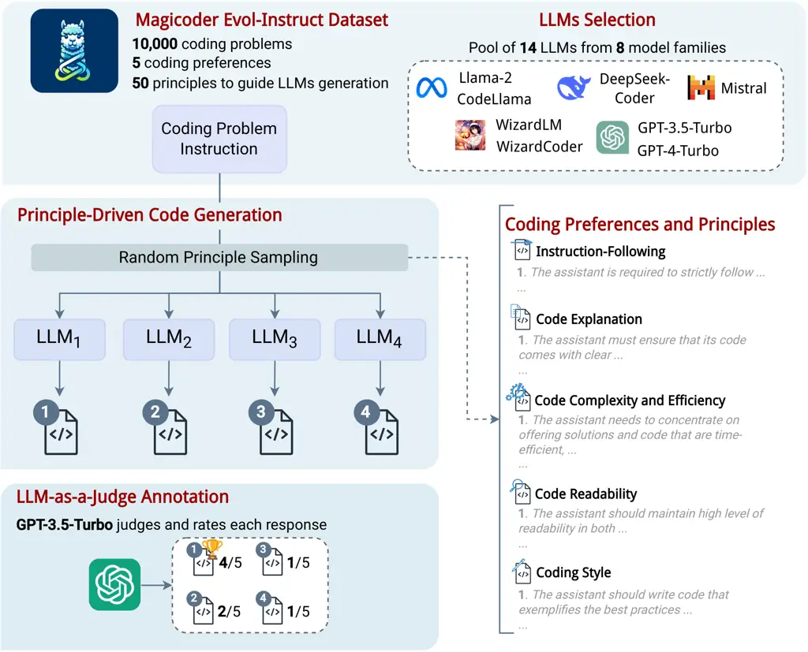
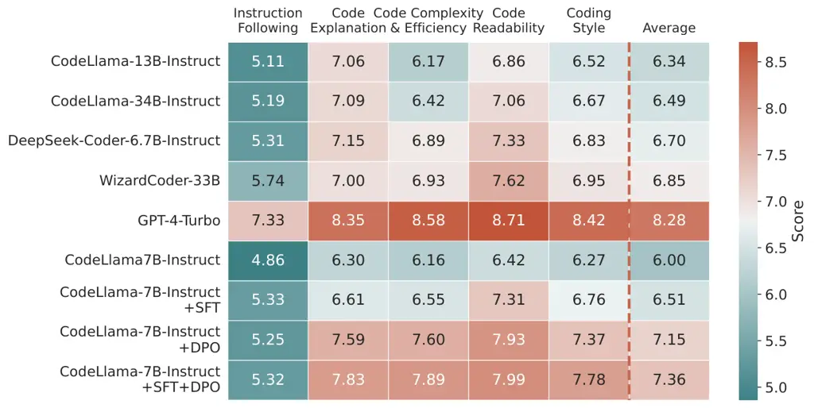

# CodeUltraFeedback: An LLM-as-a-Judge Dataset for Aligning Large Language Models to Coding Preferences

DOI: [XXXXXXX.XXXXXXX](https://doi.org/XXXXXXX.XXXXXXX)Conference: Make
sure to enter the correct conference title from your rights confirmation
emai; June 03–05, 2018; Woodstock, NYISBN: 978-1-4503-XXXX-X/18/06

Martin Weyssow email: <martin.weyssow@umontreal.ca> Affiliation: DIRO,
Université de Montréal, Montreal, Canada , Aton Kamanda email:
<atonkamanda@hotmail.com> Affiliation: DIRO, Université de Montréal,
Montreal, Canada , Xin Zhou email: <xinzhou.2020@phdcs.smu.edu.sg>
Affiliation: Singapore Management University, Singapore, Singapore and
Houari Sahraoui email: <sahraouh@iro.umontreal.ca> Affiliation: DIRO,
Université de Montréal, Montreal, Canada

2018

###### Abstract.

Evaluating the alignment of large language models (LLMs) with
user-defined coding preferences is a challenging endeavour that requires
a deep assessment of LLMs’ outputs. Existing methods and benchmarks rely
primarily on automated metrics and static analysis tools, which often
fail to capture the nuances of user instructions and LLM outputs. To
address this gap, we propose using the LLM-as-a-Judge methodology to
evaluate the alignment of LLMs with coding preferences. Based on this
approach, we present CodeUltraFeedback, a comprehensive dataset designed
to facilitate the evaluation and improvement of LLM alignment.
CodeUltraFeedback consists of 10,000 coding instructions, each annotated
with four responses generated from a diverse pool of 14 LLMs. These
responses are ranked based on five distinct coding preferences using
GPT-3.5 as a judge, providing both numerical scores and detailed textual
feedback. Our analysis of CodeUltraFeedback reveals that responses from
GPT-3.5 and GPT-4 are generally preferred over those from open-weight
LLMs, highlighting significant differences in alignment between closed
and open-weight models. In turn, we explore the usage of
CodeUltraFeedback as feedback data to fine-tune and align
CodeLlama-7B-Instruct using supervised fine-tuning (SFT) and
reinforcement learning from AI feedback (RLAIF) with direct preference
optimization (DPO). The resulting aligned CodeLlama-7B-Instruct model
outperforms larger LLMs in terms of alignment with coding preferences
and shows improved functional correctness on the HumanEval+ benchmark
compared to the original instruct model. Therefore, our contributions
bridge the gap in preference tuning of LLMs for code and set the stage
for further advancements in model alignment and RLAIF in automated
software engineering.

###### Keywords: 

Large language models, code generation, automated software engineering,
reinforcement learning from AI feedback, direct preference optimization

## 1. Introduction

The advent of recent large language models (LLMs) has ushered in a new
era of LLMs with high coding capabilities (Chen and others., 2021;
Roziere et al., 2023; Guo et al., 2024; Jiang et al., 2023; Touvron
et al., 2023; Muennighoff et al., 2023), showcasing remarkable
performances across a wide range of downstream tasks including code
generation (Liu et al., 2023b; Athiwaratkun et al., 2022; Weyssow
et al., 2023; Zheng et al., 2023b), code translation (Jiao et al., 2023;
Pan et al., 2023), bug fixing (Silva et al., 2023; Muennighoff et al.,
2023; Ye et al., 2021), and more. However, as LLMs continue to advance,
a critical question emerges: How well do these capabilities align with
developers’ expectations, particularly regarding non-functional
requirements such as code readability, efficiency, and adherence to best
practices?

Current methodologies for fine-tuning and evaluating LLMs primarily
focus on core capabilities, e.g., translating, summarizing, or reviewing
code (Lu et al., 2021; Puri et al., 2021; Zhu et al., 2022; Niu et al.,
2023; Zhou et al., 2023; Sghaier and Sahraoui, 2024; Sghaier et al.,
2023; Sghaier and Sahraoui, 2023), and functional correctness in diverse
code generation scenarios (Hendrycks et al., 2021; Austin et al., 2021;
Chen and others., 2021; Muennighoff et al., 2023; Liu et al., 2023b;
Khan et al., 2023). While some research has started to address
non-functional properties of LLM-generated code, such as code
quality (Siddiq et al., 2023), runtime efficiency (Huang et al., 2024),
and other aspects (Yetiştiren et al., 2023; Singhal et al., 2024), these
efforts often fall short in several key areas. First, existing
benchmarks typically refine established metrics without considering more
open-ended coding problems that involve complex user instructions.
Second, the assessment of LLM outputs often relies on automated metrics
and external tools based on inflexible standards and patterns. This
approach fails to capture the nuanced complexity of users’ instructions
and the subtleties in LLMs’ responses. Third, there is a notable absence
of large-scale datasets specifically designed for tuning and aligning
LLMs to non-functional requirements.

The landscape of existing datasets and benchmarks in automated software
engineering reveals a critical gap: the lack of methods for both tuning
LLMs and accurately measuring their alignment with non-functional
requirements. Furthermore, current evaluation methods fall short of
capturing the nuances in natural and programming languages, underscoring
the need for a more sophisticated, language-centric approach to
assessment. To address these shortcomings, we must develop comprehensive
datasets designed to improve LLM alignment with non-functional
requirements and design evaluation methods capable of evaluating LLM
alignment with greater precision. By closing these gaps, we can better
bridge the divide between developers’ expectations and the output of
LLMs, ensuring that the generated code not only functions correctly but
also adheres to best practices, maintains readability, and operates
efficiently.

In this paper, we introduce two novel contributions: CodeUltraFeedback
and CodeUltraFeedback-Bench. CodeUltraFeedback is a preference dataset
comprising 10,000 complex instructions with 40,000 meticulously curated
LLMs responses aligned with five non-functional requirements (or coding
preferences¹¹ 1 In the rest of this paper, we use the term “coding
preferences” instead of “non-functional requirements” to more precisely
capture the process of instructing LLMs with explicit preferences,
although both terms bear similar meanings.): instruction following, code
explanation, code complexity and efficiency, code readability, and
coding style. The objective of CodeUltraFeedback is to serve as a
dataset for preference tuning of LLMs, leveraging recent advancements in
LLM alignment, including UltraFeedback (Cui et al., 2023), reinforcement
learning from AI feedback (RLAIF) (Bai et al., 2022; Lee et al., 2023;
Ouyang et al., 2022) and LLM-as-a-Judge (Zheng et al., 2023a; Li et al.,
2023a), predicated upon the advanced judging capabilities of LLMs like
GPT-3.5 or GPT-4. We adopt an approach auxiliary to UltraFeedback for
building our dataset, starting by tagging each instruction with a coding
preference. Then, we generate responses to the instructions using four
LLMs randomly selected from a pool of 14 LLMs to achieve diversity and
consider various writing styles. Finally, we use LLM-as-a-Judge with
GPT-3.5 to rate the alignment of the LLM responses with the
instruction’s coding preference, resulting in annotations comprising a
numerical rating and a textual rationale for the rating. The resulting
dataset can then be leveraged to align an LLM to generate high-quality
responses given a coding preference by tuning the LLM through RLAIF
using techniques like direct preference optimization (DPO) (Rafailov
et al., 2023).

Subsequently, we construct CodeUltraFeedback-Bench by selecting a subset
of 500 instructions from CodeUltraFeedback. CodeUltraFeedback-Bench
serves a different purpose than CodeUltraFeedback and aims to
comprehensively assess and compare the alignment of LLMs with coding
preferences. We design a rigorous single-answer grading scheme using
LLM-as-a-Judge that allows the judge LLM to evaluate LLM-generated code
consistently and objectively. This approach offers a more nuanced
evaluation strategy than previous methods that rely on automated metrics
and external tools by leveraging the advanced reasoning capabilities of
LLMs. Their ability to discern nuances in language allows for a more
refined and context-sensitive evaluation of how well LLM-generated code
aligns with coding preferences in a language-centric fashion.

An initial data analysis of CodeUltraFeedback’s annotations reveals a
lack of alignment of 12 LLMs, including strong LLMs such as
WizardCoder-33B (Luo et al., 2023) and DeepSeek-Coder-Instruct-33B (Guo
et al., 2024), while GPT-3.5 and GPT-4 demonstrate strong alignment. In
turn, we explore preference tuning of a small model,
CodeLlama-7B-Instruct (Roziere et al., 2023) using CodeUltraFeedback
with supervised fine-tuning (SFT) and RLAIF with DPO (Rafailov et al.,
2023; Tunstall et al., 2023). This method selects high and low-rated
responses to align CodeLlama-7B-Instruct with coding preferences using
DPO, encouraging the model to favor highly rated responses. We
demonstrate that tuning CodeLlama-7B-Instruct with SFT and DPO
substantially improves alignment across all coding preferences,
surpassing all larger LLMs, including CodeLlama-34B-Instruct and
WizardCoder-33B when using GPT-3.5-Turbo as a judge. Further, we explore
LLM alignment on CodeUltraFeedback-Bench using GPT-4-Turbo as a judge
and highlight more mitigated effects of SFT and DPO, albeit
CodeLlama-7B-Instruct still outperforms CodeLlama-13B-Instruct and
CodeLlama-34B-instruct in this setup. We also show that preference
tuning does not hinder CodeLlama-7B-Instruct’s ability to generate
functionally correct code, substantially improving Pass@$`k`$ on
HumanEval (Chen and others., 2021) and HumanEval+ (Liu et al., 2023b).
Finally, we implement QLoRA (Dettmers et al., 2023) for efficient
fine-tuning, showing that SFT and DPO can effectively operate on a
single RTX A5000 GPU (24GB). Our work establishes strong evidence of the
benefits of SFT and DPO in improving LLM alignment with coding
preferences, demonstrating advancements in both preference alignment and
functional correctness. This paves the way for future improvements in
LLM training and evaluation, promising closer alignment with developers’
nuanced expectations.

To summarize, our main contributions are the following:

- –
  We release CodeUltraFeedback, a preference dataset of 10,000 complex
  instructions and 40,000 responses generated using 14 diverse LLMs for
  aligning LLMs to coding preferences in a code generation scenario.
- –
  We contribute CodeUltraFeedback-Bench, a benchmark to evaluate and
  compare LLM alignment using LLM-as-a-Judge over five coding
  preferences: instruction following, code explanation, code complexity
  and efficiency, code readability, and coding style.
- –
  We validate the utility of CodeUltraFeedback in facilitating LLM
  alignment of CodeLlama-7B-Instruct using SFT and DPO.

Our models, dataset, benchmark, and prompt templates are available at
[https://github.com/martin-wey/CodeUltraFeedback](https://github.com/martin-wey/CodeUltraFeedback).

## 2. CodeUltraFeedback

In this section, we introduce our new dataset, CodeUltraFeedback. Fig. 1
depicts our methodology for building CodeUltraFeedback, which
incorporates various components and ideas that we describe in the
subsequent subsections.

### 2.1. Coding Preferences and Principles

We start by identifying five coding preferences to guide the creation of
our dataset and which are essential to evaluate the broader capabilities
of LLMs: (1) Instruction-Following is about the strict adherence of the
LLM to the instructions provided by users. This preference is
foundational for ensuring that LLMs truly follow the user intent and
thus provide personalized responses to instructions. (2) Code
Explanation emphasizes generating code with detailed natural language
explanations. It underscores the importance of an LLM in providing a
solution with explanations that can serve as a bridge between
potentially complex code and users while improving trustworthiness. (3)
Code Complexity and Efficiency preference underlines the LLM capability
to generate code optimized for performance in terms of speed and
resource utilization. It is another crucial aspect requiring the LLM to
balance the speed and resource usage of the solution carefully. (4) Code
Readability serves a distinct purpose to the code explanation preference
by emphasizing the clarity and understandability of the code itself
through its structure, style, and the presence of meaningful
documentation and in-line comments. (5) Coding Style preference focuses
on the importance of writing code that not only meets syntactical
correctness but also aligns with the idiomatic practices and stylistic
norms of the programming language.

Altogether, these five preferences complement the functional correctness
requirement of LLM-generated code. Assessing how well LLMs align with
these preferences amounts to evaluating how the generated solutions are
optimized for human comprehension, maintainability, performance, and
collaborative work.



Figure 1. Overview of CodeUltraFeedback dataset construction procedure.
(i) Coding Preferences and Principles: we define five coding
preferences: Instruction-following, Code Explanation, Code Complexity
and Efficiency, Code Readability, and Coding Style, and 10 principles
for each preference to guide LLMs’ generative process. (ii) Magicoder
Evol-Instruct Dataset: CodeUltraFeedback is based on a 10k-instruction
subset of Magicoder Evol-Instruct dataset (Wei et al., 2023; Luo et al.,
2023), where each instruction is tagged with a coding preference. (iii)
LLMs Selection: for each instruction, four LLMs are randomly sampled
from a diverse pool of 14 LLMs. (iv) Principle-Driven Code Generation:
one principle is randomly selected per LLM to guide and align the code
generation process with the assigned coding preference. (v)
LLM-as-a-Judge Annotation: LLM-as-a-Judge with GPT-3.5-Turbo is used to
judge LLMs’ responses according to coding preferences evaluation
criteria (see Table 1).

### 2.2. Initial Dataset

To build CodeUltraFeedback, we rely on Magicoder Evol-Instruct
dataset (Wei et al., 2023), an Evol-Instruct (Xu et al., 2023; Luo
et al., 2023) version of CodeAlpaca dataset comprising coding problem
instructions. We select a random subset of Magicoder Evol-Instruct
comprising 10,000 samples serving as an initial dataset for
CodeUltraFeedback. We assign 2,000 samples per coding preference,
ensuring a balanced representation of each preference in the dataset.
The reason for subsampling the dataset to 10,000 samples is to lower
costs related to OpenAI API needed to generate some of the responses and
the annotations.

### 2.3. LLMs Selection

In order to generate highly diverse solutions to the instructions, we
select a pool of 14 LLMs spanning eight model families. These include
GPT-4-Turbo and GPT-3.5-Turbo as closed-source LLMs. We include
Llama-2-13B-Chat and Llama-2-70B-Chat (Touvron et al., 2023),
specialized for chat use cases. We choose CodeLlama-7/13/34B-Instruct
models (Roziere et al., 2023), instruction-tuned for code generation. We
also include WizardLM-15/33B models (Xu et al., 2023) and
Mistral-7B-Instruct (Jiang et al., 2023), which are instruction-tuned
LLMs that can follow complex instructions. Finally, we include
WizardCoder-15/33B (Luo et al., 2023) and
DeepSeek-Coder-6.7/33B-Instruct (Guo et al., 2024), recent
instruction-tuned LLMs that demonstrate state-of-the-art performance on
code generation benchmarks such as HumanEval (Chen and others., 2021)
and HumanEval+ (Liu et al., 2023b). From this pool, we randomly select
four LLMs for each instruction to generate responses, allowing for the
representation of a variety of coding approaches and styles. By
including models that encompass diverse pre-training and
instruction-tuning phases, our dataset captures a wide spectrum of
response generation behaviors. The differences between LLMs extend to
pre-training objectives, with some models specializing in general
natural language tasks (e.g., Llama-2-13B-Chat) and others explicitly
optimized for code-related tasks (e.g., WizardCoder and DeepSeek-Coder).
This diversity ensures that the dataset reflects not only distinct model
capabilities but also various stylistic and structural approaches to
solving programming problems. In turn, this strategy prevents subsequent
fine-tuning processes that use the CodeUltraFeedback preference dataset
to overfit a specific style of response.

### 2.4. Principle-Driven Code Generation

In this step, we leverage principle-driven generation and generate 10
principles per coding preference using ChatGPT following prior work
practices (Sun et al., 2023; Cui et al., 2023; Mukherjee et al., 2023).
The rationale for establishing 10 principles per preference is to
diversify the dataset. All principles for each coding preference can be
found in Tables 18–22.

During code generation, one principle, corresponding to the coding
preference of the sample, is randomly chosen per LLM and appended to the
instruction in an input prompt to guide the generation. This strategy
helps the LLMs generate responses that potentially align with the
requirements of the coding preferences. The output of this step is the
four LLMs’ responses to the principle-augmented instructions.

### 2.5. LLM-as-a-Judge Annotation

|                                                                                                                                                                             |
| --------------------------------------------------------------------------------------------------------------------------------------------------------------------------- |
| Evaluate the readability of code segments. Assess how comments and documentation contribute to understanding the code’s logic, purpose, and operation. Evaluation Criteria: |
| Clarity: How clear and understandable are the code and its accompanying comments/documentation?                                                                             |
| Conciseness: Are the comments and documentation succinct yet informative?                                                                                                   |
| Relevance: Do the comments and documentation directly contribute to explaining the code’s logic, objectives, and functionality?                                             |
| Comprehensibility: Can users of varying technical backgrounds easily grasp the code’s purpose and how it works?                                                             |
| Scoring: Rate outputs on a scale of 1 to 5:                                                                                                                                 |
| 1. Poor Readability: The code is hard to follow, with little to no helpful comments/documentation.                                                                          |
| 2. Basic Readability: The code has minimal comments/documentation, offering limited clarity or insight.                                                                     |
| 3. Good Readability: The code is reasonably clear with comments/documentation that aid understanding, though some areas could be improved.                                  |
| 4. Very Good Readability: The code and comments/documentation are clear and concise, making the code’s logic and purpose easily understandable.                             |
| 5. Excellent Readability: The code exemplifies outstanding readability, with clear, concise, and comprehensive comments/documentation that make it accessible to all users. |

Table 1. Code readability assessment template.

We apply the LLM-as-a-Judge methodology (Zheng et al., 2023a) to
annotate responses using GPT-3.5-Turbo. Drawing from practices
established in previous work (Cui et al., 2023), we implement a set of
guidelines ensuring GPT-3.5-Turbo delivers both consistent and objective
feedback. Each annotation consists of (1) a score on a 1–5 scale
offering a comprehensive assessment of the response’s alignment, and (2)
a rationale for the assigned score, highlighting the response’s
strengths and identifying any potential shortcomings. Tasking
GPT-3.5-Turbo to provide a rationale for the scores encourages a
chain-of-thought (Wei et al., 2022) process during the generation of
annotations, elucidating the reasons behind the scores and meaningful
feedback. In addition, this process mitigates the risk of variability
and subjectivity that might arise from purely quantitative assessments.
Consequently, this reflective process guarantees that the scoring is not
just a surface-level judgment but can be backed by thoughtful
consideration of some well-defined coding preferences evaluation
criteria.

|                                                                                                                                                                                                                                                                                                                                                                                                                                                                                                                     |
| ------------------------------------------------------------------------------------------------------------------------------------------------------------------------------------------------------------------------------------------------------------------------------------------------------------------------------------------------------------------------------------------------------------------------------------------------------------------------------------------------------------------- |
| Instruction: Devising a Python-based algorithm that utilizes the technique of ternary search, could you draw this up while also illustrating the functionality of each critical stage in the searching process?                                                                                                                                                                                                                                                                                                     |
| Preference: Readability                                                                                                                                                                                                                                                                                                                                                                                                                                                                                             |
| GPT-4: \[Response\]                                                                                                                                                                                                                                                                                                                                                                                                                                                                                                 |
| Rating: 5                                                                                                                                                                                                                                                                                                                                                                                                                                                                                                           |
| Rationale: The code is accompanied by clear and concise comments that comprehensively explain each critical stage of the ternary search algorithm. The comments provide a thorough understanding of the algorithm’s logic, purpose, and functionality, making it easily accessible to users of varying technical backgrounds. Additionally, the comments include a detailed explanation of the algorithm’s relevance and efficiency compared to binary search, enhancing the overall comprehensibility of the code. |
| DeepSeek-Coder-6.7B-Instruct: \[Response\]                                                                                                                                                                                                                                                                                                                                                                                                                                                                          |
| Rating: 4                                                                                                                                                                                                                                                                                                                                                                                                                                                                                                           |
| Rationale: \[Rationale\]                                                                                                                                                                                                                                                                                                                                                                                                                                                                                            |
| Mistral-7B-Instruct: \[Response\]                                                                                                                                                                                                                                                                                                                                                                                                                                                                                   |
| Rating: 3                                                                                                                                                                                                                                                                                                                                                                                                                                                                                                           |
| Rationale: \[Rationale\]                                                                                                                                                                                                                                                                                                                                                                                                                                                                                            |
| CodeLlama-13B-Instruct: \[Response\]                                                                                                                                                                                                                                                                                                                                                                                                                                                                                |
| Rating: 2                                                                                                                                                                                                                                                                                                                                                                                                                                                                                                           |
| Rationale: The code is clear, but the comments are minimal and lack sufficient detail to fully explain the ternary search algorithm and its critical stages. While the comments briefly describe the function’s purpose, they do not provide a comprehensive explanation of the algorithm’s logic and functionality. Additionally, the comments do not cover the relevance of ternary search in algorithmic strategies, making it less accessible to users with varying technical backgrounds.                      |

Table 2. Excerpt of ratings and rationales generated by GPT-3.5-Turbo
using LLM-as-a-Judge prompting. GPT-3.5-Turbo generates clear rationales
for each rating demonstrating its strong judging capabilities.

Table 1 illustrates the assessment template and evaluation criteria for
code readability evaluation. It aims to provide precise and
comprehensive criteria to the LLM judge for response assessment. We
design analogous assessment templates, each tailored with specific
evaluation criteria, for evaluating the other coding preferences (see
Tables 6–10). The annotation procedure entails constructing a prompt
combining the coding preference assessment template and the four LLMs
responses. GPT-3.5-Turbo is then tasked to generate the annotations for
all four responses simultaneously, enhancing the consistency and
reliability of the evaluation process over individual response
assessments. Table 2 presents an example of the output of the annotation
process using GPT-3.5-Turbo, with the LLMs responses and some rationales
omitted for brevity. This example showcases GPT-3.5-Turbo’s capability
to provide comprehensive justifications for each rating, demonstrating
its effective evaluation capabilities. Furthermore, Table 2 illustrates
an example of relatively complex instructions included in
CodeUltraFeedback, showcasing the complexity of the task.

## 3. CodeUltraFeedback: Dataset Analysis

|                              |                              |                              |                              |                              |                              |         |
| ---------------------------- | ---------------------------- | ---------------------------- | ---------------------------- | ---------------------------- | ---------------------------- | ------- |
| Model                        | Instruction Following        | Code Explanation             | Code Complexity & Efficiency | Code Readability             | Coding Style                 | Average |
| GPT-4-Turbo                  | $`\mathbf{3.79}^{\ddagger}`$ | $`\mathbf{4.04}^{\ddagger}`$ | $`\mathbf{3.91}^{\dagger}`$  | $`\mathbf{4.14}^{\ddagger}`$ | $`\mathbf{4.03}^{\ddagger}`$ | 3.98    |
| GPT-3.5-Turbo                | 3.56                         | 3.76                         | 3.76                         | 3.71                         | 3.66                         | 3.69    |
| WizardCoder-33B              | $`3.29^{\ddagger}`$          | $`3.31^{\ddagger}`$          | $`3.43^{\ddagger}`$          | $`3.44^{\ddagger}`$          | $`3.49^{\dagger}`$           | 3.39    |
| DeepSeek-Coder-33B-Instruct  | $`3.31^{\ddagger}`$          | $`3.30^{\ddagger}`$          | $`3.32^{\ddagger}`$          | $`3.46^{\ddagger}`$          | $`3.42^{\ddagger}`$          | 3.36    |
| DeepSeek-Coder-6.7B-Instruct | $`3.23^{\ddagger}`$          | $`3.29^{\ddagger}`$          | $`3.32^{\ddagger}`$          | $`3.45^{\ddagger}`$          | $`3.48^{\ddagger}`$          | 3.36    |
| Mistral-7B-Instruct          | $`3.20^{\ddagger}`$          | $`3.27^{\ddagger}`$          | $`3.28^{\ddagger}`$          | $`3.42^{\ddagger}`$          | $`3.40^{\ddagger}`$          | 3.31    |
| CodeLlama-34B-Instruct       | $`3.11^{\ddagger}`$          | $`3.20^{\ddagger}`$          | $`3.21^{\ddagger}`$          | $`3.35^{\ddagger}`$          | $`3.23^{\ddagger}`$          | 3.22    |
| Llama-2-70B-Chat             | $`3.11^{\ddagger}`$          | $`3.22^{\ddagger}`$          | $`3.14^{\ddagger}`$          | $`3.38^{\ddagger}`$          | $`3.22^{\ddagger}`$          | 3.21    |
| WizardCoder-15B              | $`3.11^{\ddagger}`$          | $`3.03^{\ddagger}`$          | $`3.12^{\ddagger}`$          | $`3.27^{\ddagger}`$          | $`3.16^{\ddagger}`$          | 3.14    |
| CodeLlama-13B-Instruct       | $`3.05^{\ddagger}`$          | $`2.99^{\ddagger}`$          | $`3.15^{\ddagger}`$          | $`3.18^{\ddagger}`$          | $`3.25^{\ddagger}`$          | 3.12    |
| CodeLlama-7B-Instruct        | $`2.91^{\ddagger}`$          | $`3.11^{\ddagger}`$          | $`3.01^{\ddagger}`$          | $`3.18^{\ddagger}`$          | $`3.13^{\ddagger}`$          | 3.07    |
| WizardLM-33B                 | $`3.07^{\ddagger}`$          | $`2.98^{\ddagger}`$          | $`2.91^{\ddagger}`$          | $`3.11^{\ddagger}`$          | $`3.10^{\ddagger}`$          | 3.03    |
| Llama-2-13B-Chat             | $`2.88^{\ddagger}`$          | $`2.97^{\ddagger}`$          | $`2.91^{\ddagger}`$          | $`3.18^{\ddagger}`$          | $`2.99^{\ddagger}`$          | 2.98    |
| WizardLM-7B                  | $`2.63^{\ddagger}`$          | $`2.61^{\ddagger}`$          | $`2.51^{\ddagger}`$          | $`2.69^{\ddagger}`$          | $`2.64^{\ddagger}`$          | 2.62    |

Table 3. Average scores across coding preferences for each LLM. The
statistical significance of differences in ratings between each LLM and
GPT-3.5-Turbo was tested using pairwise Welch’s $`t`$-tests.
Significance levels are denoted as follows: \* for $`p<0.05`$,
$`\dagger`$ for $`p<0.01`$, and $`\ddagger`$ for $`p<0.001`$. The
results from almost all pairwise $`t`$-tests indicate highly significant
differences ($`p<0.001`$).

In this section, we provide a detailed analysis of CodeUltraFeedback.
Specifically, we explore the inherent capabilities of LLMs to align with
coding preferences. Furthermore, we showcase the diversity of the
dataset in terms of LLM responses and scores.

### 3.1. LLMs Scores Exploration

We start by exploring the ratings generated by GPT-3.5-Turbo in the
LLM-as-a-Judge annotation phase. In Table 3, we present a detailed
analysis of the average scores across coding preferences for each LLM,
offering initial insight into their baseline capabilities.

At first glance, the scores might suggest marginal discrepancies given
the 1–5 scoring range. However, these variations are substantial and
carry statistical significance. To quantify this significance, we
performed pairwise Welch’s $`t`$-tests, comparing the score distribution
for each LLM against GPT-3.5-Turbo across each coding preference. This
test was chosen because it accounts for differences in sample sizes and
variances between groups. For each comparison, the null hypothesis
assumes that the means of the two groups are equal. We calculated
p-values to assess the statistical significance of observed differences,
using a significance threshold of $`p<0.05`$. The results reveal highly
significant statistical differences, with $`p<0.001`$, for most
comparisons and validate the discernible performance gaps between all
models and GPT-3.5-Turbo. Moreover, the results also demonstrate a
notably superior performance of GPT-4-Turbo relative to GPT-3.5-Turbo.

Overall, GPT-3.5-Turbo and GPT-4-Turbo score the highest across all
preferences and on average. This outcome is expected considering both
models have undergone extensive instruction and reinforcement learning
from human feedback (RLHF) tunings to align more closely with human
preferences (Ouyang et al., 2022). The scores indicate that highly
capable LLMs such as WizardCoder-33B and DeepSeek-Coder-33B-Instruct
underperform compared to GPT-3.5-Turbo. This underperformance is likely
due to a lack of alignment of the LLMs, and tuning these models using
alignment techniques could improve their performance.

### 3.2. LLMs Responses Analysis

To gain more insights into the diversity of CodeUltraFeedback, we
analyze the best and worst responses for each sample in terms of their
assigned scores.

Fig. 2 depicts the percentage of best and worst responses per LLM in the
dataset. Although GPT-4-Turbo and GPT-3.5-Turbo consistently score the
highest across all coding preferences on average, this plot highlights
that another LLM response is favoured for 73% of the samples. Moreover,
even LLMs with lower average scores produce the highest-rated responses
for at least 3.1% of the samples. This property of our dataset is
valuable for downstream applications. For instance, it enables the
alignment of LLMs using feedback data that encompasses a diverse range
of models and mitigates the risk of the aligned LLM mimicking the
behaviour of a single model.

Figure 2. Percentage of best and worst responses per LLM.

Figure 3. Distribution of best and worst responses length.

s

Next, we analyze the distribution of best and worst response lengths in
Fig. 3. Both distributions show similar patterns, though the best
responses tend to be slightly longer. Importantly, both distributions
encompass a broad spectrum of response lengths. This characteristic of
CodeUltraFeedback is also valuable for model alignment, as it helps
prevent the aligned LLM from developing a bias towards excessive
verbosity.

### 3.3. LLMs vs GPT-3.5-Turbo

To gauge the relative performance of the LLMs against GPT-3.5-Turbo more
in-depth, we analyze their performances through a win-tie-lose plot
depicted in Fig. 4. The idea is to pit each LLM (left-hand side of the
figure, e.g., Mistral-7B-Instruct) against GPT-3.5-Turbo in a
comparative match-up, where the model achieving the highest rating wins.
The plot illustrates the percentage of ratings of an LLM that are
higher/lower compared to those of GPT-3.5-Turbo, all preferences
combined (a tie stands for ratings having identical values). This figure
further demonstrates significant gaps between LLMs and GPT-3.5-Turbo,
underscoring a consistent preference for GPT-3.5-Turbo and GPT-4-Turbo’s
responses over other LLMs. For instance, even Mistral-7B-Instruct, the
second-best LLM, achieves a win rate of merely 29.8%. Additionally, the
plot further validates the utilization of GPT-3.5-Turbo as a judge,
showcasing its capability to discern between responses of differing
quality. For example, it is proficient in recognizing higher-quality
responses, as evidenced by its comparison with GPT-4-Turbo, which boasts
a win rate of 51.6%.

In conclusion, these initial observations highlight a significant
research opportunity and the necessity to delve deeper into aligning
LLMs with coding preferences to make them more competitive with models
like GPT-3.5 and GPT-4.

Figure 4. Win-tie-lose ratios of LLMs against GPT-3.5-Turbo. An LLM
wins/loses if it gets a greater/lower score than GPT-3.5-Turbo. A tie is
when the LLM and GPT-3.5-Turbo get identical scores.

## 4. Aligning LLMs to Coding Preferences

In this section, we present our experimental setup to improve LLM
alignment with coding preferences using CodeUltraFeedback as preference
data, which features the utilization of SFT and DPO (Liu et al., 2023b;
Tunstall et al., 2023). The purpose is twofold: validate the utility of
CodeUltraFeedback for LLM alignment to coding preferences and show that
a small LLM tuned using SFT and DPO can achieve greater alignment
performance.

### 4.1. Supervised Fine-Tuning (SFT)

As demonstrated in Zephyr’s paper (Tunstall et al., 2023), an
instruction-tuning phase is required prior to tuning an LLM using DPO as
it facilitates tuning. This phase is achieved through supervised
fine-tuning (SFT) using a dataset
$`\mathcal{D}=\{(x_{1},y_{1}),...,(x_{n},y_{n})\}`$ of
instruction-response pairs. Recent work leverages the
Self-Instruct (Wang et al., 2022a) and Evol-Instruct (Xu et al., 2023;
Luo et al., 2023) frameworks to compose such a dataset by generating
instructions and responses using a highly capable model such as
GPT-3.5/4 (Ouyang et al., 2022; Taori et al., 2023; Wei et al., 2023).
In this context, SFT is a form of knowledge distillation (Xu et al., 2024) that leverages a supervised signal from responses generated by a
teacher LLM to tune a student LLM.

Formally, for each instruction-response pair
$`(x_{i},y_{i})\in\mathcal{D}`$, the learning objective is to minimize
the cross-entropy loss $`\mathcal{L}_{SFT}`$, defined as:

```math
\mathcal{L}_{SFT}=-\frac{1}{n}\sum_{i=1}^{n}\log P(y_{i}|x_{i},\theta),
```

where $`P(y_{i}|x_{i},\theta)`$ represents the probability of generating
the response $`y_{i}`$ given the instruction $`x_{i}`$, parameterized by
$`\theta`$, the LLM parameters.

### 4.2. Direct Preference Optimization (DPO)

DPO is an efficient ranking optimization method to align LLMs to
preference data, where a response $`y_{w}`$ is preferred over a rejected
response $`y_{l}`$. Unlike traditional reinforcement learning methods
like RLHF, which require training a separate reward model, DPO enhances
stability and performance by directly adjusting the LLM’s policy towards
higher-ranked responses (i.e., $`y_{w}`$). Given a dataset
$`\mathcal{P}`$ of triplets $`(x,y_{w},y_{l})`$, a reference LLM policy
$`\pi_{ref}`$, and an LLM policy $`\pi_{\theta}`$, the objective is to
maximize the following expectation:

```math
\mathbb{E}_{\begin{subarray}{c}(x,y_{w},y_{l})\sim\mathcal{P}\end{subarray}}\log\sigma\left(\beta\log\left(\frac{\pi_{\theta}(y_{w}|x)}{\pi_{ref}(y_{w}|x)}-\frac{\pi_{\theta}(y_{l}|x)}{\pi_{ref}(y_{l}|x)}\right)\right).
```

The expression
$`\left(\frac{\pi_{\theta}(y_{w}|x)}{\pi_{ref}(y_{w}|x)}-\frac{\pi_{\theta}(y_{l}|x)}{\pi_{ref}(y_{l}|x)}\right)`$
calculates the difference in probabilities that the model assigns to the
preferred response $`y_{w}`$ and the response $`y_{l}`$, relative to the
reference policy $`\pi_{ref}`$. Intuitively, the difference indicates
how much the preference alignment of $`\pi_{\theta}`$ has improved for a
given triplet $`(x,y_{w},y_{l})`$ after applying DPO compared to the
reference policy $`\pi_{ref}`$. $`\beta`$ is a hyperparameter that
adjusts the sensitivity to the reference policy $`\pi_{ref}`$. In our
experiments, $`\pi_{ref}`$ is a SFT-tuned LLM.

### 4.3. Experimental Details

Datasets. We build CodeUltraFeedback-Bench, a new benchmark for
assessing LLM alignment to coding preferences. CodeUltraFeedback-Bench
consists of 500 randomly selected samples from CodeUltraFeedback, with a
balanced representation of each preference. The benchmark aims to
provide a rigorous and comprehensive framework to evaluate and compare
LLM alignment to coding preferences, allowing researchers to evaluate
the impact of new alignment methods.

For SFT, we use Magicoder Evol-Instruct (Wei et al., 2023), which
consists of instruction-response pairs generated by GPT-4. We filter out
the 10,000 samples used to build CodeUltraFeedback to mitigate data
leakage between the SFT and DPO phases and avoid potential overfitting.
The process results in 100,772 samples (95% for training, 5% for model
evaluation).

We use the remaining 9,500 samples from CodeUltraFeedback for DPO. From
each sample, we extract binary preferences ($`y_{w}`$, $`y_{l}`$),
denoting the preferred and rejected response. These preferences are
selected based on the highest and lowest ratings assigned by
GPT-3.5-Turbo during the LLM-as-a-Judge annotation phase (see
Section 2.5). In instances where multiple responses have the
highest/lowest ratings, we select one randomly to obtain
$`y_{w}`$ / $`y_{l}`$.

LLMs. We conduct our experiments on CodeLlama-7B-Instruct as it
comprises 7B parameters, allowing for tuning on a modest computing
infrastructure. Furthermore, the model lags behind more proficient LLMs
in CodeUltraFeedback’s scores (see Table 3), which makes it an ideal
candidate for demonstrating the potential impact of SFT and DPO on
improving LLM alignment. For comparison, we include the following LLMs:
CodeLlama-13/34B-Instruct, DeepSeek-Coder-6.7B-Instruct,
WizardCoder-33B, GPT-3.5-Turbo, and GPT-4-Turbo.

Grading Procedure. CodeUltraFeedback-Bench seeks to systematically
compare LLM alignment, whereas CodeUltraFeedback’s main purpose is to
serve as a training dataset for preference tuning. Therefore, we
designed a new grading procedure adapted for evaluating each LLM
individually using LLM-as-a-Judge. We implement a reference-guided
single-answer grading system that has proven efficient in alignment
benchmarks such as MT-Bench (Zheng et al., 2023a). Each LLM’s response
is individually evaluated against a reference response, providing a
consistent basis for comparison and ensuring objective judgments across
LLMs. Additionally, we instruct the judge LLM to provide a rationale
alongside the rating, enhancing the consistency of the evaluations.
Ratings are assigned on a scale from 1 to 10, facilitating nuanced
assessments of LLM alignment. We generate reference responses using
GPT-3.5-Turbo and GPT-4-Turbo and use both models as judges.

Training Details. We use HuggingFace TRL (Leandro et al., 2020) to
implement SFT and DPO with QLoRA (Dettmers et al., 2023) for efficient
fine-tuning. We use a cosine learning rate scheduler with a learning
rate of 2e-04 for SFT and 5e-05 for DPO, and 10% warmup steps. We
fine-tune CodeLlama-7B-Instruct for 3 and 5 epochs for SFT and DPO,
respectively. All experiments were conducted on a single NVIDIA RTX
A5000 GPU (24GB). We provide extensive training details in our
replication package.

## 5. Results



Figure 5. Average alignment scores for LLMs across coding preferences on
CodeUltraFeedback-Bench, evaluated using GPT-3.5-Turbo as a judge with
reference-guided single-answer grading.

SFT and DPO Improve Alignment to Coding Preferences. In Fig. 5, we
report the average alignment scores of the LLMs on the five coding
preferences using GPT-3.5-Turbo as a judge with its own responses to the
instructions as references. We do not include GPT-3.5-Turbo in the
results as references and responses would be identical, leading to
biased and perfect alignment scores.

GPT-4-Turbo stands out by surpassing all other LLMs across every coding
preference by a considerable margin. Interestingly, all LLMs demonstrate
lower scores on the instruction following preference. This trend
suggests a relative challenge in achieving high performance in this
area, possibly due to the inherently less precise nature of the
preference and potentially vague instructions. Conversely, LLMs tend to
achieve higher scores on code explanation and readability preferences.
We hypothesize this trend can be attributed to the fact that all LLMs
have undergone instruction tuning, which can encourage LLMs to output
reasoning and explanations alongside generated code. We observe that
scores substantially increase when tuning CodeLlama-7B-Instruct with
SFT+DPO, highlighting the effectiveness of these methods in enhancing
model alignment across all coding preferences. For instance, the model
yields a $`7.89`$ score on code complexity and efficiency preference,
substantially surpassing CodeLlama-7B-Instruct ($`6.16`$) and larger
models, including Wizard-33B ($`6.93`$) and CodeLlama-34B-Instruct
($`6.42`$).

Figure 6. Examples of solutions generated by
CodeLlama-7B-Instruct+SFT+DPO for two coding preferences: code
readability and code explanation.

Tuning CodeLlama-7B-Instruct with SFT shows an improvement in alignment
scores compared to the base model, which are further elevated with the
application of DPO independently or in conjunction with SFT. To quantify
these observations, we conducted pairwise $`t`$-tests (not reported for
brevety) comparing the baseline model, against its variants tuned with
SFT, DPO, and SFT+DPO. Although SFT alone improves performance, we found
no significant statistical difference with the baseline across
preferences, except for code readability. However, we found highly
significant statistical differences ($`p<0.001`$) for DPO and SFT+DPO
for all preferences with the exception of instruction following. After
DPO and SFT+DPO tunings, CodeLlama-7B-Instruct achieves superior
alignment compared to substantially larger models such as
CodeLlama-34B-Instruct and WizardCoder-33B across all coding
preferences.

To further illustrate the alignment of CodeLlama-7B-Instruct+SFT+DPO, we
highlight two examples of solutions in Fig. 6 for the code readability
and explanation preferences. For the code readability problem, the
model’s response demonstrates clear organization, use of comments, and
adherence to the task requirements, earning high ratings (GPT-4: 10/10,
Human-1: 8/10, Human-2: 10/10). Similarly, in the code explanation
problem, the model provides a well-structured, detailed breakdown of the
algorithm, including logical flow and computational complexity,
achieving a perfect score from all evaluators (GPT-4: 10/10, Human-1:
10/10, Human-2: 10/10). These examples highlight the high-quality
outputs of CodeLlama-7B-Instruct+SFT+DPO and its ability to generate
solutions tailored to different coding preferences.

Figure 7. Win-tie-lose ratios of LLMs against GPT-4-Turbo. DPO and
SFT+DPO substantially increase the percentage of won and tie matches.

DPO Enhances Competitive Edge Against GPT-4-Turbo. Fig. 7 illustrates
the win-tie-lose ratios of the LLMs against GPT-4-Turbo for all
preferences combined.

Non-aligned models achieve low win rates, with CodeLlama-7B-Instruct and
WizardCoder-33B peaking at a 10.8% win rate. GPT-4-Turbo, on the other
hand, consistently outperforms most LLMs with win rates exceeding 60%,
underscoring its superiority. Tuning CodeLlama-7B-Instruct with DPO and
SFT+DPO results in increases in win rates by 4.8% and 6.2%,
respectively, and raises tie scores by 15.4% and 16.4%, respectively.
These improvements underscore the effectiveness of alignment techniques
in rendering LLM responses more competitive. Nonetheless, the remaining
discernible gaps with GPT-4-Turbo suggest that there is still
substantial room for improvement.

Different Judges and References Impact Alignment Scores. We investigate
the effect of judges and references on the LLMs alignment scores in
Table 4.

Using GPT-3.5-Turbo as a judge, alignment scores are compared against
its own (left values) and GPT-4-Turbo’s responses (right values),
revealing a decrease against the latter due to GPT-4-Turbo’s higher
response standards. Additionally, CodeLlama-7B-Instruct+SFT+DPO achieves
an alignment score of 7.08, nearing GPT-3.5-Turbo’s average of 7.18.

Interestingly, divergent trends emerge under GPT-4-Turbo’s judgment,
with all CodeLlama models scoring lower, while other LLMs see score
increases. For instance, CodeLlama-13B-Instruct’s score falls from 5.58
to 4.83, while WizardCoder-33B’s increases from 6.26 to 6.75. Despite
this, SFT, DPO, and SFT+DPO alignment techniques boost
CodeLlama-7B-Instruct’s performance, still exceeding the 34B variant of
CodeLlama, albeit with varying impact with DPO.

These observations hint at GPT-4-Turbo’s potential preference for
certain response styles and variability in judgment compared to
GPT-3.5-Turbo, underscoring the need for further investigation to fully
understand the implications of judge selection on LLM alignment scores.

|                              |               |      |             |
| ---------------------------- | ------------- | ---- | ----------- |
|                              | Judge         |      |             |
|                              | GPT-3.5-Turbo |      | GPT-4-Turbo |
|            Reference         | G-3.5         | G-4  | G-4         |
| CodeLlama-13B-Instruct       | 6.34          | 5.58 | 4.83        |
| CodeLlama-34B-Instruct       | 6.49          | 5.84 | 5.36        |
| DeepSeek-Coder-6.7B-Instruct | 6.70          | 6.07 | 6.32        |
| WizardCoder-33B              | 6.85          | 6.26 | 6.75        |
| GPT-3.5-Turbo                | -             | 7.18 | 7.35        |
| GPT-4-Turbo                  | 8.28          | -    | -           |
| CodeLlama-7B-Instruct        | 6.00          | 5.46 | 4.72        |
| +SFT                         | 6.51          | 5.83 | 5.84        |
| +DPO                         | 7.15          | 6.79 | 5.08        |
| +SFT+DPO                     | 7.36          | 7.08 | 5.85        |

Table 4. Average alignment scores of LLMs on CodeUltraFeedback-Bench.
G-3.5 and G-4 refer to utilizing GPT-3.5-Turbo and GPT-4-Turbo responses
as references, respectively.

LLM Judgements Correlate with Human Evaluators. We investigate the
judging capabilities of GPT-3.5 and GPT-4 by evaluating their alignment
with human evaluators. We randomly select 20 samples per coding
preference, manually annotated by two authors of the paper following the
same judging setup as LLM-as-a-Judge. Fig. 8(a) reports _Cohen’s kappa_
coefficients ($`\kappa`$) for each LLM-human combination. Given that
ratings are on a 1-10 scale, we use a tolerance threshold of $`\tau=2`$,
considering ratings like 7 and 9 to be in agreement. We also compare the
score distributions of humans and LLMs in Fig. 8(b).

We observe that GPT-3.5 generally shows stronger agreement with human
evaluators (H-1 and H-2) across coding preferences compared to GPT-4.
For example, GPT-3.5 demonstrates almost perfect agreement with both
humans in code readability ($`\kappa=0.83`$ and $`\kappa=0.91`$),
whereas GPT-4 demonstrates only moderate agreement in this preference
($`\kappa=0.48`$ and $`\kappa=0.43`$). Interestingly, for most coding
preferences—except for instruction following—GPT-3.5’s judgments show
stronger alignment with individual human judges than the agreement
observed between the human judges themselves. This observation suggests
that GPT-3.5’s evaluations may serve as a reliable proxy for human
judgment in these coding preferences.

The score distributions in Fig. 8(b) reveal that humans tend to give
higher ratings compared to GPT-3.5 and GPT-4. Notably, GPT-3.5 shows
better consistency with human ratings’, while GPT-4’s ratings are more
evenly distributed, which contributes to its lower kappa values.
Overall, our findings highlight that GPT-3.5 aligns more closely with
human evaluators, though both LLMs would benefit from further
calibration, particularly in the instruction-following preference.

|                       |       |       |      |      |      |
| --------------------- | ----- | ----- | ---- | ---- | ---- |
| Preference            |       | G-3.5 | G-4  | H-1  | H-2  |
| Instruction-Following | G-3.5 | -     | 0.41 | 0.29 | 0.32 |
|                       | G-4   | -     | -    | 0.39 | 0.43 |
|                       | H-1   | -     | -    | -    | 0.57 |
|                       | H-2   | -     | -    | -    | -    |
| Explanation           | G-3.5 | -     | 0.60 | 0.78 | 0.67 |
|                       | G-4   | -     | -    | 0.49 | 0.62 |
|                       | H-1   | -     | -    | -    | 0.64 |
|                       | H-2   | -     | -    | -    | -    |
| Efficiency            | G-3.5 | -     | 0.73 | 0.50 | 0.58 |
|                       | G-4   | -     | -    | 0.49 | 0.56 |
|                       | H-1   | -     | -    | -    | 0.52 |
|                       | H-2   | -     | -    | -    | -    |
| Readability           | G-3.5 | -     | 0.53 | 0.83 | 0.91 |
|                       | G-4   | -     | -    | 0.48 | 0.43 |
|                       | H-1   | -     | -    | -    | 0.64 |
|                       | H-2   | -     | -    | -    | -    |
| Style                 | G-3.5 | -     | 0.48 | 0.77 | 0.67 |
|                       | G-4   | -     | -    | 0.48 | 0.37 |
|                       | H-1   | -     | -    | -    | 0.60 |
|                       | H-2   | -     | -    | -    | -    |

(a) Agreement between humans and LLMs judgements in terms of _Cohen’s
kappa_ coefficient with a tolerance threshold of $`\tau=2`$.

(b) Score distribution of humans (H-1 and H-2) and GPT-3.5/4.

Figure 8. Analysis of the judging agreements between humans and LLMs (a)
and their score distributions (b) for solutions generated by
CodeLlama-7B-Instruct+SFT+DPO.

SFT and DPO Improve Functional Correctness. While our findings highlight
the positive impact of SFT and DPO on aligning LLMs with coding
preferences, ensuring the functional correctness of the generated code
remains a pivotal concern. In Table 5, we report CodeLlama-7B-Instruct’s
Pass@$`k`$ on HumanEval (Chen and others., 2021) and HumanEval+ (Liu
et al., 2023b).

Firstly, SFT substantially enhances Pass@$`k`$ on both benchmarks, with
Pass@$`1`$ rising from 37.9 to 51.2 and 33.2 to 45.6 for HumanEval and
HumanEval+, respectively. This result aligns with Magicoder (Wei et al., 2023) and WizardCoder (Luo et al., 2023) findings, showing that
knowledge distillation through SFT substantially enhances the LLM’s
effectiveness on these benchmarks. Secondly, while DPO and SFT+DPO
variants exhibit a slight reduction in Pass@$`k`$ relative to SFT alone,
they still maintain substantially higher Pass@$`k`$ compared to the
baseline.

These results show that LLM alignment through SFT and DPO also improves
functional correctness, mostly due to the SFT phase, further
demonstrating the usefulness of aligning LLMs. The lesser improvements
in Pass@$`k`$ with DPO can be attributed to DPO’s learning objective,
focusing on favouring preferred responses with respect to coding
preferences rather than based on their functional correctness.
Therefore, we underscore the need for more investigations into the
design of learning objectives and methods that can prioritize both
functional correctness and alignment to coding preferences.

|                       |           |          |            |          |
| --------------------- | --------- | -------- | ---------- | -------- |
|                       | HumanEval |          | HumanEval+ |          |
|                       | $`k`$=1   | $`k`$=10 | $`k`$=1    | $`k`$=10 |
| CodeLlama-7B-Instruct | 37.9      | 60.4     | 33.2       | 54.9     |
| +SFT                  | 51.2      | 82.9     | 45.6       | 79.3     |
| +DPO                  | 42.3      | 80.5     | 35.8       | 70.1     |
| +SFT+DPO              | 43.1      | 75.6     | 36.7       | 69.5     |

Table 5. Pass@$`k`$ of CodeLlama-7B-Instruct variants on HumanEval and
HumanEval+.

Figure 9. GPT-3.5 and GPT-4 ratings for HumanEval+ solutions generated
by CodeLlama-7B-Instruct+SFT+DPO.

GPT-4 Prefers Test-Passing Solutions. To further analyze the judging
behavior of GPT-3.5 and GPT-4, we examine their ratings for solutions
generated by CodeLlama-7B-Instruct+SFT+DPO on the HumanEval+ benchmark.
Fig. 9 depicts the distribution of ratings assigned by GPT-3.5 (left)
and GPT-4 (right), distinguishing between solutions that pass and fail
the corresponding test cases. To compute the ratings, we followed an
identical LLM-as-a-Judge setup than for CodeUltraFeedback by designing a
specific prompt (see Table 17), which focuses on judging functional
correctness and the usefulness of the solution.

The results indicate a significant behavioral difference between the
GPT-3.5 and GPT-4. GPT-4 shows a clear preference for solutions that
pass test cases, assigning them consistently higher ratings. In
contrast, GPT-3.5 demonstrates little distinction between test-passing
and test-failing solutions, as reflected in the more uniform rating
distribution across both categories. These findings underscore GPT-4’s
strength in aligning ratings with objective evaluation criteria, such as
passing test cases, and highlight the need for further refinement of
GPT-3.5 in this regard.

## 6. Discussion

In this paper, we have demonstrated how LLM-as-a-Judge enables the
creation of new datasets and benchmarks like CodeUltraFeedback and
CodeUltraFeedback-Bench to facilitate the tuning of LLMs for better
alignment with coding preferences and assess their performance. This
section offers further insights from our experiments, potential
improvements for LLM alignment and evaluation, and the significance of
exploring various LLM-as-a-Judge configurations. Additionally, we
outline some limitations of CodeUltraFeedback and
CodeUltraFeedback-Bench.

### 6.1. Limitations of Existing Evaluation Metrics

Evaluation metrics are central to assessing the performance of LLMs for
code generation. Automated metrics and static analysis tools provide
scalable and objective evaluations. However, while these techniques
effectively capture specific aspects of the LLM-generated code, e.g.,
whether it passes unit tests or matches a ground truth solution, they
fail to evaluate the latter against user-centric preferences such as
code readability or whether the response strictly follows the user’s
instructions.

One of the main limitations of automated metrics is that they cannot
assess language subtleties as humans do. For instance, metrics like
Pass@$`k`$ are useful for evaluating functional correctness but cannot
discriminate between an overly verbose solution or one lacking
meaningful comments and explanations. On the other hand, static analysis
tools focus on enforcing rules, which does not encompass any form of
language understanding that would allow determining whether a solution
includes useful explanations for a given generated code. Altogether, our
approach featuring LLM-as-a-Judge offers a solution to these limitations
by focusing on LLM alignment with user coding preferences. For example,
when evaluating a solution to a coding task, the judge LLM can discern
whether comments add meaningful context, whether variable names enhance
code readability, or whether an explanation is structured logically.
This process is parallel to how humans would judge a solution.

The interplay between LLM-as-a-Judge and automated metrics offers
significant opportunities for advancing evaluation methodologies. In
particular, the combination of automated evaluation metrics and judging
LLMs could result in more holistic evaluations of LLM-generated code and
enhance the way we benchmark code LLMs. For instance, future metrics
might integrate functional correctness scores with readability and
explanation assessments, creating a weighted evaluation system that
reflects the multifaceted nature of high-quality code.

### 6.2. LLM Alignment and LLM-as-a-Judge

Balancing Learning Objectives. A crucial area requiring deeper
investigation is the balance between functional correctness and
non-functional requirements. In our experiments, we demonstrate that
CodeLlama-7B-Instruct+SFT+DPO shows higher performance on
HumanEval/HumanEval+ compared to the base model. Understanding how to
integrate functional and non-functional learning objectives could
significantly advance the tuning process of LLMs and further enhance
their performance across a broad range of benchmarks.

CodeUltraFeedback for Critic LLM Training. In this work, we demonstrate
the utility of CodeUltraFeedback for LLM preference tuning using RLAIF
and DPO. One of the drawbacks of CodeUltraFeedback-Bench is the need to
leverage models like GPT-4 to evaluate other LLMs, which might turn out
to be cost-prohibitive. Nonetheless, we believe the AI feedback data in
CodeUltraFeedback, e.g., ratings and rationales, can be leveraged to
fine-tune a small critic LLM trained to evaluate other LLMs. Prior work
including Shepherd (Wang et al., 2023) and Prometheus (Kim et al., 2023)
have been proposed around that idea and showed promising results.

Parallel Findings with Zephyr Our findings draw parallels with Zephyr
’s (Tunstall et al., 2023) insights on DPO, with models beginning to
overfit after a few epochs, achieving 100% training set accuracy. In our
case, overfitting after five DPO training epochs correlated with
improved performance. Although the model overfits, the gap between
chosen and rejected rewards continued to grow, suggesting that
monitoring reward accuracy might not be relevant for model selection.
Therefore, more experimentation on DPO could illuminate better model
tuning and selection approaches for improved model alignment.

Potential Judgment Biases. We highlight GPT-3.5-Turbo’s robustness in
judgment in both our dataset and benchmark. The performance ranking of
LLMs remained consistent, underscoring the reliability of
GPT-3.5-Turbo’s evaluations. Despite this, there remains the possibility
of inherent biases in LLM judgments, such as a preference for lengthy or
verbose responses. The grading procedures employed for CodeUltraFeedback
and CodeUltraFeedback-Bench were carefully designed, drawing on
established practices to preclude such biases (Zheng et al., 2023a; Li
et al., 2023b). Single-answer grading with a reference response to the
instruction and chain-of-thought prompting enables both GPT-3.5-Turbo
and GPT-4-Turbo to produce consistent judgements. However, further
exploration into the potential biases influencing LLM judgments is
warranted.

Exploring Alternative Judges. Future studies could benefit from
incorporating a wider range of judges to understand how different LLMs’
evaluative perspectives might influence the judgment process and
outcomes. Additionally, the reliance on closed-source models can be
mitigated by tuning small and open-source critic LLMs.

### 6.3. Limitations

Our methodology presupposes the existence of a highly capable model,
such as GPT-3.5 or GPT-4, as a proxy to humans to accurately evaluate
other LLMs. The reliance on these models is predicated upon previous
findings, which indicate that GPT-3.5 and GPT-4 align closely with human
judgments (Zheng et al., 2023a; Li et al., 2023b), achieving agreement
rates on par with those between humans themselves on MT-Bench (Zheng
et al., 2023a). Additionally, recent work (Zhuo, 2024) demonstrates that
ICE-Score, a novel metric for code generation based on LLM-as-a-Judge is
superior to prior metrics and has a higher correlation with human
judgements. Additionally, we performed a correlation analysis between
GPT-3.5, GPT-4, and human evaluators using 100 samples from
CodeUltraFeedback-Bench. The results reveal that GPT-3.5 shows a strong
correlation with human judgments across coding preferences, while
exhibiting a similar score distribution. Such evidence supports the
utilization of LLMs as evaluators.

Our current iteration of CodeUltraFeedback-Bench relies on randomly
selected samples. Future versions aim to employ a more rigorous
filtering process, possibly incorporating human annotations, to enhance
the quality of selected samples.

Lastly, our grading procedure in CodeUltraFeedback-Bench necessitates
reference responses. This usage of reference responses gives the judge
LLMs a consistent point of comparison, enabling fair and consistent
judgements across LLMs outputs. Future work might explore ways to
alleviate this dependency.

## 7. Related Work

We differentiate our work from the existing landscape of datasets and
benchmarks in automated software engineering, with a particular focus on
execution-based benchmarks, closed-solutions datasets, and benchmarks,
as well as those assessing non-functional aspects of generated code.

### 7.1. Execution-based Benchmarks

This category of benchmarks emphasizes the functional correctness of
generated code by evaluating whether it passes a set of unit tests.
Execution-based benchmarks include HumanEval (Chen and others., 2021),
MBPP (Austin et al., 2021), APPS (Hendrycks et al., 2021), and
DS-1000 (Lai et al., 2023), which have extensively been used to compare
LLMs in code generation scenarios (Roziere et al., 2023; Muennighoff
et al., 2023; Luo et al., 2023; Wei et al., 2023). Subsequent work has
expanded HumanEval and MBPP benchmarks to multiple programming
languages (Athiwaratkun et al., 2022; Cassano et al., 2023; Zheng
et al., 2023b), more unit tests (Liu et al., 2023b), and more tasks
including code summarization (Athiwaratkun et al., 2022), code
repair (Muennighoff et al., 2023), code explanation (Muennighoff et al.,
2023), and code translation (Zheng et al., 2023b). This category also
encompasses benchmarks designed around specific use cases, such as
Odex (Zhou et al., 2022), which deals with Python open-domain problems
and includes manual annotations of user intents, and StudentEval (Babe
et al., 2023), which utilizes student-defined prompts for Python code
generation. xCodeEval (Khan et al., 2023) benchmark extends the scope to
code understanding, generation, and retrieval across numerous tasks.
Lastly, benchmarks like ClassEval (Du et al., 2023) and CoderEval (Yu
et al., 2024) shift the focus towards evaluating LLMs’ proficiency in
generating functionally correct code across various programming
abstractions, such as class, file, and project levels.

Our work differs from this category of benchmarks and focuses on
aligning LLMs to coding preferences and measuring their alignment using
an LLM as a proxy for human evaluation without relying on unit tests or
automated metrics. Nonetheless, we believe evaluating the functional
correctness of LLM-generated code remains a pivotal concern
complementary to the aim of CodeUltraFeedback and
CodeUltraFeedback-Bench.

### 7.2. General Datasets and Closed-Solutions Benchmarks

Initial datasets like GitHub Java Corpus (Allamanis and Sutton, 2013),
Py150/Js150 (Raychev et al., 2016a; Raychev et al., 2016b), and
CodeSearchNet (Husain et al., 2019) laid the groundwork for evaluating
language models in code-related tasks, including modelling,
summarization, and search. Subsequent developments introduced benchmarks
like CodeXGlue (Lu et al., 2021), CodeNet (Puri et al., 2021),
XLCoST (Zhu et al., 2022), ReCode (Wang et al., 2022b), and
CrossCodeBench (Niu et al., 2023), each expanding the evaluation scope
to include code understanding, generation, and robustness against
perturbations across various coding tasks and languages. Recently,
CrossCodeEval (Ding et al., 2023) broadened this scope by assessing
generative capabilities and the use of cross-file information for
project-wide coding tasks.

These datasets and benchmarks evaluate language models’ core
capabilities, mainly through task-specific transfer learning, relying on
ground truth solutions which may overlook valid code variations. In
contrast, CodeUltraFeedback and CodeUltraFeedback-Bench focus on
aligning LLMs with human coding preferences. Additionally, the
LLM-as-a-Judge approach serves as an alternative to automated
evaluations, prioritizing nuanced assessment of natural and programming
languages over strict adherence to ground truth.

### 7.3. Non-Functional Evaluation of LLM-Generated Code

Recent advancements have expanded LLM evaluation to include
non-functional requirements (Yang et al., 2024), an aspect overlooked in
earlier studies. Examples include efforts to assess the quality of
AI-generated code (Liu et al., 2023a; Siddiq et al., 2023) by using
static analysis tools. In contrast, our work adopts a broader strategy,
employing LLMs’ advanced reasoning to tune and assess their alignment
with human coding preferences. Furthermore, Yetiştiren et
al. (Yetiştiren et al., 2023) evaluated LLM-generated code using quality
metrics such as security, reliability, and maintainability on the
HumanEval benchmark. Our work encompasses a broader evaluation scope,
including more complex instructions, and CodeUltraFeedback to tune and
align LLMs to coding preferences. In contrast to CyberSecEval (Bhatt
et al., 2023) and EffiBench (Huang et al., 2024), which concentrate on
particular code aspects like security and efficiency, our methodology
based on LLM-as-a-Judge provides a holistic evaluation across several
dimensions, offering a framework that can be adapted to assess an array
of coding preferences. NoFunEval (Singhal et al., 2024) stands as the
most closely related benchmark to our work, evaluating LLM-generated
code’s non-functional properties across 958 coding problems using
functional specifications and static analysis tools. In contrast, we
leverage LLMs’ evaluative capabilities for LLM evaluation, overcoming
static analysis tools’ limitations in capturing language nuances.
Additionally, we introduce a comprehensive dataset for tuning LLM
preferences, distinguishing our work as a unique contribution to the
field of code LLM evaluation.

## 8. Conclusion and Future Work

In this paper, we introduce CodeUltraFeedback and
CodeUltraFeedback-Bench, a preference dataset and benchmark of
instructions for LLM alignment to five coding preferences. Our analysis
reveals significant alignment disparities among various LLMs compared to
GPT-3.5 and GPT-4. Furthermore, we demonstrate how CodeUltraFeedback
facilitates preference tuning using SFT, RLAIF and DPO. Our experiments
conclude that CodeLlama-7B-Instruct tuned with SFT and DPO outperforms
34B LLMs on CodeUltraFeedback-Bench and enhances functional correctness
on HumanEval+. We hope CodeUltraFeedback and CodeUltraFeedback-Bench can
further support research related to LLM alignment in automated software
engineering. In future work, we plan to explore more judges to assess
LLMs on CodeUltraFeedback-Bench and use CodeUltraFeedback to fine-tune
our own judge LLM, thereby reducing our dependence on closed-source
models like GPT-4.

## References

- Allamanis and Sutton (2013) Miltiadis Allamanis and Charles
  Sutton. 2013. Mining source code repositories at massive scale using
  language modeling. In _2013 10th working conference on mining software
  repositories (MSR)_. IEEE, 207–216.
- Athiwaratkun et al. (2022) Ben Athiwaratkun, Sanjay Krishna Gouda,
  Zijian Wang, Xiaopeng Li, Yuchen Tian, Ming Tan, Wasi Uddin Ahmad,
  Shiqi Wang, Qing Sun, Mingyue Shang, et al. 2022. Multi-lingual
  evaluation of code generation models. _arXiv preprint
  arXiv:2210.14868_ (2022).
- Austin et al. (2021) Jacob Austin, Augustus Odena, Maxwell Nye,
  Maarten Bosma, Henryk Michalewski, David Dohan, Ellen Jiang, Carrie
  Cai, Michael Terry, Quoc Le, et al. 2021. Program Synthesis with Large
  Language Models. _arXiv preprint arXiv:2108.07732_ (2021).
- Babe et al. (2023) Hannah McLean Babe, Sydney Nguyen, Yangtian Zi,
  Arjun Guha, Molly Q Feldman, and Carolyn Jane Anderson. 2023.
  StudentEval: A Benchmark of Student-Written Prompts for Large Language
  Models of Code. arXiv:2306.04556 \[cs.LG\]
- Bai et al. (2022) Yuntao Bai, Saurav Kadavath, Sandipan Kundu, Amanda
  Askell, Jackson Kernion, Andy Jones, Anna Chen, Anna Goldie, Azalia
  Mirhoseini, Cameron McKinnon, et al. 2022. Constitutional ai:
  Harmlessness from ai feedback. _arXiv preprint arXiv:2212.08073_
  (2022).
- Bhatt et al. (2023) Manish Bhatt, Sahana Chennabasappa, Cyrus
  Nikolaidis, Shengye Wan, Ivan Evtimov, Dominik Gabi, Daniel Song,
  Faizan Ahmad, Cornelius Aschermann, Lorenzo Fontana, et al. 2023.
  Purple llama cyberseceval: A secure coding benchmark for language
  models. _arXiv preprint arXiv:2312.04724_ (2023).
- Cassano et al. (2023) Federico Cassano, John Gouwar, Daniel Nguyen,
  Sydney Nguyen, Luna Phipps-Costin, Donald Pinckney, Ming-Ho Yee,
  Yangtian Zi, Carolyn Jane Anderson, Molly Q Feldman, et al. 2023.
  MultiPL-E: a scalable and polyglot approach to benchmarking neural
  code generation. _IEEE Transactions on Software Engineering_ (2023).
- Chen and others. (2021) Mark Chen and others. 2021. Evaluating Large
  Language Models Trained on Code. arXiv:2107.03374 \[cs.LG\]
- Cui et al. (2023) Ganqu Cui, Lifan Yuan, Ning Ding, Guanming Yao, Wei
  Zhu, Yuan Ni, Guotong Xie, Zhiyuan Liu, and Maosong Sun. 2023.
  Ultrafeedback: Boosting language models with high-quality feedback.
  _arXiv preprint arXiv:2310.01377_ (2023).
- Dettmers et al. (2023) Tim Dettmers, Artidoro Pagnoni, Ari Holtzman,
  and Luke Zettlemoyer. 2023. Qlora: Efficient finetuning of quantized
  llms. _arXiv preprint arXiv:2305.14314_ (2023).
- Ding et al. (2023) Yangruibo Ding, Zijian Wang, Wasi Uddin Ahmad,
  Hantian Ding, Ming Tan, Nihal Jain, Murali Krishna Ramanathan, Ramesh
  Nallapati, Parminder Bhatia, Dan Roth, et al. 2023. Crosscodeeval: A
  diverse and multilingual benchmark for cross-file code completion.
  _arXiv preprint arXiv:2310.11248_ (2023).
- Du et al. (2023) Xueying Du, Mingwei Liu, Kaixin Wang, Hanlin Wang,
  Junwei Liu, Yixuan Chen, Jiayi Feng, Chaofeng Sha, Xin Peng, and
  Yiling Lou. 2023. Classeval: A manually-crafted benchmark for
  evaluating llms on class-level code generation. _arXiv preprint
  arXiv:2308.01861_ (2023).
- Guo et al. (2024) Daya Guo, Qihao Zhu, Dejian Yang, Zhenda Xie, Kai
  Dong, Wentao Zhang, Guanting Chen, Xiao Bi, Y Wu, YK Li, et al. 2024.
  DeepSeek-Coder: When the Large Language Model Meets Programming–The
  Rise of Code Intelligence. _arXiv preprint arXiv:2401.14196_ (2024).
- Hendrycks et al. (2021) Dan Hendrycks, Steven Basart, Saurav Kadavath,
  Mantas Mazeika, Akul Arora, Ethan Guo, Collin Burns, Samir Puranik,
  Horace He, Dawn Song, and Jacob Steinhardt. 2021. Measuring Coding
  Challenge Competence With APPS. _NeurIPS_ (2021).
- Huang et al. (2024) Dong Huang, Jie M Zhang, Yuhao Qing, and Heming
  Cui. 2024. EffiBench: Benchmarking the Efficiency of Automatically
  Generated Code. _arXiv preprint arXiv:2402.02037_ (2024).
- Husain et al. (2019) Hamel Husain, Ho-Hsiang Wu, Tiferet Gazit,
  Miltiadis Allamanis, and Marc Brockschmidt. 2019. Codesearchnet
  challenge: Evaluating the state of semantic code search. _arXiv
  preprint arXiv:1909.09436_ (2019).
- Jiang et al. (2023) Albert Q Jiang, Alexandre Sablayrolles, Arthur
  Mensch, Chris Bamford, Devendra Singh Chaplot, Diego de las Casas,
  Florian Bressand, Gianna Lengyel, Guillaume Lample, Lucile Saulnier,
  et al. 2023. Mistral 7B. _arXiv preprint arXiv:2310.06825_ (2023).
- Jiao et al. (2023) Mingsheng Jiao, Tingrui Yu, Xuan Li, Guanjie Qiu,
  Xiaodong Gu, and Beijun Shen. 2023. On the Evaluation of Neural Code
  Translation: Taxonomy and Benchmark. In _2023 38th IEEE/ACM
  International Conference on Automated Software Engineering (ASE)_.
  IEEE, 1529–1541.
- Khan et al. (2023) Mohammad Abdullah Matin Khan, M Saiful Bari,
  Xuan Long Do, Weishi Wang, Md Rizwan Parvez, and Shafiq Joty. 2023.
  xCodeEval: A Large Scale Multilingual Multitask Benchmark for Code
  Understanding, Generation, Translation and Retrieval. _arXiv preprint
  arXiv:2303.03004_ (2023).
- Kim et al. (2023) Seungone Kim, Jamin Shin, Yejin Cho, Joel Jang,
  Shayne Longpre, Hwaran Lee, Sangdoo Yun, Seongjin Shin, Sungdong Kim,
  James Thorne, et al. 2023. Prometheus: Inducing fine-grained
  evaluation capability in language models. _arXiv preprint
  arXiv:2310.08491_ (2023).
- Lai et al. (2023) Yuhang Lai, Chengxi Li, Yiming Wang, Tianyi Zhang,
  Ruiqi Zhong, Luke Zettlemoyer, Wen-tau Yih, Daniel Fried, Sida Wang,
  and Tao Yu. 2023. DS-1000: A natural and reliable benchmark for data
  science code generation. In _International Conference on Machine
  Learning_. PMLR, 18319–18345.
- Leandro et al. (2020) Von Werra Leandro, Belkada Younes, Tunstall
  Lewis, Beeching Edward, Thrush Tristan, Lambert Nathan, and Huang
  Shengyi. 2020. TRL: Transformer reinforcement learning.
  [https://huggingface.co/docs/trl/en/index](https://huggingface.co/docs/trl/en/index).
- Lee et al. (2023) Harrison Lee, Samrat Phatale, Hassan Mansoor, Kellie
  Lu, Thomas Mesnard, Colton Bishop, Victor Carbune, and Abhinav
  Rastogi. 2023. Rlaif: Scaling reinforcement learning from human
  feedback with ai feedback. _arXiv preprint arXiv:2309.00267_ (2023).
- Li et al. (2023a) Xuechen Li, Tianyi Zhang, Yann Dubois, Rohan Taori,
  Ishaan Gulrajani, Carlos Guestrin, Percy Liang, and Tatsunori B.
  Hashimoto. 2023a. AlpacaEval: An Automatic Evaluator of
  Instruction-following Models.
  [https://github.com/tatsu-lab/alpaca_eval](https://github.com/tatsu-lab/alpaca_eval).
- Li et al. (2023b) Xuechen Li, Tianyi Zhang, Yann Dubois, Rohan Taori,
  Ishaan Gulrajani, Carlos Guestrin, Percy Liang, and Tatsunori B
  Hashimoto. 2023b. Alpacaeval: An automatic evaluator of
  instruction-following models. _GitHub repository_ (2023).
- Liu et al. (2023b) Jiawei Liu, Chunqiu Steven Xia, Yuyao Wang, and
  Lingming Zhang. 2023b. Is your code generated by chatgpt really
  correct? rigorous evaluation of large language models for code
  generation. _arXiv preprint arXiv:2305.01210_ (2023).
- Liu et al. (2023a) Yue Liu, Thanh Le-Cong, Ratnadira Widyasari,
  Chakkrit Tantithamthavorn, Li Li, Xuan-Bach D Le, and David Lo. 2023a.
  Refining ChatGPT-generated code: Characterizing and mitigating code
  quality issues. _ACM Transactions on Software Engineering and
  Methodology_ (2023).
- Lu et al. (2021) Shuai Lu, Daya Guo, Shuo Ren, Junjie Huang, Alexey
  Svyatkovskiy, Ambrosio Blanco, Colin Clement, Dawn Drain, Daxin Jiang,
  Duyu Tang, et al. 2021. Codexglue: A machine learning benchmark
  dataset for code understanding and generation. _arXiv preprint
  arXiv:2102.04664_ (2021).
- Luo et al. (2023) Ziyang Luo, Can Xu, Pu Zhao, Qingfeng Sun, Xiubo
  Geng, Wenxiang Hu, Chongyang Tao, Jing Ma, Qingwei Lin, and Daxin
  Jiang. 2023. WizardCoder: Empowering Code Large Language Models with
  Evol-Instruct. _arXiv preprint arXiv:2306.08568_ (2023).
- Muennighoff et al. (2023) Niklas Muennighoff, Qian Liu, Armel Zebaze,
  Qinkai Zheng, Binyuan Hui, Terry Yue Zhuo, Swayam Singh, Xiangru Tang,
  Leandro Von Werra, and Shayne Longpre. 2023. Octopack: Instruction
  tuning code large language models. _arXiv preprint arXiv:2308.07124_
  (2023).
- Mukherjee et al. (2023) Subhabrata Mukherjee, Arindam Mitra, Ganesh
  Jawahar, Sahaj Agarwal, Hamid Palangi, and Ahmed Awadallah. 2023.
  Orca: Progressive learning from complex explanation traces of gpt-4.
  _arXiv preprint arXiv:2306.02707_ (2023).
- Niu et al. (2023) Changan Niu, Chuanyi Li, Vincent Ng, and Bin
  Luo. 2023. CrossCodeBench: Benchmarking Cross-Task Generalization of
  Source Code Models. _arXiv preprint arXiv:2302.04030_ (2023).
- Ouyang et al. (2022) Long Ouyang, Jeff Wu, Xu Jiang, Diogo Almeida,
  Carroll L Wainwright, Pamela Mishkin, Chong Zhang, Sandhini Agarwal,
  Katarina Slama, Alex Ray, et al. 2022. Training language models to
  follow instructions with human feedback, 2022. _URL https://arxiv.
  org/abs/2203.02155_ 13 (2022).
- Pan et al. (2023) Rangeet Pan, Ali Reza Ibrahimzada, Rahul Krishna,
  Divya Sankar, Lambert Pouguem Wassi, Michele Merler, Boris Sobolev,
  Raju Pavuluri, Saurabh Sinha, and Reyhaneh Jabbarvand. 2023.
  Understanding the effectiveness of large language models in code
  translation. _arXiv preprint arXiv:2308.03109_ (2023).
- Puri et al. (2021) Ruchir Puri, David S Kung, Geert Janssen, Wei
  Zhang, Giacomo Domeniconi, Vladimir Zolotov, Julian Dolby, Jie Chen,
  Mihir Choudhury, Lindsey Decker, et al. 2021. Codenet: A large-scale
  ai for code dataset for learning a diversity of coding tasks. _arXiv
  preprint arXiv:2105.12655_ (2021).
- Rafailov et al. (2023) Rafael Rafailov, Archit Sharma, Eric Mitchell,
  Stefano Ermon, Christopher D Manning, and Chelsea Finn. 2023. Direct
  preference optimization: Your language model is secretly a reward
  model. _arXiv preprint arXiv:2305.18290_ (2023).
- Raychev et al. (2016a) Veselin Raychev, Pavol Bielik, and Martin
  Vechev. 2016a. Probabilistic model for code with decision trees. _ACM
  SIGPLAN Notices_ 51, 10 (2016), 731–747.
- Raychev et al. (2016b) Veselin Raychev, Pavol Bielik, Martin Vechev,
  and Andreas Krause. 2016b. Learning programs from noisy data. _ACM
  Sigplan Notices_ 51, 1 (2016), 761–774.
- Roziere et al. (2023) Baptiste Roziere, Jonas Gehring, Fabian
  Gloeckle, Sten Sootla, Itai Gat, Xiaoqing Ellen Tan, Yossi Adi, Jingyu
  Liu, Tal Remez, Jérémy Rapin, et al. 2023. Code llama: Open foundation
  models for code. _arXiv preprint arXiv:2308.12950_ (2023).
- Sghaier et al. (2023) Oussama Ben Sghaier, Lucas Maes, and Houari
  Sahraoui. 2023. Unity is Strength: Cross-Task Knowledge Distillation
  to Improve Code Review Generation. _arXiv preprint arXiv:2309.03362_
  (2023).
- Sghaier and Sahraoui (2023) Oussama Ben Sghaier and Houari
  Sahraoui. 2023. A Multi-Step Learning Approach to Assist Code Review.
  In _2023 IEEE International Conference on Software Analysis, Evolution
  and Reengineering (SANER)_. IEEE, 450–460.
- Sghaier and Sahraoui (2024) Oussama Ben Sghaier and Houari
  Sahraoui. 2024. Improving the Learning of Code Review Successive Tasks
  with Cross-Task Knowledge Distillation. _arXiv preprint
  arXiv:2402.02063_ (2024).
- Siddiq et al. (2023) Mohammed Latif Siddiq, Beatrice Casey, and Joanna
  Santos. 2023. A Lightweight Framework for High-Quality Code
  Generation. _arXiv preprint arXiv:2307.08220_ (2023).
- Silva et al. (2023) André Silva, Sen Fang, and Martin Monperrus. 2023.
  RepairLLaMA: Efficient Representations and Fine-Tuned Adapters for
  Program Repair. _arXiv preprint arXiv:2312.15698_ (2023).
- Singhal et al. (2024) Manav Singhal, Tushar Aggarwal, Abhijeet
  Awasthi, Nagarajan Natarajan, and Aditya Kanade. 2024. NoFunEval:
  Funny How Code LMs Falter on Requirements Beyond Functional
  Correctness. _arXiv preprint arXiv:2401.15963_ (2024).
- Sun et al. (2023) Zhiqing Sun, Yikang Shen, Qinhong Zhou, Hongxin
  Zhang, Zhenfang Chen, David Cox, Yiming Yang, and Chuang Gan. 2023.
  Principle-driven self-alignment of language models from scratch with
  minimal human supervision. _arXiv preprint arXiv:2305.03047_ (2023).
- Taori et al. (2023) Rohan Taori, Ishaan Gulrajani, Tianyi Zhang, Yann
  Dubois, Xuechen Li, Carlos Guestrin, Percy Liang, and Tatsunori B
  Hashimoto. 2023. Alpaca: A strong, replicable instruction-following
  model. _Stanford Center for Research on Foundation Models.
  https://crfm. stanford. edu/2023/03/13/alpaca. html_ 3, 6 (2023), 7.
- Touvron et al. (2023) Hugo Touvron, Louis Martin, Kevin Stone, Peter
  Albert, Amjad Almahairi, Yasmine Babaei, Nikolay Bashlykov, Soumya
  Batra, Prajjwal Bhargava, Shruti Bhosale, et al. 2023. Llama 2: Open
  foundation and fine-tuned chat models. _arXiv preprint
  arXiv:2307.09288_ (2023).
- Tunstall et al. (2023) Lewis Tunstall, Edward Beeching, Nathan
  Lambert, Nazneen Rajani, Kashif Rasul, Younes Belkada, Shengyi Huang,
  Leandro von Werra, Clémentine Fourrier, Nathan Habib, et al. 2023.
  Zephyr: Direct distillation of lm alignment. _arXiv preprint
  arXiv:2310.16944_ (2023).
- Wang et al. (2022b) Shiqi Wang, Zheng Li, Haifeng Qian, Chenghao Yang,
  Zijian Wang, Mingyue Shang, Varun Kumar, Samson Tan, Baishakhi Ray,
  Parminder Bhatia, et al. 2022b. ReCode: Robustness Evaluation of Code
  Generation Models. _arXiv preprint arXiv:2212.10264_ (2022).
- Wang et al. (2023) Tianlu Wang, Ping Yu, Xiaoqing Ellen Tan, Sean
  O’Brien, Ramakanth Pasunuru, Jane Dwivedi-Yu, Olga Golovneva, Luke
  Zettlemoyer, Maryam Fazel-Zarandi, and Asli Celikyilmaz. 2023.
  Shepherd: A critic for language model generation. _arXiv preprint
  arXiv:2308.04592_ (2023).
- Wang et al. (2022a) Yizhong Wang, Yeganeh Kordi, Swaroop Mishra, Alisa
  Liu, Noah A Smith, Daniel Khashabi, and Hannaneh Hajishirzi. 2022a.
  Self-instruct: Aligning language model with self generated
  instructions. _arXiv preprint arXiv:2212.10560_ (2022).
- Wei et al. (2022) Jason Wei, Xuezhi Wang, Dale Schuurmans, Maarten
  Bosma, Fei Xia, Ed Chi, Quoc V Le, Denny Zhou, et al. 2022.
  Chain-of-thought prompting elicits reasoning in large language models.
  _Advances in neural information processing systems_ 35 (2022),
  24824–24837.
- Wei et al. (2023) Yuxiang Wei, Zhe Wang, Jiawei Liu, Yifeng Ding, and
  Lingming Zhang. 2023. Magicoder: Source code is all you need. _arXiv
  preprint arXiv:2312.02120_ (2023).
- Weyssow et al. (2023) Martin Weyssow, Xin Zhou, Kisub Kim, David Lo,
  and Houari Sahraoui. 2023. Exploring parameter-efficient fine-tuning
  techniques for code generation with large language models. _arXiv
  preprint arXiv:2308.10462_ (2023).
- Xu et al. (2023) Can Xu, Qingfeng Sun, Kai Zheng, Xiubo Geng, Pu Zhao,
  Jiazhan Feng, Chongyang Tao, and Daxin Jiang. 2023. Wizardlm:
  Empowering large language models to follow complex instructions.
  _arXiv preprint arXiv:2304.12244_ (2023).
- Xu et al. (2024) Xiaohan Xu, Ming Li, Chongyang Tao, Tao Shen, Reynold
  Cheng, Jinyang Li, Can Xu, Dacheng Tao, and Tianyi Zhou. 2024. A
  Survey on Knowledge Distillation of Large Language Models.
  arXiv:2402.13116 \[cs.CL\]
- Yang et al. (2024) Zhou Yang, Zhensu Sun, Terry Zhuo Yue, Premkumar
  Devanbu, and David Lo. 2024. Robustness, Security, Privacy,
  Explainability, Efficiency, and Usability of Large Language Models for
  Code. arXiv:2403.07506 \[cs.SE\]
- Ye et al. (2021) He Ye, Matias Martinez, Thomas Durieux, and Martin
  Monperrus. 2021. A comprehensive study of automatic program repair on
  the QuixBugs benchmark. _Journal of Systems and Software_ 171
  (2021), 110825.
- Yetiştiren et al. (2023) Burak Yetiştiren, Işık Özsoy, Miray Ayerdem,
  and Eray Tüzün. 2023. Evaluating the Code Quality of AI-Assisted Code
  Generation Tools: An Empirical Study on GitHub Copilot, Amazon
  CodeWhisperer, and ChatGPT. _arXiv preprint arXiv:2304.10778_ (2023).
- Yu et al. (2024) Hao Yu, Bo Shen, Dezhi Ran, Jiaxin Zhang, Qi Zhang,
  Yuchi Ma, Guangtai Liang, Ying Li, Qianxiang Wang, and Tao Xie. 2024.
  Codereval: A benchmark of pragmatic code generation with generative
  pre-trained models. In _Proceedings of the 46th IEEE/ACM International
  Conference on Software Engineering_. 1–12.
- Zheng et al. (2023a) Lianmin Zheng, Wei-Lin Chiang, Ying Sheng, Siyuan
  Zhuang, Zhanghao Wu, Yonghao Zhuang, Zi Lin, Zhuohan Li, Dacheng Li,
  Eric Xing, et al. 2023a. Judging LLM-as-a-judge with MT-Bench and
  Chatbot Arena. _arXiv preprint arXiv:2306.05685_ (2023).
- Zheng et al. (2023b) Qinkai Zheng, Xiao Xia, Xu Zou, Yuxiao Dong, Shan
  Wang, Yufei Xue, Zihan Wang, Lei Shen, Andi Wang, Yang Li, et al.
  2023b. Codegeex: A pre-trained model for code generation with
  multilingual evaluations on humaneval-x. _arXiv preprint
  arXiv:2303.17568_ (2023).
- Zhou et al. (2022) Shuyan Zhou, Uri Alon, Frank F Xu, Zhengbao Jiang,
  and Graham Neubig. 2022. Docprompting: Generating code by retrieving
  the docs. In _The Eleventh International Conference on Learning
  Representations_.
- Zhou et al. (2023) Xin Zhou, Kisub Kim, Bowen Xu, DongGyun Han, Junda
  He, and David Lo. 2023. Generation-based Code Review Automation: How
  Far Are We? _arXiv preprint arXiv:2303.07221_ (2023).
- Zhu et al. (2022) Ming Zhu, Aneesh Jain, Karthik Suresh, Roshan
  Ravindran, Sindhu Tipirneni, and Chandan K Reddy. 2022. Xlcost: A
  benchmark dataset for cross-lingual code intelligence. _arXiv preprint
  arXiv:2206.08474_ (2022).
- Zhuo (2024) Terry Yue Zhuo. 2024. ICE-Score: Instructing Large
  Language Models to Evaluate Code. In _Findings of the Association for
  Computational Linguistics: EACL 2024_. 2232–2242.

## Appendix A Assessment Templates

|                                                                                                                                                                                                             |
| ----------------------------------------------------------------------------------------------------------------------------------------------------------------------------------------------------------- |
| Evaluate the assistant’s fidelity to provided instructions. Assess how accurately the assistant’s responses align with user directives, noting any deviations and their justification. Evaluation Criteria: |
| Precision in Following Instructions: Does the assistant adhere to the specifics of the provided instructions?                                                                                               |
| Justification for Deviations: If deviations occur, are they justified by critical necessity or explicit user request?                                                                                       |
| Alignment with User Directives: How well do the assistant’s responses match the user’s specified needs and expectations?                                                                                    |
| Necessity of Deviations: Are any deviations from instructions made only in situations deemed absolutely necessary or upon direct user request?                                                              |
| Scoring: Rate outputs on a scale of 1 to 5:                                                                                                                                                                 |
| 1. Non-Compliant: The assistant frequently deviates from instructions without necessity or user consent.                                                                                                    |
| 2. Minimally Compliant: The assistant shows some adherence to instructions but deviates without strong justification.                                                                                       |
| 3. Moderately Compliant: The assistant generally follows instructions, with deviations occurring but justified by necessity or user request.                                                                |
| 4. Highly Compliant: The assistant closely follows instructions, with few deviations, all of which are well justified.                                                                                      |
| 5. Fully Compliant: The assistant exhibits perfect adherence to instructions, with deviations only when critically necessary and explicitly approved by the user.                                           |

Table 6. Instruction following assessment template.

|                                                                                                                                                                                                       |
| ----------------------------------------------------------------------------------------------------------------------------------------------------------------------------------------------------- |
| Evaluate the clarity and depth of explanations accompanying code segments. Assess how well the explanation helps in understanding the code’s purpose, logic, and design choices. Evaluation Criteria: |
| Clarity: How easy is it to understand the explanation?                                                                                                                                                |
| Depth: Does the explanation cover the logic, structure, and decisions behind the code?                                                                                                                |
| Relevance: Is the explanation relevant to the code’s purpose and design philosophy?                                                                                                                   |
| Accessibility: Can a broad audience understand the explanation, regardless of their technical background?                                                                                             |
| Scoring: Rate outputs on a scale of 1 to 5:                                                                                                                                                           |
| 1. Inadequate: Explanation is unclear, superficial, or missing.                                                                                                                                       |
| 2. Basic: Explanation covers fundamental points but lacks depth or clarity.                                                                                                                           |
| 3. Good: Explanation is clear and somewhat detailed, but may miss some deeper insights.                                                                                                               |
| 4. Very Good: Explanation is clear, detailed, and covers most logic, structure, and decisions.                                                                                                        |
| 5. Excellent: Explanation is exceptionally clear, in-depth, and makes the code’s purpose, design, and logic accessible to all users.                                                                  |

Table 7. Code explanation assessment template.

|                                                                                                                                                                                                                                                                                    |
| ---------------------------------------------------------------------------------------------------------------------------------------------------------------------------------------------------------------------------------------------------------------------------------- |
| Evaluate the solutions and code provided by the assistant for their time efficiency and resource management. Assess how well the code optimizes computational time and resources while ensuring the accuracy and effectiveness of the implemented algorithms. Evaluation Criteria: |
| Time Efficiency: Does the code minimize computational time?                                                                                                                                                                                                                        |
| Resource Efficiency: Does the code use resources (e.g., memory, CPU) judiciously?                                                                                                                                                                                                  |
| Algorithm Effectiveness: Are the chosen algorithms accurate and efficient in achieving the desired outcomes?                                                                                                                                                                       |
| Optimization: Has the code been optimized for quick processing without compromising the solution’s correctness or efficiency?                                                                                                                                                      |
| Scoring: Rate outputs on a scale of 1 to 5:                                                                                                                                                                                                                                        |
| 1. Inefficient: The code is resource-heavy and slow, with little evidence of optimization for time efficiency.                                                                                                                                                                     |
| 2. Somewhat Efficient: The code shows some effort towards efficiency, but significant improvements are needed in time and resource management.                                                                                                                                     |
| 3. Moderately Efficient: The code balances time and resource use reasonably well, with effective algorithm selection, but there’s room for optimization.                                                                                                                           |
| 4. Highly Efficient: The code demonstrates strong time and resource efficiency, with well-chosen algorithms that provide swift and accurate results.                                                                                                                               |
| 5. Optimally Efficient: The code exemplifies the best practices in time and resource efficiency, with optimal algorithm selection and execution that ensure maximum effectiveness with minimal resource expenditure.                                                               |

Table 8. Code complexity and efficiency assessment template.

|                                                                                                                                                                             |
| --------------------------------------------------------------------------------------------------------------------------------------------------------------------------- |
| Evaluate the readability of code segments. Assess how comments and documentation contribute to understanding the code’s logic, purpose, and operation. Evaluation Criteria: |
| Clarity: How clear and understandable are the code and its accompanying comments/documentation?                                                                             |
| Conciseness: Are the comments and documentation succinct yet informative?                                                                                                   |
| Relevance: Do the comments and documentation directly contribute to explaining the code’s logic, objectives, and functionality?                                             |
| Comprehensibility: Can users of varying technical backgrounds easily grasp the code’s purpose and how it works?                                                             |
| Scoring: Rate outputs on a scale of 1 to 5:                                                                                                                                 |
| 1. Poor Readability: The code is hard to follow, with little to no helpful comments/documentation.                                                                          |
| 2. Basic Readability: The code has minimal comments/documentation, offering limited clarity or insight.                                                                     |
| 3. Good Readability: The code is reasonably clear with comments/documentation that aid understanding, though some areas could be improved.                                  |
| 4. Very Good Readability: The code and comments/documentation are clear and concise, making the code’s logic and purpose easily understandable.                             |
| 5. Excellent Readability: The code exemplifies outstanding readability, with clear, concise, and comprehensive comments/documentation that make it accessible to all users. |

Table 9. Code readability assessment template.

|                                                                                                                                                                                                                                                         |
| ------------------------------------------------------------------------------------------------------------------------------------------------------------------------------------------------------------------------------------------------------- |
| Evaluate the coding style of provided code segments. Assess how well the code adheres to the best practices of the language, focusing on readability, maintainability, and efficiency in line with the language’s idiomatic style. Evaluation Criteria: |
| Readability: Is the code easy to read and understand?                                                                                                                                                                                                   |
| Maintainability: Can the code be easily modified or extended?                                                                                                                                                                                           |
| Efficiency: Does the code execute tasks in an efficient manner?                                                                                                                                                                                         |
| Adherence to Idiomatic Style: Does the code follow the stylistic norms and conventions specific to the programming language?                                                                                                                            |
| Scoring: Rate outputs on a scale of 1 to 5:                                                                                                                                                                                                             |
| 1. Non-Adherent: The code largely ignores language conventions, resulting in poor readability and maintainability.                                                                                                                                      |
| 2. Somewhat Adherent: The code makes some effort to follow language conventions but lacks consistency in readability, maintainability, or efficiency.                                                                                                   |
| 3. Moderately Adherent: The code is generally in line with language conventions, offering fair readability and maintainability, with room for improvement in efficiency.                                                                                |
| 4. Highly Adherent: The code strongly adheres to language conventions, demonstrating good readability, maintainability, and efficiency.                                                                                                                 |
| 5. Exemplary Adherent: The code exemplifies the best practices of the language, excelling in readability, maintainability, efficiency, and idiomatic style.                                                                                             |

Table 10. Coding style assessment template.

|                                                                                                                                                                                                                                                                                                                                                                                                                                                                                                                                                                                                                             |
| --------------------------------------------------------------------------------------------------------------------------------------------------------------------------------------------------------------------------------------------------------------------------------------------------------------------------------------------------------------------------------------------------------------------------------------------------------------------------------------------------------------------------------------------------------------------------------------------------------------------------- |
| Please act as an impartial judge and evaluate the quality of the response provided by an AI assistant to the user instruction displayed below. You will be given a Reference Response and the Assistant’s Response. Begin your evaluation by comparing the Assistant’s Response with the Reference Response. Your overall evaluation needs to be reflective of the specified Evaluation Criteria. Be as objective as possible. After providing your rationale, you must rate the Assistant’s Response on a scale of 1 to 10. DO NOT give a response to the instruction, ONLY provide your rationale followed by the rating. |

Table 11. System prompt for single-answer grading.

|                                                                                                                                                  |
| ------------------------------------------------------------------------------------------------------------------------------------------------ |
| \# Instruction Following Assessment                                                                                                              |
|                                                                                                                                                  |
| Evaluation Criteria:                                                                                                                             |
| - Precision in Following Instructions: Does the assistant adhere to the specifics of the provided instructions?                                  |
| - Justification for Deviations: If deviations occur, are they justified by critical necessity or explicit user request?                          |
| - Alignment with User Directives: How well do the assistant’s responses match the user’s specified needs and expectations?                       |
| - Necessity of Deviations: Are any deviations from instructions made only in situations deemed absolutely necessary or upon direct user request? |
|                                                                                                                                                  |
| \## Format:                                                                                                                                      |
|                                                                                                                                                  |
| \### Instruction                                                                                                                                 |
| \[Instruction\]                                                                                                                                  |
|                                                                                                                                                  |
| \### Reference Response:                                                                                                                         |
| \[Reference\]                                                                                                                                    |
|                                                                                                                                                  |
| \### Assistant’s Response:                                                                                                                       |
| \[Response\]                                                                                                                                     |
|                                                                                                                                                  |
| \### Output                                                                                                                                      |
| Rationale: \[Rationale for the rating in short sentences\]                                                                                       |
| Rating: \[Rating for Assistant’s Response\]                                                                                                      |
| —                                                                                                                                                |
| \## Example of output:                                                                                                                           |
| Rationale: The assistant’s response …                                                                                                            |
| Rating: 2/10                                                                                                                                     |
| — \## Annotation                                                                                                                                 |
|                                                                                                                                                  |
| \### Instruction                                                                                                                                 |
| {instruction}                                                                                                                                    |
|                                                                                                                                                  |
| \### Reference Response:                                                                                                                         |
| {reference}                                                                                                                                      |
|                                                                                                                                                  |
| \### Assistant’s Response:                                                                                                                       |
| {response}                                                                                                                                       |
|                                                                                                                                                  |
| \### Output                                                                                                                                      |

Table 12. Instruction following template for single-answer grading.

|                                                                                                             |
| ----------------------------------------------------------------------------------------------------------- |
| \# Code Explanation Quality Assessment                                                                      |
|                                                                                                             |
| Evaluation Criteria:                                                                                        |
| - Clarity: How easy is it to understand the explanation?                                                    |
| - Depth: Does the explanation cover the logic, structure, and decisions behind the code?                    |
| - Relevance: Is the explanation relevant to the code’s purpose and design philosophy?                       |
| - Accessibility: Can a broad audience understand the explanation, regardless of their technical background? |
|                                                                                                             |
| \## Format:                                                                                                 |
|                                                                                                             |
| \### Instruction                                                                                            |
| \[Instruction\]                                                                                             |
|                                                                                                             |
| \### Reference Response:                                                                                    |
| \[Reference\]                                                                                               |
|                                                                                                             |
| \### Assistant’s Response:                                                                                  |
| \[Response\]                                                                                                |
|                                                                                                             |
| \### Output                                                                                                 |
| Rationale: \[Rationale for the rating in short sentences\]                                                  |
| Rating: \[Rating for Assistant’s Response\]                                                                 |
| —                                                                                                           |
| \## Example of output:                                                                                      |
| Rationale: The assistant’s response …                                                                       |
| Rating: 2/10                                                                                                |
| — \## Annotation                                                                                            |
|                                                                                                             |
| \### Instruction                                                                                            |
| {instruction}                                                                                               |
|                                                                                                             |
| \### Reference Response:                                                                                    |
| {reference}                                                                                                 |
|                                                                                                             |
| \### Assistant’s Response:                                                                                  |
| {response}                                                                                                  |
|                                                                                                             |
| \### Output                                                                                                 |

Table 13. Code explanation template for single-answer grading.

|                                                                                                                                 |
| ------------------------------------------------------------------------------------------------------------------------------- |
| \# Code Complexity and Efficiency Assessment                                                                                    |
|                                                                                                                                 |
| Evaluation Criteria:                                                                                                            |
| - Time Efficiency: Does the code minimize computational time?                                                                   |
| - Resource Efficiency: Does the code use resources (e.g., memory, CPU) judiciously?                                             |
| - Algorithm Effectiveness: Are the chosen algorithms accurate and efficient in achieving the desired outcomes?                  |
| - Optimization: Has the code been optimized for quick processing without compromising the solution’s correctness or efficiency? |
|                                                                                                                                 |
| \## Format:                                                                                                                     |
|                                                                                                                                 |
| \### Instruction                                                                                                                |
| \[Instruction\]                                                                                                                 |
|                                                                                                                                 |
| \### Reference Response:                                                                                                        |
| \[Reference\]                                                                                                                   |
|                                                                                                                                 |
| \### Assistant’s Response:                                                                                                      |
| \[Response\]                                                                                                                    |
|                                                                                                                                 |
| \### Output                                                                                                                     |
| Rationale: \[Rationale for the rating in short sentences\]                                                                      |
| Rating: \[Rating for Assistant’s Response\]                                                                                     |
| —                                                                                                                               |
| \## Example of output:                                                                                                          |
| Rationale: The assistant’s response …                                                                                           |
| Rating: 2/10                                                                                                                    |
| — \## Annotation                                                                                                                |
|                                                                                                                                 |
| \### Instruction                                                                                                                |
| {instruction}                                                                                                                   |
|                                                                                                                                 |
| \### Reference Response:                                                                                                        |
| {reference}                                                                                                                     |
|                                                                                                                                 |
| \### Assistant’s Response:                                                                                                      |
| {response}                                                                                                                      |
|                                                                                                                                 |
| \### Output                                                                                                                     |

Table 14. Code complexity and efficiency template for single-answer
grading.

|                                                                                                                                   |
| --------------------------------------------------------------------------------------------------------------------------------- |
| \# Code Readability Assessment                                                                                                    |
|                                                                                                                                   |
| Evaluation Criteria:                                                                                                              |
| - Clarity: How clear and understandable are the code and its accompanying comments/documentation?                                 |
| - Conciseness: Are the comments and documentation succinct yet informative?                                                       |
| - Relevance: Do the comments and documentation directly contribute to explaining the code’s logic, objectives, and functionality? |
| - Comprehensibility: Can users of varying technical backgrounds easily grasp the code’s purpose and how it works?                 |
|                                                                                                                                   |
| \## Format:                                                                                                                       |
|                                                                                                                                   |
| \### Instruction                                                                                                                  |
| \[Instruction\]                                                                                                                   |
|                                                                                                                                   |
| \### Reference Response:                                                                                                          |
| \[Reference\]                                                                                                                     |
|                                                                                                                                   |
| \### Assistant’s Response:                                                                                                        |
| \[Response\]                                                                                                                      |
|                                                                                                                                   |
| \### Output                                                                                                                       |
| Rationale: \[Rationale for the rating in short sentences\]                                                                        |
| Rating: \[Rating for Assistant’s Response\]                                                                                       |
| —                                                                                                                                 |
| \## Example of output:                                                                                                            |
| Rationale: The assistant’s response …                                                                                             |
| Rating: 2/10                                                                                                                      |
| — \## Annotation                                                                                                                  |
|                                                                                                                                   |
| \### Instruction                                                                                                                  |
| {instruction}                                                                                                                     |
|                                                                                                                                   |
| \### Reference Response:                                                                                                          |
| {reference}                                                                                                                       |
|                                                                                                                                   |
| \### Assistant’s Response:                                                                                                        |
| {response}                                                                                                                        |
|                                                                                                                                   |
| \### Output                                                                                                                       |

Table 15. Code readability template for single-answer grading.

|                                                                                                                                |
| ------------------------------------------------------------------------------------------------------------------------------ |
| \# Coding Style Assessment                                                                                                     |
|                                                                                                                                |
| Evaluation Criteria:                                                                                                           |
| - Readability: Is the code easy to read and understand?                                                                        |
| - Maintainability: Can the code be easily modified or extended?                                                                |
| - Efficiency: Does the code execute tasks in an efficient manner?                                                              |
| - Adherence to Idiomatic Style: Does the code follow the stylistic norms and conventions specific to the programming language? |
|                                                                                                                                |
| \## Format:                                                                                                                    |
|                                                                                                                                |
| \### Instruction                                                                                                               |
| \[Instruction\]                                                                                                                |
|                                                                                                                                |
| \### Reference Response:                                                                                                       |
| \[Reference\]                                                                                                                  |
|                                                                                                                                |
| \### Assistant’s Response:                                                                                                     |
| \[Response\]                                                                                                                   |
|                                                                                                                                |
| \### Output                                                                                                                    |
| Rationale: \[Rationale for the rating in short sentences\]                                                                     |
| Rating: \[Rating for Assistant’s Response\]                                                                                    |
| —                                                                                                                              |
| \## Example of output:                                                                                                         |
| Rationale: The assistant’s response …                                                                                          |
| Rating: 2/10                                                                                                                   |
| — \## Annotation                                                                                                               |
|                                                                                                                                |
| \### Instruction                                                                                                               |
| {instruction}                                                                                                                  |
|                                                                                                                                |
| \### Reference Response:                                                                                                       |
| {reference}                                                                                                                    |
|                                                                                                                                |
| \### Assistant’s Response:                                                                                                     |
| {response}                                                                                                                     |
|                                                                                                                                |
| \### Output                                                                                                                    |

Table 16. Coding style template for single-answer grading.

|                                                                                                                                   |
| --------------------------------------------------------------------------------------------------------------------------------- |
| \# Functional Correctness Assessment                                                                                              |
|                                                                                                                                   |
| Evaluation Criteria:                                                                                                              |
| - Functional Correctness: Does the code correctly solve the problem as described in the instruction, passing all test cases?      |
| - Practical Usefulness: Is the response executable and aligned with the intended task requirements?                               |
| - Clarity: Does the code offer a clear and concise solution without unnecessary complexity?                                       |
|                                                                                                                                   |
| \## Format:                                                                                                                       |
|                                                                                                                                   |
| \### Instruction                                                                                                                  |
| \[Instruction\]                                                                                                                   |
|                                                                                                                                   |
| \### Tests:                                                                                                                       |
| \[List of unit tests\]                                                                                                            |
|                                                                                                                                   |
| \### Assistant’s Response:                                                                                                        |
| \[Response\]                                                                                                                      |
|                                                                                                                                   |
| \### Output                                                                                                                       |
| Rationale: \[Rationale for the rating in short sentences\]                                                                        |
| Rating: \[Rating for Assistant’s Response\]                                                                                       |
| —                                                                                                                                 |
| \## Examples of output:                                                                                                           |
| Rationale: The code passes all test cases and solves the problem effectively with a concise implementation.                       |
| Rating: 10/10 Rationale: The code fails on key test cases and includes unnecessary complexity, making it difficult to understand. |
| Rating: 3/10 — \## Annotation                                                                                                     |
|                                                                                                                                   |
| \### Instruction                                                                                                                  |
| {instruction}                                                                                                                     |
|                                                                                                                                   |
| \### Reference Response:                                                                                                          |
| {reference}                                                                                                                       |
|                                                                                                                                   |
| \### Assistant’s Response:                                                                                                        |
| {response}                                                                                                                        |
|                                                                                                                                   |
| \### Output                                                                                                                       |

Table 17. Evaluation template for HumanEval samples.

|                                                                                                                                                                                                                                                                          |
| ------------------------------------------------------------------------------------------------------------------------------------------------------------------------------------------------------------------------------------------------------------------------ |
| The assistant is required to strictly follow the provided instructions, making sure that all responses and actions are in exact accordance with user directives. Only in critical situations or upon direct user request should it deviate from these instructions.      |
| It’s essential for the assistant to rigorously stick to the instructions given, aligning its responses and actions accurately with user demands. Deviations are permissible solely when indispensable or specifically asked for by the user.                             |
| The assistant must ensure precise compliance with instructions, aligning its responses and actions directly with user requirements. Any deviation should occur only if absolutely necessary or if explicitly requested by the user.                                      |
| In following instructions, the assistant should adhere closely to what is asked, ensuring responses and actions match the user’s specified needs. Departure from these instructions is allowed only when critically needed or when the user explicitly allows it.        |
| The assistant is obliged to faithfully follow the instructions provided, ensuring its responses and actions mirror user expectations precisely. Only in necessary circumstances or at the user’s express request should it deviate.                                      |
| The assistant needs to maintain strict adherence to user instructions, aligning its responses and actions specifically with the user’s requests. It should deviate from these instructions only when there is an absolute necessity or upon user’s explicit instruction. |
| It is crucial for the assistant to be diligent in following user instructions, keeping its responses and actions in tight alignment with what is requested. Deviations should be considered only under essential conditions or if requested by the user.                 |
| The assistant’s responses and actions must conform closely to the instructions given by the user. It should only diverge from these instructions in situations of utmost necessity or when explicitly asked by the user.                                                 |
| The assistant should execute tasks in strict accordance with user instructions, ensuring all actions and responses are directly in line with user requirements. Only in pressing situations or with clear user consent should it deviate.                                |
| For the assistant, precise adherence to the given instructions is mandatory, with responses and actions reflecting user requests accurately. Deviating from these guidelines is acceptable only in critical instances or when the user specifically requests it.         |

Table 18. Instruction following principles.

|                                                                                                                                                                                                                                                          |
| -------------------------------------------------------------------------------------------------------------------------------------------------------------------------------------------------------------------------------------------------------- |
| The assistant is expected to provide detailed and accessible explanations for its code, clarifying the reasoning, architecture, and decisions involved, thereby aiding users in comprehending both the function and the rationale behind the code.       |
| It’s important for the assistant to deliver comprehensive and intelligible explanations for the code, breaking down the logic, framework, and choices, to help users grasp the code’s purpose and construction.                                          |
| The assistant must ensure that its code comes with clear, in-depth explanations, illuminating the underlying logic, structure, and choices, enabling users to not only understand the code’s workings but also its design philosophy.                    |
| In providing code, the assistant should also offer exhaustive and lucid explanations, elucidating the thought process, organization, and decisions behind the code, thus facilitating user understanding and application.                                |
| The assistant should accompany its code with explicit and detailed explanations, shedding light on the logic, configuration, and decisions, helping users to comprehend and utilize the code effectively.                                                |
| For every piece of code, the assistant must provide clear, comprehensive explanations, detailing the logic, structure, and reasoning, enabling users to fully understand and apply the code in their contexts.                                           |
| The assistant is obliged to offer clear-cut and extensive explanations with its code, dissecting the logic, structure, and strategic choices, ensuring users gain a complete understanding of the code’s purpose and design.                             |
| Alongside its code, the assistant should present thorough and straightforward explanations, clarifying the underlying logic, framework, and choices, aiding users in understanding and adapting the code efficiently.                                    |
| The assistant must ensure that each code segment is accompanied by transparent and thorough explanations, unraveling the logic, structure, and choices, thus empowering users to grasp and leverage the code for their needs.                            |
| It is essential for the assistant to couple its code with lucid, detailed explanations, unfolding the logic, composition, and decisions within the code, to help users not only understand its functionality but also the rationale behind its creation. |

Table 19. Code explanation principles.

|                                                                                                                                                                                                                                                     |
| --------------------------------------------------------------------------------------------------------------------------------------------------------------------------------------------------------------------------------------------------- |
| The assistant is tasked with delivering solutions and code that prioritize time efficiency, focusing on reducing computational duration and resource expenditure while ensuring the accuracy and effectiveness of the algorithms used.              |
| It’s essential for the assistant to offer solutions and code that are optimized for quick processing, designed to minimize the time and resources required for execution, while maintaining correctness and efficiency.                             |
| The assistant must ensure that its solutions and code are developed with optimal time efficiency in mind, aiming to lessen computational time and resource use, and selecting algorithms that are both accurate and swift in execution.             |
| In providing solutions, the assistant should focus on achieving the highest time efficiency, minimizing the amount of computational time and resources needed, while ensuring the selected algorithms are both correct and efficient.               |
| The assistant’s goal should be to present solutions and code that excel in time efficiency, designed to curtail the duration of computation and resource usage, while adhering to algorithms that are effective and precise.                        |
| For every solution and piece of code, the assistant is expected to prioritize time efficiency, striving to reduce computational time and resources, and favoring methods that are not only accurate but also swift.                                 |
| The assistant needs to concentrate on offering solutions and code that are time-efficient, minimizing computational and resource demands, while choosing algorithms that are both effective and efficient.                                          |
| In its solutions and code, the assistant should aim for optimal time efficiency, designing methods that cut down on computational time and resource use, while ensuring the approaches used are both correct and swift.                             |
| The assistant is required to prioritize time efficiency in its solutions and code, focusing on minimizing the time and resources involved in computation, and selecting algorithms that are not only accurate but also quick.                       |
| The assistant’s objective should be to provide solutions and code that excel in time efficiency, aiming to reduce both computational time and resource consumption, while utilizing algorithms that are effective and efficient in their operation. |

Table 20. Code complexity and efficiency principles.

|                                                                                                                                                                                                                                                                                                                           |
| ------------------------------------------------------------------------------------------------------------------------------------------------------------------------------------------------------------------------------------------------------------------------------------------------------------------------- |
| The assistant must ensure its code and responses are marked by ease of understanding, incorporating straightforward, brief comments and documentation that clarify the code’s logic, purpose, and operational process, facilitating user comprehension and learning.                                                      |
| It is crucial for the assistant to make its code and responses readily comprehensible, using clear and concise explanations in comments and documentation to illuminate the reasoning, objectives, and functions of the code, thus aiding in user education and application.                                              |
| The assistant should provide code and responses that are easily graspable, with lucid, succinct comments and documentation elucidating the underlying logic, goals, and functionality of the code, enhancing the user’s ability to follow and absorb the material.                                                        |
| In delivering code and responses, the assistant is expected to prioritize understandability, featuring clear, compact comments and documentation that detail the code’s logic, intent, and capabilities, thereby assisting users in their learning journey.                                                               |
| The assistant is tasked with ensuring that both its code and responses are straightforward to comprehend, integrating clear, brief comments and documentation that explicate the code’s reasoning, purpose, and mechanisms, thus streamlining the learning process for users.                                             |
| For effective readability, the assistant should ensure its code and responses are effortlessly intelligible, employing clear, concise comments and documentation that convey the logic, objectives, and functionality of the code, simplifying the learning curve for users.                                              |
| The assistant’s code and responses need to be accessible in terms of understanding, necessitating the use of clear, brief comments and documentation that outline the logic, intent, and function of the code, thereby enhancing user comprehension and learning.                                                         |
| The assistant has the responsibility to ensure its code and responses are straightforward to understand, necessitating lucid, concise comments and documentation that outline the code’s reasoning, purpose, and operational aspects, key to ensuring users can easily follow and benefit from the provided material.     |
| The assistant should maintain a high level of readability in both its code and responses, achieved by integrating clear, straightforward comments and documentation that illuminate the code’s reasoning, purpose, and functionality, to assist users in easily grasping and learning from the content.                   |
| In providing code and responses, the assistant must focus on making them easily understandable, entailing the inclusion of lucid, succinct comments and documentation that explicate the code’s logic, aim, and functional aspects, essential for ensuring users can easily follow and benefit from the provided content. |

Table 21. Code readability principles.

|                                                                                                                                                                                                               |
| ------------------------------------------------------------------------------------------------------------------------------------------------------------------------------------------------------------- |
| The assistant should write code that exemplifies the best practices of the language used, focusing on readability, maintainability, and efficiency in line with the language’s idiomatic style.               |
| It is important for the assistant to adopt a coding style that is characteristic of the language, balancing clarity, conciseness, and efficiency to produce easily understandable and efficient code.         |
| The assistant’s coding approach should reflect the standard conventions of the language, prioritizing a style that is both effective and in harmony with the language’s best practices.                       |
| In coding, the assistant must aim for a style that is not only syntactically correct but also adheres to the idiomatic nuances of the programming language, ensuring efficiency and readability.              |
| The assistant is expected to craft code that follows the established stylistic norms of the programming language, optimizing for a balance between clarity, efficiency, and language-specific best practices. |
| The assistant should maintain a coding style that aligns with the language’s conventional practices, ensuring that the code is efficient, readable, and easily maintained.                                    |
| Coding in a style that is representative of the language’s community standards, the assistant should strive for code that is succinct, efficient, and easily interpreted by others.                           |
| The assistant’s coding should demonstrate a clear adherence to the stylistic principles of the language, focusing on creating code that is both high-performing and elegantly written.                        |
| In its coding practices, the assistant should embody the ideal balance of efficiency, readability, and adherence to the language’s stylistic conventions, ensuring optimal code performance.                  |
| The assistant’s coding style should be a reflection of the language’s standard practices, emphasizing a clean, efficient, and idiomatic approach to ensure both performance and readability.                  |

Table 22. Coding style principles.
