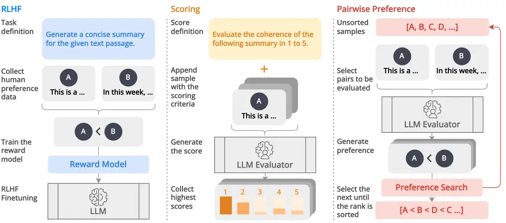
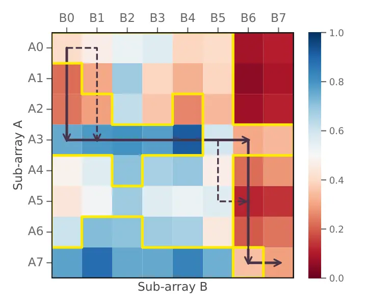
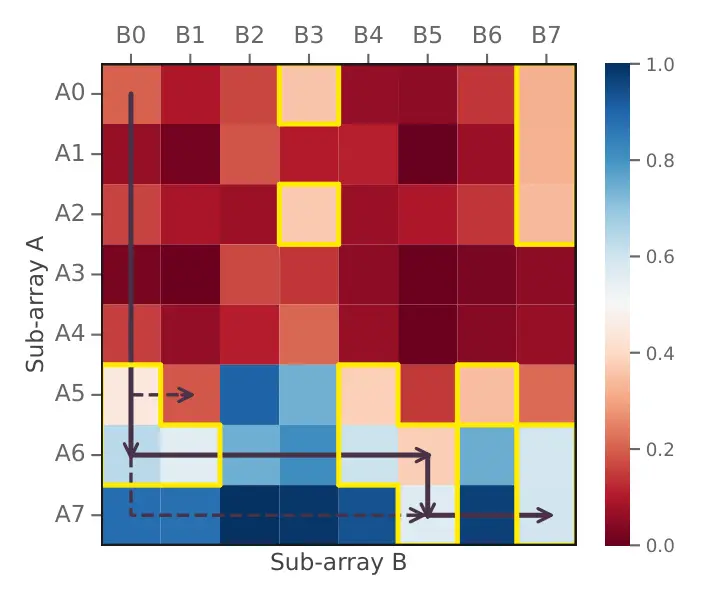

# Aligning with Human Judgement: The Role of Pairwise Preference in Large Language Model Evaluators

Yinhong Liu ^(†)^(†)thanks: Equal contribution. Code is available at
[https://github.com/cambridgeltl/PairS](https://github.com/cambridgeltl/PairS).
Affiliation: University of Cambridge    Han Zhou¹¹footnotemark: 1
Affiliation: University of Cambridge    Zhijiang Guo
Affiliation: University of Cambridge    Ehsan Shareghi
Affiliation: Monash University    Ivan Vulić Affiliation: University of
Cambridge    Anna Korhonen   Nigel Collier  
Email: [{yl535,hz416,zg283,iv250,alk23,nhc30}@cam.ac.ukehsan.shareghi@monash.edu](mailto:)
Affiliation: University of Cambridge

###### Abstract

Large Language Models (LLMs) have demonstrated promising capabilities as
automatic evaluators in assessing the quality of generated natural
language. However, LLMs still exhibit biases in evaluation and often
struggle to generate coherent evaluations that align with human
assessments. In this work, we first conduct a systematic study of the
misalignment between LLM evaluators and human evaluation, revealing that
existing calibration methods aimed at mitigating biases of LLMs are
insufficient for effectively aligning LLM evaluators. Inspired by the
use of preference data in RLHF, we formulate the evaluation as a ranking
problem and introduce Pairwise-preference Search (PairS), an
uncertainty-guided search-based rank aggregation method that employs
LLMs to conduct pairwise comparisons locally and efficiently ranks
candidate texts globally. PairS achieves state-of-the-art performance on
representative evaluation tasks in long-form generations and
demonstrates significant improvements over direct scoring. Furthermore,
we provide insights into the role of pairwise preference in quantifying
the transitivity of LLMs and demonstrate how PairS benefits from
calibration using debiased pairwise evaluations.

|     |
| --- |
|     |

## 1 Introduction

Large Language Models (LLMs) (Brown et al., 2020; OpenAI, 2023; Anil
et al., 2023a; Anil et al., 2023b) have achieved promising
instruction-following abilities, enabling an efficient adaptation
pipeline to solve complex natural language tasks with minimal or no
labelled data (Kojima et al., 2022; Zhou et al., 2024c). This unique
capability stems from supervised training LLMs with
instruction-following data (Wei et al., 2022; Chung et al., 2022) and
reinforcement learning from human feedback (RLHF) (Christiano et al.,
2017; Stiennon et al., 2020). In the RLHF training paradigm, a reward
model is aligned with human preferences based on ranked comparison data
(Ouyang et al., 2022). It enhances LLMs’ alignment with human values
(Touvron et al., 2023), thereby generating responses that better assist
humans and abide by human values (Dai et al., 2024).

Recently, LLMs have emerged as competent and inexpensive assessors for
the evaluation of various aspects, such as coherence, fluency,
consistency and hallucination, of text quality (Chen et al., 2023; Zeng
et al., 2024; Zheng et al., 2024). Put simply, LLMs can be seen as an
appealing reference-free evaluation paradigm for generative tasks while
avoiding expensive human-labeling costs (Liu et al., 2023a). However,
the predictions from LLM evaluators are highly sensitive to the prompt
design (Zhou et al., 2023; Zheng et al., 2024) and even biased by
multiple sources, including positional bias (Wang et al., 2023b),
verbosity bias (Saito et al., 2023), and contextual bias (Zhou et al.,
2024b). These biases still hinder fair and trustworthy applications of
LLM evaluators, resulting in inconsistency and misalignment with human
judgements.

To mitigate biased predictions from LLMs, calibration techniques have
been developed to ensure less biased outcomes (Liu et al., 2023b; Li
et al., 2023a; Zhou et al., 2024b). Motivated by this line of work, we
first conduct a systematic analysis of the effectiveness of calibration
techniques in aligning LLM evaluators in direct scoring (Figure 1,
middle) with human judgements. We find that existing calibration methods
are insufficient for aligning LLM evaluators, even when provided with
supervised data. We discover that misalignment in evaluation is not
primarily due to biased priors over evaluation scores, but rather from
misaligned evaluation standards, i.e., the likelihood of LLM evaluators
defined in Equation (1). Therefore, we are motivated to explore a new
evaluation paradigm with LLMs to facilitate a more aligned judgement.



Figure 1: Illustration of RLHF (left), direct scoring with LLM
evaluators (middle), and pairwise preference search (PairS; right).
Pairwise preference data have been utilized to train the reward model to
align the LLM in RLHF. Leveraging this idea, PairS reframes the
traditional scoring-based evaluations into a series of pairwise
comparisons between selected candidate pairs which are then used to form
the final ranking.

Inspired by how LLMs are aligned through a reward model with preference
data in RLHF, we argue that LLM evaluators can produce more aligned and
inherent evaluations by leveraging their pairwise ranking abilities.
Recent work has started exploring this intrinsic property by prompting
LLMs with a pair of candidates (Wang et al., 2023b; Chen et al., 2023;
Qin et al., 2023; Li et al., 2024). However, the complexity and
scalability of evaluating with pairwise preference have been largely
overlooked. To produce a preference ranking for evaluation, existing
methods require exhaustive pairwise comparisons, as they ignore the
transitivity assumption¹¹ 1 The term transitivity in this work refers to
mathematical transitivity, not linguistic transitivity. It is a property
stating that if A is preferred to B and B is preferred to C, then A is
preferred to C. (Qin et al., 2023). This makes the evaluation procedure
intractable as the number of comparisons grows quadratically (Zheng
et al., 2024; Liusie et al., 2024).

In this work, we shed new light on the full potential of pairwise
preference in LLM evaluators and its alignment with human judgements. We
propose Pairwise-preference Search (PairS), an uncertainty-guided search
method that efficiently estimates the Maximum Likelihood Estimate (MLE)
of preference rankings by searching through an uncertainty-pruned
pairwise comparison space. PairS is more effective and query-efficient
than existing pairwise baselines while substantially outperforming
traditional direct scoring evaluations. We extensively examine the
applicability of PairS in representative evaluation tasks, including
summarization and open-ended generation. We show that PairS produces
more robust and transitive evaluations compared with the greedy search
baseline. Lastly, we provide further insights into how pairwise
preference can be used to quantify the transitivity ability of LLM
evaluators and how it benefits from calibration.

In sum, we provide the following contributions: 1) We present a
systematic analysis of the limitations of calibration in aligning direct
scoring LLM evaluators with human judgements. 2) We formulate the
evaluation as ranking from the perspective of transitivity and propose
PairS, an uncertainty-guided pairwise preference search method that
efficiently estimates MLE rankings. 3) We demonstrate that PairS attains
unique scalability in aligning LLM evaluations. We also provide insights
into the transitivity and calibration of pairwise preferences in LLM
evaluators.

## 2 On the Limitations of Calibration in Aligning LLM Evaluators

Figure 2: LLM evaluations are misaligned with human judgements. The
score histograms on evaluating the coherence in HANNA (Chhun et al., 2022) and SummEval (Fabbri et al., 2021). We present the scores from
gold human evaluations, LLMs, and LLMs after calibrations. The
histograms can be interpreted as estimated score prior distributions via
marginalization.

Misalignment Between LLM Evaluators and Human Judgements. The prediction
of score-based LLM evaluators can be expressed as a posterior predictive
distribution $`p_{\mathcal{M}}(s|y;x,I)`$:

```math
p_{\mathcal{M}}(s|y;x,I)\propto\underbrace{p_{\mathcal{M}}(y|s;x,I)}_{Likelihood}\times\underbrace{p_{\mathcal{M}}(s;x,I)}_{Prior}, \tag{1}
```

where $`x`$ and $`y`$ form an input-output pair (e.g., a source text and
its summary, respectively), $`I`$ denotes an instruction prompt, and
$`s`$ represents the model’s rating score in its evaluation. Similarly,
we can express the human posterior predictive distribution as
$`p_{\mathcal{H}}(s|y;x,I)`$. For simplicity, we omit the $`x`$ and
$`I`$ terms hereafter. When utilizing LLMs to perform Likert scale
evaluations (Likert, 1932), it is known that there exists a mismatch
between the score distributions of LLM ratings and human annotations
(Liu et al., 2023b). We start by observing and interpreting the same
misalignment phenomenon, as shown in Figure 2.

Since the posterior distribution consists of two components, the
likelihood, and the score preference prior, we hypothesise that the
discrepancy between the posterior distributions of LLMs and humans
mainly arises from a misalignment between their respective likelihoods.
To verify this hypothesis, we conduct a preliminary experiment by
calibrating the LLM’s score preference prior, $`p_{\mathcal{M}}(s)`$ to
match the human prior, $`p_{\mathcal{H}}(s)`$, described in what
follows.

Score-Based LLM Evaluator Calibration. Following previous calibration
methods (Zhou et al., 2024b; Jiang et al., 2023b), we first assume that
the likelihood terms for both the LLM and humans are the same,
$`p_{\mathcal{M}}(y|s)=p_{\mathcal{H}}(y|s)`$. Upon this assumption, the
human posterior distribution $`p_{\mathcal{H}}(s|y)`$ can be expressed
as:

```math
p_{\mathcal{H}}(s|y)=\frac{p_{\mathcal{H}}(s)p_{\mathcal{H}}(y|s)}{p_{\mathcal{H}}(y)}\propto\frac{p_{\mathcal{H}}(s)}{p_{\mathcal{M}}(s)}p_{\mathcal{M}}(s|y). \tag{2}
```

We can estimate LLM’s preference prior $`p_{\mathcal{M}}(s)`$ by
marginalizing the model’s predictions, i.e.,
$`p_{\mathcal{M}}(s)=\sum_{y}p_{\mathcal{M}}(s|y)p(y)`$. Unlike previous
work that assumes a uniform prior for $`p_{\mathcal{H}}(s)`$ (Zhou
et al., 2024b), we directly estimate it by marginalizing human
annotations to achieve a more accurate estimation. The calibration is
performed by scaling the model’s predictions according to Equation (2).

In Figure 2, the experimental results show that even after calibration,
the gap persists between the posterior distributions of the LLM and
human evaluators. Specifically, the Mean Absolute Error (MAE) shifts
from 1.62 to 1.16 on HANNA and from 0.78 to 0.86 on SummEval, indicating
notable misalignment. This suggests that the discrepancy is not
primarily due to the misaligned priors but rather stems from the
differences in the likelihood of LLM evaluators. In other words, the
assumption that LLM evaluators and humans have similar evaluation
likelihoods becomes invalid, i.e.,
$`p_{\mathcal{M}}(y|s)\neq p_{\mathcal{H}}(y|s)`$. The likelihood term
reflects expected output candidates for a given score, which can be
interpreted as the underlying evaluation standards. LLMs learn their
standards from pretraining data, potentially diverging from the human
evaluation standards. Hence, these findings motivate efforts to reduce
the gap between evaluation standards.

## 3 Uncertainty-Guided Pairwise-Preference Search

### 3.1 Evaluation as Ranking

Inspired by the fact that the RLHF training stage of most recent LLMs
utilizes pairwise preference or preference ranking data (Touvron et al.,
2023), we propose that evaluation with pairwise comparisons could be a
promising solution to address the above issues. We conclude the
motivation: The difference between LLM and human evaluation standards is
smaller when performing pairwise comparison, compared to rating with
scores.

When using an LLM to perform a pairwise comparison, we can compute the
preference probabilities $`P(y_{i}\succ y_{j})`$ from output logits,
where $`\succ`$ denotes the preference relation “is preferred to”.
However, LLM evaluators do not guarantee transitivity property, e.g.
given an LLM’s pairwise preferences $`y_{i}\succ y_{j}`$ and
$`y_{j}\succ y_{k}`$, it is not necessarily true that the LLM will have
$`y_{i}\succ y_{k}`$. The problem of finding the optimal preference
ranking from non-transitive pairwise comparison probabilities is known
as the Rank Aggregation problem (Dwork et al., 2002). We formulate this
problem as a Maximum Likelihood Estimation (MLE) problem.

Let $`y_{1:N}`$ be a set of $`N`$ output candidates to be ranked. For a
pair of outputs $`(y_{i},y_{j})`$, we have the probability
$`P(y_{i}\succ y_{j})`$ that output $`y_{i}`$ is preferred over output
$`y_{j}`$. We denote a permutation (ranking) of these candidates as
$`\pi=(\pi_{1},\pi_{2},\ldots,\pi_{N})`$, where $`\pi_{i}`$ is the index
of the $`i`$-th ranked candidate, i.e., $`y_{\pi_{i}}`$ is the $`i`$-th
ranked candidate output in $`\pi`$. The ranking $`\pi`$ imposes a total
order on $`y_{1:N}`$, such that
$`y_{\pi_{1}}\succ y_{\pi_{2}}\succ\ldots\succ y_{\pi_{N}}`$. The goal
is to find a ranking of the output candidates that maximizes the
likelihood of observing pairwise probabilities:

```math
\mathcal{L}_{NT}(\pi)=\prod_{i,j:\pi_{i}<\pi_{j}}P(y_{\pi_{i}}\succ y_{\pi_{j}}), \tag{3}
```

where $`\mathcal{L}_{NT}`$ stands for the non-transitive likelihood,²² 2
This likelihood can be derived from the general learning to rank
likelihood in Appendix §C.1. which does not make any transitive
assumptions for the pairwise comparison probabilities. The MLE ranking
of $`\mathcal{L}_{NT}`$ is also equivalent to the Kemeny-Optimal
Ranking (Kemeny, 1959). However, finding the optimal ranking is
challenging in two aspects:

1.  1.  Computing $`\mathcal{L}_{NT}`$ requires a complete set of
        $`O(N^{2})`$ pairwise comparisons.
2.  2.  The exact solution to the rank aggregation problem is NP-hard (Dwork
        et al., 2001), meaning that there is no known polynomial-time
        algorithm to solve it optimally.

If LLM evaluators are assumed to possess transitivity property, then the
problem of finding the MLE ranking reduces to a sorting problem, which
can be solved by standard sorting algorithms such as merge sort or quick
sort with only $`O(N\log N)`$ pairwise comparisons.

However, strict transitivity is a strong assumption. To relax the strict
transitivity assumption to some extent and find a better trade-off
between computational complexity and performance, we propose simplifying
the non-transitive likelihood in Equation (3) by assuming compositional
stochastic transitivity (Latta, 1979; Oliveira et al., 2018). The
derivation of this simplified likelihood is provided in Appendix §C.2:

```math
\mathcal{L}_{T}(\pi)=\prod_{\pi_{i}<\pi_{i+1}}P(y_{\pi_{i}}\succ y_{\pi_{i+1}}), \tag{4}
```

where $`\mathcal{L}_{T}`$ stands for the transitive likelihood, and the
MLE ranking is denoted as $`\pi^{*}=\argmax_{\pi}\mathcal{L}_{T}(\pi)`$.

1:  Objective: Find the ranking that maximizes the transitive likelihood
$`\mathcal{L}_{T}`$.

2:  Hyper-parameters: Beam size, $`beam\_size`$; Uncertainty threshold,
$`U_{h}`$.

3:  Inputs: Two sorted input sub-arrays
$`\mathbf{a}=[A_{1},A_{2},\ldots,A_{L}]`$ and
$`\mathbf{b}=[B_{1},B_{2},\ldots,B_{R}]`$.

4:  Output: A merged sorted array.

5:  Initialize: Initialize a Beam $`\mathcal{B}`$ with the first
candidate $`cand`$. Each $`cand`$ keeps track of its choice trajectory,
two pointers $`i`$ and $`j`$ for $`\mathbf{a}`$ and $`\mathbf{b}`$, and
a cumulative likelihood of its trajectory.

6:  for $`k=1`$ to $`L+R`$ do

7:   Create another empty beam $`\mathcal{B}^{\prime}`$.

8:   for $`cand`$ in $`\mathcal{B}`$ do

9:
   $`P(A_{i}\succ B_{j}),U_{A_{i},B_{j}}\leftarrow\text{LLM}(A_{i},B_{j})`$

10:    if $`U_{A_{i},B_{j}}>U_{h}`$ then

11:
    $`\mathcal{B}^{\prime}\leftarrow\mathcal{B}^{\prime}\cup cand`$.update($`A_{i}`$)

12:
    $`\mathcal{B}^{\prime}\leftarrow\mathcal{B}^{\prime}\cup cand`$.update($`B_{j}`$)

13:    else if $`P(A_{i}\succ B_{j})\geq\frac{1}{2}`$ then

14:
    $`\mathcal{B}^{\prime}\leftarrow\mathcal{B}^{\prime}\cup cand`$.update($`A_{i}`$)

15:    else

16:
    $`\mathcal{B}^{\prime}\leftarrow\mathcal{B}^{\prime}\cup cand`$.update($`B_{j}`$)

17:    end if

18:   end for

19:
  $`\mathcal{B}^{\prime}\leftarrow\text{sort}(\mathcal{B}^{\prime},\text{key}=\mathcal{L}_{T})`$

20:   $`\mathcal{B}\leftarrow\mathcal{B}^{\prime}[:beam\_size]`$

21:  end for

22:  return $`\mathcal{B}[0].\text{trajectory}`$

Algorithm 1 Uncertainty-Guided PairS-beam

Figure 3: Visualization of PairS in ranking with a beam size of 2 on the
same evaluation examples in Figure  4.



Figure 4: Illustration of PairS with a beam size of 2. Heatmap values
show $`P(A_{i}\succ B_{j})`$ by Mistral 7B, deciding the search
direction. Yellow-bordered lines highlight comparisons whose
uncertainties are above $`U_{h}`$. Solid lines represent greedy search
paths, while dashed lines denote alternative paths by other beam
candidates.

### 3.2 Uncertainty-Guided Pairwise-Preference Search

The traditional merge sort algorithm employs a divide-and-conquer
approach, merging two sorted subarrays at each operation step. This
merge operation can be interpreted as a greedy search procedure that
aims to find the MLE ranking $`\pi^{*}`$ under the transitive
likelihood. We refer to this approach as PairS-greedy. However, the
non-transitive nature of LLMs suggests that optimization based on local
probability may not lead to the optimal solution. Therefore, we also
propose PairS-beam, a heuristic beam search algorithm that improves upon
the greedy search merge operation by considering both candidates at each
step.

The PairS algorithm is described in Algorithm 1, and a demonstration of
its workings is provided in Figure 3 and Figure 4. Intuitively, while
the PairS-greedy chooses the preferred items between the heads of two
sub-arrays in a greedy fashion, PairS-beam maintains a likelihood
$`\mathcal{L}_{T}`$ beam that keeps track of the top-k trajectory
candidates. By also considering less preferred items between the two
heads, PairS explores a broader search space and potentially finds a
better ranking.

To further improve the efficiency of the beam search, we introduce a
pruning mechanism based on the LLM’s uncertainty. When the uncertainty
of the LLM’s pairwise comparison is lower than a threshold $`U_{h}`$, we
prune the less preferred candidate from the beam. This uncertainty-based
pruning restricts the search space, making the beam search more
efficient and achieving a better balance between computational
complexity and ranking performance.

To represent the uncertainty between two items, we follow a commonly
used approach in previous works (Wan et al., 2023a; Wan et al., 2023b)
that employs entropy as the uncertainty measurement. Hence, the
uncertainty between a pair of comparisons can be expressed below:

```math
U(y_{i},y_{j})=H(y_{i},y_{j})=-P(y_{i}\succ y_{j})\log(P(y_{i}\succ y_{j}))-P(y_{j}\succ y_{i})\log(P(y_{j}\succ y_{i})). \tag{5}
```

### 3.3 A Scaling Variant of PairS

Figure 5: PairS is scalable. Complexity plot for different pairwise
preference algorithms.

The theoretical complexity of PairS-beam ranges from $`O(N\log N)`$ to
$`O(N^{2})`$ pairwise comparisons, as shown in Figure 5. The upper bound
occurs when the uncertainty-based pruning is disabled, and the beam size
is sufficiently large to explore all potential trajectories during the
merge operation. Conversely, the lower bound corresponds to
PairS-greedy. However, for large instances, even the complexity of
$`O(N\log N)`$ becomes computationally expensive and infeasible. To
address this issue, we propose a two-stage scaling method that leverages
the granularity of Likert scale annotations.

In the first stage, we sample and rank a subset of the evaluation set,
referred to as the anchor set. The size of the anchor set can be
statistically determined by accommodating a tolerable error margin
(Cochran, 1977) (Further details and empirical evidence in
Appendix §F.3). In the second stage, we use binary search to find the
positions of the remaining samples relative to the anchor set,
efficiently determining their appropriate positions in the overall
ranking. As depicted in Figure 5, the second stage of the scaling method
results in $`O(N)`$ complexity, a significant improvement over the
original complexity. This two-stage scaling approach allows PairS to
efficiently handle large evaluation sets while maintaining the benefits
of beam search and uncertainty-based pruning. The scaling variant
strikes a balance between complexity and ranking performance, making it
suitable for real-world applications involving large-scale datasets.

### 3.4 On the Benefits of Pairwise-Preference Search

Transitivity. Both PairS-direct and PairS-beam assume transitivity to
some extent, implying that an LLM with better transitivity can perform
more accurate and more efficient evaluations. In other words, we expect
better-performing LLMs to exhibit more transitive behaviour when making
pairwise comparisons. Consequently, we propose that transitivity can
serve as an effective measure of an LLM’s ability as an evaluator. By
quantifying and comparing the transitivity of different LLMs, we can
gain insight into their relative performance and suitability for
evaluation tasks. To validate this hypothesis, we provide complementary
experiments and analysis in Section 5.4.

Calibration. Although pairwise preference inherently aligns LLM
evaluations with human judgement, pairwise prompting can still suffer
from misaligned preference priors, e.g., positional bias and contextual
bias (Zhao et al., 2021; Zhou et al., 2024b). Therefore, we propose
applying calibration on top of PairS to ensure debiased PairS
evaluations. It is worth noting that, unlike calibrating the score-based
LLM evaluators, which requires external information on the distribution
of human preference prior, as shown in Section 2, pairwise comparisons
can fully leverage a uniform human prior, due to the random nature of
pairwise sample selections.

## 4 Related Work

LLMs as Evaluators. Recently, LLMs have been increasingly used to
automatically evaluate various natural language generation tasks (Zhong
et al., 2022; Chen et al., 2023; Wang et al., 2023a; Tan et al., 2024).
LLM evaluators enable reference-free or reference-guided metrics while
being cheaper alternates to human evaluation in a diverse task set, such
as summarization (Shen et al., 2023), machine translation (Kocmi &
Federmann, 2023), open-ended story generation (Chiang & Lee, 2023),
dialog response generation (Liu et al., 2024a) and instruction-following
(Zeng et al., 2024). Unlike traditional reference-based evaluation
metrics (Papineni et al., 2002; Liu et al., 2024c), LLM evaluators are
usually equipped with evaluation criteria prompts and generate scores to
access the quality of the candidate text (Liu et al., 2023a). This forms
the scoring-based LLM evaluator that enables easy adaption to various
tasks by simple instructions (Fu et al., 2023). To fairly examine
various LLM evaluation abilities, efforts have also been devoted to
developing meta-evaluation benchmarks (Wang et al., 2023b; Zhang et al.,
2023; Zheng et al., 2024) and prompt optimization (Zhou et al., 2024a).

Pairwise Preference. Preference data have been widely used in training
the reward model to reflect human preferences in RLHF (Ouyang et al.,
2022). For example, Llama-2 has leveraged binary preference with
‘chosen’ or ‘rejected’ responses in its reward modelling (Touvron
et al., 2023). Following the preference idea, using pairwise comparisons
in evaluating the LLM outputs has also been studied to some extent
recently (Chen et al., 2023; Shen et al., 2023), where Wang et al.
(2023b) find that pairwise comparison exhibits better human correlations
than traditional scoring-based LLM evaluators. However, Zheng et al.
(2024) point out the intractability of pairwise comparisons due to its
quadratic query complexity (Liusie et al., 2024), which significantly
limits its practicability. Qin et al. (2023) propose pairwise ranking
with sorting but ignore the important transitivity of LLM predictions.
Recent work (Liu et al., 2024b) has proposed a framework to quantify and
improve the preference consistency of LLM judgments. In our work, we
address the aforementioned issues by searching in a tractable pairwise
search and transitive space based on model uncertainty.

## 5 Experiments

### 5.1 Experimental Setup

Datasets. We evaluate PairS using three commonly used meta-evaluation
benchmarks for two types of NLG tasks: abstractive summarization and
creative story generation. Following previous research, we adopt two
evaluation strategies, namely sample-level and dataset-level Spearman
correlations, as detailed in Appendix  §E.1. For summarization task, we
select News Room (Grusky et al., 2018) and SummEval (Fabbri et al.,
2021), consistent with prior studies (Zhong et al., 2022; Fu et al.,
2023). For the story generation task, we include HANNA (Chhun et al.,
2022).³³ 3 We make the first application of pairwise preference to
evaluate over thousands samples. We use an anchor size of 100 on
PairS-beam-scaled in HANNA. We refer to Appendix §D for more details.

Models. To cover a good range of LLMs, we select two open-source models:
Mistral 7B (Instruct-v0.1) (Jiang et al., 2023a) and Llama-2-chat 7b
(Touvron et al., 2023), and two closed-source models: GPT-3.5-turbo
(-1106) and GPT-4-turbo (-preview) (OpenAI, 2023). For open-source
models, we calculate the preference probability by normalizing the
logits of choice ‘A’ and ‘B’. For GPT-3.5 and GPT-4, we return top-5
log-probabilities, which can be normalized to find the preference
probability.

Baselines. We consider two types of reference-free baselines: optimized
and zero-shot evaluators. Optimized evaluators, UniEval (Zhong et al., 2022) and BARTscore (Yuan et al., 2021), mitigate the evaluation
standard gaps using annotated data, making them specialized for a
specific dataset or domain but not transferable. We treat them as strong
but unfair metrics and use their reported scores as a reference. For
zero-shot evaluators, we re-implement the following baselines: BERTScore
(Zhang et al., 2020), G-Eval (Liu et al., 2023a), and GPTScore (Fu
et al., 2023). We report direct scoring and G-Eval as the main baseline
for fair comparisons.

|                       |     |           |      |       |      |     |          |      |      |      |     |       |      |      |
| --------------------- | --- | --------- | ---- | ----- | ---- | --- | -------- | ---- | ---- | ---- | --- | ----- | ---- | ---- |
|     Models            |     | News Room |      |       |      |     | SummEval |      |      |      |     | HANNA |      |      |
|                       |     | CH        | RE   | IN    | FLU  |     | CH       | FLU  | CON  | RE   |     | CH    | SU   | CX   |
| Other Metrics         |     |           |      |       |      |     |          |      |      |      |     |       |      |      |
| BertScore             |     | 0.15      | 0.16 | 0.13  | 0.17 |     | 0.28     | 0.19 | 0.11 | 0.31 |     | 0.25  | 0.22 | 0.30 |
| GPTScore (d02)        |     | 0.31      | 0.35 | 0.26  | 0.31 |     | 0.28     | 0.31 | 0.38 | 0.22 |     | 0.22  | 0.25 | 0.08 |
| UniEval (single best) |     | \-        | \-   | \-    | \-   |     | 0.54     | 0.43 | 0.47 | 0.46 |     | \-    | \-   | \-   |
| BARTScore (CNN)       |     | 0.65      | 0.56 | 0.61  | 0.64 |     | 0.45     | 0.35 | 0.38 | 0.35 |     | \-    | \-   | \-   |
| Mistral 7B            |     |           |      |       |      |     |          |      |      |      |     |       |      |      |
| Scoring               |     | 0.32      | 0.39 | 0.20  | 0.26 |     | 0.23     | 0.19 | 0.37 | 0.19 |     | 0.30  | 0.26 | 0.37 |
| G-Eval                |     | 0.36      | 0.36 | 0.24  | 0.39 |     | 0.25     | 0.20 | 0.39 | 0.25 |     | 0.34  | 0.25 | 0.39 |
| PairS-greedy          |     | 0.57      | 0.52 | 0.53  | 0.44 |     | 0.25     | 0.08 | 0.28 | 0.29 |     | \-    | \-   | \-   |
| PairS-beam            |     | 0.55      | 0.53 | 0.48  | 0.48 |     | 0.28     | 0.24 | 0.30 | 0.27 |     | 0.29  | 0.27 | 0.31 |
| Llama-2-chat 7B       |     |           |      |       |      |     |          |      |      |      |     |       |      |      |
| Scoring               |     | 0.02      | 0.14 | -0.02 | 0.01 |     | 0.12     | 0.06 | 0.18 | 0.11 |     | 0.25  | 0.17 | 0.33 |
| G-Eval                |     | 0.05      | 0.14 | -0.15 | 0.04 |     | 0.15     | 0.07 | 0.23 | 0.20 |     | 0.31  | 0.17 | 0.35 |
| PairS-greedy          |     | 0.38      | 0.41 | 0.35  | 0.25 |     | 0.16     | 0.16 | 0.28 | 0.20 |     | \-    | \-   | \-   |
| PairS-beam            |     | 0.43      | 0.43 | 0.37  | 0.28 |     | 0.17     | 0.18 | 0.31 | 0.24 |     | 0.29  | 0.19 | 0.17 |
| GPT-3.5-turbo         |     |           |      |       |      |     |          |      |      |      |     |       |      |      |
| Scoring               |     | 0.44      | 0.47 | 0.46  | 0.50 |     | 0.32     | 0.28 | 0.49 | 0.25 |     | 0.22  | 0.12 | 0.37 |
| G-Eval                |     | 0.45      | 0.45 | 0.45  | 0.52 |     | 0.30     | 0.29 | 0.47 | 0.27 |     | 0.28  | 0.18 | 0.39 |
| PairS-greedy          |     | 0.56      | 0.55 | 0.53  | 0.45 |     | 0.35     | 0.23 | 0.41 | 0.27 |     | \-    | \-   | \-   |
| PairS-beam            |     | 0.56      | 0.57 | 0.52  | 0.49 |     | 0.42     | 0.37 | 0.45 | 0.29 |     | 0.38  | 0.29 | 0.47 |
| GPT-4-turbo           |     |           |      |       |      |     |          |      |      |      |     |       |      |      |
| Scoring               |     | 0.55      | 0.54 | 0.57  | 0.60 |     | 0.44     | 0.42 | 0.46 | 0.53 |     | 0.35  | 0.28 | 0.38 |
| G-Eval                |     | 0.58      | 0.55 | 0.57  | 0.58 |     | 0.45     | 0.42 | 0.45 | 0.54 |     | 0.34  | 0.31 | 0.41 |
| PairS-greedy          |     | 0.62      | 0.59 | 0.62  | 0.59 |     | 0.53     | 0.45 | 0.47 | 0.58 |     | \-    | \-   | \-   |
| PairS-beam            |     | 0.64      | 0.61 | 0.67  | 0.60 |     | 0.53     | 0.48 | 0.47 | 0.59 |     | 0.44  | 0.36 | 0.49 |
|                       |     |           |      |       |      |     |          |      |      |      |     |       |      |      |

Table 1: LLM evaluation results. We report Spearman correlations on all
datasets in terms of the following evaluation aspects: coherence (CH),
fluency (FLU), relevancy (RE), informativeness (IN), consistency (CON),
surprise (SU), and complexity (CX). For PairS-beam, the experiments were
conducted with a beam size of 1000 and an uncertainty threshold at 0.6.

### 5.2 Main Experiments

Performance Gap between Direct Scoring and PairS. As shown in Table 1,
PairS, as a zero-shot general evaluator, achieves state-of-the-art
(SOTA) or near-SOTA performance on all datasets, even when compared with
the optimized metrics UniEval and BARTScore, which are trained on
dataset-specific data. In general, PairS outperforms direct scoring and
G-Eval baselines in most aspects, with some exceptions, such as the
consistency (CON) aspect of SummEval. We attribute this to the
concentrated human scores distribution, with $`86.7\%`$ summaries
labelled with a score of 5. These characteristics make it difficult for
pairwise comparisons to yield meaningful comparisons and consequent
rankings.

Impact of PairS on Different (Families of) LLMs. PairS particularly
benefits the performance of smaller LLMs. For Mistral 7B and Llama-2 7B,
we observe that pairwise comparison methods generally outperform direct
scoring on News Room and SummEval. Notably, Mistral 7B achieves
performance comparable to GPT-3.5-turbo on News Room. We hypothesize
that this is due to their potentially similar quality of instruction
tuning. Llama-2 7B struggles to effectively rate summaries with scores
but demonstrates much better performance when comparing summaries. For
HANNA, both small models do not benefit much from pairwise comparison,
possibly due to the difficulty of understanding the long-context prompts
or the presence of length bias. Conversely, direct scoring performs
relatively well compared to summarization tasks. We believe this is
because story generation evaluation does not depend on input, making the
task more straightforward. For the two closed-source GPT models, PairS
generally outperforms direct scoring and G-Eval baselines on all three
datasets, indicating that PairS can achieve better performance more
consistently for more capable models.

Benefits of Uncertainty-Guided Search. PairS-beam generally exhibits
higher correlations and lower Standard Error (SE), as shown in Table 3,
than PairS-greedy on all datasets, indicating its ability to more
robustly produce better rankings. Interestingly, the performance
difference between PairS-greedy and PairS-beam is minimal for
GPT-4-turbo. We attribute this to GPT-4-turbo’s better transitivity,
allowing the greedy search to robustly find near-optimal rankings. There
are also a few cases where PairS-beam cannot outperform PairS-greedy.
This could occur when the LLM’s preference standards, the likelihood
term, do not perfectly match with human annotations.

### 5.3 Efficiency Comparison with Rank Aggregation Baselines

Figure 6: PairS-greedy and PairS-beam are more efficient than other
pairwise rank aggregation methods. Both diagrams are evaluating on the
coherence of SummEval. Each datapoint contains 16 summary candidates,
with the number of pairwise comparisons ranging from 1 to 240.
PairS-beam curves show results for beam sizes 1, 2, 5, 10, 20, 50, and
100, without uncertainty pruning. When beam size is 1, PairS-beam and
PairS-greedy are equivalent.

PairS is an efficient pairwise rank aggregation method. We evaluate our
method against two baseline rank aggregation techniques: 1) Win-loss
rate and 2) ELO rating, which can both aggregate rankings from any
number of pairwise comparisons. To assess their efficiency as
aggregation algorithms, we calculate the correlations between human
annotations and rankings predicted by PairS and the baselines using
varying numbers of comparisons. The comparisons were random sampled
without replacement. We also include the calibrated PairS, which
requires double the computation by considering both permutations for
each comparison pair.

Figure 6 demonstrates that PairS is more efficient than the baselines.
PairS-greedy typically requires only about $`30\%`$ of the comparisons
to achieve performance similar to ELO rating. The calibrated PairS
generally outperforms the upper bound of the baselines, where all
$`N(N-1)`$ pairwise comparions are utilized. We attribute the strong
performance of PairS to its leveraging of the transitivity assumption of
LLMs to identify the most informative comparison pairs, which provides a
natural efficiency advantage. While win-rate and ELO aggregation methods
are designed to handle systems or players with variable performance,
making them more effective at dealing with changes, our task involves
ranking constant response candidates on a specific aspect. In this
context, sorting-based algorithms that exploit transitivity have
inherent advantages.

### 5.4 Ablation Studies

Transitivity. The transitivity assumption plays a crucial role in the
effectiveness of LLMs as evaluators, impacting the speed and consistency
with which they achieve rankings. Hence, it is a good measurement of the
capability of LLMs as evaluators. We quantify transitivity through the
analysis of correlation variations, specifically the Standard Error. We
conducted 10 runs of both PairS-greedy and PairS-beam with different
random seeds. For the HANNA dataset, we sample and shuffle the same
subset of 200 stories. Table 3 shows that PairS-beam generally
demonstrates better correlations and lower SE than PairS-greedy, which
indicates that it is more robust. We notice that GPT-3.5-turbo
consistently exhibits fewer errors across all datasets, suggesting that
it can produce more consistent evaluations with itself, thus possessing
better transitivity. Furthermore, different datasets show varying levels
of errors, which we believe indicates the transitivity difficulty of
each dataset. For example, compared to other datasets, HANNA has
relatively higher errors, which means that, for the same base models,
its optimal rankings are more difficult to find. This observation is
expected as HANNA, being a creative story-writing dataset, has naturally
more subjective human annotations, causing challenges for LLM alignment.

Calibration. Unlike direct scoring, pairwise comparison has a known
preference prior, which is uniform. We perform the same calibration
method as in the previous work by Zheng et al. (2023), which averages
the probabilities of both permutations of the candidates. Table 3
demonstrates that calibration consistently improves the performance of
Mistral 7B and Llama-2 7B. However, calibration on GPT-3.5-turbo yields
relatively small improvements, likely due to its heavily skewed output
probabilities (also shown in the example in Figure 8, Appendix §F.2).
The over-confident predictions make the language model difficult to
calibrate.

|              |                 |                 |                |
| ------------ | --------------- | --------------- | -------------- |
|   Models     | News Room       | SummEval        | HANNA          |
| M-7B greedy  | 55.7$`\pm`$1.62 | 25.6$`\pm`$0.89 | 33.2$`\pm`$3.2 |
| M-7B beam    | 54.7$`\pm`$0.87 | 27.6$`\pm`$0.92 | 33.8$`\pm`$2.9 |
| L-7B greedy  | 39.5$`\pm`$1.66 | 14.9$`\pm`$1.94 | 29.4$`\pm`$2.7 |
| L-7B beam    | 43.2$`\pm`$1.33 | 16.0$`\pm`$1.43 | 33.9$`\pm`$1.5 |
| G-3.5 greedy | 54.6$`\pm`$1.57 | 36.2$`\pm`$0.58 | 33.7$`\pm`$2.2 |
| G-3.5 beam   | 55.9$`\pm`$0.72 | 41.7$`\pm`$0.43 | 36.2$`\pm`$1.0 |
|              |                 |                 |                |

Table 2: Quantifying transitivity. Mean and std. of Spearman
correlations (CH aspect) over 10 runs with different random seeds.

|               |           |          |       |
| ------------- | --------- | -------- | ----- |
|   Models      | News Room | SummEval | HANNA |
| M-7B          | 55.6      | 25.6     | 33.0  |
| \- calibrated | 57.7      | 32.9     | 34.2  |
| L-7B          | 38.9      | 15.6     | 29.2  |
| \- calibrated | 40.5      | 16.2     | 31.5  |
| G-3.5         | 54.2      | 36.8     | 37.6  |
| \- calibrated | 56.7      | 38.5     | 37.8  |
|               |           |          |       |

Table 3: Calibrating PairS. Mean of Spearman correlations (CH aspect)
over 10 runs of PairS-greedy, w. and w/o calibration.

## 6 Conclusion

In this work, we have first conducted a systematic analysis of LLMs used
as direct scorers for evaluation in generative tasks. The analysis has
revealed a misalignment between LLM and human evaluators, which cannot
be effectively mitigated by applying calibration techniques. Inspired by
RLHF, we have then proposed the use of pairwise comparisons which should
produce evaluation rankings that are inherently more aligned to human
judgements. We have formulated the evaluation as a ranking problem from
the perspective of transitivity and proposed PairS, an efficient,
scalable, and uncertainty-guided ranking method that navigates the
pairwise comparison space and estimates the MLE rankings. Extensive
experimental results have demonstrated that PairS is more aligned with
human annotations and achieves SOTA performance compared to direct
scoring and domain-optimized baselines. Furthermore, we have shown that
PairS can also be used to measure LLM’s transitivity.

## Acknowledgements

The work is supported by the UK Research and Innovation (UKRI) Frontier
Research Grant EP/Y031350/1 (the UK government’s funding guarantee for
ERC Advanced Grants) awarded to Anna Korhonen at the University of
Cambridge. The work has been supported in part by a Royal Society
University Research Fellowship (no 221137; 2022-) awarded to Ivan Vulić,
and by the UK EPSRC grant EP/T02450X/1.

## References

- Anil et al. (2023a) Rohan Anil, Sebastian Borgeaud, Yonghui Wu,
  Jean-Baptiste Alayrac, Jiahui Yu, Radu Soricut, Johan Schalkwyk,
  Andrew M. Dai, Anja Hauth, Katie Millican, David Silver, Slav Petrov,
  Melvin Johnson, Ioannis Antonoglou, Julian Schrittwieser, Amelia
  Glaese, Jilin Chen, Emily Pitler, Timothy P. Lillicrap, Angeliki
  Lazaridou, Orhan Firat, James Molloy, Michael Isard, Paul Ronald
  Barham, Tom Hennigan, Benjamin Lee, Fabio Viola, Malcolm Reynolds,
  Yuanzhong Xu, Ryan Doherty, Eli Collins, Clemens Meyer, Eliza
  Rutherford, Erica Moreira, Kareem Ayoub, Megha Goel, George Tucker,
  Enrique Piqueras, Maxim Krikun, Iain Barr, Nikolay Savinov, Ivo
  Danihelka, Becca Roelofs, Anaïs White, Anders Andreassen, Tamara von
  Glehn, Lakshman Yagati, Mehran Kazemi, Lucas Gonzalez, Misha Khalman,
  Jakub Sygnowski, and et al. Gemini: A family of highly capable
  multimodal models. _arXiv preprint arXiv:2312.11805_, 2023a.
- Anil et al. (2023b) Rohan Anil, Andrew M Dai, Orhan Firat, Melvin
  Johnson, Dmitry Lepikhin, Alexandre Passos, Siamak Shakeri, Emanuel
  Taropa, Paige Bailey, Zhifeng Chen, et al. Palm 2 technical report.
  _arXiv preprint arXiv:2305.10403_, 2023b.
- Brown et al. (2020) Tom B. Brown, Benjamin Mann, Nick Ryder, Melanie
  Subbiah, Jared Kaplan, Prafulla Dhariwal, Arvind Neelakantan, Pranav
  Shyam, Girish Sastry, Amanda Askell, Sandhini Agarwal, Ariel
  Herbert-Voss, Gretchen Krueger, Tom Henighan, Rewon Child, Aditya
  Ramesh, Daniel M. Ziegler, Jeffrey Wu, Clemens Winter, Christopher
  Hesse, Mark Chen, Eric Sigler, Mateusz Litwin, Scott Gray, Benjamin
  Chess, Jack Clark, Christopher Berner, Sam McCandlish, Alec Radford,
  Ilya Sutskever, and Dario Amodei. Language models are few-shot
  learners. In _Advances in Neural Information Processing Systems 33:
  Annual Conference on Neural Information Processing Systems 2020,
  NeurIPS 2020, December 6-12, 2020, virtual_, 2020.
- Chen et al. (2023) Yi Chen, Rui Wang, Haiyun Jiang, Shuming Shi, and
  Ruifeng Xu. Exploring the use of large language models for
  reference-free text quality evaluation: An empirical study. In Jong C.
  Park, Yuki Arase, Baotian Hu, Wei Lu, Derry Wijaya, Ayu Purwarianti,
  and Adila Alfa Krisnadhi (eds.), _Findings of the Association for
  Computational Linguistics: IJCNLP-AACL 2023 (Findings)_, pp. 361–374,
  Nusa Dua, Bali, November 2023. Association for Computational
  Linguistics. URL
  [https://aclanthology.org/2023.findings-ijcnlp.32](https://aclanthology.org/2023.findings-ijcnlp.32).
- Chhun et al. (2022) Cyril Chhun, Pierre Colombo, Fabian M. Suchanek,
  and Chloé Clavel. Of human criteria and automatic metrics: A benchmark
  of the evaluation of story generation. In Nicoletta Calzolari, Chu-Ren
  Huang, Hansaem Kim, James Pustejovsky, Leo Wanner, Key-Sun Choi,
  Pum-Mo Ryu, Hsin-Hsi Chen, Lucia Donatelli, Heng Ji, Sadao Kurohashi,
  Patrizia Paggio, Nianwen Xue, Seokhwan Kim, Younggyun Hahm, Zhong He,
  Tony Kyungil Lee, Enrico Santus, Francis Bond, and Seung-Hoon Na
  (eds.), _Proceedings of the 29th International Conference on
  Computational Linguistics_, pp. 5794–5836, Gyeongju, Republic of
  Korea, October 2022. International Committee on Computational
  Linguistics. URL
  [https://aclanthology.org/2022.coling-1.509](https://aclanthology.org/2022.coling-1.509).
- Chiang & Lee (2023) Cheng-Han Chiang and Hung-yi Lee. Can large
  language models be an alternative to human evaluations? In Anna
  Rogers, Jordan Boyd-Graber, and Naoaki Okazaki (eds.), _Proceedings of
  the 61st Annual Meeting of the Association for Computational
  Linguistics (Volume 1: Long Papers)_, pp. 15607–15631, Toronto,
  Canada, July 2023. Association for Computational Linguistics. doi:
  10.18653/v1/2023.acl-long.870. URL
  [https://aclanthology.org/2023.acl-long.870](https://aclanthology.org/2023.acl-long.870).
- Christiano et al. (2017) Paul F. Christiano, Jan Leike, Tom B. Brown,
  Miljan Martic, Shane Legg, and Dario Amodei. Deep reinforcement
  learning from human preferences. In Isabelle Guyon, Ulrike von
  Luxburg, Samy Bengio, Hanna M. Wallach, Rob Fergus, S. V. N.
  Vishwanathan, and Roman Garnett (eds.), _Advances in Neural
  Information Processing Systems 30: Annual Conference on Neural
  Information Processing Systems 2017, December 4-9, 2017, Long Beach,
  CA, USA_, pp. 4299–4307, 2017. URL
  [https://proceedings.neurips.cc/paper/2017/hash/d5e2c0adad503c91f91df240d0cd4e49-Abstract.html](https://proceedings.neurips.cc/paper/2017/hash/d5e2c0adad503c91f91df240d0cd4e49-Abstract.html).
- Chung et al. (2022) Hyung Won Chung, Le Hou, Shayne Longpre, Barret
  Zoph, Yi Tay, William Fedus, Yunxuan Li, Xuezhi Wang, Mostafa
  Dehghani, Siddhartha Brahma, et al. Scaling instruction-finetuned
  language models. _arXiv preprint arXiv:2210.11416_, 2022.
- Cochran (1977) William G. Cochran. _Sampling Techniques, 3rd Edition_.
  John Wiley, 1977. ISBN 0-471-16240-X.
- Dai et al. (2024) Josef Dai, Xuehai Pan, Ruiyang Sun, Jiaming Ji,
  Xinbo Xu, Mickel Liu, Yizhou Wang, and Yaodong Yang. Safe RLHF: Safe
  reinforcement learning from human feedback. In _The Twelfth
  International Conference on Learning Representations_, 2024. URL
  [https://openreview.net/forum?id=TyFrPOKYXw](https://openreview.net/forum?id=TyFrPOKYXw).
- Dwork et al. (2001) Cynthia Dwork, Ravi Kumar, Moni Naor, and
  D Sivakumar. Rank aggregation methods for the web. In _Proceedings of
  the 10th International Conference on World Wide Web_, pp. 613–622.
  ACM, 2001.
- Dwork et al. (2002) Cynthia Dwork, Ravi Kumar, Moni Naor, and
  D. Sivakumar. Rank aggregation revisited. 2002. URL
  [https://api.semanticscholar.org/CorpusID:13976791](https://api.semanticscholar.org/CorpusID:13976791).
- Fabbri et al. (2021) Alexander R. Fabbri, Wojciech Kryściński, Bryan
  McCann, Caiming Xiong, Richard Socher, and Dragomir Radev. SummEval:
  Re-evaluating summarization evaluation. _Transactions of the
  Association for Computational Linguistics_, 9:391–409, 2021. doi:
  10.1162/tacl_a_00373. URL
  [https://aclanthology.org/2021.tacl-1.24](https://aclanthology.org/2021.tacl-1.24).
- Fishburn (1973) Peter C Fishburn. Binary choice probabilities: on the
  varieties of stochastic transitivity. _Journal of Mathematical
  psychology_, 10(4):327–352, 1973.
- Fu et al. (2023) Jinlan Fu, See-Kiong Ng, Zhengbao Jiang, and Pengfei
  Liu. Gptscore: Evaluate as you desire. _arXiv preprint
  arXiv:2302.04166_, 2023.
- Grusky et al. (2018) Max Grusky, Mor Naaman, and Yoav Artzi. Newsroom:
  A dataset of 1.3 million summaries with diverse extractive strategies.
  In Marilyn Walker, Heng Ji, and Amanda Stent (eds.), _Proceedings of
  the 2018 Conference of the North American Chapter of the Association
  for Computational Linguistics: Human Language Technologies, Volume 1
  (Long Papers)_, pp. 708–719, New Orleans, Louisiana, June 2018.
  Association for Computational Linguistics. doi: 10.18653/v1/N18-1065.
  URL
  [https://aclanthology.org/N18-1065](https://aclanthology.org/N18-1065).
- Jiang et al. (2023a) Albert Q. Jiang, Alexandre Sablayrolles, Arthur
  Mensch, Chris Bamford, Devendra Singh Chaplot, Diego de las Casas,
  Florian Bressand, Gianna Lengyel, Guillaume Lample, Lucile Saulnier,
  Lélio Renard Lavaud, Marie-Anne Lachaux, Pierre Stock, Teven Le Scao,
  Thibaut Lavril, Thomas Wang, Timothée Lacroix, and William El Sayed.
  Mistral 7b, 2023a.
- Jiang et al. (2023b) Zhongtao Jiang, Yuanzhe Zhang, Cao Liu, Jun Zhao,
  and Kang Liu. Generative calibration for in-context learning. In Houda
  Bouamor, Juan Pino, and Kalika Bali (eds.), _Findings of the
  Association for Computational Linguistics: EMNLP 2023_, pp. 2312–2333,
  Singapore, December 2023b. Association for Computational Linguistics.
  doi: 10.18653/v1/2023.findings-emnlp.152. URL
  [https://aclanthology.org/2023.findings-emnlp.152](https://aclanthology.org/2023.findings-emnlp.152).
- Kemeny (1959) John G Kemeny. Mathematics without numbers. _Daedalus_,
  88(4):577–591, 1959.
- Kocmi & Federmann (2023) Tom Kocmi and Christian Federmann. Large
  language models are state-of-the-art evaluators of translation
  quality. In Mary Nurminen, Judith Brenner, Maarit Koponen, Sirkku
  Latomaa, Mikhail Mikhailov, Frederike Schierl, Tharindu Ranasinghe,
  Eva Vanmassenhove, Sergi Alvarez Vidal, Nora Aranberri, Mara
  Nunziatini, Carla Parra Escartín, Mikel Forcada, Maja Popovic,
  Carolina Scarton, and Helena Moniz (eds.), _Proceedings of the 24th
  Annual Conference of the European Association for Machine
  Translation_, pp. 193–203, Tampere, Finland, June 2023. European
  Association for Machine Translation. URL
  [https://aclanthology.org/2023.eamt-1.19](https://aclanthology.org/2023.eamt-1.19).
- Kojima et al. (2022) Takeshi Kojima, Shixiang Shane Gu, Machel Reid,
  Yutaka Matsuo, and Yusuke Iwasawa. Large language models are zero-shot
  reasoners. In Sanmi Koyejo, S. Mohamed, A. Agarwal, Danielle Belgrave,
  K. Cho, and A. Oh (eds.), _Advances in Neural Information Processing
  Systems 35: Annual Conference on Neural Information Processing Systems
  2022, NeurIPS 2022, New Orleans, LA, USA, November 28 - December 9,
  2022_, 2022.
- Latta (1979) Robert B Latta. Composition rules for probabilities from
  paired comparisons. _The Annals of Statistics_, pp. 349–371, 1979.
- Li et al. (2023a) Chengzu Li, Han Zhou, Goran Glavaš, Anna Korhonen,
  and Ivan Vulić. On task performance and model calibration with
  supervised and self-ensembled in-context learning. _arXiv preprint
  arXiv:2312.13772_, 2023a.
- Li et al. (2024) Zhen Li, Xiaohan Xu, Tao Shen, Can Xu, Jia-Chen Gu,
  and Chongyang Tao. Leveraging large language models for nlg
  evaluation: A survey. _arXiv preprint arXiv:2401.07103_, 2024.
- Li et al. (2023b) Zongjie Li, Chaozheng Wang, Pingchuan Ma, Daoyuan
  Wu, Shuai Wang, Cuiyun Gao, and Yang Liu. Split and merge: Aligning
  position biases in large language model based evaluators. _arXiv
  preprint arXiv:2310.01432_, 2023b.
- Likert (1932) Rensis Likert. A technique for the measurement of
  attitudes. _Archives of psychology_, 1932.
- Liu et al. (2023a) Yang Liu, Dan Iter, Yichong Xu, Shuohang Wang,
  Ruochen Xu, and Chenguang Zhu. G-eval: NLG evaluation using gpt-4 with
  better human alignment. In Houda Bouamor, Juan Pino, and Kalika Bali
  (eds.), _Proceedings of the 2023 Conference on Empirical Methods in
  Natural Language Processing_, pp. 2511–2522, Singapore, December
  2023a. Association for Computational Linguistics. doi:
  10.18653/v1/2023.emnlp-main.153. URL
  [https://aclanthology.org/2023.emnlp-main.153](https://aclanthology.org/2023.emnlp-main.153).
- Liu et al. (2024a) Yinhong Liu, Yimai Fang, David Vandyke, and Nigel
  Collier. Toad: Task-oriented automatic dialogs with diverse response
  styles. _arXiv preprint arXiv:2402.10137_, 2024a.
- Liu et al. (2024b) Yinhong Liu, Zhijiang Guo, Tianya Liang, Ehsan
  Shareghi, Ivan Vulić, and Nigel Collier. Aligning with logic:
  Measuring, evaluating and improving logical consistency in large
  language models. _arXiv preprint arXiv:2410.02205_, 2024b.
- Liu et al. (2024c) Yinhong Liu, Yixuan Su, Ehsan Shareghi, and Nigel
  Collier. Unlocking structure measuring: Introducing PDD, an automatic
  metric for positional discourse coherence. In Kevin Duh, Helena Gomez,
  and Steven Bethard (eds.), _Proceedings of the 2024 Conference of the
  North American Chapter of the Association for Computational
  Linguistics: Human Language Technologies (Volume 2: Short Papers)_,
  pp. 92–100, Mexico City, Mexico, June 2024c. Association for
  Computational Linguistics. doi: 10.18653/v1/2024.naacl-short.9. URL
  [https://aclanthology.org/2024.naacl-short.9](https://aclanthology.org/2024.naacl-short.9).
- Liu et al. (2023b) Yuxuan Liu, Tianchi Yang, Shaohan Huang, Zihan
  Zhang, Haizhen Huang, Furu Wei, Weiwei Deng, Feng Sun, and Qi Zhang.
  Calibrating llm-based evaluator. _arXiv preprint arXiv:2309.13308_,
  2023b.
- Liusie et al. (2024) Adian Liusie, Potsawee Manakul, and Mark Gales.
  LLM comparative assessment: Zero-shot NLG evaluation through pairwise
  comparisons using large language models. In Yvette Graham and Matthew
  Purver (eds.), _Proceedings of the 18th Conference of the European
  Chapter of the Association for Computational Linguistics (Volume 1:
  Long Papers)_, pp. 139–151, St. Julian’s, Malta, March 2024.
  Association for Computational Linguistics. URL
  [https://aclanthology.org/2024.eacl-long.8](https://aclanthology.org/2024.eacl-long.8).
- Oliveira et al. (2018) IFD Oliveira, S Zehavi, and O Davidov.
  Stochastic transitivity: Axioms and models. _Journal of Mathematical
  Psychology_, 85:25–35, 2018.
- OpenAI (2023) OpenAI. Gpt-4 technical report, 2023.
- Ouyang et al. (2022) Long Ouyang, Jeffrey Wu, Xu Jiang, Diogo Almeida,
  Carroll Wainwright, Pamela Mishkin, Chong Zhang, Sandhini Agarwal,
  Katarina Slama, Alex Ray, et al. Training language models to follow
  instructions with human feedback. _Advances in Neural Information
  Processing Systems_, 35:27730–27744, 2022.
- Papineni et al. (2002) Kishore Papineni, Salim Roukos, Todd Ward, and
  Wei-Jing Zhu. Bleu: a method for automatic evaluation of machine
  translation. In Pierre Isabelle, Eugene Charniak, and Dekang Lin
  (eds.), _Proceedings of the 40th Annual Meeting of the Association for
  Computational Linguistics_, pp. 311–318, Philadelphia, Pennsylvania,
  USA, July 2002. Association for Computational Linguistics. doi:
  10.3115/1073083.1073135. URL
  [https://aclanthology.org/P02-1040](https://aclanthology.org/P02-1040).
- Pezeshkpour & Hruschka (2023) Pouya Pezeshkpour and Estevam Hruschka.
  Large language models sensitivity to the order of options in
  multiple-choice questions. _arXiv preprint arXiv:2308.11483_, 2023.
- Qin et al. (2023) Zhen Qin, Rolf Jagerman, Kai Hui, Honglei Zhuang,
  Junru Wu, Jiaming Shen, Tianqi Liu, Jialu Liu, Donald Metzler, Xuanhui
  Wang, et al. Large language models are effective text rankers with
  pairwise ranking prompting. _arXiv preprint arXiv:2306.17563_, 2023.
- Saito et al. (2023) Keita Saito, Akifumi Wachi, Koki Wataoka, and
  Youhei Akimoto. Verbosity bias in preference labeling by large
  language models. _arXiv preprint arXiv:2310.10076_, 2023.
- Shen et al. (2023) Chenhui Shen, Liying Cheng, Xuan-Phi Nguyen, Yang
  You, and Lidong Bing. Large language models are not yet human-level
  evaluators for abstractive summarization. In Houda Bouamor, Juan Pino,
  and Kalika Bali (eds.), _Findings of the Association for Computational
  Linguistics: EMNLP 2023_, pp. 4215–4233, Singapore, December 2023.
  Association for Computational Linguistics. doi:
  10.18653/v1/2023.findings-emnlp.278. URL
  [https://aclanthology.org/2023.findings-emnlp.278](https://aclanthology.org/2023.findings-emnlp.278).
- Stiennon et al. (2020) Nisan Stiennon, Long Ouyang, Jeffrey Wu, Daniel
  Ziegler, Ryan Lowe, Chelsea Voss, Alec Radford, Dario Amodei, and
  Paul F Christiano. Learning to summarize with human feedback.
  _Advances in Neural Information Processing Systems_,
  33:3008–3021, 2020.
- Tan et al. (2024) Haochen Tan, Zhijiang Guo, Zhan Shi, Lu Xu, Zhili
  Liu, Xiaoguang Li, Yasheng Wang, Lifeng Shang, Qun Liu, and Linqi
  Song. Proxyqa: An alternative framework for evaluating long-form text
  generation with large language models. _arXiv preprint
  arXiv:2401.15042_, 2024.
- Touvron et al. (2023) Hugo Touvron, Louis Martin, Kevin Stone, Peter
  Albert, Amjad Almahairi, Yasmine Babaei, Nikolay Bashlykov, Soumya
  Batra, Prajjwal Bhargava, Shruti Bhosale, et al. Llama 2: Open
  foundation and fine-tuned chat models. _arXiv preprint
  arXiv:2307.09288_, 2023.
- Wan et al. (2023a) Xingchen Wan, Ruoxi Sun, Hanjun Dai, Sercan Arik,
  and Tomas Pfister. Better zero-shot reasoning with self-adaptive
  prompting. In Anna Rogers, Jordan Boyd-Graber, and Naoaki Okazaki
  (eds.), _Findings of the Association for Computational Linguistics:
  ACL 2023_, pp. 3493–3514, Toronto, Canada, July 2023a. Association for
  Computational Linguistics. doi: 10.18653/v1/2023.findings-acl.216. URL
  [https://aclanthology.org/2023.findings-acl.216](https://aclanthology.org/2023.findings-acl.216).
- Wan et al. (2023b) Xingchen Wan, Ruoxi Sun, Hootan Nakhost, Hanjun
  Dai, Julian Eisenschlos, Sercan Arik, and Tomas Pfister. Universal
  self-adaptive prompting. In Houda Bouamor, Juan Pino, and Kalika Bali
  (eds.), _Proceedings of the 2023 Conference on Empirical Methods in
  Natural Language Processing_, pp. 7437–7462, Singapore, December
  2023b. Association for Computational Linguistics. doi:
  10.18653/v1/2023.emnlp-main.461. URL
  [https://aclanthology.org/2023.emnlp-main.461](https://aclanthology.org/2023.emnlp-main.461).
- Wang et al. (2023a) Jiaan Wang, Yunlong Liang, Fandong Meng, Zengkui
  Sun, Haoxiang Shi, Zhixu Li, Jinan Xu, Jianfeng Qu, and Jie Zhou. Is
  ChatGPT a good NLG evaluator? a preliminary study. In Yue Dong, Wen
  Xiao, Lu Wang, Fei Liu, and Giuseppe Carenini (eds.), _Proceedings of
  the 4th New Frontiers in Summarization Workshop_, pp. 1–11, Singapore,
  December 2023a. Association for Computational Linguistics. doi:
  10.18653/v1/2023.newsum-1.1. URL
  [https://aclanthology.org/2023.newsum-1.1](https://aclanthology.org/2023.newsum-1.1).
- Wang et al. (2023b) Peiyi Wang, Lei Li, Liang Chen, Dawei Zhu,
  Binghuai Lin, Yunbo Cao, Qi Liu, Tianyu Liu, and Zhifang Sui. Large
  language models are not fair evaluators. _arXiv preprint
  arXiv:2305.17926_, 2023b.
- Wei et al. (2022) Jason Wei, Maarten Bosma, Vincent Zhao, Kelvin Guu,
  Adams Wei Yu, Brian Lester, Nan Du, Andrew M. Dai, and Quoc V Le.
  Finetuned language models are zero-shot learners. In _International
  Conference on Learning Representations_, 2022. URL
  [https://openreview.net/forum?id=gEZrGCozdqR](https://openreview.net/forum?id=gEZrGCozdqR).
- Yuan et al. (2021) Weizhe Yuan, Graham Neubig, and Pengfei Liu.
  Bartscore: Evaluating generated text as text generation. _Advances in
  Neural Information Processing Systems_, 34:27263–27277, 2021.
- Zeng et al. (2024) Zhiyuan Zeng, Jiatong Yu, Tianyu Gao, Yu Meng,
  Tanya Goyal, and Danqi Chen. Evaluating large language models at
  evaluating instruction following. In _The Twelfth International
  Conference on Learning Representations_, 2024. URL
  [https://openreview.net/forum?id=tr0KidwPLc](https://openreview.net/forum?id=tr0KidwPLc).
- Zhang et al. (2020) Tianyi Zhang, Varsha Kishore, Felix Wu, Kilian Q.
  Weinberger, and Yoav Artzi. Bertscore: Evaluating text generation with
  bert. In _International Conference on Learning Representations_, 2020.
  URL
  [https://openreview.net/forum?id=SkeHuCVFDr](https://openreview.net/forum?id=SkeHuCVFDr).
- Zhang et al. (2023) Xinghua Zhang, Bowen Yu, Haiyang Yu, Yangyu Lv,
  Tingwen Liu, Fei Huang, Hongbo Xu, and Yongbin Li. Wider and deeper
  llm networks are fairer llm evaluators. _arXiv preprint
  arXiv:2308.01862_, 2023.
- Zhao et al. (2021) Zihao Zhao, Eric Wallace, Shi Feng, Dan Klein, and
  Sameer Singh. Calibrate before use: Improving few-shot performance of
  language models. In _Proceedings of the 38th International Conference
  on Machine Learning, ICML 2021, 18-24 July 2021, Virtual Event_, pp.
  12697–12706, 2021.
- Zheng et al. (2023) Chujie Zheng, Hao Zhou, Fandong Meng, Jie Zhou,
  and Minlie Huang. Large language models are not robust multiple choice
  selectors. In _The Twelfth International Conference on Learning
  Representations_, 2023.
- Zheng et al. (2024) Lianmin Zheng, Wei-Lin Chiang, Ying Sheng, Siyuan
  Zhuang, Zhanghao Wu, Yonghao Zhuang, Zi Lin, Zhuohan Li, Dacheng Li,
  Eric Xing, et al. Judging llm-as-a-judge with mt-bench and chatbot
  arena. _Advances in Neural Information Processing Systems_, 36, 2024.
- Zhong et al. (2022) Ming Zhong, Yang Liu, Da Yin, Yuning Mao, Yizhu
  Jiao, Pengfei Liu, Chenguang Zhu, Heng Ji, and Jiawei Han. Towards a
  unified multi-dimensional evaluator for text generation. In Yoav
  Goldberg, Zornitsa Kozareva, and Yue Zhang (eds.), _Proceedings of the
  2022 Conference on Empirical Methods in Natural Language Processing_,
  pp. 2023–2038, Abu Dhabi, United Arab Emirates, December 2022.
  Association for Computational Linguistics. doi:
  10.18653/v1/2022.emnlp-main.131. URL
  [https://aclanthology.org/2022.emnlp-main.131](https://aclanthology.org/2022.emnlp-main.131).
- Zhou et al. (2023) Han Zhou, Xingchen Wan, Ivan Vulić, and Anna
  Korhonen. Survival of the most influential prompts: Efficient
  black-box prompt search via clustering and pruning. In Houda Bouamor,
  Juan Pino, and Kalika Bali (eds.), _Findings of the Association for
  Computational Linguistics: EMNLP 2023_, pp. 13064–13077, Singapore,
  December 2023. Association for Computational Linguistics. URL
  [https://aclanthology.org/2023.findings-emnlp.870](https://aclanthology.org/2023.findings-emnlp.870).
- Zhou et al. (2024a) Han Zhou, Xingchen Wan, Yinhong Liu, Nigel
  Collier, Ivan Vulić, and Anna Korhonen. Fairer preferences elicit
  improved human-aligned large language model judgments. _arXiv preprint
  arXiv:2406.11370_, 2024a.
- Zhou et al. (2024b) Han Zhou, Xingchen Wan, Lev Proleev, Diana Mincu,
  Jilin Chen, Katherine A Heller, and Subhrajit Roy. Batch calibration:
  Rethinking calibration for in-context learning and prompt engineering.
  In _The Twelfth International Conference on Learning Representations_,
  2024b. URL
  [https://openreview.net/forum?id=L3FHMoKZcS](https://openreview.net/forum?id=L3FHMoKZcS).
- Zhou et al. (2024c) Han Zhou, Xingchen Wan, Ivan Vulić, and Anna
  Korhonen. Autopeft: Automatic configuration search for
  parameter-efficient fine-tuning. _Transactions of the Association for
  Computational Linguistics_, 12:525–542, 2024c.

## Appendix A Additional Related Work

Calibrating LLM Evaluators. Though previous studies have shed light on
using LLMs as evaluators, LLMs have been exposed to their sensitivity to
prompt designs (Zhao et al., 2021; Zhou et al., 2023), and even biased
from various factors, including but not limited to positional bias (Wang
et al., 2023b; Pezeshkpour & Hruschka, 2023), verbosity bias (Saito
et al., 2023), and contextual bias (Zhou et al., 2024b). Calibration
methods are then proposed to mitigate these biases by criteria
optimization (Liu et al., 2023b), context decomposition (Li et al.,
2023b), order permutation (Wang et al., 2023b; Zheng et al., 2023),
ensembling (Li et al., 2023a) and batching (Zhou et al., 2024b).
However, we show that calibrations are yet insufficient in aligning LLM
evaluators with humans.

## Appendix B Future Work

By formulating the evaluation as a ranking problem, we provide a
playground for future work to develop better searching algorithms. PairS
is a type of Breadth-First Search (BFS) method. However, under different
transitivity assumptions, there may be a better trade-off between
performance and efficiency. We encourage future work to explore and
develop novel ranking algorithms that can optimize this trade-off.

Furthermore, future work can investigate alternative scaling approaches.
For instance, by examining the performance of LLMs on selecting the best
candidate from a set of K options, instead of performing pairwise
ranking, the search efficiency could potentially be improved from
$`O(log_{2}N)`$ to $`O(log_{K}N)`$. The improvement in efficiency could
significantly impact the scalability and practicality of the
search-based method, especially when dealing with large-scale datasets
or real-world applications.

## Appendix C Derivations

### C.1 Rank Aggregation Likelihood Derivation

In the general setting of learning to rank, we have a set of items and a
set of pairwise comparisons between these items. Each pairwise
comparison indicates which of the two items is preferred or ranked
higher. The goal is to find a ranking of the items that is most
consistent with these pairwise comparisons.

The likelihood function for the general ranking problem can be written
as:

```math
\mathcal{L}(\pi)=\prod_{(i,j)\in C}P(i\succ j|\pi).
```

Here, $`C`$ is the set of all pairwise comparisons, and
$`P(i\succ j|\pi)`$ is the probability of observing the comparison ‘item
i is preferred over item j’ given the ranking $`\pi`$.

In the rank aggregation problem, we assume that the pairwise comparisons
are independent and that the probability of observing a comparison ‘item
i is preferred over item j’ is given by $`P(i\succ j)`$, which is
provided as input. Therefore, the likelihood function for the rank
aggregation problem can be derived from the general likelihood function
by making the following substitution:

```math
P(i\succ j|\pi)=\begin{cases}P(i\succ j)&\text{\quad if }\pi(i)<\pi(j)\\
1-P(i\succ j)&\text{\quad if }\pi(i)>\pi(j).\end{cases}
```

In other words, if the ranking $`\pi`$ is consistent with the comparison
‘item i is preferred over item j’, then the probability of observing
this comparison is simply $`P(i\succ j)`$. Otherwise, if the ranking
$`\pi`$ is inconsistent with the comparison, the probability is
$`1-P(i\succ j)`$.

Substituting this into the general likelihood function, we get:

```math
\mathcal{L}(\pi)=\prod_{i,j:\pi(i)<\pi(j)}P(i\succ j)\times\prod_{i,j:\pi(i)>\pi(j)}(1-P(i\succ j)).
```

The second product can be simplified by noting that
$`P(j\succ i)=1-P(i\succ j)`$, so we get:

```math
\mathcal{L}(\pi)=\prod_{i,j:\pi(i)<\pi(j)}P(i\succ j)\times\prod_{i,j:\pi(i)>\pi(j)}P(j\succ i).
```

Finally, since the comparisons are assumed to be independent, the second
product can be absorbed into the first one, giving us the likelihood
function for the rank aggregation problem:

```math
\mathcal{L}(\pi)=\prod_{i,j:\pi(i)<\pi(j)}P(i\succ j).
```

### C.2 Transitive Ranking Likelihood Derivation

In this section, we will show how we derive the transitive ranking
likelihood, Equation (4), from the non-transitive ranking likelihood,
Equation (3), given the compositional stochastic transitivity
assumption.

Compositional stochastic transitivity (Fishburn, 1973; Latta, 1979;
Oliveira et al., 2018) states that
$`P(a\succ c)=H(P(a\succ b),P(b\succ c))`$, where
$`H:\mathbb{R}\rightarrow[0,1]`$ is some strictly-monotone and symmetric
composition rules. We use the notation of $`P_{a,b}`$ to represent
$`P(a\succ b)`$. Therefore, we can have
$`P_{a,c}=\lambda P_{a,b}+\lambda P_{b,c}`$, where
$`\lambda\in[0,0.5]`$.

For a ranking $`\pi_{1:N}`$, where
$`\pi_{1}\succ\pi_{2}\succ...\succ\pi_{N}`$, of length $`N`$, there are
$`N-k`$ pairwise comparisons with distance $`k`$, e.g.
$`P_{\pi_{i},\pi_{i+k}}`$. Each comparison probability with distance
$`k`$ can be expressed by comparison probabilities with distance 1 using
$`k-1`$ coefficients:

```math
\displaystyle P_{\pi_{i},\pi_{i+k}} \displaystyle=\lambda_{1}P_{\pi_{i},\pi_{i+1}}+\lambda_{1}P_{\pi_{i+1},\pi_{i+k}}
```

```math
\displaystyle=\lambda_{1}P_{\pi_{i},\pi_{i+1}}+\lambda_{2}P_{\pi_{i},\pi_{i+2}}+...+\lambda_{k-1}P_{\pi_{i+k-2},\pi_{i+k-1}}+\lambda_{k-1}P_{\pi_{i+k-1},\pi_{i+k}}. \tag{6}
```

The number of $`\lambda`$ coefficients has a scale of $`O(N^{3})`$. The
non-transitive ranking likelihood can be expressed by probabilities of
comparisons with distance 1.

```math
\mathcal{L}_{NT}(\pi)=p(\pi_{1:N})=\mu_{1}P_{\pi_{1},\pi_{2}}+\mu_{2}P_{\pi_{2},\pi_{3}}+...\mu_{N-1}P(\pi_{N-1},\pi_{N}) \tag{7}
```

If letting $`\mu_{1}=\mu_{2}=...=\mu_{N-1}`$, we can have around
$`O(N^{2})`$ constraint equations, expressed by $`\lambda`$s. As the
dimension of $`\lambda`$ coefficients is much larger than the number of
constraint equations, we argue that there should always be a set of
$`\lambda\in[0,0.5]`$ satisfying the constraints.

### C.3 Ranking to Scores Conversion via Quantile Matching

Given ranking information, we can convert it to scores with any desired
score distribution, via Quantile or Cumulative Density Function (CDF)
matching. The desired score distribution can be either an assumed human
score prior, for example, a normal distribution is a simple and suitable
guess on prior, or an estimated distribution from validation samples.

To match the CDF of variable $`Y`$ to variable $`X`$, we need to find a
transformation function $`g`$ such that $`Y=g(X)`$. The goal is to make
the CDF of $`Y`$ equal to the CDF of $`X`$.

The CDF matching transformation is given by:

```math
Y=F_{Y}^{-1}(F_{X}(X)), \tag{8}
```

where $`F_{Y}^{-1}`$ is the inverse of the CDF of $`Y`$.

For example, if we assume the score prior distribution is
$`[10\%,20\%,40\%,20\%,10\%]`$ for scores 1 to 5, then we can simply
convert a ranking into scores by assigning the smallest $`10\%`$ with
score 1, the smallest $`10\%-30\%`$ with score 2 and so on.

## Appendix D Datasets

Summarization Tasks: We select SummEval (Fabbri et al., 2021) and
NewsRoom (Grusky et al., 2018) for our experiments. SummEval consists of
100 input source texts, each paired with 16 summary candidates generated
by different LMs. The dataset is annotated on four aspects: coherency
(CH), fluency (FLU), consistency (CON), and relevancy (RE). NewsRoom
includes 60 input source texts and 7 output summaries for each sample.
It is annotated on the aspects of coherence (CH), fluency (FLU),
relevance (RE), and informativeness (IN).

Story Generation Task: We select HANNA (Chhun et al., 2022), which
contains 1056 creative story writings generated from 96 prompts
collected from WritingPrompt. Three representative aspects are selected:
coherence (CH), surprise (SU), and complexity (CX). We concatenate the
story prompts with the story bodies, allowing the stories to be compared
without input prompts. Due to the computational cost, we use the scaling
variant of PairS with an anchor size of 100.

## Appendix E Implementation Details

### E.1 Evaluation Strategies

Following previous works (Liu et al., 2023a; Zhong et al., 2022; Fu
et al., 2023) we used two evaluation strategies, Sample level and
Dataset level. For the sample level, the correlation values are
calculated across the multiple candidates to the same input and then
averaged across all input samples. For the dataset level, the
correlation is calculated across the entire dataset.

## Appendix F Additional Experiments

### F.1 Scaling Variant Performance Loss

|     Methods | Mistral-7B |        | Llama2-7B |        |
| ----------- | ---------- | ------ | --------- | ------ |
|             | $`\rho`$   | \# Q   | $`\rho`$  | \# Q   |
| greedy      | 30.4       | 9,762  | 30.4      | 9,065  |
| beam        | 32.0       | 24,733 | 31.1      | 24,006 |
| beam-scaled | 29.3       | 7,571  | 29.5      | 7,438  |
|             |            |        |           |        |

Table 4: Performance trade-off of the scaling variant. We compare the
Spearman correlations ($`\rho`$) and numbers of the model query (# Q)
for PairS-greedy, PairS-beam and PairS-beam-scaled on the Coherence
aspect of the HANNA dataset. The beam size is set to 100, the anchor
size is set to 100, and the uncertainty threshold is set to 0.67.

Because of the binary search in the second stage of the scaling variant,
we expect there will be performance loss compared to PairS-greedy and
PairS-beam. To investigate the actual trade-off, we conduct an ablation
study using Mistral-7B and Llama2-7B. The results presented in Table 4
illustrate the trade-off between performance and computational cost.
PairS-beam-scaled achieves comparable performance to PairS-greedy, while
requiring fewer model queries. We note that the computational complexity
of PairS-greedy grows at a rate of $`O(N\log N)`$, whereas
PairS-beam-scaled will grow at a rate of $`O(\log 100)`$, making it more
computationally efficient as the problem size increases.

### F.2 Uncertainty Threshold for Different LLMs

Different base models have different logit distributions. Mistral 7B and
Llama2 7B tend to have symmetric and bell-shaped distributions, which
means a large portion of the probabilities lie within the range of
$`[0.3,0.7]`$, as shown in Figure 4. However, as shown in Figure 8, the
probability distribution is different for GPT-3.5-turbo. Therefore,
their optimal uncertainty thresholds would be different.



Figure 7: Illustration of PairS with a beam size of 2. Heatmap values
show $`P(A_{i}\succ B_{j})`$ by GPT-3.5-turbo. The rest of the settings
are the same as Figure 4

Figure 8: Empirical evidence for anchor set size selection. The error
bars show the mean and standard deviation of the KL divergence between
the score distributions of randomly sampled anchor sets (100
repetitions) and the full set. The results suggest that an anchor set
size of 100 yields a relatively small error.

### F.3 Theoretical and Empirical Evidence for Choice of Anchor Set Size

The Likert scale score rating can be treated as a five-category
classification problem. Therefore the problem of anchor size estimation
becomes estimating the sample size for estimating a categorical
distribution. This can be calculated by the method of ‘proportion sample
size calculation’ The formula for the sample size calculation for a
single proportion is:

```math
n=\frac{(z^{2}\times p\times(1-p))}{e^{2}},
```

where $`n`$ is the sample size, $`z`$ is the z-score corresponding to
the desired confidence level, $`p`$ is the expected proportion of the
most common category, and $`e`$ is the desired margin of error. To
account for multiple categories, the sample size is multiplied by a
design effect ($`deff`$), which typically ranges from 1.5 to 2.

```math
n_{adj}=n\times deff,
```

where $`n_{adj}`$ is the adjusted sample size for multiple categories,
$`n`$ is the sample size calculated for a single proportion, and
$`deff`$ is the design effect. The design effect accounts for the
increased variability in the data due to the multiple categories and the
potential clustering of responses within categories.

If we take the desired confidence level as $`0.8`$, the expected
proportion of the most common category $`p`$ as $`0.4`$, error margin
$`e`$ as $`7\%`$ and $`deff`$ as 1.5, then the sample size required for
estimating five categories distribution is around 120.

Figure 8 presents empirical evidence for selecting an appropriate anchor
set size. To determine the optimal size, we conducted an experiment
where we randomly sampled different numbers of annotations from the
HANNA (coherence) dataset and calculated the Kullback-Leibler (KL)
divergence between the score distributions of the sampled sets and the
entire set. For each anchor set size, we repeated the sampling process
100 times and computed the standard errors. The results suggest that an
anchor set size between 100 and 200 provides a reasonable balance
between computational efficiency and representativeness of the full
dataset, as the KL divergence stabilizes within this range.

## Appendix G Prompt Templates

### G.1 Prompts

|                                                                                                                                                                                                                                                                                                                                                                   |
| ----------------------------------------------------------------------------------------------------------------------------------------------------------------------------------------------------------------------------------------------------------------------------------------------------------------------------------------------------------------- |
| Prompt Template Example for Pairwise Comparison                                                                                                                                                                                                                                                                                                                   |
| Evaluate and compare the coherence of the two following summaries. Source text: \[source_text_input\] Summary A: \[summary_1\] Summary B: \[summary_2\] Question: Which summary is more coherent? If the summary A is more coherent, please return ’A’. If the summary B is more coherent, please return ’B’. You must only return the choice. Answer: \[output\] |

|                                                                                                                                                                                                                                                                              |
| ---------------------------------------------------------------------------------------------------------------------------------------------------------------------------------------------------------------------------------------------------------------------------- |
| Prompt Template Example for Direct Scoring                                                                                                                                                                                                                                   |
| Evaluate the coherence of the following summary. Source text: \[source_text_input\] Summary: \[summary\] Please rate on a scale from 1 to 5, where 1 represents very low coherence and 5 indicates excellent coherence. You must only return an int score. Score: \[output\] |

Table 6: A prompt template example for direct scoring of the coherence
aspect in the summarization task.

Table 5: A prompt template example for pairwise comparison of the
coherence aspect in the summarization task.
