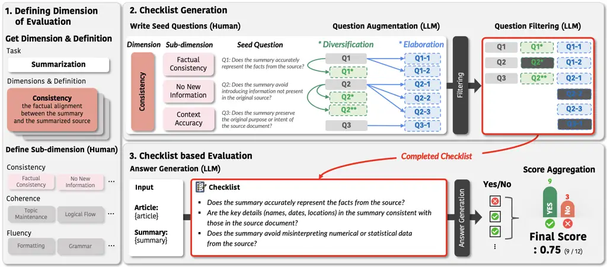
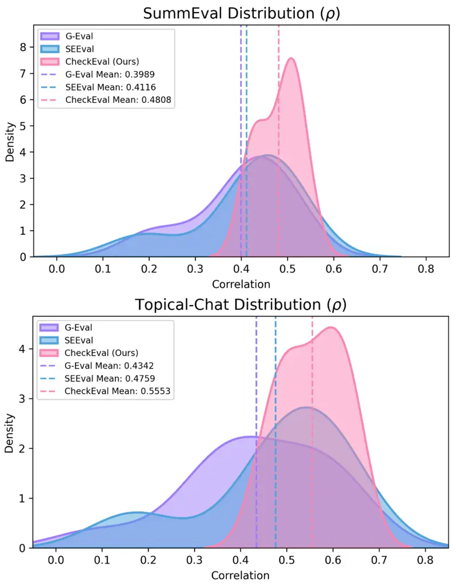
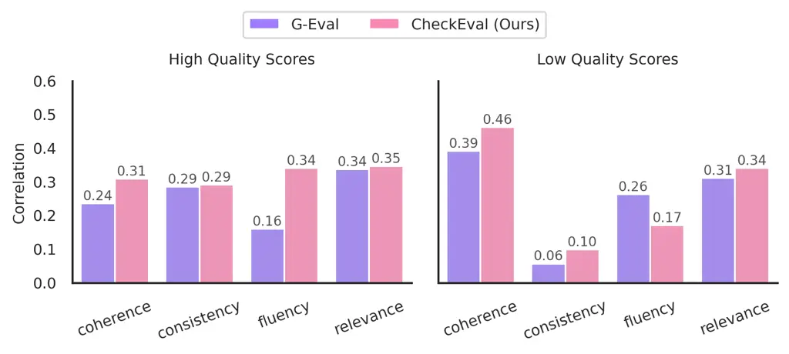
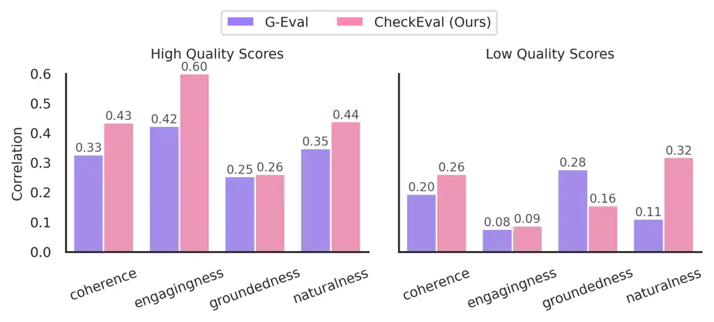

# CheckEval: A reliable LLM-as-a-Judge framework for evaluating text generation using checklists

Yukyung Lee Affiliation: Boston University
Email: <mailto:ylee5@bu.eduylee5@bu.edumailto:pilsungkang@snu.ac.krpilsungkang@snu.ac.krmailto:najoung@bu.edunajoung@bu.edu>
   Joonghoon Kim Affiliation: SK Telecom    Jaehee Kim
Affiliation: Seoul National University    Hyowon Cho Affiliation: KAIST
   Jaewook Kang Affiliation: NAVER    Pilsung Kang Affiliation: Seoul
National University    Najoung Kim Affiliation: Boston University

###### Abstract

Existing LLM-as-a-Judge approaches for evaluating text generation suffer
from rating inconsistencies, with low agreement and high rating variance
across different evaluator models. We attribute this to subjective
evaluation criteria combined with Likert scale scoring in existing
protocols. To address this issue, we introduce CheckEval, a
checklist-based evaluation framework that improves rating reliability
via decomposed binary questions. Through experiments with 12 evaluator
models across multiple datasets, we first demonstrate that CheckEval
strongly correlates with human judgments. More importantly, CheckEval
dramatically improves the average agreement across evaluator models by
0.45 and reduces the score variance. CheckEval scores furthermore have
the benefit of being more interpretable because it decomposes evaluation
criteria into traceable binary decisions, allowing analyses of specific
attributes driving quality judgments.

^(†)^(†)footnotetext: ^(\#),^(†) Equal contribution. Our code is
available at
[https://github.com/yukyunglee/CheckEval](https://github.com/yukyunglee/CheckEval).

## 1 Introduction

Evaluating text generation quality remains a major challenge in Natural
Language Generation (NLG), particularly as Large Language Models (LLMs)
continue to advance in their generative capabilities Brown et al.
(2020); Chowdhery et al. (2023); Achiam et al. (2023). This is
especially evident in tasks such as summarization, dialogue, and
creative writing Liu et al. (2023d); Kim et al. (2023); Liu et al.
(2023a), where qualitative dimensions of the output are crucial yet
difficult to measure systematically. Consequently, there is growing
interest in developing evaluation methods that can effectively capture
these aspects. These methods will ideally involve well-defined protocols
that ensure reliability across different raters and tasks. In obtaining
actual scores from such protocols, human evaluation remains the gold
standard, but it is costly, time-consuming, and difficult to scale
Novikova et al. (2017); Belz et al. (2020). While lexical overlap-based
metrics such as ROUGE and BLEU Lin (2004); Papineni et al. (2002) have
been widely adopted for ease of automation, they align poorly with human
judgments, calling for alternatives that better approximate human
evaluation.

Recent work has explored the use of LLM-as-a-Judge as a scalable
alternative, leveraging LLMs to assess generated text directly Zheng
et al. (2023). This paradigm has evolved through various approaches:
single-turn prompting Liu et al. (2023b); Fu et al. (2023),
meta-evaluator training Kim et al. (2023); Wu et al. (2024b), and even
more sophisticated methods like multi-agent debate Chan et al. (2024);
Kim et al. (2024). However, these methods often rely on subjective
evaluation protocols that require evaluators to assign holistic scores
without clear decision criteria. For example, evaluators are typically
asked to rate text on a Likert scale from 1 to 5 (higher is better) on
dimensions such as coherence, consistency, fluency, and relevance. While
Likert scales are useful for capturing ordinal relationships in human
evaluation, they face two key challenges when applied to LLM-based
evaluator models. First, current LLMs are known to struggle with
subjective criteria in Likert-scale evaluations, in particular showing
difficulty in differentiating between high-quality texts Li et al.
(2019); Stureborg et al. (2024). Second, evaluation results are highly
sensitive to the choice of evaluator models. These lead to low
inter-evaluator agreement (IEA),¹¹ 1 This is equivalent to
Inter-Annotator Agreement (IAA) in human evaluation Artstein (2017), but
we use the term IEA in this paper to make it clear that the agreement we
are aiming to improve is agreement between evaluator models, rather than
between human raters providing the gold evaluation. which we define as
the agreement among evaluator models (of similar capacity), as well as
high variance in evaluation results Stureborg et al. (2024). Yet,
previous LLM-as-a-Judge approaches have overlooked these issues Gao
et al. (2024a).

Figure 1: Overall process of CheckEval. CheckEval consists of three
stages: (1) Defining Dimensions of Evaluation, where humans select
specific dimensions and define sub-dimensions; (2) Checklist Generation,
which incorporates two augmentation methods—question diversification
(green) and elaboration (blue); and (3) Checklist-based Evaluation,
where the model responds to the checklist with yes/no answers.

To address these challenges, we introduce CheckEval, a reliable
evaluation framework that decomposes evaluation criteria to target
fine-grained qualitative dimensions and turns them into a checklist.²² 2
Our checklist concept is inspired by Ribeiro et al. (2020), who proposed
checklist-based testing for NLP models. Inspired by recent advances in
fine-grained decomposition of evaluation Liu et al. (2023c); Min et al.
(2023), our framework breaks down evaluation into discrete Boolean
questions. This decomposition simplifies each individual evaluation
question and clarifies the rationale behind evaluation decisions.
CheckEval addresses key limitations of existing methods in two ways.
First, it improves explainability by tracking how specific criteria are
met, making evaluation decisions more explicit and reducing ambiguity.
Second, it enhances consistency through structured binary responses,
which improve IEA and reduce variability. Importantly, CheckEval
maintains competitive correlation with human evaluation while achieving
these improvements. These improvements are verified through
comprehensive experiments across 12 different LLM-based evaluator models
of varying sizes, including both open and closed-source models, on
multiple datasets. The main contributions of this study can be
summarized as follows:

- •
  We introduce CheckEval, a fine-grained evaluation framework leveraging
  a Boolean QA checklist to address the rating consistency issues with
  existing LLM-as-a-Judge methods for NLG evaluation.
- •
  Experiments across 12 LLMs and multiple datasets demonstrate
  significant improvements in correlation with human evaluation compared
  to Likert-based approaches like G-Eval Liu et al. (2023b) and SEEval
  Wu et al. (2025).
- •
  CheckEval shows reduced sensitivity to the choice of evaluator models,
  leading to more consistent evaluation results with lower variance and
  higher IEA.

## 2 Related Work

### 2.1 LLM-as-a-Judge

Traditional NLG evaluation metrics like ROUGE and BLEU show clear
limitations due to their reliance on reference texts Gu et al. (2021).
With advances in LLMs, researchers have explored LLM-as-a-Judge, where
an LLM evaluates texts based on specified criteria, formalized as
$`F(\text{subject},\text{criteria})\to\text{result}`$ Li et al. (2024).
LLM-as-a-Judge can be categorized into pairwise and pointwise evaluation
approaches Gu et al. (2024). Pairwise evaluation Zheng et al. (2023);
Qin et al. (2024) compares two outputs to determine relative preference
but is computationally expensive as comparisons scale exponentially. In
contrast, pointwise evaluation Liu et al. (2023b); Fu et al. (2023)
assigns scores to individual outputs, allowing for absolute scaling.
However, existing pointwise evaluation protocols often lack granularity,
assigning a single numeric score to each dimension of evaluation. If the
specified dimensions of evaluation are too broad (e.g., fluency), this
may lead to inconsistencies in judgments because many factors could
influence the quality along the target dimension. CheckEval falls in to
the category of pointwise evaluation but addresses its limitations by
adopting a finer-grained Boolean QA Checklist.³³ 3 Recent studies Wu
et al. (2024a); Wang et al. (2024) use LLM-as-a-Judge as a reward signal
in alignment training with RLHF Ouyang et al. (2022). However, this
approach primarily aims to optimize model training rather than enhance
evaluation robustness and explainability. Our work focuses on improving
evaluation frameworks, and integrating evaluation signals into model
training is beyond our scope.

### 2.2 Decompositional Approaches

Decomposing complex information into minimal units to simplify tasks
have been explored in various areas of NLP Kamoi et al. (2023); Chen
et al. (2022); Wright et al. (2022); Krishna et al. (2023); Nenkova and
Passonneau (2004); Liu et al. (2024). Recent studies have shown that
breaking down content into atomic units reduces subjectivity in factual
consistency judgment Liu et al. (2023c); Min et al. (2023). Atomic units
represent elementary information that cannot be further divided.
Similarly, CheckEval decomposes evaluation criteria into fine-grained
Boolean QA Checklists to enhance clarity and reduce ambiguity in the
evaluation process.

### 2.3 Reliability of Evaluation

Reliability is an important yet often overlooked component of
evaluation. Many LLM-as-a-Judge methods focus only on correlation with
human scores, often neglecting consistency and stability across
different LLMs. Recent studies have highlighted several reliability
concerns. Xiao et al. (2023) demonstrate that LLMs fail to reliably
assess subtle quality differences in text. Similarly, Bavaresco et al.
(2024) find these models often assign highly variable ratings to
identical inputs. Furthermore, IEA remains low across models,
compromising evaluation reliability Stureborg et al. (2024). Our work
addresses these issues by evaluating not only correlation but also IEA
and score variance across evaluator models, showing that CheckEval
improves reliability across diverse LLMs.

## 3 Method

CheckEval consists of three stages, (1) Defining Dimensions of
Evaluation, (2) Checklist Generation, and (3) Checklist-Based
Evaluation, as shown in Figure 1. The framework translates high-level
evaluation criteria into a Boolean QA checklist, each question in the
checklist expecting a binary (yes/no) response. This format improves
clarity and alleviates ambiguity compared to Likert-scale scoring
(discussed further in Section 7.2).

### 3.1 Defining Dimensions of Evaluation

The first stage defines the dimensions of text quality (e.g.,
consistency, fluency) to be evaluated by either adopting predefined
dimensions from benchmarks or specifying custom dimensions for the task.
For each dimension, we then define sub-dimensions that break down the
high-level dimensions further into distinct and detailed components. The
sub-dimensions are grounded in the original definitions of the
dimensions from benchmark datasets and can also also informed by related
work Liu et al. (2023c); Laban et al. (2023); Tang et al. (2019). For
instance, the original SummEval paper proposes that fluency in
summarization should include sub-dimensions such as formatting, grammar,
completeness, and readability.

Sub-dimensions must be carefully designed to align with benchmark
definitions and to prevent inconsistencies with the intended evaluation
criteria. While LLMs can be used to automate the generation of
sub-dimensions and questions, we found that fully relying on them often
led to misalignment with the criteria defined by the benchmark (e.g.,
conflating coherence and fluency). This leads to evaluation that is not
grounded in the benchmark design, potentially producing incorrect
assessments. To address this, we only allowed human-selected
sub-dimensions in our work, following prior work that recommends human
oversight as an effective way to maintain alignment with benchmark
objectives Szymanski et al. (2024); Pan et al. (2024).

### 3.2 Checklist Generation

#### Seed Question Writing

We create Boolean questions that correspond to the sub-dimensions
defined in the first step. Each question requires a ‘yes’ or ‘no’
answer, where ‘yes’ indicates adherence to the evaluation criterion
corresponding to the target sub-dimension. This binary format simplifies
the judgment process, ensuring that evaluation criteria are explicitly
defined and consistently applied Laban et al. (2023); Liu et al.
(2023c). This format also helps LLMs generate more reliable responses by
constraining the answer space, minimizing response variability and
reducing ambiguity. For example, the question “Are all words in the
sentence spelled correctly?” elicits a clearer and more direct response
than a more open-ended alternative like “How well does the sentence
adhere to or deviate from standard grammar rules?”.

#### Question Augmentation

Manually designing a comprehensive set of evaluation questions would be
ideal for ensuring a high-quality checklist. However, this approach
faces scalability limitations, making it impractical to generate a
sufficiently large and diverse set of questions for evaluation. This
challenge becomes even more significant when extending to individual
application scenarios, each requiring its own comprehensive set of
questions. To this end, we expand the seed questions using LLMs,
enhancing both the diversity and granularity of evaluation. Augmentation
enables broader coverage while refining questions to capture a wider
range of lexical and semantic variations. This process follows two
strategies, each extending the coverage of seed questions. (1) Question
Diversification expands evaluation diversity by introducing variations
that explore different perspectives of sub-dimensions and contexts of
the seed question. (2) Question Elaboration increases granularity by
expanding the seed questions into more specific and detailed questions.
To ensure that the augmented questions remain grounded in the seed
questions, Question Diversification and Elaboration are performed
independently rather than sequentially. For example, the seed question
“Are all words in the sentence spelled correctly?” can be expanded into
“Are all sentences complete, with no fragments or missing components?”
(diversification) or specified into “Are proper nouns (names of people,
places, etc.) spelled correctly?” (elaboration).

#### Question Filtering

LLM-based augmentation expands the question set, but it can also
generate questions that do not fully align with the intended evaluation
criteria. Some questions may reflect misinterpretations of dimension
definitions or add unnecessary redundancy, which can affect evaluation
reliability. To filter out such questions, we apply an LLM-based minimal
filtering process that evaluates a combined pool of seed and augmented
questions for each dimension. This filtering step applies three main
criteria for retaining relevant questions: (1) alignment, verifying that
a ‘yes’ response to the question indicates higher quality; (2) dimension
consistency, confirming that the question adheres to the original
definition of the evaluation dimension; and (3) redundancy removal,
eliminating semantically overlapping questions to avoid unnecessary
repetition. While there is no direct metric to measure filtering
effectiveness, we observe improved correlation with human judgments
after filtering, suggesting that the filtering is functioning as
intended. We further validated the quality of the checklist via a human
study, where annotators scored the augmented and filtered questions
(Section 6.1).

### 3.3 Checklist-based Evaluation

In the final stage, LLMs evaluate the target text using the completed
checklist (see Table 17 and 18 for the number of checklist questions and
Table 26 and 27 for the dimensions, sub-dimensions, and corresponding
seed question for each dataset). To improve efficiency, we ask multiple
questions simultaneously rather than asking each question separately. We
compared single-question and multi-question inference in our pilot
experiments and found no noticeable difference in performance.
Therefore, we evaluated multiple questions together to reduce the
computational cost. The questions are grouped by sub-dimensions,
ensuring that related questions are presented together to aid model
comprehension. For each question in the checklist, the LLM generates a
‘yes’ or ‘no’ response. The final quality score is computed as the
proportion of ‘yes’ responses among all questions (e.g., 15 ‘yes’ out of
20 questions yields 0.75). We note that the final score is computed by
uniformly weighting the checklist questions: each ‘yes’ response
contributes equally to the final score. We discuss an alternative
weighting strategy in Appendix C.2. More implementation details about
the evaluation process are described in Section 4.4.

This approach enhances explainability by explicitly tracking how
specific criteria are met, making evaluation decisions more
interpretable without requiring additional rationale generation. Unlike
existing LLM-as-a-Judge approaches such as G-Eval and SEEval (our main
comparison points) that generate numerical scores without explanation
(e.g., “Based on the conversation history, the corresponding context,
and the response, here is the evaluation: ‘Naturalness’: 2”), the
reasoning behind the evaluation score is easily traceable from the
checklist responses.

## 4 Experimental Setup

### 4.1 Datasets and Metrics

Following Liu et al. (2023b), We use three meta-evaluation benchmarks
spanning various tasks to measure the effectiveness of CheckEval.
SummEval Fabbri et al. (2021) is a benchmark designed for the
meta-evaluation of summarization. SummEval includes human evaluations
for each generated summary across four dimensions: coherence,
consistency, fluency, and relevance. Topical-Chat Gopalakrishnan et al.
(2019) is a benchmark for meta-evaluating evaluation methods for
knowledge-grounded dialogue systems. Following Zhong et al. (2022), we
evaluate our method using human ratings across four dimensions:
naturalness, coherence, engagingness, and groundedness. QAGS Wang et al.
(2020) is another widely used benchmark, but since it focuses solely on
factual consistency in summarization, we only report the results in
Appendix B.1. We report Pearson’s $`r`$, Spearman’s $`\rho`$, Kendall’s
$`\tau`$ on each benchmark. For SummEval, correlations are calculated at
the sample-level (per summary), while for Topical-Chat, they are
calculated at the turn-level (per conversational response).

### 4.2 Baselines

We selected G-Eval Liu et al. (2023b) and SEEval Wu et al. (2025) as our
main baselines. G-Eval adopts chain-of-thought prompting Wei et al.
(2022) and a form-filling paradigm to generate evaluation scores on a
Likert scale. We selected it based on three factors: (1) its widespread
adoption as a representative baseline in LLM-as-a-judge research, (2)
the availability of publicly released prompts that facilitate
reproducibility, and (3) its relatively simple setup that avoids
confounding performance-enhancing techniques—such as prompt optimization
(e.g., self-correction), training meta-evaluators, preference learning,
or multi-agent frameworks. SEEval follows a similar Likert-style scoring
procedure to G-Eval but augments it with a self-explanation step,
prompting the model to generate brief justifications before producing
its rating. This strategy is intended to improve evaluation quality
without additional training.

Like G-Eval and SEEval, CheckEval is also designed to rely solely on a
binary checklist mechanism, without introducing additional optimization
techniques beyond standard prompting. Although they are not
apples-to-apples comparisons, we also include comparisons to several
strong methods surveyed in Gu et al. (2024) and Gao et al. (2024b),
showing that CheckEval remains competitive even in light of more recent
developments. Further details on the baseline implementations are
provided in Appendix A.1.

### 4.3 Models

We test both open-source models of varying sizes and closed-source GPT
models as evaluators. The models included in each category are as
follows:⁴⁴ 4 The links for each model are provided in Appendix E. (1)
Large models (70–123B): LLama3.1-70B, Mistral-Large (123B), Qwen2.5-72B.
(2) Medium models (22–32B): Mistral-Small (22B), Gemma2-27B,
Qwen2.5-32B. (3) Small models (7–9B): LLama3.1-8B, Gemma2-9B,
Qwen2.5-7B, (4) GPT models: GPT-4-Turbo, GPT-4o, GPT-4o-mini Achiam
et al. (2023); Dubey et al. (2024); Jiang et al. (2023); Yang et al.
(2024); Riviere et al. (2024).

### 4.4 Implementation Details

Following prior work Liu et al. (2023b), we set temperature = 0, n = 1,
and fix the random seed for both G-Eval, SEEval and CheckEval.
Additionally, We set max_length to 20 for G-Eval as it generates a
single score, 500 for SEEval following the original implementation and
200 for CheckEval as it needs to generate responses to multiple
checklist questions. We used the original prompts provided by the
authors of G-Eval and SEEval without any modifications. Example prompts
for CheckEval are provided in the Appendix F. We evaluated multiple
questions in the checklist within a single prompt to enhance efficiency
and practicality rather than evaluating each question individually, as
discussed in Section 3.3.

We used GPT-4o for both the question augmentation and filtering steps in
the checklist generation stage. The total number of generated questions
at each step is provided in Appendix D. Our experiments on open-weight
models were conducted using vLLM 0.6.3 Kwon et al. (2023) with four A100
GPUs (or eight A6000 GPUs). The API cost to evaluate the 1,600 SummEval
samples was approximately \$66 with GPT-4 Turbo, \$22 with GPT-4o, and
\$1.30 with GPT-4o-mini.

|                    |                    |                 |          |                     |       |
| ------------------ | ------------------ | --------------- | -------- | ------------------- | ----- |
| Model              | Evaluation Methods | SummEval (Avg.) |          | Topical-Chat (Avg.) |       |
|                    |                    | $`\rho`$        | $`\tau`$ | $`\rho`$            | $`r`$ |
| non-LLM-as-a-Judge |                    |                 |          |                     |       |
|                    | ROUGE-L            | 0.17            | 0.13     | 0.24                | 0.24  |
|                    | BERTScore          | 0.23            | 0.18     | 0.25                | 0.24  |
|                    | MOVERScore         | 0.47            | 0.38     | 0.22                | 0.24  |
|                    | BARTScore          | 0.19            | 0.15     | 0.29                | 0.29  |
|                    | UniEval            | 0.39            | 0.31     | 0.28                | 0.26  |
| LLM-as-a-Judge     |                    |                 |          |                     |       |
| Llama3.1-70B       | G-Eval             | 0.40            | 0.36     | 0.45                | 0.39  |
|                    | SEEval             | 0.41            | 0.35     | 0.55                | 0.54  |
|                    | CheckEval          | 0.46            | 0.40     | 0.57                | 0.57  |
| Mistral-Large      | G-Eval             | 0.52            | 0.47     | 0.64                | 0.62  |
|                    | SEEval             | 0.54            | 0.50     | 0.64                | 0.63  |
|                    | CheckEval          | 0.55            | 0.48     | 0.65                | 0.65  |
| Qwen2.5-72B        | G-Eval             | 0.43            | 0.39     | 0.62                | 0.61  |
|                    | SEEval             | 0.47            | 0.41     | 0.60                | 0.60  |
|                    | CheckEval          | 0.50            | 0.44     | 0.59                | 0.60  |
| Mistral-Small      | G-Eval             | 0.18            | 0.16     | 0.58                | 0.52  |
|                    | SEEval             | 0.22            | 0.20     | 0.17                | 0.17  |
|                    | CheckEval          | 0.45            | 0.39     | 0.47                | 0.49  |
| Gemma2-27B         | G-Eval             | 0.44            | 0.39     | 0.31                | 0.29  |
|                    | SEEval             | 0.44            | 0.39     | 0.41                | 0.44  |
|                    | CheckEval          | 0.51            | 0.44     | 0.53                | 0.52  |
| Qwen2.5-32B        | G-Eval             | 0.50            | 0.45     | 0.46                | 0.38  |
|                    | SEEval             | 0.49            | 0.44     | 0.47                | 0.51  |
|                    | CheckEval          | 0.52            | 0.44     | 0.56                | 0.56  |
| Llama3.1-8B        | G-Eval             | 0.24            | 0.21     | 0.11                | 0.09  |
|                    | SEEval             | 0.16            | 0.13     | 0.17                | 0.17  |
|                    | CheckEval          | 0.41            | 0.34     | 0.46                | 0.45  |
| Gemma2-9B          | G-Eval             | 0.38            | 0.34     | 0.46                | 0.35  |
|                    | SEEval             | 0.49            | 0.40     | 0.49                | 0.50  |
|                    | CheckEval          | 0.43            | 0.37     | 0.49                | 0.50  |
| Qwen2.5-7B         | G-Eval             | 0.41            | 0.38     | 0.45                | 0.39  |
|                    | SEEval             | 0.39            | 0.34     | 0.48                | 0.46  |
|                    | CheckEval          | 0.42            | 0.37     | 0.48                | 0.47  |
| GPT-4 Turbo        | G-Eval             | 0.51            | 0.46     | 0.59                | 0.58  |
|                    | SEEval             | 0.50            | 0.46     | 0.60                | 0.61  |
|                    | CheckEval          | 0.52            | 0.46     | 0.63                | 0.64  |
| GPT-4o             | G-Eval             | 0.32            | 0.29     | 0.52                | 0.43  |
|                    | SEEval             | 0.39            | 0.37     | 0.56                | 0.47  |
|                    | CheckEval          | 0.50            | 0.44     | 0.64                | 0.63  |
| GPT-4o-mini        | G-Eval             | 0.45            | 0.40     | 0.58                | 0.56  |
|                    | SEEval             | 0.46            | 0.41     | 0.57                | 0.56  |
|                    | CheckEval          | 0.49            | 0.42     | 0.59                | 0.59  |

Table 1: Average correlation scores across dimensions on the benchmarks.
For SummEval, we report sample-level $`\rho`$ and $`\tau`$. For
Topical-Chat, we report turn-level $`\rho`$ and $`r`$. Colors indicate
model groups: large (pink), medium (blue), small (green) and GPT
(purple). The best score per model category is bolded, and the highest
overall score is marked with an underline.

## 5 Results

### 5.1 Correlation with Human Evaluation

Table 1 shows the correlation between various evaluation methods and
human judgments on the SummEval and Topical-Chat datasets (detailed
correlation results for all dimensions are shown in Table 22, 24 and 7
in the Appendix). We compare both non-LLM-as-a-Judge and LLM-as-a-Judge
methods, with an emphasis on how CheckEval compares against G-Eval and
SEEval across 12 LLMs.

Excluding MOVERScore, most non-LLM-as-a-Judge metrics exhibit very low
correlation with humans. Among LLM-as-a-Judge methods, CheckEval
consistently achieves higher correlation with human judgments than
G-Eval and SEEval, with only a few exceptions of Qwen2.5 and
Mistral-Small. These results suggest that CheckEval’s fine-grained,
checklist-based design more effectively captures subtle differences in
text quality, leading to improved correlation with human judgments. When
analyzing model sizes, large open-source models show strong performance,
with Mistral-Large combined with CheckEval achieving the highest
correlation among all models ($`\rho=0.55`$ on SummEval and $`r=0.65`$
on Topical-Chat). Even in medium- and small-sized models—where
evaluation capacity tends to be weaker—CheckEval maintains its advantage
over G-Eval. Notably, some medium-sized models perform particularly well
on SummEval, achieving correlations comparable to larger models. For GPT
models, CheckEval consistently yields stronger correlations than G-Eval
and SEEval, particularly with GPT-4o.

|             |                    |                 |            |                     |            |
| ----------- | ------------------ | --------------- | ---------- | ------------------- | ---------- |
| Model Group | Evaluation Methods | SummEval (Avg.) |            | Topical-Chat (Avg.) |            |
|             |                    | $`\alpha`$      | $`\kappa`$ | $`\alpha`$          | $`\kappa`$ |
| All         | G-Eval             | 0.09            | 0.19       | 0.06                | 0.34       |
|             | SEEval             | 0.08            | 0.14       | 0.07                | 0.31       |
|             | CheckEval          | 0.48            | 0.48       | 0.45                | 0.45       |
| Large       | G-Eval             | 0.05            | 0.16       | 0.01                | 0.51       |
|             | SEEval             | 0.06            | 0.19       | 0.55                | 0.61       |
|             | CheckEval          | 0.67            | 0.67       | 0.67                | 0.67       |
| Medium      | G-Eval             | 0.04            | 0.14       | 0.07                | 0.22       |
|             | SEEval             | 0.09            | 0.13       | 0.06                | 0.34       |
|             | CheckEval          | 0.56            | 0.56       | 0.50                | 0.50       |
| Small       | G-Eval             | 0.06            | 0.10       | 0.04                | 0.16       |
|             | SEEval             | 0.02            | 0.07       | 0.16                | 0.15       |
|             | CheckEval          | 0.24            | 0.24       | 0.17                | 0.17       |
| GPT         | G-Eval             | 0.08            | 0.20       | 0.04                | 0.50       |
|             | SEEval             | 0.13            | 0.32       | 0.12                | 0.51       |
|             | CheckEval          | 0.56            | 0.56       | 0.54                | 0.54       |
| Top-3^(∗)   | G-Eval             | 0.07            | 0.23       | 0.03                | 0.56       |
|             | SEEval             | 0.09            | 0.19       | 0.06                | 0.34       |
|             | CheckEval          | 0.65            | 0.65       | 0.57                | 0.57       |

Table 2: Inter-evaluator agreement (IEA) results for SummEval and
Topical-Chat, comparing G-Eval, SEEval and CheckEval across different
model groups. Top-3 refers to the three models with the highest
correlation to human judgments (^(∗) see Appendix  A.3 for the list of
top-3 models for each evaluation method). The best score per model
category is bolded.

### 5.2 Inter-evaluator Agreement (IEA)

Table 2 compares the IEA of G-Eval, SEEval and CheckEval on the SummEval
and Topical-Chat datasets. We measure IEA using Krippendorff’s
$`\alpha`$ and Fleiss’ $`\kappa`$, treating different LLMs within the
same group (large, medium, small, GPT) as annotators. While correlation
with human judgments is a main metric in LLM-as-a-Judge, high
correlation alone does not guarantee reliability. Reliability is a
desirable property for evaluation methods, as it ensures that different
evaluator models (of similar capacity) assign similar scores/rating to
the same input. This reliability is critical yet overlooked in existing
frameworks.

Both G-Eval and SEEval demonstrate this limitation. They achieve fairly
good correlation with human judgments but show much lower IEA in
general. Table 2 shows a clear gap between the IEA of G-Eval and SEEval
and IEA of CheckEval, particularly for the Large and Top-3 models. This
indicates inconsistent scoring across different LLM evaluator models of
similar capacity. We speculate that existing protocols like G-Eval’s
mainly lend themselves to inconsistencies in the following two ways: (1)
the evaluation dimensions adopted encompass multiple distinct
fine-grained criteria, making it difficult for LLMs to generate a
consistent holistic score, and (2) adjacent Likert scale scores lack
clear distinctions (e.g., 3 vs. 4) and are not calibrated well across
models Laban et al. (2023).

Figure 2: Human validation scores for the checklist generation process,
averaged across all dimensions on both SummEval and Topical-Chat.
‘Augmentation’ refers to the percentage of augmented questions that
fulfilled the specified quality criteria, and ‘Filtering’ refers to the
percentage for filtered questions.

CheckEval’s fine-grained checklist approach improves upon this
limitation greatly. For the large models, CheckEval achieves best IEA
scores of 0.67 ($`\alpha`$ and $`\kappa`$), on SummEval, which is
comparable to IEA among human raters ($`\kappa\approx 0.7`$) Fabbri
et al. (2021), and 0.67 ($`\alpha`$ and $`\kappa`$) on Topical-Chat.
Crucially, CheckEval maintains both high correlation and IEA across
different LLMs and tasks. These results demonstrate that CheckEval
provides a more reliable evaluation than G-Eval and SEEval (See Table 23
and 25 for a detailed per-dimension IEA). We furthermore show that this
improvement in IEA is not solely due to the format of the output (Likert
vs. binary) in Appendix C.3.

## 6 Human Validation

We conducted two distinct human evaluation studies to validate our
approach: (1) an assessment of our automated checklist generation
process, and (2) a direct comparison between LLM and human scores using
the CheckEval protocol.

### 6.1 Validation of Checklist Generation Process

|               |                   |                     |          |
| ------------- | ----------------- | ------------------- | -------- |
| Model         | Evaluation Method | SummEval (Avg.)     |          |
|               |                   | $`\rho`$            | $`\tau`$ |
| Mistral-Large | CheckEval         | 0.5486              | 0.4797   |
|               | CheckEval ^(\#)   | 0.5486              | 0.4797   |
|               |                   | Topical-Chat (Avg.) |          |
|               |                   | $`\rho`$            | $`r`$    |
|               | CheckEval         | 0.6451              | 0.6453   |
|               | CheckEval ^(\#)   | 0.6443              | 0.6412   |
|               |                   | QAGS (Avg.)         |          |
|               |                   | $`r`$               | $`\rho`$ |
|               | CheckEval         | 0.6681              | 0.6558   |
|               | CheckEval ^(\#)   | 0.6680              | 0.6558   |

Table 3: Effect of applying additional human filtering to Mistral-Large.
\# indicates that filtering was applied.

To verify that each stage of the checklist generation process worked as
intended, we conducted an additional human evaluation focused on
checklist quality. This evaluation validates the augmentation stage
(seed questions, augmented questions), and filtering stage (seed
questions, filtered questions) on both the SummEval and Topical-Chat
datasets. Human evaluators are tasked with assessing each question on a
binary (yes/no) basis, determining whether it satisfies the augmentation
and filtering criteria. Figure 2 shows the average scores derived from
the checklist validation evaluation for both the SummEval and
Topical-Chat datasets. The augmentation stage consistently achieves very
high average scores across both datasets (above 90%), which suggests
that the question augmentation process of CheckEval is highly effective.
The filtering stage yields slightly lower scores but remains
competitive. We observed that annotators often expected 1–2 additional
questions per dimensions to be filtered. Comments from annotators
suggest that these questions were mostly semantically overlapping
questions that the filter failed to capture.

To test whether removing these remaining questions would affect
evaluation results, we conducted a follow-up experiment by applying an
additional human-curated filtering step. We used Mistral-Large, the
best-performing model, for this experiment. As shown in As shown in
Table 3, the correlation scores after applying the additional filtering
were extremely similar to the original results, with only minor drops.
This indicates that removing one or two additional questions per
evaluation dimension does not meaningfully impact the evaluation
behavior, suggesting that CheckEval’s automatic filtering is functioning
effectively in practice.

### 6.2 Validation of CheckEval Protocol

|                                      |               |             |
| ------------------------------------ | ------------- | ----------- |
| Correlation                          | $`\rho`$      | $`\tau`$    |
|   00Mistral-large (C) vs. Humans (C) | 0.73^(∗∗)     | 0.58^(∗∗)   |
|   00Qwen2.5-72B (C) vs. Humans (C)   | 0.72^(∗∗)     | 00.59^(∗∗∗) |
|   00Llama3.1-70B (C) vs. Humans (C)  | 0.73^(∗∗)     | 0.58^(∗∗)   |
|   00Humans (L) vs. Humans (C)        | 0.69^(∗∗)     | 00.54^(∗∗∗) |
| Agreement (dim: Relevance)           | \# Annotators | $`\kappa`$  |
|   00Humans                           | 3             | 0.53        |
|   00LLMs (Large) & Humans            | 6             | 0.49        |

Table 4: Human validation of the CheckEval protocol on SummEval. C
denotes CheckEval, L denotes Likert (original SummEval Score). We use
the LLM results from the large model group. (^(∗∗): $`p<.01`$, ^(∗∗∗):
$`p<.001`$)

To further assess the validity of CheckEval protocol, we asked human
annotators to manually apply the same checklist. We then used these
human-generated scores to perform two analyses: a correlation analysis
against scores from LLMs, and an inter-rater agreement analysis
(Table 4). Details of the human validation setup are provided in
Appendix A.4.

#### Correlation

We sampled 20 summaries from the SummEval dataset. The random sampling
was stratified based on original annotation scores to ensure balanced
coverage of a wide range of quality levels. Three annotators evaluated
each summary using the checklist, which contains approximately 25 binary
(yes/no) questions per evaluation dimension. This resulted in roughly
2,000 binary annotations per annotator. For each summary, we aggregated
checklist scores by summing the number of ‘yes’ responses per dimension,
following the same method used for LLM outputs. We then computed
correlation between these aggregated human scores and those from three
large LLMs: Mistral-Large, Qwen2.5-72B, and Llama3.1-70B. In addition,
we calculated correlation between the original Likert-scale scores from
SummEval and the checklist-based human scores. All correlations are
statistically significant, indicating that CheckEval scores successfully
capture human judgments.

#### Agreement

Due to the high annotation cost, we focused on relevance for agreement
analysis. We collected binary annotations on 100 summaries (sample size
selected based on a power analysis targeting 95% confidence interval
width of $`\leq`$ 0.2 for IEA scores). Each annotator answered
approximately 10,000 questions. We report inter-annotator agreement
among the three human annotators, as well as agreement between the human
group and the large LLM group. We observe high agreement between humans
as well as between humans and LLMs, showing that CheckEval elicits
consistent scores across both human and LLM raters.

Figure 3: Kernel density estimation (KDE) of correlations with human
judgments for G-Eval (purple), SEEval (blue) and CheckEval (pink) across
different evaluator models on SummEval and Topical-Chat. Dashed lines
indicate mean correlation values.

## 7 Analysis

### 7.1 Stability Analysis of Evaluation Methods

We further analyze the stability of evaluation methods by examining the
distribution of correlations with human judgments across different
evaluator models. While the agreement metric (Section 5.2) focuses on
how consistently models assess the same samples, stability evaluates
whether an evaluation method maintains reliable alignment with human
annotations across all evaluator models. As shown in Figure 3, CheckEval
achieves higher mean correlation and lower variance than G-Eval and
SEEval on both datasets, demonstrating more stable evaluation across
different models. Detailed correlation statistics, including full mean
and variance values, are available in Table 15.

[TABLE]

Table 5: Case study on the naturalness dimension in the Topical-Chat.

### 7.2 Case Study

We conduct a case study on the naturalness dimension in the Topical-Chat
dataset to illustrate how CheckEval enhances explainability by
explicitly showing which evaluation criteria contribute to the final
score (see Table 5). We evaluate system responses generated by
Mistral-large, the model with the strongest correlation with human
judgments. For this case study, we normalize all scores to a 0–1 scale
for direct comparison. On evaluating the given text on naturalness,
CheckEval (0.88) aligns more closely with human judgments (1.0), rating
the response as natural. In contrast, G-Eval (0.25) assigned a much
lower naturalness score. More importantly, while G-Eval provides only a
score without explanation, CheckEval’s systematic decomposition into
specific sub-questions helps us attribute the high score to individual
questions with a ‘yes’ answer (e.g., the response is natural because it
avoids repetition, the message is clear, etc.). An additional case study
on low-quality samples from benchmark datasets is presented in
Appendix C.1, further demonstrating how CheckEval operates across a
wider range of text qualities.

### 7.3 Ablation Study

We conducted an ablation study to assess the contribution of each
component in the CheckEval pipeline. Table 6 reports results when
removing filtering and augmentation step. Both components contribute to
overall performance, with the augmentation stage showing a slightly
larger impact. We also explore whether the performance gap can be closed
by increasing the baseline inference budget in Appendix C.4.

|                    |            |                |
| ------------------ | ---------- | -------------- |
|                    |   SummEval |   Topical-Chat |
|   CheckEval        |   0.48     |   0.55         |
|   w/o filtering    |   0.48     |   0.54         |
|   w/o augmentation |   0.46     |   0.53         |

Table 6: Effect of filtering and augmentation components in CheckEval

## 8 Conclusion

We propose CheckEval, a fine-grained Boolean QA Checklist framework that
addresses key limitations in existing LLM-as-Judge approaches for
evaluating text generation. By decomposing evaluation criteria into
structured binary questions, CheckEval enables reliable evaluation of
(open-ended) text. Our experiments across various models and datasets
demonstrate that CheckEval outperforms widely-adopted Likert scale-based
methods like G-Eval, achieving higher correlation to human evaluation
and IEA across different LLM evaluators. The framework shows particular
strength in evaluating high-quality texts by effectively capturing
subtle qualitative differences while maintaining explainability.
Additionally, CheckEval enhances evaluation stability through reduced
variance across LLMs. This shows that our framework offers a promising
solution for constructing more reliable evaluation benchmarks across
diverse NLG tasks.

## 9 Limitations

CheckEval improves the reliability of LLM-as-a-Judge evaluation, but it
has several limitations. First, while automating checklist generation is
a promising direction for improving scalability, it introduces
challenges that are common to many automatic evaluation methods.
CheckEval uses task-specific, human-written seed questions, which helps
ground the evaluation in task-relevant criteria. However, as an
automatic evaluation method, there may be factors beyond our control
that lead to potential misalignment. In such cases, human involvement
may be necessary to ensure alignment with task-specific goals. This is
not a limitation of CheckEval specifically, but a broader challenge
inherent to automatic evaluation approaches.

Second, this study focused on analyzing model-wise evaluation trends and
comparing Likert-scale evaluation with Boolean QA checklist-based
evaluation. However, recent LLM-as-a-Judge studies have introduced
various techniques to enhance human alignment. Methods such as prompt
optimization (e.g. chain-of-thought Wei et al. (2022), self-correction
Xu et al. (2023)), multi-agent debate Chan et al. (2024); Kim et al.
(2024), and meta-evaluator training Kim et al. (2023); Wu et al.
(2024b); Zhu et al. (2025) enable LLMs to make more enhanced judgments.
Therefore, future work should compare it against these approaches and
analyze how it differs in terms of reliability. This would also help
determine whether CheckEval can be combined with such techniques to
build a more robust evaluation framework.

Third, while CheckEval’s boolean-style decision improves evaluation
reliability, not all NLG tasks and evaluation criteria can be strictly
answered with a yes/no response. This limitation becomes more apparent
when considering evaluation scenarios involving texts two to three times
longer than those in the current benchmarks. As text length increases,
some parts of a response may be strong while others are weak. For
example, the first half of a response may be well-written and coherent,
while the latter half is unclear or contains errors. This makes binary
decisions insufficient for capturing subtle quality differences. The
constraints of a yes/no format may become more pronounced in long-form
evaluations, suggesting that future research should explore ways to
mitigate this limitation while preserving the strengths of CheckEval.

Fourth, CheckEval’s efficacy should be tested on a wider range of NLG
tasks. While this study primarily focused on summarization and dialogue
response generation, additional experiments are needed to validate
CheckEval’s applicability to tasks such as story generation, long-form
question answering, machine translation, and dialogue generation. Given
that evaluation criteria vary by domain, it is important to examine how
well CheckEval generalizes across different task settings. We note that
generalizability of CheckEval is already actively being tested in
follow-up work: for instance CheckEval has been used for tasks such as
essay scoring Chu et al. (2025), creative writing evaluation Lee et al.
(2024), and healthcare evaluation Mallinar et al. (2025).

Finally, improving the automation of checklist design and evaluation
processes would enhance CheckEval’s usability. Currently, checklist
construction is a manual process tailored to specific tasks, making it
difficult to predict the time and effort required for new evaluation
domains. One potential solution is to pre-build a large-scale question
database for NLG tasks and develop a system that automatically assembles
relevant checklists based on task requirements. Future research should
explore LLM-assisted checklist generation and reconfiguration methods to
ensure that CheckEval can be efficiently applied to a broader range of
tasks.

## 10 Acknowledgments

We thank Meng-Chen Wu for his help during the rebuttal process. We also
thank Jungsoo Park for discussions that helped shape the initial idea of
CheckEval. Thanks to Soonwon Ka, Bokyung Son, and Keonwoo Kim for their
useful feedback in the early stages of the project. We also appreciate
the valuable discussion and support from Yulu Qin, tinlab at BU, Naver
AX unsupervised learning and DSBA NLP group at KU & SNU. We acknowledge
that the computational work reported in this paper was performed on the
Shared Computing Cluster which is administered by [Boston University’s
Research Computing Services](https://www.bu.edu/tech/support/research/).
In addition, JK and PK were supported by Institute of Information &
Communications Technology Planning & Evaluation (IITP) grant funded by
the Korea government (MSIT) (RS-2025-02214591, Development of an
Innovative AI Agent for Worker-Friendly Autonomous Manufacturing). Also,
JK and PK were supported by the BK21 FOUR Program (Education and
Research Center for Industrial Innovation Analytics) funded by the
Ministry of Education, Korea (No. 4120240214912)

## References

- Achiam et al. (2023) Josh Achiam, Steven Adler, Sandhini Agarwal, Lama
  Ahmad, Ilge Akkaya, Florencia Leoni Aleman, Diogo Almeida, Janko
  Altenschmidt, Sam Altman, Shyamal Anadkat, et al. 2023. GPT-4
  technical report. _arXiv:2303.08774_.
- Artstein (2017) Ron Artstein. 2017. Inter-annotator agreement.
  _Handbook of linguistic annotation_, pages 297–313.
- Bavaresco et al. (2024) Anna Bavaresco, Raffaella Bernardi, Leonardo
  Bertolazzi, Desmond Elliott, Raquel Fernández, Albert Gatt, Esam
  Ghaleb, Mario Giulianelli, Michael Hanna, Alexander Koller, André
  F. T. Martins, Philipp Mondorf, Vera Neplenbroek, Sandro Pezzelle,
  Barbara Plank, David Schlangen, Alessandro Suglia, Aditya K.
  Surikuchi, Ece Takmaz, and Alberto Testoni. 2024. [Llms instead of
  human judges? a large scale empirical study across 20 nlp evaluation
  tasks](https://doi.org/10.48550/arXiv.2406.18403). _CoRR_,
  abs/2406.18403.
- Belz et al. (2020) Anya Belz, Simon Mille, and David M.
  Howcroft. 2020. [Disentangling the properties of human evaluation
  methods: A classification system to support comparability,
  meta-evaluation and reproducibility
  testing](https://doi.org/10.18653/v1/2020.inlg-1.24). In _Proceedings
  of the 13th International Conference on Natural Language Generation_,
  pages 183–194, Dublin, Ireland. Association for Computational
  Linguistics.
- Brown et al. (2020) Tom Brown, Benjamin Mann, Nick Ryder, Melanie
  Subbiah, Jared D Kaplan, Prafulla Dhariwal, Arvind Neelakantan, Pranav
  Shyam, Girish Sastry, Amanda Askell, et al. 2020. Language models are
  few-shot learners. _Advances in neural information processing
  systems_, 33:1877–1901.
- Chan et al. (2024) Chi-Min Chan, Weize Chen, Yusheng Su, Jianxuan Yu,
  Wei Xue, Shanghang Zhang, Jie Fu, and Zhiyuan Liu. 2024. [Chateval:
  Towards better LLM-based evaluators through multi-agent
  debate](https://openreview.net/forum?id=FQepisCUWu). In _The Twelfth
  International Conference on Learning Representations_.
- Chen et al. (2022) Jifan Chen, Aniruddh Sriram, Eunsol Choi, and Greg
  Durrett. 2022. Generating literal and implied subquestions to
  fact-check complex claims. _arXiv:2205.06938_.
- Chiang and Lee (2023) Cheng-Han Chiang and Hung-yi Lee. 2023. [A
  closer look into using large language models for automatic
  evaluation](https://doi.org/10.18653/v1/2023.findings-emnlp.599). In
  _Findings of the Association for Computational Linguistics: EMNLP
  2023_, pages 8928–8942, Singapore. Association for Computational
  Linguistics.
- Chowdhery et al. (2023) Aakanksha Chowdhery, Sharan Narang, Jacob
  Devlin, Maarten Bosma, Gaurav Mishra, Adam Roberts, Paul Barham,
  Hyung Won Chung, Charles Sutton, Sebastian Gehrmann, et al. 2023.
  Palm: Scaling language modeling with pathways. _Journal of Machine
  Learning Research_, 24(240):1–113.
- Chu et al. (2025) Seong Yeub Chu, Jong Woo Kim, and Mun Yong Yi. 2025.
  [Think together and work better: Combining humans’ and llms’
  think-aloud outcomes for effective text
  evaluation](https://doi.org/10.1145/3706598.3713181). In _Proceedings
  of the 2025 CHI Conference on Human Factors in Computing Systems_, CHI
  ’25, New York, NY, USA. Association for Computing Machinery.
- Devlin et al. (2018) Jacob Devlin, Ming-Wei Chang, Kenton Lee, and
  Kristina Toutanova. 2018. Bert: Pre-training of deep bidirectional
  transformers for language understanding. _arXiv:1810.04805_.
- Dubey et al. (2024) Abhimanyu Dubey, Abhinav Jauhri, Abhinav Pandey,
  Abhishek Kadian, Ahmad Al-Dahle, Aiesha Letman, Akhil Mathur, Alan
  Schelten, Amy Yang, Angela Fan, et al. 2024. The llama 3 herd of
  models. _arXiv:2407.21783_.
- Fabbri et al. (2021) Alexander R Fabbri, Wojciech Kryściński, Bryan
  McCann, Caiming Xiong, Richard Socher, and Dragomir Radev. 2021.
  Summeval: Re-evaluating summarization evaluation. _Transactions of the
  Association for Computational Linguistics_, 9:391–409.
- Fu et al. (2023) Jinlan Fu, See-Kiong Ng, Zhengbao Jiang, and Pengfei
  Liu. 2023. Gptscore: Evaluate as you desire. _arXiv:2302.04166_.
- Gao et al. (2024a) Mingqi Gao, Xinyu Hu, Li Lin, and Xiaojun Wan.
  2024a. Analyzing and evaluating correlation measures in nlg
  meta-evaluation. _arXiv:2410.16834_.
- Gao et al. (2024b) Mingqi Gao, Xinyu Hu, Jie Ruan, Xiao Pu, and
  Xiaojun Wan. 2024b. [Llm-based nlg evaluation: Current status and
  challenges](https://api.semanticscholar.org/CorpusID:267406182).
  _ArXiv_, abs/2402.01383.
- Gopalakrishnan et al. (2019) Karthik Gopalakrishnan, Behnam
  Hedayatnia, Qinlang Chen, Anna Gottardi, Sanjeev Kwatra, Anu
  Venkatesh, Raefer Gabriel, and Dilek Hakkani-Tür. 2019. [Topical-Chat:
  Towards Knowledge-Grounded Open-Domain
  Conversations](https://doi.org/10.21437/Interspeech.2019-3079). In
  _Proc. Interspeech 2019_, pages 1891–1895.
- Gu et al. (2024) Jiawei Gu, Xuhui Jiang, Zhichao Shi, Hexiang Tan,
  Xuehao Zhai, Chengjin Xu, Wei Li, Yinghan Shen, Shengjie Ma, Honghao
  Liu, et al. 2024. A survey on llm-as-a-judge. _arXiv:2411.15594_.
- Gu et al. (2021) Jing Gu, Qingyang Wu, and Zhou Yu. 2021. Perception
  score: A learned metric for open-ended text generation evaluation. In
  _Proceedings of the AAAI Conference on Artificial Intelligence_,
  volume 35, pages 12902–12910.
- Jiang et al. (2023) Albert Q Jiang, Alexandre Sablayrolles, Arthur
  Mensch, Chris Bamford, Devendra Singh Chaplot, Diego de las Casas,
  Florian Bressand, Gianna Lengyel, Guillaume Lample, Lucile Saulnier,
  et al. 2023. Mistral 7b. _arXiv:2310.06825_.
- Jiang et al. (2024) Dongfu Jiang, Yishan Li, Ge Zhang, Wenhao Huang,
  Bill Yuchen Lin, and Wenhu Chen. 2024. [TIGERScore: Towards building
  explainable metric for all text generation
  tasks](https://openreview.net/forum?id=EE1CBKC0SZ). _Transactions on
  Machine Learning Research_.
- Kamoi et al. (2023) Ryo Kamoi, Tanya Goyal, Juan Diego Rodriguez, and
  Greg Durrett. 2023. Wice: Real-world entailment for claims in
  wikipedia. _arXiv:2303.01432_.
- Kim et al. (2024) Alex Kim, Keonwoo Kim, and Sangwon Yoon. 2024.
  [DEBATE: Devil‘s advocate-based assessment and text
  evaluation](https://doi.org/10.18653/v1/2024.findings-acl.112). In
  _Findings of the Association for Computational Linguistics: ACL 2024_,
  pages 1885–1897, Bangkok, Thailand. Association for Computational
  Linguistics.
- Kim et al. (2023) Seungone Kim, Jamin Shin, Yejin Cho, Joel Jang,
  Shayne Longpre, Hwaran Lee, Sangdoo Yun, Seongjin Shin, Sungdong Kim,
  James Thorne, et al. 2023. Prometheus: Inducing fine-grained
  evaluation capability in language models. _arXiv:2310.08491_.
- Krishna et al. (2023) Kalpesh Krishna, Erin Bransom, Bailey Kuehl,
  Mohit Iyyer, Pradeep Dasigi, Arman Cohan, and Kyle Lo. 2023. Longeval:
  Guidelines for human evaluation of faithfulness in long-form
  summarization. _arXiv:2301.13298_.
- Kwon et al. (2023) Woosuk Kwon, Zhuohan Li, Siyuan Zhuang, Ying Sheng,
  Lianmin Zheng, Cody Hao Yu, Joseph E. Gonzalez, Hao Zhang, and Ion
  Stoica. 2023. Efficient memory management for large language model
  serving with pagedattention. In _Proceedings of the ACM SIGOPS 29th
  Symposium on Operating Systems Principles_.
- Laban et al. (2023) Philippe Laban, Wojciech Kryscinski, Divyansh
  Agarwal, Alexander Fabbri, Caiming Xiong, Shafiq Joty, and Chien-Sheng
  Wu. 2023. [SummEdits: Measuring LLM ability at factual reasoning
  through the lens of
  summarization](https://doi.org/10.18653/v1/2023.emnlp-main.600). In
  _Proceedings of the 2023 Conference on Empirical Methods in Natural
  Language Processing_, pages 9662–9676, Singapore. Association for
  Computational Linguistics.
- Lee et al. (2024) Yukyung Lee, Soonwon Ka, Bokyung Son, Pilsung Kang,
  and Jaewook Kang. 2024. Navigating the path of writing: Outline-guided
  text generation with large language models. _arXiv:2404.13919_.
- Li et al. (2024) Bo Li, Irina Sigler, and Yuan Xue. 2024. [Evaluating
  large language models - principles, approaches, and
  applications](https://nips.cc/virtual/2024/tutorial/99524). Neurips
  2024 Tutorial.
- Li et al. (2019) Margaret Li, Jason Weston, and Stephen Roller. 2019.
  Acute-eval: Improved dialogue evaluation with optimized questions and
  multi-turn comparisons. _arXiv:1909.03087_.
- Lin (2004) Chin-Yew Lin. 2004. Rouge: A package for automatic
  evaluation of summaries. In _Text summarization branches out_, pages
  74–81.
- Liu et al. (2023a) Minqian Liu, Ying Shen, Zhiyang Xu, Yixin Cao,
  Eunah Cho, Vaibhav Kumar, Reza Ghanadan, and Lifu Huang. 2023a.
  X-eval: Generalizable multi-aspect text evaluation via augmented
  instruction tuning with auxiliary evaluation aspects.
  _arXiv:2311.08788_.
- Liu et al. (2023b) Yang Liu, Dan Iter, Yichong Xu, Shuohang Wang,
  Ruochen Xu, and Chenguang Zhu. 2023b. Gpteval: Nlg evaluation using
  gpt-4 with better human alignment. _arXiv:2303.16634_.
- Liu et al. (2023c) Yixin Liu, Alex Fabbri, Pengfei Liu, Yilun Zhao,
  Linyong Nan, Ruilin Han, Simeng Han, Shafiq Joty, Chien-Sheng Wu,
  Caiming Xiong, and Dragomir Radev. 2023c. [Revisiting the gold
  standard: Grounding summarization evaluation with robust human
  evaluation](https://doi.org/10.18653/v1/2023.acl-long.228). In
  _Proceedings of the 61st Annual Meeting of the Association for
  Computational Linguistics (Volume 1: Long Papers)_, pages 4140–4170,
  Toronto, Canada. Association for Computational Linguistics.
- Liu et al. (2023d) Yuxuan Liu, Tianchi Yang, Shaohan Huang, Zihan
  Zhang, Haizhen Huang, Furu Wei, Weiwei Deng, Feng Sun, and Qi Zhang.
  2023d. Calibrating llm-based evaluator. _arXiv:2309.13308_.
- Liu et al. (2024) Yuxuan Liu, Tianchi Yang, Shaohan Huang, Zihan
  Zhang, Haizhen Huang, Furu Wei, Weiwei Deng, Feng Sun, and
  Qi Zhang. 2024. [HD-eval: Aligning large language model evaluators
  through hierarchical criteria
  decomposition](https://doi.org/10.18653/v1/2024.acl-long.413). In
  _Proceedings of the 62nd Annual Meeting of the Association for
  Computational Linguistics (Volume 1: Long Papers)_, pages 7641–7660,
  Bangkok, Thailand. Association for Computational Linguistics.
- Mallinar et al. (2025) Neil Mallinar, A Ali Heydari, Xin Liu,
  Anthony Z Faranesh, Brent Winslow, Nova Hammerquist, Benjamin Graef,
  Cathy Speed, Mark Malhotra, Shwetak Patel, et al. 2025. A scalable
  framework for evaluating health language models. _arXiv preprint
  arXiv:2503.23339_.
- Min et al. (2023) Sewon Min, Kalpesh Krishna, Xinxi Lyu, Mike Lewis,
  Wen-tau Yih, Pang Koh, Mohit Iyyer, Luke Zettlemoyer, and Hannaneh
  Hajishirzi. 2023. [FActScore: Fine-grained atomic evaluation of
  factual precision in long form text
  generation](https://doi.org/10.18653/v1/2023.emnlp-main.741). In
  _Proceedings of the 2023 Conference on Empirical Methods in Natural
  Language Processing_, pages 12076–12100, Singapore. Association for
  Computational Linguistics.
- Nenkova and Passonneau (2004) Ani Nenkova and Rebecca J
  Passonneau. 2004. Evaluating content selection in summarization: The
  pyramid method. In _Proceedings of the human language technology
  conference of the north american chapter of the association for
  computational linguistics: Hlt-naacl 2004_, pages 145–152.
- Novikova et al. (2017) Jekaterina Novikova, Ondřej Dušek, Amanda
  Cercas Curry, and Verena Rieser. 2017. [Why we need new evaluation
  metrics for NLG](https://doi.org/10.18653/v1/D17-1238). In
  _Proceedings of the 2017 Conference on Empirical Methods in Natural
  Language Processing_, pages 2241–2252, Copenhagen, Denmark.
  Association for Computational Linguistics.
- Ouyang et al. (2022) Long Ouyang, Jeffrey Wu, Xu Jiang, Diogo Almeida,
  Carroll Wainwright, Pamela Mishkin, Chong Zhang, Sandhini Agarwal,
  Katarina Slama, Alex Ray, et al. 2022. Training language models to
  follow instructions with human feedback. _Advances in neural
  information processing systems_, 35:27730–27744.
- Pan et al. (2024) Qian Pan, Zahra Ashktorab, Michael Desmond, Martín
  Santillán Cooper, James Johnson, Rahul Nair, Elizabeth Daly, and
  Werner Geyer. 2024. Human-centered design recommendations for
  LLM-as-a-judge. In _Proceedings of the 1st Human-Centered Large
  Language Modeling Workshop_, TBD. ACL.
- Papineni et al. (2002) Kishore Papineni, Salim Roukos, Todd Ward, and
  Wei-Jing Zhu. 2002. Bleu: a method for automatic evaluation of machine
  translation. In _Proceedings of the 40th annual meeting of the
  Association for Computational Linguistics_, pages 311–318.
- Qin et al. (2024) Zhen Qin, Rolf Jagerman, Kai Hui, Honglei Zhuang,
  Junru Wu, Le Yan, Jiaming Shen, Tianqi Liu, Jialu Liu, Donald Metzler,
  Xuanhui Wang, and Michael Bendersky. 2024. [Large language models are
  effective text rankers with pairwise ranking
  prompting](https://doi.org/10.18653/v1/2024.findings-naacl.97). In
  _Findings of the Association for Computational Linguistics: NAACL
  2024_, pages 1504–1518, Mexico City, Mexico. Association for
  Computational Linguistics.
- Ribeiro et al. (2020) Marco Tulio Ribeiro, Tongshuang Wu, Carlos
  Guestrin, and Sameer Singh. 2020. [Beyond accuracy: Behavioral testing
  of NLP models with
  CheckList](https://doi.org/10.18653/v1/2020.acl-main.442). In
  _Proceedings of the 58th Annual Meeting of the Association for
  Computational Linguistics_, pages 4902–4912, Online. Association for
  Computational Linguistics.
- Riviere et al. (2024) Morgane Riviere, Shreya Pathak, Pier Giuseppe
  Sessa, Cassidy Hardin, Surya Bhupatiraju, Léonard Hussenot, Thomas
  Mesnard, Bobak Shahriari, Alexandre Ramé, et al. 2024. Gemma 2:
  Improving open language models at a practical size.
  _arXiv:2408.00118_.
- Stureborg et al. (2024) Rickard Stureborg, Dimitris Alikaniotis, and
  Yoshi Suhara. 2024. Large language models are inconsistent and biased
  evaluators. _arXiv:2405.01724_.
- Szymanski et al. (2024) Annalisa Szymanski, Simret Araya
  Gebreegziabher, Oghenemaro Anuyah, Ronald A Metoyer, and Toby Jia-Jun
  Li. 2024. Comparing criteria development across domain experts, lay
  users, and models in large language model evaluation.
  _arXiv:2410.02054_.
- Tang et al. (2019) Hongyin Tang, Miao Li, and Beihong Jin. 2019. [A
  topic augmented text generation model: Joint learning of semantics and
  structural features](https://doi.org/10.18653/v1/D19-1513). In
  _Proceedings of the 2019 Conference on Empirical Methods in Natural
  Language Processing and the 9th International Joint Conference on
  Natural Language Processing (EMNLP-IJCNLP)_, pages 5090–5099, Hong
  Kong, China. Association for Computational Linguistics.
- Wang et al. (2020) Alex Wang, Kyunghyun Cho, and Mike Lewis. 2020.
  [Asking and answering questions to evaluate the factual consistency of
  summaries](https://doi.org/10.18653/v1/2020.acl-main.450).
  _Proceedings of the 58th Annual Meeting of the Association for
  Computational Linguistics_.
- Wang et al. (2024) Tianlu Wang, Ilia Kulikov, Olga Golovneva, Ping Yu,
  Weizhe Yuan, Jane Dwivedi-Yu, Richard Yuanzhe Pang, Maryam
  Fazel-Zarandi, Jason Weston, and Xian Li. 2024. Self-taught
  evaluators. _arXiv:2408.02666_.
- Wei et al. (2022) Jason Wei, Xuezhi Wang, Dale Schuurmans, Maarten
  Bosma, Fei Xia, Ed Chi, Quoc V Le, Denny Zhou, et al. 2022.
  Chain-of-thought prompting elicits reasoning in large language models.
  _Advances in Neural Information Processing Systems_, 35:24824–24837.
- Wright et al. (2022) Dustin Wright, David Wadden, Kyle Lo, Bailey
  Kuehl, Arman Cohan, Isabelle Augenstein, and Lucy Lu Wang. 2022.
  Generating scientific claims for zero-shot scientific fact checking.
  _arXiv:2203.12990_.
- Wu et al. (2025) Meng-Chen Wu, Md Mosharaf Hossain, Tess Wood,
  Shayan Ali Akbar, Si-Chi Chin, and Erwin Cornejo. 2025. [SEEval:
  Advancing LLM text evaluation efficiency and accuracy through
  self-explanation
  prompting](https://aclanthology.org/2025.findings-naacl.411/). In
  _Findings of the Association for Computational Linguistics: NAACL
  2025_, pages 7357–7368, Albuquerque, New Mexico. Association for
  Computational Linguistics.
- Wu et al. (2024a) Tianhao Wu, Weizhe Yuan, Olga Golovneva, Jing Xu,
  Yuandong Tian, Jiantao Jiao, Jason Weston, and Sainbayar Sukhbaatar.
  2024a. Meta-rewarding language models: Self-improving alignment with
  llm-as-a-meta-judge. _arXiv:2407.19594_.
- Wu et al. (2024b) Wenhao Wu, Wei Li, Xinyan Xiao, Jiachen Liu, and
  Sujian Li. 2024b. [InstructEval: Instruction-tuned text evaluator from
  human preference](https://doi.org/10.18653/v1/2024.findings-acl.799).
  In _Findings of the Association for Computational Linguistics: ACL
  2024_, pages 13462–13474, Bangkok, Thailand. Association for
  Computational Linguistics.
- Xiao et al. (2023) Ziang Xiao, Susu Zhang, Vivian Lai, and Q. Vera
  Liao. 2023. [Evaluating evaluation metrics: A framework for analyzing
  NLG evaluation metrics using measurement
  theory](https://doi.org/10.18653/v1/2023.emnlp-main.676). In
  _Proceedings of the 2023 Conference on Empirical Methods in Natural
  Language Processing_, pages 10967–10982, Singapore. Association for
  Computational Linguistics.
- Xu et al. (2023) Wenda Xu, Danqing Wang, Liangming Pan, Zhenqiao Song,
  Markus Freitag, William Yang Wang, and Lei Li. 2023. Instructscore:
  Towards explainable text generation evaluation with automatic
  feedback. _arXiv:2305.14282_.
- Yang et al. (2024) An Yang, Baosong Yang, Beichen Zhang, Binyuan Hui,
  Bo Zheng, Bowen Yu, Chengyuan Li, Dayiheng Liu, Fei Huang, Haoran Wei,
  et al. 2024. Qwen2. 5 technical report. _arXiv:2412.15115_.
- Yuan et al. (2021) Weizhe Yuan, Graham Neubig, and Pengfei Liu. 2021.
  Bartscore: Evaluating generated text as text generation. _Advances in
  Neural Information Processing Systems_, 34:27263–27277.
- Zhang et al. (2019) Tianyi Zhang, Varsha Kishore, Felix Wu, Kilian Q
  Weinberger, and Yoav Artzi. 2019. Bertscore: Evaluating text
  generation with bert. _arXiv:1904.09675_.
- Zhao et al. (2019) Wei Zhao, Maxime Peyrard, Fei Liu, Yang Gao,
  Christian M Meyer, and Steffen Eger. 2019. Moverscore: Text generation
  evaluating with contextualized embeddings and earth mover distance.
  _arXiv:1909.02622_.
- Zheng et al. (2023) Lianmin Zheng, Wei-Lin Chiang, Ying Sheng, Siyuan
  Zhuang, Zhanghao Wu, Yonghao Zhuang, Zi Lin, Zhuohan Li, Dacheng Li,
  Eric Xing, Hao Zhang, Joseph E. Gonzalez, and Ion Stoica. 2023.
  [Judging LLM-as-a-judge with MT-bench and chatbot
  arena](https://openreview.net/forum?id=uccHPGDlao). In _Thirty-seventh
  Conference on Neural Information Processing Systems Datasets and
  Benchmarks Track_.
- Zhong et al. (2022) Ming Zhong, Yang Liu, Da Yin, Yuning Mao, Yizhu
  Jiao, Pengfei Liu, Chenguang Zhu, Heng Ji, and Jiawei Han. 2022.
  Towards a unified multi-dimensional evaluator for text generation.
  _arXiv:2210.07197_.
- Zhu et al. (2025) Lianghui Zhu, Xinggang Wang, and Xinlong Wang. 2025.
  [JudgeLM: Fine-tuned large language models are scalable
  judges](https://openreview.net/forum?id=xsELpEPn4A). In _The
  Thirteenth International Conference on Learning Representations_.

## Appendix A Detailed Experimental Setup

### A.1 Baselines

#### Baselines for main comparison (Table 1)

\(1\) BERTScore Zhang et al. (2019) calculates text similarity by
contextual embeddings of BERT Devlin et al. (2018). (2) MoverScore Zhao
et al. (2019) extends BERTScore by incorporating soft alignments,
allowing words to be dynamically matched across texts. It refines
similarity computation through an improved aggregation strategy that
accounts for word importance and semantic shifts. (3) BARTScore Yuan
et al. (2021) evaluates text quality by computing the average likelihood
of a generated output under a BART-based conditional probability model.
(4) UniEval Zhong et al. (2022) is a multi-dimensional evaluation
framework that assesses various dimensions of text generation by
leveraging both reference-based and reference-free evaluation. (5)
G-Eval Liu et al. (2023b) is an LLM-based method, using chain-of-thought
Wei et al. (2022) and a form-filling paradigm to generate evaluation
scores on a Likert scale. We select G-Eval as the main comparison point
due to its widespread adoption Liu et al. (2023a); Liu et al. (2024), as
well as considering the similarity between G-Eval and CheckEval that
neither approach involves complex prompt engineering, additional model
training or multi-agent evaluation. (6) SEEval Wu et al. (2025) is a
prompt-based evaluator that incorporates self-explanation, guiding the
model to justify its rating decisions without additional training.

#### Baselines for Comparative Analysis (Table 10)

\(1\) TIGERScore Jiang et al. (2024) is a Llama 2 fine-tuned evaluation
method that uses LLM to perform an explainable text evaluation. (2)
GPTScore Fu et al. (2023) evaluates text by computing the conditional
log-likelihood of reference or output generated under LLM. (3)
Analyze-Rate Chiang and Lee (2023) analyzes how specific design choices
in LLM-based evaluation, such as explanation prompting and output
format, affect alignment with human judgment and finds that encouraging
explanation improves correlation. (4) HD-EVAL Liu et al. (2024)
decomposes the evaluation into fine-grained criteria and trains a
regression model to aggregate them in alignment with human preferences
through iterative preference-based optimization.

|               |                    |        |          |          |        |          |          |         |          |          |
| ------------- | ------------------ | ------ | -------- | -------- | ------ | -------- | -------- | ------- | -------- | -------- |
| Model         | Evaluation Methods | CNN    |          |          | Xsum   |          |          | Average |          |          |
|               |                    | $`r`$  | $`\rho`$ | $`\tau`$ | $`r`$  | $`\rho`$ | $`\tau`$ | $`r`$   | $`\rho`$ | $`\tau`$ |
| Llama3.1-70B  | G-Eval             | 0.5097 | 0.4559   | 0.4261   | 0.2317 | 0.2317   | 0.2317   | 0.3707  | 0.3438   | 0.3289   |
|               | CheckEval          | 0.7002 | 0.6747   | 0.5683   | 0.5394 | 0.5018   | 0.4355   | 0.6198  | 0.5883   | 0.5019   |
| Mistral-Large | G-Eval             | 0.5617 | 0.6104   | 0.5705   | 0.5834 | 0.5834   | 0.5834   | 0.5726  | 0.5969   | 0.5770   |
|               | CheckEval          | 0.7472 | 0.7291   | 0.6277   | 0.5889 | 0.5825   | 0.5352   | 0.6681  | 0.6558   | 0.5815   |
| Qwen2.5-72B   | G-Eval             | 0.6830 | 0.7154   | 0.6686   | 0.5236 | 0.5236   | 0.5236   | 0.6033  | 0.6195   | 0.5961   |
|               | CheckEval          | 0.7312 | 0.7013   | 0.6078   | 0.4931 | 0.4898   | 0.4197   | 0.6122  | 0.5956   | 0.5138   |
| Mistral-Small | G-Eval             | 0.5656 | 0.5425   | 0.5070   | 0.4833 | 0.4833   | 0.4833   | 0.5245  | 0.5129   | 0.4952   |
|               | CheckEval          | 0.6563 | 0.6211   | 0.5239   | 0.4950 | 0.4496   | 0.3890   | 0.5757  | 0.5354   | 0.4565   |
| Gemma2-27B    | G-Eval             | 0.6124 | 0.6543   | 0.6115   | 0.5644 | 0.5644   | 0.5644   | 0.5884  | 0.6094   | 0.5880   |
|               | CheckEval          | 0.6975 | 0.6493   | 0.5397   | 0.4547 | 0.4040   | 0.3482   | 0.5761  | 0.5267   | 0.4440   |
| Qwen2.5-32B   | G-Eval             | 0.6487 | 0.6357   | 0.5941   | 0.4290 | 0.4290   | 0.4290   | 0.5389  | 0.5324   | 0.5116   |
|               | CheckEval          | 0.7286 | 0.7132   | 0.6145   | 0.5532 | 0.5231   | 0.4547   | 0.6409  | 0.6182   | 0.5346   |
| Llama3.1-8B   | G-Eval             | 0.2785 | 0.2228   | 0.2082   | 0.0614 | 0.0614   | 0.0614   | 0.1700  | 0.1421   | 0.1348   |
|               | CheckEval          | 0.6100 | 0.5995   | 0.4924   | 0.4244 | 0.4292   | 0.3669   | 0.5172  | 0.5144   | 0.4297   |
| Gemma2-9B     | G-Eval             | 0.6599 | 0.7002   | 0.6544   | 0.5546 | 0.5546   | 0.5546   | 0.6073  | 0.6274   | 0.6045   |
|               | CheckEval          | 0.5353 | 0.5713   | 0.4597   | 0.4502 | 0.4529   | 0.3875   | 0.4928  | 0.5121   | 0.4236   |
| Qwen2.5-7B    | G-Eval             | 0.4688 | 0.4307   | 0.4025   | 0.2137 | 0.2137   | 0.2137   | 0.3413  | 0.3222   | 0.3081   |
|               | CheckEval          | 0.6157 | 0.5672   | 0.4775   | 0.4419 | 0.4681   | 0.4063   | 0.5288  | 0.5177   | 0.4419   |
| GPT-4 Turbo   | G-Eval             | 0.4941 | 0.5402   | 0.5049   | 0.5560 | 0.5560   | 0.5560   | 0.5251  | 0.5481   | 0.5305   |
|               | CheckEval          | 0.7155 | 0.7211   | 0.6363   | 0.5922 | 0.5658   | 0.4961   | 0.6539  | 0.6435   | 0.5662   |
| GPT-4o        | G-Eval             | 0.2864 | 0.3100   | 0.2897   | 0.0582 | 0.0582   | 0.0582   | 0.1723  | 0.1841   | 0.1740   |
|               | CheckEval          | 0.6724 | 0.6601   | 0.5452   | 0.5448 | 0.5282   | 0.4564   | 0.6086  | 0.5942   | 0.5008   |
| GPT-4o-mini   | G-Eval             | 0.5424 | 0.5833   | 0.5136   | 0.4591 | 0.4591   | 0.4212   | 0.5008  | 0.5212   | 0.4674   |
|               | CheckEval          | 0.6175 | 0.6340   | 0.5451   | 0.4394 | 0.4831   | 0.4591   | 0.5285  | 0.5586   | 0.5021   |

Table 7: Average correlation scores across dimensions on the QAGS-CNN
and QAGS-Xsum. we report $`r`$, $`\rho`$ and $`\tau`$. Colors indicate
model groups: large (pink), medium (blue), small (green) and GPT
(purple).

### A.2 Detailed Process of Seed Question Writing

We constructed seed questions based on predefined evaluation criteria
(e.g., coherence, consistency), aiming for atomic, conceptually clear,
and non-overlapping formulations. Each evaluation dimension was first
decomposed into finer-grained sub-dimensions, and a set of seed
questions was written to cover each sub-dimension. This ensured both
conceptual coverage and balance across dimensions. To guide this
process, we consulted prior task-specific literature (e.g.,
summarization evaluation papers) and followed established guidelines
where available. We observed that overly fine-grained seed questions
often led LLMs to generate augmented variants that deviated from the
original intent. Therefore, we intentionally maintained an appropriate
granularity level to preserve alignment throughout augmentation. All
seed questions were cross-validated by our team to ensure clarity,
consistency, and relevance across different evaluation dimensions.

### A.3 Top-3 Models per Evaluation Method

The following models achieved the highest correlation with human
judgments for each evaluation method: CheckEval (SummEval: GPT-4-Turbo,
Mistral-Large, Gemma2-27B; Topical-Chat: GPT-4-Turbo, GPT-4o,
Mistral-Large), G-Eval (SummEval: GPT-4-Turbo, GPT-4o-mini,
Mistral-Large; Topical-Chat: GPT-4-Turbo, Mistral-Large, Qwen2.5-72B),
and SEEval (SummEval: Mistral-Large, GPT-4-Turbo, Qwen2.5-32B;
Topical-Chat: Mistral-Large, Qwen2.5-72B, GPT-4-Turbo).

### A.4 Human Validation

To validate CheckEval, we conducted three human evaluation studies
(correlation, agreement study: Section 6.2 and Checklist
Validation Figure 2). For these studies, summaries were randomly sampled
from the SummEval dataset using stratification based on original human
annotation scores to ensure balanced coverage across quality levels.
Each study involves three Ph.D student-level evaluators. We recruited
three human evaluators with Ph.D. student-level qualifications or above
in Computer Science, all of whom had a background in evaluation research
and summarization/dialogue tasks. Each participant was compensated with
a gift card equivalent to approximately 10,000 KRW ($`\approx`$ 7 USD)
per hour.⁵⁵ 5 Note that the annotation was conducted in South Korea,
where the compensation level is slightly above the local minimum wage.

For the correlation study (Table 4 - Correlation), 20 summaries are
randomly sampled from the SummEval dataset. These summaries are
subsequently evaluated on a binary (yes/no) basis against a checklist
comprising four dimensions: coherence, consistency, fluency, and
relevance.

For the agreement study (Table 4 - Agreement), 100 summaries are sampled
from the SummEval dataset. These summaries are then evaluated on a
binary (yes/no) basis concerning only relevance due to practical cost
constraints (evaluation this dimension alone already requires each
annotator to answer approximately 10K questions). The sample size of 100
was calculated from a power analysis based on a pilot study.

For the checklist validation study (Figure 2), each annotator saw the
same set of items, with approximately 28 questions per evaluation
dimension in SummEval and 26 in Topical-Chat.

|             |                    |            |            |            |            |
| ----------- | ------------------ | ---------- | ---------- | ---------- | ---------- |
| Model Group | Evaluation Methods | CNN        |            | Xsum       |            |
|             |                    | $`\alpha`$ | $`\kappa`$ | $`\alpha`$ | $`\kappa`$ |
| All         | G-Eval             | 0.2215     | 0.3624     | 0.2873     | 0.2853     |
|             | CheckEval          | 0.4149     | 0.4149     | 0.3416     | 0.3416     |
| Large       | G-Eval             | 0.1595     | 0.3345     | 0.1166     | 0.3772     |
|             | CheckEval          | 0.6420     | 0.6420     | 0.5189     | 0.5189     |
| Medium      | G-Eval             | 0.0526     | 0.5612     | 0.0546     | 0.3458     |
|             | CheckEval          | 0.5971     | 0.5970     | 0.4074     | 0.4074     |
| Small       | G-Eval             | 0.0805     | 0.0761     | 0.1796     | 0.0440     |
|             | CheckEval          | 0.0846     | 0.0846     | 0.1881     | 0.1880     |
| GPT         | G-Eval             | 0.0625     | 0.3920     | 0.1674     | 0.2156     |
|             | CheckEval          | 0.4720     | 0.4719     | 0.2998     | 0.2997     |
| Top-3       | G-Eval             | 0.0489     | 0.4845     | 0.0349     | 0.4381     |
|             | CheckEval          | 0.5234     | 0.5234     | 0.5066     | 0.5066     |

Table 8: IEA - QAGS

## Appendix B Additional Results

### B.1 Additional experiments with QAGS

Table 7 shows the correlation between various evaluation methods and
human judgments on the QAGS dataset. The results show that CheckEval
outperforms G-Eval for 9 out of the 12 LLMs (comparable to results on
the other two datasets reported in the main text), indicating its
effectiveness as an evaluation Framework. Furthermore, Table 8 compares
the IEA of G-Eval and CheckEval on the QAGS dataset. Across all model
groups, CheckEval consistently achieves a higher IEA than G-Eval,
demonstrating its advantage in robustness.

### B.2 Comparative performance of various LLM-as-a-Judge methods

We also included a broader comparison with recent evaluation methods
surveyed in Gu et al. (2024); Gao et al. (2024b). For CheckEval and
G-Eval, we use scores using the best-performing evaluator in our
experiments (Mistral-large). Table 10 shows that CheckEval performs well
overall on both datasets, and remains competitive even compared to more
recent approaches. However, we would like to emphasize again that our
main goal is not to propose the best-performing LLM-as-a-judge method.
Instead, our focus is on building a more reliable evaluation process and
analyzing its consistency across different LLMs, and that is why
comparison to G-Eval is the most directly relevant result.

### B.3 Checklist Validation

To quantify the reliability of human annotations in the checklist
validation study, we adopted Exact Match as our IAA metric over more
common alternatives like Fleiss’s Kappa. This choice was motivated by
two characteristics of our data. The evaluation results showed a
response distribution heavily concentrated on ‘Yes’ (or 1) due to the
high quality of the items (see Figure Figure 2), which can make Kappa’s
chance correction misleading. Furthermore, the small number of items per
dimension (fewer than 30) can impact the stability of Kappa scores.
Given these factors, we report Exact Match scores of 0.677 for SummEval
and 0.634 for Topical-Chat (see Table 9).

|              |        |        |        |        |        |
| ------------ | ------ | ------ | ------ | ------ | ------ |
| SummEval     | Coh.   | Con.   | Flu.   | Rel.   | Avg.   |
| EM           | 0.7330 | 0.6920 | 0.7100 | 0.5710 | 0.6765 |
| Topical-Chat | Coh.   | Eng.   | Gro.   | Nat.   | Avg.   |
| EM           | 0.6470 | 0.6670 | 0.6300 | 0.5910 | 0.6338 |

Table 9: Agreement (Exact Match) for each dimension in checklist
validation.

|                    |                 |                 |          |                     |       |
| ------------------ | --------------- | --------------- | -------- | ------------------- | ----- |
| Evaluation Methods | Model           | SummEval (Avg.) |          | Topical-Chat (Avg.) |       |
|                    |                 | $`\rho`$        | $`\tau`$ | $`\rho`$            | $`r`$ |
| TIGERScore         | LLaMA 2–13B^(†) | 0.39            | 0.31     | 0.28                | 0.26  |
| GPTScore           | GPT-4           | 0.39            | 0.34     | 0.36                | 0.34  |
| G-Eval             | Mistral-large   | 0.52            | 0.47     | 0.64                | 0.62  |
| Analyze-Rate       | Claude 3 Sonnet | 0.53            | 0.44     | 0.64                | 0.64  |
| HD-EVAL            | GPT-4           | 0.53            | –        | 0.62                | 0.63  |
| SEEval             | Claude 3 Sonnet | 0.52            | 0.47     | 0.65                | 0.64  |
| CheckEval          | Mistral-large   | 0.55            | 0.48     | 0.65                | 0.65  |

Table 10: Comparative performance of various LLM-as-a-Judge methods.
Models marked with $`\dagger`$ are fine-tuned.

## Appendix C Discussion

### C.1 Analysis of Performance on High and Low-Quality Texts

As LLMs improve, their high-quality outputs become more fluent and
coherent, making it increasingly difficult for evaluation methods to
differentiate subtle quality differences. Meanwhile, low-quality text
poses a different challenge, as its overall readability is low,
obscuring distinctions between evaluation criteria and making it harder
to properly assess all target dimensions of quality. Given these
differences, it is important to assess how evaluation methods handle
varying levels of text quality. To this end, we conduct a detailed
dimension-wise analysis by dividing the data into high-quality and
low-quality groups based on human annotation scores (e.g., on a 1–5
scale, treat scores $`\geq`$3 as High, $`<`$3 as Low). We compute the
average correlation across 12 LLMs to analyze how CheckEval and G-Eval
align with human judgments for different levels of text quality.

As shown in Figure 4, CheckEval consistently achieves higher
correlations with human judgments than G-Eval in high-quality texts
across all dimensions. Notably, for SummEval, CheckEval shows much
stronger alignment in fluency (0.34 vs. 0.16). For Topical-Chat, it
outperforms G-Eval in engagingness (0.60 vs. 0.42) and naturalness (0.44
vs. 0.35) by a large margin.

(a) SummEval

(b) Topical-Chat

Figure 4: dimension-wise correlation analysis of G-Eval (purple) and
CheckEval (pink), with samples divided based on human annotator ratings
into High-Quality (human ratings $`\geq`$3) and Low-Quality (human
ratings $`<`$3) groups. Each bar represents correlation with human
judgments across different quality dimensions.

However, for low-quality texts, while CheckEval generally maintains
stronger correlations compared to G-Eval, it exhibits performance drops
in a small number of cases, notably in fluency (SummEval) and
groundedness (Topical-Chat). From our additional analysis of the
results, one possible explanation is that discrepancies between
benchmark definitions and actual human annotations of these dimensions
may have contributed to the observed performance drop in CheckEval. For
example, while SummEval defines fluency as the absence of formatting
issues, capitalization errors, or ungrammatical sentence structures that
hinder readability, human annotators often prioritized overall
readability over strict grammatical correctness. Since CheckEval relies
on fine-grained Boolean QA decisions aligned with predefined criteria,
the correlation with human scores may be impacted when human annotation
practices deviate from the exact evaluation guidelines. In the
groundedness dimension of Topical-Chat, a different issue arises. For
low-quality texts, CheckEval’s strict yes/no framework often results in
uniformly low scores, making it difficult to distinguish between varying
degrees of poor responses. In contrast, G-Eval, which allows for more
gradient judgments, showed advantages in these cases. This suggests
potential refinements to the Boolean QA framework to better handle
annotation inconsistencies while preserving its fine-grained evaluation
capability.

|               |                      |                        |                       |
| ------------- | -------------------- | ---------------------- | --------------------- |
| Model         | Aggregation Strategy | SummEval (Avg.)        |                       |
|               |                      | $`\rho`$               | $`\tau`$              |
| Llama3.1-70B  | original             | 0.4628                 | 0.4037                |
|               | weighted             | 0.4674 ($`\pm`$0.015)  | 0.4046 ($`\pm`$0.016) |
| Mistral-Large | original             | 0.5486                 | 0.4797                |
|               | weighted             | 0.5320 ($`\pm`$0.021)  | 0.4622 ($`\pm`$0.021) |
| Qwen2.5-72B   | original             | 0.5024                 | 0.4413                |
|               | weighted             | 0.5002 ($`\pm`$0.0130) | 0.4360 ($`\pm`$0.006) |
| Mistral-Small | original             | 0.4473                 | 0.3938                |
|               | weighted             | 0.4424 ($`\pm`$0.029)  | 0.3920 ($`\pm`$0.029) |
| Gemma2-27B    | original             | 0.5108                 | 0.4426                |
|               | weighted             | 0.5063 ($`\pm`$0.008)  | 0.4361 ($`\pm`$0.006) |
| Qwen2.5-32B   | original             | 0.5193                 | 0.4566                |
|               | weighted             | 0.5093 ($`\pm`$0.006)  | 0.4422 ($`\pm`$0.005) |
| Llama3.1-8B   | original             | 0.4342                 | 0.3654                |
|               | weighted             | 0.3752 ($`\pm`$0.009)  | 0.3191 ($`\pm`$0.008) |
| Gemma2-9B     | original             | 0.4186                 | 0.3607                |
|               | weighted             | 0.4561 ($`\pm`$0.005)  | 0.3920 ($`\pm`$0.003) |
| Qwen2.5-7B    | original             | 0.4162                 | 0.3652                |
|               | weighted             | 0.4026 ($`\pm`$0.023)  | 0.3545 ($`\pm`$0.019) |
| GPT-4 Turbo   | original             | 0.5212                 | 0.4633                |
|               | weighted             | 0.5182 ($`\pm`$0.003)  | 0.4563 ($`\pm`$0.001) |
| GPT-4o        | original             | 0.5042                 | 0.4377                |
|               | weighted             | 0.4771 ($`\pm`$0.026)  | 0.4113 ($`\pm`$0.023) |
| GPT-4o-mini   | original             | 0.4913                 | 0.4157                |
|               | weighted             | 0.4817 ($`\pm`$0.013)  | 0.4032 ($`\pm`$0.008) |

Table 11: Effect of question weighting strategy on SummEval.

### C.2 Does CheckEval need question weighting?

We conducted an additional analysis to investigate whether incorporating
question-specific weights improves the reliability of CheckEval scores.
Motivated by HD-Eval Liu et al. (2024), we trained a linear regression
model using 20% of the SummEval data to estimate the relative importance
(i.e., weights) of each checklist question. These weights were then used
to compute a weighted CheckEval score. To assess robustness, the process
was repeated across five random seeds, each sampling a different 20%
subset of the data. Table 11 reports the average results and standard
deviation across seeds. “original” denotes the unweighted CheckEval
score, while “weighted” denotes the score after applying the learned
question-specific weights. The overall results were mixed. A couple of
evaluator models benefited from learning the weights, but most others
did not. Since there were no reliable gains from weighting the
questions, we ultimately chose not to incorporate weighted aggregation
into our results. While we only experimented with a simple linear
weighting strategy here, we could explore more sophisticated methods of
estimating question importance as well as learning weights that are
generalizable across different evaluator models in future work.

|              |                |          |                             |                             |
| ------------ | -------------- | -------- | --------------------------- | --------------------------- |
| Dataset      | Dimension      | Original | Binary                      | Binary                      |
|              |                | Scale    | Conversion 1                | Conversion 2                |
| SummEval     | All            | 1–5      | \[4,5\] $`\rightarrow`$ 1   | \[3,4,5\] $`\rightarrow`$ 1 |
|              |                |          | \[1,2,3\] $`\rightarrow`$ 0 | \[1,2\] $`\rightarrow`$ 0   |
| Topical Chat | Coh./Eng./Nat. | 1–3      | \[3\] $`\rightarrow`$ 1     | \[2,3\] $`\rightarrow`$ 1   |
|              |                |          | \[1,2\] $`\rightarrow`$ 0   | \[1\] $`\rightarrow`$ 0     |
| Topical Chat | Gro.           | 0–1      | –                           | –                           |
| QAGS         | All            | 0–1      | –                           | –                           |

Table 12: Binary conversion schemes applied to G-Eval’s Likert-scale
outputs to enable fairer IEA comparison.

### C.3 Does Binarizing Likert-Scale Outputs Close the IEA Gap?

We conducted an additional analysis to investigate whether the observed
IEA gap is a fundamental difference between the evaluation protocols or
simply an artifact of their different output formats (binary vs.
Likert). One way to test this would be to directly binarize the Likert
scores derived from the evaluator models. We conducted this experiment
with G-Eval’s Likert-scale outputs–that is, we converted the Likert
scores (1-5 scale for SummEval and 1-3 scale for Topical-Chat) to binary
(0/1) scores by mapping the lower values to 0 and higher values to 1. To
ensure that the results are not affected by the mapping choice of the
middle value on the scale, we tested both possible versions of the
mapping schemes: treating the middle value as 0 and 1, respectively, as
detailed in Table 12. Scores of evaluation dimensions that already
employed a binary scoring scheme were not converted.

The results, shown in Tables 13 and 14, are clear and consistent. While
binarizing the outputs does improve G-Eval’s IEA scores compared to
using the original Likert scale scores, a large performance gap to
CheckEval remains across all model groups. We therefore conclude that
the performance difference is not solely an effect of the output format
but stems from the fundamental improvements in our proposed
checklist-based evaluation protocol.

|            |                             |            |            |
| ---------- | --------------------------- | ---------- | ---------- |
| Model Size | Method                      | $`\alpha`$ | $`\kappa`$ |
| All        | G-Eval                      | 0.0929     | 0.1859     |
|            | G-Eval (binary \[4,5\]→1)   | 0.1063     | 0.2812     |
|            | G-Eval (binary \[3,4,5\]→1) | 0.1074     | 0.2835     |
|            | CheckEval                   | 0.4803     | 0.4803     |
| Best       | G-Eval                      | 0.0731     | 0.2266     |
|            | G-Eval (binary \[4,5\]→1)   | 0.0666     | 0.4650     |
|            | G-Eval (binary \[3,4,5\]→1) | 0.0666     | 0.4647     |
|            | CheckEval                   | 0.6471     | 0.6471     |
| GPT        | G-Eval                      | 0.0841     | 0.2018     |
|            | G-Eval (binary \[4,5\]→1)   | 0.0693     | 0.3012     |
|            | G-Eval (binary \[3,4,5\]→1) | 0.0676     | 0.3016     |
|            | CheckEval                   | 0.5575     | 0.5575     |
| Large      | G-Eval                      | 0.0512     | 0.1586     |
|            | G-Eval (binary \[4,5\]→1)   | 0.3204     | 0.4646     |
|            | G-Eval (binary \[3,4,5\]→1) | 0.3228     | 0.4575     |
|            | CheckEval                   | 0.6731     | 0.6731     |
| Medium     | G-Eval                      | 0.0430     | 0.1411     |
|            | G-Eval (binary \[4,5\]→1)   | 0.0606     | 0.2758     |
|            | G-Eval (binary \[3,4,5\]→1) | 0.0658     | 0.2821     |
|            | CheckEval                   | 0.5617     | 0.5617     |
| Small      | G-Eval                      | 0.0635     | 0.0998     |
|            | G-Eval (binary \[4,5\]→1)   | 0.1450     | 0.1984     |
|            | G-Eval (binary \[3,4,5\]→1) | 0.0835     | 0.1995     |
|            | CheckEval                   | 0.2387     | 0.2387     |

Table 13: IEA on SummEval after converting G-Eval’s Likert-scale outputs
to binary formats.

|            |                           |            |            |
| ---------- | ------------------------- | ---------- | ---------- |
| Model Size | Method                    | $`\alpha`$ | $`\kappa`$ |
| All        | G-Eval                    | 0.0589     | 0.3407     |
|            | G-Eval (binary \[3\]→1)   | 0.0565     | 0.3841     |
|            | G-Eval (binary \[2,3\]→1) | 0.1711     | 0.3893     |
|            | CheckEval                 | 0.4494     | 0.4494     |
| Best       | G-Eval                    | 0.0255     | 0.5593     |
|            | G-Eval (binary \[3\]→1)   | 0.0181     | 0.5799     |
|            | G-Eval (binary \[2,3\]→1) | 0.0181     | 0.5806     |
|            | CheckEval                 | 0.5736     | 0.5736     |
| GPT        | G-Eval                    | 0.0385     | 0.4971     |
|            | G-Eval (binary \[3\]→1)   | 0.0231     | 0.5196     |
|            | G-Eval (binary \[2,3\]→1) | 0.0240     | 0.5151     |
|            | CheckEval                 | 0.5395     | 0.5395     |
| Large      | G-Eval                    | 0.0145     | 0.5088     |
|            | G-Eval (binary \[3\]→1)   | 0.0090     | 0.5749     |
|            | G-Eval (binary \[2,3\]→1) | 0.0092     | 0.5753     |
|            | CheckEval                 | 0.6736     | 0.6736     |
| Medium     | G-Eval                    | 0.0688     | 0.2231     |
|            | G-Eval (binary \[3\]→1)   | 0.0585     | 0.2450     |
|            | G-Eval (binary \[2,3\]→1) | 0.0613     | 0.2410     |
|            | CheckEval                 | 0.5044     | 0.5043     |
| Small      | G-Eval                    | 0.0372     | 0.1636     |
|            | G-Eval (binary \[3\]→1)   | 0.0635     | 0.1713     |
|            | G-Eval (binary \[2,3\]→1) | 0.0674     | 0.1591     |
|            | CheckEval                 | 0.1669     | 0.1668     |

Table 14: IEA on Topical-Chat after converting G-Eval’s Likert-scale
outputs to binary formats.

### C.4 Does Increasing the Inference Budget Strengthen the Baselines?

To address the possibility that our performance gains stem from
differences in the inference budget, we increased the budget for the
baseline. One straightforward way to do this is to sample multiple
outputs and aggregate the results. We applied this method to G-Eval on
Topical-Chat, setting ‘temperature=1.0’ to enable diverse generations
and using ‘n=3’ samples before averaging the scores. As shown in
Table 16, the resulting correlations changed minimally ($`r`$ 0.6387 vs.
0.6389; $`\rho`$ 0.6169 vs. 0.6176), indicating that this aggregation
does not close the performance gap with our checklist-based approach.

|              |             |           |        |          |
| ------------ | ----------- | --------- | ------ | -------- |
| Dataset      | Correlation | Method    | Mean   | Variance |
| SummEval     | Spearman    | G-Eval    | 0.3989 | 0.0100   |
|              |             | SEEval    | 0.4116 | 0.0129   |
|              |             | CheckEval | 0.4808 | 0.0019   |
|              | Kendall     | G-Eval    | 0.3647 | 0.0084   |
|              |             | SEEval    | 0.3684 | 0.0111   |
|              |             | CheckEval | 0.4163 | 0.0016   |
| Topical-Chat | Spearman    | G-Eval    | 0.4342 | 0.0220   |
|              |             | SEEval    | 0.4759 | 0.0245   |
|              |             | CheckEval | 0.5553 | 0.0043   |
|              | Pearson     | G-Eval    | 0.4797 | 0.0205   |
|              |             | SEEval    | 0.4679 | 0.0231   |
|              |             | CheckEval | 0.5546 | 0.0042   |

Table 15: Mean and variance for each dataset and correlation method

|               |                          |          |        |
| ------------- | ------------------------ | -------- | ------ |
| Aspect        | Metric                   | $`\rho`$ | $`r`$  |
| Mistral-Large | G-Eval                   | 0.6389   | 0.6176 |
|               | G-Eval aggregation (n=3) | 0.6387   | 0.6169 |
|               | SEEVal                   | 0.6352   | 0.6323 |
|               | CheckEval                | 0.6451   | 0.6453 |

Table 16: Comparison of Evaluation Methods under Different Inference
Budgets.

## Appendix D The number of questions at each stage

We provide a step-by-step breakdown of the number of questions, from the
initial seed questions through the augmentation and filtering stages to
the final checklist, with the number of questions varying across
different dimensions. Before and after filtering, the correlation shows
slight variations. For the SummEval, Spearman’s $`\rho`$ changed from
0.4790 to 0.4816, while Kendall’s $`\tau`$ changed from 0.4143 to
0.4163. In the Topical-Chat, Pearson’s $`r`$ remained unchanged at
0.5553, whereas Spearman’s $`\rho`$ increased from 0.5446 to 0.5546. The
number of questions for each dataset is reported in Table 17 and  18,
respectively.

## Appendix E Open-source model information

Table 19 provides links to all open-source models used in our
experiments. Table 20 lists each model along with its corresponding
license. Table 21 summarizes the datasets used and their associated
licenses. If a dataset is publicly available but no explicit license is
provided, we denote the license as ‘–’ in the table.

Coherence Consistency Fluency Relevance Seed Questions 3 3 4 5
Diversification 7 12 11 5 Elaboration 13 14 24 21 Filtered Questions 0 0
4 5 Final Checklist 23 29 35 26

Table 17: The number of questions - SummEval.

Naturalness Coherence Engagingness Groundedness Seed Questions 5 4 4 5
Diversification 9 6 10 6 Elaboration 14 11 17 15 Filtered Questions 0 1
0 0 Final Checklist 28 20 31 26

Table 18: The number of questions - Topical-Chat.

Model Link Llama3.1-70B
[https://huggingface.co/meta-llama/Llama-3.1-70B-Instruct](https://huggingface.co/meta-llama/Llama-3.1-70B-Instruct)
Mistral-large (123B)
[https://huggingface.co/mistralai/Mistral-Large-Instruct-2411](https://huggingface.co/mistralai/Mistral-Large-Instruct-2411)
Qwen2.5-72B
[https://huggingface.co/Qwen/Qwen2.5-72B-Instruct](https://huggingface.co/Qwen/Qwen2.5-72B-Instruct)
Mistral-Small (22B)
[https://huggingface.co/mistralai/Mistral-Small-Instruct-2409](https://huggingface.co/mistralai/Mistral-Small-Instruct-2409)
Gemma2-27B
[https://huggingface.co/google/gemma-2-27b-it](https://huggingface.co/google/gemma-2-27b)
Qwen2.5-32B
[https://huggingface.co/Qwen/Qwen2.5-32B-Instruct](https://huggingface.co/Qwen/Qwen2.5-32B-Instruct)
Llama3.1-8B
[https://huggingface.co/meta-llama/Llama-3.1-8B-Instruct](https://huggingface.co/meta-llama/Llama-3.1-8B-Instruct)
Gemma2-9B
[https://huggingface.co/google/gemma-2-9b-it](https://huggingface.co/google/gemma-2-9b-it)
Qwen2.5-7B
[https://huggingface.co/Qwen/Qwen2.5-7B-Instruct](https://huggingface.co/Qwen/Qwen2.5-7B-Instruct)

Table 19: Model Links.

|                                       |                    |
| ------------------------------------- | ------------------ |
| Models                                | License            |
| meta-llama/Llama-3.1-70B-Instruct     | llama3.1           |
| mistralai/Mistral-Large-Instruct-2411 | mrl                |
| Qwen/Qwen2.5-72B-Instruct             | qwen               |
| mistralai/Mistral-Small-Instruct-2409 | mrl                |
| google/gemma-2-27b-it                 | gemma              |
| Qwen/Qwen2.5-32B-Instruct             | Apache license 2.0 |
| meta-llama/Llama-3.1-8B-Instruct      | llama3.1           |
| google/gemma-2-9b-it                  | gemma              |
| Qwen/Qwen2.5-7B-Instruct              | Apache license 2.0 |
| GPT-4 Turbo                           | Proprietary        |
| GPT-4o                                | Proprietary        |
| GPT-4o-mini                           | Proprietary        |

Table 20: List of models and their corresponding licenses.

|                 |                     |
| --------------- | ------------------- |
|    Datasets     |    License          |
|    SummEval     |    MIT license      |
|    Topical-chat |    CDLA-Sharing-1.0 |
|    QAGS         |    -                |

Table 21: List of datasets and their corresponding licenses.

## Appendix F Prompts

Figure 5 and 6 shows the detailed evaluation prompt. Figure 7 and 8
shows the detailed augmentation prompt. Figure 9 shows the filtering
prompt.

|                |                   |           |          |             |          |          |          |           |          |             |              |
| -------------- | ----------------- | --------- | -------- | ----------- | -------- | -------- | -------- | --------- | -------- | ----------- | ------------ |
| Model          | Evaluation Method | Coherence |          | Consistency |          | Fluency  |          | Relevance |          | Average     |              |
|                |                   | $`\rho`$  | $`\tau`$ | $`\rho`$    | $`\tau`$ | $`\rho`$ | $`\tau`$ | $`\rho`$  | $`\tau`$ | $`\rho`$    | $`\tau`$     |
| LLM-as-a-judge |                   |           |          |             |          |          |          |           |          |             |              |
| Llama3.1-70B   | G-Eval            | 0.5206    | 0.4459   | 0.3513      | 0.3306   | 0.3104   | 0.2924   | 0.4371    | 0.3800   | 0.4048      | 0.3622       |
|                | SEEval            | 0.5836    | 0.4821   | 0.4188      | 0.3878   | 0.2287   | 0.2043   | 0.4037    | 0.3295   | 0.4087      | 0.3509       |
|                | CheckEval         | 0.6222    | 0.5264   | 0.5406      | 0.4913   | 0.2637   | 0.2288   | 0.4248    | 0.3682   | 0.4628      | 0.4037       |
| Mistral-Large  | G-Eval            | 0.5892    | 0.5078   | 0.6153      | 0.5824   | 0.3611   | 0.3435   | 0.5026    | 0.4368   | 0.5171      | 0.4676       |
|                | SEEval            | 0.5472    | 0.5132   | 0.6065      | 0.5782   | 0.4563   | 0.4352   | 0.5406    | 0.4581   | 0.5377      | 0.4962       |
|                | CheckEval         | 0.6439    | 0.5424   | 0.6132      | 0.5668   | 0.4563   | 0.3926   | 0.4811    | 0.4169   | 00.5486^(∗) | 0 0.4797^(∗) |
| Qwen2.5-72B    | G-Eval            | 0.3937    | 0.3420   | 0.5248      | 0.4903   | 0.3202   | 0.3050   | 0.4762    | 0.4178   | 0.4287      | 0.3888       |
|                | SEEval            | 0.4761    | 0.4002   | 0.5156      | 0.4742   | 0.3746   | 0.3452   | 0.5118    | 0.4390   | 0.4695      | 0.4147       |
|                | CheckEval         | 0.5778    | 0.4932   | 0.5490      | 0.5047   | 0.4113   | 0.3582   | 0.4717    | 0.4092   | 0.5025      | 0.4413       |
| Mistral-Small  | G-Eval            | 0.2885    | 0.2463   | 0.2748      | 0.2532   | 0.0134   | 0.0126   | 0.1629    | 0.1343   | 0.1849      | 0.1616       |
|                | SEEval            | 0.1260    | 0.1003   | 0.2040      | 0.1823   | 0.3822   | 0.3519   | 0.1829    | 0.1468   | 0.2238      | 0.1953       |
|                | CheckEval         | 0.5297    | 0.4531   | 0.5113      | 0.4712   | 0.3098   | 0.2670   | 0.4381    | 0.3837   | 0.4472      | 0.3937       |
| Gemma2-27B     | G-Eval            | 0.5731    | 0.4951   | 0.5111      | 0.4684   | 0.1596   | 0.1520   | 0.5239    | 0.4515   | 0.4419      | 0.3917       |
|                | SEEval            | 0.5892    | 0.5021   | 0.4829      | 0.4552   | 0.3629   | 0.2132   | 0.5193    | 0.4361   | 0.4886      | 0.4017       |
|                | CheckEval         | 0.6199    | 0.5244   | 0.4924      | 0.4485   | 0.4402   | 0.3756   | 0.4906    | 0.4220   | 0.5108      | 0.4426       |
| Qwen2.5-32B    | G-Eval            | 0.5361    | 0.4682   | 0.5550      | 0.5199   | 0.3606   | 0.3420   | 0.5363    | 0.4703   | 0.4970      | 0.4501       |
|                | SEEval            | 0.5731    | 0.4681   | 0.5578      | 0.5267   | 0.3893   | 0.3460   | 0.4352    | 0.4371   | 0.4889      | 0.4445       |
|                | CheckEval         | 0.6056    | 0.4938   | 0.5311      | 0.4767   | 0.4879   | 0.4157   | 0.4605    | 0.3797   | 0.5213      | 0.4415       |
| Llama3.1-8B    | G-Eval            | 0.2689    | 0.2253   | 0.2988      | 0.2763   | 0.0088   | 0.0087   | 0.3644    | 0.3139   | 0.2352      | 0.2060       |
|                | SEEval            | 0.2684    | 0.2190   | 0.0508      | 0.0483   | 0.1623   | 0.1472   | 0.1488    | 0.1251   | 0.1576      | 0.1349       |
|                | CheckEval         | 0.5045    | 0.4048   | 0.4561      | 0.3887   | 0.3040   | 0.2654   | 0.3933    | 0.3168   | 0.4145      | 0.3439       |
| Gemma2-9B      | G-Eval            | 0.5649    | 0.4895   | 0.4555      | 0.4206   | -0.0252  | -0.0221  | 0.5272    | 0.4602   | 0.3806      | 0.3370       |
|                | SEEval            | 0.5636    | 0.4843   | 0.4045      | 0.3935   | 0.2876   | 0.2510   | 0.4520    | 0.4548   | 0.4269      | 0.3959       |
|                | CheckEval         | 0.5777    | 0.4876   | 0.3979      | 0.3450   | 0.2798   | 0.2358   | 0.4590    | 0.4003   | 0.4286      | 0.3672       |
| Qwen2.5-7B     | G-Eval            | 0.3785    | 0.3270   | 0.5343      | 0.5020   | 0.3309   | 0.3146   | 0.4154    | 0.3617   | 0.4148      | 0.3763       |
|                | SEEval            | 0.3950    | 0.3259   | 0.4767      | 0.4373   | 0.2595   | 0.2352   | 0.4350    | 0.3623   | 0.3916      | 0.3402       |
|                | CheckEval         | 0.4068    | 0.3398   | 0.4214      | 0.3800   | 0.4598   | 0.4226   | 0.3768    | 0.3183   | 0.4162      | 0.3652       |
| GPT-4 Turbo    | G-Eval            | 0.4912    | 0.4251   | 0.6498      | 0.6229   | 0.3878   | 0.3668   | 0.5064    | 0.4397   | 0.5088      | 0.4636       |
|                | SEEval            | 0.5292    | 0.4621   | 0.6351      | 0.6031   | 0.3551   | 0.3327   | 0.4728    | 0.4501   | 0.4981      | 0.4620       |
|                | CheckEval         | 0.5807    | 0.4901   | 0.6232      | 0.5872   | 0.4611   | 0.4058   | 0.4197    | 0.3713   | 0.5212      | 0.4636       |
| GPT-4o         | G-Eval            | 0.1896    | 0.1581   | 0.4219      | 0.3911   | 0.2862   | 0.2676   | 0.3969    | 0.3421   | 0.3237      | 0.2897       |
|                | SEEval            | 0.3391    | 0.3618   | 0.4421      | 0.4162   | 0.3665   | 0.3512   | 0.4021    | 0.3617   | 0.3875      | 0.3727       |
|                | CheckEval         | 0.5564    | 0.4644   | 0.5304      | 0.4738   | 0.4699   | 0.4125   | 0.4602    | 0.4001   | 0.5042      | 0.4377       |
| GPT-4o-mini    | G-Eval            | 0.4826    | 0.4197   | 0.5243      | 0.4837   | 0.2734   | 0.2598   | 0.5192    | 0.4524   | 0.4499      | 0.4039       |
|                | SEEval            | 0.5149    | 0.4221   | 0.4831      | 0.4567   | 0.3552   | 0.3005   | 0.4882    | 0.4681   | 0.4604      | 0.4119       |
|                | CheckEval         | 0.5854    | 0.4829   | 0.4939      | 0.4286   | 0.3883   | 0.3314   | 0.4975    | 0.4199   | 0.4913      | 0.4157       |

Table 22: Sample-level Spearman ($`\rho`$) and Kendall tau ($`\tau`$)
correlations on the SummEval. The best score per model category is
bolded, and the highest overall score is marked with \*.

|             |                    |            |            |             |            |            |            |            |            |            |            |
| ----------- | ------------------ | ---------- | ---------- | ----------- | ---------- | ---------- | ---------- | ---------- | ---------- | ---------- | ---------- |
| Model Group | Evaluation Methods | Coherence  |            | Consistency |            | Fluency    |            | Relevance  |            | Average    |            |
|             |                    | $`\alpha`$ | $`\kappa`$ | $`\alpha`$  | $`\kappa`$ | $`\alpha`$ | $`\kappa`$ | $`\alpha`$ | $`\kappa`$ | $`\alpha`$ | $`\kappa`$ |
| All         | G-Eval             | 0.0751     | 0.2706     | 0.0539      | 0.1625     | 0.1626     | 0.0699     | 0.0799     | 0.2407     | 0.0929     | 0.1859     |
|             | SEEval             | 0.0713     | 0.1332     | 0.0837      | 0.1457     | 0.0789     | 0.1391     | 0.0861     | 0.1420     | 0.0800     | 0.1400     |
|             | CheckEval          | 0.4242     | 0.4242     | 0.2963      | 0.2963     | 0.4422     | 0.4422     | 0.7584     | 0.7584     | 0.4803     | 0.4803     |
| Large       | G-Eval             | 0.0448     | 0.2170     | 0.0476      | 0.0057     | 0.0621     | 0.2372     | 0.0502     | 0.1745     | 0.0512     | 0.1586     |
|             | SEEval             | 0.0531     | 0.1827     | 0.0674      | 0.1965     | 0.0592     | 0.1884     | 0.0603     | 0.1924     | 0.0600     | 0.1900     |
|             | CheckEval          | 0.7154     | 0.7154     | 0.5757      | 0.5757     | 0.5207     | 0.5206     | 0.8806     | 0.8806     | 0.6731     | 0.6731     |
| Medium      | G-Eval             | 0.0096     | 0.3742     | 0.0229      | 0.1306     | 0.0970     | -0.1462    | 0.0424     | 0.2057     | 0.0430     | 0.1411     |
|             | SEEval             | 0.0826     | 0.1234     | 0.0947      | 0.1361     | 0.0883     | 0.1292     | 0.0944     | 0.1313     | 0.0900     | 0.1300     |
|             | CheckEval          | 0.6455     | 0.6455     | 0.2723      | 0.2723     | 0.5851     | 0.5851     | 0.7440     | 0.7440     | 0.5617     | 0.5617     |
| Small       | G-Eval             | 0.0704     | 0.2237     | 0.0044      | 0.1351     | 0.1089     | -0.1161    | 0.0702     | 0.1564     | 0.0635     | 0.0998     |
|             | SEEval             | 0.0117     | 0.0628     | 0.0265      | 0.0741     | 0.0189     | 0.0663     | 0.0229     | 0.0768     | 0.0200     | 0.0700     |
|             | CheckEval          | 0.0827     | 0.0826     | 0.0237      | 0.0237     | 0.1746     | 0.1746     | 0.6739     | 0.6739     | 0.2387     | 0.2387     |
| GPT         | G-Eval             | 0.1425     | 0.1513     | 0.0984      | 0.0823     | 0.0064     | 0.3388     | 0.0889     | 0.2347     | 0.0841     | 0.2018     |
|             | SEEval             | 0.1196     | 0.3097     | 0.1338      | 0.3289     | 0.1275     | 0.3158     | 0.1391     | 0.3256     | 0.1300     | 0.3200     |
|             | CheckEval          | 0.5081     | 0.5081     | 0.4135      | 0.4135     | 0.5473     | 0.5473     | 0.7612     | 0.7612     | 0.5575     | 0.5575     |
| Top-3       | G-Eval             | 0.1104     | 0.2360     | 0.1002      | 0.0544     | 0.0171     | 0.3751     | 0.0647     | 0.2407     | 0.0731     | 0.2266     |
|             | SEEval             | 0.0812     | 0.1786     | 0.0973      | 0.1962     | 0.0884     | 0.1927     | 0.0931     | 0.1925     | 0.0900     | 0.1900     |
|             | CheckEval          | 0.6236     | 0.6236     | 0.4836      | 0.4836     | 0.6698     | 0.6698     | 0.8114     | 0.8114     | 0.6471     | 0.6471     |

Table 23: IEA - SummEval.

|                |                    |           |        |              |        |              |        |             |        |             |             |
| -------------- | ------------------ | --------- | ------ | ------------ | ------ | ------------ | ------ | ----------- | ------ | ----------- | ----------- |
| Model          | Evaluation Methods | Coherence |        | Engagingness |        | Groundedness |        | Naturalness |        | Average     |             |
|                |                    | $`\rho`$  | $`r`$  | $`\rho`$     | $`r`$  | $`\rho`$     | $`r`$  | $`\rho`$    | $`r`$  | $`\rho`$    | $`r`$       |
| LLM-as-a-judge |                    |           |        |              |        |              |        |             |        |             |             |
| Llama3.1-70B   | G-Eval             | 0.4089    | 0.3622 | 0.3968       | 0.3501 | 0.6190       | 0.5553 | 0.3684      | 0.2991 | 0.4483      | 0.3917      |
|                | SEEval             | 0.5160    | 0.4923 | 0.6384       | 0.6312 | 0.6091       | 0.6164 | 0.4223      | 0.4238 | 0.5465      | 0.5409      |
|                | CheckEval          | 0.5517    | 0.5360 | 0.6547       | 0.6551 | 0.4706       | 0.4917 | 0.6065      | 0.6082 | 0.5709      | 0.5727      |
| Mistral-Large  | G-Eval             | 0.5709    | 0.5699 | 0.7135       | 0.6996 | 0.6217       | 0.5703 | 0.6494      | 0.6307 | 0.6389      | 0.6176      |
|                | SEEval             | 0.6207    | 0.6146 | 0.7128       | 0.7055 | 0.6132       | 0.6139 | 0.5941      | 0.5950 | 0.6352      | 0.6323      |
|                | CheckEval          | 0.6269    | 0.6174 | 0.7215       | 0.7206 | 0.5806       | 0.5766 | 0.6512      | 0.6664 | 00.6451^(∗) | 00.6453^(∗) |
| Qwen2.5-72B    | G-Eval             | 0.5650    | 0.5507 | 0.6944       | 0.6870 | 0.6122       | 0.6217 | 0.5927      | 0.5812 | 0.6161      | 0.6102      |
|                | SEEval             | 0.5448    | 0.5419 | 0.6605       | 0.6552 | 0.5942       | 0.6066 | 0.5879      | 0.5896 | 0.5969      | 0.5983      |
|                | CheckEval          | 0.5551    | 0.5506 | 0.7204       | 0.7199 | 0.4769       | 0.4873 | 0.6252      | 0.6398 | 0.5944      | 0.5994      |
| Mistral-Small  | G-Eval             | 0.4439    | 0.4215 | 0.6550       | 0.6411 | 0.6939       | 0.5102 | 0.5103      | 0.4996 | 0.5758      | 0.5181      |
|                | SEEval             | 0.2531    | 0.2478 | 0.1768       | 0.1971 | 0.1276       | 0.1238 | 0.1169      | 0.1274 | 0.1686      | 0.1740      |
|                | CheckEval          | 0.3925    | 0.4225 | 0.6061       | 0.5914 | 0.4789       | 0.4826 | 0.4191      | 0.4777 | 0.4742      | 0.4935      |
| Gemma2-27B     | G-Eval             | 0.4086    | 0.4337 | 0.3286       | 0.2928 | 0.2680       | 0.2361 | 0.2173      | 0.1953 | 0.3056      | 0.2895      |
|                | SEEval             | 0.4551    | 0.4621 | 0.4212       | 0.4512 | 0.3551       | 0.3795 | 0.4627      | 0.4215 | 0.4235      | 0.4286      |
|                | CheckEval          | 0.5036    | 0.4952 | 0.6390       | 0.6323 | 0.3794       | 0.3718 | 0.5825      | 0.5714 | 0.5261      | 0.5177      |
| Qwen2.5-32B    | G-Eval             | 0.4834    | 0.4515 | 0.3663       | 0.2697 | 0.4616       | 0.3082 | 0.5367      | 0.4924 | 0.4620      | 0.3804      |
|                | SEEval             | 0.4551    | 0.4351 | 0.4116       | 0.4642 | 0.4531       | 0.3621 | 0.5517      | 0.5921 | 0.4679      | 0.4634      |
|                | CheckEval          | 0.4918    | 0.4702 | 0.6914       | 0.6806 | 0.4139       | 0.4363 | 0.6300      | 0.6350 | 0.5568      | 0.5555      |
| Llama3.1-8B    | G-Eval             | 0.1109    | 0.1013 | 0.1031       | 0.0813 | 0.1702       | 0.0959 | 0.0667      | 0.0765 | 0.1127      | 0.0887      |
|                | SEEval             | 0.2531    | 0.2478 | 0.1768       | 0.1971 | 0.1276       | 0.1238 | 0.1169      | 0.1274 | 0.1686      | 0.1740      |
|                | CheckEval          | 0.5046    | 0.4986 | 0.5200       | 0.5069 | 0.3972       | 0.3934 | 0.4050      | 0.3876 | 0.4567      | 0.4466      |
| Gemma2-9B      | G-Eval             | 0.4357    | 0.3879 | 0.5512       | 0.4123 | 0.4742       | 0.3055 | 0.3681      | 0.2969 | 0.4573      | 0.3507      |
|                | SEEval             | 0.4130    | 0.4303 | 0.6116       | 0.6016 | 0.4334       | 0.4441 | 0.5020      | 0.5087 | 0.4900      | 0.4962      |
|                | CheckEval          | 0.3943    | 0.4232 | 0.6520       | 0.6588 | 0.4167       | 0.4136 | 0.4971      | 0.5137 | 0.4900      | 0.5023      |
| Qwen2.5-7B     | G-Eval             | 0.4625    | 0.4540 | 0.5496       | 0.5111 | 0.3346       | 0.1429 | 0.4459      | 0.4421 | 0.4481      | 0.3875      |
|                | SEEval             | 0.4130    | 0.3918 | 0.5747       | 0.5735 | 0.4681       | 0.4551 | 0.4648      | 0.4322 | 0.4802      | 0.4632      |
|                | CheckEval          | 0.3704    | 0.3840 | 0.6329       | 0.6266 | 0.4712       | 0.4247 | 0.4489      | 0.4486 | 0.4809      | 0.4710      |
| GPT-4 Turbo    | G-Eval             | 0.4924    | 0.4719 | 0.7026       | 0.6900 | 0.6112       | 0.6126 | 0.5724      | 0.5512 | 0.5947      | 0.5814      |
|                | SEEval             | 0.5012    | 0.5162 | 0.7123       | 0.7221 | 0.6232       | 0.6231 | 0.5829      | 0.5922 | 0.6049      | 0.6134      |
|                | CheckEval          | 0.5209    | 0.5232 | 0.7367       | 0.7438 | 0.6292       | 0.6341 | 0.6425      | 0.6476 | 0.6323      | 0.6372      |
| GPT-4o         | G-Eval             | 0.5917    | 0.5669 | 0.6111       | 0.5770 | 0.3903       | 0.1655 | 0.4770      | 0.4255 | 0.5175      | 0.4337      |
|                | SEEval             | 0.6011    | 0.5881 | 0.6551       | 0.5822 | 0.4512       | 0.2620 | 0.5331      | 0.4627 | 0.5601      | 0.4738      |
|                | CheckEval          | 0.5889    | 0.5790 | 0.7362       | 0.7354 | 0.5869       | 0.5761 | 0.6462      | 0.6448 | 0.6395      | 0.6338      |
| GPT-4o-mini    | G-Eval             | 0.5424    | 0.5333 | 0.6024       | 0.5623 | 0.5748       | 0.5744 | 0.5977      | 0.5756 | 0.5793      | 0.5614      |
|                | SEEval             | 0.5426    | 0.5277 | 0.6051       | 0.5771 | 0.5831       | 0.5651 | 0.5441      | 0.5569 | 0.5687      | 0.5567      |
|                | CheckEval          | 0.5140    | 0.5171 | 0.5980       | 0.5984 | 0.6362       | 0.6241 | 0.6038      | 0.6160 | 0.5880      | 0.5889      |

Table 24: Turn-level Spearman ($`\rho`$) and Pearson ($`r`$)
correlations on Topical-Chat. The best score per model category is
bolded, and the highest overall score is marked with \*.

|             |                    |            |            |              |            |              |            |             |            |            |            |
| ----------- | ------------------ | ---------- | ---------- | ------------ | ---------- | ------------ | ---------- | ----------- | ---------- | ---------- | ---------- |
| Model Group | Evaluation Methods | Coherence  |            | Engagingness |            | Groundedness |            | Naturalness |            | Average    |            |
|             |                    | $`\alpha`$ | $`\kappa`$ | $`\alpha`$   | $`\kappa`$ | $`\alpha`$   | $`\kappa`$ | $`\alpha`$  | $`\kappa`$ | $`\alpha`$ | $`\kappa`$ |
| All         | G-Eval             | 0.0651     | 0.3051     | 0.0418       | 0.3263     | 0.0825       | 0.4443     | 0.0462      | 0.2871     | 0.0589     | 0.3407     |
|             | SEEval             | 0.0741     | 0.3123     | 0.0668       | 0.3185     | 0.0674       | 0.3089     | 0.0717      | 0.3032     | 0.0700     | 0.3100     |
|             | CheckEval          | 0.4796     | 0.4796     | 0.4354       | 0.4354     | 0.3995       | 0.3995     | 0.4830      | 0.4830     | 0.4494     | 0.4494     |
| Large       | G-Eval             | 0.0070     | 0.4550     | 0.0110       | 0.5134     | 0.0030       | 0.7288     | 0.0371      | 0.3378     | 0.0145     | 0.5088     |
|             | SEEval             | 0.5573     | 0.6091     | 0.5416       | 0.6074     | 0.5528       | 0.6137     | 0.5482      | 0.6085     | 0.5500     | 0.6100     |
|             | CheckEval          | 0.6486     | 0.6486     | 0.6626       | 0.6626     | 0.6263       | 0.6263     | 0.7569      | 0.7569     | 0.6736     | 0.6736     |
| Medium      | G-Eval             | 0.1680     | 0.1361     | 0.0115       | 0.2581     | 0.0572       | 0.2907     | 0.0384      | 0.2074     | 0.0688     | 0.2231     |
|             | SEEval             | 0.0527     | 0.3426     | 0.0614       | 0.3362     | 0.0595       | 0.3407     | 0.0659      | 0.3393     | 0.0600     | 0.3400     |
|             | CheckEval          | 0.3635     | 0.3635     | 0.5338       | 0.5338     | 0.4486       | 0.4486     | 0.6715      | 0.6715     | 0.5044     | 0.5043     |
| Small       | G-Eval             | 0.0357     | 0.1535     | 0.0287       | 0.1528     | 0.0603       | 0.2139     | 0.0242      | 0.1343     | 0.0372     | 0.1636     |
|             | SEEval             | 0.1615     | 0.1487     | 0.1553       | 0.1511     | 0.1628       | 0.1494     | 0.1674      | 0.1542     | 0.1600     | 0.1500     |
|             | CheckEval          | 0.4040     | 0.4040     | 0.2127       | 0.2127     | 0.0218       | 0.0218     | 0.0289      | 0.0289     | 0.1669     | 0.1668     |
| GPT         | G-Eval             | 0.0079     | 0.4970     | 0.0698       | 0.3936     | 0.0225       | 0.6910     | 0.0536      | 0.4067     | 0.0385     | 0.4971     |
|             | SEEval             | 0.1191     | 0.5057     | 0.1217       | 0.5123     | 0.1175       | 0.5148     | 0.1283      | 0.5021     | 0.1200     | 0.5100     |
|             | CheckEval          | 0.5651     | 0.5651     | 0.2452       | 0.2452     | 0.6124       | 0.6124     | 0.7352      | 0.7352     | 0.5395     | 0.5395     |
| Top-3       | G-Eval             | 0.0234     | 0.4389     | 0.0015       | 0.6510     | 0.0020       | 0.7701     | 0.0752      | 0.3773     | 0.0255     | 0.5593     |
|             | SEEval             | 0.0597     | 0.3375     | 0.0614       | 0.3401     | 0.0558       | 0.3418     | 0.0579      | 0.3405     | 0.0600     | 0.3400     |
|             | CheckEval          | 0.6215     | 0.6215     | 0.2481       | 0.2480     | 0.6435       | 0.6434     | 0.7813      | 0.7812     | 0.5736     | 0.5736     |

Table 25: IEA - Topical-Chat.

Figure 5: Evaluation Prompt - SummEval

Figure 6: Evaluation Prompt - Topical-Chat

Figure 7: Augmentation - Question Diversification Prompt

Figure 8: Augmentation - Question Elaboration Prompt

Figure 9: Filtering Prompt

|             |                               |                                                                                                     |
| ----------- | ----------------------------- | --------------------------------------------------------------------------------------------------- |
| Dimension   | Sub-dimension                 | Seed Questions                                                                                      |
| Coherence   | Topic Maintenance             | Does the summary consistently focus on the central topic without deviating into unrelated areas?    |
|             | Logical Flow                  | Does the summary present information in a logical order?                                            |
|             | Consistent Point of View      | Is the point of view or perspective in the summary consistent with the source?                      |
| Consistency | Factual Consistency           | Does the summary accurately represent the facts from the source?                                    |
|             | No New Information            | Does the summary avoid introducing information not present in the original source?                  |
|             | Contextual Accuracy           | Does the summary preserve the original purpose or intent of the source document?                    |
| Fluency     | Formatting                    | Is the summary free from formatting issues and correctly capitalized throughout?                    |
|             | Grammar                       | Are all sentences grammatically correct and free from errors?                                       |
|             | Completeness                  | Are all sentences complete, with no fragments or missing components?                                |
|             | Readability                   | Is the summary easy to read, without unnecessary complexity?                                        |
| Relevance   | Content Coverage              | Does the summary encapsulate all critical points of the source document?                            |
|             | Topic Consistency             | Does the summary maintain the main topic of the source?                                             |
|             | Consistent Use of Terminology | Does the summary use the same terminology or jargon as the source?                                  |
|             | Use of Key Terms and Phrases  | Does the summary incorporate key terms and phrases from the source material effectively?            |
|             | Importance                    | Is each point mentioned in the summary important to the overall understanding of the original text? |

Table 26: Dimensions, sub-dimensions, and corresponding seed questions
for SummEval.

|              |                      |                                                                                                                  |
| ------------ | -------------------- | ---------------------------------------------------------------------------------------------------------------- |
| Dimension    | Sub-dimension        | Seed Questions                                                                                                   |
| Coherence    | Logical Flow         | Does the response logically follow from the earlier part of the conversation, maintaining a clear flow of ideas? |
|              | Relevance            | Is the response directly relevant to the content and context of the previous dialogue?                           |
|              | Continuity           | Does the response stay consistent with the topic discussed in the previous dialogue?                             |
|              |                      | Does the response integrate smoothly with the ongoing conversation, ensuring a coherent progression?             |
| Engagingness | Informative          | Does the response add meaningful value to the conversation?                                                      |
|              | Emotional Engagement | Is the response friendly, polite, and empathetic?                                                                |
|              | Interest Level       | Does the response capture interest or intrigue, making the conversation more engaging?                           |
|              |                      | Does the response actively contribute to keeping the conversation lively and engaging?                           |
| Groundedness | Relevance            | Does the response appropriately address the preceding question or statement?                                     |
|              |                      | Does the answer provide new information while maintaining the flow of the conversation?                          |
|              |                      | Does it effectively utilize the key information that has been mentioned in the conversation?                     |
|              | Consistency          | Does the response remain consistent with previous utterances?                                                    |
|              |                      | Does it avoid contradicting previously provided information?                                                     |
| Naturalness  | Avoid repetition     | Does the response avoid unnecessary repetition of the same content between sentences?                            |
|              | Context relevance    | Are all the sentences relevant to the topic of conversation and used naturally within the context?               |
|              | Clarity              | Is the overall message clear and easy to understand?                                                             |
|              | Word choice and tone | Is the tone consistent throughout?                                                                               |
|              |                      | Are there no major grammatical errors?                                                                           |

Table 27: Dimensions, sub-dimensions, and corresponding seed questions
for Topical-Chat.
