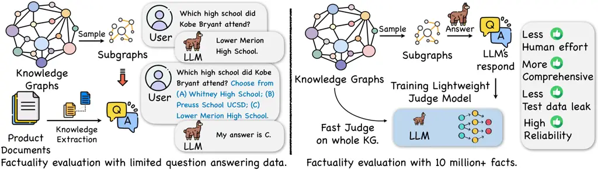
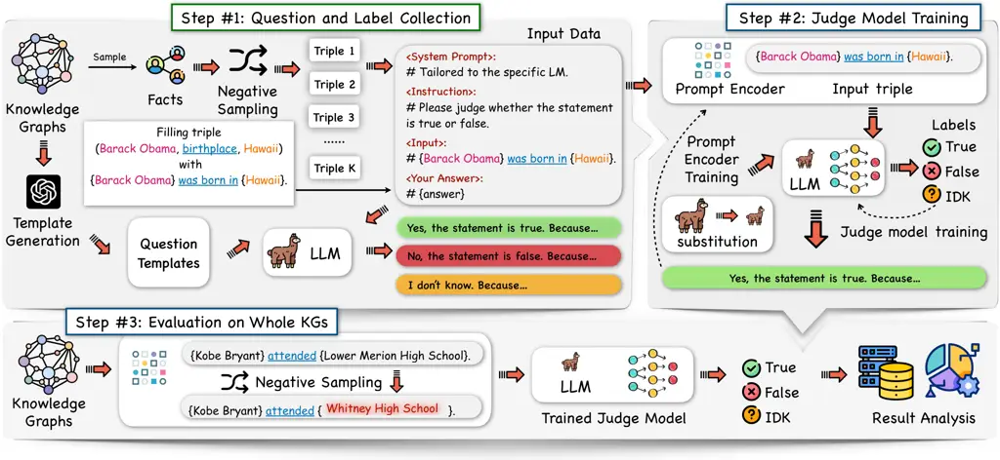
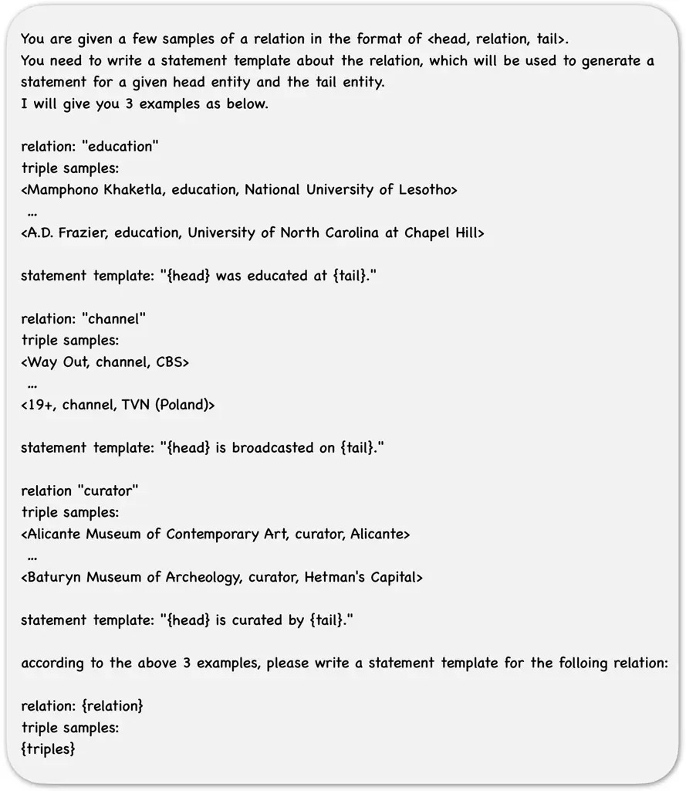

# Evaluating the Factuality of Large Language Models using Large-Scale Knowledge Graphs

Xiaoze Liu Affiliation:  Purdue University, West Lafayette, IN 47907,
USA Email: [xiaoze@purdue.edu](mailto:)    Feijie Wu Affiliation: 
Purdue University, West Lafayette, IN 47907, USA
Email: [wu1977@purdue.edu](mailto:)    Tianyang Xu Affiliation:  Purdue
University, West Lafayette, IN 47907, USA
Email: [xu1868@purdue.edu](mailto:)    Zhuo Chen Affiliation:  Zhejiang
University, Hangzhou, China Email: [joywang@purdue.edu](mailto:)   
Yichi Zhang Affiliation:  Zhejiang University, Hangzhou, China
Email: [jinggao@purdue.edu](mailto:)    Xiaoqian Wang Affiliation: 
Purdue University, West Lafayette, IN 47907, USA
Email: [zhuo.chen@zju.edu.cn](mailto:)    Jing Gao Affiliation:  Purdue
University, West Lafayette, IN 47907, USA
Email: [zhangyichi2022@zju.edu.cn](mailto:)

###### Abstract

The advent of Large Language Models (LLMs) has significantly transformed
the AI landscape, enhancing machine learning and AI capabilities.
Factuality issue is a critical concern for LLMs, as they may generate
factually incorrect responses. In this paper, we propose GraphEval to
evaluate an LLM’s performance using a substantially large test dataset.
Specifically, the test dataset is retrieved from a large knowledge graph
with more than 10 million facts without expensive human efforts. Unlike
conventional methods that evaluate LLMs based on generated responses,
GraphEval streamlines the evaluation process by creating a judge model
to estimate the correctness of the answers given by the LLM. Our
experiments demonstrate that the judge model’s factuality assessment
aligns closely with the correctness of the LLM’s generated outputs,
while also substantially reducing evaluation costs. Besides, our
findings offer valuable insights into LLM performance across different
metrics and highlight the potential for future improvements in ensuring
the factual integrity of LLM outputs. The code is publicly available at
[https://github.com/xz-liu/GraphEval](https://github.com/xz-liu/GraphEval).

|     |
| --- |
|     |

## 1 Introduction

The rapid progress of Large Language Models (LLMs) has markedly boosted
artificial intelligence and machine learning due to their strong
contextual text generation capabilities. Despite these groundbreaking
advancements, recent works (Chang et al., 2023; Wang et al., 2023a) have
highlighted the significance of LLMs evaluation. LLMs are prone to
producing seemingly authentic yet factually inaccurate responses, a
phenomenon known as hallucination (Wang et al., 2023b). Such errors may
stem from outdated or incorrect data during training or the model’s
learned associations, impacting its reliability (Chen et al., 2024b).
The evaluation, therefore, helps identify instances of hallucination and
understand the LLM’s ability to generate coherent and contextually
relevant text, i.e., factuality of LLM outputs.

Recent efforts have been put into the factuality evaluation of LLM. For
example, Chen et al. (2023a) introduce FELM, a benchmark comprising
diverse factual samples across various domains. Moreover, Tian et al.
(2023) and Feng et al. (2023) utilize external tools (e.g., search
engines and a well-trained factual LLM) to estimate the factuality of
the generated texts. Representing structured knowledge related to
real-world objects, Knowledge Graphs (KGs) (Auer et al., 2007; Bollacker
et al., 2008; Suchanek et al., 2007; Carlson et al., 2010) have gained
prominence for LLM factuality assessments. They primarily originate from
Wikipedia, encapsulate factual information for AI tasks, and form the
knowledge base with datasets like Natural Questions (Kwiatkowski et al.,
2019). Several studies (Sun et al., 2023; Liang et al., 2022) have
focused on creating benchmarks from knowledge sources by posing factual
questions derived from triples in KGs. These methods, as depicted in the
left part of Figure 1, either (i) sample subgraphs from large KGs or
(ii) extract a subset of knowledge from text documents to construct
multiple-choice or text question-answer pairs. Those question pairs are
then posed to LLMs to assess their factuality.

However, the above-mentioned methods or evaluation strategies face
challenges in comprehensively evaluating the factuality of LLMs.
Firstly, the scope of evaluation data is often limited or incomplete,
focusing predominantly on specific domains. This limitation restricts
the evaluation’s breadth and undermines its applicability across various
contexts, failing to cover the wide range of topics LLMs are expected to
handle. The specialized nature of these datasets means that the
evaluation may not accurately reflect the model’s performance in
generating factual content across a broader spectrum of subjects.
Secondly, the process of factuality evaluation itself is inherently
time-consuming and costly. It necessitates that an LLM generate full
texts, which must then be meticulously assessed for accuracy and
reliability. This comprehensive generation and detailed review demand
significant computational resources and extensive human effort (Wang
et al., 2023a) for validation. As a result, the process becomes less
feasible for regular or large-scale applications, limiting the frequency
and scope of practical evaluations. Lastly, due to the limited size of
the evaluation data, there may be biases in the benchmarks (Gallegos
et al., 2023), or risks of test data leakage (Zhou et al., 2023), which
might compromise the validity of the evaluations. Together, these
challenges underscore the need for more scalable, efficient, and
domain-agnostic approaches to evaluating the factuality of LLM-generated
texts.

To this end, we propose GraphEval, which consists of two novel features
in terms of the design, as presented on the right side of Figure 1.
First, we utilize KGs that encapsulate factual information sourced from
verifiable content like Wikipedia. With the KG, millions of prompts can
be automatically generated, leading to a significant saving of human
efforts in labeling the ground truth. From the data perspective, the KG
gives a more diversified and comprehensive evaluation of the LLMs’
factuality. Second, the proposed method efficiently reduces the
computation costs and speeds up the evaluation process. Specifically, we
incorporate a highly reliable and lightweight judge model to decide
whether an LLM can generate an accurate response to a designated
question. Instead of generating the full text, the judge model returns
three options (i.e., True, False, and I don’t know) to simulate LLMs’
responses to a given prompt. To ensure the reliability of the simulated
results, the judge model is trained based on a few question-answer
pairs, where the questions are sampled from KGs and the answers are
generated by the target LLM. As a result, the judge model can serve as a
replacement for the factuality evaluation of the facts extracted from
large-scale KGs. In summary, our contributions are as follows:



Figure 1: Existing works compared to the proposed GraphEval on
factuality evaluation.

- •
  We propose GraphEval, a large-scale evaluation framework that assesses
  the factuality of LLMs using KGs. GraphEval evaluates the factuality
  of LLMs using the entire KGs, providing a more diversified and
  comprehensive evaluation of the LLMs’ factuality.
- •
  We introduce a judge model to assist with the evaluation process,
  which reduces the computational cost and enhances the efficiency of
  the evaluation. We also give a theoretical analysis of the judge model
  to demonstrate its validity.
- •
  We conduct extensive experiments on a large-scale KG, i.e., DBpedia,
  to demonstrate the effectiveness and efficiency of GraphEval in
  evaluating the factuality of LLMs.
- •
  We provide an in-depth analysis of the LLM’s performance on the KGs,
  including the LLM’s performance with respect to relation types, head
  entity types, tail entity types, and the relation of LLM performance
  to degree and pageviews.

## 2 Related Work

#### Factuality Issue of LLMs

Factuality issue (Wang et al., 2023b; Zhang et al., 2023c), is the issue
that LLMs may produce content inconsistent with established facts. As
outlined in Wang et al. (2023b), this issue may be due to: (i) LLMs
lacking expertise in specific domains (Lu et al., 2022; et al., 2024;
Tan et al., 2021; Bolton et al., 2024); (ii) LLMs’ unawareness of recent
developments or changes (Jia et al., 2018; Yao et al., 2023); (iii) LLMs
not retaining (Wang et al., 2023a; Joshi et al., 2017; Kwiatkowski
et al., 2019) or forgetting (Goodfellow et al., 2013; Kotha et al.,
2023; Wang et al., 2022; Chen et al., 2020; Zhai et al., 2023) knowledge
from its training corpus; and (iv) LLMs failing to reason with the
knowledge they possess (Liu et al., 2023a; Berglund et al., 2023; Tan
et al., 2023). The factuality issue has been addressed by various works,
by incorporating Retrieval Augmented Generation (RAG) (Lewis et al.,
2020; Wang et al., 2024a), fine-tuning (Tian et al., 2023; Chen et al.,
2023b), reward-based alignment (Zhang et al., 2023a), and
knowledge-enhanced models (Feng et al., 2023; Zhang et al., 2023b; Diao
et al., 2023). To summarize, these approaches integrate other knowledge
sources into the LLMs’ training process or use them to augment the
models’ knowledge base, thus alleviating the factuality issue. Our work
differ from them in that we evaluate the factuality of LLMs, rather than
providing factuality enhancement methods.

#### Factuality Evaluation of LLMs

The expanding use of LLMs across various domains necessitates the
assurance of their output’s accuracy and reliability. A range of
benchmarks and evaluation methodologies for assessing large language
models (LLMs) are proposed. These works primarily focus on evaluating
the factuality, truthfulness, reasoning capabilities, and adaptability
to new information of LLMs. MMLU (Hendrycks et al., 2021) and TruthfulQA
(Lin et al., 2022) aim to measure the factuality and truthfulness of
LLMs across diverse tasks, while C-Eval (Huang et al., 2024) focuses on
the Chinese context, assessing models’ knowledge of Chinese culture and
laws. BigBench (Srivastava et al., 2023) challenges LLMs with tasks
beyond current capabilities, and HaluEval (Li et al., 2023), SelfAware
(Yin et al., 2023), and the Pinocchio (Hu et al., 2023) benchmark
explore models’ propensity for generating hallucinations, their
self-awareness, and their reasoning skills, respectively. REALTIMEQA
(Kasai et al., 2024) and FreshQA (Vu et al., 2023) introduce dynamic
benchmarks that test LLMs on current events and up-to-date knowledge.
There are also works (Sun et al., 2023; Liang et al., 2022) that propose
factuality evaluation using subsets of KGs. However, selecting subsets
of KGs to test LLMs can introduce selection bias. For example, random
sampling can focus more on a few popular domains or subjects more
densely connected with others, thus not showing LLMs’ factuality on
diversified topics. Our work addresses this limitation by proposing a
resource-efficient method to evaluate the factuality of LLMs which
allows evaluations on whole KGs instead of subsets, thus providing a
more diversified and comprehensive evaluation of the LLMs’ factuality,
enabling an extensive assessment of LLM’s factuality and reasoning
abilities in a way that existing individual benchmarks do not as they
only focus on specific aspects.

#### Using KGs in LLMs

KGs are structured representations of factual knowledge, typically in
the form of (head, relation, tail) triples. There are lots of efforts in
constructing (Auer et al., 2007; Bollacker et al., 2008), integrating
(Chen et al., 2016; Chen et al., 2021; Ge et al., 2021a; Ge et al.,
2021b; Gao et al., 2022; Liu et al., 2023b), and reasoning (Bordes
et al., 2013; Sun et al., 2019; Guo et al., 2024; Chen et al., 2024a) on
KGs. This has made KGs an indispensable resource of factual knowledge
for AI tasks. Currently, the most common way of integrating KGs with
LLMs is using KGs as an external knowledge source to enhance LLM
performance by pre-training, fine-tuning, or in-context
learning (Yasunaga et al., 2022; Jiang et al., 2023; Zhang et al., 2024;
Kim et al., 2023; Luo et al., 2023). Our work is different from these
works in that we use KGs to evaluate the factuality of LLMs, rather than
enhancing the LLMs with KGs.



Figure 2: Overview of the GraphEval framework. Step \#1 retrieves KG
statements and collect LLM judgments on them. Step \#2 trains the judge
model which classifies LLM hidden states into three categories. Step \#3
evaluates the LLM on all KG statements with the judge model.

## 3 Method

GraphEval is designed to measure the factuality of a language model in
relation to a KG. As presented in Figure 2, the proposed work is divided
into three steps:

- •
  Step 1: Question and label collection from KGs and LLMs.  The model
  samples triples from KGs and converts each triple into a declarative
  statement with GPT-4-crafted templates. To prepare versatile
  statements, we employ negative sampling, where incorrect statements
  are intentionally generated. Afterward, those statements are posed to
  collect the labels answered by an LLM (i.e., Yes, No, and I don’t know
  (IDK)).
- •
  Step 2: Judge model training.  With the triples collected in the first
  step, we train a judge model to avoid long-generated texts and
  conserve computational resources. In detail, inspired by Azaria &
  Mitchell (2023), we train a classifier with LLMs’ hidden states to
  make a selection within the above three options. We also apply
  p-tuning (Liu et al., 2021) to minimize the prompt/instruction size.
- •
  Step 3: Evaluation on whole KGs.  Similar to the first step, we
  retrieve all true/false statements from KGs. Subsequently, these
  statements are fed into the trained judge model to estimate the
  factuality of LLM. This process enables a thorough and multifaceted
  analysis of the LLM’s performance in terms of factuality, drawing from
  a wide range of perspectives to provide a more comprehensive and
  diversified evaluation.

In the following sections, we will discuss the details of each step.

### 3.1 Question and Label Collection

#### Question Generation

In order to evaluate the language model’s ability to identify false
statements, we directly construct a declarative sentence for each
triple. This addresses the ineffectiveness of multiple-choice questions
in our task. Firstly, multiple-choice prompts may cause misalignment
with parametric knowledge in LLMs. Since LLMs mainly learn parametric
knowledge through text data, in which knowledge facts are mostly
represented as declarative sentences (Weller et al., 2023), employing
multiple-choice questions may hinder the evaluation of factuality.
Secondly, multiple-choice questions have more complex labels (i.e. A, B,
C, D) than declarative sentences (i.e. True, False, IDK), which can
complicate the tasks for the judge model, influencing the overall
effectiveness. We use an example to illustrate this.

###### Example 3.1.

For the triple (Barack Obama, birthPlace, Hawaii), a multi-choice
question can be generated as Where was Barack Obama born? with choices
A. Hawaii B. Chicago C. New York D. Los Angeles. Here, for the same
triple, we can also generate another multi-choice question as Where was
Barack Obama born? with choices A. China, B. Hawaii, C. Japan, D.
Russia. The two questions represent the same triple, but the choices are
different. As mentioned in the last paragraph, this can introduce
complexity and potential misalignment with an LLM’s training and result
in inconsistent responses.

To address the ineffectiveness of multiple-choice questions, we propose
to directly ask the LLMs whether a statement is true or not. For
instance, considering the triple (Barack Obama, birthPlace, Hawaii), we
can formulate a fact Obama was born in Hawaii by integrating the
entities Barack Obama and Hawaii into the template {head} was born in
{tail}. Each template corresponds to the relation of a triple, and they
are crafted to be clear and straightforward statements. GPT-4 is
employed to generate these templates for all relations in the KG. These
generated templates are then manually reviewed and refined to ensure
their compatibility with the KG. Then, we can ask a question to the
LLMs, such as Is the statement "Barack Obama was born in Hawaii" true or
false?. Here, the templates are corresponding to the relations of the
triples. This is because the number of relations in the KG is limited,
while the number of triples is large. Therefore, we can use the
relations to categorize the triples, and then use the templates to
generate questions for each category. This can significantly reduce
human labor, i.e., monitoring less than 1000 templates compared with
monitoring more than 10 million triples. See the Appendix A.4 for the
detailed settings of the relation templates.

#### Negative sampling

Although the declarative sentences simplify the training of the judge
model, they alone are insufficient to evaluate the language model’s
factual accuracy. LLMs can simply answer true for every question, and
still get a high accuracy. To address this, we introduce negative
sampling, a technique commonly used in KG completion tasks, to generate
false statements. Specifically, we randomly replace one entity or
relation in the original triple with another entity or relation sampled
from the KG. For example, given the triple (Barack Obama, birthPlace,
Hawaii), we can replace the tail entity Hawaii with another entity
Chicago to form the false statement Barack Obama was born in Chicago.
These false statements are then presented to the LLMs to evaluate their
ability to identify falsehoods.

### 3.2 Judge Model

Normally, to evaluate the factual accuracy of a language model, we would
generate questions from a KG and then pose these questions to the
language model. However, given the expansive nature of KGs, it’s
impractical to label every generated question by the LLM. A more
efficient approach is to use the last token logits of the LLMs as their
answers. However, recent research has highlighted discrepancies between
these logits and the model’s actual text outputs (Wang et al., 2024b).
Therefore, we introduce a novel judge model to assist with this task.
The judge model, initially trained on a subset of labeled questions, is
then employed to label the remaining questions. Uniquely, inspired by
 Azaria & Mitchell (2023), the judge model utilizes the LLM’s hidden
state as input, as a replacement of the LLM’s last layer with compressed
output tokens. Specifically, three output classes are used: True, False,
and I don’t know. The judge model is a two-layer feed-forward neural
network, with a layer normalization and a ReLU activation function. This
approach diverges from standard practices where LLMs generate answers,
as here we only forward the transformer once. Consequently, this
operation is significantly less resource-intensive than full answer
generation, allowing the judge model to efficiently process a large
number of questions with limited labeled data.

#### Efficiency

To further enhance the judge model’s efficiency, we include 2 extra
components. First, we found that the instruction prefix of the LLMs is
too large for the judge model to process efficiently. We thus fine-tune
a prompt encoder (Liu et al., 2022) to reduce the large input of the
prompt prefix, which would be the same for all questions. Second, we
found that our judge model, with the training process on the labeled
dataset, is robust to the LLM’s hidden states. In experiments, we
observed that our judge model can seamlessly utilize hidden states from
distinct LLMs without significant differences in performance. For
instance, within the LLaMA 2 model family, which contains 3 models with
different parameters: 7B, 13B, and 70B, we found that the judge model’s
performance is consistent regardless of whether the hidden states are
from 7B, 13B, or 70B. Therefore, we can use the model with the least
parameters, as a substitute model when computing the hidden states. This
gives us a huge reduction in computational cost.

#### Analysis of Judge model

In this part, we assume there are two datasets; one is for training the
judge model, and the other is for evaluation, denoted by
$`\mathcal{D}_{S}`$ and $`\mathcal{D}_{T}`$, respectively. As the
proposed judge model leads to a triple classification task, we assume a
hypothesis portfolio $`h=\{h_{t},h_{f},h_{idk}\}`$, where these three
hypotheses separately predict if a sample can be correctly answered by
the LLM, i.e., True, False, and IDK. In other words, the hypothesis
$`\hat{h}\in h`$ maps an input $`\mathbf{x}`$ to $`\{0,1\}`$, where
$`1`$ means the input satisfies the hypothesis conditions. For a given
input $`\mathbf{x}`$, the equality
$`h(\mathbf{x})=h_{t}(\mathbf{x})+h_{f}(\mathbf{x})+h_{idk}(\mathbf{x})=1`$
always holds because the judge model provides an only output. Define the
convex loss function for a hypothesis $`\hat{h}\in h`$ to be

```math
L_{\mathcal{D}}(\hat{h})=\sum_{(\mathbf{x},y)\in\mathcal{D}}|\hat{h}(\mathbf{x})-\bm{1}_{\hat{h}}(y)|
```

, where $`\bm{1}_{\hat{h}}(y)`$ indicates if the data indeed satisfies
the hypothesis. Since a wrong prediction for data $`(\mathbf{x},y)`$
results in
$`\sum_{\hat{h}\in h}|\hat{h}(\mathbf{x})-\bm{1}_{\hat{h}}(y)|=2`$, we
define the misclassification rate as

```math
L_{\mathcal{D}}\left(h\right)=\frac{1}{2}\left(L_{\mathcal{D}}\left(h_{t}\right)+L_{\mathcal{D}}\left(h_{f}\right)+L_{\mathcal{D}}\left(h_{idk}\right)\right)
```

Below is a theoretical analysis to understand the bound of the
misclassification rate, which is driven by Theorem 2 of Ben-David et al.
(2010).

###### Theorem 3.1.

Let
$`\mathcal{H}=\{\mathcal{H}_{t},\mathcal{H}_{f},\mathcal{H}_{idk}\}`$ be
a set of hypothesis spaces of VC dimension $`d`$. If
$`\mathcal{U}_{S},\mathcal{U}_{T}`$ are the samples of size $`m`$ each,
drawn from $`\mathcal{D}_{S}`$ and $`\mathcal{D}_{T}`$, respectively,
then for any $`\delta\in(0,1)`$, with probability at least $`1-\delta`$,
for every $`h\in\mathcal{H}`$, we have

```math
L_{\mathcal{D}_{T}}\left(h\right)\leq L_{\mathcal{D}_{S}}\left(h\right)+\frac{3}{4}d_{\mathcal{H}\Delta\mathcal{H}}\left(\mathcal{U}_{S},\mathcal{U}_{T}\right)+6\sqrt{\frac{2d\log\left(2m\right)+\log\left(2/\delta\right)}{m}}+\frac{1}{2}\lambda \tag{1}
```

where
$`\lambda=\inf_{h\in\mathcal{H}}\left(L_{\mathcal{D}_{S}}\left(h\right)+L_{\mathcal{D}_{T}}\left(h\right)\right)`$
is the optimal combined error, $`d_{\mathcal{H}\Delta\mathcal{H}}`$
measures the distribution discrepancy between two distributions.

The above theorem provides insights for the generalization bound of the
judge model. The bound is associated with the discrepancy between
training data $`\mathcal{D}_{S}`$ and evaluation data
$`\mathcal{D}_{T}`$, and the discrepancy can be measured by drawing
samples from both training and evaluation datasets for an equivalent
size. Moreover, the bound is affected by the optimal hypothesis over all
the data, i.e., $`\mathcal{D}_{S}\cup\mathcal{D}_{T}`$, where a lower
error leads to improved performance of the judge model.

### 3.3 Evaluation

For evaluating the LLM’s performance, we consider Correctness, which is
defined as the proportion of questions for which the LLM’s response
matches the true label (or false label if the question is generated from
a negative triple). This captures the accuracy of the LLM in identifying
correct information and distinguishing it from fabricated (negative)
triples. We also adopt the metrics of Truthfulness and Informativeness,
as defined in Lin et al. (2022). Truthfulness refers to the likelihood
of the language model (LLM) providing an honest response. A response is
considered Truthful if the LLM either provides the correct answer or
opts for ’I don’t know’. This criterion assesses the model’s ability to
be honest about what it knows and to admit uncertainty rather than
making false statements. Informativeness is the probability of the LLM
offering any substantive information, irrespective of its accuracy. An
answer is deemed Informative if it is anything other than ’I don’t
know’. This reflects the model’s capacity to provide substantial
information without resorting to uncertainty or avoidance of an answer.

When considering multiple negative triples sampled, we combine the
results for all negative triples sampled from a triple $`\tau`$, as well
as the results for their original positive triple $`\tau`$, to calculate
the overall performance of the LLM. Since correctly detecting a real
triple from KG is much simpler than detecting a negative triple, we want
to give a max penalty to the LLM’s wrong response to the real triple
when designing the metric. Therefore, if a real triple is predicted as
false, the LLM will score $`0`$ across all metrics. Then, the negative
triple results are averaged to give a fine-grained evaluation of the
LLM’s performance. To achieve this, for each performance metric, we
define functions $`\mathcal{F}`$ which evaluates the LLM’s response to
$`\tau`$ and $`\mathcal{F}^{\prime}`$ to each negative triple
$`\tau^{\prime}`$ sampled from $`\tau`$. The overall performance metric
for $`\tau`$ is then calculated as:

```math
\text{Metric}(\tau)=\max\left(0,\mathcal{F}(\tau)-\frac{1}{|\mathcal{N}(\tau)|}\sum_{\tau^{\prime}\in\mathcal{N}(\tau)}\mathcal{F}^{\prime}(\tau^{\prime})\right) \tag{2}
```

Here, $`\mathcal{N}(\tau)`$ represents the set of all negative triples
generated from the positive triple $`\tau`$. $`\mathcal{F}`$ and
$`\mathcal{F}^{\prime}`$ are defined as follows: (i) Correctness.
$`\mathcal{F}`$ is defined such that it is $`1`$ if the judge model
predicts that a real (positive) triple is True, and it is $`0`$
otherwise; $`\mathcal{F}^{\prime}`$ is 0 if the judge model predicts a
negative triple as False, and 1 otherwise. (ii) Truthfulness. When
measuring Truthfulness, $`\mathcal{F}`$ is set to $`1`$ if the judge
model’s prediction for the input $`\tau`$ is either True or IDK, and it
is $`0`$ otherwise. Similarly, $`\mathcal{F}^{\prime}`$ is set to $`1`$
if the judge model’s prediction for the input $`\tau^{\prime}`$ is True,
and $`0`$ otherwise; and (iii) Informativeness. For Informativeness,
$`\mathcal{F}`$ is defined as $`1`$ if the judge model’s prediction for
the input $`\tau`$ is anything other than ”I don’t know”, and it is
$`0`$ otherwise. $`\mathcal{F}^{\prime}`$ is set to $`1-\mathcal{F}`$ on
the informativeness metric. By applying this equation, we can
systematically compute the Correctness, Truthfulness, and
Informativeness of an LLM’s responses in a consistent and comprehensive
manner, offering a detailed insight into its overall performance.

## 4 Experiments

### 4.1 Experiment Setup

#### Data

We use DBpedia (Auer et al., 2007), a large-scale knowledge graph
constructed from Wikipedia. We report the statistics of the DBpedia
knowledge graph in Table 1. Note that there are “dummy” entities in
DBpedia that represent a fact that is only true on a specific time
period. An example is
[https://dbpedia.org/page/Kathy_Greenlee\_\_Tenure\_\_1](https://dbpedia.org/page/Kathy_Greenlee__Tenure__1).
For simplicity, we remove these dummy entities and triples related from
the knowledge graph. We refer to the remaining triples as the DBpedia
knowledge graph. The DBpedia knowledge graph contains 4,928,232
entities, 633 relations, and 16,915,848 triples. The average node degree
of the knowledge graph is 6.80, and the density of the knowledge graph
is $`7.18\times 10^{-7}`$.

|            |             |            |             |                        |
| ---------- | ----------- | ---------- | ----------- | ---------------------- |
| \#Entities | \#Relations | \#Triples  | Avg. degree | Density                |
| 4,928,232  | 633         | 16,915,848 | 6.80        | $`7.18\times 10^{-7}`$ |

Table 1: Statistics of the DBpedia knowledge graph.

#### LLMs

In this paper, we evaluate the Meta LLaMA 2 family (Touvron et al.,
2023), including LLaMA-2-7B, LLaMA-2-13B, and LLaMA-2-70B, and Google’s
Gemma (Team et al., 2024) including Gemma-2B and Gemma-7B. For each
language model, we first randomly sample 2000 triples, and perform a
negative sampling to obtain another 2000 negative triples. For each
triple, we ask the LLM 3 times the same question, on whether the triple
is true, false, or the LLM doesn’t know. We use majority voting to
determine the LLM’s final answer. When asking, we use huggingface’s
pipeline with default settings and FP16 precision. This is to form a
labeled dataset. We randomly sample 70% for the training set and 30% for
the validation set, then train a judge model to classify the LLM’s
hidden state into 3 classes: LLM correctly answering the question
(True), LLM incorrectly answering the question (False), and LLM
responding with I don’t know (IDK). We refer to Table 2 for the
statistics of the labeled dataset.

#### Metrics

For the LLM’s performance, we report the estimated factuality of the
LLMs on the DBpedia knowledge graph. We report the LLM’s performance in
terms of Truthfulness, Informativeness, and Correctness. For evaluating
the judge model’s performance (See Appendix A.1), we seek to maximize
the similarity between the judge model’s prediction and the LLM’s
answer. Thus, we use the common metrics Precision (P), Recall (R), and
F1 score (F) to evaluate the judge model’s accuracy; and the time it
takes to predict to evaluate the judge model’s efficiency.

#### Hyperparameter Settings

For the judge model classifier training, we train 100 epochs with a
batch size of 8. We use the Adam optimizer with a learning rate of 1e-4.
We use the same settings for all the evaluated LLMs. For LLaMA 2 7B,
13B, and 70B, we use LLaMA 2 7B as the judge model’s hidden state input.
For Gemma 2B and 7B, we use Gemma 2B as the judge model’s hidden state
input. The judge model is trained on a server with NVIDIA A6000 GPUs.

For the training of the prompt encoder, we use the same settings for all
the evaluated LLMs. To be specific, we use 20 virtual tokens, 1
transformer submodule, 12 attention heads, 12 layers, MLP as the encoder
reparameterization type, 4096 as the encoder hidden size, and 2e-5 as
the learning rate. We train the prompt encoder for 5 epochs with a batch
size of 8. We use the Adam optimizer with a weight decay of 0.01.

For the evaluation, we use two servers, one with NVIDIA A6000 GPUs and
the other with NVIDIA A100 GPUs. For inference, we use Flash Attention
2 (Dao, 2023) as the attention implementation, and use FP16 precision.

### 4.2 LLM’s Performance Analysis

We report the estimated factuality of the LLMs on DBpedia in Table 2.
Overall, the LLaMA-2 series shows an increase in model size up to 13B,
particularly in terms of balanced truthfulness, informativeness, and
correctness. However, the 70B variant diverges, excelling in
truthfulness but failing to provide useful or accurate information. We
will discuss this phenomenon in the detailed LLaMA analysis. The Gemma
series struggles with truthfulness and correctness, despite being
informative. This might indicate that these models are better at
generating detailed content but need careful consideration for tasks
requiring high accuracy or reliability. The performance of these models
highlights the complex trade-offs between being truthful, informative,
and correct. We further provide a correlation analysis between the LLM’s
performance and the degree/popularity of the entities in the
Appendix A.3.

#### LLaMA-2 Analysis

LLaMA-2-7B shows good truthfulness (.965) but is moderate in being
informative (.550) and correct (.516). This suggests that while the
model is generally reliable in its outputs, it may not always provide
highly detailed or accurate information. LLaMA-2-13B significantly
improves across all metrics compared to LLaMA-2-7B, with very high
scores in truthfulness (.979), informativeness (.980), and correctness
(.959). This indicates a strong overall performance, making it a very
reliable and accurate model for generating information. LLaMA-2-70B,
despite its high truthfulness (.993), scores extremely low in both
informativeness (.007) and correctness (.006), which is puzzling. We
hypothesize that the model may have difficulty in making a decision, and
thus selecting I don’t know as the answer. This may be related to a more
clear knowledge boundary of LLMs, as larger LMs tend to give up on more
questions (Ren et al., 2023), meaning they have a better understanding
on whether they know the answer or not. This can also be confirmed by
the fact that the model has the highest truthfulness score among all
models, indicating that it is more likely to provide a correct answer
when it knows the answer. However, it is still important to note that a
high number of ‘I don’t know’ answers may indicate the model’s inability
to answer factual questions.

#### Gemma Analysis

detailedGemma-2B has an exceptionally low truthfulness score (.056) but
is quite high in informativeness (.867). Its correctness score (.024) is
also very low. This suggests that despite providing detailed responses,
the model’s outputs are often neither truthful nor accurate. It might be
generating detailed but misleading or incorrect information. Gemma-7B
improves on truthfulness (.206) compared to Gemma-2B but still falls
short of being considered reliable. Its informativeness (.657) is
respectable, and its correctness (.056) remains low. Similar to
Gemma-2B, while it can provide detailed responses, those are not often
true or correct.

|             |      |       |      |          |             |         |
| ----------- | ---- | ----- | ---- | -------- | ----------- | ------- |
| Model       | True | False | IDK  | Truthful | Informative | Correct |
| LLaMA-2-7B  | 1901 | 1545  | 554  | 0.965    | 0.550       | 0.516   |
| LLaMA-2-13B | 2100 | 1796  | 104  | 0.979    | 0.980       | 0.959   |
| LLaMA-2-70B | 338  | 126   | 3536 | 0.993    | 0.007       | 0.006   |
| Gemma-2B    | 1760 | 1786  | 454  | 0.056    | 0.867       | 0.024   |
| Gemma-7B    | 1509 | 1751  | 740  | 0.206    | 0.657       | 0.056   |

Table 2: Statistics and performance metrics of LLMs. True, False, and
IDK denote the number of labels from the LLMs in the labeled dataset.
Truthful, Informative, and Correct represent performance metrics.

### 4.3 Relation Type Study

(a) Averaged metrics vs Head entity type

(b) Averaged metrics vs Tail entity type

Figure 3: The LLM’s averaged metrics with respect to head entity types
and tail entity types

There are more than 600 different relation types in the DBpedia
knowledge graph, and each relation type has different characteristics.
It is unclear if we directly compare the performance of the LLMs on
different relation types. Thus, to gain a better understanding of the
LLM’s performance, we first analyze the LLM’s performance with respect
to relation types. In DBpedia, most entities are associated with a
[https://schema.org/](https://schema.org/) type. Thus, we can categorize
the relations into different types by the triples they belong to. We
denote a relation’s head/tail entity type as the most frequent schema
type of the head/tail entity of the triples associated with the
relation. For example, the relation birthPlace is associated with
triples like (Barack Obama, birthPlace, Hawaii), and the head entity
Barack Obama is associated with the schema type Person, and the tail
entity Hawaii is associated with the schema type Place. Then, the
relation’s head entity type is Person, and tail entity type is Place. We
then analyze the LLM’s performance with respect to these relation types.
We report the performance of the LLMs on different relation types, by
taking the average of the 3 metrics, correctness, truthfulness, and
informativeness, for each relation type. We present the results in
Figure 3. Here, “None” refers to entities not linked to a schema type.
We also present a detailed analysis of the LLM’s performance with
respect to head and tail entity types in Appendix A.2. We can observe
variability in model performance across relation types, such as
“MusicGroup” and “CreativeWork” achieving high scores while “Area” and
”Mountain” face lower performance, highlighting the diverse challenges
in modeling different kinds of information. These performance
differences suggest that the effectiveness of LLMs in handling
structured knowledge heavily depends on the nature of the relations
being modeled.

## 5 Conclusions

We introduce GraphEval, an innovative approach for appraising the
efficacy of LLMs against a voluminous test dataset derived from an
extensive knowledge graph containing over 10 million facts,
significantly mitigating the necessity for costly human intervention.
GraphEval, by embedding a judge module within the LLM itself, not only
refines the evaluation process but also establishes a new benchmark for
assessing the veracity of the information presented by these models. The
empirical evidence from our experiments substantiates the judge model’s
proficiency in fact-checking, exhibiting a high degree of concordance
with the accuracy of the LLM’s outputs, and simultaneously diminishing
the resources required for evaluation. The insights gleaned from our
study shed light on the multifaceted performance of LLMs and lay the
groundwork for future endeavors aimed at enhancing the reliability of
their generated content.

## Ethics Statement

We use publicly available knowledge graphs and large language models and
do not collect any personal data. The DBpedia knowledge graph used is
retrieved from Wikipedia, in which some content, although factually
correct, may be offensive to certain readers. For example, some
historical events damaging to certain races/countries. We only evaluate
the factuality of the LLMs, and do not use the LLMs for any other
purposes. We hope that our work can contribute to the development of
more reliable and trustworthy AI systems.

## Limitations

This research represents an initial foray into the realm of evaluating
the factuality of LLMs by leveraging real-world-sized knowledge graphs,
a critical step toward understanding and enhancing the reliability of
LLM outputs. Amidst its pioneering efforts, several limitations have
surfaced, sketching a roadmap for future investigative endeavors.
Firstly, the judge model, while efficient in this specific context,
lacks versatility for other tasks and cannot generate text, suggesting
an avenue for future research to enhance its functionality and
application range. Secondly, the study relies solely on zero-shot
evaluation, omitting potential improvements in LLM performance through
methods like in-context few-shot learning, indicating a need for more
comprehensive evaluation techniques. Additionally, the white-box
evaluation method employed is restricted by its requirement for access
to LLM hidden states, which is not universally available, pointing to
the necessity for developing black-box evaluation strategies. Lastly,
the research does not examine the method’s efficacy on domain-specific
knowledge graphs nor consider temporal relations, marking areas for
future exploration to better understand and improve LLM factuality
assessments.

## References

- Auer et al. (2007) Sören Auer, Christian Bizer, Georgi Kobilarov, Jens
  Lehmann, Richard Cyganiak, and Zachary Ives. Dbpedia: A nucleus for a
  web of open data. In _International Semantic Web Conference_, pp.
  722–735. Springer, 2007.
- Azaria & Mitchell (2023) Amos Azaria and Tom Mitchell. The internal
  state of an llm knows when it’s lying. In _Findings of the Association
  for Computational Linguistics: EMNLP 2023_, pp. 967–976, 2023.
- Ben-David et al. (2010) Shai Ben-David, John Blitzer, Koby Crammer,
  Alex Kulesza, Fernando Pereira, and Jennifer Wortman Vaughan. A theory
  of learning from different domains. _Machine learning_,
  79:151–175, 2010.
- Berglund et al. (2023) Lukas Berglund, Meg Tong, Max Kaufmann, Mikita
  Balesni, Asa Cooper Stickland, Tomasz Korbak, and Owain Evans. The
  reversal curse: Llms trained on” a is b” fail to learn” b is a”.
  _arXiv preprint arXiv:2309.12288_, 2023.
- Bollacker et al. (2008) Kurt Bollacker, Colin Evans, Praveen Paritosh,
  Tim Sturge, and Jamie Taylor. Freebase: a collaboratively created
  graph database for structuring human knowledge. In _Proceedings of the
  2008 ACM SIGMOD international conference on Management of data_, pp.
  1247–1250, 2008.
- Bolton et al. (2024) Elliot Bolton, Abhinav Venigalla, Michihiro
  Yasunaga, David Hall, Betty Xiong, Tony Lee, Roxana Daneshjou,
  Jonathan Frankle, Percy Liang, Michael Carbin, and Christopher D.
  Manning. Biomedlm: A 2.7b parameter language model trained on
  biomedical text, 2024.
- Bordes et al. (2013) Antoine Bordes, Nicolas Usunier, Alberto
  Garcia-Duran, Jason Weston, and Oksana Yakhnenko. Translating
  embeddings for modeling multi-relational data. _Advances in neural
  information processing systems_, 26, 2013.
- Carlson et al. (2010) Andrew Carlson, Justin Betteridge, Bryan Kisiel,
  Burr Settles, Estevam Hruschka, and Tom Mitchell. Toward an
  architecture for never-ending language learning. In _Proceedings of
  the AAAI conference on artificial intelligence_, volume 24, pp.
  1306–1313, 2010.
- Chang et al. (2023) Yupeng Chang, Xu Wang, Jindong Wang, Yuan Wu,
  Linyi Yang, Kaijie Zhu, Hao Chen, Xiaoyuan Yi, Cunxiang Wang, Yidong
  Wang, et al. A survey on evaluation of large language models. _ACM
  Transactions on Intelligent Systems and Technology_, 2023.
- Chen et al. (2016) Muhao Chen, Yingtao Tian, Mohan Yang, and Carlo
  Zaniolo. Multilingual knowledge graph embeddings for cross-lingual
  knowledge alignment. _arXiv preprint arXiv:1611.03954_, 2016.
- Chen et al. (2020) Sanyuan Chen, Yutai Hou, Yiming Cui, Wanxiang Che,
  Ting Liu, and Xiangzhan Yu. Recall and learn: Fine-tuning deep
  pretrained language models with less forgetting. In _Proceedings of
  the 2020 Conference on Empirical Methods in Natural Language
  Processing (EMNLP)_, pp. 7870–7881, 2020.
- Chen et al. (2023a) Shiqi Chen, Yiran Zhao, Jinghan Zhang, I-Chun
  Chern, Siyang Gao, Pengfei Liu, and Junxian He. FELM: Benchmarking
  factuality evaluation of large language models. In _Thirty-seventh
  Conference on Neural Information Processing Systems Datasets and
  Benchmarks Track_, 2023a.
- Chen et al. (2024a) Zhikai Chen, Haitao Mao, Hang Li, Wei Jin, Hongzhi
  Wen, Xiaochi Wei, Shuaiqiang Wang, Dawei Yin, Wenqi Fan, Hui Liu, and
  Jiliang Tang. Exploring the potential of large language models (llms)
  in learning on graphs, 2024a.
- Chen et al. (2021) Zhuo Chen, Jiaoyan Chen, Yuxia Geng, Jeff Z Pan,
  Zonggang Yuan, and Huajun Chen. Zero-shot visual question answering
  using knowledge graph. In _The Semantic Web–ISWC 2021: 20th
  International Semantic Web Conference, ISWC 2021, Virtual Event,
  October 24–28, 2021, Proceedings 20_, pp. 146–162. Springer, 2021.
- Chen et al. (2023b) Zhuo Chen, Wen Zhang, Yufeng Huang, Mingyang Chen,
  Yuxia Geng, Hongtao Yu, Zhen Bi, Yichi Zhang, Zhen Yao, Wenting Song,
  et al. Tele-knowledge pre-training for fault analysis. In _2023 IEEE
  39th International Conference on Data Engineering (ICDE)_, pp.
  3453–3466. IEEE, 2023b.
- Chen et al. (2024b) Zhuo Chen, Yichi Zhang, Yin Fang, Yuxia Geng,
  Lingbing Guo, Xiang Chen, Qian Li, Wen Zhang, Jiaoyan Chen, Yushan
  Zhu, et al. Knowledge graphs meet multi-modal learning: A
  comprehensive survey. _arXiv preprint arXiv:2402.05391_, 2024b.
- Dao (2023) Tri Dao. Flashattention-2: Faster attention with better
  parallelism and work partitioning. _arXiv preprint
  arXiv:2307.08691_, 2023.
- Diao et al. (2023) Shizhe Diao, Tianyang Xu, Ruijia Xu, Jiawei Wang,
  and Tong Zhang. Mixture-of-domain-adapters: Decoupling and injecting
  domain knowledge to pre-trained language models memories, 2023.
- et al. (2024) Mingjie Liu et al. Chipnemo: Domain-adapted llms for
  chip design, 2024.
- Feng et al. (2023) Shangbin Feng, Vidhisha Balachandran, Yuyang Bai,
  and Yulia Tsvetkov. Factkb: Generalizable factuality evaluation using
  language models enhanced with factual knowledge. In _Proceedings of
  the 2023 Conference on Empirical Methods in Natural Language
  Processing_, pp. 933–952, 2023.
- Gallegos et al. (2023) Isabel O Gallegos, Ryan A Rossi, Joe Barrow,
  Md Mehrab Tanjim, Sungchul Kim, Franck Dernoncourt, Tong Yu, Ruiyi
  Zhang, and Nesreen K Ahmed. Bias and fairness in large language
  models: A survey. _arXiv preprint arXiv:2309.00770_, 2023.
- Gao et al. (2022) Yunjun Gao, Xiaoze Liu, Junyang Wu, Tianyi Li,
  Pengfei Wang, and Lu Chen. Clusterea: Scalable entity alignment with
  stochastic training and normalized mini-batch similarities. In
  _Proceedings of the 28th ACM SIGKDD Conference on Knowledge Discovery
  and Data Mining_, pp. 421–431, 2022.
- Ge et al. (2021a) Congcong Ge, Xiaoze Liu, Lu Chen, Baihua Zheng, and
  Yunjun Gao. Largeea: Aligning entities for large-scale knowledge
  graphs. _Proceedings of the VLDB Endowment_, 15(2):237–245, 2021a.
- Ge et al. (2021b) Congcong Ge, Xiaoze Liu, Lu Chen, Baihua Zheng, and
  Yunjun Gao. Make it easy: An effective end-to-end entity alignment
  framework. In _Proceedings of the 44th International ACM SIGIR
  Conference on Research and Development in Information Retrieval_, pp.
  777–786, 2021b.
- Goodfellow et al. (2013) Ian J Goodfellow, Mehdi Mirza, Da Xiao, Aaron
  Courville, and Yoshua Bengio. An empirical investigation of
  catastrophic forgetting in gradient-based neural networks. _arXiv
  preprint arXiv:1312.6211_, 2013.
- Guo et al. (2024) Lingbing Guo, Zhuo Chen, Jiaoyan Chen, Yichi Zhang,
  Zequn Sun, Zhongpu Bo, Yin Fang, Xiaoze Liu, Huajun Chen, and Wen
  Zhang. Distributed representations of entities in open-world knowledge
  graphs. _Knowledge-Based Systems_, pp. 111582, 2024.
- Hendrycks et al. (2021) Dan Hendrycks, Collin Burns, Steven Basart,
  Andy Zou, Mantas Mazeika, Dawn Song, and Jacob Steinhardt. Measuring
  massive multitask language understanding. _Proceedings of the
  International Conference on Learning Representations (ICLR)_, 2021.
- Hu et al. (2023) Xuming Hu, Junzhe Chen, Xiaochuan Li, Yufei Guo,
  Lijie Wen, Philip S Yu, and Zhijiang Guo. Do large language models
  know about facts? _arXiv preprint arXiv:2310.05177_, 2023.
- Huang et al. (2024) Yuzhen Huang, Yuzhuo Bai, Zhihao Zhu, Junlei
  Zhang, Jinghan Zhang, Tangjun Su, Junteng Liu, Chuancheng Lv, Yikai
  Zhang, Yao Fu, et al. C-eval: A multi-level multi-discipline chinese
  evaluation suite for foundation models. _Advances in Neural
  Information Processing Systems_, 36, 2024.
- Jia et al. (2018) Zhen Jia, Abdalghani Abujabal, Rishiraj Saha Roy,
  Jannik Strötgen, and Gerhard Weikum. Tempquestions: A benchmark for
  temporal question answering. In _Companion Proceedings of the The Web
  Conference 2018_, pp. 1057–1062, 2018.
- Jiang et al. (2023) Jinhao Jiang, Kun Zhou, Wayne Xin Zhao, Yaliang
  Li, and Ji-Rong Wen. Reasoninglm: Enabling structural subgraph
  reasoning in pre-trained language models for question answering over
  knowledge graph. In _Proceedings of the 2023 Conference on Empirical
  Methods in Natural Language Processing_, pp. 3721–3735, 2023.
- Joshi et al. (2017) Mandar Joshi, Eunsol Choi, Daniel S Weld, and Luke
  Zettlemoyer. Triviaqa: A large scale distantly supervised challenge
  dataset for reading comprehension. In _Proceedings of the 55th Annual
  Meeting of the Association for Computational Linguistics (Volume 1:
  Long Papers)_, pp. 1601–1611, 2017.
- Kasai et al. (2024) Jungo Kasai, Keisuke Sakaguchi, Ronan Le Bras,
  Akari Asai, Xinyan Yu, Dragomir Radev, Noah A Smith, Yejin Choi,
  Kentaro Inui, et al. Realtime qa: What’s the answer right now?
  _Advances in Neural Information Processing Systems_, 36, 2024.
- Kim et al. (2023) Jiho Kim, Yeonsu Kwon, Yohan Jo, and Edward Choi.
  Kg-gpt: A general framework for reasoning on knowledge graphs using
  large language models. _arXiv preprint arXiv:2310.11220_, 2023.
- Kotha et al. (2023) Suhas Kotha, Jacob Mitchell Springer, and Aditi
  Raghunathan. Understanding catastrophic forgetting in language models
  via implicit inference. _arXiv preprint arXiv:2309.10105_, 2023.
- Kwiatkowski et al. (2019) Tom Kwiatkowski, Jennimaria Palomaki, Olivia
  Redfield, Michael Collins, Ankur Parikh, Chris Alberti, Danielle
  Epstein, Illia Polosukhin, Jacob Devlin, Kenton Lee, et al. Natural
  questions: A benchmark for question answering research. _Transactions
  of the Association for Computational Linguistics_, 7:453–466, 2019.
- Lewis et al. (2020) Patrick Lewis, Ethan Perez, Aleksandra Piktus,
  Fabio Petroni, Vladimir Karpukhin, Naman Goyal, Heinrich Küttler, Mike
  Lewis, Wen-tau Yih, Tim Rocktäschel, et al. Retrieval-augmented
  generation for knowledge-intensive nlp tasks. _Advances in Neural
  Information Processing Systems_, 33:9459–9474, 2020.
- Li et al. (2023) Junyi Li, Xiaoxue Cheng, Xin Zhao, Jian-Yun Nie, and
  Ji-Rong Wen. Halueval: A large-scale hallucination evaluation
  benchmark for large language models. In _The 2023 Conference on
  Empirical Methods in Natural Language Processing_, 2023.
- Liang et al. (2022) Percy Liang, Rishi Bommasani, Tony Lee, Dimitris
  Tsipras, Dilara Soylu, Michihiro Yasunaga, Yian Zhang, Deepak
  Narayanan, Yuhuai Wu, Ananya Kumar, et al. Holistic evaluation of
  language models. _arXiv preprint arXiv:2211.09110_, 2022.
- Lin et al. (2022) Stephanie Lin, Jacob Hilton, and Owain Evans.
  Truthfulqa: Measuring how models mimic human falsehoods. In
  _Proceedings of the 60th Annual Meeting of the Association for
  Computational Linguistics (Volume 1: Long Papers)_, pp.
  3214–3252, 2022.
- Liu et al. (2023a) Alisa Liu, Zhaofeng Wu, Julian Michael, Alane Suhr,
  Peter West, Alexander Koller, Swabha Swayamdipta, Noah A Smith, and
  Yejin Choi. We’re afraid language models aren’t modeling ambiguity.
  _arXiv preprint arXiv:2304.14399_, 2023a.
- Liu et al. (2021) Xiao Liu, Kaixuan Ji, Yicheng Fu, Weng Lam Tam,
  Zhengxiao Du, Zhilin Yang, and Jie Tang. P-tuning v2: Prompt tuning
  can be comparable to fine-tuning universally across scales and tasks.
  _arXiv preprint arXiv:2110.07602_, 2021.
- Liu et al. (2022) Xiao Liu, Kaixuan Ji, Yicheng Fu, Weng Tam,
  Zhengxiao Du, Zhilin Yang, and Jie Tang. P-tuning: Prompt tuning can
  be comparable to fine-tuning across scales and tasks. In _Proceedings
  of the 60th Annual Meeting of the Association for Computational
  Linguistics (Volume 2: Short Papers)_, pp. 61–68, 2022.
- Liu et al. (2023b) Xiaoze Liu, Junyang Wu, Tianyi Li, Lu Chen, and
  Yunjun Gao. Unsupervised entity alignment for temporal knowledge
  graphs. In _Proceedings of the ACM Web Conference 2023_, pp.
  2528–2538, 2023b.
- Lu et al. (2022) Pan Lu, Swaroop Mishra, Tony Xia, Liang Qiu, Kai-Wei
  Chang, Song-Chun Zhu, Oyvind Tafjord, Peter Clark, and Ashwin Kalyan.
  Learn to explain: Multimodal reasoning via thought chains for science
  question answering. In _Advances in Neural Information Processing
  Systems_, 2022.
- Luo et al. (2023) Linhao Luo, Yuan-Fang Li, Gholamreza Haffari, and
  Shirui Pan. Reasoning on graphs: Faithful and interpretable large
  language model reasoning. _arXiv preprint arXiv:2310.01061_, 2023.
- Ren et al. (2023) Ruiyang Ren, Yuhao Wang, Yingqi Qu, Wayne Xin Zhao,
  Jing Liu, Hao Tian, Hua Wu, Ji-Rong Wen, and Haifeng Wang.
  Investigating the factual knowledge boundary of large language models
  with retrieval augmentation. _arXiv preprint arXiv:2307.11019_, 2023.
- Srivastava et al. (2023) Aarohi Srivastava, Abhinav Rastogi, Abhishek
  Rao, Abu Awal Md Shoeb, Abubakar Abid, Adam Fisch, Adam R Brown, Adam
  Santoro, Aditya Gupta, Adrià Garriga-Alonso, et al. Beyond the
  imitation game: Quantifying and extrapolating the capabilities of
  language models. _Transactions on Machine Learning Research_, 2023.
- Suchanek et al. (2007) Fabian M Suchanek, Gjergji Kasneci, and Gerhard
  Weikum. Yago: a core of semantic knowledge. In _Proceedings of the
  16th international conference on World Wide Web_, pp. 697–706, 2007.
- Sun et al. (2023) Kai Sun, Yifan Ethan Xu, Hanwen Zha, Yue Liu, and
  Xin Luna Dong. Head-to-tail: How knowledgeable are large language
  models (llm)? aka will llms replace knowledge graphs? _arXiv preprint
  arXiv:2308.10168_, 2023.
- Sun et al. (2019) Zhiqing Sun, Zhi-Hong Deng, Jian-Yun Nie, and Jian
  Tang. Rotate: Knowledge graph embedding by relational rotation in
  complex space. _arXiv preprint arXiv:1902.10197_, 2019.
- Tan et al. (2023) Yiming Tan, Dehai Min, Yu Li, Wenbo Li, Nan Hu,
  Yongrui Chen, and Guilin Qi. Can chatgpt replace traditional kbqa
  models? an in-depth analysis of the question answering performance of
  the gpt llm family. In _International Semantic Web Conference_, pp.
  348–367. Springer, 2023.
- Tan et al. (2021) Zhanhong Tan, Hongyu Cai, Runpei Dong, and Kaisheng
  Ma. Nn-baton: Dnn workload orchestration and chiplet granularity
  exploration for multichip accelerators. In _2021 ACM/IEEE 48th Annual
  International Symposium on Computer Architecture (ISCA)_, pp.
  1013–1026, 2021.
- Team et al. (2024) Gemma Team, Thomas Mesnard, Cassidy Hardin, Robert
  Dadashi, Surya Bhupatiraju, Shreya Pathak, Laurent Sifre, Morgane
  Rivière, Mihir Sanjay Kale, Juliette Love, et al. Gemma: Open models
  based on gemini research and technology. _arXiv preprint
  arXiv:2403.08295_, 2024.
- Tian et al. (2023) Katherine Tian, Eric Mitchell, Huaxiu Yao,
  Christopher D Manning, and Chelsea Finn. Fine-tuning language models
  for factuality. _arXiv preprint arXiv:2311.08401_, 2023.
- Touvron et al. (2023) Hugo Touvron, Louis Martin, Kevin Stone, Peter
  Albert, Amjad Almahairi, Yasmine Babaei, Nikolay Bashlykov, Soumya
  Batra, Prajjwal Bhargava, Shruti Bhosale, et al. Llama 2: Open
  foundation and fine-tuned chat models. _arXiv preprint
  arXiv:2307.09288_, 2023.
- Vu et al. (2023) Tu Vu, Mohit Iyyer, Xuezhi Wang, Noah Constant, Jerry
  Wei, Jason Wei, Chris Tar, Yun-Hsuan Sung, Denny Zhou, Quoc Le, et al.
  Freshllms: Refreshing large language models with search engine
  augmentation. _arXiv preprint arXiv:2310.03214_, 2023.
- Wang et al. (2023a) Cunxiang Wang, Sirui Cheng, Qipeng Guo, Yuanhao
  Yue, Bowen Ding, Zhikun Xu, Yidong Wang, Xiangkun Hu, Zheng Zhang, and
  Yue Zhang. Evaluating open-QA evaluation. In _Thirty-seventh
  Conference on Neural Information Processing Systems Datasets and
  Benchmarks Track_, 2023a.
- Wang et al. (2023b) Cunxiang Wang, Xiaoze Liu, Yuanhao Yue, Xiangru
  Tang, Tianhang Zhang, Cheng Jiayang, Yunzhi Yao, Wenyang Gao, Xuming
  Hu, Zehan Qi, et al. Survey on factuality in large language models:
  Knowledge, retrieval and domain-specificity. _arXiv preprint
  arXiv:2310.07521_, 2023b.
- Wang et al. (2024a) Haoyu Wang, Tuo Zhao, and Jing Gao. Blendfilter:
  Advancing retrieval-augmented large language models via query
  generation blending and knowledge filtering, 2024a.
- Wang et al. (2024b) Xinpeng Wang, Bolei Ma, Chengzhi Hu, Leon
  Weber-Genzel, Paul Röttger, Frauke Kreuter, Dirk Hovy, and Barbara
  Plank. ” my answer is c”: First-token probabilities do not match text
  answers in instruction-tuned language models. _arXiv preprint
  arXiv:2402.14499_, 2024b.
- Wang et al. (2022) Yihan Wang, Si Si, Daliang Li, Michal Lukasik,
  Felix Yu, Cho-Jui Hsieh, Inderjit S Dhillon, and Sanjiv Kumar.
  Preserving in-context learning ability in large language model
  fine-tuning. _arXiv preprint arXiv:2211.00635_, 2022.
- Weller et al. (2023) Orion Weller, Marc Marone, Nathaniel Weir, Dawn
  Lawrie, Daniel Khashabi, and Benjamin Van Durme. ” according to…”
  prompting language models improves quoting from pre-training data.
  _arXiv preprint arXiv:2305.13252_, 2023.
- Yao et al. (2023) Yunzhi Yao, Peng Wang, Bozhong Tian, Siyuan Cheng,
  Zhoubo Li, Shumin Deng, Huajun Chen, and Ningyu Zhang. Editing large
  language models: Problems, methods, and opportunities. _arXiv preprint
  arXiv:2305.13172_, 2023.
- Yasunaga et al. (2022) Michihiro Yasunaga, Antoine Bosselut, Hongyu
  Ren, Xikun Zhang, Christopher D Manning, Percy S Liang, and Jure
  Leskovec. Deep bidirectional language-knowledge graph pretraining.
  volume 35, pp. 37309–37323, 2022.
- Yin et al. (2023) Zhangyue Yin, Qiushi Sun, Qipeng Guo, Jiawen Wu,
  Xipeng Qiu, and Xuan-Jing Huang. Do large language models know what
  they don’t know? In _Findings of the Association for Computational
  Linguistics: ACL 2023_, pp. 8653–8665, 2023.
- Zhai et al. (2023) Yuexiang Zhai, Shengbang Tong, Xiao Li, Mu Cai,
  Qing Qu, Yong Jae Lee, and Yi Ma. Investigating the catastrophic
  forgetting in multimodal large language models. _arXiv preprint
  arXiv:2309.10313_, 2023.
- Zhang et al. (2024) Mengqi Zhang, Xiaotian Ye, Qiang Liu, Pengjie Ren,
  Shu Wu, and Zhumin Chen. Knowledge graph enhanced large language model
  editing. _arXiv preprint arXiv:2402.13593_, 2024.
- Zhang et al. (2023a) Yichi Zhang, Zhuo Chen, Yin Fang, Lei Cheng,
  Yanxi Lu, Fangming Li, Wen Zhang, and Huajun Chen. Knowledgeable
  preference alignment for llms in domain-specific question answering.
  _arXiv preprint arXiv:2311.06503_, 2023a.
- Zhang et al. (2023b) Yichi Zhang, Zhuo Chen, Wen Zhang, and Huajun
  Chen. Making large language models perform better in knowledge graph
  completion. _arXiv preprint arXiv:2310.06671_, 2023b.
- Zhang et al. (2023c) Yue Zhang, Yafu Li, Leyang Cui, Deng Cai, Lemao
  Liu, Tingchen Fu, Xinting Huang, Enbo Zhao, Yu Zhang, Yulong Chen,
  et al. Siren’s song in the ai ocean: a survey on hallucination in
  large language models. _arXiv preprint arXiv:2309.01219_, 2023c.
- Zhou et al. (2023) Kun Zhou, Yutao Zhu, Zhipeng Chen, Wentong Chen,
  Wayne Xin Zhao, Xu Chen, Yankai Lin, Ji-Rong Wen, and Jiawei Han.
  Don’t make your llm an evaluation benchmark cheater. _arXiv preprint
  arXiv:2311.01964_, 2023.

## Appendix A Appendix

### A.1 Judge Model Analysis

We analyze the judge model’s performance on the labeled validation set.
We compare GraphEval’s judge model by using the last token logit as the
judge model. This is a common practice in evaluating LLMs, as the last
token logit is the most common way to extract the hidden state of the
LLMs. We also analyze the judge model with or without the prompt encoder
(PE), as it may have a negative impact on the judge model’s performance.
We refer to Figure 4 for the judge model’s performance on the labeled
validation set.

(a) LLaMA 7B

(b) LLaMA 13B

(c) LLaMA 70B

(d) Gemma 2B

(e) Gemma 7B

(f) Average

Figure 4: Evaluation scores on the judge model’s performance on the
labeled validation set. P, R, and F are Precision, Recall, and F1 Score.

|                  |            |      |      |             |      |      |             |      |      |
| ---------------- | ---------- | ---- | ---- | ----------- | ---- | ---- | ----------- | ---- | ---- |
| Substitute Model | LLaMA 2 7B |      |      | LLaMA 2 13B |      |      | LLaMA 2 70B |      |      |
|                  | P          | R    | F    | P           | R    | F    | P           | R    | F    |
| LLaMA 2 7B       | .858       | .845 | .850 | .928        | .934 | .930 | .837        | .861 | .848 |
| LLaMA 2 13B      | .850       | .868 | .855 | .930        | .940 | .932 | .837        | .851 | .844 |
| LLaMA 2 70B      | .868       | .883 | .871 | .924        | .942 | .931 | .858        | .876 | .866 |

Table 3: Ablation on the LLaMA models as substitute models. The $`i`$-th
row and $`j`$-th column denote the result of using $`i`$-th LLM as the
substitute hidden state input for training on $`j`$-th model’s labels.
P, R, and F are Precision, Recall, and F1 Score.

|                   |            |        |             |        |             |        |             |        |             |        |
| ----------------- | ---------- | ------ | ----------- | ------ | ----------- | ------ | ----------- | ------ | ----------- | ------ |
| Models            | LLaMA 2 7B |        | LLaMA 2 13B |        | LLaMA 2 70B |        | Gemma 2B    |        | Gemma7B     |        |
|                   | Speed      | \#GPUs | Speed       | \#GPUs | Speed       | \#GPUs | Speed       | \#GPUs | Speed       | \#GPUs |
| TG (A6000)        | 2.26       | 1      | 1.07        | 2      | 0.09        | 4      | 2.06 (1.82) | 1      | 2.18 (1.28) | 1      |
| GraphEval (A6000) | 121.34     | 1      | 120.10      | 1      | 117.90      | 1      | 388.61      | 1      | 389.04      | 1      |
| TG (A100)         | 2.80       | 1      | 1.48        | 1      | 0.21        | 2      | 2.47        | 1      | 2.42        | 1      |
| GraphEval (A100)  | 210.59     | 1      | 213.05      | 1      | 210.30      | 1      | 731.98      | 1      | 735.62      | 1      |

Table 4: Efficiency evaluation. Speed denotes the average number of
triple facts on which a conclusion can be given in one second. \#GPUs
denotes the least number of GPUs to run without OOM. TG denotes text
generation. The numbers in parentheses are the speed without Flash
Attention 2.

#### Accuracy Analysis

The GraphEval model, both with and without Prompt Encoder (PE),
consistently outperforms the score of using Last token logits in almost
all configurations and metrics. This indicates the effectiveness of the
GraphEval approach in capturing the nuances of the evaluation task.

#### Ablation Study

On Prompt Encoder: As Figure 4 shows, the comparison between models with
and without PE indicates a slight performance variation. For GraphEval,
the presence of PE does not significantly alter the performance,
suggesting that our method of evaluating LLMs is robust to the inclusion
or exclusion of PE. For the Last token logits method, removing PE
generally results in a perturbation in performance. However, the
GraphEval approach’s consistency suggests a potentially different or
more advanced mechanism of evaluation that is less dependent on PE. On
Substitute Models: We also evaluate the judge model’s performance on
different LLMs as hidden state input. We refer to Table 3 for the judge
model’s performance on different LLMs as hidden state input. We can see
that, generally, when larger models are applied for feeding the hidden
states, there is a slight increase in the fitting accuracy of the judge
model. However, there is no significant difference in the judge model’s
performance.

#### Efficiency study

We also analyze the judge model’s efficiency by measuring the time it
takes to make a prediction on one triple. The speed of text generation
refers to the average rate at which the LLM completes generating a
response consisting of one sentence derived from a triple. It’s
important to recognize that the pace of text generation can vary with
different prompts because the LLM may produce responses of varying
lengths. Therefore, for a more consistent measure of text generation
speeds, it’s advisable to consider the rate of token generation. Despite
this, our evaluation framework, GraphEval, does not depend on text
generation and operates on a triple-based unit. Consequently, we
continue to use the triple as the unit of measurement for time. We use
the same hardware and software environment for all the experiments. We
compare the average speed of the judge model with text generation. We
report the time it takes to make a prediction in Table 4. The attention
implementation and precision are the same for text generation and for
the judge model’s input model. We can see that the judge model is
significantly faster than text generation. This indicates that the judge
model is efficient in evaluating the LLMs. Also, benefiting from the
substitute model, our evaluation speed and GPU requirement does not grow
with the LLM size, which is an advantage for evaluating large LLMs. We
also observe that, paradoxically, the Gemma 2B model operates slower
than the Gemma 7B model, despite its smaller size. This counterintuitive
result could be attributed to the implementation of Flash Attention 2.
To draw a fair comparison, we documented the text generation speed on
A6000 GPUs excluding Flash Attention 2, which is indicated within
parentheses. The comparative data reveals that Gemma 2B is faster than
Gemma 7B when Flash Attention 2 is not utilized. Notwithstanding this,
Gemma 2B demonstrates enhanced performance when Flash Attention 2 is
active. Therefore, for the sake of consistency, we have decided to
maintain the results acquired with Flash Attention 2.

### A.2 Detailed Relation Type Analysis

(a) Correctness vs Head entity type

(b) Correctness vs Tail entity type

Figure 5: The LLM’s correctness with respect to head entity types and
tail entity types

(a) Truthfulness vs Head entity type

(b) Truthfulness vs Tail entity type

Figure 6: The LLM’s truthfulness with respect to head entity types and
tail entity types

(a) Informativeness vs Head entity type

(b) Informativeness vs Tail entity type

Figure 7: The LLM’s informativeness with respect to head entity types
and tail entity types

#### Llama Family Analysis

Across the LLaMA family, a progressive improvement in performance is
observed from 7b to 13b. The 7b model shows decent performance across
categories with a particular strength in the truthfulness. However, its
informativeness and correctness metrics show room for improvement,
particularly in categories like Book, Hotel, and College, indicating a
struggle to accurately provide informative and correct classifications
in more nuanced or specific domains.

The LLaMA 13b model demonstrates a significant leap in performance,
especially in informativeness and correctness, nearly reaching
perfection across most categories. This jump can be attributed to the
model’s increased capacity, enabling it to understand and process the
nuances of various entities better, resulting in remarkably high scores
in nearly all categories, especially noticeable in MusicGroup,
CreativeWork, and Place.

The LLaMA 70b results appear anomalous with extremely high truthfulness
scores but negligible informativeness and correctness across all
categories. We suspect this discrepancy might be due to the model’s
knowledge awareness Ren et al. (2023), where the model might be less
confident in its responses when the parameters are increased, leading to
a higher proportion of “I don’t know” responses. This could explain the
high truthfulness scores but low informativeness and correctness
metrics, as the model might be too cautious to provide definitive
answers.

#### Gemma Family Analysis

The Gemma models present an interesting contrast. The Gemma 2b model
shows a tendency towards high informativeness in certain categories like
MusicGroup and Book but lacks behind significantly in truthfulness and
correctness metrics. This suggests that while the model might be picking
up on relevant information, it struggles to accurately validate the
truth behind that information or its applicability to the queried
entities. The Gemma 7b model shows improvement in the truthfulness
metric compared to Gemma 2b, particularly noticeable in categories like
Book and Hotel, and even surpasses LLaMA 7b in certain areas like None
and Restaurant. However, it still significantly lags behind the LLaMA
models, particularly LLaMA 13b, in both informativeness and correctness.
The improved but still limited performance suggests that while Gemma 7b
has a better grasp over the veracity of information compared to Gemma
2b, it still struggles with providing highly informative and correct
outputs consistently across various entities.

### A.3 Correlation Analysis

As the current language models are all exposed to Wikipedia knowledge
during training, we are interested in how the LLM performance is
correlated with the attributes of the triples in the knowledge graphs.
As an example, if an entity has a higher degree, it may be linked to
more documents, and the LLM may have more chances to learn about the
entity during training. Another example is the popularity of the entity.
If the entity is more popular, it may be linked to more external
documents, and the LLM may have more chances to learn about the entity
during training. This raises the question of whether the LLM’s
performance is correlated with the attributes of the triples in the
knowledge graphs. For the entities in a knowledge graph, the degree of
an entity is the number of edges connected to the entity. We also
collect the pageviews of the entities in the knowledge graph from
Wikimedia¹¹ 1
https://wikimedia.org/api/rest_v1/metrics/pageviews/per-article/en.wikipedia.org/all-access/all-agents,
which is the number of pageviews of the Wikipedia page of the entity.
This can be seen as a measure of the popularity of the entity. We
collect the pageviews, in the time period of the entities in the
knowledge graph from the Wikipedia page of the entity. After collecting
the degree and pageviews of the entities in the knowledge graph, we can
aggregate the degree and pageviews of the entities to the triples, by
simply taking the average of the degree and pageviews of the head and
tail entities of the triples.

Here, we analyze whether the LLM’s performance is correlated with the
attributes of the triples in the knowledge graphs, such as the entity’s
degree, and page views. We refer to Figure 8 for the correlation heatmap
of the LLMs’ hidden states and the judge model’s predictions. Here, ‘T’
stands for Truthful, ‘I’ stands for Informativeness, ‘C’ stands for
Correctness, ‘P’ stands for Pageviews, and ‘D’ stands for Degree. We can
see that the LLM’s performance does not show a strong correlation with
the attributes of the triples in the knowledge graphs. This indicates
that the LLM’s performance is not directly correlated with the
attributes of the triples in the knowledge graphs. However, the
different metrics of LLMs may correlate with each other, such as
Truthful and Informativeness, which is expected.

(a) LLaMA-2-7B

(b) LLaMA-2-13B

(c) LLaMA-2-70B

(d) Gemma-2B

(e) Gemma-7B

Figure 8: Correlation heatmap of the LLMs’ hidden states and the judge
model’s predictions.

### A.4 Detailed Settings



Figure 9: The prompt to generate the relation template.

|                              |                                                        |           |
| ---------------------------- | ------------------------------------------------------ | --------- |
| Relation                     | Template                                               | Count     |
| birthPlace                   | The birthplace of {head} is {tail}.                    | 1,465,157 |
| team                         | {head} is a part of the {tail} team.                   | 1,265,483 |
| subdivision                  | The subdivision of {head} is {tail}.                   | 1,070,387 |
| country                      | {head} is from the country {tail}.                     | 766,844   |
| starring                     | {head} is a character in a movie or play {tail}”.      | 540,937   |
| location                     | The location of {head} is {tail}.                      | 523,283   |
| type                         | The type of {head} is {tail}.                          | 480,274   |
| deathPlace                   | {head} passed away in {tail}.                          | 435,869   |
| timeZone                     | The time zone of {head} is {tail}.                     | 433,915   |
| genre                        | The genre of {head} is {tail}.                         | 415,336   |
| homepage                     | The homepage of {head} is {tail}.                      | 366,745   |
| position                     | The position of {head} is {tail}.                      | 319,196   |
| seeAlso                      | The related item to {head} under the                   | 296,615   |
|                              | $`\;\hookrightarrow`$label ’seeAlso’ is {tail}.        |           |
| writer                       | The writer of {head} is {tail}.                        | 249,017   |
| almaMater                    | The alma mater of {head} is {tail}.                    | 217,533   |
| occupation                   | The occupation of {head} is {tail}.                    | 200,615   |
| award                        | The award won by {head} is {tail}.                     | 181,521   |
| recordLabel                  | The record label associated with {head} is {tail}.     | 178,657   |
| party                        | The party that {head} is affiliated with is {tail}.    | 170,931   |
| producer                     | The producer of {head} is {tail}.                      | 169,628   |
| formerTeam                   | {head} used to play for {tail} team.                   | 151,374   |
| family                       | {head} belongs to the {tail} family.                   | 148,818   |
| currentMember                | The current member of {head} is {tail}.                | 148,739   |
| battle                       | {head} participated in the following battles: {tail}.  | 148,188   |
| nationality                  | The nationality of head is tail.                       | 147,525   |
| director                     | The director of {head} is {tail}.                      | 145,621   |
| associatedBand               | The band associated with {head} is {tail}.             | 135,597   |
| associatedMusical            | The musical artist associated with {head}              | 135,582   |
| $`\;\hookrightarrow`$ Artist | $`\;\hookrightarrow`$ in the music industry is {tail}. |           |
| class                        | The class of {head} is {tail}.                         | 127,837   |
| order                        | The order of {head} is {tail}.                         | 123,626   |

Table 5: Relations templates.

#### Relation templates

We use the relation templates to create queries for evaluating the
models. These templates are first generated by GPT with Web API in a
few-shot manner, then manually curated to ensure the quality of the
templates. We refer to Figure 9 for the prompt used for generating the
relation templates. The prompt is designed to ask the model to generate
a query for a given relation type. The model is asked to generate a
query that can be used to judge the factuality of the relation type. We
then manually curate the generated templates to ensure the quality of
the templates. We refer to Table 5 for the curated relation templates.
Due to the large number of relation types in the DBpedia knowledge
graph, we only showcase a few relation templates in the table, these
templates are the most common relation types in the knowledge graph,
sorted by the number of triples associated with the relation type. We
can see that the relation templates are comprehensive and cover a wide
range of topics. This can be seen as a source of multiple-domain
knowledge for evaluating the LLMs.

#### Data and Model

We download the DBpedia data dump from
[https://www.dbpedia.org/](https://www.dbpedia.org/). We use the turtle
format of the DBpedia knowledge graph. We directly use the LLaMA 2 and
Gemma from the Hugging Face model hub. The model cards are
[meta-llama/Llama-2-7b-chat-hf](https://huggingface.co/meta-llama/Llama-2-7b-chat-hf),
[meta-llama/Llama-2-13b-chat-hf](https://huggingface.com/meta-llama/Llama-2-13b-chat-hf),
[meta-llama/Llama-2-70b-chat-hf](https://huggingface.co/meta-llama/Llama-2-70b-chat-hf),
[gemma-team/gemma-2b-chat-hf](https://huggingface.co/gemma-team/gemma-2b-chat-hf),
and
[gemma-team/gemma-7b-chat-hf](https://huggingface.co/gemma-team/gemma-7b-chat-hf).

|         |                                                                                                                                                                                                                                                                                                                                                                                                                                                                                                                                                                    |
| ------- | ------------------------------------------------------------------------------------------------------------------------------------------------------------------------------------------------------------------------------------------------------------------------------------------------------------------------------------------------------------------------------------------------------------------------------------------------------------------------------------------------------------------------------------------------------------------ |
| Model   | Instruction                                                                                                                                                                                                                                                                                                                                                                                                                                                                                                                                                        |
| LLaMA 2 | Below is an instruction that describes a task, paired with an input that provides further context. Write a response that appropriately completes the request.\n\n \### Instruction:\n You are given a statement. You are asked to judge whether the statement is true or false. Answer ’Yes, the statement is true.’ if you know the statement is true. Answer ’No, the statement is false.’ if you know the statement is false. Otherwise, answer ’I don’t know.’\n\n### Input: Input \n\n### Response:\n\n                                                       |
| Gemma   | start_of_turn\>user Below is an instruction that describes a task, paired with an input that provides further context. Write a response that appropriately completes the request.\n\n### Instruction:\n You are given a statement. You are asked to judge whether the statement is true or false. Answer ’Yes, the statement is true.’ if you know the statement is true. Answer ’No, the statement is false.’ if you know the statement is false. Otherwise, answer ’I don’t know.’\n\n### Input: Input \<end_of_turn\>\<start_of_turn\>model\n\n The answer is ” |

Table 6: Instruction used for creating queries.

#### Instruction used for the LLaMA and Gemma models

We report the instructions used for creating queries for the LLaMA and
Gemma models. The instruction is designed to ask the model to judge
whether the statement is true or false. We refer to Table 6 for the
instruction used for creating queries. We use the same instruction for
both the LLaMA and Gemma models with little modification to adjust the
model’s instruction format. With this instruction, the most frequent
responses of LLMs are Yes, the statement is true, No, the statement is
false, and I don’t know, with some variations on the suffix, mainly
explaining the reason for the answer. This is what we expect from the
LLMs when using a judge model (or the first-token logit as well), since
the judge model doesn’t use the LLM’s response, but the hidden state of
the LLM, which makes the consistency of the response format important.
