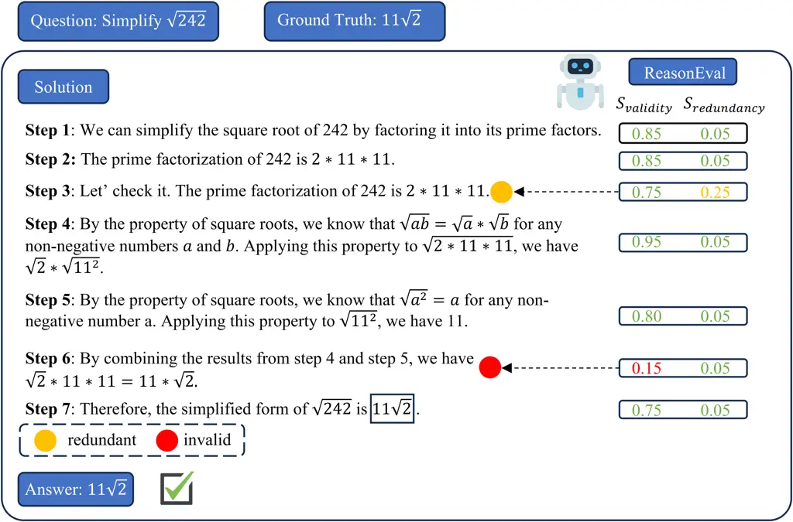

# Evaluating Mathematical Reasoning Beyond Accuracy

Shijie Xia    Xuefeng Li    Yixin Liu    Tongshuang Wu ^(†)^(†)thanks:
   Corresponding Authors.    Pengfei Liu^(†)^(†)footnotemark:

###### Abstract

The leaderboard of Large Language Models (LLMs) in mathematical tasks
has been continuously updated. However, the majority of evaluations
focus solely on the final results, neglecting the quality of the
intermediate steps. This oversight can mask underlying problems, such as
logical errors or unnecessary steps in the reasoning process. To measure
reasoning beyond final-answer accuracy, we introduce ReasonEval, a new
methodology for evaluating the quality of reasoning steps. ReasonEval
employs validity and redundancy to characterize the reasoning quality,
as well as accompanying LLMs to assess them automatically. We explore
different design options for the LLM-based evaluators and empirically
demonstrate that ReasonEval, when instantiated with base models
possessing strong mathematical knowledge and trained with high-quality
labeled data, consistently outperforms baseline methods in the
meta-evaluation datasets. We also highlight the strong generalization
capabilities of ReasonEval. By utilizing ReasonEval to evaluate LLMs
specialized in math, we find that an increase in final-answer accuracy
does not necessarily guarantee an improvement in the overall quality of
the reasoning steps for challenging mathematical problems. Additionally,
we observe that ReasonEval can play a significant role in data
selection. We open-source the best-performing model, meta-evaluation
script, and all evaluation results to facilitate future research.

¹ Shanghai Jiao Tong University, ² Shanghai Artificial Intelligence
Laboratory

³ Carnegie Mellon University, ⁴ Yale University, ⁵ Generative AI
Research Lab (GAIR)

{shijiexia, xuefengli, pengfei}@sjtu.edu.cn, yixin.liu@yale.edu,
sherryw@cs.cmu.edu

Code — https://github.com/GAIR-NLP/ReasonEval

## 1 Introduction

Mathematical reasoning, a core cognitive skill, is crucial for resolving
complex problems and making informed decisions (Hendrycks et al. 2021;
Lewkowycz et al. 2022), playing a significant role in large language
models (LLMs) research (Azerbayev et al. 2023; Lu et al. 2023). Given
its significance, reliably evaluating mathematical reasoning in LLMs
becomes crucial. Current methodologies to evaluate mathematical
reasoning in LLMs focus primarily on the final result (Luo et al. 2023;
Chern et al. 2023; Yu et al. 2023), neglecting the intricacies of the
reasoning process. For example, the OpenLLM leaderboard,¹¹ 1
https://huggingface.co/spaces/HuggingFaceH4/open˙llm˙leaderboard a
relatively well-recognized benchmark for LLMs, uses overall accuracy to
assess models’ mathematical reasoning. Despite being effective to some
degree, such evaluation practice could mask underlying issues such as
logical errors or unnecessary steps that compromise accuracy and
efficiency of reasoning steps. In this work, we argue that a desirable
evaluation criterion for mathematical reasoning encompasses not only the
accuracy of the final answer but also the correctness and efficiency of
each step in the reasoning process. Moreover, it is imperative that the
evaluation metrics be open-source and replicable to ensure transparency
and reliability.



Figure 1: Given a solution to a math problem, ReasonEval scores each
step and identifies the potential error location, serving as an
extension to verify the final answer only.

Our design philosophy stems from the fact that a correct final answer
does not guarantee a flawless reasoning process (Lewkowycz et al. 2022;
Uesato et al. 2022), and excessive or irrelevant reasoning steps can
lead to potential errors as well as increased computational costs (Zhang
et al. 2023). Once these issues go unnoticed, they can cause problems in
many application scenarios. For example, in K12 mathematics education,
incorrect or redundant solution steps provided by LLMs could mislead
students. There have been some recent works related to the above
evaluation principle. Specifically,  Uesato et al. (2022); Lightman
et al. (2023); Wang et al. (2023) present process reward models for
mathematical reasoning,²² 2  Uesato et al. (2022) and Lightman et al.
(2023) are close-source. which focus on their utility as
verifiers (Cobbe et al. 2021) to boost the accuracy (i.e., by generating
many candidate solutions and selecting the one ranked highest by the
verifier), leaving its underlying potential to identify reasoning
errors³³ 3 Identifying reasoning errors and ranking reasoning steps are
different tasks. As also highlighted by Tyen et al. (2023), even
state-of-the-art (SOTA) models like GPT-4 (OpenAI 2023) still struggle
to detect errors in reasoning tasks. and redundancy. Clinciu, Eshghi,
and Hastie (2021); Golovneva et al. (2022) rely on embedding-based
methods to measure the quality of general reasoning explanation, which
has limitations in handling diverse reasoning steps from various models.

In response to these challenges, we propose ReasonEval, a suite
comprising a new evaluation methodology with defined metrics for
assessing mathematical reasoning quality and corresponding LLM-based
evaluators for automated calculation. As illustrated in Figure 1,
ReasonEval emphasizes the _validity_ (i.e., the step contains no
mistakes in calculation and logic) of each reasoning step, and evaluates
the _redundancy_ (i.e., the step lacks utility in solving the problem
but is still valid) of steps to ensure efficiency. We explore different
design options for the LLM-based evaluators and show training such a
high-quality evaluator for mathematical reasoning is not a
straightforward task, which requires an LLM with strong mathematical
knowledge as well as high-quality training data. We empirically
demonstrate that ReasonEval using the optimal design can consistently
outperform baseline methods by a large margin in the meta-evaluation
datasets (§4.2). Moreover, we highlight the strong generalization
ability of ReasonEval (§4.3).

Furthermore, we show the utility of ReasonEval through the lens of two
preliminary applications, as detailed in §5: (1) evaluating different
LLMs trained for mathematical reasoning; and (2) selecting high-quality
data to train such LLMs. We have the following main findings: (1) We
find that an improvement in the result accuracy is not sufficient to
ensure an enhancement in the overall quality of reasoning steps in
challenging mathematical problems; (2) We find that the model scale, the
base model, and the training methods have significantly influenced the
quality of reasoning steps; (3) We find that ReasonEval can select
high-quality training data to improve the efficiency of solving problems
and the quality of solutions. These findings pave the way for future
work to design methods that take into account the process of
problem-solving.

Overall, our main contributions are as follows:

\(1\) We recognize the potential gap between what we are evaluating and
what we are desiring in mathematical reasoning, prioritize validity and
redundancy aspect to address the misalignments and inefficiencies that
can arise in mathematical reasoning processes (§3). (2) We design a
meta-evaluation testbed to assess the reliability (§4) and utility (§5)
of mentioned metrics, guiding us to a superior metric design,
solidifying the foundation for future exploration and significantly
lowering trial and error costs. (3) We open-source our best-performing
metric, meta-evaluation script and all evaluation results to facilitate
future research.

## 2 Preliminaries

### 2.1 Problem Formulation

Given a mathematical problem $`q`$, solution steps
$`\hat{\mathbf{{h}}}=\{\hat{h}_{1},...,\hat{h}_{N}\}`$ and an answer
$`\hat{a}`$ generated by LLMs, the goal is to evaluate how well the
generated solution and answer are. Usually, the ground truth answer
$`a`$ is available but the reference solution step
$`\mathbf{{h}}=\{{h}_{1},...,{h}_{M}\}`$ is not always provided.

### 2.2 Existing Evaluation Methodology

##### Answer-based Matching

Most of the existing works (Luo et al. 2023; Chern et al. 2023; Yu
et al. 2023) measure the mathematical reasoning quality by directly
comparing the final answer (i.e., $`\hat{a}`$ and $`a`$) and calculating
the overall accuracy on a given dataset.

##### Reference-based Scoring

Instead of only using the final result as a scoring criterion, some
works (Sawada et al. 2023) try to measure the reasoning quality by
comparing the similarity between generated and reference solution steps
(i.e., $`\hat{\mathbf{{h}}}`$ and $`\mathbf{{h}}`$). Although datasets
like MATH (Hendrycks et al. 2021) and GSM8K (Cobbe et al. 2021) provide
the ground truth solutions, the existence of diverse reasoning paths
leading to the same answer $`a`$ renders reliance on any single one of
them as a reference unreliable.

##### Prompting-based Method

This method directly asks LLMs with a well-defined prompt to generate a
judgment for a given generated solution and answer (Hao et al. 2024).
This approach usually requires a very powerful LLM, often GPT-4, which
may not be practical for iterative model development due to cost and
transparency concerns.

The aforementioned methods either focus solely on the final results
(e.g., $`a`$) or are limited by the use of reference solutions and
proprietary LLMs, and most of them only concentrate on evaluating
“correctness”, neglecting other aspects such as the redundancy of
solution steps. This has inspired us to propose a set of evaluation
criteria that better aligns with the reasoning models in the era of
LLMs.

## 3 ReasonEval: Metrics and Implementations

### 3.1 Design Principle

We argue that for tasks involving multi-step reasoning, measuring the
quality of reasoning should not solely depend on the correctness of the
final result. It should also consider (1) the accuracy of each reasoning
step; (2) the efficiency of the reasoning process. To this end, we
design evaluators that assess reasoning steps regarding validity and
redundancy in a step-by-step format, checking whether each step advances
well towards solving the problem. Precisely, validity denotes the step
contains no mistakes in calculation and logic, and redundancy describes
the step lacks utility in solving the problem but is still valid.

### 3.2 Scoring Scheme

Following this principle, we formulate such a metric design process as a
classification task. We classify each step into three classes: positive,
neutral, and negative. The positive label indicates that the step is
correct and contributes to solving the question, the neutral label
represents that the step is correct but does not make any progress, and
the negative label signifies an incorrect step. Given a question $`q`$
and the solution steps
$`\hat{\mathbf{{h}}}=\{\hat{h}_{1},...,\hat{h}_{N}\}`$, each step will
be assigned the probability of the three classes as follows:

```math
\displaystyle\{{p}^{1},...,{p}^{N}\} \displaystyle=\textsc{ReasonEval}(q,\hat{h}_{1},...,\hat{h}_{N}) \tag{1}
```

```math
\displaystyle p^{i} \displaystyle=(p^{i}_{\text{positive}},p^{i}_{\text{neutral}},p^{i}_{\text{negative}}) \tag{2}
```

The validity score, concerning only the correctness of the reasoning
steps, is defined as:

```math
\displaystyle S_{\text{validity}}^{i} \displaystyle=p^{i}_{\text{positive}}+p^{i}_{\text{neutral}} \tag{3}
```

The redundancy score, concerning the utility of the steps given that
they are valid, is defined as:

```math
\displaystyle S_{\text{redundancy}}^{i} \displaystyle=p^{i}_{\text{neutral}} \tag{4}
```

We can aggregate the step-level scores to get the solution-level scores.
We use the ‘min’ and ‘max’ operations:

```math
\displaystyle S_{\text{validity}}^{\text{all}} \displaystyle=\min(S^{1}_{\text{validity}},...,S^{N}_{\text{validity}}) \tag{5}
```

```math
\displaystyle S_{\text{redundancy}}^{\text{all}} \displaystyle=\max(S^{1}_{\text{redundancy}},...,S^{N}_{\text{redundancy}}) \tag{6}
```

We describe the detailed justification of our scoring scheme in Appendix
A.

### 3.3 Model Architecture

##### LLM Backbone

Our defined evaluation method (Eq.1) can be implemented by directly
prompting existing LLMs or fine-tuning LLMs using supervised dataset. To
make a comprehensive study, in this work we instantiate ReasonEval by
different types of LLMs, which vary in base model types (e.g.,
Llama2 (Touvron et al. 2023) and Mistral (Jiang et al. 2023)), model
sizes (e.g., 7B, 34B), and post-training strategies (e.g., continued
pretraining (Azerbayev et al. 2023) and fine-tuning).

##### Task-specific Layer

Our evaluator’s architecture is identical to the base model, except that
the linear layer for next-token prediction is replaced with a linear
layer for outputting the possibilities of each class. After
normalization with the softmax layer, we get the possibility for each
class.

### 3.4 Fine-tuning

The above task formulation allows us to utilize the existing dataset,
PRM800K (Lightman et al. 2023), as training data in ReasonEval. PRM800K
contains about 800,000 step-level labels over 75,000 solutions. It is
collected by employing humans to label the step-by-step solutions
generated by GPT-4 to MATH problems. The label categories for the
reasoning steps are identical to those mentioned in §3.2. In the
training phase, the loss function only includes the last token of each
step, as it contains the full information about the step. We also take
the last token of each step for prediction at test time. We provide the
details on training and splitting solutions in Appendix B.

## 4 Meta Evaluation

### 4.1 Meta-evaluation Setup

|                                              |                  |      |              |      |                   |      |              |      |
| -------------------------------------------- | ---------------- | ---- | ------------ | ---- | ----------------- | ---- | ------------ | ---- |
|                                              | MR-MATH-invalid  |      |              |      | MR-MATH-redundant |      |              |      |
|                                              | _Solution-level_ |      | _Step-level_ |      | _Solution-level_  |      | _Step-level_ |      |
|                                              | F1 Score         | AUC  | F1 Score     | AUC  | F1 Score          | AUC  | F1 Score     | AUC  |
| _Embedding-based Methods_                    |                  |      |              |      |                   |      |              |      |
| ROSCOE-SA                                    | 48.2             | 57.5 | \-           | \-   | 50.7              | 53.9 | \-           | \-   |
| ROSCOE-SS                                    | 51.6             | 49.6 | \-           | \-   | 52.0              | 52.7 | \-           | \-   |
| _Prompting-based Methods_                    |                  |      |              |      |                   |      |              |      |
| GPT-3.5-turbo                                | 59.7             | \-   | 53.2         | \-   | 53.0              | \-   | 51.5         | \-   |
| GPT-4                                        | 73.2             | \-   | 61.0         | \-   | 57.1              | \-   | 54.2         | \-   |
| _Step-level Evaluators_                      |                  |      |              |      |                   |      |              |      |
| Math-shepherd-Mistral-7b                     | 70.1             | 77.3 | 60.0         | 77.2 | 50.4              | 54.5 | 42.7         | 53.0 |
| ReasonEval$`{}_{\text{Llama2-7B}}`$          | 66.7             | 79.5 | 60.8         | 80.0 | 60.4              | 62.8 | 59.0         | 68.6 |
| ReasonEval$`{}_{\text{WizardMath-7B-V1.0}}`$ | 72.8             | 81.9 | 67.7         | 83.9 | 60.5              | 65.6 | 59.0         | 68.3 |
| ReasonEval$`{}_{\text{Mistral-7B}}`$         | 78.0             | 85.1 | 68.6         | 85.7 | 60.7              | 63.4 | 59.7         | 70.9 |
| ReasonEval$`{}_{\text{Llemma-7B}}`$          | 74.7             | 84.3 | 76.6         | 90.5 | 59.6              | 63.0 | 58.6         | 68.3 |
| ReasonEval$`{}_{\text{Abel-7B-002}}`$        | 77.3             | 86.2 | 70.4         | 90.5 | 58.6              | 63.6 | 59.5         | 71.8 |
| ReasonEval$`{}_{\text{WizardMath-7B-V1.1}}`$ | 78.6             | 87.5 | 73.9         | 89.5 | 61.6              | 64.8 | 59.7         | 72.2 |
| ReasonEval$`{}_{\text{Llemma-34B}}`$         | 79.6             | 90.8 | 77.5         | 92.8 | 58.3              | 62.7 | 57.5         | 67.3 |

Table 1: Comparison of methods for automatic evaluation of reasoning
steps in MR-MATH. For any methods that require setting a threshold, we
report the Area Under the Curve (AUC) metric.

##### Meta-evaluation⁴⁴ 4 Meta-evaluation refers to evaluating the performance of evaluators themselves. Datasets

Inspired by Zeng et al. (2024), which propose a benchmark named
Meta-Reasoning-GSM8K (MR-GSM8K), we construct a meta-evaluation dataset
MR-MATH to better assess how well different evaluators can detect errors
in reasoning steps. It is constructed as follows: (1) To collect the
first type of errors affecting the correctness of steps, we recruit
undergraduates who have a solid mathematical background to label
solutions generated by Abel (Chern et al. 2023) and WizardMath (Luo
et al. 2023). We collect 83 samples with incorrect steps and 76 without,
pinpointing the first error location in the former. All the solutions
reach the correct final answers, meaning the evaluators need to judge
correctness based on the process rather than the outcome. Additionally,
since the style of solutions differs from the training set of PRM800K
(See examples of solutions in Appendix C), it tests the generalization
of ReasonEval to some degree. (2) For the second type of errors
affecting the efficiency of problem solving process, as they are more
rarer than the first one, we sample solutions from the test set of
PRM800K directly, containing 150 samples with redundant steps and 150
samples without.

|                                              |     |                   |      |            |      |                   |      |            |      |
| -------------------------------------------- | --- | ----------------- | ---- | ---------- | ---- | ----------------- | ---- | ---------- | ---- |
|                                              |     | MR-GSM8K-original |      |            |      | MR-GSM8K-reversed |      |            |      |
|                                              |     | Solution-level    |      | Step-level |      | Solution-level    |      | Step-level |      |
|                                              | OOD | F1 Score          | AUC  | F1 Score   | AUC  | F1 Score          | AUC  | F1 Score   | AUC  |
| Embedding-based Methods                      |     |                   |      |            |      |                   |      |            |      |
| ROSCOE-SA                                    | ✓   | 51.6              | 54.4 | \-         | \-   | 54.5              | 57.9 | \-         | \-   |
| ROSCOE-SS                                    | ✓   | 49.6              | 60.1 | \-         | \-   | 49.6              | 52.1 | \-         | \-   |
| Prompting-based Methods                      |     |                   |      |            |      |                   |      |            |      |
| GPT-3.5-turbo                                | \-  | 54.9              | \-   | 52.3       | \-   | 54.3              | \-   | 49.9       | \-   |
| GPT-4                                        | \-  | 81.7              | \-   | 69.0       | \-   | 72.2              | \-   | 52.2       | \-   |
| Step-level Evaluators                        |     |                   |      |            |      |                   |      |            |      |
| Math-shepherd-Mistral-7b                     | ✗   | 86.0              | 93.9 | 73.4       | 88.5 | 77.2              | 88.0 | 59.6       | 77.9 |
| ReasonEval$`{}_{\text{Mistral-7B}}`$         | ✓   | 61.8              | 79.8 | 62.9       | 86.1 | 61.0              | 71.9 | 61.5       | 84.3 |
| ReasonEval$`{}_{\text{WizardMath-7B-V1.1}}`$ | ✓   | 74.1              | 90.7 | 72.8       | 91.4 | 74.4              | 86.3 | 70.5       | 90.5 |
| ReasonEval$`{}_{\text{Llemma-34B}}`$         | ✓   | 81.0              | 88.1 | 73.5       | 86.8 | 76.1              | 84.1 | 69.3       | 85.0 |

Table 2: Comparison of methods for automatic evaluation of reasoning
steps in MR-GSM8K. “OOD” represents that its training data contains the
labeled solutions for problems of the dataset. The results of
prompting-based methods are from Zeng et al. (2024).

##### Evaluators

We compare three methods to evaluate reasoning steps automatically:
embedding-based methods, prompting-based methods and step-level
evaluators. For the embedding-based methods, we choose ROSCOE
 (Golovneva et al. 2022), a SOTA method among them. Specifically, we
select the semantic alignment metrics (ROSCOE-SA) and the semantic
similarity metrics (ROSCOE-SS), which do not require references solution
steps. For the prompting-based methods, we select GPT-3.5-turbo and
GPT-4, two mainstream generation models. We use the prompt suggested
by Zeng et al. (2024) for the invalid errors and the modified version
for the redundant errors. For the step-level evaluators, we select 7
base models for ReasonEval: Llama-2-7B, Mistral-7B, Llemma-7B,
Llemma-34B, WizardMath-7B-V1.0 (Luo et al. 2023), WizardMath-7B-V1.1,
Abel-7B-002 (Chern et al. 2023). The llemma series is continuing
pertaining on math-based corpus. The Abel and WizardMath series are
fine-tuning for solving mathematical problems. We also select the
open-source SOTA process reward model Math-shepherd-Mistral-7B (Wang
et al. 2023) to compare. The settings for these methods are in Appendix
D.

##### Meta-evaluation Metrics

We test two abilities: judging whether the solution contains errors and
locating the error step. In the first task the ground truth is labels
for solutions (solution-level), and in the second tasks the ground truth
is labels for steps (step-level). Since both are classification tasks,
we present the macro F1 score as a performance metric. Additionally, for
any methods that require setting a threshold, we report the Area Under
the Curve (AUC) metric, which is a more balanced evaluation of
performance across different threshold settings.

### 4.2 Results and Analysis

##### Overall Results

We present our main results in Table 1. ReasonEval outperforms baseline
methods across all error types and label levels. It is noteworthy that
the identification of errors at the step level is generally more
challenging than at the solution level for all methods. This suggests a
higher complexity in pinpointing errors at the individual step level.
Furthermore, identifying redundant errors is more intricate than invalid
errors due to the inherent ambiguity involved in the former.

##### Analysis on Base Models

We investigate the correlation between the base LLMs’ mathematical
reasoning capabilities and the performance of ReasonEval fine-tuned from
them. In Figure 2, for the invalid errors, an increase in AUC shows a
positive correlation with the base models’ ability to solve MATH
problems, indicating that enhancing mathematical problem-solving
abilities is beneficial for identifying invalid errors. It is noted that
the Llemma-34B outperforms all 7B models, although its Pass@1 is not the
highest. It highlights the importance of model scale and the continued
pretraining over math-related corpus. For the redundant errors, the
distinction across different base models is small, and it does not show
the correlation as the invalid errors. This may be due to developers for
these models prioritizing the correctness of solutions over their
efficiency, resulting in similar performances in this aspect across
various LLMs.

Figure 2: Correlation between Pass@1 for the base model on MATH and AUC
for the solution-level labels.

##### Analysis on Training Data

In Table 1, the Mistral-7B trained on Math-Shepherd falls behind that
trained on PRM800K. We summarize the information about Math-shepherd and
PRM800K in Table 3. For Math-shepherd, although having 6x training data,
there is more noise in the step-level labels generated with the
unsupervised method, thus harming its precision in identifying errors.
And the only two classes of labels also make it limited in evaluating
redundancy. Nonetheless, the data synthesis method is promising. We
leave it for future work to optimize this method to reduce noise.

|               |      |     |                |            |
| ------------- | ---- | --- | -------------- | ---------- |
| Dataset       | \#S  | \#C | Problem Source | Human Ann. |
| Math-shepherd | 440K | 2   | MATH, GSM8K    | ✗          |
| PRM800K       | 75K  | 3   | MATH           | ✓          |

Table 3: Comparison between Math-shepherd and PRM800K. “#S” represents
the number of labeled solutions. “#C” represents the number of label
categories for the reasoning steps. For Math-shepherd, the categories
are “correct" and “incorrect". “Human Ann.” indicates whether the labels
for the reasoning steps are generated by human annotations.

### 4.3 Out-Of-Distribution Generalization

##### Setup

To assess the out-of-distribution generalization of ReasonEval, we
evaluate its performance on MR-GSM8K (Zeng et al. 2024). We select two
distinct types of questions from the dataset. The first type of question
is from the original GSM8K. The second type, termed reversed
reasoning (Yu et al. 2023), involves concealing one of the inputs and
requiring the computation of the missing input using the provided
original answer. Both problem sets cover the full test set of GSM8K,
comprising approximately 1.4K samples each. The step-by-step solutions
for these questions are sampled from MetaMath-7B (Yu et al. 2023) and
include human annotations labeling the correctness of each step. Since
the training data of ReasonEval does not include the labeled solutions
for these types of problems, this evaluation serves as a robust test of
its generalization ability. All settings are identical to those
described in §4.1.

##### Results

We present the results in Table 2. We observe that both
$`\textsc{ReasonEval}_{\text{Llemma-34B}}`$ and
$`\textsc{ReasonEval}_{\text{WizardMath-7B-V1.1}}`$ achieve superior
performance at the step level and approach the performance of GPT-4 at
the solution level, demonstrating strong generalization capabilities.
Additionally, ReasonEval is more robust to the question types compared
to other methods. For Math-shepherd-Mistral-7B, it performs best in
solution-level labels but lags behind in step-level labels, suggesting
that the noise in step labels from Math-Shepherd negatively impacts its
ability to accurately locate error steps.

## 5 Utilizing ReasonEval for Evaluating and Improving Reasoning Quality

### 5.1 Evaluating Reasoning Quality of LLMs Specialized in Math

Figure 3: Box-and-whisker plots of $`S_{\text{validity}}`$ (upper) and
$`S_{\text{redundancy}}`$ (lower). The boundaries of the whiskers are
based on the 1.5 interquartile range.

##### Setup

The models selected for measurement are two mainstream LLMs specialized
in math: Abel (Chern et al. 2023) and WizardMath (Luo et al. 2023), with
different scales. We also report the results of LLaMA-2 (Touvron et al. 2023) naive fine-tuned on PRM800K (approximately 6K solutions that reach
the correct final answers) for comparison. We evaluate the performance
of the LLMs on MATH and sample 100 solutions for each problem to reduce
evaluation noise and sampling randomness. Specifically, the sampling
temperature is set to 0.6, and the top-p value is set to 0.95. The
maximum sample length is set to 2048 tokens. All solutions are scored by
ReasonEval$`{}_{\text{LLemma-34B}}`$.

Our analysis includes two aspects: (1) False positive rate: it refers to
the proportion of solutions that have the correct final answers but
contain incorrect steps among all solutions with correct final answers.
(2) The redundancy of solutions.

#### False Positive Rate

|                    |          |              |
| ------------------ | -------- | ------------ |
| Model              | Acc. (%) | FPR (%)      |
| LLaMA2-13B-PRM800K | 7.4      | 40.6         |
| LLaMA2-70B-PRM800K | 14.7     | 21.8         |
| Abel7B-001         | 12.4     | 31.8         |
| Abel13B            | 15.2     | 29.8 ( 29.2) |
| Abel70B            | 25.7     | 20.0         |
| Abel7B-002         | 30.0     | 22.8         |
| WizardMath7B-V1.0  | 8.9      | 34.4         |
| WizardMath13B      | 10.9     | 31.3 ( 28.3) |
| WizardMath70B      | 18.7     | 16.5         |
| WizardMath7B-V1.1  | 31.0     | 16.7         |

Table 4: We estimate the false positive rate (FPR) with
ReasonEval$`{}_{\text{LLemma-34B}}`$. We also check the false positive
rate of Abel13B and WizardMath13B by human (denoted by .), sampling one
solution for each problem. “Acc.” represents the overall accuracy.

We set the threshold to 0.25 for the validity scores and calculate the
false positive rate. We describe the details of choosing the threshold
value in Appendix E. We present the main results in Table 4. We also
include the results in Figure 4 with the information of the tested
models. We highlight three key takeaways:

Increased final-answer accuracy does not inherently ensure a
corresponding reduction in the false positive rate. In Figure 4, it is
clear that the false positive rate drops and stays at a level of about
20% as the final-answer accuracy rises. When comparing WizardMath7B-V1.1
with WizardMath70B, although the former exhibits a much higher accuracy
(31.0% vs. 18.7%), its false positive rate is almost the same (16.7% vs.
16.5%). It indicates there exists a bottleneck for the quality of
reasoning steps to advance.

The model size and base model affect the false positive rate
significantly. When comparing LLaMA13B-PRM800K with LLaMA70B-PRM800K,
although using the same training data, the distinction in false positive
rates is large (40.6% vs. 21.8%). It indicates the importance of the
model scale. The base model of Mistral (Jiang et al. 2023) also achieves
a lower false positive rate than LLaMA2 (22.8% vs. 31.8%, 16.7% vs.
34.4%). Overall, the scaling law still applies to this field.

Figure 4: Correlation between the final-answer accuracy and the false
positive rate.

RLHF helps lower the false positive rate when the LLMs are relatively
strong. There’s no distinction in false positive rates between SFT and
SFT plus RLHF when the model is relatively weak, like 7B and the 13B
model of LLaMA-2 (31.8% vs. 34.4%, 29.8% vs. 31.3%). As the model size
becomes larger, SFT plus RLHF performs better (16.5% vs. 20.0%, 16.7%
vs. 22.8%). This indicates that effective supervision by RLHF requires a
strong mathematical ability of the model itself.

#### Redundancy of Solutions

We analyze the redundancy in reasoning steps. Our main results are in
Figure 3. It is noteworthy that the redundancy scores of Abel family are
usually higher. This is because the solutions from Abel often involve
restating the problem first, which is considered a meaningless action
towards solving the problem by our evaluator. Moreover, the redundancy
scores for solutions that fail to reach the correct answers are higher.
This suggests that when a model is unsure about how to solve a problem,
it tends to make more attempts that lack meaningful progression.

### 5.2 Improving Reasoning Quality by Selecting Training Data

In this part, we explore the potential of ReasonEval to select
high-quality training data for SFT.

##### Setup

The MMIQC (Liu and Yao 2024) dataset consists of a mixture of processed
web data and synthetic question-response pairs used to enhance the
reasoning capabilities of LLMs. We randomly sample 10K unique responses
generated by GPT-3.5-turbo on MATH from the dataset. We then filter it
using $`\textsc{ReasonEval}_{\text{WizardMath-7B-V1.1}}`$, specifically
removing samples with validity scores below 0.5 or redundancy scores
above 0.15. We also combine these two conditions. We SFT the mistral-7b
in different subsets with 3 epochs and observe the performance on MATH.
To compare, we randomly sample the same amount of training data three
times and report the average performance.

##### Results

We make the following observations from Table 5: (1) In terms of
accuracy, all groups filtered by
$`\textsc{ReasonEval}_{\text{WizardMath-7B-V1.1}}`$ outperform the
random group and achieve performance close to that of the full dataset.
(2) The average number of tokens for the solutions decreases in groups
filtered by $`\textsc{ReasonEval}_{\text{WizardMath-7B-V1.1}}`$,
indicating its advantage in increasing problem-solving efficiency. (3)
The group that combines the two filtering conditions significantly
improves the quality of reasoning steps with only about half the
training data.

|             |       |      |      |      |         |
| ----------- | ----- | ---- | ---- | ---- | ------- |
| Filter      | \#D   | Acc. | Val. | Red. | \#Token |
| \-          | 100%  | 22.2 | 65.2 | 27.4 | 723.4   |
| val.        | 76.7% | 22.0 | 65.9 | 26.4 | 699.9   |
| random      | 76.7% | 20.1 | 62.5 | 27.4 | 765.6   |
| red.        | 71.9% | 21.8 | 65.6 | 22.1 | 681.5   |
| random      | 71.9% | 20.3 | 62.3 | 28.0 | 746.1   |
| red. & val. | 56.7% | 22.0 | 67.8 | 22.5 | 701.2   |
| random      | 56.7% | 20.0 | 62.1 | 27.6 | 739.5   |

Table 5: “#D” represents the percentage of training data from the full
set. “Acc.” represents the overall accuracy. “Val.” and “Red.” represent
$`S_{\text{validity}}`$ and $`S_{\text{redundancy}}`$ for the solutions
with correct results. “#Token” represents the average number of tokens
for the solutions.

## 6 Related Work

##### Evaluating reasoning steps automatically

The technique used to assess reasoning steps automatically can be
broadly divided into three groups: (1) Embedding-based methods:
Golovneva et al. (2022) propose several metrics and uses the
embedding-based calculation among hypothesis steps, reference steps, and
problems to represent them; (2) Parsing-based methods: this approach
aims to parse steps into structured forms, like ‘subject-verb-object’
frames (Prasad et al. 2023) or symbolic proofs (Saparov and He 2022).
However, it presents challenges for complex datasets such as MATH due to
the intricate logic involved; (3) Prompting-based methods: due to the
generalization of LLMs, given tailored prompts to SOTA LLMs, they can
check the solutions and find the potential errors (Tyen et al. 2023;
Zeng et al. 2024).

##### Process reward model (PRM)

Process reward models are mainly used in reinforcement learning to give
feedback to LLMs to align with human logic in mathematics. Lightman
et al. (2023) and Uesato et al. (2022) both evaluate the performance of
PRM as a verifier against the outcome reward model. Ma et al. (2023)
combine a check-and-generation idea with PRM to generate a more accurate
response. Wang et al. (2023) propose a way to automatically construct
process-wise supervision data. These studies focus on leveraging PRM to
enhance accuracy. In contrast, our research explores the potential of
PRM to develop new evaluation methods in mathematics, moving beyond mere
accuracy improvements.

## 7 Conclusion

In this work, we develop ReasonEval, a new metric to evaluate the
quality of reasoning steps from the perspectives of correctness and
efficiency. We construct a meta-evaluation testbed and show ReasonEval
using the optimal design can consistently outperform baseline methods by
a large margin. Additionally, we empirically demonstrate the strong
generalization ability of ReasonEval. With ReasonEval, we find an
inconsistency between final-answer accuracy and the quality of reasoning
steps. We also show its efficacy in selecting training data.

## References

- Azerbayev et al. (2023) Azerbayev, Z.; Schoelkopf, H.; Paster, K.;
  Dos Santos, M.; McAleer, S. M.; Jiang, A. Q.; Deng, J.; Biderman, S.;
  and Welleck, S. 2023. Llemma: An Open Language Model for Mathematics.
  In _The Twelfth International Conference on Learning Representations_.
- Chern et al. (2023) Chern, E.; Zou, H.; Li, X.; Hu, J.; Feng, K.; Li,
  J.; and Liu, P. 2023. Generative AI for Math: Abel.
  https://github.com/GAIR-NLP/abel.
- Clinciu, Eshghi, and Hastie (2021) Clinciu, M.-A.; Eshghi, A.; and
  Hastie, H. 2021. A Study of Automatic Metrics for the Evaluation of
  Natural Language Explanations. In _Proceedings of the 16th Conference
  of the European Chapter of the Association for Computational
  Linguistics: Main Volume_, 2376–2387. Online: Association for
  Computational Linguistics.
- Cobbe et al. (2021) Cobbe, K.; Kosaraju, V.; Bavarian, M.; Chen, M.;
  Jun, H.; Kaiser, L.; Plappert, M.; Tworek, J.; Hilton, J.; Nakano, R.;
  et al. 2021. Training verifiers to solve math word problems. _ArXiv
  preprint_, abs/2110.14168.
- Dai et al. (2023) Dai, J.; Pan, X.; Sun, R.; Ji, J.; Xu, X.; Liu, M.;
  Wang, Y.; and Yang, Y. 2023. Safe RLHF: Safe Reinforcement Learning
  from Human Feedback. In _The Twelfth International Conference on
  Learning Representations_.
- Golovneva et al. (2022) Golovneva, O.; Chen, M. P.; Poff, S.;
  Corredor, M.; Zettlemoyer, L.; Fazel-Zarandi, M.; and
  Celikyilmaz, A. 2022. ROSCOE: A Suite of Metrics for Scoring
  Step-by-Step Reasoning. In _The Eleventh International Conference on
  Learning Representations_.
- Hao et al. (2024) Hao, S.; Gu, Y.; Luo, H.; Liu, T.; Shao, X.; Wang,
  X.; Xie, S.; Ma, H.; Samavedhi, A.; Gao, Q.; Wang, Z.; and
  Hu, Z. 2024. LLM Reasoners: New Evaluation, Library, and Analysis of
  Step-by-Step Reasoning with Large Language Models. arXiv:2404.05221.
- Hendrycks et al. (2021) Hendrycks, D.; Burns, C.; Kadavath, S.; Arora,
  A.; Basart, S.; Tang, E.; Song, D.; and Steinhardt, J. 2021. Measuring
  Mathematical Problem Solving With the MATH Dataset. In _Thirty-fifth
  Conference on Neural Information Processing Systems Datasets and
  Benchmarks Track (Round 2)_.
- Jiang et al. (2023) Jiang, A. Q.; Sablayrolles, A.; Mensch, A.;
  Bamford, C.; Chaplot, D. S.; Casas, D. d. l.; Bressand, F.; Lengyel,
  G.; Lample, G.; Saulnier, L.; et al. 2023. Mistral 7B. _ArXiv
  preprint_, abs/2310.06825.
- Lewkowycz et al. (2022) Lewkowycz, A.; Andreassen, A.; Dohan, D.;
  Dyer, E.; Michalewski, H.; Ramasesh, V.; Slone, A.; Anil, C.; Schlag,
  I.; Gutman-Solo, T.; et al. 2022. Solving quantitative reasoning
  problems with language models. _Advances in Neural Information
  Processing Systems_, 35: 3843–3857.
- Lightman et al. (2023) Lightman, H.; Kosaraju, V.; Burda, Y.; Edwards,
  H.; Baker, B.; Lee, T.; Leike, J.; Schulman, J.; Sutskever, I.; and
  Cobbe, K. 2023. Let’s Verify Step by Step. In _The Twelfth
  International Conference on Learning Representations_.
- Liu and Yao (2024) Liu, H.; and Yao, A. C.-C. 2024. Augmenting math
  word problems via iterative question composing. _ArXiv preprint_,
  abs/2401.09003.
- Loshchilov and Hutter (2019) Loshchilov, I.; and Hutter, F. 2019.
  Decoupled Weight Decay Regularization. In _7th International
  Conference on Learning Representations, ICLR 2019, New Orleans, LA,
  USA, May 6-9, 2019_. OpenReview.net.
- Lu et al. (2023) Lu, P.; Qiu, L.; Yu, W.; Welleck, S.; and Chang,
  K.-W. 2023. A Survey of Deep Learning for Mathematical Reasoning. In
  _Proceedings of the 61st Annual Meeting of the Association for
  Computational Linguistics (Volume 1: Long Papers)_, 14605–14631.
- Luo et al. (2023) Luo, H.; Sun, Q.; Xu, C.; Zhao, P.; Lou, J.; Tao,
  C.; Geng, X.; Lin, Q.; Chen, S.; and Zhang, D. 2023. Wizardmath:
  Empowering mathematical reasoning for large language models via
  reinforced evol-instruct. _ArXiv preprint_, abs/2308.09583.
- Ma et al. (2023) Ma, Q.; Zhou, H.; Liu, T.; Yuan, J.; Liu, P.; You,
  Y.; and Yang, H. 2023. Let’s reward step by step: Step-Level reward
  model as the Navigators for Reasoning. _ArXiv preprint_,
  abs/2310.10080.
- OpenAI (2023) OpenAI, R. 2023. GPT-4 technical report. _arXiv_,
  2303–08774.
- Prasad et al. (2023) Prasad, A.; Saha, S.; Zhou, X.; and
  Bansal, M. 2023. ReCEval: Evaluating Reasoning Chains via Correctness
  and Informativeness. In _Proceedings of the 2023 Conference on
  Empirical Methods in Natural Language Processing_, 10066–10086.
- Saparov and He (2022) Saparov, A.; and He, H. 2022. Language Models
  Are Greedy Reasoners: A Systematic Formal Analysis of
  Chain-of-Thought. In _The Eleventh International Conference on
  Learning Representations_.
- Sawada et al. (2023) Sawada, T.; Paleka, D.; Havrilla, A.; Tadepalli,
  P.; Vidas, P.; Kranias, A.; Nay, J. J.; Gupta, K.; and
  Komatsuzaki, A. 2023. Arb: Advanced reasoning benchmark for large
  language models. _ArXiv preprint_, abs/2307.13692.
- Touvron et al. (2023) Touvron, H.; Martin, L.; Stone, K.; Albert, P.;
  Almahairi, A.; Babaei, Y.; Bashlykov, N.; Batra, S.; Bhargava, P.;
  Bhosale, S.; et al. 2023. Llama 2: Open foundation and fine-tuned chat
  models. _ArXiv preprint_, abs/2307.09288.
- Tyen et al. (2023) Tyen, G.; Mansoor, H.; Chen, P.; Mak, T.; and
  Cărbune, V. 2023. LLMs cannot find reasoning errors, but can correct
  them! _ArXiv preprint_, abs/2311.08516.
- Uesato et al. (2022) Uesato, J.; Kushman, N.; Kumar, R.; Song, F.;
  Siegel, N.; Wang, L.; Creswell, A.; Irving, G.; and Higgins, I. 2022.
  Solving math word problems with process-and outcome-based feedback.
  _ArXiv preprint_, abs/2211.14275.
- Wang et al. (2023) Wang, P.; Li, L.; Shao, Z.; Xu, R.; Dai, D.; Li,
  Y.; Chen, D.; Wu, Y.; and Sui, Z. 2023. Math-Shepherd: A Label-Free
  Step-by-Step Verifier for LLMs in Mathematical Reasoning. _ArXiv
  preprint_, abs/2312.08935.
- Yu et al. (2023) Yu, L.; Jiang, W.; Shi, H.; Jincheng, Y.; Liu, Z.;
  Zhang, Y.; Kwok, J.; Li, Z.; Weller, A.; and Liu, W. 2023. MetaMath:
  Bootstrap Your Own Mathematical Questions for Large Language Models.
  In _The Twelfth International Conference on Learning Representations_.
- Zeng et al. (2024) Zeng, Z.; Chen, P.; Liu, S.; Jiang, H.; and
  Jia, J. 2024. MR-GSM8K: A Meta-Reasoning Revolution in Large Language
  Model Evaluation. arXiv:2312.17080.
- Zhang et al. (2023) Zhang, M.; Wang, Z.; Yang, Z.; Feng, W.; and
  Lan, A. 2023. Interpretable Math Word Problem Solution Generation via
  Step-by-step Planning. In _Proceedings of the 61st Annual Meeting of
  the Association for Computational Linguistics (Volume 1: Long
  Papers)_, 6858–6877.

## Appendix A Ablation Studies on the Scoring Scheme

|                                              |                |               |               |               |
| -------------------------------------------- | -------------- | ------------- | ------------- | ------------- |
|                                              | Solution-level |               | Step-level    |               |
|                                              | $`S_{1}`$-AUC  | $`S_{2}`$-AUC | $`S_{1}`$-AUC | $`S_{2}`$-AUC |
| ReasonEval$`{}_{\text{Llama2-7B}}`$          | 79.5           | 74.0          | 80.0          | 67.1          |
| ReasonEval$`{}_{\text{WizardMath-7B-V1.0}}`$ | 81.9           | 80.3          | 83.9          | 77.5          |
| ReasonEval$`{}_{\text{Mistral-7B}}`$         | 85.1           | 76.5          | 85.7          | 73.5          |
| ReasonEval$`{}_{\text{Llemma-7B}}`$          | 84.3           | 82.9          | 90.5          | 85.9          |
| ReasonEval$`{}_{\text{Abel-7B-002}}`$        | 86.2           | 83.5          | 90.5          | 81.3          |
| ReasonEval$`{}_{\text{WizardMath-7B-V1.1}}`$ | 87.5           | 84.3          | 89.5          | 83.1          |
| ReasonEval$`{}_{\text{Llemma-34B}}`$         | 90.8           | 89.7          | 92.8          | 89.6          |

Table 6: Performance of different scoring schemes on MR-MATH-invalid.
The $`S_{1}`$ represents the scoring scheme implemented by Eq.1, and
$`S_{2}`$ represents the scoring scheme implemented by Eq.2.

|                                              |                 |      |      |                   |      |      |
| -------------------------------------------- | --------------- | ---- | ---- | ----------------- | ---- | ---- |
|                                              | MR-MATH-invalid |      |      | MR-MATH-redundant |      |      |
|                                              | MIN             | AM   | GM   | MAX               | AM   | GM   |
| ReasonEval$`{}_{\text{Llama2-7B}}`$          | 80.0            | 74.0 | 73.5 | 62.8              | 65.5 | 66.6 |
| ReasonEval$`{}_{\text{WizardMath-7B-V1.0}}`$ | 83.9            | 80.3 | 78.3 | 65.6              | 66.2 | 66.2 |
| ReasonEval$`{}_{\text{Mistral-7B}}`$         | 85.7            | 76.5 | 80.2 | 63.4              | 64.4 | 64.5 |
| ReasonEval$`{}_{\text{Llemma-7B}}`$          | 90.5            | 82.9 | 82.5 | 63.0              | 63.5 | 63.2 |
| ReasonEval$`{}_{\text{Abel-7B-002}}`$        | 90.5            | 83.5 | 85.6 | 63.6              | 64.7 | 65.3 |
| ReasonEval$`{}_{\text{WizardMath-7B-V1.1}}`$ | 89.5            | 84.3 | 87.9 | 64.8              | 65.4 | 65.4 |
| ReasonEval$`{}_{\text{Llemma-34B}}`$         | 92.8            | 89.7 | 90.3 | 62.7              | 64.2 | 64.2 |

Table 7: Performance of different aggregation methods on MR-MATH. The
“AM” represents the arithmetic mean of the step scores, and “GM”
represents the geometric mean of the step scores.

##### Validity Scores

The validity score can be defined using two different methods as
follows:

```math
\displaystyle S_{\text{validity}} \displaystyle=p_{\text{positive}}+p_{\text{neutral}} \tag{1}
```

```math
\displaystyle S^{{}^{\prime}}_{\text{validity}} \displaystyle=p_{\text{positive}} \tag{2}
```

We compare the performance of the two scoring schemes in Table 6. The
scoring scheme Eq.1 consistently outperforms Eq.2.

##### Aggregation Methods

We explore three different methods for aggregating step-level scores:
min/max, the arithmetic mean (AM), and the geometric mean (GM). We
compare the performance in Table 7. For the validity scores, the min
operation consistently outperforms both the AM and GM by a large margin.
Conversely, for the redundancy scores, the AM and GM slightly outperform
the max operation. This discrepancy may be due to the fact that the
redundancy score estimations are less accurate compared to validity
scores for ReasonEval, and averaging operations help to reduce noise.
Given the trade-offs and considering the potential future advancements
in model capabilities, we ultimately choose the min/max operation, as
also taken by Golovneva et al. (2022) and Prasad et al. (2023).

## Appendix B Details for ReasonEval

##### Training Details

The ReasonEval model is trained on NVIDIA A100 GPUs (4 GPUs for the 7B
models, 16 GPUs for the 34B models) using the supervised fine-tuning
(SFT) framework provided by Dai et al. (2023). Specifically, the model
is trained in 1 epoch. We set the batch size to 64 and maximum sequence
length to 2048. We use a peak learning rate 1e-6 with 8 warmup steps and
cosine learning rate decay to 0. We use AdamW (Loshchilov and Hutter 2019) as our optimizer with $`\beta_{1}=0.9,\beta_{2}=0.95`$ and weight
decay of 0.1.

##### Splitting Solutions

For users of ReasonEval, we suggest splitting solutions into steps using
delimiters such as “\n” or period marks. In our experiments with the
Abel and WizardMath series, solutions naturally contained step markers
(e.g., “Step 1:”), allowing for direct step-wise splitting. For the
LLaMA-PRM800K series, we split solutions using double newlines (“\n\n”).

## Appendix C Examples of Solutions Generated by Different LLMs

We present examples of solutions generated by different LLMs in Figure
5, including LLaMA-PRM800K⁵⁵ 5 It represents the LLaMA-2 naive
fine-tuned on PRM800K (approximately 6K solutions that reach the correct
final answers), reflecting the language style of PRM800K., Abel and
WizardMath.

Figure 5: Examples of solutions generated by different LLMs

## Appendix D Settings for Evaluators

The settings for evaluators are as follows: (1) Embedding-based methods:
for ROSCOE we use the embedding layer “roscoe-512-roberta-base”. We
select Repetition-token matrix for ROSCOE-SA and the Repetition-step
matrix for ROSCOE-SS. The threshold is set to 0.025. (2) Prompting-based
methods: we present the prompts in Figure 6. (3) Step-level evaluators:
for the validity scores, the threshold is set to 0.5, and for redundancy
scores, it is set to 0.15. Both are applied to the solution-level labels
and step-level labels. For math-shepherd we set the threshold to 0.5 for
all errors.

|                                                                                                                                                                                                                                                                                                                                                                                                                                                                                                                                                                                                                                                                                                                                                                                                                                                                                                                                               |                                                                                                                                                                                                                                                                                                                                                                                                                                                                                                                                                                                                                                                                                                                                                                                                                                                                                                                                                                                   |
| --------------------------------------------------------------------------------------------------------------------------------------------------------------------------------------------------------------------------------------------------------------------------------------------------------------------------------------------------------------------------------------------------------------------------------------------------------------------------------------------------------------------------------------------------------------------------------------------------------------------------------------------------------------------------------------------------------------------------------------------------------------------------------------------------------------------------------------------------------------------------------------------------------------------------------------------- | --------------------------------------------------------------------------------------------------------------------------------------------------------------------------------------------------------------------------------------------------------------------------------------------------------------------------------------------------------------------------------------------------------------------------------------------------------------------------------------------------------------------------------------------------------------------------------------------------------------------------------------------------------------------------------------------------------------------------------------------------------------------------------------------------------------------------------------------------------------------------------------------------------------------------------------------------------------------------------- |
| The Prompt for identifying invalid errors                                                                                                                                                                                                                                                                                                                                                                                                                                                                                                                                                                                                                                                                                                                                                                                                                                                                                                     | The Prompt for identifying redundant errors                                                                                                                                                                                                                                                                                                                                                                                                                                                                                                                                                                                                                                                                                                                                                                                                                                                                                                                                       |
| Question: {question} Student Solution: {solution} Your task involves three parts: 1. \*\*Step-by-step Evaluation:\*\* Go through the student solution carefully and identify key errors and potential misunderstandings that led to the incorrect solution. 2. \*\*Final Judgement:\*\* Provide an overall judgement on the correctness of the student’s solution. 3. \*\*First Error Step:\*\* If the solution is incorrect, generate the step number where the first error occurs, otherwise generate N/A here Here’s the format I want: Step-by-step Evaluation: \[Provide a step by step examination of the student solution and identify key errors and misunderstandings here.\] Final Judgement: \[Insert only \*\*correct\*\* or \*\*wrong\*\* here\] First Error Step: \[Insert either N/A or the step number where the first error occurs\] Please follow this format without any additional introductory or concluding statements. | Question: {question} Student Solution: {solution} Your task involves three parts: 1. \*\*Step-by-step Evaluation:\*\* Carefully review the student’s solution. Identify any neutral steps that, while reasonable, do not offer new insight, advance the solution, or suggest a next step. 2. \*\*Final Judgment:\*\* Indicate whether the solution contains or does not contain any neutral steps. 3. \*\*Neutral Steps Identified\*\*: If neutral steps are present, list their numbers in list format; otherwise, insert N/A. Here’s the format I want: Step-by-step Evaluation: \[Provide a step-by-step examination of the student solution and identify the neutral steps.\] Final Judgment: \[Insert only the word \*\*Present\*\* if neutral steps are identified, or \*\*Absent\*\* if not.\] Neutral Steps Identified: \[Insert either N/A or the step numbers in list format.\] Please follow this format without any additional introductory or concluding statements. |

Figure 6: Prompts used to identify invalid and redundant errors,
modified from the prompt provided by Zeng et al. (2024).

## Appendix E Threshold Selection for False Positive Rate Estimation

First, we compare the validity scores of reasoning steps from different
models in Figure 3. For solutions with the correct answers but wrong
steps, the validity scores should behave similarly to solutions with the
incorrect answers. So we can use it to estimate the threshold and
calculate the false positive rate. A rough estimation for the threshold
is between 0.15 and 0.35. To further ensure a relatively accurate
estimation, we check the false positive rate of Abel13B and
WizardMath13B by humans, sampling one solution for each problem.
Combining above information, the threshold is set to 0.25.
