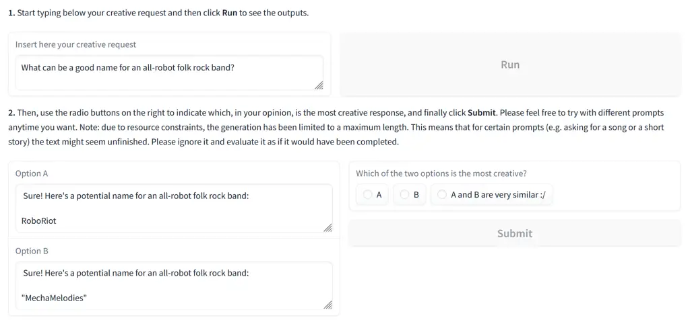

# Creative Beam Search: LLM-as-a-Judge for Improving Response Generation

Giorgio Franceschelli Affiliation: Department of Computer Science and
Engineering Affiliation: Alma Mater Studiorum Università di Bologna
Email: <giorgio.franceschelli@unibo.it>    Mirco Musolesi
Affiliation: Department of Computer Science Affiliation: University
College London Affiliation: Department of Computer Science and
Engineering Affiliation: Alma Mater Studiorum Università di Bologna
Email: <m.musolesi@ucl.ac.uk>

###### Abstract

> Large language models are revolutionizing several areas, including
> artificial creativity. However, the process of generation in machines
> profoundly diverges from that observed in humans. In particular,
> machine generation is characterized by a lack of intentionality and an
> underlying creative process. We propose a method called Creative Beam
> Search that uses Diverse Beam Search and LLM-as-a-Judge to perform
> response generation and response validation. The results of a
> qualitative experiment show how our approach can provide better output
> than standard sampling techniques. We also show that the response
> validation step is a necessary complement to the response generation
> step.

## Introduction

Recent advancements in deep learning have led to a wave of generative
models, in particular large language models (LLMs), capable of impacting
society at multiple levels \[\citeauthoryearBommasani et al.2021\].
Thanks to the quality of their outputs, the impact of LLMs on creative
fields has been substantial \[\citeauthoryearNewton and Dhole2023,
\citeauthoryearWeidinger et al.2022\]. However, LLMs are still far from
being creative due to their lack of intentionality
\[\citeauthoryearShanahan2024\] and the absence of a genuinely creative
process in their production \[\citeauthoryearFranceschelli and
Musolesi2023\].

In this paper, we introduce Creative Beam Search (CBS), a novel
generate-and-test sampling scheme designed to artificially replicate
certain aspects of the creative process. According to the framework
proposed in \[\citeauthoryearAmabile1983\], creativity should involve
the following steps: task presentation (from internal or external
stimuli); preparation; response generation (thanks to
creativity-relevant skills); and response validation (thanks to
domain-relevant skills). In particular, CBS first simulates the response
generation phase through Diverse Beam Search (DBS)
\[\citeauthoryearVijayakumar et al.2018\], generating a more diverse set
of possible solutions. Then, it performs a self-evaluation phase in
LLM-as-a-Judge style \[\citeauthoryearZheng et al.2023\] to select the
final output. We evaluate our method against the classic sampling
strategy with a qualitative assessment study, finding that end-users
find our approach preferable and, on average, CBS (as a
generate-and-test approach with DBS) provides better solutions than DBS
alone.

The remainder of the article is structured as follows. First, we review
the relationship between LLMs and creativity and we introduce the key
concepts at the basis of Creative Beam Search. Then, we detail our
proposed method and present our qualitative experiment results. Finally,
we discuss our findings and the limitations of the proposed approach,
and we conclude with final remarks.

## Related Work

### LLMs and Creativity

The potential impact of LLMs on creative fields has been evident since
the advent of GPT models \[\citeauthoryearBrown et al.2020,
\citeauthoryearOpenAI2023\] and their competitors, e.g.
\[\citeauthoryearTouvron et al.2023\]. Research has been conducted to
determine whether LLMs can pass human creativity tests, such as the
Alternate Uses Test \[\citeauthoryearStevenson et al.2022\], and to
explore ways to improve their results \[\citeauthoryearGoes et
al.2023\]. However, their intrinsic lack of intentionality and
consciousness should prevent them from being truly creative
\[\citeauthoryearFranceschelli and Musolesi2023\]. Another area of
research is focused on enhancing the ability of LLMs to generate
creative outputs. For example, LLMs can be fine-tuned
\[\citeauthoryearSawicki et al.2023b\] or used in zero-shot settings
\[\citeauthoryearSawicki et al.2023a\] to write in the style of famous
authors. Another possibility is to use Reinforcement Learning from Human
Feedback (RLHF) \[\citeauthoryearChristiano et al.2017\] to teach an LLM
to write haikus that human evaluators would find more creative
\[\citeauthoryearPardinas et al.2023\]. Finally, active divergence
techniques \[\citeauthoryearBerns and Colton2020\] can also be used.
Quality-diversity algorithms can help find more creative solutions by
leveraging human feedback \[\citeauthoryearDing et al.2023\] or AI
feedback \[\citeauthoryearBradley et al.2023\] to measure quality.

### Beam Search

Beam Search \[\citeauthoryearOtt et al.2018\] is a text generation
strategy that maintains several hypotheses (known as the beam budget
$`B`$) at each time step and eventually chooses the hypothesis with the
overall highest probability under the model. This approach, rather than
focusing on single tokens (which can lead to sub-optimal or even
degenerated solutions), considers the likelihood of the entire sequence
\[\citeauthoryearCaccia et al.2020\]. However, Beam Search often focuses
on a single highly valued beam, resulting in final candidates that are
merely minor variations of a single sequence. Diverse Beam Search
\[\citeauthoryearVijayakumar et al.2018\] proposes to overcome this
issue by dividing the beam budget into $`G`$ groups. It enforces
diversity between different groups by penalizing candidates that share
tokens with other beams. This guarantees increased diversity in the
final solutions. Other variants of Beam Search have been proposed as
well, to enforce a certain constraint over the output
\[\citeauthoryearHokamp and Liu2017\] or to substitute the likelihood
with a self-evaluation scheme \[\citeauthoryearXie et al.2023\].

### LLM-as-a-Judge

The LLM-as-a-Judge approach involves the LLM evaluating its own
responses. \[\citeauthoryearChiang and Lee2023, \citeauthoryearZheng et
al.2023\] show that evaluations from strong LLMs align with those from
human experts. However, these evaluations suffer from positional bias,
i.e., altering the order of candidate responses can affect their quality
ranking \[\citeauthoryearWang et al.2023\]. This new capability has led
to the adoption of self-evaluation during training, replacing human
feedback for RLHF \[\citeauthoryearBai et al.2022, \citeauthoryearLee et
al.2023\] or for other learning strategies \[\citeauthoryearChen et
al.2024, \citeauthoryearYuan et al.2024\]. In addition, LLM-as-a-Judge
can be applied at inference time. It can guide quality-diversity search
algorithms \[\citeauthoryearBradley et al.2023\] or improve responses
for creativity tests \[\citeauthoryearGoes et al.2023,
\citeauthoryearSummers-Stay, Voss, and Lukin2023\].

## Creative Beam Search

Drawing from the componential model of creativity
\[\citeauthoryearAmabile1983\], we propose a method, namely Creative
Beam Search (CBS), to better simulate (parts of) the human creative
process during text generation. In particular, after a task presentation
step where an external stimulus is provided in the form of a user prompt
and a preparation step where a pre-trained language model is loaded
(bringing along the facts and information already acquired), CBS is
articulated in two steps: response generation and response validation.
The full process is summarized in Figure 1.

Figure 1: The Creative Beam Search method. Given a user prompt (step 0),
DBS samples $`K`$ candidate solutions from a pre-trained language model
(step 1). Then, $`K`$ evaluative prompts are composed by altering the
order of the candidates and are passed to the model as inputs (step 2).
The candidate with the most preferences is finally outputted.

Figure 2: The interface presented to the end-users during our
experiment. After inserting a prompt with a creative request, two
options are shown in a random order: the CBS output and the standard
sampling output. The user is then asked to indicate which is the most
creative in their opinion (or if the two options are too similar to
decide).

### Response Generation

During the response generation phase, an individual generates response
possibilities by searching through the available pathways, exploring
features that are relevant to the task at hand
\[\citeauthoryearAmabile1983\]. This process requires
creativity-relevant skills as well as a method to limit the search to
feasible and relevant solutions.

We propose to simulate these aspects using Diverse Beam Search for
sequence generation. During beam search, a better collection of options
is generated thanks to a diversity penalty. The beam budget $`B`$ is
divided into $`G`$ groups. At each generation step, the $`\frac{B}{G}`$
solutions for a given group are selected among all possible
$`\frac{B}{G}\cdot|\mathcal{V}|`$ candidates (where $`\mathcal{V}`$ is
the vocabulary). These solutions optimize an objective consisting of two
terms: the standard sequence likelihood under the model and a
dissimilarity term that encourages diversity across groups. Commonly,
Hamming diversity is considered, where each token receives a penalty
proportional to the number of times that same token has been selected in
other groups at the same step. Therefore, DBS can be seen as guided by
two forces: the diversity penalty, which represents a simplified
creativity-oriented skill, and the likelihood under the model, which
helps focus the search to feasible and relevant paths.

### Response Validation

During the response validation phase, the response possibilities are
tested for quality and appropriateness, using the knowledge and
assessment criteria from domain-relevant skills
\[\citeauthoryearAmabile1983\].

We propose an explicit self-assessment step that leverages the
evaluative capabilities of recent generative models \[\citeauthoryearLee
et al.2023, \citeauthoryearYuan et al.2024\]. This involves asking the
model to choose among the top $`K`$ candidates generated by DBS,
according to their score. This allows the system to output the solution
the model finds to be the best for the task, rather than simply
returning the one with the highest combined likelihood and diversity.
While \[\citeauthoryearAmabile1983\] suggests evaluating a single
response and repeating the entire process if the test is not passed, our
method simplifies this by evaluating multiple candidates in a single
step. This trade-off allows CBS to maintain short compute times, making
it effective for online co-creative purposes.

In practice, CBS uses LLM-as-a-Judge prompting \[\citeauthoryearZheng et
al.2023\] to make the model decide among the generated candidates. To
address positional bias, we use the balanced position calibration scheme
\[\citeauthoryearWang et al.2023\]. We create $`K`$ different prompts by
rotating the top $`K`$ candidates, ensuring each candidate is considered
in all possible positions. We then aggregate the votes and the candidate
with the most preferences is selected. In the event of a tie, the
initial order of the candidates (i.e., the DBS score) is taken into
account.

## Experiments

We conducted a qualitative evaluation of Creative Beam Search to assess
its potential for co-creativity. Figure 2 shows a screenshot of the
interface we used, which was created with Gradio \[\citeauthoryearAbid
et al.2019\].

### Setup

We chose Llama 2 \[\citeauthoryearTouvron et al.2023\] as our
pre-trained language model. Due to resource constraints, we selected the
7B variant and used the RLHF-tuned version, which provides more accurate
and coherent responses. We set the beam budget $`B`$ to $`8`$, divided
into single-item groups (i.e., $`G=8`$). The diversity penalty was
scaled by a factor of $`10`$ to counterbalance the likelihood score. We
then retained the top $`K=4`$ solutions for the evaluation step. For the
DBS step, we used the prompt from Algorithm 1; the prompt for
self-assessment is detailed in Algorithm 2.

{‘role’: ‘user’,

 ‘content’: ‘\$input. Provide only one answer without any explanation.’}

Algorithm 1 Prompt for response generation.

{‘role’: ‘user’,

 ‘context’: ‘Which of the following is the most creative answer to
“\$input”?

 1) \$candidate1

 2) \$candidate2

 3) \$candidate3

 4) \$candidate4

 Provide only the number of the most creative answer without any
explanation.’}

Algorithm 2 Prompt for response validation.

As mentioned above, we repeated the latter step $`K=4`$ times, each time
altering the positions of the candidates.

We limited the model outputs to $`256`$ new tokens. Although this is a
significant constraint, we believe it does not impact the final result
as differences in creativity should be noticeable even in shorter texts.
Lastly, we used a greedy decoding strategy (i.e., always selecting the
most probable token) for the self-assessment to prevent the best
candidate from being chosen randomly.

### Qualitative Results

We carried out a qualitative evaluation involving 31 graduate students
in Computer Science. They were given the freedom to input their prompts
and were asked to choose between the CBS and the standard output
(generated with a temperature of $`1.0`$ and nucleus sampling
\[\citeauthoryearHoltzman et al.2020\] with top-p of $`0.9`$). The
presentation order of the two solutions was randomized, and the user
could also indicate the outputs were too similar to differentiate.

We gathered a total of 217 answers. As reported in Table 1, CBS was
preferred 45% of the time, with a significant margin over the standard
output. However, in about one-fourth of the cases, the responses were
too similar to make a choice. This suggests that despite the diversity
penalty and self-evaluation step, CBS output does not deviate
significantly from standard sampling.

| Preference | CBS != DBS | CBS == DBS | Total |
| ---------- | ---------- | ---------- | ----- |
| CBS        | .34        | .11        | .45   |
| STD        | .18        | .11        | .29   |
| Same       | .19        | .7         | .26   |
|            | .71        | .29        | 1.00  |

Table 1: Aggregate results from our qualitative assessment. The three
possible preferences (CBS for Creative Beam Search, STD for standard
sampling, and Same for when CBS and STD were too similar to choose) are
divided considering whether CBS output is the same as Diverse Beam
Search (DBS) output or not, and in total.

We also tracked whether the candidate selected during self-evaluation
was the same as the one selected by DBS. The overlap was 29%, which is
less than the 35.3% that a random selection would have led to. This
indicates that the self-evaluation step was not merely random and has
subverted more than confirmed the DBS scoring.

Finally, we also analyze whether there was a difference in user
preference for CBS outputs that matched or did not match the DBS
outputs. Figure 3 shows the preference proportions for both scenarios.
While the differences are not substantial, the standard output was
preferred more when compared with the DBS output. This suggests that the
final self-evaluation step can further improve Diverse Beam Search.

Figure 3: Percentage of end-users’ preferences comparing when CBS output
is equal to DBS output and when it is not.

## Discussion

This paper has introduced a new sampling scheme, Creative Beam Search,
to tackle the misalignment between the human creative process and how
generative models produce their outputs. It leverages recent techniques
such as Diverse Beam Search and LLM-as-a-Judge to simulate aspects of
response generation and validation. However, it does not address other
key aspects as outlined by \[\citeauthoryearAmabile1983\], such as task
motivation from internal stimuli and the possibility of iteratively
adjusting the responses. Moreover, both Diverse Beam Search and
LLM-as-a-Judge have limitations. For instance, Diverse Beam Search uses
Hamming diversity, which only considers differences at the same time
step. This can lead to overly similar sequences due to minor
misalignments such as initial spacing. In addition, it is only
applicable to sequence generation tasks and is more expensive than
classic decoding strategies. As for LLM-as-a-Judge, it is important to
remark that LLMs are not conscious or intentional. Therefore,
self-evaluation does not reflect any personal belief but merely returns
what the model has learned to be more likely. Consequently, our approach
can be considered as an artificial simulation of certain aspects of
creativity. Finally, there is a need to extend the experimental
evaluation, considering the impact of the prompt structure on the
overall results.

Despite these limitations, our qualitative experiment shows that, on
average, Creative Beam Search is viewed as a more creative sampling
scheme than traditional methods by potential end-users. Furthermore, our
results suggest that the self-evaluation step improves the output choice
even when considering a small number of candidate solutions from DBS.
Future work could explore whether considering a broader and more diverse
set of candidates could lead to even better results. Thanks to its
simplicity, our method can be easily extended to other, potentially more
powerful, LLMs or to models trained with more creativity-oriented
strategies. In conclusion, we believe our paper contributes to the
growing field of generative learning for computational creativity
\[\citeauthoryearFranceschelli and Musolesi2024\].

## Acknowledgments

The participation and presentation at ICCC’24 was supported by the ISA
Doctoral Prize (ISA DP), offered by Istituto di Studi Avanzati, Alma
Mater Studiorum Università di Bologna.

## References

- \[\citeauthoryearAbid et al.2019\] Abid, A.; Abdalla, A.; Abid, A.;
  Khan, D.; Alfozan, A.; and Zou, J. 2019. Gradio: Hassle-free sharing
  and testing of ML models in the wild. arXiv:1906.02569 \[cs.LG\].
- \[\citeauthoryearAmabile1983\] Amabile, T. M. 1983. The social
  psychology of creativity: A componential conceptualization. Journal of
  Personality and Social Psychology 45(2):357–376.
- \[\citeauthoryearBai et al.2022\] Bai, Y.; Kadavath, S.; Kundu, S.;
  Askell, A.; Kernion, J.; Jones, A.; Chen, A.; Goldie, A.; Mirhoseini,
  A.; McKinnon, C.; Chen, C.; Olsson, C.; Olah, C.; Hernandez, D.;
  Drain, D.; Ganguli, D.; Li, D.; Tran-Johnson, E.; Perez, E.; …; and
  Kaplan, J. 2022. Constitutional AI: Harmlessness from AI Feedback.
  arXiv:2212.08073 \[cs.CL\].
- \[\citeauthoryearBerns and Colton2020\] Berns, S., and Colton, S. 2020. Bridging generative deep learning and computational creativity.
  In Proceedings of the 11th International Conference on Computational
  Creativity (ICCC’20).
- \[\citeauthoryearBommasani et al.2021\] Bommasani, R.; Hudson, D.;
  Adeli, E.; Altman, R.; Arora, S.; Arx, S.; Bernstein, M.; Bohg, J.;
  Bosselut, A.; Brunskill, E.; Brynjolfsson, E.; Buch, S.; Card, D.;
  Castellon, R.; Chatterji, N.; Chen, A.; Creel, K.; Davis, J.; Demszky,
  D.; …; and Liang, P. 2021. On the opportunities and risks of
  foundation models. arXiv:2108.07258 \[cs.LG\].
- \[\citeauthoryearBradley et al.2023\] Bradley, H.; Dai, A.; Teufel,
  H.; Zhang, J.; Oostermeijer, K.; Bellagente, M.; Clune, J.; Stanley,
  K.; Schott, G.; and Lehman, J. 2023. Quality-Diversity through AI
  feedback. arXiv:2310.13032 \[cs.CL\].
- \[\citeauthoryearBrown et al.2020\] Brown, T.; Mann, B.; Ryder, N.;
  Subbiah, M.; Kaplan, J. D.; Dhariwal, P.; Neelakantan, A.; Shyam, P.;
  Sastry, G.; Askell, A.; Agarwal, S.; Herbert-Voss, A.; Krueger, G.;
  Henighan, T.; Child, R.; Ramesh, A.; Ziegler, D.; Wu, J.; Winter, C.;
  …; and Amodei, D. 2020. Language models are few-shot learners. In
  Advances in Neural Information Processing Systems (NIPS’20).
- \[\citeauthoryearCaccia et al.2020\] Caccia, M.; Caccia, L.; Fedus,
  W.; Larochelle, H.; Pineau, J.; and Charlin, L. 2020. Language GANs
  falling short. In Proceedings of the 8th International Conference on
  Learning Representations (ICLR’20).
- \[\citeauthoryearChen et al.2024\] Chen, Z.; Deng, Y.; Yuan, H.; Ji,
  K.; and Gu, Q. 2024. Self-play fine-tuning converts weak language
  models to strong language models. arXiv:2401.01335 \[cs.LG\].
- \[\citeauthoryearChiang and Lee2023\] Chiang, C.-H., and Lee, H.-y. 2023. Can large language models be an alternative to human
  evaluations? In Proceedings of the 61st Annual Meeting of the
  Association for Computational Linguistics (ACL’23).
- \[\citeauthoryearChristiano et al.2017\] Christiano, P. F.; Leike, J.;
  Brown, T.; Martic, M.; Legg, S.; and Amodei, D. 2017. Deep
  reinforcement learning from human preferences. In Advances in Neural
  Information Processing Systems (NeurIPS’17).
- \[\citeauthoryearDing et al.2023\] Ding, L.; Zhang, J.; Clune, J.;
  Spector, L.; and Lehman, J. 2023. Quality diversity through human
  feedback. In Proceedings of the NeurIPS’23 ALOE Workshop.
- \[\citeauthoryearFranceschelli and Musolesi2023\] Franceschelli, G.,
  and Musolesi, M. 2023. On the creativity of large language models.
  arXiv:2304.00008 \[cs.AI\].
- \[\citeauthoryearFranceschelli and Musolesi2024\] Franceschelli, G.,
  and Musolesi, M. 2024. Creativity and machine learning. ACM Computing
  Surveys. Accepted for Publication. To Appear.
- \[\citeauthoryearGoes et al.2023\] Goes, F.; Volpe, M.; Sawicki, P.;
  Grzés, M.; and Watson, J. 2023. Pushing GPT’s creativity to its
  limits: Alternative Uses and Torrance Tests. In Proceedings of the
  14th International Conference on Computational Creativity (ICCC’23).
- \[\citeauthoryearHokamp and Liu2017\] Hokamp, C., and Liu, Q. 2017.
  Lexically constrained decoding for sequence generation using grid beam
  search. In Proceedings of the 55th Annual Meeting of the Association
  for Computational Linguistics (ACL’17).
- \[\citeauthoryearHoltzman et al.2020\] Holtzman, A.; Buys, J.; Du, L.;
  Forbes, M.; and Choi, Y. 2020. The curious case of neural text
  degeneration. In Proceedings of the 8th International Conference on
  Learning Representations (ICLR’20).
- \[\citeauthoryearLee et al.2023\] Lee, H.; Phatale, S.; Mansoor, H.;
  Lu, K.; Mesnard, T.; Bishop, C.; Carbune, V.; and Rastogi, A. 2023.
  RLAIF: Scaling reinforcement learning from human feedback with AI
  feedback. arXiv:2309.00267 \[cs.CL\].
- \[\citeauthoryearNewton and Dhole2023\] Newton, A., and Dhole, K. 2023. Is AI art another industrial revolution in the making? In
  Proceedings of the AAAI’23 Creative AI Across Modalities Workshop.
- \[\citeauthoryearOpenAI2023\] OpenAI. 2023. GPT-4 Technical Report.
  arXiv:2303.08774 \[cs.CL\].
- \[\citeauthoryearOtt et al.2018\] Ott, M.; Auli, M.; Grangier, D.; and
  Ranzato, M. 2018. Analyzing uncertainty in neural machine
  translation. In Proceedings of the 35th International Conference on
  Machine Learning (ICML’18).
- \[\citeauthoryearPardinas et al.2023\] Pardinas, R.; Huang, G.;
  Vazquez, D.; and Piché, A. 2023. Leveraging human preferences to
  master poetry. In Proceedings of the AAAI’23 Workshop on Creative AI
  Across Modalities.
- \[\citeauthoryearSawicki et al.2023a\] Sawicki, P.; Grzés, M.; Goes,
  F.; Brown, D.; Peeperkorn, M.; Khatun, A.; and Paraskevopoulou, S.
  2023a. Bits of Grass: Does GPT already know how to write like Whitman?
  In Proceedings of the 14th International Conference on Computational
  Creativity (ICCC’23).
- \[\citeauthoryearSawicki et al.2023b\] Sawicki, P.; Grzés, M.; Goes,
  F.; Brown, D.; Peeperkorn, M.; Khatun, A.; and Paraskevopoulou, S.
  2023b. On the power of special-purpose GPT models to create and
  evaluate new poetry in old styles. In Proc. of the 14th International
  Conference on Computational Creativity (ICCC’23).
- \[\citeauthoryearShanahan2024\] Shanahan, M. 2024. Talking about
  large language models. Communications of the ACM 67(2):68–79.
- \[\citeauthoryearStevenson et al.2022\] Stevenson, C.; Smal, I.; Baas,
  M.; Grasman, R.; and van der Maas, H. 2022. Putting GPT-3’s
  creativity to the (Alternative Uses) Test. In Proceedings of the 13th
  International Conference on Computational Creativity (ICCC’22).
- \[\citeauthoryearSummers-Stay, Voss, and Lukin2023\] Summers-Stay, D.;
  Voss, C. R.; and Lukin, S. M. 2023. Brainstorm, then select: a
  generative language model improves its creativity score. In
  Proceedings of the AAAI’23 Workshop on Creative AI Across Modalities.
- \[\citeauthoryearTouvron et al.2023\] Touvron, H.; Martin, L.; Stone,
  K.; Albert, P.; Almahairi, A.; Babaei, Y.; Bashlykov, N.; Batra, S.;
  Bhargava, P.; Bhosale, S.; Bikel, D.; Blecher, L.; Ferrer, C. C.;
  Chen, M.; Cucurull, G.; Esiobu, D.; Fernandes, J.; Fu, J.; Fu, W.; …;
  and Scialom, T. 2023. Llama 2: Open foundation and fine-tuned chat
  models. arXiv:2307.09288 \[cs.CL\].
- \[\citeauthoryearVijayakumar et al.2018\] Vijayakumar, A.; Cogswell,
  M.; Selvaraju, R.; Sun, Q.; Lee, S.; Crandall, D.; and Batra, D. 2018. Diverse beam search for improved description of complex scenes.
  Proceedings of the 32nd AAAI Conference on Artificial Intelligence
  (AAAI’18).
- \[\citeauthoryearWang et al.2023\] Wang, P.; Li, L.; Chen, L.; Cai,
  Z.; Zhu, D.; Lin, B.; Cao, Y.; Liu, Q.; Liu, T.; and Sui, Z. 2023.
  Large language models are not fair evaluators. arXiv:2305.17926
  \[cs.CL\].
- \[\citeauthoryearWeidinger et al.2022\] Weidinger, L.; Uesato, J.;
  Rauh, M.; Griffin, C.; Huang, P.-S.; Mellor, J.; Glaese, A.; Cheng,
  M.; Balle, B.; Kasirzadeh, A.; Biles, C.; Brown, S.; Kenton, Z.;
  Hawkins, W.; Stepleton, T.; Birhane, A.; Hendricks, L. A.; Rimell, L.;
  Isaac, W.; …; and Gabriel, I. 2022. Taxonomy of risks posed by
  language models. In Proceedings of the 2022 ACM Conference on
  Fairness, Accountability, and Transparency (FAccT’22).
- \[\citeauthoryearXie et al.2023\] Xie, Y.; Kawaguchi, K.; Zhao, Y.;
  Zhao, X.; Kan, M.-Y.; He, J.; and Xie, Q. 2023. Self-evaluation
  guided beam search for reasoning. In Proceedings of the 37th
  Conference on Neural Information Processing Systems (NIPS’23).
- \[\citeauthoryearYuan et al.2024\] Yuan, W.; Pang, R. Y.; Cho, K.; Li,
  X.; Sukhbaatar, S.; Xu, J.; and Weston, J. 2024. Self-rewarding
  language models. arXiv:2401.10020 \[cs.CL\].
- \[\citeauthoryearZheng et al.2023\] Zheng, L.; Chiang, W.-L.; Sheng,
  Y.; Zhuang, S.; Wu, Z.; Zhuang, Y.; Lin, Z.; Li, Z.; Li, D.; Xing, E.;
  Zhang, H.; Gonzalez, J. E.; and Stoica, I. 2023. Judging
  LLM-as-a-judge with MT-bench and chatbot arena. In Proceedings of the
  37th Conference on Neural Information Processing Systems Datasets and
  Benchmarks Track (NIPS’23).
