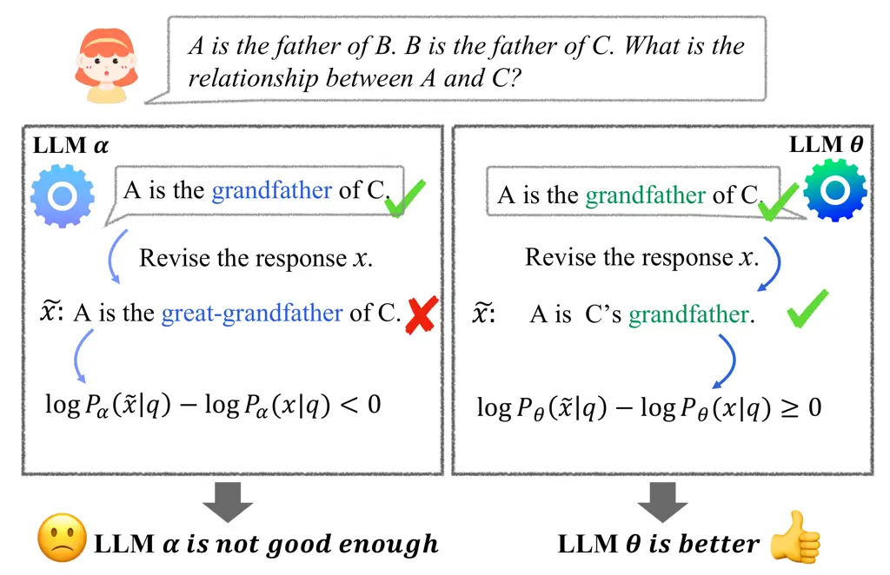
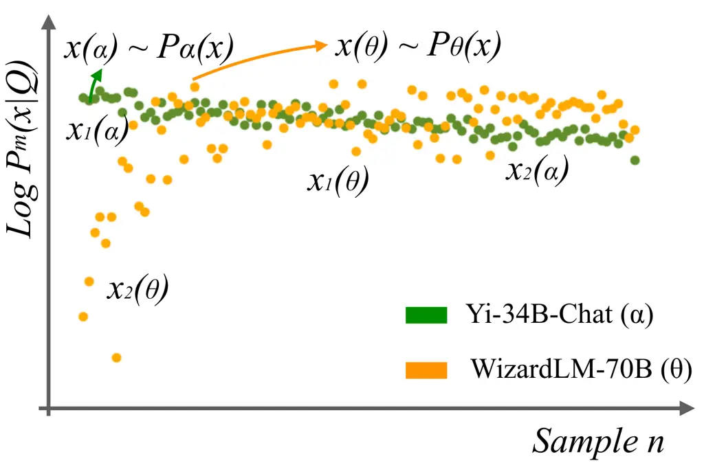

# Language Models can Evaluate Themselves via Probability Discrepancy

Tingyu Xia²² 2 Work done during the author’s internship at the Alibaba
Group Affiliation: School of Artificial Intelligence, Jilin University
Affiliation: Engineering Research Center of Knowledge-Driven
Human-Machine Intelligence, MOE, China Email: <xiaty21@mails.jlu.edu.cn>
   Bowen Yu¹¹ 1 Corresponding authors Affiliation: Alibaba Group
Email: <yubowen.ybw@alibaba-inc.com>    Yuan Wu¹¹ 1 Corresponding
authors Affiliation: School of Artificial Intelligence, Jilin University
Affiliation: Engineering Research Center of Knowledge-Driven
Human-Machine Intelligence, MOE, China Email: <yuanwu@jlu.edu.cn>    Yi
Chang¹¹ 1 Corresponding authors Affiliation: School of Artificial
Intelligence, Jilin University Affiliation: Engineering Research Center
of Knowledge-Driven Human-Machine Intelligence, MOE, China
Affiliation: International Center of Future Science, Jilin University
Email: <yichang@jlu.edu.cn>    Chang Zhou Affiliation: Alibaba Group
Email: <ericzhou.zc@alibaba-inc.com>

###### Abstract

In this paper, we initiate our discussion by demonstrating how Large
Language Models (LLMs), when tasked with responding to queries, display
a more even probability distribution in their answers if they are more
adept, as opposed to their less skilled counterparts. Expanding on this
foundational insight, we propose a new self-evaluation method ProbDiff
for assessing the efficacy of various LLMs. This approach obviates the
necessity for an additional evaluation model or the dependence on
external, proprietary models like GPT-4 for judgment. It uniquely
utilizes the LLMs being tested to compute the probability discrepancy
between the initial response and its revised versions. A higher
discrepancy for a given query between two LLMs indicates a relatively
weaker capability. Our findings reveal that ProbDiff achieves results on
par with those obtained from evaluations based on GPT-4, spanning a
range of scenarios that include natural language generation (NLG) tasks
such as translation, summarization, and our proposed Xiaohongshu blog
writing task, and benchmarks for LLM evaluation like AlignBench,
MT-Bench, and AlpacaEval, across LLMs of varying magnitudes. The code is
available at
[https://github.com/xiatingyu/ProbDiff](https://github.com/xiatingyu/ProbDiff).

## 1 Introduction

With the emergence of LLMs like ChatGPT, we’ve witnessed groundbreaking
progress in tasks involving instruction following Wang et al. (2023e),
intent comprehension Lu et al. (2023), and text generation Zhao et al.
(2023). As LLMs evolve at a rapid pace, it becomes crucial to develop
solid evaluation frameworks to gauge their performance accurately Chang
et al. (2023). Traditional evaluation methods such as BLEU Papineni
et al. (2002) focus mainly on superficial text differences and often
fail to align with human judgment Liu et al. (2023b).



Figure 1: An overview of ProbDiff, wherein an LLM iteratively revises
its responses, calculating the resulting probability discrepancies as an
self-evaluation metric. Larger discrepancies imply decreased confidence
in the generated outcomes, with greater variances indicating poorer
performance.

Critique models, trained on binary preference and language critique
datasets to simulate human judgment Ouyang et al. (2022), have emerged
as a core component of Learning from Human Feedback Stiennon et al.
(2020). However, critique models encounter several challenges. Firstly,
they risk becoming outdated as LLMs must continually adapt to novel and
intricate tasks, such as writing in specific styles like Xiaohongshu, or
solving increasingly complex problems like tool use Li et al. (2023b)
and role play Lu et al. (2024). Frozen critique models trained on past
data struggle to accurately assess such unseen tasks, and it’s
impractical to predefine and annotate data for all potential tasks in
labeled feedback data. Secondly, there is the issue of Reward Hacking,
where an LLM may exploit vulnerabilities in the critique models,
achieving high rewards without truly fulfilling the intended
objectives Askell et al. (2021); Ramé et al. (2024), resulting in
degraded performance, such as linguistically flawed Lewis et al. (2017)
or excessively verbose outputs Singhal et al. (2023). Thirdly, with each
iteration and upgrade of an LLM, there is a need to train additional
critique models of matching or greater capacity, increasing the costs
and resource consumption. Another popular option is to allow proprietary
models like GPT-4 to score candidate responses via API Chen et al.
(2023); Fu et al. (2023); Ji et al. (2023); Kocmi and Federmann (2023);
Wang et al. (2023a); Zhang et al. (2023). However, GPT-based evaluations
entail the risk of potential high costs associated with addressing data
leaks Wang et al. (2023d), and are subject to OpenAI’s terms of use ¹¹ 1
[https://openai.com/policies/terms-of-use](https://openai.com/policies/terms-of-use).
Overall, there currently exists no evaluation method that can fit human
preferences without increasing additional training costs, maintain
robustness without leaking data, and continually improve alongside
advancements in model capabilities.

This paper poses a novel hypothesis: for any query $`q`$, an LLM capable
of providing accurate response $`x`$ tend to exhibit a more uniform
probability distribution $`{\rm log}\;p(x|q)`$ compared to their less
proficient counterparts. Existing studies indicate that the initial
model response $`x`$ often converges to local maxima of the log
probability. when refining $`x`$ to generate a new response $`\hat{x}`$,
the relative reduction in $`{\rm log}\;p(\hat{x}|q)`$ compared to
$`{\rm log}\;p(x|q)`$ is insignificant. Conversely, for LLMs incapable
of producing a correct response, $`{\rm log}\;p(x|q)`$ typically
demonstrates higher variance. As a result, revised answers tend to
exhibit much lower log probabilities than the original response. We
empirically validate this hypothesis and observe its consistency across
various LLMs and tasks. Figure 2 and 3 illustrate the visualization of
the underlying hypothesis and Section 3.1 showcases the empirical
assessment. Exploiting this insight, we introduce ProbDiff, a
self-evaluation technique applicable to any LLM across tasks. Given a
query $`q`$, ProbDiff first prompts a candidate LLM to generate a
response $`x`$, then asks the LLM to revise $`x`$ based on $`q`$,
producing a refined response $`\hat{x}`$. Finally, ProbDiff quantifies
the probability discrepancy $`{\rm log}\;p({\hat{x}}|q)`$ -
$`{\rm log}\;p(x|q)`$ as the evaluation metric. When comparing two
candidate LLMs on $`q`$, a larger probability discrepancy indicates a
lower proficiency in handling the instruction.

Compared with critique models, ProbDiff utilizes the probability
characteristics of LLM to evaluate the LLM’s performance, avoiding the
resource waste of training a second model and addressing the issues of
critique models’ inability to dynamically adjust with the improvement of
LLM capabilities and task changes. Unlike GPT-based Evaluation, ProbDiff
mitigates the risks of data leakage, high API call costs, and usage
restrictions of external models. We conduct experiments on conventional
generation tasks such as translation and summarization, novel generation
tasks like Xiaohongshu blog writing, as well as English and Chinese LLM
benchmarks such as AlpacaEval Li et al. (2023d), MT-bench Zheng et al.
(2023), and AlignBench Liu et al. (2023a), using Qwen Bai et al. (2023),
LLAMA-2 Touvron et al. (2023), Yi 01-ai (2023), WizardLM Xu et al.
(2023) and Tulu Ivison et al. (2023). The results demonstrate that
ProbDiff exhibits highly consistent performance across various tasks and
LLMs compared to the currently prevalent GPT-4 based Evaluation methods.

## 2 Related Work

LLM Evaluation. Current research primarily focuses on model-based
evaluation, which involves training another reward model or utilizing
external proprietary LLMs such as GPT-4 as judges. Representative
methods of the former like PandaLM Wang et al. (2023d) , Shepherd Wang
et al. (2023c), and AUTO-J Li et al. (2023a) distinguish the most
superior model among various candidates and can provide a brief
explanation or critique to support their evaluation. However, these
models are often relatively small in scale, frozen once trained, and
unable to adapt to changes in LLM capabilities, output distributions,
and task variations. A more popular approach currently leverages larger
and more powerful LLMs like GPT-4 to evaluate numerous natural language
generation tasks, including text summarization, machine translation, and
so on, showcasing remarkable performance Liu et al. (2023b); Wang et al.
(2023a); Kocmi and Federmann (2023). However, subsequent investigations
have unveiled certain issues with LLM evaluators, particularly
concerning biases related to position and verbosity Wang et al. (2023b);
Zheng et al. (2023). Despite researchers adopting multi-agent strategies
and making multiple calls to GPT models to mitigate bias Zhang et al.
(2023); Chan et al. (2023); Li et al. (2023c), they still face
challenges such as data leakage and high evaluation costs. In this
paper, we propose for the first time the concept of probability
discrepancy to enable LLMs to conduct self-evaluation from a
probabilistic perspective, without requiring training extra models or
invoking external ones. It allows for the evaluation of model
effectiveness on any task using any LLM and achieves results similar to
current mainstream GPT-4 evaluations.

Probability Exploitation. Probability has played a pivotal role in both
detecting inconsistencies She et al. (2023); Jia et al. (2023) and
identifying machine-generated text Tang et al. (2023); Mitchell et al.
(2023); Bao et al. (2023). Zero-shot faithfulness evaluation with a
foundation language model(FFLM), introduced by Jia et al. (2023),
combines changes in probability based on the premise that pre-adding a
text segment consistent with the output increases the likelihood of
predicting the desired output. Controlling the preference of the
generation model with the help of the prompt (CoP) She et al. (2023), on
the other hand, leverages the disparity in probability between a
document and a coherent text prompt during inference to detect factual
inconsistencies. In the realm of detecting machine-generated text,
DetectGPT Mitchell et al. (2023) posits that unlike human-authored text,
model-generated text tends to cluster in local maxima of the log
probability. Building upon this insight, Fast-DetectGPT Bao et al.
(2023) utilizes conditional probability curvature to reveal disparities
in word choices between LLMs and human authors within a given context.
Inspired by DetectGPT, our work further analyzes the local structure of
the generation probability function for LLMs capable and incapable of
handling specific queries. We observed that proficient LLMs exhibit a
flatter distribution, whereas less capable ones exhibit a steep
distribution. Consequently, we propose evaluating model performance
through repeated sampling and assessing the discrepancy in log
probability between samples. Through this novel probabilistic
perspective, we successfully offer a new approach to LLM evaluation.

## 3 Method

In this section, we present our self-evaluation protocol, ProbDiff,
designed to self-assess the capabilities of LLMs autonomously through
logarithmic probability changes. We begin with preliminary studies to
validate the prior assumptions of ProbDiff, followed by a detailed
exposition of its intricacies and mechanisms.

### 3.1 Hypothesis Validation

The first assumption underlying ProbDiff is that when we question an
LLM, the more capable it is of providing an answer, the more confident
it should be in its response. Therefore, the proportion of consistent or
approximate answers in repeated questioning of the same question should
be higher. However, when the model lacks proficiency in a specific
domain, it should exhibit considerable uncertainty in its responses.
Thus, there would be a significant variance in the answers provided upon
repeated questioning. To test this hypothesis, we conducted experiments
using two widely used LLMs: GPT-3.5 and GPT-4. It is well-known that
GPT-4 surpasses GPT-3.5 in various dimensions of capability. If our
hypothesis holds true, then for the same set of questions asked multiple
times to both GPT-4 and GPT-3.5, the similarity between the answers
provided by GPT-4 should be higher.

We employed MT-Bench as our test dataset. Since MT-Bench is a multi-turn
dataset, we utilized only the first-turn query, and requested these LLMs
to provide answers three times. Specifically, upon receiving the first
answer from the LLM, we continued to prompt with "Answer this question
again." to collect the model’s second answer, and so forth until
obtaining the third answer.

|                   |               |       |            |       |
| ----------------- | ------------- | ----- | ---------- | ----- |
|                   | GPT-3.5-turbo |       | GPT-4      |       |
|                   | Similarity    | EM    | Similarity | EM    |
| $`x`$ - $`x_{1}`$ | 86.88         | 21.25 | 92.25      | 26.25 |
| $`x`$ - $`x_{2}`$ | 90.28         | 18.75 | 90.71      | 25.00 |

Table 1: The preliminary study aims to verify the disparities in
similarity between responses to the same query from a strong model
(GPT-4) and a weak model (GPT-3.5-turbo). Here, $`x`$ represents the
initial response, $`x_{1}`$ denotes the re-generated response, and
$`x_{2}`$ is the response regenerated based on $`x_{1}`$. Similarity
refers to the similarity score between two responses, while EM stands
for Exact Match, indicating the proportion of responses that are
identical in the dataset. This study was conducted using the MT-Bench
benchmark.

As depicted in Table 1, the similarity between the first and second
responses from GPT-3.5, compared to GPT-4, was lower by 5.37 pts.
Additionally, we observed that in both GPT-3.5 and GPT-4, a substantial
proportion of responses remained exactly the same across the two rounds,
constituting an exact match (EM). For instance, 21.5% of GPT-3.5’s first
and second round responses were consistent, whereas this proportion
increased to 26.25% in GPT-4. Comparing the first and third round
responses, although the similarity score of GPT-3.5 improved, there was
still a significant difference in exact match proportions compared to
GPT-4, thus validating our hypothesis.



Figure 2: Log probability curves of the responses for Yi-34B-Chat and
WizardLM-70B on AlpacaEval-2.0.

So, why does this phenomenon exist? We posit that it’s because stronger
LLMs assign higher probabilities to each token in the answer output,
resulting in greater determinism and thus smaller variance in the
decoded responses. To investigate this conjecture, we conducted a second
preliminary study. We selected the AlpacaEval-2.0 benchmark along with
the best-performing open-source model on the benchmark, Yi-34B-Chat
(Score 29.66%), and a relatively poorer-performing model, WizardLM 70B
(Score 14.38%). We randomly sampled 10 queries from AlpacaEval-2.0, with
each query sampled for 100 responses from each model. We plotted the log
probability curves of the responses for each model, as shown in Figure 2. It is evident that the log probability curve of Yi-34B-Chat is
flatter, indicating smaller variance, with nearly all response output
probabilities being approximately equal.

Figure 3: We recognize and leverage the observation that superior LLMs
typically exhibit smaller probability variances, along with the
conclusion that the model-generated samples tend to reside in regions of
negative curvature within the probability function. These findings serve
as crucial distinctions for ProbDiff in discerning between models of
varying capabilities.

Combining this conclusion with the observations of DetectGPT Mitchell
et al. (2023) forms the theoretical foundation of ProbDiff. DetectGPT
proposes that samples $`x`$ from an LLM typically reside in regions of
negative curvature of the log probability function, where neighboring
samples like $`x_{1}`$ and $`x_{2}`$ exhibit lower model log probability
on average. In other words, the log probability of the responses
initially sampled by the model tends to be at local maxima of the
probability function. As illustrated in Figure 3, we depict a simulated
probability function. Due to the fact that the log probability
$`p(x|q)`$ for a specific query $`q`$ is comparatively flatter for
better LLM than for worse LLM, we can infer that models with larger
probability discrepancy, after revising their responses multiple times,
will perform worse on the current query.

### 3.2 Self-evaluation Protocol ProbDiff


Based on our validated assumptions, ProbDiff employs a remarkably simple
yet elegant strategy for LLM evaluation. Specifically, given any LLM
$`\alpha`$, and a query $`q`$ under evaluation, we first require
$`\alpha`$ to generate a response $`x`$ containing $`T`$ tokens
according to its decoding strategy, with the average per-token log
probability $`{\rm log};p_{\alpha}(x|q)`$ defined as:

```math
\displaystyle{\rm log};p_{\alpha}(x|q)=\frac{1}{T}\sum_{t=1}^{T}p_{\alpha}(x_{t}|q,x_{<t}). \tag{1}
```

Subsequently, we prompt LLM $`\alpha`$ to revise the response based on
$`q`$ and $`x`$, obtaining $`x_{1}`$, and iterate this revision process
$`K`$ times to obtain the final response $`x_{K}`$, with the revision
prompt defined as the Response Refinement Prompt. Finally, we calculate
the log-probability discrepancy between $`x`$ and $`x_{K}`$ as:

```math
\displaystyle d(\alpha,q)={\rm log}\;p_{\alpha}(x_{K}|q)-{\rm log}\;p_{\alpha}(x|q). \tag{2}
```

We aim to characterize the variance of LLM $`\alpha`$’s probability
distribution for $`q`$ using $`d(\alpha,q)`$, although employing
multiple evaluations for averaging could yield more accurate estimates.
However, in this paper, we present a preliminary exploration where we
adopt the simplest characterization by directly computing the
discrepancy between the two probabilities. Subsequently, for the
evaluation set $`\mathbb{D}`$, we can compute the average
$`d(\alpha,q)`$ for all $`q`$ in the set, yielding
$`d(\alpha,\mathbb{D})=\frac{1}{|\mathbb{D}|}\sum_{q\in\mathbb{D}}d(\alpha,q)`$
as the probability discrepancy score of LLM $`\alpha`$ over
$`\mathbb{D}`$. Ultimately, for the two LLMs, $`\alpha`$ and $`\theta`$,
under evaluation, we can compare $`d(\alpha,\mathbb{D})`$ and
$`d(\theta,\mathbb{D})`$. A larger $`d(\alpha,\mathbb{D})`$ implies a
higher variance in the probability distribution of the generation,
indicating lower confidence in its responses and thus poorer performance
under our hypothesis. Furthermore, if one wishes to statistically
analyze the win/tie/lose ratios between $`\alpha`$ and $`\theta`$, one
can establish predefined thresholds for $`d(\alpha,q)`$ and
$`d(\theta,q)`$ to determine when their performances are comparable
within a certain discrepancy range. Beyond this range, a judgment can be
made regarding which model performs better.

In addition, we use Response Refinement Prompt to guide the model to
revise the original responses, instead of using multiple sampling to
calculate log probability discrepancies. This is mainly because greedy
methods are usually used to decode in math and code tasks, such as code
and math tasks in MT-Bench. Multiple sampling for this decoding method
is meaningless, and using prompt to guide the model to revise the answer
is suitable for any decoding methods.

## 4 Experiment

In this section, we evaluate our ProbDiff methodology across three
diverse natural language generation tasks: Translation, Summarization,
and a niche task designated as Xiaohongshu blog writing. To gauge
ProbDiff’s efficacy, we fine-tuned the Qwen-14B-Chat model for each
specified task. Additionally, our evaluation encompasses three
benchmarks tailored for LLM assessment: MT-Bench Zheng et al. (2023),
AlpacaEval Li et al. (2023d), and AlignBench Liu et al. (2023a). These
experiments are designed to comprehensively evaluate ProbDiff’s
performance across a wide array of linguistic tasks and benchmarks,
showcasing its applicability in measuring LLM effectiveness.

|            |       |       |       |       |        |      |      |
| ---------- | ----- | ----- | ----- | ----- | ------ | ---- | ---- |
|            | Cs-En | De-En | Ru-En | Zh-En | Cnn_dm | Xsum | Blog |
| Qwen       | 4.6   | 1.1   | 3.5   | 8.1   | 21.5   | 17.9 | 64.0 |
| Qwen\_(ft) | 91.3  | 94.0  | 91.8  | 91.4  | 67.1   | 77.1 | 90.0 |

Table 2: Confidence (%) obtained through ProbDiff in the translation,
summarization, and Xiaohongshu blog writing tasks. “Qwen” represents the
Qwen-14B-Chat model with different parameter sizes, and “Qwen\_(ft)”
denotes the fine-tuned model based on Qwen-14B-Chat with different
parameter sizes. The best performance in each column is bold.

|            |         |      |       |       |        |       |      |       |       |
| ---------- | ------- | ---- | ----- | ----- | ------ | ----- | ---- | ----- | ----- |
|            | Overall | Pro. | Math. | Fund. | Logic. | Writ. | Chi. | Role. | Open. |
| Qwen       | 32.2    | 20.2 | 18.9  | 15.9  | 31.6   | 62.7  | 13.8 | 53.4  | 42.1  |
| Qwen\_(ft) | 45.7    | 25.0 | 48.6  | 43.5  | 62.1   | 52.0  | 27.6 | 60.3  | 34.2  |

Table 3: Confidence (%) obtained through the ProbDiff in AlignBench.
“Pro.” denotes “Professional Knowledge”, “Math.” denotes Mathematics,
“Fund.” denotes Fundamental Language Ability, “Logic.” denotes Logical
Reasoning, “Writ.” denotes Writing Ability, “Chi.” denotes Advanced
Chinese Understanding, “Role.” denotes Task-oriented Role Play, and
“Open.” denotes Open-ended Questions. The best performance in each
column is bold.

### 4.1 Datasets

For the Translation task, we selected the WMT19 dataset Ng et al. (2019)
for Chinese-English (Zh-En), Czech-English (Cs-En), German-English
(De-En), and Russian-English (Ru-En) translation tasks. We randomly
chose 5,000 translation pairs for our training sets and 1,000 pairs for
our test sets, ensuring an equitable distribution between
source-to-English and English-to-source language pairs. Regarding the
Summarization task, we opted for the XSum Narayan et al. (2018) and
CNN_DM Hermann et al. (2015) datasets, randomly selecting 5,000
documents for the training set and 1,000 documents for the test set from
each dataset.

We introduce an innovative Xiaohongshu blog writing task as a novel
natural language generation task to assess the instruction-following
capabilities of LLMs. For this, we compiled a new benchmark by gathering
569 blogs across various topics from the Xiaohongshu APP, a lifestyle
platform where users share product recommendations or opinions. We
randomly chose 469 instances for model fine-tuning and 100 instances to
evaluate model performance. Detailed descriptions and example instances
of the new dataset are available in Appendix A.

To evaluate the alignment capability of LLMs across diverse dimensions,
we undertook experiments with AlignBench Liu et al. (2023a), a
comprehensive dataset designed to assess LLMs’ alignment capabilities in
Chinese. It categorizes use cases into eight principal domains:
Fundamental Language Abilities, Chinese Advanced Understanding,
Open-ended Questions, Writing Ability, Logical Reasoning, Mathematics,
Task-oriented Role Play, and Professional Knowledge, encompassing 683
samples in total. We used GPT-4 to generate 50 text samples per use case
and category pair, and selected 15 generated samples per pair to
eliminate duplicates, culminating in a collection of 10,245 generated
samples for fine-tuning Qwen-14B-Chat.

In addition to specific task fine-tuning of Qwen-14B-Chat, we also
conducted experiments on models listed on the existing LLM benchmark
leaderboards. We choose MT-bench²² 2
[https://chat.lmsys.org/?leaderboard](https://chat.lmsys.org/?leaderboard)
and AlpacaEval 2.0³³ 3
[https://tatsu-lab.github.io/alpaca_eval](https://tatsu-lab.github.io/alpaca_eval)
as our evaluation benchmarks. MT-benchZheng et al. (2023) is tailored to
examine multi-turn conversation and instruction-following capabilities
through 80 high-quality multi-turn questions. MT-benchZheng et al.
(2023) comprises 805 single-turn questions, formulated from Alpaca Data.

### 4.2 Implementation Details

For all experiments except those on the MT-Bench and AlignBench
datasets, we configured the temperature to $`0.7`$, respectively, to
generate initial responses. These two benchmarks possess officially
recommended generation settings, which we adhered to for relevant
experiments. To refine the generated responses, we adjusted the
temperature to $`0.1`$. In translation, summarization, and AlpacaEval
tasks, the initial round aimed at general text generation tasks, we set
the temperature to $`0.7`$, referring to the parameters established by
MT-Bench. However, for the second round, where we viewed the review of
existing answers as a more professional task, we lowered the temperature
accordingly.

The effectiveness of an LLM is evaluated based on the confidence level
of its responses. This metric quantifies the degree of probability
enhancement observed when the model’s initial response undergoes
refinement. The calculation is as follows:

```math
\displaystyle confidence=\frac{1}{|\mathbb{D}|}\sum_{q\in\mathbb{D}}\phi \tag{3}
```

```math
\displaystyle\phi=\left\{\begin{array}[]{lcl}1,&d(\alpha,q)\geq\delta\\
0,&d(\alpha,q)<\delta\end{array}\right.
```

where $`\delta`$ is the threshold. In this paper, $`\delta`$ is set to
$`-0.05`$.

### 4.3 Results

Natural Language Generation Evaluation: We applied ProbDiff to assess
Qwen-14B-Chat’s efficacy in tasks such as translation, summarization,
and Xiaohongshu blog writing. Table 2 illustrates the confidence levels
in the generated sentences by both the original and fine-tuned Qwen
models across these tasks. Subsequent to the fine-tuning process, it was
noted that the fine-tuned model exhibited increased confidence in its
responses upon revision, aligning with our anticipatory hypotheses.
Specifically, in the Xiaohongshu blog writing task tailored for LLMs
with a 14B parameter size, we encountered a scarcity of data for
fine-tuning. Nonetheless, post-fine-tuning, there was a noticeable
enhancement in response confidence, as depicted in Table 2. From these
results, we deduce that fine-tuning LLMs on task-specific datasets
invariably boosts the confidence of their responses, markedly surpassing
the performance of the pre-fine-tuned LLM. This elevation in response
confidence serves as a pertinent indicator for gauging improvements in
LLM performance.

LLM’s Alignment Evaluation: To ascertain the alignment capabilities of
LLMs across diverse dimensions, we conducted fine-tuning of
Qwen-14B-Chat using documents synthesized by GPT-4, specifically
targeting the AlignBench dataset. The results of our evaluation are
presented in Table 3.

AlignBench serves as a meticulously curated benchmark designed to assess
the alignment capabilities of LLMs. This benchmark poses a more complex
challenge compared to standard NLG tasks, requiring nuanced
understanding and response accuracy from the model. As depicted in Table
3, post fine-tuning with task-specific data, the model demonstrates
notable confidence across most evaluated alignment abilities. However,
it is observed that in categories such as writing ability and open-ended
questions, the model’s confidence tends to diminish, suggesting areas
for further improvement and investigation.

|          |          |          |            |          |
| -------- | -------- | -------- | ---------- | -------- |
|          | MT-Bench |          | AlpacaEval |          |
|          | ProbDiff | Official | ProbDiff   | Official |
| Llama2   | 7.50     | 6.86     | 2.61       | 13.87    |
| Yi       | 17.50    | 7.58     | 6.33       | 29.66    |
| WizardLM | 30.63    | 7.71     | 4.60       | 14.38    |
| Tulu     | 20.00    | 7.89     | 5.47       | 15.98    |

Table 4: ProbDiff and Official results on MT-Bench and AlpacaEval. The
metrics of ProbDiff is confidence(%), MT-Bench official metrics is model
scores(0-10) judged by GPT-4, and AlpacaEval 2.0 official metrics is win
rate(%).

Evaluation on other LLMs: To assess the generalization capabilities of
our ProbDiff, we extended our evaluations to include several
high-performing LLMs featured on established LLM benchmark leaderboards,
specifically MT-Bench and AlpacaEval 2.0. We employed ProbDiff to
evaluate a selection of models, including Yi-34B-Chat 01-ai (2023),
tulu-2-dpo-70B Ivison et al. (2023), WizardLM-70B-V1.0 Xu et al. (2023),
and Llama2-70B-chat Touvron et al. (2023). Table 4 presents the response
confidence of these LLMs alongside their official benchmarks. Notably,
Yi-34B-Chat lacks official MT-Bench scores, thus we conducted its
evaluation using the benchmark’s official protocol.

Figure 4: Evaluate the validity of the Qwen-14B-Chat and
Qwen-14B-Chat_ft through GPT-4 in AlignBench(Align) and Xiaohongshu Blog
Writing(Blog) tasks. “Align_gpt” and “Blog_gpt” represents the win rate
judged by GPT-4, “Align_prob” and “Blog_prob” represents the confidence
evaluate by ProbDiff. Orange histogram indicates fine-tuned
Qwen-14B-Chat and blue histogram indicates Qwen-14B-Chat, respectively.

|             |            |         |      |       |       |        |       |      |       |       |
| ----------- | ---------- | ------- | ---- | ----- | ----- | ------ | ----- | ---- | ----- | ----- |
|             |            | Overall | Pro. | Math. | Fund. | Logic. | Writ. | Chi. | Role. | Open. |
| GPT-4       | Qwen       | 5.66    | 6.28 | 4.89  | 7.00  | 4.66   | 6.56  | 6.17 | 6.47  | 6.74  |
|             | Qwen\_(ft) | 6.60    | 6.27 | 5.85  | 7.15  | 7.12   | 7.00  | 5.83 | 7.16  | 6.89  |
| CritiqueLLM | Qwen       | 5.22    | 5.90 | 4.23  | 6.43  | 4.28   | 6.48  | 5.97 | 6.03  | 6.34  |
|             | Qwen\_(ft) | 6.19    | 5.58 | 5.42  | 6.28  | 6.98   | 6.77  | 4.97 | 6.99  | 6.45  |
| ProbDiff    | Qwen       | 32.2    | 20.2 | 18.9  | 15.9  | 31.6   | 62.7  | 13.8 | 53.4  | 42.1  |
|             | Qwen\_(ft) | 45.7    | 25.0 | 48.6  | 43.5  | 62.1   | 52.0  | 27.6 | 60.3  | 34.2  |

Table 5: The scores(0-10) obtained through GPT-4 and CritiqueLLM of
AlignBench, and the response confidence(%) obtained through ProbDiff.
“Qwen” represents the Qwen-14B-Chat model, and “Qwen\_(ft)” denotes the
fine-tuned model based on Qwen-14B-Chat. The underlined number indicates
the best performance evaluated by different approaches. The bold numbers
indicate the ProbDiff results consistent with GPT-4.

Within the MT-Bench framework, the official ranking of these LLMs is
Tulu, WizardLM, Yi, and Llama2, a sequence that aligns perfectly with
the model confidence hierarchy as determined by ProbDiff, as illustrated
in table 4. Conversely, for MT-Bench, the ranking is Tulu, WizardLM, Yi,
and Llama2. Our analysis, however, positions the models as WizardLM,
Tulu, Yi, and Llama2, showcasing a slight variation from the official
results. This discrepancy suggests that ProbDiff’s criteria for
evaluating multi-round dialog tasks may still harbor certain
imperfections.

## 5 Discussion

### 5.1 Confidence vs GPT-4 scores

In this section, to substantiate our premise that enhancements in model
efficacy are discernible through shifts in log probability, we
juxtaposed the congruence between our evaluative outcomes and those
derived from utilizing GPT-4 as an adjudicator. To juxtapose the
evaluative outcomes of ProbDiff with those of GPT-4, we engaged GPT-4 to
directly appraise which output from the two models prevails, eschewing
the assignment of a definitive score. Figure 4 illustrates that when
ProbDiff adjudicates the fine-tuned model as superior to its baseline
counterpart, GPT-4’s evaluation of the outputs from these models aligns
with the determinations made by ProbDiff.

Given that AlignBench furnishes official evaluation scripts capable of
producing scores for each model via GPT-4 or alternative evaluative LLMs
like CritiqueLLM Ke et al. (2023), we have also juxtaposed these
findings in Table 5. To undertake a comprehensive assessment, AlignBench
articulates a detailed taxonomy of LLM capabilities, categorizing and
summarizing their applications across 8 principal categories. The
specifics of this comparative analysis are presented in Table 5. It’s
observable that while disparities between the outcomes derived from
ProbDiff and those obtained via GPT-4 manifest in certain evaluative
contexts, such as writing ability, our ProbDiff methodology consistently
aligns with the evaluations conducted by GPT-4 and CritiqueLLM in the
majority of instances.

### 5.2 ProbDiff vs GPT-4 and Manual Evaluation

In soliciting amendments from LLMs, we employ the log probability
variance as a gauge to ascertain the enhancement of the refined
responses. This method involves a rigorous examination of the congruence
between ProbDiff, GPT-4, and manual evaluations by quantifying the
extent of discordance. It is essential to articulate that, from a
probabilistic vantage, the model invariably selects the response with
the maximal probability. Upon requesting an LLM to adjust its outputs,
should minute modifications materialize, such as the substitution of
synonyms, there ensues a marked diminution in the log probability of the
adjusted responses. Nevertheless, considering the dimension of response
quality, these minimal alterations do not compromise the aggregate
quality of the response. Consequently, both GPT-4 and manual evaluations
do not perceive these minor adjustments as significant enough to impact
the overall quality of the response. Hence, probability emerges as a
stringent metric, culminating in a diminished correlation coefficient
among ProbDiff, GPT-4, and manual evaluations.

|            |       |        |
| ---------- | ----- | ------ |
|            | GPT-4 | Humans |
| AlignBench | 3.84  | 4.49   |
| MT-Bench   | 6.45  | 4.84   |

Table 6: Conflict degree(%) among ProbDiff, GPT-4, and manual
evaluation. We employ 3 human annotators to report the average results.

We deployed GPT-4 alongside manual evaluation to ascertain whether our
ProbDiff engenders outputs that diverge from the evaluations provided by
GPT-4 and manual review. Our objective was to scrutinize instances where
ProbDiff indicates an improvement ($`d(\alpha,q)>0`$), to determine if
both GPT-4 and human assessors concurrently affirm an enhancement in
response quality. Conversely, in scenarios where ProbDiff suggests a
decline ($`d(\alpha,q)<0`$), we aimed to validate whether GPT-4 and
human evaluators corroborate a diminution in response quality. This
investigation was carried out on AlignBench and MT-Bench, with outcomes
detailed in table 6. As elucidated in table 6, the discrepancy between
ProbDiff and the combined assessments of GPT-4 and manual evaluation
remains minimal. Our human evaluation was conducted by 3 Ph.D.
volunteers specializing in NLP. These volunteers assessed whether the
quality of the modified answers improved. If the quality remained
unchanged, 0 points will be assigned. If the quality improved 1 point
was awarded, and if it decreased -1 point was given. The average kappa
coefficient among the human annotators was 0.66 on AlignBench and 0.62
on MTBench.

## 6 Conclusion

In this paper, we introduce an innovative evaluation framework,
ProbDiff, designed to facilitate LLMs in performing self-assessment
through the analysis of probability discrepancies in their generated
outputs. Furthermore, our ProbDiff method offers a robust mechanism for
evaluating the competencies of LLMs, even without pre-existing training
or domain-specific benchmarks, effectively addressing concerns of data
confidentiality breaches.

## Acknowledgement

The authors would like to thank the anonymous referees for their
valuable comments. This work is supported by the National Science and
Technology Major Project under Grant No.2023YFF0905400, the National
Natural Science Foundation of China (No.U2341229), and the Fundamental
Research Funds for the Central Universities, JLU.

## Limitations

The constraints of our methodology are outlined as follows: Firstly,
while our approach is capable of ascertaining enhancements in LLM
performance, it lacks the capacity to offer quantitative metrics
indicating the magnitude of improvement. ProbDiff is more focused on
giving log-probability based trends, independent of external models,
rather than yielding precise results. Consequently, ProbDiff is more
suitable as an auxiliary evaluation method to help researchers view the
changing trends of model effects. Secondly, variations in log
probability are occasionally affected by sentence length. Should there
be a notable disparity in length between the original and modified
sentences, the log probability will undergo substantial changes.

## References

- 01-ai (2023) 01-ai. 2023.
  [https://github.com/01-ai/Yi](https://github.com/01-ai/Yi).
- Askell et al. (2021) Amanda Askell, Yuntao Bai, Anna Chen, Dawn Drain,
  Deep Ganguli, Tom Henighan, Andy Jones, Nicholas Joseph, Ben Mann,
  Nova DasSarma, et al. 2021. A general language assistant as a
  laboratory for alignment. _arXiv preprint arXiv:2112.00861_.
- Bai et al. (2023) Jinze Bai, Shuai Bai, Yunfei Chu, Zeyu Cui, Kai
  Dang, Xiaodong Deng, Yang Fan, Wenbin Ge, Yu Han, Fei Huang,
  et al. 2023. Qwen technical report. _arXiv preprint arXiv:2309.16609_.
- Bao et al. (2023) Guangsheng Bao, Yanbin Zhao, Zhiyang Teng, Linyi
  Yang, and Yue Zhang. 2023. Fast-detectgpt: Efficient zero-shot
  detection of machine-generated text via conditional probability
  curvature. _arXiv preprint arXiv:2310.05130_.
- Chan et al. (2023) Chi-Min Chan, Weize Chen, Yusheng Su, Jianxuan Yu,
  Wei Xue, Shanghang Zhang, Jie Fu, and Zhiyuan Liu. 2023. Chateval:
  Towards better llm-based evaluators through multi-agent debate. _arXiv
  preprint arXiv:2308.07201_.
- Chang et al. (2023) Yupeng Chang, Xu Wang, Jindong Wang, Yuan Wu,
  Linyi Yang, Kaijie Zhu, Hao Chen, Xiaoyuan Yi, Cunxiang Wang, Yidong
  Wang, et al. 2023. A survey on evaluation of large language models.
  _ACM Transactions on Intelligent Systems and Technology_.
- Chen et al. (2023) Yi Chen, Rui Wang, Haiyun Jiang, Shuming Shi, and
  Ruifeng Xu. 2023. [Exploring the use of large language models for
  reference-free text quality evaluation: A preliminary empirical
  study](http://arxiv.org/abs/2304.00723).
- Fu et al. (2023) Jinlan Fu, See-Kiong Ng, Zhengbao Jiang, and Pengfei
  Liu. 2023. Gptscore: Evaluate as you desire. _arXiv preprint
  arXiv:2302.04166_.
- Hermann et al. (2015) Karl Moritz Hermann, Tomas Kocisky, Edward
  Grefenstette, Lasse Espeholt, Will Kay, Mustafa Suleyman, and Phil
  Blunsom. 2015. Teaching machines to read and comprehend. _Advances in
  neural information processing systems_, 28.
- Ivison et al. (2023) Hamish Ivison, Yizhong Wang, Valentina Pyatkin,
  Nathan Lambert, Matthew Peters, Pradeep Dasigi, Joel Jang, David
  Wadden, Noah A. Smith, Iz Beltagy, and Hannaneh Hajishirzi. 2023.
  [Camels in a changing climate: Enhancing lm adaptation with tulu
  2](http://arxiv.org/abs/2311.10702).
- Ji et al. (2023) Yunjie Ji, Yan Gong, Yiping Peng, Chao Ni, Peiyan
  Sun, Dongyu Pan, Baochang Ma, and Xiangang Li. 2023. [Exploring
  chatgpt’s ability to rank content: A preliminary study on consistency
  with human preferences](http://arxiv.org/abs/2303.07610).
- Jia et al. (2023) Qi Jia, Siyu Ren, Yizhu Liu, and Kenny Q Zhu. 2023.
  Zero-shot faithfulness evaluation for text summarization with
  foundation language model. _arXiv preprint arXiv:2310.11648_.
- Ke et al. (2023) Pei Ke, Bosi Wen, Zhuoer Feng, Xiao Liu, Xuanyu Lei,
  Jiale Cheng, Shengyuan Wang, Aohan Zeng, Yuxiao Dong, Hongning Wang,
  et al. 2023. Critiquellm: Scaling llm-as-critic for effective and
  explainable evaluation of large language model generation. _arXiv
  preprint arXiv:2311.18702_.
- Kocmi and Federmann (2023) Tom Kocmi and Christian Federmann. 2023.
  Large language models are state-of-the-art evaluators of translation
  quality. _arXiv preprint arXiv:2302.14520_.
- Lewis et al. (2017) Mike Lewis, Denis Yarats, Yann N Dauphin, Devi
  Parikh, and Dhruv Batra. 2017. Deal or no deal? end-to-end learning
  for negotiation dialogues. _arXiv preprint arXiv:1706.05125_.
- Li et al. (2023a) Junlong Li, Shichao Sun, Weizhe Yuan, Run-Ze Fan,
  Hai Zhao, and Pengfei Liu. 2023a. Generative judge for evaluating
  alignment. _arXiv preprint arXiv:2310.05470_.
- Li et al. (2023b) Minghao Li, Yingxiu Zhao, Bowen Yu, Feifan Song,
  Hangyu Li, Haiyang Yu, Zhoujun Li, Fei Huang, and Yongbin Li. 2023b.
  Api-bank: A comprehensive benchmark for tool-augmented llms. In
  _Proceedings of the 2023 Conference on Empirical Methods in Natural
  Language Processing_, pages 3102–3116.
- Li et al. (2023c) Ruosen Li, Teerth Patel, and Xinya Du. 2023c. Prd:
  Peer rank and discussion improve large language model based
  evaluations. _arXiv preprint arXiv:2307.02762_.
- Li et al. (2023d) Xuechen Li, Tianyi Zhang, Yann Dubois, Rohan Taori,
  Ishaan Gulrajani, Carlos Guestrin, Percy Liang, and Tatsunori B.
  Hashimoto. 2023d. Alpacaeval: An automatic evaluator of
  instruction-following models.
  [https://github.com/tatsu-lab/alpaca_eval](https://github.com/tatsu-lab/alpaca_eval).
- Liu et al. (2023a) Xiao Liu, Xuanyu Lei, Shengyuan Wang, Yue Huang,
  Zhuoer Feng, Bosi Wen, Jiale Cheng, Pei Ke, Yifan Xu, Weng Lam Tam,
  et al. 2023a. Alignbench: Benchmarking chinese alignment of large
  language models. _arXiv preprint arXiv:2311.18743_.
- Liu et al. (2023b) Yang Liu, Dan Iter, Yichong Xu, Shuohang Wang,
  Ruochen Xu, and Chenguang Zhu. 2023b. Gpteval: Nlg evaluation using
  gpt-4 with better human alignment. _arXiv preprint arXiv:2303.16634_.
- Lu et al. (2024) Keming Lu, Bowen Yu, Chang Zhou, and Jingren
  Zhou. 2024. Large language models are superpositions of all
  characters: Attaining arbitrary role-play via self-alignment. _arXiv
  preprint arXiv:2401.12474_.
- Lu et al. (2023) Keming Lu, Hongyi Yuan, Zheng Yuan, Runji Lin,
  Junyang Lin, Chuanqi Tan, Chang Zhou, and Jingren Zhou. 2023. \#
  InsTag: Instruction tagging for analyzing supervised fine-tuning of
  large language models. _arXiv e-prints_, pages arXiv–2308.
- Mitchell et al. (2023) Eric Mitchell, Yoonho Lee, Alexander Khazatsky,
  Christopher D Manning, and Chelsea Finn. 2023. Detectgpt: Zero-shot
  machine-generated text detection using probability curvature. _arXiv
  preprint arXiv:2301.11305_.
- Narayan et al. (2018) Shashi Narayan, Shay B. Cohen, and Mirella
  Lapata. 2018. Don’t give me the details, just the summary! Topic-aware
  convolutional neural networks for extreme summarization. In
  _Proceedings of the 2018 Conference on Empirical Methods in Natural
  Language Processing_, Brussels, Belgium.
- Ng et al. (2019) Nathan Ng, Kyra Yee, Alexei Baevski, Myle Ott,
  Michael Auli, and Sergey Edunov. 2019. Facebook fair’s wmt19 news
  translation task submission. _arXiv preprint arXiv:1907.06616_.
- Ouyang et al. (2022) Long Ouyang, Jeffrey Wu, Xu Jiang, Diogo Almeida,
  Carroll Wainwright, Pamela Mishkin, Chong Zhang, Sandhini Agarwal,
  Katarina Slama, Alex Ray, et al. 2022. Training language models to
  follow instructions with human feedback. _Advances in Neural
  Information Processing Systems_, 35:27730–27744.
- Papineni et al. (2002) Kishore Papineni, Salim Roukos, Todd Ward, and
  Wei-Jing Zhu. 2002. Bleu: a method for automatic evaluation of machine
  translation. In _Proceedings of the 40th annual meeting of the
  Association for Computational Linguistics_, pages 311–318.
- Ramé et al. (2024) Alexandre Ramé, Nino Vieillard, Léonard Hussenot,
  Robert Dadashi, Geoffrey Cideron, Olivier Bachem, and Johan
  Ferret. 2024. Warm: On the benefits of weight averaged reward models.
  _arXiv preprint arXiv:2401.12187_.
- She et al. (2023) Shuaijie She, Xiang Geng, Shujian Huang, and Jiajun
  Chen. 2023. Cop: Factual inconsistency detection by controlling the
  preference. In _Proceedings of the AAAI Conference on Artificial
  Intelligence_, volume 37, pages 13556–13563.
- Singhal et al. (2023) Prasann Singhal, Tanya Goyal, Jiacheng Xu, and
  Greg Durrett. 2023. A long way to go: Investigating length
  correlations in rlhf. _arXiv preprint arXiv:2310.03716_.
- Stiennon et al. (2020) Nisan Stiennon, Long Ouyang, Jeffrey Wu, Daniel
  Ziegler, Ryan Lowe, Chelsea Voss, Alec Radford, Dario Amodei, and
  Paul F Christiano. 2020. Learning to summarize with human feedback.
  _Advances in Neural Information Processing Systems_, 33:3008–3021.
- Tang et al. (2023) Ruixiang Tang, Yu-Neng Chuang, and Xia Hu. 2023.
  The science of detecting llm-generated texts. _arXiv preprint
  arXiv:2303.07205_.
- Touvron et al. (2023) Hugo Touvron, Louis Martin, Kevin Stone, Peter
  Albert, Amjad Almahairi, Yasmine Babaei, Nikolay Bashlykov, Soumya
  Batra, Prajjwal Bhargava, Shruti Bhosale, et al. 2023. Llama 2: Open
  foundation and fine-tuned chat models. _arXiv preprint
  arXiv:2307.09288_.
- Wang et al. (2023a) Jiaan Wang, Yunlong Liang, Fandong Meng, Haoxiang
  Shi, Zhixu Li, Jinan Xu, Jianfeng Qu, and Jie Zhou. 2023a. Is chatgpt
  a good nlg evaluator? a preliminary study. _arXiv preprint
  arXiv:2303.04048_.
- Wang et al. (2023b) Peiyi Wang, Lei Li, Liang Chen, Dawei Zhu,
  Binghuai Lin, Yunbo Cao, Qi Liu, Tianyu Liu, and Zhifang Sui. 2023b.
  [Large language models are not fair
  evaluators](http://arxiv.org/abs/2305.17926).
- Wang et al. (2023c) Tianlu Wang, Ping Yu, Xiaoqing Ellen Tan, Sean
  O’Brien, Ramakanth Pasunuru, Jane Dwivedi-Yu, Olga Golovneva, Luke
  Zettlemoyer, Maryam Fazel-Zarandi, and Asli Celikyilmaz. 2023c.
  Shepherd: A critic for language model generation. _arXiv preprint
  arXiv:2308.04592_.
- Wang et al. (2023d) Yidong Wang, Zhuohao Yu, Zhengran Zeng, Linyi
  Yang, Cunxiang Wang, Hao Chen, Chaoya Jiang, Rui Xie, Jindong Wang,
  Xing Xie, et al. 2023d. Pandalm: An automatic evaluation benchmark for
  llm instruction tuning optimization. _arXiv preprint
  arXiv:2306.05087_.
- Wang et al. (2023e) Yufei Wang, Wanjun Zhong, Liangyou Li, Fei Mi,
  Xingshan Zeng, Wenyong Huang, Lifeng Shang, Xin Jiang, and Qun Liu.
  2023e. Aligning large language models with human: A survey. _arXiv
  preprint arXiv:2307.12966_.
- Xu et al. (2023) Can Xu, Qingfeng Sun, Kai Zheng, Xiubo Geng, Pu Zhao,
  Jiazhan Feng, Chongyang Tao, and Daxin Jiang. 2023. Wizardlm:
  Empowering large language models to follow complex instructions.
  _arXiv preprint arXiv:2304.12244_.
- Zhang et al. (2023) Xinghua Zhang, Bowen Yu, Haiyang Yu, Yangyu Lv,
  Tingwen Liu, Fei Huang, Hongbo Xu, and Yongbin Li. 2023. Wider and
  deeper llm networks are fairer llm evaluators. _arXiv preprint
  arXiv:2308.01862_.
- Zhao et al. (2023) Wayne Xin Zhao, Kun Zhou, Junyi Li, Tianyi Tang,
  Xiaolei Wang, Yupeng Hou, Yingqian Min, Beichen Zhang, Junjie Zhang,
  Zican Dong, et al. 2023. A survey of large language models. _arXiv
  preprint arXiv:2303.18223_.
- Zheng et al. (2023) Lianmin Zheng, Wei-Lin Chiang, Ying Sheng, Siyuan
  Zhuang, Zhanghao Wu, Yonghao Zhuang, Zi Lin, Zhuohan Li, Dacheng Li,
  Eric. P Xing, Hao Zhang, Joseph E. Gonzalez, and Ion Stoica. 2023.
  [Judging llm-as-a-judge with mt-bench and chatbot
  arena](http://arxiv.org/abs/2306.05685).

## Appendix A Xiaohongshu Datasets

According to the blog format and text style of Xiaohongshu App, we
manually wrote 569 blogs, covering various functional topics such as
life, beauty, travel, recommendations, etc., and constructed a
instruction following dataset. It is characterized by the addition of
rich emoji elements. The data format is shown in figure 5


Figure 5: Xiaohongshu blog writing data.

## Appendix B Threshold analysis

In this section, we analyze the impact of different thresholds on
response confidence. We conducted experiments in Alignbench and set the
thresholds to 0, -0.05, and -0.1 to observe the impact of the thresholds
on the experimental results.

As shown in table 7, when the absolute value of the threshold decreases,
although the final results of most sub-tasks are consistent with those
of GPT-4, for untuned models, lower absolute values can significantly
affect the confidence in certain sub-tasks, such as mathematics,
fundamental language, and role-play. As the absolute value of the
threshold increases, the model’s performance deviates more from the
GPT-4 evaluation results. Therefore, we chose -0.05 as the final
threshold.

|       |            |         |      |       |       |        |       |      |       |       |
| ----- | ---------- | ------- | ---- | ----- | ----- | ------ | ----- | ---- | ----- | ----- |
|       |            | Overall | Pro. | Math. | Fund. | Logic. | Writ. | Chi. | Role. | Open. |
| 0     | Qwen       | 18.7    | 10.5 | 6.3   | 8.7   | 23.2   | 37.3  | 6.9  | 37.1  | 13.2  |
|       | Qwen\_(ft) | 41.6    | 25.0 | 43.2  | 40.6  | 55.8   | 41.3  | 27.6 | 56.0  | 31.6  |
| -0.05 | Qwen       | 32.2    | 20.2 | 18.9  | 15.9  | 31.6   | 62.7  | 13.8 | 53.4  | 42.1  |
|       | Qwen\_(ft) | 45.7    | 25.0 | 48.6  | 43.5  | 62.1   | 52.0  | 27.6 | 60.3  | 34.2  |
| -0.1  | Qwen       | 41.1    | 26.6 | 29.7  | 26.1  | 34.7   | 72.0  | 20.7 | 65.5  | 57.9  |
|       | Qwen\_(ft) | 50.5    | 27.4 | 55.0  | 44.9  | 70.5   | 58.7  | 29.3 | 62.9  | 47.4  |

Table 7: Confidence (%) obtained through the ProbDiff in AlignBench with
different $`\delta`$. “Pro.” denotes “Professional Knowledge”, “Math.”
denotes Mathematics, “Fund.” denotes Fundamental Language Ability,
“Logic.” denotes Logical Reasoning, “Writ.” denotes Writing Ability,
“Chi.” denotes Advanced Chinese Understanding, “Role.” denotes
Task-oriented Role Play, and “Open.” denotes Open-ended Questions.

|            |         |      |       |       |        |       |      |       |       |
| ---------- | ------- | ---- | ----- | ----- | ------ | ----- | ---- | ----- | ----- |
|            | Overall | Pro. | Math. | Fund. | Logic. | Writ. | Chi. | Role. | Open. |
| Qwen       | 43.8    | 26.6 | 41.4  | 29.0  | 44.2   | 66.7  | 12.1 | 64.7  | 68.4  |
| Qwen\_(ft) | 52.7    | 38.7 | 60.4  | 59.4  | 58.9   | 57.3  | 34.5 | 56.9  | 50.0  |

Table 8: Confidence (%) obtained through the ProbDiff with the simple
prompt in AlignBench. The best performance in each column is bold.

|      |            |         |      |       |       |        |       |      |       |       |
| ---- | ---------- | ------- | ---- | ----- | ----- | ------ | ----- | ---- | ----- | ----- |
|      |            | Overall | Pro. | Math. | Fund. | Logic. | Writ. | Chi. | Role. | Open. |
| same | Qwen       | 23.0    | 20.2 | 18.9  | 15.9  | 31.6   | 38.7  | 10.3 | 25.9  | 13.2  |
|      | Qwen\_(ft) | 41.6    | 25.0 | 48.6  | 43.5  | 62.1   | 44.0  | 27.6 | 43.1  | 28.9  |
| 0.7  | Qwen       | 12.7    | 3.2  | 7.2   | 7.2   | 12.6   | 26.7  | 1.7  | 28.4  | 10.5  |
|      | Qwen\_(ft) | 37.5    | 17.7 | 34.2  | 31.9  | 57.9   | 46.7  | 22.4 | 51.7  | 28.9  |

Table 9: Confidence (%) obtained through the ProbDiff with the simple
prompt in AlignBench. The best performance in each column is bold. “
same” indicates the second round temperatures consistent with the first
round, 0.7 indicates the second round temperature is set to 0.7.

## Appendix C Refinement Prompt analysis

In this section, we analyze the impact of different prompts on response
confidence. We conducted experiments in Alignbench and choose a simple
prompt to observe the impact of the prompts on the experimental results.


As shown in table 8, it is evident that while the confidence levels of
the models increase with the implementation of the simple refinement
prompt, the overarching trends remain largely consistent with the
initial findings, with the exception of role play as delineated in table 3.

## Appendix D Refinement Temperature analysis

In this section, we analyze the impact of different temperature on
response confidence. As for Alignbench, the official recommend inference
temperature is 0.7 for writing, role play and open-ended questions and
0.1 for other sub-tasks. We kept the 2nd round temperature consistent
with the first round in different sub-tasks on AlignBench, and set the
2nd round temperature to 0.7. The results are shown in table 9. Overall,
although there will be some differences in a small number of tasks,
changes in temperature will not significantly affect the evaluation
results. Additionally, when higher temperature is employed to alter the
model’s initial round of responses, fine-tuned models tend to exhibit
heightened confidence, even in areas where the model may not have
received robust training. Therefore, we recommend employing lower
temperature when modifying responses, as it yields more stable results
during evaluating.
