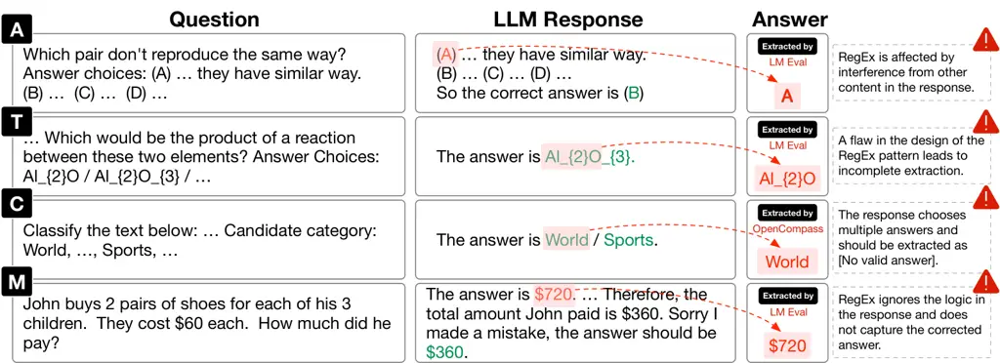
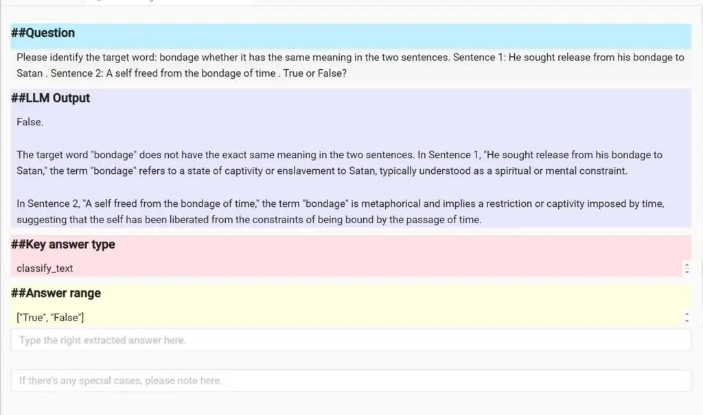

# xFinder: Large Language Models as Automated Evaluators for Reliable Evaluation

Qingchen Yu ^(†)^(†)thanks: Equal contribution. \$†\$ Corresponding
authors. Affiliation:  Institute for Advanced Algorithms Research,
Shanghai Email: <lizy@iaar.ac.cn>    Zifan Zheng    Shichao Song   
Zhiyu Li    Feiyu Xiong Affiliation:  Institute for Advanced Algorithms
Research, Shanghai    Bo Tang Affiliation:  Institute for Advanced
Algorithms Research, Shanghai    Ding Chen Affiliation:  Institute for
Advanced Algorithms Research, Shanghai Affiliation:  Renmin University
of China

###### Abstract

The continuous advancement of large language models (LLMs) has brought
increasing attention to the critical issue of developing fair and
reliable methods for evaluating their performance. Particularly, the
emergence of cheating phenomena, such as test set leakage and prompt
format overfitting, poses significant challenges to the reliable
evaluation of LLMs. As evaluation frameworks commonly use Regular
Expression (RegEx) for answer extraction, models may adjust their
responses to fit formats easily handled by RegEx. Nevertheless, the key
answer extraction module based on RegEx frequently suffers from
extraction errors. Furthermore, recent studies proposing fine-tuned LLMs
as judge models for automated evaluation face challenges in terms of
generalization ability and fairness. This paper comprehensively analyzes
the entire LLM evaluation chain and demonstrates that optimizing the key
answer extraction module improves extraction accuracy and enhances
evaluation reliability. Our findings suggest that improving the key
answer extraction module can lead to higher judgment accuracy and
improved evaluation efficiency compared to the judge models. To address
these issues, we propose xFinder, a novel evaluator for answer
extraction and matching in LLM evaluation. As part of this process, we
create a specialized dataset, the Key Answer Finder (KAF) dataset, to
ensure effective model training and evaluation. Generalization tests and
real-world evaluations show that the smallest xFinder model, with only
500 million parameters, achieves an average extraction accuracy of
93.42%. In contrast, RegEx accuracy in the best evaluation framework is
74.38%. The final judgment accuracy of xFinder reaches 97.61%,
outperforming existing evaluation frameworks and judge models. All
resources for xFinder are available at
[https://github.com/IAAR-Shanghai/xFinder](https://github.com/IAAR-Shanghai/xFinder).

|     |
| --- |
|     |

## 1 Introduction

Large language models (LLMs) have seen rapid advancements in recent
years (Brown et al., 2020; Achiam et al., 2023). To explore the
strengths, weaknesses, and differences of various LLMs, numerous
researchers have introduced a variety of evaluation benchmarks aimed at
evaluating the performance of LLMs across various dimensions (Talmor
et al., 2019; Clark et al., 2018; Hendrycks et al., 2020; Cobbe et al.,
2021). Furthermore, to facilitate comparisons of different LLMs on these
benchmarks, several institutions have developed unified LLM evaluation
frameworks, such as LM Eval Harness¹¹ 1 LM Eval Harness is the backend
for Hugging Face’s Open LLM Leaderboard (Beeching et al., 2023). (Gao
et al., 2021) and OpenCompass (OpenMMLab, 2023). These frameworks are
capable of uniformly evaluating LLM in reasoning, text generation, and
domain-specific knowledge.

Despite the widespread application of the aforementioned evaluation
benchmarks and frameworks, some researchers have raised concerns about
the fairness and reliability of current LLM evaluation efforts (Aiyappa
et al., 2023; Ye et al., 2024; Yu et al., 2024). For instance, the
benchmarks may suffer from data contamination and leakage in their test
sets (Zhou et al., 2023; Oren et al., 2023). Furthermore, a systematic
review has revealed multiple unreliabilities at various stages of the
existing evaluation pipeline, as illustrated in Figure 1.

Figure 1: Typical LLM Evaluation Pipeline.

##### Data Item Transformation

Given the uncertainty of LLM output content, evaluation frameworks often
transform datasets to achieve uniform evaluation across different tasks.
For example, they may convert datasets into the Multiple-Choice
Question-Answer (MCQA) with alphabet options. However, it has been shown
that for some tasks, the evaluation results under this MCQA form with
alphabet options may differ from those under the open-ended setting
 (Röttger et al., 2024).

##### Question Prompting and LLM Answering

Various institutions may employ different configurations (such as
temperature settings, decoding strategies, etc.) and prompts when
evaluating LLMs. LLMs are highly sensitive to these settings (Zhou
et al., 2023; Zheng et al., 2025). Even minor modifications (such as
changing the case of letters in options or adding extra spaces) can
significantly alter the model’s responses (Röttger et al., 2024; Gu
et al., 2023; Sun et al., 2023; Yukun et al., 2024; Chen et al., 2024),
thus affecting the fairness of the evaluation outcomes. Moreover, while
employing consistent prompts may ensure a degree of fairness, uniform
prompts may not suit all LLMs, potentially contradicting the initial
intent of evaluating the models’ inherent capabilities.

##### Key Answer Extraction and Matching

Current evaluation frameworks predominantly rely on Regular Expression
(RegEx) to extract answers from model responses. For example, they often
select content following phrases like “The answer is” as the key
response. However, many LLMs fail to generate standardized answers (Asai
et al., 2023), complicating key answer extraction from their responses.
Figure 2 illustrates instances where current evaluation frameworks
failed to extract responses correctly. There are two primary scenarios
where regular rules fail: first, when the model’s response is irrelevant
to the evaluation question, and second, when the response format does
not conform to standards. In the first scenario, it is unreasonable to
classify a model’s failure to provide a relevant response as an error,
as the evaluation aims to measure the model’s knowledge comprehension
and reasoning capabilities, not merely its instruction-following
ability. In the second scenario, although the LLM’s response effectively
addresses the question, the response’s non-standard format impedes
correct extraction using RegEx, resulting in false judgments.



Figure 2: Cases where LM Eval Harness and OpenCompass fail in extracting
key answers. A/T/C/M stands for tasks with alphabet / short text /
categorical label / math options, respectively.

In summary, existing LLM evaluation practices continue to face
deficiencies in fairness and reliability, making reliable evaluations an
urgent issue in the field of LLMs. The most effective methods for
extracting and matching key answers use advanced LLMs (such as GPT-4)
with manual evaluation (Huang et al., 2024). However, due to time and
financial constraints, these methods are seldom applied in practical
evaluations. As a result, some initiatives have developed fine-tuned
judge models to automatically evaluate the LLM responses (Wang et al.,
2023b; Zhu et al., 2023). Unfortunately, these methods significantly lag
behind advanced LLMs or manual evaluations in generalizability.

To address the conflict between fairness and cost in LLM evaluation, we
propose xFinder, a novel evaluator for answer extraction and matching.
xFinder achieves higher judgment accuracy than RegEx-based methods and
judge models, thereby improving evaluation reliability. The core of
xFinder is constructing a large-scale LLM response evaluation dataset
and developing a precise, efficient model to serve as the evaluator. By
replacing RegEx-based answer evaluation methods, xFinder assesses LLM
responses more accurately and efficiently, further enhancing evaluation
reliability.

To construct xFinder, we initially created the Key Answer Finder (KAF)
Dataset. We fine-tuned 19 LLMs of varying sizes using the training set,
and xFinder performed well on both the test and generalization sets. For
instance, xFinder-qwen1505 achieved an average extraction accuracy of
93.42% on the generalization set, demonstrating the model’s substantial
generalizability. Subsequently, we compared the judgment accuracy of
xFinder with mainstream evaluation frameworks and LLM-based judge models
(PandaLM, JudgeLM, and GPT-4) on the generalization set. The results
show that xFinder achieves a judgment accuracy of 97.61%, significantly
outperforming PandaLM (51.9%), JudgeLM (78.13% for the 33B model), and
GPT-4 (84.2%). Finally, we used xFinder and a traditional RegEx
extraction module to assess 10 LLMs on a common set of real-world tasks
and ranked their performance. We found that RegEx-based answer
extraction components in existing frameworks often fail to extract
answers correctly or fail entirely. Moreover, rankings from different
evaluation frameworks exhibit significant inconsistencies. In contrast,
our fine-tuned xFinder models consistently produced stable LLM rankings,
demonstrating greater evaluation reliability.

We summarize our primary contributions as follows:

- •
  We provide a comprehensive review of LLM evaluation processes in the
  industry, identifying critical factors that can lead to unreliable
  evaluation results.
- •
  We introduce xFinder, a novel evaluator for answer extraction and
  matching in LLM evaluation, and construct the KAF dataset to support
  its training and testing.
- •
  Our experiments show that both RegEx-based frameworks and automated
  judge models exhibit unreliability, leading to low judgment accuracy.
  In contrast, our method achieves higher accuracy and improved
  evaluation efficiency.

## 2 Related Work

From the perspective of LLM capabilities, current evaluations can be
categorized into knowledge and capability evaluations (Lyu et al.,
2024), vertical domain evaluations (Liang et al., 2024a), and alignment
and safety evaluations (Li et al., 2024; Guo et al., 2023). When
considering the types of questions in benchmark datasets, evaluations
can be divided into objective questions and subjective questions. For
objective questions, metrics like accuracy and F1-score are widely used.
These metrics rely on the ability to exactly match the LLM’s response
with the correct answer.

Currently, many popular unified LLM evaluation frameworks exist,
including LM Eval Harness (Gao et al., 2021), OpenCompass (OpenMMLab,
2023), UltraEval (He et al., 2024), and OpenAI Evals (OpenAI, 2024).
When using objective question datasets to evaluate LLMs, these
frameworks first conduct data item transformation, converting
classification and fill-in-the-blank questions into multiple-choice
questions. They then extract and match key answers using RegEx methods.
This process involves either extracting option letters for text response
evaluation or calculating the probabilities of option letters during
generation for first-token evaluation. However, both methods have
notable drawbacks when evaluating objective questions. In text response
evaluation, inaccurately extracting the key answer from the LLM’s
response can lead to incorrect evaluation results. On the other hand,
first-token evaluation may not accurately reflect the LLM’s intended
answer, as it overlooks the LLM’s reasoning process (Wang et al.,
2024c).

In addition to RegEx-based answer extraction, recent research
increasingly focuses on fine-tuning LLMs for evaluation, known as judge
models. Specifically, these methods include training evaluation models
to select the better response to the same question (Pairwise
Selection) (Wang et al., 2023b; Zhu et al., 2023; Li et al., 2023), and
training models to directly score a given question, response, and
reference (Pointwise Grading) (Zheng et al., 2024; Li et al., 2023; Kim
et al., 2023). However, these judge models demonstrate poor
generalization when evaluating different LLMs and benchmarks (Laskar
et al., 2023; Huang et al., 2024). In open-domain QA tasks, recent work
has introduced the EVOUNA dataset, which can be used to evaluate the
accuracy of automated evaluation methods (Wang et al., 2024a).

Recently, the concept of reliable evaluation has been proposed²² 2
[https://sites.google.com/view/real-info2024/overview](https://sites.google.com/view/real-info2024/overview).
This concept aims to rigorously assess the authenticity of content
generated by LLMs and the potential risks to information
systems (Augenstein et al., 2023). However, systematic research and
efforts to improve reliable evaluation are still lacking. To the best of
our knowledge, our work is the first to conduct a systematic study in
this area.

## 3 Problem Definition

The existing methods described in Section 2 aim to align the scores
assigned by evaluation models with human-expected scores. In other
words, these methods strive to ensure that the evaluation model’s
judgments of LLM outputs match human judgments. Since scoring is
subjective, unlike the objective determination of correctness, these
methods are more suitable for open-ended tasks like text translation and
summarization. In contrast, our method aims to align xFinder’s
extraction of key answers from LLM outputs with the key answers expected
by humans. Fundamentally, this method is more suitable for tasks with
deterministic answers, such as multiple-choice questions and
mathematical problems. We define the key answer extraction task as
follows:

Let $`\mathcal{D}`$ denote an evaluation dataset consisting of triplets:
a question, a set of options, and the correct answer, as shown in
Equation 1. Here, $`q`$ denotes the question, $`\mathcal{C}`$ denotes
the set of options, and $`a`$ denotes the correct answer. Let $`\Sigma`$
be the set of all tokens and $`\mathcal{P}`$ the power set.

```math
\mathcal{D}\subset\{(\bm{q},\mathcal{C},\bm{a})\mid\bm{q}\in\Sigma^{*},\bm{a}\in\Sigma^{*},\mathcal{C}\in\mathcal{P}(\Sigma^{*})\} \tag{1}
```

Each data point $`(\bm{q},\mathcal{C},\bm{a})`$ in $`\mathcal{D}`$ is
fed into the LLM, producing an output $`\bm{y}`$, as shown in
Equation 2:

```math
\bm{y}=\text{LLM}(\bm{q},\mathcal{C},\bm{a}) \tag{2}
```

If a unique substring in $`\bm{y}`$ can be identified as one of the
three types—Direct, Prompt wrapped, or Converted question wrapped—then
this substring is considered the Key Answer Sentence $`\bm{s}`$.
Intuitively, $`\bm{s}`$ is a sentence that contains the final answer to
the question $`\bm{q}`$. The definitions of these three types and their
corresponding sets are as follows:

##### Direct

This refers to $`\bm{s}`$ directly providing the final answer. Its
corresponding set is specifically defined as shown in Equation 3. Here,
$`\tau:\Sigma^{*}\rightarrow\mathcal{P}(\Sigma^{*})`$ denotes the
function for synonym transformation, such as
$`\tau\left(\text{Option A}\right)=\{\text{A},\text{The First Option},\left<\text{corresponding content of the option}\right>,\cdots\}`$.

##### Prompt wrapped

Here, $`\bm{s}`$ consists of relevant prompts combined with the final
answer, as detailed in Equation 4. The subset
$`\mathcal{F}\subset\mathcal{P}(\Sigma^{*})`$ represents a collection of
prompts guiding to the answer, where the placeholder \<final answer\>
indicates the position of the final answer. The expression
$`\bm{s}\circ\bm{f}`$ denotes the new sentence formed by replacing the
\<final answer\> token in $`\bm{f}`$ with $`\bm{s}`$.

##### Converted question wrapped

In this approach, $`\bm{s}`$ consists of the original question
$`\bm{q}`$ converted into a declarative statement, combined with the
final answer. The corresponding set is specified in Equation 5. The
function $`\zeta:\Sigma^{*}\rightarrow\Sigma^{*}`$ represents the
statement conversion function, which transforms $`\bm{q}`$ into its
declarative form and identifies the position of the placeholder. For
example,
$`\zeta(\text{What is the age of Mark 10 years later?})=\text{Mark will be <final answer> years old in 10 years}`$.

Particularly, when multiple substrings meet the criteria, it is
necessary to determine if a Chain of Thought (CoT) process³³ 3 CoT
(Chain of Thought (Wei et al., 2022)) refers to the process of
progressively reasoning through $`\bm{q}`$ to arrive at the final
result. exists within $`\bm{y}`$. If a CoT process is present,
$`\bm{s}`$ is defined as the unique substring that meets the criteria
and appears after the CoT process in $`\bm{y}`$. If no CoT process is
present, $`\bm{s}`$ does not exist in $`\bm{y}`$.

```math
\displaystyle\mathcal{S}_{1} \displaystyle=\{\bm{c},\tau(\bm{c})\mid\bm{c}\in\mathcal{C}\} \tag{3}
```

```math
\displaystyle\mathcal{S}_{2} \displaystyle=\{\bm{s}\circ\bm{f}\mid\bm{s}\in\mathcal{S}_{1},\bm{f}\in\mathcal{F}\} \tag{4}
```

```math
\displaystyle\mathcal{S}_{3} \displaystyle=\{\bm{s}\circ\bm{x}\mid\bm{s}\in\mathcal{S}_{1},\bm{x}\in\zeta(\bm{q})\} \tag{5}
```

The definition of the key answer $`\bm{k}`$ is divided into two
scenarios:

1.  1.  If $`\bm{s}`$ does not exist, $`\bm{k}`$ is set to \[No valid
        answer\];
2.  2.  If $`\bm{s}`$ exists, $`\bm{k}`$ is the option within the set
        $`\mathcal{C}`$ that best corresponds to what is described by
        $`\bm{s}`$, as defined in Equation 6:

```math
\exists\bm{k}\subset\mathcal{C},\text{s.t.}\\
\exists\bm{x}\in\{\bm{k},\tau(\bm{k})\},\bm{x}\subset\bm{s} \tag{6}
```

## 4 Methodology

To fine-tune xFinder, a high-quality dataset is essential. To our
knowledge, there is no dedicated dataset for key answer extraction and
matching. In this section, we will detail the implementation of xFinder,
including the KAF dataset construction and model training, as
illustrated in Figure 3. The KAF dataset encompasses a variety of
evaluation tasks, including questions, optional answer ranges, LLM
responses to the questions, and the extracted key answers. The dataset
is divided into three segments: training, test, and generalization sets,
used for fine-tuning, testing, and performance assessment, respectively.
The training set has 26,900 samples, the test set 4,961 samples, and the
generalization set 4,482 samples. For more detailed information, refer
to Appendices B.1 and B.3. Section 4.1 details LLM responses collection,
Section 4.2 describes the annotation of key answers in LLM-generated
content, and Section 4.3 elaborates on our detailed approach to training
xFinder.

Figure 3: Schematic of the research framework. The first three stages
correspond to Sections 4.1,  4.2, and  4.3, while the final stage
illustrates the replacement of RegEx with xFinder in the evaluation
pipeline. The experiments in Section 5.3 demonstrate the efficacy of our
approach within this pipeline. Note: The percentages 80.3%, 77.0%, and
2.2% in the center of the figure around “unreliable evaluation” indicate
results from the Llama3-8B-Instruct on the GSM8K benchmark using RegEx
evaluation via the LM Eval Harness, OpenCompass, and UltraEval
frameworks, respectively, while our method achieves a reliable result of
80.2%.

### 4.1 LLM Response Generation

As shown in the first part of Figure 3, we initially generate
question-response pairs using different LLMs across multiple datasets.
Currently, the tasks for evaluating LLM performance are highly
diverse.We investigated the leading LLM benchmarks and evaluation
reports to cover popular evaluation tasks. Ultimately, we selected 19
typical evaluation task datasets, with detailed information provided in
Appendix A.1. We categorized these tasks into four types, each with
similar option formats serving as prompts to induce LLMs to generate
varied responses (as shown in the left boxes in Figure 2): (1) Alphabet
option tasks. By referring to the design of mainstream evaluation
rankings, these tasks are formatted as alphabet options, where each task
aims to select the single correct option from multiple possibilities
(i.e., A, B, C, D, etc.). (2) Short text option tasks. The requirement
for the model to map letters to option texts may impact the evaluation
of the model’s true capabilities (Wang et al., 2024b). Therefore, we
designed tasks with key answer types as short texts, where the goal is
to select the correct option from multiple short texts. (3) Categorical
label tasks. For traditional classification tasks (e.g., sentiment
classification, topic classification, entity classification), we
retained their original format, using the labels themselves as options.
(4) Math option tasks. Given the variety of output types in math tasks,
such as integers, decimals, and LaTeX code, we categorized them
separately.

To enhance the diversity of the dataset, we designed eight types of
prompt configurations to elicit varied responses from the LLMs. These
configurations include 0-shot(-restrict⁴⁴ 4 -restrict indicates that the
prompt ends with the sentence “End your final answer with ‘The answer is
¡answer¿.’ ” to standardize the LLM’s response format.),
0-shot-cot(-restrict), 5-shot(-restrict), and 5-shot-cot(-restrict).
These prompt templates are provided in Appendix F.1.

For generating responses, it is crucial to capture a wide range of
output content, given that LLMs of different series and sizes exhibit
varied reasoning processes and may provide different answers to the same
question. Consequently, we utilized a total of more than 10 distinct
LLMs, and specific details about these models can be found in
Appendix A.2. The KAF dataset’s training and test sets include
question-response pairs generated by 10 LLMs across 8 evaluation tasks.
To ensure the validity and fairness of the generalization evaluation,
the question-response pairs used in the generalization set are derived
from responses by 8 LLMs on 11 entirely new evaluation tasks. Further
details on the KAF dataset can be found in Appendix B.1.

### 4.2 Auto Labelling and Human Recheck

The foundation of the KAF dataset is extracting the key answer
$`\bm{k}`$ from the LLM response $`\bm{y}`$, which serves as the label.
We employed distinct annotation strategies for the training, test, and
generalization sets. For the training set, to improve annotation
efficiency, we adopted a semi-automated procedure. This involves
generating two sets of annotations from GPT-4 with different prompts
(refer to Appendix F.2 for prompt templates). Using the self-consistency
strategy (Wang et al., 2023a; Liang et al., 2024b), items with
discrepancies between the two annotation rounds, along with all
mathematics questions, were manually re-annotated using Label
Studio (Tkachenko et al., 2020). Two rounds of manual labeling were
conducted to ensure the accuracy and reliability of the test and
generalization sets. Detailed information about the annotation methods
can be found in Appendix B.2.

### 4.3 Training xFinder

According to the definition of key answer extraction outlined in
Section 3, our goal is to fine-tune xFinder to precisely locate
$`\bm{s}`$ within $`\bm{y}`$ and accurately extract $`\bm{k}`$ from
$`\bm{s}`$. The training input for xFinder includes the question
$`\bm{q}`$, the LLM response $`\bm{y}`$, the key answer type, and the
answer range, while the output is the key answer $`\bm{k}`$.

During the training process, we primarily utilized the XTuner (InternLM, 2023) tool developed by the InternLM team for fine-tuning. To fully
exploit the instruction-following potential of xFinder, we meticulously
crafted prompts as demonstrated in Appendix F.4. Additionally, to
enhance the generalization capability of xFinder, we implemented data
augmentation on the KAF training set, which included:

- •
  Simulating LLM responses to alphabet option questions. We randomly
  selected 50% of the alphabet option questions from the KAF training
  set and altered their answer choices by either adding one or two
  options or removing one option with equal probability.
- •
  Enriching the variety of prompt forms in Prompt wrapped key answer
  sentences. From the LLM responses in the KAF training set that
  contained wrapped key answer sentences, we extracted 10% and
  substituted the $`\bm{f}`$ with other elements from $`\mathcal{F}`$,
  such as replacing “The final answer is A” with “Based on the context
  of the question, A is the most likely answer.”

## 5 Experiments

In this section, we first outline the experimental setup, including
metrics, baselines, and fine-tuning configurations, which apply to the
Extraction Accuracy and Judgment Accuracy experiments.

- •
  Metrics. For the Extraction Accuracy and Judgment Accuracy
  experiments, we employ two primary metrics: Extraction Accuracy,
  measuring the proportion of correctly extracted key answers, and
  Judgment Accuracy, evaluating the correctness of judgments on LLM
  responses. Detailed definitions of these metrics are provided in
  Appendix D.1.
- •
  Baselines. The baselines for these two experiments include mainstream
  LLM evaluation frameworks such as OpenCompass (OpenMMLab, 2023), LM
  Eval Harness (Gao et al., 2021), and UltraEval (He et al., 2024), all
  of which rely on RegEx-based extraction methods. Additionally, we
  compare with judge models such as PandaLM (Wang et al., 2023b) and
  JudgeLM (Zhu et al., 2023), as well as GPT-4, which serves as both an
  extractor and a judge (the prompt used is provided in Appendix F.2 and
  Appendix F.3).
- •
  Fine-tuning Details. For the experiments, we fine-tuned 19 LLMs, with
  parameter sizes ranging from 0.5B to 8B, using the KAF training set.
  Fine-tuning was performed using the QLoRA method from the XTuner
  framework (InternLM, 2023; Dettmers et al., 2024), with detailed
  parameters provided in Appendix C.

Finally, for the Real-world Evaluation experiment, we evaluated the
performance of 10 LLMs on 14 evaluation task datasets, comparing results
obtained using xFinder-qwen1505, xFinder-llama38it, and the mainstream
evaluation frameworks. This experiment analyzes differences in
evaluation outcomes to establish xFinder’s reliability in practical
applications.

### 5.1 Extraction Accuracy: xFinder vs. RegEx

##### Results on KAF test set

We employed the QLoRA method from the XTuner framework (InternLM, 2023;
Dettmers et al., 2024) for fine-tuning the foundation models, with
specific tuning parameters detailed in Appendix C. To evaluate the
effectiveness of xFinder, we conducted tests using the KAF test set. We
set the mainstream frameworks—OpenCompass, LM Eval Harness, and
UltraEval—with their RegEX extraction modules as baselines. The
comparison metric is extraction accuracy, defined as the proportion of
correctly extracted key answers relative to the dataset size. Partial
results are presented in Table 1; For complete experimental results,
refer to Table 22 in Appendix D.2.

|                       |                 |            |                   |        |         |
| --------------------- | --------------- | ---------- | ----------------- | ------ | ------- |
| Method                | alphabet option | short text | categorical label | math   | Overall |
| OpenCompass           | 0.8098          | /          | /                 | 0.7481 | 0.7937  |
| LM Eval Harness       | 0.8500          | 0.7540     | 0.8208            | 0.7496 | 0.8113  |
| UltraEval             | 0.6057          | /          | /                 | 0.4766 | 0.5722  |
| xFinder-qwen1505      | 0.9735          | 0.9683     | 0.9805            | 0.9276 | 0.9688  |
| xFinder-qwen1518      | 0.9735          | 0.9781     | 0.9755            | 0.9457 | 0.9712  |
| xFinder-gemma7        | 0.9751          | 0.9805     | 0.9736            | 0.9367 | 0.9704  |
| xFinder-chatglm36base | 0.9735          | 0.9793     | 0.9730            | 0.9291 | 0.9684  |
| xFinder-llama38       | 0.9698          | 0.9829     | 0.9692            | 0.9276 | 0.9661  |

Table 1: Comparison of Extraction Accuracy on KAF Test Set: Mainstream
frameworks vs. xFinder models. Specifically, xFinder-qwen1505 and
xFinder-llama38it represent models fine-tuned with the KAF training set
on Qwen1.5-0.5B and Llama3-8B-Instruct, respectively.

It is evident that the xFinder models, fine-tuned using the KAF training
set, are highly effective. Furthermore, despite a 16-fold difference in
the parameter sizes of the models, the variation in extraction accuracy
does not exceed 0.5%.

##### Results on KAF generalization set

To further explore xFinder’s extraction capabilities on not-seen tasks,
we conducted tests using the KAF generalization set. Specific results
are shown in Table 2. Only two xFinder models are displayed here for
brevity, but the complete experimental results can be found in Table 23
of Appendix D.2. The results indicate that xFinder maintains a high
level of extraction accuracy on the generalization set. In contrast,
mainstream RegEx methods perform poorly⁵⁵ 5 Here, the extraction
accuracy of OpenCompass, LM Eval Harness, and UltraEval has
significantly decreased compared to Table 1. This is because the LLM
responses in the KAF test set are generated from restricted prompts,
making it easier for RegEx methods to extract the key answer; However,
the responses in the KAF generalization set are generated from
non-restricted prompts., especially in extracting key answers for
mathematical problems. Even GPT-4 struggles to extract key answers from
complex and varied LLM responses accurately.

| Method             | alphabet option | short text | categorical label | math   | Overall | $`\Delta_{acc}`$ | $`\Delta_{acc}/N`$ |
| ------------------ | --------------- | ---------- | ----------------- | ------ | ------- | ---------------- | ------------------ |
| OpenCompass        | 0.7750          | /          | /                 | 0.6813 | 0.7438  | /                | /                  |
| LM Eval Harness    | 0.6594          | 0.7484     | 0.8381            | 0.2094 | 0.6780  | /                | /                  |
| UltraEval          | 0.5945          | /          | /                 | 0.1781 | 0.3978  | /                | /                  |
| GPT-4 as Extractor | 0.6578          | 0.8046     | 0.6706            | 0.6703 | 0.6957  | /                | /                  |
| xFinder-qwen1505   | 0.9477          | 0.9335     | 0.9281            | 0.9234 | 0.9342  | 0.0277           | 0.0554             |
| xFinder-llama38it  | 0.9547          | 0.9428     | 0.9537            | 0.9547 | 0.9518  | 0.0453           | 0.0057             |

Table 2: Comparison of Extraction Accuracy on KAF Generalization Set:
Mainstream frameworks, GPT-4, and xFinder models. Specifically,
xFinder-qwen1505 and xFinder-llama38it represent models fine-tuned with
the KAF training set on Qwen1.5-0.5B and Llama3-8b-instruct,
respectively.

### 5.2 Judgment Accuracy: xFinder vs. Judge Models

As shown in Table 3, we present the evaluation results of mainstream
frameworks, judge models, GPT-4, and xFinder on the generalization set.
The metric is Judgment Accuracy, which measures the correctness of
judgments on LLM responses. We observed that the judgment accuracy of
PandaLM was only 51.9%, while JudgeLM-33B achieved merely 78.13%. In
addition, the highest accuracy of GPT-4’s judgments is only 88.42%,
which is significantly lower than that of xFinder.

|                      |                 |            |                   |        |         |
| -------------------- | --------------- | ---------- | ----------------- | ------ | ------- |
| Method               | alphabet option | short text | categorical label | math   | Overall |
| OpenCompass          | 0.8742          | /          | /                 | 0.9125 | 0.8870  |
| LM Eval Harness      | 0.8117          | 0.9148     | 0.9750            | 0.5813 | 0.8592  |
| UltraEval            | 0.7836          | /          | /                 | 0.5328 | 0.7000  |
| PandaLM-7B           | 0.4953          | 0.5832     | 0.5312            | 0.4391 | 0.5190  |
| JudgeLM-7B           | 0.7195          | 0.8316     | 0.8056            | 0.5875 | 0.7555  |
| JudgeLM-13B          | 0.6875          | 0.8545     | 0.7694            | 0.9266 | 0.7867  |
| JudgeLM-33B          | 0.8133          | 0.8358     | 0.6906            | 0.8625 | 0.7813  |
| GPT-4 as Judge       | 0.9016          | 0.8909     | 0.7294            | 0.9313 | 0.8420  |
| GPT-4 as Judge (CoT) | 0.9234          | 0.9345     | 0.7919            | 0.9609 | 0.8842  |
| xFinder-qwen1505     | 0.9781          | 0.9761     | 0.9625            | 0.9969 | 0.9748  |
| xFinder-llama38it    | 0.9750          | 0.9688     | 0.9731            | 0.9969 | 0.9761  |

Table 3: Comparison of Judgment Accuracy on KAF Generalization Set:
Mainstream frameworks, judge models, GPT-4, and xFinder, using
human-annotated results as ground truth. All judge models use prompts
with reference answers.

We present the differences between answer Extraction Accuracy and final
Judgment Accuracy in Table 4. From the results, we can see that the
baseline method with the smallest difference, OpenCompass, still has a
judgment accuracy 14.32% higher than its extraction accuracy, indicating
a high unreliability in the evaluation results obtained using
traditional RegEx-based key answer extraction methods. In contrast, the
judgment accuracy of our xFinder-llama38it method is only 2.43% higher
than its extraction accuracy, reducing judging reliability due to
inaccurate extraction to within 3%.

| Method            | Extraction Accuracy $`\uparrow`$ | Judgment Accuracy $`\uparrow`$ | Accuracy Gap $`\downarrow`$ |
| ----------------- | -------------------------------- | ------------------------------ | --------------------------- |
| OpenCompass       | 0.7438                           | 0.8870                         | 0.1432                      |
| LM Eval Harness   | 0.6780                           | 0.8592                         | 0.1812                      |
| UltraEval         | 0.3978                           | 0.7000                         | 0.3022                      |
| GPT-4             | 0.6957                           | 0.8420                         | 0.1463                      |
| xFinder-qwen1505  | 0.9342                           | 0.9748                         | 0.0406                      |
| xFinder-llama38it | 0.9518                           | 0.9761                         | 0.0243                      |

Table 4: The difference, that is Accuracy Gap ($`\downarrow`$), between
Judgment Accuracy ($`\uparrow`$) and Extraction Accuracy ($`\uparrow`$)
on the Generalization Set for Mainstream frameworks, GPT-4, and xFinder.
It reflects discrepancies in Judgment Accuracy due to extraction errors.
This set uses human-annotated results as the ground truth.

##### Efficiency Comparison

To further compare our xFinder with existing LLM as judge models,
including JudgeLM, PandaLM, and the API-based GPT-4, we conducted a cost
analysis experiment. We randomly sampled 200 instances from four
question types within the Generalization Set. As shown in Table 5, we
present the time required to evaluate these tasks on the same machine
equipped with 8 NVIDIA H100 (80G) GPUs. Notably, JudgeLM-33B utilized 2
GPUs, while the other models operated on a single GPU, with all
evaluations conducted in a single process. In Table 6, we present the
complete evaluation tasks along with the costs incurred by the API-based
GPT-4. The cost of xFinder-qwen1505 under the aforementioned setup is
merely \$0.02, accounting for only 0.4% of GPT-4’s expenses. It can be
observed that our xFinder achieves not only higher accuracy compared to
these judge models but also lower evaluation costs and greater
flexibility.

| Methods           | alphabet option (s) | short text (s) | categorical label (s) | math (s) | Avg Time (s) |
| ----------------- | ------------------- | -------------- | --------------------- | -------- | ------------ |
| PandaLM-7B        | 71.05               | 70.09          | 56.45                 | 38.88    | 59.12        |
| JudgeLM-7B        | 228.11              | 227.83         | 240.54                | 330.40   | 256.72       |
| JudgeLM-13B       | 395.57              | 457.49         | 415.46                | 415.31   | 420.96       |
| JudgeLM-33B       | 522.05              | 527.63         | 517.25                | 571.82   | 534.69       |
| xFinder-qwen1505  | 10.24               | 11.12          | 10.05                 | 11.28    | 10.67        |
| xFinder-llama38it | 13.43               | 16.79          | 12.79                 | 16.80    | 14.95        |

Table 5: Time costs (in seconds) for xFinder and judge models in
evaluating 200 randomly selected questions per task type from KAF
generalization set.

| Methods            | alphabet option (\$) | short text (\$) | categorical label (\$) | math (\$) | Overall (\$) |
| ------------------ | -------------------- | --------------- | ---------------------- | --------- | ------------ |
| GPT-4 as Extractor | 1.34                 | 1.2             | 1.13                   | 1.39      | 5.06         |
| GPT-4 as Judge     | 1.25                 | 1.14            | 1.19                   | 1.57      | 5.15         |

Table 6: Total costs (in USD) for GPT-4 API in evaluating 200 randomly
selected questions per task type from KAF generalization set.

### 5.3 Evaluation in Real-World Scenarios

The experiments conclusively demonstrate that xFinder plays a critical
role within evaluation frameworks. Next, we will use xFinder for
automated evaluations in real-world evaluation tasks instead of only
inspecting the extraction accuracy. To balance efficiency and quality,
we calculated two metrics for all xFinder models on the KAF
generalization set: $`\Delta_{acc}`$ and $`\Delta_{acc}/N`$ (where $`N`$
is the parameter size of the LLM, measured in billions). Based on these
metrics, xFinder-qwen1505 (with the highest $`\Delta_{acc}/N`$) and
xFinder-llama38it (with the highest $`\Delta_{acc}`$) were selected.
Here, $`\Delta_{acc}`$ represents the difference in extraction accuracy
on the KAF generalization set between the current xFinder and the lowest
accuracy among the 19 xFinder models. For specific results, refer to
Table 23 in Appendix D.2.

We evaluated the performance of 10 LLMs across 14 mainstream evaluation
tasks using xFinder-qwen1505 and xFinder-llama38it, along with RegEx
methods based on OpenCompass, LM Eval Harness, and UltraEval. The
comprehensive scoring results are provided in Appendix D.3.

##### Setup

Currently, the parameter settings for each evaluation framework differ
significantly, including preprocessing methods for task datasets, prompt
template configurations, and hyperparameter settings for the models
being tested. Therefore, to compare the performance of our xFinder
extraction method with RegEx methods on these frameworks, we replicated
only the RegEx methods on each framework and ensured consistency in
other settings. This primarily included: (1) applying uniform
preprocessing to the task datasets; (2) employing a consistent zero-shot
approach for all evaluation tasks, with specific prompts detailed in
Appendix F.1; and (3) selecting the following LLMs for comprehensive
evaluation: Phi-2, Baichuan series, Gemma series, Llama series, InternLM
series, and Qwen series. Additionally, to ensure the stability of
experimental results and maintain consistency in parameter settings
across different LLMs, we set the temperature to 0, top_p to 0.9, and
top_k to 5.

Figure 4: Bump charts: Changes in LLM rank over different evaluation
frameworks.

##### Results and Analysis

Figure 4 illustrates the ranking changes of LLMs across four tasks based
on evaluation results extracted from different frameworks. Additional
chart results can be found in Appendix E. From the analysis, we can
derive the following insights:

RQ1: Are existing evaluation frameworks reliable? The graph reveals
significant discrepancies in the rankings of LLMs obtained using
different evaluation frameworks. For instance, in the CommonsenseQA
(alphabet) task, InternLM2-1.8B-Chat ranks first in UltraEval but only
fifth in OpenCompass. Such disparities in rankings indicate the
unreliability of RegEx methods within mainstream evaluation frameworks,
potentially affecting the credibility and ranking of model evaluation.

RQ2: Is xFinder reliable? Firstly, by comparing our presented
checkpoints, xFinder-qwen1505 and xFinder-llama38it, we observe
relatively consistent rankings of LLMs across different base models on
the same task. This demonstrates the high stability of xFinder, even on
CommonsenseQA datasets that have not been used for training.
Furthermore, considering the extraction accuracy of key answers from our
previous experiments, xFinder exhibits higher accuracy compared to the
RegEx methods in other frameworks. This implies that our evaluation
results are both stable and accurate. Therefore, it can be concluded
that our model demonstrates higher reliability compared to other
frameworks.

(additional) RQ3: Is setting evaluation tasks as alphabet options
reliable? Existing evaluation frameworks often aim to convert all
questions into multiple-choice format with alphabet options. However, as
shown in Figure 4, there are significant differences in the rankings of
the CommonsenseQA task when using the alphabet option format compared to
the short text format (more experimental details can be found in
Appendix E.1). This suggests that alphabet options may be unreliable,
and we advocate for reducing the reliance on the alphabet option format
in existing evaluation frameworks.

## 6 Conclusion

In this paper, we analyzed key issues in existing LLM evaluation
frameworks that could result in unreliable outcomes, with a particular
focus on the extraction and matching of LLM responses. In response to
these challenges, we introduced xFinder, a novel evaluator specifically
designed for accurate key answer extraction and matching in LLM
responses. Extensive experiments showed that xFinder extracted key
answers from LLM outputs more accurately and efficiently than existing
RegEx-based methods, significantly improving evaluation reliability.
This study represents the first step in constructing a reliable
evaluation framework. In the future, we will have continued addressing
other key issues in the reliable evaluation of LLMs, providing a
foundation for accurately evaluating LLM performance.

## References

- Achiam et al. (2023) Josh Achiam, Steven Adler, Sandhini Agarwal, Lama
  Ahmad, Ilge Akkaya, Florencia Leoni Aleman, Diogo Almeida, Janko
  Altenschmidt, Sam Altman, Shyamal Anadkat, et al. Gpt-4 technical
  report. _arXiv preprint arXiv:2303.08774_, 2023.
- Aiyappa et al. (2023) Rachith Aiyappa, Jisun An, Haewoon Kwak, and
  Yong-Yeol Ahna. Can we trust the evaluation on chatgpt? In _The Third
  Workshop on Trustworthy Natural Language Processing_, pp.  47, 2023.
- Asai et al. (2023) Akari Asai, Zeqiu Wu, Yizhong Wang, Avirup Sil, and
  Hannaneh Hajishirzi. Self-rag: Learning to retrieve, generate, and
  critique through self-reflection. In _The Twelfth International
  Conference on Learning Representations_, 2023.
- Augenstein et al. (2023) Isabelle Augenstein, Timothy Baldwin,
  Meeyoung Cha, Tanmoy Chakraborty, Giovanni Luca Ciampaglia, David
  Corney, Renee DiResta, Emilio Ferrara, Scott Hale, Alon Halevy, et al.
  Factuality challenges in the era of large language models. _arXiv
  preprint arXiv:2310.05189_, 2023.
- Beeching et al. (2023) Edward Beeching, Clémentine Fourrier, Nathan
  Habib, Sheon Han, Nathan Lambert, Nazneen Rajani, Omar Sanseviero,
  Lewis Tunstall, and Thomas Wolf. Open llm leaderboard.
  [https://huggingface.co/spaces/HuggingFaceH4/open_llm_leaderboard](https://huggingface.co/spaces/HuggingFaceH4/open_llm_leaderboard), 2023.
- Brown et al. (2020) Tom Brown, Benjamin Mann, Nick Ryder, Melanie
  Subbiah, Jared D Kaplan, Prafulla Dhariwal, Arvind Neelakantan, Pranav
  Shyam, Girish Sastry, Amanda Askell, et al. Language models are
  few-shot learners. _Advances in neural information processing
  systems_, 33:1877–1901, 2020.
- Chen et al. (2024) Ding Chen, Shichao Song, Qingchen Yu, Zhiyu Li,
  Wenjin Wang, Feiyu Xiong, and Bo Tang. Grimoire is all you need for
  enhancing large language models. _arXiv preprint
  arXiv:2401.03385_, 2024.
- Clark et al. (2018) Peter Clark, Isaac Cowhey, Oren Etzioni, Tushar
  Khot, Ashish Sabharwal, Carissa Schoenick, and Oyvind Tafjord. Think
  you have solved question answering? try arc, the ai2 reasoning
  challenge. _arXiv preprint arXiv:1803.05457_, 2018.
- Cobbe et al. (2021) Karl Cobbe, Vineet Kosaraju, Mohammad Bavarian,
  Mark Chen, Heewoo Jun, Lukasz Kaiser, Matthias Plappert, Jerry Tworek,
  Jacob Hilton, Reiichiro Nakano, et al. Training verifiers to solve
  math word problems. _arXiv preprint arXiv:2110.14168_, 2021.
- Dettmers et al. (2024) Tim Dettmers, Artidoro Pagnoni, Ari Holtzman,
  and Luke Zettlemoyer. Qlora: Efficient finetuning of quantized llms.
  _Advances in Neural Information Processing Systems_, 36, 2024.
- Gao et al. (2021) Leo Gao, Jonathan Tow, Baber Abbasi, Stella
  Biderman, Sid Black, Anthony DiPofi, Charles Foster, Laurence Golding,
  Jeffrey Hsu, Alain Le Noac’h, Haonan Li, Kyle McDonell, Niklas
  Muennighoff, Chris Ociepa, Jason Phang, Laria Reynolds, Hailey
  Schoelkopf, Aviya Skowron, Lintang Sutawika, Eric Tang, Anish Thite,
  Ben Wang, Kevin Wang, and Andy Zou. A framework for few-shot language
  model evaluation, September 2021. URL
  [https://doi.org/10.5281/zenodo.5371628](https://doi.org/10.5281/zenodo.5371628).
- Gu et al. (2023) Jiasheng Gu, Hongyu Zhao, Hanzi Xu, Liangyu Nie,
  Hongyuan Mei, and Wenpeng Yin. Robustness of learning from task
  instructions. In _Findings of the Association for Computational
  Linguistics: ACL 2023_, pp. 13935–13948, 2023.
- Guo et al. (2023) Zishan Guo, Renren Jin, Chuang Liu, Yufei Huang, Dan
  Shi, Linhao Yu, Yan Liu, Jiaxuan Li, Bojian Xiong, Deyi Xiong, et al.
  Evaluating large language models: A comprehensive survey. _arXiv
  preprint arXiv:2310.19736_, 2023.
- He et al. (2024) Chaoqun He, Renjie Luo, Shengding Hu, Yuanqian Zhao,
  Jie Zhou, Hanghao Wu, Jiajie Zhang, Xu Han, Zhiyuan Liu, and Maosong
  Sun. Ultraeval: A lightweight platform for flexible and comprehensive
  evaluation for llms. _arXiv preprint arXiv:2404.07584_, 2024.
- Hendrycks et al. (2020) Dan Hendrycks, Collin Burns, Steven Basart,
  Andy Zou, Mantas Mazeika, Dawn Song, and Jacob Steinhardt. Measuring
  massive multitask language understanding. In _International Conference
  on Learning Representations_, 2020.
- Huang et al. (2024) Hui Huang, Yingqi Qu, Jing Liu, Muyun Yang, and
  Tiejun Zhao. An empirical study of llm-as-a-judge for llm evaluation:
  Fine-tuned judge models are task-specific classifiers. _arXiv preprint
  arXiv:2403.02839_, 2024.
- InternLM (2023) InternLM. Xtuner: A toolkit for efficiently
  fine-tuning llm.
  [https://github.com/InternLM/xtuner](https://github.com/InternLM/xtuner), 2023.
- Kim et al. (2023) Seungone Kim, Jamin Shin, Yejin Cho, Joel Jang,
  Shayne Longpre, Hwaran Lee, Sangdoo Yun, Seongjin Shin, Sungdong Kim,
  James Thorne, et al. Prometheus: Inducing fine-grained evaluation
  capability in language models. _arXiv preprint
  arXiv:2310.08491_, 2023.
- Laskar et al. (2023) Md Tahmid Rahman Laskar, Cheng Chen,
  Shashi Bhushan Tn, et al. Are large language models reliable judges? a
  study on the factuality evaluation capabilities of llms. In
  _Proceedings of the Third Workshop on Natural Language Generation,
  Evaluation, and Metrics (GEM)_, pp. 310–316, 2023.
- Li et al. (2023) Junlong Li, Shichao Sun, Weizhe Yuan, Run-Ze Fan,
  Pengfei Liu, et al. Generative judge for evaluating alignment. In _The
  Twelfth International Conference on Learning Representations_, 2023.
- Li et al. (2024) Miao Li, Ming-Bin Chen, Bo Tang, Shengbin Hou, Pengyu
  Wang, Haiying Deng, Zhiyu Li, Feiyu Xiong, Keming Mao, Peng Cheng,
  et al. Newsbench: Systematic evaluation of llms for writing
  proficiency and safety adherence in chinese journalistic editorial
  applications. _arXiv preprint arXiv:2403.00862_, 2024.
- Liang et al. (2024a) Xun Liang, Shichao Song, Simin Niu, Zhiyu Li,
  Feiyu Xiong, Bo Tang, Yezhaohui Wang, Dawei He, Cheng Peng, Zhonghao
  Wang, and Haiying Deng. UHGEval: Benchmarking the hallucination of
  Chinese large language models via unconstrained generation. In
  _Proceedings of the 62nd Annual Meeting of the Association for
  Computational Linguistics (Volume 1: Long Papers)_, pp. 5266–5293.
  Association for Computational Linguistics, August 2024a. doi:
  10.18653/v1/2024.acl-long.288. URL
  [https://aclanthology.org/2024.acl-long.288](https://aclanthology.org/2024.acl-long.288).
- Liang et al. (2024b) Xun Liang, Shichao Song, Zifan Zheng, Hanyu Wang,
  Qingchen Yu, Xunkai Li, Rong-Hua Li, Yi Wang, Zhonghao Wang, Feiyu
  Xiong, and Zhiyu Li. Internal consistency and self-feedback in large
  language models: A survey. _arXiv preprint arXiv:2407.14507_, 2024b.
- Lyu et al. (2024) Yuanjie Lyu, Zhiyu Li, Simin Niu, Feiyu Xiong,
  Bo Tang, Wenjin Wang, Hao Wu, Huanyong Liu, Tong Xu, and Enhong Chen.
  Crud-rag: A comprehensive chinese benchmark for retrieval-augmented
  generation of large language models. _ACM Transactions on Information
  Systems_, 2024. ISSN 1046-8188. doi: 10.1145/3701228. URL
  [https://doi.org/10.1145/3701228](https://doi.org/10.1145/3701228).
- OpenAI (2024) OpenAI. GitHub - openai/evals: Evals is a framework for
  evaluating LLMs and LLM systems, and an open-source registry of
  benchmarks., 2024. URL
  [https://github.com/openai/evals](https://github.com/openai/evals).
- OpenMMLab (2023) OpenMMLab. Opencompass: A universal evaluation
  platform for foundation models.
  [https://github.com/open-compass/opencompass](https://github.com/open-compass/opencompass), 2023.
- Oren et al. (2023) Yonatan Oren, Nicole Meister, Niladri S Chatterji,
  Faisal Ladhak, and Tatsunori Hashimoto. Proving test set contamination
  for black-box language models. In _The Twelfth International
  Conference on Learning Representations_, 2023.
- Röttger et al. (2024) Paul Röttger, Valentin Hofmann, Valentina
  Pyatkin, Musashi Hinck, Hannah Rose Kirk, Hinrich Schütze, and Dirk
  Hovy. Political compass or spinning arrow? towards more meaningful
  evaluations for values and opinions in large language models. _arXiv
  preprint arXiv:2402.16786_, 2024.
- Sun et al. (2023) Jiuding Sun, Chantal Shaib, and Byron C Wallace.
  Evaluating the zero-shot robustness of instruction-tuned language
  models. In _The Twelfth International Conference on Learning
  Representations_, 2023.
- Talmor et al. (2019) Alon Talmor, Jonathan Herzig, Nicholas Lourie,
  and Jonathan Berant. Commonsenseqa: A question answering challenge
  targeting commonsense knowledge. In _Proceedings of NAACL-HLT_, pp.
  4149–4158, 2019.
- Tkachenko et al. (2020) Maxim Tkachenko, Mikhail Malyuk, Andrey
  Holmanyuk, and Nikolai Liubimov. Label Studio: Data labeling
  software, 2020. URL
  [https://github.com/heartexlabs/label-studio](https://github.com/heartexlabs/label-studio).
  Open source software available from
  https://github.com/heartexlabs/label-studio.
- Wang et al. (2024a) Cunxiang Wang, Sirui Cheng, Qipeng Guo, Yuanhao
  Yue, Bowen Ding, Zhikun Xu, Yidong Wang, Xiangkun Hu, Zheng Zhang, and
  Yue Zhang. Evaluating open-qa evaluation. _Advances in Neural
  Information Processing Systems_, 36, 2024a.
- Wang et al. (2024b) Haochun Wang, Sendong Zhao, Zewen Qiang, Bing Qin,
  and Ting Liu. Beyond the answers: Reviewing the rationality of
  multiple choice question answering for the evaluation of large
  language models. _arXiv preprint arXiv:2402.01349_, 2024b.
- Wang et al. (2024c) Xinpeng Wang, Bolei Ma, Chengzhi Hu, Leon
  Weber-Genzel, Paul Röttger, Frauke Kreuter, Dirk Hovy, and Barbara
  Plank. " my answer is c": First-token probabilities do not match text
  answers in instruction-tuned language models. _arXiv preprint
  arXiv:2402.14499_, 2024c.
- Wang et al. (2023a) Xuezhi Wang, Jason Wei, Dale Schuurmans, Quoc V
  Le, Ed H. Chi, Sharan Narang, Aakanksha Chowdhery, and Denny Zhou.
  Self-consistency improves chain of thought reasoning in language
  models. In _The Eleventh International Conference on Learning
  Representations_, 2023a. URL
  [https://openreview.net/forum?id=1PL1NIMMrw](https://openreview.net/forum?id=1PL1NIMMrw).
- Wang et al. (2023b) Yidong Wang, Zhuohao Yu, Zhengran Zeng, Linyi
  Yang, Wenjin Yao, Cunxiang Wang, Hao Chen, Chaoya Jiang, Rui Xie,
  Jindong Wang, et al. Pandalm: An automatic evaluation benchmark for
  llm instruction tuning optimization. In _The Twelfth International
  Conference on Learning Representations_, 2023b.
- Wei et al. (2022) Jason Wei, Xuezhi Wang, Dale Schuurmans, Maarten
  Bosma, Fei Xia, Ed Chi, Quoc V Le, Denny Zhou, et al. Chain-of-thought
  prompting elicits reasoning in large language models. _Advances in
  neural information processing systems_, 35:24824–24837, 2022.
- Ye et al. (2024) Fanghua Ye, Mingming Yang, Jianhui Pang, Longyue
  Wang, Derek F Wong, Emine Yilmaz, Shuming Shi, and Zhaopeng Tu.
  Benchmarking llms via uncertainty quantification. _arXiv preprint
  arXiv:2401.12794_, 2024.
- Yu et al. (2024) Qingchen Yu, Shichao Song, Ke Fang, Yunfeng Shi,
  Zifan Zheng, Hanyu Wang, Simin Niu, and Zhiyu Li. Turtlebench:
  Evaluating top language models via real-world yes/no puzzles. _arXiv
  preprint arXiv:2410.05262_, 2024.
- Yukun et al. (2024) Zhao Yukun, Yan Lingyong, Sun Weiwei, Xing
  Guoliang, Wang Shuaiqiang, Meng Chong, Cheng Zhicong, Ren Zhaochun,
  and Yin Dawei. Improving the robustness of large language models via
  consistency alignment. _arXiv preprint arXiv:2403.14221_, 2024.
- Zheng et al. (2024) Lianmin Zheng, Wei-Lin Chiang, Ying Sheng, Siyuan
  Zhuang, Zhanghao Wu, Yonghao Zhuang, Zi Lin, Zhuohan Li, Dacheng Li,
  Eric Xing, et al. Judging llm-as-a-judge with mt-bench and chatbot
  arena. _Advances in Neural Information Processing Systems_, 36, 2024.
- Zheng et al. (2025) Zifan Zheng, Yezhaohui Wang, Yuxin Huang, Shichao
  Song, Mingchuan Yang, Bo Tang, Feiyu Xiong, and Zhiyu Li. Attention
  heads of large language models. _Patterns_, 2025.
- Zhou et al. (2023) Kun Zhou, Yutao Zhu, Zhipeng Chen, Wentong Chen,
  Wayne Xin Zhao, Xu Chen, Yankai Lin, Ji-Rong Wen, and Jiawei Han.
  Don’t make your llm an evaluation benchmark cheater. _arXiv preprint
  arXiv:2311.01964_, 2023.
- Zhu et al. (2023) Lianghui Zhu, Xinggang Wang, and Xinlong Wang.
  Judgelm: Fine-tuned large language models are scalable judges. _arXiv
  preprint arXiv:2310.17631_, 2023.

## Appendix A Datasets and Models

### A.1 Dataset Details

Table 7 provides a summary of all the datasets utilized in our
experiments. We undertook extensive preprocessing activities on the raw
data from these datasets, ensuring that all samples were transformed
into a consistent and unified format. From our original dataset, we
sampled 2000 data points from the training set and 1000 data points from
the test set (or dev set if a test set was unavailable). Subsequently,
we categorized the questions into four types based on the key answer
format in the dataset: alphabet, short text, categorical label, and math
type.

| Dataset           | Key Answer Type | \#Train | \#Test | License      |
| ----------------- | --------------- | ------- | ------ | ------------ |
| AgNews^(∗)        | C               | 2000    | 1000   | Unspecified  |
| Amazon^(∗)        | C               | 2000    | 1000   | Apache-2.0   |
| ARC-challenge^(∗) | A/T             | 2000    | 1000   | CC BY-SA 4.0 |
| ARC-easy^(∗)      | A/T             | 1391    | 1000   | CC BY-SA 4.0 |
| BOOlQ             | C               | 2000    | 1000   | CC BY-SA 3.0 |
| ComonsenseQA      | A/T             | 2000    | 1000   | MIT License  |
| DBPedia^(∗)       | C               | 2000    | 1000   | CC-BY-SA-3.0 |
| GSM8K^(∗)         | M               | 2000    | 1000   | MIT License  |
| hellaswag         | A               | 2000    | 1000   | MIT License  |
| MATH^(∗)          | M               | 1974    | 986    | MIT License  |
| MetaMathQA        | M               | 2000    | 1000   | Apache-2.0   |
| MMLU^(∗)          | A/T             | 2000    | 638    | MIT License  |
| MultiArith        | M               | 420     | 180    | Unspecified  |
| OpenbookQA        | A/T             | 2000    | 500    | Apache-2.0   |
| QNLI              | C               | 2000    | 1000   | Unspecified  |
| SIQA              | A/T             | 2000    | 1000   | Unspecified  |
| Subj              | C               | 2000    | 1000   | Unspecified  |
| TREC              | C               | 1000    | 500    | Unspecified  |
| WiC               | C               | 2000    | 638    | CC BY-NC 4.0 |

Table 7: Datasets Description. The datasets are sorted by their names in
alphabetical order. Key Answer Type refers to the format of the key
answer: A/T/C/M stands for alphabet / short text / categorical label /
math type options respectively. Asterisk (\*) denotes that the data
within these datasets are utilized for fine-tuning our xFinder model.

### A.2 Large Language Models

We selected the models listed in Table 8 from a vast array of
open-source LLMs for our experiments.

| Model             | \#Para. | Type     | Publisher     | Date    |
| ----------------- | ------- | -------- | ------------- | ------- |
| LLaMA2            | 7B      | Chat     | Meta          | 2023.07 |
| Baichuan2         | 7B      | Chat     | Baichuan Inc. | 2023.09 |
| ChatGLM3          | 6B      | Chat     | Tsinghua      | 2023.10 |
| GPT4-1106-preview | NaN     | Chat     | OpenAI        | 2023.11 |
| Phi-2             | 2.7B    | Base     | Microsoft     | 2023.12 |
| InternLM2         | 7B      | Chat     | ShLab         | 2024.01 |
| InternLM2         | 1.8B    | Chat     | ShLab         | 2024.01 |
| Qwen1.5           | 14B     | Chat     | Alibaba       | 2024.02 |
| Qwen1.5           | 4B      | Chat     | Alibaba       | 2024.02 |
| Qwen1.5           | 1.8B    | Chat     | Alibaba       | 2024.02 |
| Qwen1.5           | 0.5B    | Chat     | Alibaba       | 2024.02 |
| Gemma             | 7B      | Instruct | Google        | 2024.02 |
| Gemma             | 2B      | Instruct | Google        | 2024.02 |
| Qwen1.5-MoE       | 14.3B   | Chat     | Alibaba       | 2024.03 |
| LLaMA3            | 8B      | Instruct | Meta          | 2024.04 |

Table 8: LLMs sorted by release date. All LLMs are chat or instruct
models. Asterisk (\*) denotes estimated value, NaN denotes no public
data available, and 175B denotes 175 billion.

## Appendix B KAF Dataset

### B.1 Dataset Structure

The KAF dataset is designed to enhance the accuracy and reliability of
key answer extraction in LLMs. It is divided into three segments:
training set, test set, and generalization set, each serving distinct
purposes in the development and evaluation of the xFinder model.

#### B.1.1 Training Set

The training set contains 26,900 samples. Detailed information about the
models, key answer types, and prompt configurations used in the training
set is presented in Tables  9,  10,  11, and  12, respectively.

| LLMs              | Count |
| ----------------- | ----- |
| Baichuan2-7B-Chat | 3726  |
| Qwen1.5-4B-Chat   | 3051  |
| Anonymity^(∗)     | 2972  |
| Qwen1.5-1.8B-Chat | 2724  |
| Gemma-7B-it       | 2409  |
| InternLM2-7B-Chat | 2383  |
| Gemma-2B-it       | 2214  |
| LLaMA2-7B-Chat    | 2102  |
| Qwen1.5-0.5B-Chat | 1927  |
| ChatGLM3-6B       | 1755  |
| PHI2              | 1637  |

Table 9: Number of samples from each LLM in the training set. Asterisk
(\*) denotes our manually expanded enhanced data.

| Dataset       | Count |
| ------------- | ----- |
| AgNews        | 1813  |
| Amazon        | 2029  |
| ARC-c (alpha) | 2452  |
| ARC-c (enh)   | 577   |
| ARC-c (text)  | 2549  |
| ARC-e (alpha) | 2403  |
| ARC-e (enh)   | 581   |
| ARC-e (text)  | 2670  |
| DBPedia       | 2303  |
| GSM8K         | 3394  |
| MATH          | 1540  |
| MMLU (alpha)  | 2439  |
| MMLU (enh)    | 574   |
| MMLU (text)   | 1576  |

Table 10: Number of samples for each dataset in the training set. "enh"
indicates the enhanced alphabet option questions.

| Key Answer Type   | Count |
| ----------------- | ----- |
| alphabet option   | 9026  |
| short text        | 6795  |
| categorical label | 6145  |
| math              | 4934  |

Table 11: Number of samples for each key answer type in the training
set.

| Prompt Configuration       | Count |
| -------------------------- | ----- |
| random-0-shot              | 3341  |
| random-0-shot-cot          | 5201  |
| random-0-shot-cot-restrict | 2976  |
| random-0-shot-restrict     | 2350  |
| random-5-shot              | 3267  |
| random-5-shot-cot          | 5321  |
| random-5-shot-cot-restrict | 2390  |
| random-5-shot-restrict     | 2054  |

Table 12: Number of samples for each prompt configuration in the
training set.

#### B.1.2 Test Set

The test set comprises 4,961 samples. Detailed information about the
models, key answer types, and prompt configurations used in the test set
is presented in Tables  13,  14,  15, and  16, respectively.

| LLMs              | Count |
| ----------------- | ----- |
| Baichuan2-7B-Chat | 786   |
| Qwen1.5-4B-Chat   | 669   |
| Qwen1.5-1.8B-Chat | 545   |
| InternLM2-7B-Chat | 541   |
| Gemma-7B-it       | 495   |
| LLaMA2-7B-Chat    | 436   |
| Phi-2             | 412   |
| Gemma-2B-it       | 398   |
| ChatGLM3-6B       | 344   |
| Qwen1.5-0.5B-Chat | 335   |

Table 13: Number of samples from each LLM in the test set.

| Dataset       | Count |
| ------------- | ----- |
| AgNews        | 478   |
| Amazon        | 600   |
| ARC-c (alpha) | 651   |
| ARC-c (text)  | 345   |
| ARC-e (alpha) | 584   |
| ARC-e (text)  | 387   |
| DBPedia       | 512   |
| GSM8K         | 663   |
| MMLU (alpha)  | 652   |
| MMLU (text)   | 89    |

Table 14: Number of samples from each dataset in the test set.

| Key Answer Type   | Count |
| ----------------- | ----- |
| alphabet option   | 1887  |
| short text        | 821   |
| categorical label | 1590  |
| math              | 663   |

Table 15: Number of samples for each key answer type in the test set.

| Prompt Configuration | Count |
| -------------------- | ----- |
| random-0-shot        | 1157  |
| random-0-shot-cot    | 1248  |
| random-5-shot        | 1270  |
| random-5-shot-cot    | 1286  |

Table 16: Number of samples for each prompt configuration in the test
set.

#### B.1.3 Generalization Set

The generalization set comprises 4,482 samples. Detailed information
about the models, key answer types, and prompt configurations used in
the generalization set is presented in Tables  17,  18,  19, and  20,
respectively.

| LLMs                   | Count |
| ---------------------- | ----- |
| LLaMA2-7B-Chat         | 562   |
| InternLM2-1.8B-Chat    | 562   |
| Gemma-2B-it            | 561   |
| Qwen1.5-14B-Chat       | 560   |
| Llama3-8B-Instruct     | 560   |
| Qwen1.5-MoE-A2.7B-Chat | 560   |
| ChatGLM3-6B            | 559   |
| Phi-2                  | 558   |

Table 17: Number of samples from each LLM in the generalization set.

| Dataset               | Count |
| --------------------- | ----- |
| BoolQ                 | 320   |
| CommonsenseQA (alpha) | 320   |
| CommonsenseQA (text)  | 322   |
| hellaswag (alpha)     | 320   |
| MetaMathQA            | 319   |
| MultiArith            | 321   |
| OpenbookQA (alpha)    | 320   |
| OpenbookQA (text)     | 320   |
| QNLI                  | 320   |
| SIQA (alpha)          | 320   |
| SIQA (text)           | 320   |
| Subj                  | 320   |
| TREC                  | 320   |
| WiC                   | 320   |

Table 18: Number of samples from each dataset in the generalization set.

| Key Answer Type   | Count |
| ----------------- | ----- |
| alphabet option   | 1280  |
| short text        | 962   |
| categorical label | 1600  |
| math              | 640   |

Table 19: Number of samples for each key answer type in the
generalization set.

| Prompt Configuration | Count |
| -------------------- | ----- |
| random-0-shot        | 1122  |
| random-0-shot-cot    | 1120  |
| random-5-shot        | 1119  |
| random-5-shot-cot    | 1121  |

Table 20: Number of samples for each prompt configuration in the
generalization set.

### B.2 Human Annotation Details

In our manual annotation project, all annotators are volunteers with a
background in natural language processing, and each annotator holds at
least a master’s degree. The project team consists of five annotators,
with a gender ratio of three men to two women. Regarding their
remuneration, they first receive the standard employee salary. We also
pay them an additional 2 RMB per annotated data item, with the average
time for annotating each task being about 20 seconds. Additionally, our
engineering team participates in data review, primarily responsible for
supervising and evaluating annotation qualityEvery data item is
annotated by two different annotators. We will recheck the annotation
and make the final decision if two annotators have different results
towards the same item The entire annotation process lasted for 15 days.
Below are the annotation guidelines.

#### B.2.1 Human Annotation Guidelines

The annotation interface is shown in Figure 5. Each sample consists of
the following elements: Question (the question), LLM Output (the
response provided by a LLM for this question), Key answer type (the type
of answer for this question, which can be one of:
alphanumeric_numeric_options / short_text_content / classify_text /
numerical), and Answer range (the set of candidate answers for this
question).



Figure 5: Label Studio Interface.

Your Task. You are required to fill in the following two blanks.

- •
  The first blank is for the answer extracted from the LLM Output. For
  non-mathematical questions, the extracted answer MUST exactly match
  one of the candidate answers in the Answer range. For mathematical
  questions, directly extract the final answer from the LLM Output,
  preserving the original format (including any LaTeX formatting). When
  no valid answer can be extracted from the LLM Output (e.g., if the
  answer is irrelevant or inconsistent), enter \[No valid answer\]
  (without quotation marks).
- •
  The second blank is generally left empty, but can be used for notes in
  special cases. If you encounter a particularly unusual LLM Output, you
  may leave a comment here. In other cases, leave this field blank.

Annotation Details.

For alphanumeric option questions (alphanumeric_numeric_options):

- •
  The LLM Output may provide both the option letter and the
  corresponding option content, but you should only extract the option
  letter, i.e., “A/B/C/D” (note that the letter should be uppercase,
  with no additional spaces, and without quotation marks).
- •
  If the LLM Output provides both the option letter and content, but
  they do not match, enter \[No valid answer\] (without quotation
  marks).

For short text questions (short_text_content):

- •
  If the LLM Output correctly provides one of the candidate short texts
  from the Answer range as the answer, label it with that short text.
- •
  Note that some candidate short texts in the Answer range may include
  punctuation (e.g., “.”), which must be copied and pasted exactly as
  the final label, without quotation marks.

For text classification questions (classify_text):

- •
  Similarly, only if the LLM Output clearly provides a candidate answer
  from the Answer range should you label it with that answer; otherwise,
  label it as \[No valid answer\] (without quotation marks).
- •
  If the answer in the LLM Output has some kind of relationship with a
  candidate answer in the Answer range (e.g., inclusion, intersection),
  but does not explicitly indicate that candidate answer, label it as
  \[No valid answer\]. For example, if the LLM Output is “The answer is
  River.” and the Answer range is \[“Nature”, “Technology”\], it should
  be labeled as \[No valid answer\].

For mathematical questions (numerical):

- •
  If the LLM Output does not explicitly provide an answer to the
  corresponding question, label it as \[No valid answer\].
- •
  If the LLM Output initially gives an answer ans1, but through detailed
  calculations, it rejects ans1 and provides a final answer ans2,
  extract ans2 as the final answer.
- •
  The label should not include commas or non-LaTeX symbols (such as
  “\$”). For instance, if the LLM Output is “The answer is \$10,000.”,
  the label should be “10000” (without quotation marks). But, the “\$”
  symbol with the LaTex equation should be retained.

### B.3 Examples from the KAF Dataset

{

"key_answer_type": "alphabet option",

"question": "A man is seen playing guitar on a stage with others playing
instruments behind him. The man grabs a guitar from the audience and
begins playing both one after the other ...",

"llm_output": "Option A is the correct choice as it describes ...",

"standard_answer_range": "\[\[’A’, ’strums the guitar in the end,
continues playing the guitar with the crowd following him as well as
lining up next to him.’\], \[’B’, ’continues playing the instruments and
ends by waving to the crowd and walking off stage.’\], \[’C’, ’then
turns to the audience and gives a stuffed toy to the audience and
continues playing.’\], \[’D’, ’finally stops playing and moves his hands
for the crowd to see.’\]\]",

"gold_label": "A",

"xFinder_output": "A",

},

{

"key_answer_type": "short text",

"question": "If you really wanted a grape, where would you go to get it?
Answer Choices: winery / fruit stand / field / kitchen / food",

"llm_output": "The answer is winery / fruit stand / field / kitchen /
food ...",

"standard_answer_range": "\[\\winery\\, \\fruit stand\\, \\field\\,
\\kitchen\\, \\food\\\]",

"gold_label": "\[No valid answer\]",

"xFinder_output": "\[No valid answer\]",

},

{

"key_answer_type": "categorical label",

"question": "How tall is the Sears Building?",

"llm_output": "The Sears Building is a specific structure, so the answer
would be a Location ...",

"standard_answer_range": "\[’Abbreviation’, ’Entity’, ’Description’,
’Person’, ’Location’, ’Number’\]",

"gold_label": "Location",

"xFinder_output": "Location",

},

{

"key_answer_type": "math",

"question": "Mike made 69 dollars mowing lawns over the summer. If he
spent 24 dollars buying new mower blades, how many 5 dollar games could
he buy with the money he had left?",

"llm_output": "To find out how many 5 dollar ... Let’s calculate
that:\\n\\n\$45 / \$5 = 9\\n\\nSo, Mike could buy 9 5 dollar games with
the money he had left.",

"standard_answer_range": "a(n) number / set / vector / matrix / interval
/ expression / function / equation / inequality",

"gold_label": "9",

"xFinder_output": "9",

}

## Appendix C Fine-Tuning Hyperparameters

When fine-tuning xFinder using the XTuner framework and the QLoRA
method, all base models were trained with identical hyperparameters. The
training was conducted on 8x A100 GPUs. We focused on the
hyperparameters specified in Table 21, while all other hyperparameters
were set to their default values.

| Hyperparameter     | Setting      |
| ------------------ | ------------ |
| Batch Size         | 1            |
| Maximum Length     | 2048         |
| Learning Rate      | 2e-4         |
| Pack to Max Length | True         |
| Optimizer Type     | AdamW        |
| Betas              | (0.9, 0.999) |
| Weight Decay       | 0            |
| Warmup Ratio       | 0.03         |

Table 21: xFinder fine-tuning hyperparameter setting.

## Appendix D Detailed Experimental Results

### D.1 Example of Extraction vs. Judgment Accuracy

For the concepts of “Judgment Accuracy” and “Extraction Accuracy”
mentioned in the main text, although we have provided explanations in
the corresponding table notes, these concepts might still be somewhat
difficult to understand. Therefore, we present a real evaluation example
by OpenCompass to help clarify these concepts.

{

"question": "Which pair don’t reproduce the same way? Answer Choices:
(A) ... (B) ... (C) cat and catfish (D) caterpillar and butterfly",

"correct_answer": "C",

"tested_llm_output": "(A) is not the answer... So the correct answer is
(D) Caterpillar and butterfly ...",

"correct_key_answer": "D",

"is_tested_llm_output_right": "Wrong",

}

Referring to the test data above, OpenCompass’s extraction is “A”, which
is inconsistent with the “correct answer”, so OpenCompass’s judgment of
the LLM’s output is “Wrong”. Comparing OpenCompass’s extraction (“A”)
with the “correct key answer” (“D”), we can conclude that OpenCompass’s
extraction is incorrect, which relates to extraction accuracy.
Similarly, OpenCompass’s judgment (“Wrong”) aligns with the “Is the
tested LLM output right?” result (“Wrong”), meaning that OpenCompass’s
judgment is correct, which relates to judgment accuracy.

A 100% reliable evaluation logic first extracts the key answer and then
compares it with the correct answer to make a judgment. The comparison
between the key answer and the correct answer is a simple regular
expression match, ensuring no errors. Under this assumption, correct
extraction is a necessary and sufficient condition for correct judgment.
However, current evaluation methods are not 100% reliable, which means
that even if an evaluation method fails to correctly extract the key
answer, it may still “guess” the final evaluation result correctly. This
directly leads to the judgment accuracy of the same evaluation method
being higher than its extraction accuracy. The fundamental reason for
the discrepancy between the two metrics is extraction errors.

### D.2 Extraction Accuracy Results

Table 22 presents the extraction accuracy of all 19 LLMs fine-tuned on
the KAF generalization set. It can be observed that LLMs with different
parameter magnitudes achieve stable and high accuracy levels after
training on the KAF training set.

| xFinder                | alphabet option | short text | categorical label | math   | Overall |
| ---------------------- | --------------- | ---------- | ----------------- | ------ | ------- |
| xFinder-qwen1505       | 0.9735          | 0.9683     | 0.9805            | 0.9276 | 0.9688  |
| xFinder-qwen1505chat   | 0.9634          | 0.9635     | 0.9811            | 0.9351 | 0.9653  |
| xFinder-qwen1518       | 0.9735          | 0.9781     | 0.9755            | 0.9457 | 0.9712  |
| xFinder-qwen1518chat   | 0.9709          | 0.9708     | 0.9736            | 0.9382 | 0.9673  |
| xFinder-internlm218    | 0.9608          | 0.9695     | 0.9667            | 0.9201 | 0.9587  |
| xFinder-gemma2         | 0.9698          | 0.9744     | 0.9774            | 0.9276 | 0.9673  |
| xFinder-gemma2it       | 0.9661          | 0.9756     | 0.9755            | 0.9246 | 0.9651  |
| xFinder-qwen154        | 0.9730          | 0.9708     | 0.9698            | 0.9291 | 0.9657  |
| xFinder-qwen154chat    | 0.9671          | 0.9793     | 0.9686            | 0.9306 | 0.9647  |
| xFinder-chatglm36base  | 0.9735          | 0.9793     | 0.9730            | 0.9291 | 0.9684  |
| xFinder-chatglm36      | 0.9698          | 0.9769     | 0.9742            | 0.9261 | 0.9665  |
| xFinder-qwen157        | 0.9703          | 0.9744     | 0.9774            | 0.9306 | 0.9680  |
| xFinder-qwen157chat    | 0.9735          | 0.9842     | 0.9748            | 0.9321 | 0.9702  |
| xFinder-internlm27     | 0.9740          | 0.9756     | 0.9730            | 0.9336 | 0.9686  |
| xFinder-baichuan27chat | 0.9724          | 0.9756     | 0.9717            | 0.9276 | 0.9667  |
| xFinder-gemma7         | 0.9751          | 0.9805     | 0.9736            | 0.9367 | 0.9704  |
| xFinder-gemma7it       | 0.9682          | 0.9708     | 0.9226            | 0.9367 | 0.9498  |
| xFinder-llama38        | 0.9698          | 0.9829     | 0.9692            | 0.9276 | 0.9661  |
| xFinder-llama38it      | 0.9709          | 0.9683     | 0.9711            | 0.9382 | 0.9661  |

Table 22: Extraction Accuracy of xFinder fine-tuned on all 19 LLMs on
the KAF test set. The first column lists the models fine-tuned using the
KAF training set, including Qwen1.5-0.5B, Qwen1.5-0.5B-Chat,
Qwen1.5-1.8B, Qwen1.5-1.8B-Chat, InternLM2-1.8B, Gemma-2B, Gemma-2B-it,
Qwen1.5-4B, Qwen1.5-4B-Chat, ChatGLM3-6B-base, ChatGLM3-6B, Qwen1.5-7B,
Qwen1.5-7B-Chat, InternLM2-7B, Baichuan2-7B-Chat, Gemma-7B, Gemma-7B-it,
Llama-3-8B, and Llama-3-8B-Instruct models.

Table 23 displays the extraction accuracy, $`\Delta_{acc}`$, and
$`\Delta_{acc}/N`$ of all 19 LLMs fine-tuned on the KAF generalization
set.

| xFinder                | alphabet option | short text | categorical label | math   | Overall | $`\Delta_{acc}`$ | $`\Delta_{acc}/N`$ |
| ---------------------- | --------------- | ---------- | ----------------- | ------ | ------- | ---------------- | ------------------ |
| xFinder-qwen1505       | 0.9477          | 0.9335     | 0.9281            | 0.9234 | 0.9342  | 0.0277           | 0.0554             |
| xFinder-qwen1505chat   | 0.9289          | 0.9283     | 0.9163            | 0.9375 | 0.9255  | 0.0190           | 0.0380             |
| xFinder-qwen1518       | 0.9508          | 0.9439     | 0.9406            | 0.9500 | 0.9456  | 0.0391           | 0.0217             |
| xFinder-qwen1518chat   | 0.9508          | 0.9356     | 0.9181            | 0.9531 | 0.9362  | 0.0297           | 0.0165             |
| xFinder-internlm218    | 0.9500          | 0.9407     | 0.8400            | 0.9344 | 0.9065  | 0                | 0                  |
| xFinder-gemma2         | 0.9484          | 0.9335     | 0.9337            | 0.9437 | 0.9393  | 0.0328           | 0.0164             |
| xFinder-gemma2it       | 0.9344          | 0.9262     | 0.9263            | 0.9391 | 0.9304  | 0.0239           | 0.0120             |
| xFinder-qwen154        | 0.9484          | 0.9345     | 0.9387            | 0.9484 | 0.9420  | 0.0355           | 0.0088             |
| xFinder-qwen154chat    | 0.9492          | 0.9407     | 0.9237            | 0.9531 | 0.9389  | 0.0324           | 0.0081             |
| xFinder-chatglm36base  | 0.9484          | 0.9324     | 0.9481            | 0.9484 | 0.9449  | 0.0384           | 0.0064             |
| xFinder-chatglm36      | 0.9563          | 0.9376     | 0.9163            | 0.9484 | 0.9369  | 0.0304           | 0.0051             |
| xFinder-qwen157        | 0.9570          | 0.9345     | 0.9519            | 0.9391 | 0.9478  | 0.0413           | 0.0059             |
| xFinder-qwen157chat    | 0.9563          | 0.9345     | 0.9319            | 0.9422 | 0.9409  | 0.0344           | 0.0049             |
| xFinder-internlm27     | 0.9563          | 0.9563     | 0.9281            | 0.9375 | 0.9436  | 0.0371           | 0.0053             |
| xFinder-baichuan27chat | 0.9477          | 0.9345     | 0.9431            | 0.9313 | 0.9409  | 0.0344           | 0.0049             |
| xFinder-gemma7         | 0.9477          | 0.9345     | 0.9456            | 0.9500 | 0.9444  | 0.0379           | 0.0054             |
| xFinder-gemma7it       | 0.9398          | 0.9200     | 0.8938            | 0.9469 | 0.9201  | 0.0136           | 0.0019             |
| xFinder-llama38        | 0.9563          | 0.9376     | 0.9469            | 0.9516 | 0.9482  | 0.0417           | 0.0052             |
| xFinder-llama38it      | 0.9547          | 0.9428     | 0.9537            | 0.9547 | 0.9518  | 0.0453           | 0.0057             |

Table 23: Extraction Accuracy of xFinder fine-tuned on all 19 LLMs on
the KAF generalization set, along with $`\Delta_{acc}`$ and
$`\Delta_{acc}/N`$ values. The first column lists the models fine-tuned
using the KAF training set: Qwen1.5-0.5B, Qwen1.5-0.5B-Chat,
Qwen1.5-1.8B, Qwen1.5-1.8B-Chat, InternLM2-1.8B, Gemma-2B, Gemma-2B-it,
Qwen1.5-4B, Qwen1.5-4B-Chat, ChatGLM3-6B-base, ChatGLM3-6B, Qwen1.5-7B,
Qwen1.5-7B-Chat, InternLM2-7B, Baichuan2-7B-Chat, Gemma-7B, Gemma-7B-it,
Llama-3-8B, and Llama-3-8B-Instruct.

### D.3 Evaluation in Real-World Scenarios Results

#### D.3.1 Alphabet & Short Text Option Tasks

| LLMs                   | OpenCompass | UltraEval | LM Eval Harness | xFinder-llama38it | xFinder-qwen1505 |
| ---------------------- | ----------- | --------- | --------------- | ----------------- | ---------------- |
| Baichuan2-7B-Chat      | 39.17%      | 38.15%    | 52.80%          | 54.93%            | 55.04%           |
| ChatGLM3-6B            | 56.56%      | 44.46%    | 56.26%          | 57.27%            | 57.17%           |
| Gemm-2B-it             | 43.23%      | 42.22%    | 43.23%          | 44.56%            | 43.44%           |
| Gemma-7B-it            | 50.76%      | 45.88%    | 35.10%          | 71.01%            | 70.80%           |
| InternLM2-1.8B-Chat    | 59.31%      | 59.21%    | 58.70%          | 59.51%            | 59.61%           |
| InternLM2-7B-Chat      | 76.70%      | 77.72%    | 77.72%          | 77.92%            | 77.72%           |
| Llama3-8B-Instruct     | 78.03%      | 77.92%    | 77.92%          | 78.03%            | 78.03%           |
| Phi-2                  | 66.12%      | 65.82%    | 70.91%          | 70.91%            | 71.01%           |
| Qwen1.5-14B-Chat       | 83.32%      | 64.29%    | 76.60%          | 85.96%            | 86.06%           |
| Qwen1.5-MoE-A2.7B-Chat | 70.30%      | 67.96%    | 70.19%          | 73.35%            | 73.45%           |

Table 24: Evaluating results of LLMs on the ARC-c (alphabet) task,
presenting accuracy scores using different key answer extraction
methods.

| LLMs                   | OpenCompass | UltraEval | LM Eval Harness | xFinder-llama38it | xFinder-qwen1505 |
| ---------------------- | ----------- | --------- | --------------- | ----------------- | ---------------- |
| Baichuan2-7B-Chat      | 40.80%      | 40.80%    | 47.50%          | 48.40%            | 48.40%           |
| ChatGLM3-6B            | 26.70%      | 26.70%    | 37.30%          | 40.70%            | 39.70%           |
| Gemm-2B-it             | 8.00%       | 8.00%     | 25.10%          | 31.70%            | 29.60%           |
| Gemma-7B-it            | 31.80%      | 31.80%    | 58.10%          | 65.20%            | 63.90%           |
| InternLM2-1.8B-Chat    | 34.10%      | 34.10%    | 43.80%          | 44.30%            | 42.20%           |
| InternLM2-7B-Chat      | 57.20%      | 57.20%    | 70.40%          | 71.00%            | 70.00%           |
| Llama3-8B-Instruct     | 60.50%      | 60.50%    | 75.10%          | 74.80%            | 74.70%           |
| Phi-2                  | 41.30%      | 41.30%    | 48.40%          | 49.80%            | 49.50%           |
| Qwen1.5-14B-Chat       | 60.10%      | 60.10%    | 77.80%          | 80.60%            | 80.60%           |
| Qwen1.5-MoE-A2.7B-Chat | 41.30%      | 41.30%    | 61.10%          | 63.20%            | 62.50%           |

Table 25: Evaluation results of LLMs on the ARC-c (text) task,
presenting accuracy scores using different key answer extraction
methods.

| LLMs                   | OpenCompass | UltraEval | LM Eval Harness | xFinder-llama38it | xFinder-qwen1505 |
| ---------------------- | ----------- | --------- | --------------- | ----------------- | ---------------- |
| Baichuan2-7B-Chat      | 44.30%      | 42.70%    | 71.20%          | 74.10%            | 73.60%           |
| ChatGLM3-6B            | 71.40%      | 47.50%    | 70.60%          | 71.90%            | 72.10%           |
| Gemm-2B-it             | 61.70%      | 59.50%    | 62.00%          | 62.80%            | 61.90%           |
| Gemma-7B-it            | 58.80%      | 54.80%    | 39.20%          | 84.40%            | 84.10%           |
| InternLM2-1.8B-Chat    | 74.90%      | 75.60%    | 76.00%          | 76.40%            | 76.10%           |
| InternLM2-7B-Chat      | 89.40%      | 90.50%    | 90.20%          | 90.40%            | 90.50%           |
| Llama3-8B-Instruct     | 92.70%      | 92.70%    | 92.70%          | 92.70%            | 92.70%           |
| Phi-2                  | 78.00%      | 77.70%    | 84.20%          | 84.60%            | 84.60%           |
| Qwen1.5-14B-Chat       | 93.40%      | 76.70%    | 88.20%          | 95.60%            | 95.60%           |
| Qwen1.5-MoE-A2.7B-Chat | 83.40%      | 81.20%    | 84.20%          | 86.10%            | 85.80%           |

Table 26: Evaluation results of LLMs on the ARC-e (alphabet) task,
presenting accuracy scores using different key answer extraction
methods.

| LLMs                   | OpenCompass | UltraEval | LM Eval Harness | xFinder-llama38it | xFinder-qwen1505 |
| ---------------------- | ----------- | --------- | --------------- | ----------------- | ---------------- |
| Baichuan2-7B-Chat      | 61.40%      | 61.40%    | 65.20%          | 67.00%            | 67.20%           |
| ChatGLM3-6B            | 39.60%      | 39.60%    | 49.20%          | 52.70%            | 51.60%           |
| Gemm-2B-it             | 8.20%       | 8.20%     | 32.80%          | 45.80%            | 41.20%           |
| Gemma-7B-it            | 51.80%      | 51.80%    | 76.80%          | 82.70%            | 81.60%           |
| InternLM2-1.8B-Chat    | 53.30%      | 53.30%    | 60.70%          | 60.50%            | 58.70%           |
| InternLM2-7B-Chat      | 79.40%      | 79.40%    | 86.50%          | 86.90%            | 86.20%           |
| Llama3-8B-Instruct     | 80.40%      | 80.40%    | 89.90%          | 89.70%            | 89.40%           |
| Phi-2                  | 62.80%      | 62.80%    | 67.30%          | 69.50%            | 69.30%           |
| Qwen1.5-14B-Chat       | 74.10%      | 74.10%    | 88.50%          | 91.90%            | 91.80%           |
| Qwen1.5-MoE-A2.7B-Chat | 56.70%      | 56.70%    | 75.80%          | 78.60%            | 77.60%           |

Table 27: Evaluation results of LLMs on the ARC-e (text) task,
presenting accuracy scores using different key answer extraction
methods.

| LLMs                   | OpenCompass | UltraEval | LM Eval Harness | xFinder-llama38it | xFinder-qwen1505 |
| ---------------------- | ----------- | --------- | --------------- | ----------------- | ---------------- |
| Baichuan2-7B-Chat      | 36.00%      | 27.50%    | 58.60%          | 60.00%            | 59.90%           |
| ChatGLM3-6B            | 61.20%      | 31.80%    | 57.00%          | 62.30%            | 61.70%           |
| Gemm-2B-it             | 44.70%      | 39.90%    | 44.90%          | 45.90%            | 45.00%           |
| Gemma-7B-it            | 55.10%      | 34.90%    | 41.00%          | 69.90%            | 69.90%           |
| InternLM2-1.8B-Chat    | 71.50%      | 71.40%    | 73.70%          | 73.10%            | 72.90%           |
| InternLM2-7B-Chat      | 82.60%      | 66.90%    | 83.70%          | 83.70%            | 83.80%           |
| Llama3-8B-Instruct     | 71.60%      | 58.30%    | 71.70%          | 71.30%            | 71.30%           |
| Phi-2                  | 59.50%      | 51.90%    | 61.30%          | 61.40%            | 61.30%           |
| Qwen1.5-14B-Chat       | 83.40%      | 60.20%    | 74.80%          | 83.60%            | 83.40%           |
| Qwen1.5-MoE-A2.7B-Chat | 73.00%      | 57.80%    | 75.70%          | 77.70%            | 77.50%           |

Table 28: Evaluation results of LLMs on the CommonsenseQA (alphabet)
task, presenting accuracy scores using different key answer extraction
methods.

| LLMs                   | OpenCompass | UltraEval | LM Eval Harness | xFinder-llama38it | xFinder-qwen1505 |
| ---------------------- | ----------- | --------- | --------------- | ----------------- | ---------------- |
| Baichuan2-7B-Chat      | 51.20%      | 51.20%    | 51.50%          | 52.40%            | 52.20%           |
| ChatGLM3-6B            | 31.80%      | 31.80%    | 41.90%          | 46.60%            | 46.60%           |
| Gemm-2B-it             | 5.70%       | 5.70%     | 31.40%          | 39.10%            | 38.10%           |
| Gemma-7B-it            | 53.20%      | 53.20%    | 63.80%          | 68.00%            | 67.60%           |
| InternLM2-1.8B-Chat    | 58.00%      | 58.00%    | 58.60%          | 59.00%            | 58.60%           |
| InternLM2-7B-Chat      | 74.80%      | 74.80%    | 75.80%          | 78.50%            | 78.00%           |
| Llama3-8B-Instruct     | 70.20%      | 70.20%    | 71.40%          | 71.20%            | 71.50%           |
| Phi-2                  | 41.80%      | 41.80%    | 42.40%          | 42.60%            | 42.60%           |
| Qwen1.5-14B-Chat       | 70.50%      | 70.50%    | 75.60%          | 78.60%            | 78.90%           |
| Qwen1.5-MoE-A2.7B-Chat | 55.50%      | 55.50%    | 67.80%          | 70.40%            | 70.20%           |

Table 29: Evaluation results of LLMs on the CommonsenseQA (text) task,
presenting accuracy scores using different key answer extraction
methods.

| LLMs                   | OpenCompass | UltraEval | LM Eval Harness | xFinder-llama38it | xFinder-qwen1505 |
| ---------------------- | ----------- | --------- | --------------- | ----------------- | ---------------- |
| Baichuan2-7B-Chat      | 36.60%      | 34.80%    | 41.30%          | 44.40%            | 44.30%           |
| ChatGLM3-6B            | 39.10%      | 31.20%    | 39.20%          | 39.40%            | 39.60%           |
| Gemm-2B-it             | 37.40%      | 36.50%    | 37.50%          | 38.10%            | 37.30%           |
| Gemma-7B-it            | 40.80%      | 35.40%    | 24.90%          | 50.00%            | 49.70%           |
| InternLM2-1.8B-Chat    | 42.10%      | 44.30%    | 45.00%          | 45.80%            | 45.10%           |
| InternLM2-7B-Chat      | 54.10%      | 54.80%    | 55.00%          | 55.70%            | 55.00%           |
| Llama3-8B-Instruct     | 62.50%      | 62.00%    | 62.70%          | 62.60%            | 62.50%           |
| Phi-2                  | 46.10%      | 45.20%    | 48.30%          | 48.80%            | 48.60%           |
| Qwen1.5-14B-Chat       | 65.40%      | 49.70%    | 59.80%          | 66.00%            | 66.00%           |
| Qwen1.5-MoE-A2.7B-Chat | 50.80%      | 48.60%    | 51.60%          | 54.50%            | 54.20%           |

Table 30: Evaluation results of LLMs on the MMLU (alphabet) task,
presenting accuracy scores using different key answer extraction
methods.

| LLMs                   | OpenCompass | UltraEval | LM Eval Harness | xFinder-llama38it | xFinder-qwen1505 |
| ---------------------- | ----------- | --------- | --------------- | ----------------- | ---------------- |
| Baichuan2-7B-Chat      | 26.00%      | 26.00%    | 37.20%          | 35.70%            | 35.90%           |
| ChatGLM3-6B            | 13.40%      | 13.40%    | 24.00%          | 22.70%            | 22.40%           |
| Gemm-2B-it             | 5.20%       | 5.20%     | 23.20%          | 24.50%            | 21.50%           |
| Gemma-7B-it            | 19.60%      | 19.60%    | 44.00%          | 42.30%            | 41.70%           |
| InternLM2-1.8B-Chat    | 22.30%      | 22.30%    | 33.30%          | 29.50%            | 29.80%           |
| InternLM2-7B-Chat      | 30.10%      | 30.10%    | 48.90%          | 44.60%            | 44.80%           |
| Llama3-8B-Instruct     | 36.80%      | 36.80%    | 55.20%          | 49.60%            | 49.80%           |
| Phi-2                  | 22.30%      | 22.30%    | 32.90%          | 30.60%            | 30.70%           |
| Qwen1.5-14B-Chat       | 31.60%      | 31.60%    | 53.10%          | 52.60%            | 51.90%           |
| Qwen1.5-MoE-A2.7B-Chat | 25.60%      | 25.60%    | 43.60%          | 41.80%            | 41.30%           |

Table 31: Evaluation results of LLMs on the MMLU (text) task, presenting
accuracy scores using different key answer extraction methods.

| LLMs                   | OpenCompass | UltraEval | LM Eval Harness | xFinder-llama38it | xFinder-qwen1505 |
| ---------------------- | ----------- | --------- | --------------- | ----------------- | ---------------- |
| Baichuan2-7B-Chat      | 39.00%      | 37.00%    | 47.80%          | 50.40%            | 50.40%           |
| ChatGLM3-6B            | 52.80%      | 41.80%    | 52.00%          | 53.20%            | 53.20%           |
| Gemm-2B-it             | 51.80%      | 51.00%    | 51.80%          | 52.60%            | 51.80%           |
| Gemma-7B-it            | 57.40%      | 28.60%    | 49.40%          | 65.20%            | 65.00%           |
| InternLM2-1.8B-Chat    | 55.40%      | 56.80%    | 57.20%          | 56.20%            | 57.20%           |
| InternLM2-7B-Chat      | 77.60%      | 78.20%    | 78.00%          | 78.40%            | 78.60%           |
| Llama3-8B-Instruct     | 74.60%      | 74.60%    | 74.40%          | 74.60%            | 74.60%           |
| Phi-2                  | 65.40%      | 64.60%    | 68.00%          | 68.00%            | 68.00%           |
| Qwen1.5-14B-Chat       | 83.00%      | 68.20%    | 75.40%          | 84.20%            | 84.20%           |
| Qwen1.5-MoE-A2.7B-Chat | 69.80%      | 66.60%    | 69.20%          | 72.00%            | 71.60%           |

Table 32: Evaluation results of LLMs on the OpenbookQA (alphabet) task,
presenting accuracy scores using different key answer extraction
methods.

| LLMs                   | OpenCompass | UltraEval | LM Eval Harness | xFinder-llama38it | xFinder-qwen1505 |
| ---------------------- | ----------- | --------- | --------------- | ----------------- | ---------------- |
| Baichuan2-7B-Chat      | 41.60%      | 41.60%    | 44.20%          | 45.40%            | 45.60%           |
| ChatGLM3-6B            | 22.60%      | 22.60%    | 34.20%          | 36.20%            | 36.20%           |
| Gemm-2B-it             | 5.20%       | 5.20%     | 24.00%          | 30.80%            | 30.60%           |
| Gemma-7B-it            | 42.60%      | 42.60%    | 58.60%          | 63.40%            | 63.00%           |
| InternLM2-1.8B-Chat    | 38.40%      | 38.40%    | 44.00%          | 43.80%            | 42.20%           |
| InternLM2-7B-Chat      | 61.40%      | 61.40%    | 70.20%          | 70.00%            | 70.00%           |
| Llama3-8B-Instruct     | 67.80%      | 67.80%    | 72.80%          | 72.80%            | 72.60%           |
| Phi-2                  | 34.60%      | 34.60%    | 36.60%          | 37.40%            | 37.40%           |
| Qwen1.5-14B-Chat       | 68.00%      | 68.00%    | 75.40%          | 81.00%            | 80.80%           |
| Qwen1.5-MoE-A2.7B-Chat | 39.60%      | 39.60%    | 54.20%          | 55.40%            | 55.20%           |

Table 33: Evaluation results of LLMs on the OpenbookQA (text) task,
presenting accuracy scores using different key answer extraction
methods.

| LLMs                   | OpenCompass | UltraEval | LM Eval Harness | xFinder-llama38it | xFinder-qwen1505 |
| ---------------------- | ----------- | --------- | --------------- | ----------------- | ---------------- |
| Baichuan2-7B-Chat      | 44.50%      | 43.50%    | 58.90%          | 60.40%            | 60.20%           |
| ChatGLM3-6B            | 66.10%      | 60.30%    | 66.00%          | 66.50%            | 66.50%           |
| Gemm-2B-it             | 53.00%      | 52.70%    | 53.00%          | 53.40%            | 53.00%           |
| Gemma-7B-it            | 63.00%      | 15.10%    | 55.40%          | 66.00%            | 66.30%           |
| InternLM2-1.8B-Chat    | 69.20%      | 69.80%    | 70.80%          | 69.80%            | 70.00%           |
| InternLM2-7B-Chat      | 75.90%      | 77.30%    | 77.70%          | 77.10%            | 77.20%           |
| Llama3-8B-Instruct     | 71.00%      | 70.50%    | 70.90%          | 70.60%            | 70.70%           |
| Phi-2                  | 63.60%      | 63.60%    | 64.00%          | 64.00%            | 64.00%           |
| Qwen1.5-14B-Chat       | 79.00%      | 58.30%    | 62.40%          | 78.90%            | 79.10%           |
| Qwen1.5-MoE-A2.7B-Chat | 68.90%      | 67.30%    | 71.60%          | 72.50%            | 72.50%           |

Table 34: Evaluation results of LLMs on the SIQA (alphabet) task,
presenting accuracy scores using different key answer extraction
methods.

| LLMs                   | OpenCompass | UltraEval | LM Eval Harness | xFinder-llama38it | xFinder-qwen1505 |
| ---------------------- | ----------- | --------- | --------------- | ----------------- | ---------------- |
| Baichuan2-7B-Chat      | 50.00%      | 50.00%    | 52.90%          | 53.70%            | 53.50%           |
| ChatGLM3-6B            | 32.40%      | 32.40%    | 49.70%          | 52.50%            | 52.90%           |
| Gemm-2B-it             | 8.40%       | 8.40%     | 35.20%          | 45.30%            | 43.90%           |
| Gemma-7B-it            | 32.50%      | 32.50%    | 62.60%          | 64.00%            | 64.30%           |
| InternLM2-1.8B-Chat    | 53.10%      | 53.10%    | 60.20%          | 59.60%            | 59.80%           |
| InternLM2-7B-Chat      | 58.40%      | 58.40%    | 68.60%          | 67.70%            | 68.00%           |
| Llama3-8B-Instruct     | 61.30%      | 61.30%    | 64.90%          | 64.60%            | 64.70%           |
| Phi-2                  | 43.50%      | 43.50%    | 44.20%          | 45.80%            | 45.70%           |
| Qwen1.5-14B-Chat       | 62.50%      | 62.50%    | 68.80%          | 72.90%            | 72.70%           |
| Qwen1.5-MoE-A2.7B-Chat | 48.40%      | 48.40%    | 62.70%          | 66.10%            | 65.40%           |

Table 35: Evaluation results of LLMs on the SIQA (text) task, presenting
accuracy scores using different key answer extraction methods.

| LLMs                   | OpenCompass | UltraEval | LM Eval Harness | xFinder-llama38it | xFinder-qwen1505 |
| ---------------------- | ----------- | --------- | --------------- | ----------------- | ---------------- |
| Baichuan2-7B-Chat      | 46.40%      | 45.80%    | 46.80%          | 47.20%            | 46.70%           |
| ChatGLM3-6B            | 44.50%      | 43.60%    | 43.90%          | 44.20%            | 43.80%           |
| Gemm-2B-it             | 29.80%      | 27.80%    | 29.80%          | 29.80%            | 29.70%           |
| Gemma-7B-it            | 50.20%      | 21.30%    | 42.30%          | 51.20%            | 51.10%           |
| InternLM2-1.8B-Chat    | 61.20%      | 62.20%    | 60.30%          | 61.80%            | 61.30%           |
| InternLM2-7B-Chat      | 73.40%      | 72.70%    | 73.40%          | 73.40%            | 73.20%           |
| Llama3-8B-Instruct     | 69.30%      | 68.80%    | 69.30%          | 68.80%            | 68.80%           |
| Phi-2                  | 34.40%      | 34.20%    | 34.40%          | 34.30%            | 34.20%           |
| Qwen1.5-14B-Chat       | 78.50%      | 75.60%    | 75.50%          | 78.60%            | 78.60%           |
| Qwen1.5-MoE-A2.7B-Chat | 62.60%      | 59.70%    | 63.60%          | 66.10%            | 65.50%           |

Table 36: Evaluation results of LLMs on the hellaswag (alphabet) task,
presenting accuracy scores using different key answer extraction
methods.

#### D.3.2 Categorical Label Option Tasks

| LLMs                   | OpenCompass | UltraEval | LM Eval Harness | xFinder-llama38it | xFinder-qwen1505 |
| ---------------------- | ----------- | --------- | --------------- | ----------------- | ---------------- |
| Baichuan2-7B-Chat      | 83.40%      | 83.40%    | 83.60%          | 83.70%            | 83.60%           |
| ChatGLM3-6B            | 86.50%      | 86.50%    | 95.20%          | 95.20%            | 95.20%           |
| Gemm-2B-it             | 81.50%      | 81.50%    | 85.30%          | 85.10%            | 85.30%           |
| Gemma-7B-it            | 73.60%      | 73.60%    | 94.10%          | 94.30%            | 94.20%           |
| InternLM2-1.8B-Chat    | 96.40%      | 96.40%    | 96.60%          | 96.50%            | 95.50%           |
| InternLM2-7B-Chat      | 96.10%      | 96.10%    | 96.20%          | 96.10%            | 96.10%           |
| Llama3-8B-Instruct     | 93.40%      | 93.40%    | 93.40%          | 93.40%            | 93.40%           |
| Phi-2                  | 91.60%      | 91.60%    | 91.80%          | 91.80%            | 91.80%           |
| Qwen1.5-14B-Chat       | 95.50%      | 95.50%    | 95.80%          | 95.50%            | 95.70%           |
| Qwen1.5-MoE-A2.7B-Chat | 90.50%      | 90.50%    | 93.70%          | 92.50%            | 92.60%           |

Table 37: Evaluation results of LLMs on the Amazon task, presenting
accuracy scores using different key answer extraction methods.

| LLMs                   | OpenCompass | UltraEval | LM Eval Harness | xFinder-llama38it | xFinder-qwen1505 |
| ---------------------- | ----------- | --------- | --------------- | ----------------- | ---------------- |
| Baichuan2-7B-Chat      | 63.60%      | 63.60%    | 63.60%          | 63.60%            | 63.60%           |
| ChatGLM3-6B            | 20.60%      | 20.60%    | 60.50%          | 60.20%            | 61.00%           |
| Gemm-2B-it             | 24.80%      | 24.80%    | 63.50%          | 63.20%            | 63.80%           |
| Gemma-7B-it            | 68.60%      | 68.60%    | 69.40%          | 69.70%            | 69.70%           |
| InternLM2-1.8B-Chat    | 55.00%      | 55.00%    | 64.60%          | 61.50%            | 58.20%           |
| InternLM2-7B-Chat      | 76.70%      | 76.70%    | 76.70%          | 76.50%            | 76.50%           |
| Llama3-8B-Instruct     | 68.60%      | 68.60%    | 68.50%          | 68.60%            | 68.60%           |
| Phi-2                  | 64.10%      | 64.10%    | 64.10%          | 64.10%            | 64.10%           |
| Qwen1.5-14B-Chat       | 41.90%      | 41.90%    | 74.60%          | 74.90%            | 74.90%           |
| Qwen1.5-MoE-A2.7B-Chat | 24.30%      | 24.30%    | 63.60%          | 63.50%            | 63.60%           |

Table 38: Evaluation results of LLMs on the BoolQ task, presenting
accuracy scores using different key answer extraction methods.

| LLMs                   | OpenCompass | UltraEval | LM Eval Harness | xFinder-llama38it | xFinder-qwen1505 |
| ---------------------- | ----------- | --------- | --------------- | ----------------- | ---------------- |
| Baichuan2-7B-Chat      | 58.40%      | 58.40%    | 58.40%          | 58.50%            | 58.50%           |
| ChatGLM3-6B            | 42.60%      | 42.60%    | 63.50%          | 64.90%            | 65.50%           |
| Gemm-2B-it             | 54.30%      | 54.30%    | 55.40%          | 55.40%            | 55.20%           |
| Gemma-7B-it            | 53.30%      | 53.30%    | 56.80%          | 56.80%            | 57.70%           |
| InternLM2-1.8B-Chat    | 51.50%      | 51.50%    | 69.50%          | 67.60%            | 68.40%           |
| InternLM2-7B-Chat      | 60.80%      | 60.80%    | 61.60%          | 60.80%            | 67.80%           |
| Llama3-8B-Instruct     | 72.10%      | 72.10%    | 72.10%          | 72.10%            | 72.20%           |
| Phi-2                  | 48.40%      | 48.40%    | 48.40%          | 48.40%            | 48.40%           |
| Qwen1.5-14B-Chat       | 37.20%      | 37.20%    | 79.70%          | 78.00%            | 79.60%           |
| Qwen1.5-MoE-A2.7B-Chat | 35.80%      | 35.80%    | 77.00%          | 76.80%            | 77.10%           |

Table 39: Evaluation results of LLMs on the QNLI task, presenting
accuracy scores using different key answer extraction methods.

| LLMs                   | OpenCompass | UltraEval | LM Eval Harness | xFinder-llama38it | xFinder-qwen1505 |
| ---------------------- | ----------- | --------- | --------------- | ----------------- | ---------------- |
| Baichuan2-7B-Chat      | 53.92%      | 53.92%    | 53.92%          | 53.92%            | 53.92%           |
| ChatGLM3-6B            | 32.29%      | 32.29%    | 51.88%          | 52.35%            | 52.35%           |
| Gemm-2B-it             | 54.39%      | 54.39%    | 54.39%          | 54.39%            | 54.39%           |
| Gemma-7B-it            | 50.31%      | 50.31%    | 50.31%          | 50.47%            | 50.47%           |
| InternLM2-1.8B-Chat    | 54.08%      | 54.08%    | 54.08%          | 53.76%            | 54.08%           |
| InternLM2-7B-Chat      | 51.57%      | 51.57%    | 51.57%          | 51.57%            | 51.57%           |
| Llama3-8B-Instruct     | 56.90%      | 56.90%    | 56.90%          | 56.90%            | 56.90%           |
| Phi-2                  | 50.31%      | 50.31%    | 50.31%          | 50.16%            | 50.31%           |
| Qwen1.5-14B-Chat       | 47.65%      | 47.65%    | 64.42%          | 64.42%            | 64.42%           |
| Qwen1.5-MoE-A2.7B-Chat | 45.45%      | 45.45%    | 57.99%          | 57.84%            | 57.84%           |

Table 40: Evaluation results of LLMs on the WiC task, presenting
accuracy scores using different key answer extraction methods.

#### D.3.3 Math Option Tasks

| LLMs                   | OpenCompass | UltraEval | LM Eval Harness | xFinder-llama38it | xFinder-qwen1505 |
| ---------------------- | ----------- | --------- | --------------- | ----------------- | ---------------- |
| Baichuan2-7B-Chat      | 6.60%       | 5.50%     | 5.50%           | 6.70%             | 6.80%            |
| ChatGLM3-6B            | 43.60%      | 0.00%     | 37.10%          | 43.60%            | 43.60%           |
| Gemm-2B-it             | 7.90%       | 3.10%     | 3.20%           | 8.70%             | 7.90%            |
| Gemma-7B-it            | 35.70%      | 1.20%     | 33.30%          | 36.80%            | 36.60%           |
| InternLM2-1.8B-Chat    | 14.00%      | 2.40%     | 23.90%          | 31.80%            | 26.20%           |
| InternLM2-7B-Chat      | 49.50%      | 5.10%     | 50.80%          | 63.10%            | 58.60%           |
| Llama3-8B-Instruct     | 77.00%      | 2.20%     | 80.30%          | 80.30%            | 80.20%           |
| Phi-2                  | 15.60%      | 12.40%    | 13.40%          | 16.80%            | 16.50%           |
| Qwen1.5-14B-Chat       | 74.40%      | 0.40%     | 76.00%          | 77.00%            | 76.70%           |
| Qwen1.5-MoE-A2.7B-Chat | 46.80%      | 3.80%     | 42.10%          | 48.00%            | 48.20%           |

Table 41: Evaluation results of LLMs on the GSM8K task, presenting
accuracy scores using different key answer extraction methods.

| LLMs                   | OpenCompass | UltraEval | LM Eval Harness | xFinder-llama38it | xFinder-qwen1505 |
| ---------------------- | ----------- | --------- | --------------- | ----------------- | ---------------- |
| Baichuan2-7B-Chat      | 6.39%       | 6.39%     | 5.68%           | 7.20%             | 7.10%            |
| ChatGLM3-6B            | 23.02%      | 8.22%     | 4.56%           | 23.02%            | 22.82%           |
| Gemm-2B-it             | 6.39%       | 4.56%     | 5.07%           | 8.82%             | 8.82%            |
| Gemma-7B-it            | 13.18%      | 1.72%     | 11.46%          | 14.40%            | 14.10%           |
| InternLM2-1.8B-Chat    | 11.16%      | 3.55%     | 8.32%           | 11.66%            | 10.55%           |
| InternLM2-7B-Chat      | 19.57%      | 4.67%     | 16.23%          | 21.20%            | 20.39%           |
| Llama3-8B-Instruct     | 30.73%      | 7.10%     | 24.44%          | 30.63%            | 30.73%           |
| Phi-2                  | 9.03%       | 8.82%     | 6.90%           | 10.24%            | 9.33%            |
| Qwen1.5-14B-Chat       | 31.34%      | 4.26%     | 26.06%          | 36.71%            | 36.31%           |
| Qwen1.5-MoE-A2.7B-Chat | 17.65%      | 7.91%     | 6.69%           | 22.21%            | 22.52%           |

Table 42: Evaluation results of LLMs on the MATH task, presenting
accuracy scores using different key answer extraction methods.

| LLMs                   | OpenCompass | UltraEval | LM Eval Harness | xFinder-llama38it | xFinder-qwen1505 |
| ---------------------- | ----------- | --------- | --------------- | ----------------- | ---------------- |
| Baichuan2-7B-Chat      | 5.00%       | 3.33%     | 3.33%           | 5.00%             | 5.00%            |
| ChatGLM3-6B            | 72.78%      | 1.11%     | 63.33%          | 72.78%            | 72.78%           |
| Gemm-2B-it             | 23.89%      | 4.44%     | 4.44%           | 26.11%            | 23.89%           |
| Gemma-7B-it            | 84.44%      | 1.67%     | 77.78%          | 84.44%            | 83.33%           |
| InternLM2-1.8B-Chat    | 30.56%      | 16.67%    | 36.67%          | 59.44%            | 45.56%           |
| InternLM2-7B-Chat      | 56.67%      | 36.67%    | 67.78%          | 81.67%            | 70.00%           |
| Llama3-8B-Instruct     | 97.78%      | 1.67%     | 97.78%          | 97.78%            | 97.78%           |
| Phi-2                  | 33.33%      | 29.44%    | 28.33%          | 41.67%            | 38.89%           |
| Qwen1.5-14B-Chat       | 98.33%      | 0.56%     | 98.33%          | 98.33%            | 98.33%           |
| Qwen1.5-MoE-A2.7B-Chat | 62.78%      | 7.78%     | 52.78%          | 63.33%            | 63.33%           |

Table 43: Evaluation results of LLMs on the MultiArith task, presenting
accuracy scores using different key answer extraction methods.

## Appendix E Bump Charts of All Tasks

### E.1 Alphabet & Short Text Option Tasks

Figure 6: Bump Chart of ARC-c

Figure 7: Bump Chart of ARC-e

Figure 8: Bump Chart of CommonsenseQA

Figure 9: Bump Chart of MMLU

Figure 10: Bump Chart of OpenbookQA

Figure 11: Bump Chart of SIQA

Figure 12: Bump Chart of hellaswag (alphabet)

### E.2 Categorical Label Option Tasks

Figure 13: Bump Chart of Amazon

Figure 14: Bump Chart of BoolQ

Figure 15: Bump Chart of QNLI

Figure 16: Bump Chart of WiC

### E.3 Math Option Tasks

Figure 17: Bump Chart of GSM8K

Figure 18: Bump Chart of MATH

Figure 19: Bump Chart of MultiArith

## Appendix F Prompts

### F.1 Prompts for LLM Responses Generation & Real-World Scenarios Evaluation

In these figures, the red part represents the System prompt, the blue
part represents the Demonstration, and the black part represents the
Question.


Figure 20: 0-shot prompt for LLM response generation (using alphabet
option type question as an example).


Figure 21: 0-shot-restrict prompt for LLM response generation &
Real-World scenarios evaluation (using alphabet option type question as
an example).


Figure 22: 0-shot-cot prompt for LLM response generation (using alphabet
option type question as an example).


Figure 23: 0-shot-cot-restrict prompt for LLM response generation (using
alphabet option type question as an example).


Figure 24: 5-shot prompt for LLM response generation (using alphabet
option type question as an example).


Figure 25: 5-shot-restrict prompt for LLM response generation (using
alphabet option type question as an example).


Figure 26: 5-shot-cot prompt for LLM response generation (using alphabet
option type question as an example).


Figure 27: 5-shot-cot-restrict prompt for LLM response generation (using
alphabet option type question as an example).

### F.2 Prompts for Auto Labeling Using GPT-4

As shown in Step 3 of Figure 3, we employed a self-consistency strategy
for the automatic annotation using GPT-4. Specifically, we used two
forms of prompts: a normal form and an XML form, as shown in Figure 28
and Figure 29, respectively. In these figures, the red part represents
the System prompt, the orange part represents the Instruction prompt,
and the black part represents the Question.


Figure 28: The prompt for automatic annotation by GPT-4: normal form.


Figure 29: The prompt for automatic annotation by GPT-4: XML form.

### F.3 Prompts for Judge Models Using GPT-4

As shown in Figure 30, this is the prompt used by GPT-4 as Judge in our
experiments. This prompt is also applied to other judge models used for
comparison in our study. Figure 31 illustrates the CoT prompt used by
GPT-4 as Judge (CoT).


Figure 30: The prompt for GPT-4 as Judge.


Figure 31: The prompt for GPT-4 as Judge (CoT).

### F.4 Prompts for Extracting Key Answers Using xFinder

As shown in Figure 32, this is the carefully designed prompt template we
used for extracting key answers with xFinder.


Figure 32: The prompt for extracting key answers by xFinder.
