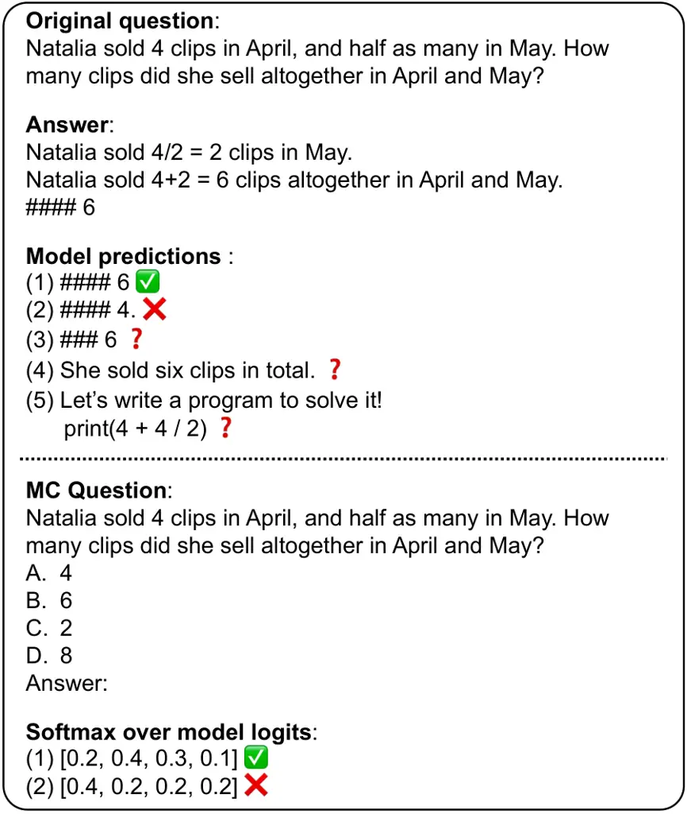
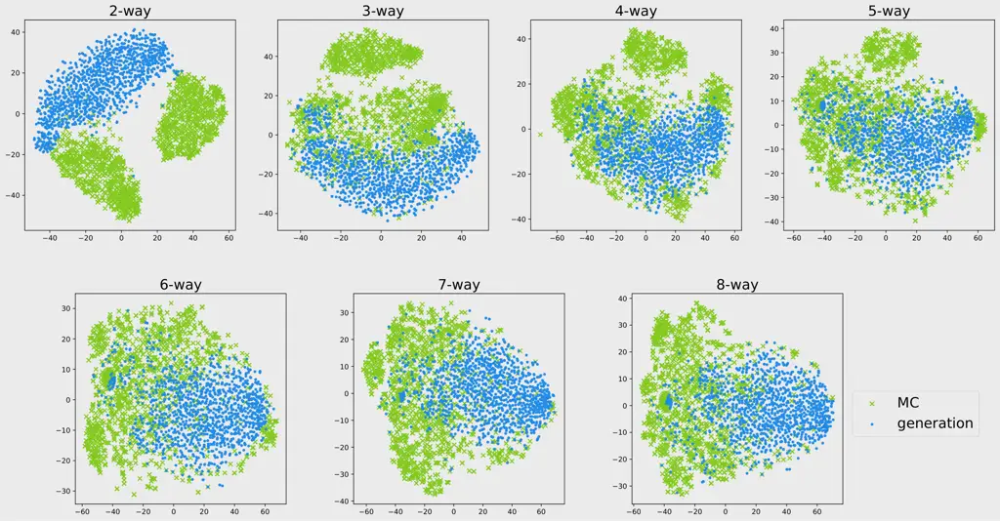

# Multiple-Choice Questions are Efficient and Robust LLM Evaluators

Ziyin Zhang    Zhaokun Jiang    Lizhen Xu    Hongkun Hao    Rui Wang
^(†)^(†)thanks: Corresponding author. Affiliation: Shanghai Jiao Tong
University Affiliation: {daenerystargaryen, wangrui12}@sjtu.edu.cn

###### Abstract

We present GSM-MC, a multiple-choice (MC) dataset constructed by
collecting answers and incorrect predictions on GSM8K from 60
open-source models. Through extensive experiments, we show that LLMs’
performance on the MC version of this popular benchmark is strongly
correlated with their performance on the original version and is quite
robust to distractor choices and option orders, while the evaluation
time is reduced by a factor of up to 30. Following similar procedures,
we introduce MATH-MC, constructed from MATH, and PythonIO, a new program
reasoning MC dataset constructed from HumanEval and MBPP. Experimental
results indicate that LLMs’ performance on these MC benchmarks leaves
much room for improvement. Our data and code are available at
[https://github.com/Geralt-Targaryen/MC-Evaluation](https://github.com/Geralt-Targaryen/MC-Evaluation).

## 1 Introduction

MMLU (Hendrycks et al., 2021a), GSM8K (Cobbe et al., 2021),
MATH (Hendrycks et al., 2021b), HumanEval (Chen et al., 2021), and
MBPP (Austin et al., 2021) are currently the de facto most popular
benchmarks for evaluating LLMs. Among these benchmarks, only MMLU is in
multiple-choice (MC) format, where model predictions can be efficiently
extracted from output logits. In the other benchmarks, the models are
typically evaluated by open-ended generation, from which the answers are
extracted.

Figure 1: An illustrative example of correct, incorrect, and invalid
answers to one question from GSM8K (top). After converting to
multiple-choice format (bottom), a prediction can always be extracted
from model logits.

However, as shown in Figure 1, LLMs may not always follow the required
answer format during generation, which results in many false negatives
when the answers are heuristically extracted from model generations and
evaluated by exact match, as in GSM8K and MATH.

To tackle this issue, in this work we investigate whether short-answer
generation benchmarks like GSM8K and MATH can be converted into a
multiple-choice format to prevent invalid answers like those in Figure 1
from affecting the evaluation accuracy of LLMs. Using GSM8K as a
proof-of-concept example, we collect incorrect predictions from 60
open-source models to construct a pool of distractors for each problem
and convert the problems into an MC format similar to MMLU (which we dub
GSM-MC). Through extensive experiments involving different numbers of
choices (Section 3.4.1) and robustness against different distractor
choices and option orders (Section 3.4.2), we show that LLMs’
performance on GSM-MC is robust to distractors and option orders, and
strongly correlated with the performance on the original GSM8K
regardless of choice numbers (ranging from 2 to 8).

| Benchmark | Training Samples | Test Samples | Source          | Domain                           |
| --------- | ---------------- | ------------ | --------------- | -------------------------------- |
| GSM-MC    | 7468             | 1319         | GSM8K           | grade school math word problems  |
| MATH-MC   | 7278             | 4914         | MATH            | high school math competitions    |
| PythonIO  | 966              | 1684         | HumanEval, MBPP | Python program output prediction |

Table 1: Overview of our MC datasets.

Inspired by the success of converting GSM8K to GSM-MC, we repeat the
same procedure on MATH to construct MATH-MC. The two coding benchmarks,
however, can not be naively converted into MC format in the same way,
which would result in outrageously long and very unnatural questions.
Thus we follow one recent work (Gu et al., 2024) and convert them into a
program output prediction task instead, which we name PythonIO. An
overview of these datasets is provided in Table 1.

## 2 Related Work

The evaluation of LLMs can be categorized as either generation-based or
multiple-choice-based. To compute a model’s score on one specific
generation sample - such as a math word problem in GSM8K (Cobbe et al., 2021) or one program synthesis problem in HumanEval (Chen et al., 2021) - there are several classes of metrics: 1) the first one is based
on content overlap such as exact match, BLEU (Papineni et al., 2002),
and ROUGE (Lin, 2004); 2) the second one is based on model-scoring,
either by computing similarities between model representations (e.g.
BERTScore Zhang et al., 2020), or by regression (e.g. BLEURT Sellam
et al., 2020), or by directly asking a powerful LLM to grade the
sample (Zheng et al., 2023); 3) the third one, specific to code, is
based on functional correctness, where a generated program is run
against a set of tests to verify their functions (Chen et al., 2021;
Zhang et al., 2023). Most reasoning-heavy evaluations - such as math and
coding benchmarks, where a small lexical difference in the answer could
completely change its semantics - adopt the first and the third types of
metrics. However, these metrics also require rigorous and possibly
labor-intensive post-processing of model generations to work correctly,
as exemplified in Figure 1.

On the other hand, to evaluate a model on one MC question - such as one
from MMLU (Hendrycks et al., 2021a) - a binary score is typically
computed by checking whether the model assigns the largest probability
to the correct option id (e.g. “A”) among all the option ids. While some
early works used other methods such as concatenating the content of each
option to the question and comparing their likelihood (Brown et al.,
2020), it has been argued in the literature that such methods
underperform compared with directly asking the model to output the
answer id (Robinson and Wingate, 2023).

Recently Several works have studied the effectiveness and robustness of
evaluating LLMs on MC benchmarks. Savelka et al. (2023) evaluated GPT
models on questions from a Python programming course, finding the models
to struggle with questions that require analysis and reasoning about the
code, such as output prediction. Zheng et al. (2024) analyzed 20 LLMs’
performance on MMLU and other MC benchmarks, finding that LLMs a priori
assign higher probability to certain answer ids. Wang et al. (2024) also
investigated LLMs’ performance on MMLU, finding them to be sensitive to
the ordering of the four options in the question. However, all these
works focused on existing MC benchmarks. To our knowledge, no work has
explored the possibility of converting generation benchmarks into MC
format.

## 3 Converting GSM8K to Multiple-Choice Format

We first use GSM8K - which is relatively small in size and can be
straightforwardly converted into an MC format - as a proof-of-concept
example and validate the rationality of converting short-answer
generation benchmarks into MC format.

Figure 2: LLMs’ answer distributions on GSM8K. Smaller models and
aligned models tend to produce more invalid answers.

Figure 3: Comparison of answer distribution by aligned models with (top)
and without (bottom) applying the instruction template.

### 3.1 A Closer Look at LLMs’ Performance on GSM8K

Using the original prompt format provided by Cobbe et al. (2021), we
evaluated a series of open-source LLMs including Qwen1.5 (Bai et al.,
2023), LLaMA 2 and 3 (Touvron et al., 2023), Mistral (Jiang et al.,
2023), Gemma (Mesnard et al., 2024), Phi 1-3 (Gunasekar et al., 2023; Li
et al., 2023b; Abdin et al., 2024), ChatGLM3 (Zeng et al., 2023),
Flan-T5 (Raffel et al., 2020; Chung et al., 2022), Pythia (Biderman
et al., 2023), and BLOOM (Scao et al., 2022; Muennighoff et al., 2023)
on GSM8K. The results indicate that a non-negligible portion of the
wrong answers arises from failure to parse model outputs, as shown in
Figure 2. Inspecting the invalid answers, we identify three most common
causes: meaningless repetition, not highlighting the answer in the
correct format, and writing programs instead of solving the problems
directly. More details about the prompt and sample outputs can be found
in Figure 8, 9 in Appendix B.

In the main experiments we used greedy decoding for all the evaluated
models and did not apply any chat or instruction template for the
aligned versions. In early experiments, We also evaluated the instruct
versions of LLaMA-3, Mistral, and Phi-3 with their respective
instruction template. As shown in Figure 3, these templates lead to
significantly more invalid responses, and also fewer correct answers for
Mistral and LLaMA. We hypothesize that the instruction templates (for
example, prepending \[INST\] and appending \[/INST\] to the prompt)
interrupt the logical flow established by the consecutive in-context
examples and make it harder for the models to follow the desired format.

### 3.2 Converting to Multiple-Choice Format

To tackle the issue presented in Section 3.1, we collected all the valid
but incorrect answers produced by the evaluated models as a distractor
pool for each problem in the benchmark. We then constructed a new
dataset following the format of MMLU (see Figure 10 in Appendix B). We
also additionally generated distractors for the training set to
facilitate future research.

After converting to MC format, the evaluation process no longer involves
auto-regressive generation but simplifies into one softmax operation
over the option tokens’ corresponding output logits at the end of the
prompt. This leads to a significant reduction in computation cost:
evaluating Qwen1.5-32B on the original GSM8K dataset takes 7 hours on
our machine (distributed across 3 RTX 3090) while evaluating it on the
newly constructed 4-way MC dataset takes only 13 minutes on the same
machine.

Figure 4: Frequency of most likely output token over 1K training set
problems on GSM-MC by base models (top) and aligned models (bottom). The
ground truth answers of the 1K problems are balanced across the four
options.

### 3.3 Can LLMs Understand Multiple-Choice Questions?

As previously mentioned, one advantage of multiple-choice questions is
that they enable the evaluation of any language model on any subject by
simply comparing the output logits of the tokens “A”, “B”, “C”, “D”.
However, the output logits of models are distributed over the entire
vocabulary instead of only these option ids, and it remains unclear
whether LLMs understand the multiple-choice format and tend to produce
these tokens over other irrelevant tokens in the vocabulary. Thus, we
first evaluated several models on one thousand 4-way MC problems
constructed from the training set and counted the frequency of the most
likely output token, presented in Figure 4.

From the figure, we observe that LLMs do understand multiple-choice
format, but with a heavy bias towards certain options, which may be
alleviated by alignment. For example, both BLOOM 7B and Pythia 6.9B only
outputs B and C, but never A and D for all the 1K problems, while the
output distribution is more balanced in BLOOM’s aligned version BLOOMZ.

Another issue Figure 4 reveals is the options tokenization. The
currently most popular evaluation framework of MC problems provided by
Hendrycks et al. (2021a) directly tokenizes the options by calling
tokenizer("A").input_ids\[0\]. However, this does not always yield the
correct token id, since some tokenizers treat “A” and “ A” as different
tokens. For example, in LLaMA 3 tokenizer, the id of token “A” is 32,
produced by the above script, while the id of token “ A” is 362, one of
the most likely tokens generated by the model after an MC question. In
our implementation, we solve this issue by customizing the tokenization
of options for each model.

Figure 5: Model performance on GSM-MC (with the number of choices
ranging from 2 to 8) and the original GSM8K. Each point is one model’s
score on GSM8K (x-axis) and one version of GSM-MC (y-axis), and the
best-fitting line is given in red. The MC scores are strongly correlated
with generation scores (Pearson correlation shown in each subplot’s
title), with a $`p`$-value less than 0.001 in all cases, indicating
statistical significance.

Figure 6: T-SNE visualization of questions in GSM8K and GSM-MC, using 40
models’ correctness on each question as features. Starting from 4-way,
the distribution of MC questions has a high overlap with generative
questions.

### 3.4 Rationality of MC Evaluation

#### 3.4.1 Correlation between MC Evaluation and Open-Ended Evaluation

From the experiments described in Section 3.1 and 3.2, we collected more
than ten distractors for every problem in GSM8K’s test set. Using these
distractors, we constructed MC questions with different numbers of
choices, ranging from 2-way to 8-way. We evaluated all the models
mentioned in Section 3.1 on these seven suites of MC problems, and their
performance is plotted against the performance on original GSM8K in
Figure  5. The results are strongly correlated with statistical
significance in all cases.

To further explore the relation between models’ performance on GSM8K and
GSM-MC, we also visualize the questions in both datasets using the
correctness of 40 models with non-trivial performance as features, as
shown in Figure 6. In the 2-way setting, the MC questions are clearly
structured into two clusters. This is explained by the fact that between
the options “A” and “B”, some models are biased towards the former while
others are biased towards the latter (as shown in Figure 4), which
results in the features of questions with correct answer “A” and those
with correct answer “B” having distinct distributions. However, as can
be seen in Figure 6, as the number of options increases in the MC
questions, this correctness distribution gap is reduced, and the overall
distribution of the MC questions also moves closer to that of the
generative questions.

Based on these findings, we consider 4-way MC problems by default in the
rest of this work and in our released datasets, as 4-way questions are
the most common MC format and our experiments also suggest that 4-way
GSM-MC yields a similar model performance distribution to the original
GSM8K. However, to contribute to future research, we also release all
the distractors used to construct MC questions with more options.

Figure 7: Performance variation on 4-way GSM-MC across ten sets of
questions with different option orders and distractors.

#### 3.4.2 Robustness against Distractors and Choice Orders

Many works studying LLMs’ performance on MC questions have suggested
that LLMs are not robust to choice orders in MC problems (Robinson and
Wingate, 2023; Zheng et al., 2024; Wang et al., 2024). Thus, to explore
LLMs’ robustness on GSM-MC, we constructed ten different sets of 4-way
MC problems from the distractor pool where both the choice of the three
distractors and the order of the four options are randomized and
repeated the previous experiments on these ten sets of problems. The
results are plotted in Figure 7, where it can be observed that the
variation of one model’s performance is quite small compared with the
inter-model difference.

| Distractors      | Std   | Correlation with generation scores |
| ---------------- | ----- | ---------------------------------- |
| model-generated  | 1.083 | 0.859                              |
| randomly sampled | 1.017 | 0.705                              |

Table 2: Comparision of model scores on GSM-MC with model-generated and
randomly sampled distractors: standard deviation across ten sets of
questions, and mean correlation with the scores on the original GSM8K.

We also experimented with an alternative strategy for generating
distractors, where for a question with ground truth answer $`n`$, we
randomly sample distractors in the interval $`[0.5n,1.5n]`$¹¹ 1 When
$`n`$ is less than 40, we sample in $`[n-20,n+20]`$ instead.. Like the
previous experiment, we constructed ten sets of randomized questions and
evaluated the models on them. We find that in this setting, the models’
performance variation across the ten sets of problems is about the same
as model-generated distractors, but the average correlation between
scores on MC questions and the scores on the original GSM8K is much
weaker, as shown in Table 2. Also, this strategy only applies to
benchmarks where the ground truth answers are straightforward numbers,
but fails in other cases (such as LaTeX expressions). Thus we recommend
using model-generated distractors in future research.

## 4 MATH-MC and PythonIO

Inspired by the success of converting GSM8K to MC format, we also
convert three other popular LLM evaluation benchmarks - MATH, HumanEval,
and MBPP - into MC format to accelerate the evaluation of LLMs.

| Model                | GSM-MC         | MATH-MC | PythonIO | Average |
| -------------------- | -------------- | ------- | -------- | ------- |
| Qwen1.5-7B           | 38.43\_(±1.43) | 42.96   | 32.78    | 38.06   |
| Qwen1.5-14B          | 45.40\_(±0.92) | 50.65   | 40.86    | 45.64   |
| Qwen1.5-32B          | 50.83\_(±1.10) | 54.48   | 51.78    | 52.36   |
| Qwen1.5-72B          | 53.28\_(±0.89) | 55.92   | 50.36    | 53.19   |
| Qwen1.5-7B-Chat      | 37.85\_(±1.26) | 43.85   | 32.48    | 38.06   |
| Qwen1.5-14B-Chat     | 46.46\_(±0.99) | 49.98   | 40.86    | 45.77   |
| Qwen1.5-32B-Chat     | 51.92\_(±1.01) | 55.13   | 48.57    | 51.87   |
| Qwen1.5-72B-Chat     | 52.30\_(±1.24) | 56.33   | 50.65    | 53.09   |
| Mistral-7B           | 31.74\_(±1.09) | 34.11   | 31.65    | 32.50   |
| Mistral-7B-Instruct  | 31.00\_(±0.79) | 28.27   | 25.89    | 28.39   |
| LLaMA-2-13B          | 31.48\_(±1.27) | 30.12   | 26.60    | 29.40   |
| LLaMA-2-70B          | 41.92\_(±1.22) | 40.64   | 38.24    | 40.27   |
| LLaMA-2-13B-Chat     | 29.77\_(±0.79) | 28.94   | 28.03    | 28.91   |
| LLaMA-2-70B-Chat     | 34.14\_(±1.27) | 32.36   | 31.47    | 32.66   |
| LLaMA-3-8B           | 33.52\_(±1.15) | 37.63   | 34.38    | 35.18   |
| LLaMA-3-70B          | 49.58\_(±1.00) | 53.99   | 59.92    | 54.50   |
| LLaMA-3-8B-Instruct  | 36.10\_(±1.07) | 37.61   | 38.95    | 37.55   |
| LLaMA-3-70B-Instruct | 61.14\_(±1.37) | 60.26   | 70.07    | 63.82   |
| Gemma-7B             | 37.33\_(±1.04) | 38.36   | 30.52    | 35.40   |
| Gemma-7B-it          | 32.62\_(±0.90) | 33.52   | 27.97    | 31.37   |
| Phi-2                | 30.98\_(±1.08) | 30.44   | 29.75    | 30.39   |
| Phi-3                | 39.26\_(±1.45) | 41.39   | 38.24    | 39.63   |
| ChatGLM3-6B-Base     | 35.32\_(±1.13) | 37.32   | 27.73    | 33.46   |
| ChatGLM3-6B          | 29.69\_(±1.43) | 31.42   | 26.13    | 29.08   |
| Flan-T5-3B           | 25.03\_(±0.87) | 24.93   | 26.60    | 25.52   |
| Flan-T5-11B          | 32.80\_(±1.63) | 26.43   | 29.33    | 29.52   |
| Flan-UL2             | 31.54\_(±0.97) | 27.35   | 25.95    | 28.28   |

Table 3: Selected results on GSM-MC, MATH-MC, and PythonIO. The results
for GSM-MC are the mean value of the ten sets of different problems in
Figure 7, with standard deviation given in subscript.

##### MATH

For MATH, we generated distractors with ChatGLM3, Qwen1.5, Gemma,
Mistral, and Phi-2. As the answers are all latex expressions in this
dataset, we used SymPy²² 2
[https://www.sympy.org/en/index.html](https://www.sympy.org/en/index.html)
to remove lexically different but semantically equivalent answers. After
collecting the distractors, we filtered out a small number of questions
where the ground truth answer extracted from the original solution is
ambiguous (either empty or has more than one answer), which leaves us
with 7.3K training samples and 4.9K test samples.

##### HumanEval and MBPP

For the code generation datasets, we follow Gu et al. (2024) and convert
the task into program output prediction instead. We heuristically
extracted and manually verified input-output pairs from the unit tests
in HumanEval and MBPP, and used Qwen1.5, Mistral, ChatGLM3, LLaMA-3,
Phi-3, Gemma, and StarCoder (Li et al., 2023a) to generate distractors.
We only retained distractors that can be successfully evaluated by a
Python interpreter, and removed any duplicates. For the train/test
split, we use all programs from HumanEval and the test set of MBPP as
test samples, and the rest of MBPP as training samples.

The selected results of our evaluated models on MATH-MC and PythonIO,
along with GSM-MC, are resented in Table 3 (the complete results are
given in Appendix A). Overall, LLaMA-3 70B Instruct is the best
performing model among all the evaluated models, scoring 61.1 on GSM-MC,
60.3 on MATH-MC, and 70.1 on PythonIO. Also, all three benchmarks prove
to be rather challenging tasks, with few models scoring higher than 50,
leaving much room for improvement.

## 5 Conclusion

In this work, we convert two of the most popular LLM evaluation
benchmarks - GSM8K and MATH - into multiple-choice format, and also
construct a new program reasoning benchmark PythonIO from HumanEval and
MBPP. Through extensive experiments, we show that LLMs’ performance on
GSM-MC is strongly correlated with their performance on the original
GSM8K using open-ended generation, regardless of choice numbers and
option orders. With the introduction of these three benchmarks, we hope
to facilitate more efficient LLM evaluation in the research community.

## Limitations

Due to limited computation resources, throughout this work we used only
GSM8K and GSM-MC as a proof-of-concept example to discuss the relation
between a short-answer generation benchmark and its multiple-choice
version. In terms of the other two benchmarks, MATH includes three times
more questions than GSM8K, thus we expect most of the conclusions
regarding robustness that we drew from experiments on GSM-MC to also
hold on MATH-MC. As for PythonIO, the newly constructed benchmark
evaluates a different capability (input-output reasoning) compared with
the original HumanEval and MBPP (program synthesis), and is thus not
directly comparable.

Also, the methodology taken in this work only applies to generation
benchmarks with short, unique ground truth answers, but not other
open-ended generation tasks such as machine translation and
summarization. We leave the exploration of whether these tasks can also
be evaluated more efficiently in multiple-choice format to future works.

## Ethics Statement

Regarding the data resources from which GSM-MC, MAHT-MC, and PythonIO
are constructed, GSM8K, MATH, and HumanEval are released under MIT
license, and MBPP is released under Apache 2.0 license. If you use,
adapt, or redistribute our benchmarks, please also cite the original
resources and include the corresponding license information. Our
benchmarks should not be used outside of research contexts.

## References

- Abdin et al. (2024) Marah Abdin, Sam Ade Jacobs, Ammar Ahmad Awan,
  Jyoti Aneja, Ahmed Awadallah, Hany Awadalla, Nguyen Bach, Amit Bahree,
  Arash Bakhtiari, Harkirat Behl, Alon Benhaim, Misha Bilenko, Johan
  Bjorck, Sébastien Bubeck, Martin Cai, Caio César Teodoro Mendes,
  Weizhu Chen, Vishrav Chaudhary, Parul Chopra, Allie Del Giorno,
  Gustavo de Rosa, Matthew Dixon, Ronen Eldan, Dan Iter, Amit Garg,
  Abhishek Goswami, Suriya Gunasekar, Emman Haider, Junheng Hao,
  Russell J. Hewett, Jamie Huynh, Mojan Javaheripi, Xin Jin, Piero
  Kauffmann, Nikos Karampatziakis, Dongwoo Kim, Mahoud Khademi, Lev
  Kurilenko, James R. Lee, Yin Tat Lee, Yuanzhi Li, Chen Liang, Weishung
  Liu, Eric Lin, Zeqi Lin, Piyush Madan, Arindam Mitra, Hardik Modi, Anh
  Nguyen, Brandon Norick, Barun Patra, Daniel Perez-Becker, Thomas
  Portet, Reid Pryzant, Heyang Qin, Marko Radmilac, Corby Rosset,
  Sambudha Roy, Olatunji Ruwase, Olli Saarikivi, Amin Saied, Adil Salim,
  Michael Santacroce, Shital Shah, Ning Shang, Hiteshi Sharma, Xia Song,
  Masahiro Tanaka, Xin Wang, Rachel Ward, Guanhua Wang, Philipp Witte,
  Michael Wyatt, Can Xu, Jiahang Xu, Sonali Yadav, Fan Yang, Ziyi Yang,
  Donghan Yu, Chengruidong Zhang, Cyril Zhang, Jianwen Zhang, Li Lyna
  Zhang, Yi Zhang, Yue Zhang, Yunan Zhang, and Xiren Zhou. 2024. [Phi-3
  technical report: A highly capable language model locally on your
  phone](https://doi.org/10.48550/ARXIV.2404.14219). _CoRR_,
  abs/2404.14219.
- Austin et al. (2021) Jacob Austin, Augustus Odena, Maxwell I. Nye,
  Maarten Bosma, Henryk Michalewski, David Dohan, Ellen Jiang, Carrie J.
  Cai, Michael Terry, Quoc V. Le, and Charles Sutton. 2021. [Program
  synthesis with large language
  models](http://arxiv.org/abs/2108.07732). _CoRR_, abs/2108.07732.
- Bai et al. (2023) Jinze Bai, Shuai Bai, Yunfei Chu, Zeyu Cui, Kai
  Dang, Xiaodong Deng, Yang Fan, Wenbin Ge, Yu Han, Fei Huang, Binyuan
  Hui, Luo Ji, Mei Li, Junyang Lin, Runji Lin, Dayiheng Liu, Gao Liu,
  Chengqiang Lu, Keming Lu, Jianxin Ma, Rui Men, Xingzhang Ren,
  Xuancheng Ren, Chuanqi Tan, Sinan Tan, Jianhong Tu, Peng Wang, Shijie
  Wang, Wei Wang, Shengguang Wu, Benfeng Xu, Jin Xu, An Yang, Hao Yang,
  Jian Yang, Shusheng Yang, Yang Yao, Bowen Yu, Hongyi Yuan, Zheng Yuan,
  Jianwei Zhang, Xingxuan Zhang, Yichang Zhang, Zhenru Zhang, Chang
  Zhou, Jingren Zhou, Xiaohuan Zhou, and Tianhang Zhu. 2023. [Qwen
  technical report](https://doi.org/10.48550/ARXIV.2309.16609). _CoRR_,
  abs/2309.16609.
- Biderman et al. (2023) Stella Biderman, Hailey Schoelkopf,
  Quentin Gregory Anthony, Herbie Bradley, Kyle O’Brien, Eric Hallahan,
  Mohammad Aflah Khan, Shivanshu Purohit, USVSN Sai Prashanth, Edward
  Raff, Aviya Skowron, Lintang Sutawika, and Oskar van der Wal. 2023.
  [Pythia: A suite for analyzing large language models across training
  and scaling](https://proceedings.mlr.press/v202/biderman23a.html). In
  _International Conference on Machine Learning, ICML 2023, 23-29 July
  2023, Honolulu, Hawaii, USA_, volume 202 of _Proceedings of Machine
  Learning Research_, pages 2397–2430. PMLR.
- Brown et al. (2020) Tom B. Brown, Benjamin Mann, Nick Ryder, Melanie
  Subbiah, Jared Kaplan, Prafulla Dhariwal, Arvind Neelakantan, Pranav
  Shyam, Girish Sastry, Amanda Askell, Sandhini Agarwal, Ariel
  Herbert-Voss, Gretchen Krueger, Tom Henighan, Rewon Child, Aditya
  Ramesh, Daniel M. Ziegler, Jeffrey Wu, Clemens Winter, Christopher
  Hesse, Mark Chen, Eric Sigler, Mateusz Litwin, Scott Gray, Benjamin
  Chess, Jack Clark, Christopher Berner, Sam McCandlish, Alec Radford,
  Ilya Sutskever, and Dario Amodei. 2020. [Language models are few-shot
  learners](https://proceedings.neurips.cc/paper/2020/hash/1457c0d6bfcb4967418bfb8ac142f64a-Abstract.html).
  In _Advances in Neural Information Processing Systems 33: Annual
  Conference on Neural Information Processing Systems 2020, NeurIPS
  2020, December 6-12, 2020, virtual_.
- Chen et al. (2021) Mark Chen, Jerry Tworek, Heewoo Jun, Qiming Yuan,
  Henrique Pondé de Oliveira Pinto, Jared Kaplan, Harrison Edwards, Yuri
  Burda, Nicholas Joseph, Greg Brockman, Alex Ray, Raul Puri, Gretchen
  Krueger, Michael Petrov, Heidy Khlaaf, Girish Sastry, Pamela Mishkin,
  Brooke Chan, Scott Gray, Nick Ryder, Mikhail Pavlov, Alethea Power,
  Lukasz Kaiser, Mohammad Bavarian, Clemens Winter, Philippe Tillet,
  Felipe Petroski Such, Dave Cummings, Matthias Plappert, Fotios
  Chantzis, Elizabeth Barnes, Ariel Herbert-Voss, William Hebgen Guss,
  Alex Nichol, Alex Paino, Nikolas Tezak, Jie Tang, Igor Babuschkin,
  Suchir Balaji, Shantanu Jain, William Saunders, Christopher Hesse,
  Andrew N. Carr, Jan Leike, Joshua Achiam, Vedant Misra, Evan Morikawa,
  Alec Radford, Matthew Knight, Miles Brundage, Mira Murati, Katie
  Mayer, Peter Welinder, Bob McGrew, Dario Amodei, Sam McCandlish, Ilya
  Sutskever, and Wojciech Zaremba. 2021. [Evaluating large language
  models trained on code](http://arxiv.org/abs/2107.03374). _CoRR_,
  abs/2107.03374.
- Chung et al. (2022) Hyung Won Chung, Le Hou, Shayne Longpre, Barret
  Zoph, Yi Tay, William Fedus, Eric Li, Xuezhi Wang, Mostafa Dehghani,
  Siddhartha Brahma, Albert Webson, Shixiang Shane Gu, Zhuyun Dai, Mirac
  Suzgun, Xinyun Chen, Aakanksha Chowdhery, Sharan Narang, Gaurav
  Mishra, Adams Yu, Vincent Y. Zhao, Yanping Huang, Andrew M. Dai,
  Hongkun Yu, Slav Petrov, Ed H. Chi, Jeff Dean, Jacob Devlin, Adam
  Roberts, Denny Zhou, Quoc V. Le, and Jason Wei. 2022. [Scaling
  instruction-finetuned language
  models](https://doi.org/10.48550/ARXIV.2210.11416). _CoRR_,
  abs/2210.11416.
- Cobbe et al. (2021) Karl Cobbe, Vineet Kosaraju, Mohammad Bavarian,
  Mark Chen, Heewoo Jun, Lukasz Kaiser, Matthias Plappert, Jerry Tworek,
  Jacob Hilton, Reiichiro Nakano, Christopher Hesse, and John
  Schulman. 2021. [Training verifiers to solve math word
  problems](http://arxiv.org/abs/2110.14168). _CoRR_, abs/2110.14168.
- Gu et al. (2024) Alex Gu, Baptiste Rozière, Hugh Leather, Armando
  Solar-Lezama, Gabriel Synnaeve, and Sida I. Wang. 2024. [Cruxeval: A
  benchmark for code reasoning, understanding and
  execution](https://doi.org/10.48550/ARXIV.2401.03065). _CoRR_,
  abs/2401.03065.
- Gunasekar et al. (2023) Suriya Gunasekar, Yi Zhang, Jyoti Aneja, Caio
  César Teodoro Mendes, Allie Del Giorno, Sivakanth Gopi, Mojan
  Javaheripi, Piero Kauffmann, Gustavo de Rosa, Olli Saarikivi, Adil
  Salim, Shital Shah, Harkirat Singh Behl, Xin Wang, Sébastien Bubeck,
  Ronen Eldan, Adam Tauman Kalai, Yin Tat Lee, and Yuanzhi Li. 2023.
  [Textbooks are all you
  need](https://doi.org/10.48550/ARXIV.2306.11644). _CoRR_,
  abs/2306.11644.
- Hendrycks et al. (2021a) Dan Hendrycks, Collin Burns, Steven Basart,
  Andy Zou, Mantas Mazeika, Dawn Song, and Jacob Steinhardt. 2021a.
  [Measuring massive multitask language
  understanding](https://openreview.net/forum?id=d7KBjmI3GmQ). In _9th
  International Conference on Learning Representations, ICLR 2021,
  Virtual Event, Austria, May 3-7, 2021_. OpenReview.net.
- Hendrycks et al. (2021b) Dan Hendrycks, Collin Burns, Saurav Kadavath,
  Akul Arora, Steven Basart, Eric Tang, Dawn Song, and Jacob Steinhardt.
  2021b. [Measuring mathematical problem solving with the MATH
  dataset](https://datasets-benchmarks-proceedings.neurips.cc/paper/2021/hash/be83ab3ecd0db773eb2dc1b0a17836a1-Abstract-round2.html).
  In _Proceedings of the Neural Information Processing Systems Track on
  Datasets and Benchmarks 1, NeurIPS Datasets and Benchmarks 2021,
  December 2021, virtual_.
- Jiang et al. (2023) Albert Q. Jiang, Alexandre Sablayrolles, Arthur
  Mensch, Chris Bamford, Devendra Singh Chaplot, Diego de Las Casas,
  Florian Bressand, Gianna Lengyel, Guillaume Lample, Lucile Saulnier,
  Lélio Renard Lavaud, Marie-Anne Lachaux, Pierre Stock, Teven Le Scao,
  Thibaut Lavril, Thomas Wang, Timothée Lacroix, and William El
  Sayed. 2023. [Mistral 7b](https://doi.org/10.48550/ARXIV.2310.06825).
  _CoRR_, abs/2310.06825.
- Li et al. (2023a) Raymond Li, Loubna Ben Allal, Yangtian Zi, Niklas
  Muennighoff, Denis Kocetkov, Chenghao Mou, Marc Marone, Christopher
  Akiki, Jia Li, Jenny Chim, Qian Liu, Evgenii Zheltonozhskii, Terry Yue
  Zhuo, Thomas Wang, Olivier Dehaene, Mishig Davaadorj, Joel
  Lamy-Poirier, João Monteiro, Oleh Shliazhko, Nicolas Gontier, Nicholas
  Meade, Armel Zebaze, Ming-Ho Yee, Logesh Kumar Umapathi, Jian Zhu,
  Benjamin Lipkin, Muhtasham Oblokulov, Zhiruo Wang, Rudra Murthy V,
  Jason Stillerman, Siva Sankalp Patel, Dmitry Abulkhanov, Marco Zocca,
  Manan Dey, Zhihan Zhang, Nour Moustafa-Fahmy, Urvashi Bhattacharyya,
  Wenhao Yu, Swayam Singh, Sasha Luccioni, Paulo Villegas, Maxim
  Kunakov, Fedor Zhdanov, Manuel Romero, Tony Lee, Nadav Timor, Jennifer
  Ding, Claire Schlesinger, Hailey Schoelkopf, Jan Ebert, Tri Dao,
  Mayank Mishra, Alex Gu, Jennifer Robinson, Carolyn Jane Anderson,
  Brendan Dolan-Gavitt, Danish Contractor, Siva Reddy, Daniel Fried,
  Dzmitry Bahdanau, Yacine Jernite, Carlos Muñoz Ferrandis, Sean Hughes,
  Thomas Wolf, Arjun Guha, Leandro von Werra, and Harm de Vries. 2023a.
  [Starcoder: may the source be with
  you!](https://doi.org/10.48550/ARXIV.2305.06161) _CoRR_,
  abs/2305.06161.
- Li et al. (2023b) Yuanzhi Li, Sébastien Bubeck, Ronen Eldan, Allie Del
  Giorno, Suriya Gunasekar, and Yin Tat Lee. 2023b. [Textbooks are all
  you need II: phi-1.5 technical
  report](https://doi.org/10.48550/ARXIV.2309.05463). _CoRR_,
  abs/2309.05463.
- Lin (2004) Chin-Yew Lin. 2004. [ROUGE: A package for automatic
  evaluation of summaries](https://aclanthology.org/W04-1013). In _Text
  Summarization Branches Out_, pages 74–81, Barcelona, Spain.
  Association for Computational Linguistics.
- Mesnard et al. (2024) Thomas Mesnard, Cassidy Hardin, Robert Dadashi,
  Surya Bhupatiraju, Shreya Pathak, Laurent Sifre, Morgane Rivière,
  Mihir Sanjay Kale, Juliette Love, Pouya Tafti, Léonard Hussenot,
  Aakanksha Chowdhery, Adam Roberts, Aditya Barua, Alex Botev, Alex
  Castro-Ros, Ambrose Slone, Amélie Héliou, Andrea Tacchetti, Anna
  Bulanova, Antonia Paterson, Beth Tsai, Bobak Shahriari, Charline Le
  Lan, Christopher A. Choquette-Choo, Clément Crepy, Daniel Cer, Daphne
  Ippolito, David Reid, Elena Buchatskaya, Eric Ni, Eric Noland, Geng
  Yan, George Tucker, George-Christian Muraru, Grigory Rozhdestvenskiy,
  Henryk Michalewski, Ian Tenney, Ivan Grishchenko, Jacob Austin, James
  Keeling, Jane Labanowski, Jean-Baptiste Lespiau, Jeff Stanway, Jenny
  Brennan, Jeremy Chen, Johan Ferret, Justin Chiu, and et al. 2024.
  [Gemma: Open models based on gemini research and
  technology](https://doi.org/10.48550/ARXIV.2403.08295). _CoRR_,
  abs/2403.08295.
- Muennighoff et al. (2023) Niklas Muennighoff, Thomas Wang, Lintang
  Sutawika, Adam Roberts, Stella Biderman, Teven Le Scao, M. Saiful
  Bari, Sheng Shen, Zheng Xin Yong, Hailey Schoelkopf, Xiangru Tang,
  Dragomir Radev, Alham Fikri Aji, Khalid Almubarak, Samuel Albanie,
  Zaid Alyafeai, Albert Webson, Edward Raff, and Colin Raffel. 2023.
  [Crosslingual generalization through multitask
  finetuning](https://doi.org/10.18653/V1/2023.ACL-LONG.891). In
  _Proceedings of the 61st Annual Meeting of the Association for
  Computational Linguistics (Volume 1: Long Papers), ACL 2023, Toronto,
  Canada, July 9-14, 2023_, pages 15991–16111. Association for
  Computational Linguistics.
- Papineni et al. (2002) Kishore Papineni, Salim Roukos, Todd Ward, and
  Wei-Jing Zhu. 2002. [Bleu: a method for automatic evaluation of
  machine translation](https://doi.org/10.3115/1073083.1073135). In
  _Proceedings of the 40th Annual Meeting of the Association for
  Computational Linguistics, July 6-12, 2002, Philadelphia, PA, USA_,
  pages 311–318. ACL.
- Raffel et al. (2020) Colin Raffel, Noam Shazeer, Adam Roberts,
  Katherine Lee, Sharan Narang, Michael Matena, Yanqi Zhou, Wei Li, and
  Peter J. Liu. 2020. [Exploring the limits of transfer learning with a
  unified text-to-text
  transformer](http://jmlr.org/papers/v21/20-074.html). _J. Mach. Learn.
  Res._, 21:140:1–140:67.
- Robinson and Wingate (2023) Joshua Robinson and David Wingate. 2023.
  [Leveraging large language models for multiple choice question
  answering](https://openreview.net/pdf?id=yKbprarjc5B). In _The
  Eleventh International Conference on Learning Representations, ICLR
  2023, Kigali, Rwanda, May 1-5, 2023_. OpenReview.net.
- Savelka et al. (2023) Jaromír Savelka, Arav Agarwal, Christopher
  Bogart, and Majd Sakr. 2023. [Large language models (GPT) struggle to
  answer multiple-choice questions about
  code](https://doi.org/10.5220/0011996900003470). In _Proceedings of
  the 15th International Conference on Computer Supported Education,
  CSEDU 2023, Prague, Czech Republic, April 21-23, 2023, Volume 2_,
  pages 47–58. SCITEPRESS.
- Scao et al. (2022) Teven Le Scao, Angela Fan, Christopher Akiki, Ellie
  Pavlick, Suzana Ilic, Daniel Hesslow, Roman Castagné, Alexandra Sasha
  Luccioni, François Yvon, Matthias Gallé, Jonathan Tow, Alexander M.
  Rush, Stella Biderman, Albert Webson, Pawan Sasanka Ammanamanchi,
  Thomas Wang, Benoît Sagot, Niklas Muennighoff, Albert Villanova del
  Moral, Olatunji Ruwase, Rachel Bawden, Stas Bekman, Angelina
  McMillan-Major, Iz Beltagy, Huu Nguyen, Lucile Saulnier, Samson Tan,
  Pedro Ortiz Suarez, Victor Sanh, Hugo Laurençon, Yacine Jernite,
  Julien Launay, Margaret Mitchell, Colin Raffel, Aaron Gokaslan, Adi
  Simhi, Aitor Soroa, Alham Fikri Aji, Amit Alfassy, Anna Rogers,
  Ariel Kreisberg Nitzav, Canwen Xu, Chenghao Mou, Chris Emezue,
  Christopher Klamm, Colin Leong, Daniel van Strien, David Ifeoluwa
  Adelani, and et al. 2022. [BLOOM: A 176b-parameter open-access
  multilingual language
  model](https://doi.org/10.48550/ARXIV.2211.05100). _CoRR_,
  abs/2211.05100.
- Sellam et al. (2020) Thibault Sellam, Dipanjan Das, and Ankur P.
  Parikh. 2020. [BLEURT: learning robust metrics for text
  generation](https://doi.org/10.18653/V1/2020.ACL-MAIN.704). In
  _Proceedings of the 58th Annual Meeting of the Association for
  Computational Linguistics, ACL 2020, Online, July 5-10, 2020_, pages
  7881–7892. Association for Computational Linguistics.
- Touvron et al. (2023) Hugo Touvron, Louis Martin, Kevin Stone, Peter
  Albert, Amjad Almahairi, Yasmine Babaei, Nikolay Bashlykov, Soumya
  Batra, Prajjwal Bhargava, Shruti Bhosale, Dan Bikel, Lukas Blecher,
  Cristian Canton-Ferrer, Moya Chen, Guillem Cucurull, David Esiobu,
  Jude Fernandes, Jeremy Fu, Wenyin Fu, Brian Fuller, Cynthia Gao,
  Vedanuj Goswami, Naman Goyal, Anthony Hartshorn, Saghar Hosseini, Rui
  Hou, Hakan Inan, Marcin Kardas, Viktor Kerkez, Madian Khabsa, Isabel
  Kloumann, Artem Korenev, Punit Singh Koura, Marie-Anne Lachaux,
  Thibaut Lavril, Jenya Lee, Diana Liskovich, Yinghai Lu, Yuning Mao,
  Xavier Martinet, Todor Mihaylov, Pushkar Mishra, Igor Molybog, Yixin
  Nie, Andrew Poulton, Jeremy Reizenstein, Rashi Rungta, Kalyan Saladi,
  Alan Schelten, Ruan Silva, Eric Michael Smith, Ranjan Subramanian,
  Xiaoqing Ellen Tan, Binh Tang, Ross Taylor, Adina Williams, Jian Xiang
  Kuan, Puxin Xu, Zheng Yan, Iliyan Zarov, Yuchen Zhang, Angela Fan,
  Melanie Kambadur, Sharan Narang, Aurélien Rodriguez, Robert Stojnic,
  Sergey Edunov, and Thomas Scialom. 2023. [Llama 2: Open foundation and
  fine-tuned chat models](https://doi.org/10.48550/ARXIV.2307.09288).
  _CoRR_, abs/2307.09288.
- Wang et al. (2024) Haochun Wang, Sendong Zhao, Zewen Qiang, Bing Qin,
  and Ting Liu. 2024. [Beyond the answers: Reviewing the rationality of
  multiple choice question answering for the evaluation of large
  language models](https://doi.org/10.48550/ARXIV.2402.01349). _CoRR_,
  abs/2402.01349.
- Zeng et al. (2023) Aohan Zeng, Xiao Liu, Zhengxiao Du, Zihan Wang,
  Hanyu Lai, Ming Ding, Zhuoyi Yang, Yifan Xu, Wendi Zheng, Xiao Xia,
  Weng Lam Tam, Zixuan Ma, Yufei Xue, Jidong Zhai, Wenguang Chen,
  Zhiyuan Liu, Peng Zhang, Yuxiao Dong, and Jie Tang. 2023. [GLM-130B:
  an open bilingual pre-trained
  model](https://openreview.net/pdf?id=-Aw0rrrPUF). In _The Eleventh
  International Conference on Learning Representations, ICLR 2023,
  Kigali, Rwanda, May 1-5, 2023_. OpenReview.net.
- Zhang et al. (2020) Tianyi Zhang, Varsha Kishore, Felix Wu, Kilian Q.
  Weinberger, and Yoav Artzi. 2020. [Bertscore: Evaluating text
  generation with BERT](https://openreview.net/forum?id=SkeHuCVFDr). In
  _8th International Conference on Learning Representations, ICLR 2020,
  Addis Ababa, Ethiopia, April 26-30, 2020_. OpenReview.net.
- Zhang et al. (2023) Ziyin Zhang, Chaoyu Chen, Bingchang Liu, Cong
  Liao, Zi Gong, Hang Yu, Jianguo Li, and Rui Wang. 2023. [Unifying the
  perspectives of nlp and software engineering: A survey on language
  models for code](https://doi.org/10.48550/ARXIV.2311.07989). _CoRR_,
  abs/2311.07989.
- Zheng et al. (2024) Chujie Zheng, Hao Zhou, Fandong Meng, Jie Zhou,
  and Minlie Huang. 2024. [Large language models are not robust multiple
  choice selectors](https://openreview.net/forum?id=shr9PXz7T0). In _The
  Twelfth International Conference on Learning Representations_.
- Zheng et al. (2023) Lianmin Zheng, Wei-Lin Chiang, Ying Sheng, Siyuan
  Zhuang, Zhanghao Wu, Yonghao Zhuang, Zi Lin, Zhuohan Li, Dacheng Li,
  Eric P. Xing, Hao Zhang, Joseph E. Gonzalez, and Ion Stoica. 2023.
  [Judging llm-as-a-judge with mt-bench and chatbot
  arena](http://papers.nips.cc/paper_files/paper/2023/hash/91f18a1287b398d378ef22505bf41832-Abstract-Datasets_and_Benchmarks.html).
  In _Advances in Neural Information Processing Systems 36: Annual
  Conference on Neural Information Processing Systems 2023, NeurIPS
  2023, New Orleans, LA, USA, December 10 - 16, 2023_.

## Appendix A Complete Results

| Model                | GSM-MC         | MATH-MC | PythonIO | Average |
| -------------------- | -------------- | ------- | -------- | ------- |
| Qwen1.5-0.5B         | 27.81\_(±1.21) | 25.11   | 25.18    | 26.03   |
| Qwen1.5-1.8B         | 28.46\_(±0.80) | 28.90   | 26.43    | 27.93   |
| Qwen1.5-4B           | 34.75\_(±1.15) | 37.81   | 25.71    | 32.76   |
| Qwen1.5-7B           | 38.43\_(±1.43) | 42.96   | 32.78    | 38.06   |
| Qwen1.5-14B          | 45.40\_(±0.92) | 50.65   | 40.86    | 45.64   |
| Qwen1.5-32B          | 50.83\_(±1.10) | 54.48   | 51.78    | 52.36   |
| Qwen1.5-72B          | 53.28\_(±0.89) | 55.92   | 50.36    | 53.19   |
| Qwen1.5-0.5B-Chat    | 26.75\_(±1.07) | 24.28   | 28.03    | 26.35   |
| Qwen1.5-1.8B-Chat    | 28.08\_(±1.08) | 28.35   | 26.31    | 27.58   |
| Qwen1.5-4B-Chat      | 32.68\_(±1.01) | 36.35   | 25.65    | 31.56   |
| Qwen1.5-7B-Chat      | 37.85\_(±1.26) | 43.85   | 32.48    | 38.06   |
| Qwen1.5-14B-Chat     | 46.46\_(±0.99) | 49.98   | 40.86    | 45.77   |
| Qwen1.5-32B-Chat     | 51.92\_(±1.01) | 55.13   | 48.57    | 51.87   |
| Qwen1.5-72B-Chat     | 52.30\_(±1.24) | 56.33   | 50.65    | 53.09   |
| Mistral-7B           | 31.74\_(±1.09) | 34.11   | 31.65    | 32.50   |
| Mistral-7B-Instruct  | 31.00\_(±0.79) | 28.27   | 25.89    | 28.39   |
| LLaMA-2-7B           | 27.48\_(±0.92) | 29.08   | 23.04    | 26.53   |
| LLaMA-2-13B          | 31.48\_(±1.27) | 30.12   | 26.60    | 29.40   |
| LLaMA-2-70B          | 41.92\_(±1.22) | 40.64   | 38.24    | 40.27   |
| LLaMA-2-7B-Chat      | 26.27\_(±1.25) | 26.48   | 25.53    | 26.09   |
| LLaMA-2-13B-Chat     | 29.77\_(±0.79) | 28.94   | 28.03    | 28.91   |
| LLaMA-2-70B-Chat     | 34.14\_(±1.27) | 32.36   | 31.47    | 32.66   |
| LLaMA-3-8B           | 33.52\_(±1.15) | 37.63   | 34.38    | 35.18   |
| LLaMA-3-70B          | 49.58\_(±1.00) | 53.99   | 59.92    | 54.50   |
| LLaMA-3-8B-Instruct  | 36.10\_(±1.07) | 37.61   | 38.95    | 37.55   |
| LLaMA-3-70B-Instruct | 61.14\_(±1.37) | 60.26   | 70.07    | 63.82   |
| Gemma-2B             | 26.50\_(±1.13) | 26.31   | 24.29    | 25.70   |
| Gemma-7B             | 37.33\_(±1.04) | 38.36   | 30.52    | 35.40   |
| Gemma-2B-it          | 24.82\_(±1.10) | 24.99   | 24.64    | 24.82   |
| Gemma-7B-it          | 32.62\_(±0.90) | 33.52   | 27.97    | 31.37   |
| Phi-1                | 25.46\_(±0.91) | 25.15   | 26.19    | 25.60   |
| Phi-1.5              | 27.09\_(±1.24) | 26.62   | 22.80    | 25.50   |
| Phi-2                | 30.98\_(±1.08) | 30.44   | 29.75    | 30.39   |
| Phi-3                | 39.26\_(±1.45) | 41.39   | 38.24    | 39.63   |
| ChatGLM3-6B-Base     | 35.32\_(±1.13) | 37.32   | 27.73    | 33.46   |
| ChatGLM3-6B          | 29.69\_(±1.43) | 31.42   | 26.13    | 29.08   |

Table 4: The complete results on GSM-MC, MATH-MC, and PythonIO
(continued in Table 5). The results for GSM-MC are the mean value of the
ten sets of different problems in Figure 7, with standard deviation
given in subscript.

| Model        | GSM-MC         | MATH-MC | PythonIO | Average |
| ------------ | -------------- | ------- | -------- | ------- |
| Pythia-70M   | 25.45\_(±1.03) | 26.21   | 27.08    | 26.25   |
| Pythia-160M  | 25.05\_(±1.32) | 24.20   | 25.12    | 24.79   |
| Pythia-410M  | 24.19\_(±0.88) | 24.93   | 23.69    | 24.27   |
| Pythia-1B    | 24.64\_(±1.34) | 23.89   | 22.98    | 23.84   |
| Pythia-1.4B  | 25.05\_(±0.88) | 24.60   | 23.28    | 24.31   |
| Pythia-2.8B  | 24.63\_(±1.07) | 24.01   | 26.19    | 24.94   |
| Pythia-6.9B  | 24.97\_(±0.92) | 23.54   | 25.12    | 24.54   |
| Pythia-12B   | 24.93\_(±1.01) | 24.95   | 25.95    | 25.28   |
| Flan-T5-60M  | 16.95\_(±1.05) | 19.60   | 25.65    | 20.73   |
| Flan-T5-220M | 22.79\_(±0.99) | 22.59   | 24.05    | 23.14   |
| Flan-T5-770M | 24.93\_(±0.83) | 22.18   | 27.20    | 24.77   |
| Flan-T5-3B   | 25.03\_(±0.87) | 24.93   | 26.60    | 25.52   |
| Flan-T5-11B  | 32.80\_(±1.63) | 26.43   | 29.33    | 29.52   |
| Flan-UL2     | 31.54\_(±0.97) | 27.35   | 25.95    | 28.28   |
| BLOOM-0.56B  | 24.73\_(±0.86) | 23.97   | 25.42    | 24.71   |
| BLOOM-1.1B   | 25.50\_(±1.16) | 24.97   | 24.17    | 24.88   |
| BLOOM-1.7B   | 25.79\_(±0.98) | 25.23   | 23.16    | 24.73   |
| BLOOM-3B     | 25.11\_(±1.01) | 25.17   | 24.35    | 24.88   |
| BLOOM-7B     | 25.04\_(±1.19) | 25.03   | 24.23    | 24.77   |
| BLOOMZ-0.56B | 25.05\_(±0.70) | 24.97   | 25.30    | 25.11   |
| BLOOMZ-1.1B  | 24.76\_(±1.14) | 23.22   | 24.64    | 24.21   |
| BLOOMZ-1.7B  | 25.48\_(±1.27) | 24.77   | 24.94    | 25.06   |
| BLOOMZ-3B    | 25.71\_(±1.31) | 24.18   | 24.29    | 24.73   |
| BLOOMZ-7B    | 27.94\_(±0.83) | 25.34   | 22.62    | 25.30   |

Table 5: The complete results on GSM-MC, MATH-MC, and PythonIO
(continued from Table 4). The results for GSM-MC are the mean value of
the ten sets of different problems in Figure 7, with standard deviation
given in subscript.

.

## Appendix B Prompt Details and Sample Outputs

The following are grade school math word problems. Please answer the
last problem following the format of the previous examples. Highlight
the final answer with \####.

Natalia sold clips to 48 of her friends in April, and then she sold half
as many clips in May. How many clips did Natalia sell altogether in
April and May?

Natalia sold 48/2 = \<\<48/2=24\>\>24 clips in May.

Natalia sold 48+24 = \<\<48+24=72\>\>72 clips altogether in April and
May.

\#### 72

{four more in-context examples}

Janet’s ducks lay 16 eggs per day. She eats three for breakfast every
morning and bakes muffins for her friends every day with four. She sells
the remainder at the farmers’ market daily for \$2 per fresh duck egg.
How much in dollars does she make every day at the farmers’ market?

Figure 8: Prompt format for evaluating LLMs on the original GSM8K
dataset. In-context examples come from training set.

\######Pythia 160M\######

A \$2.00 per day, a \$1.00 a day, a \$0.00 a day, a \$0.00 a day, a
\$0.00 a day, a \$0.00 a day, a \$0.00 a day, a \$0.00 a day, a \$0.00 a
day, a \$0.00 a day, a \$0.00 a day, a \$0.00 a day, a \$0.00 a day, a
\$0.00 a day, a \$0.00 a day, a \$0.00 a day, a \$0.00 a day, a \$0.00 a
day, a \$0.00 a day, …

\######BLOOM 1.7B\######

How much does she make per day at the farmers’ market?

Janet eats three eggs for breakfast every morning and bakes four muffins
for her friends every day. She sells the remaining at the farmers’
market daily for \$2 per fresh duck egg. How much in dollars does she
make every day at the farmers’ market? How much does she make per day at
the farmers’ market?

Janet eats three eggs for breakfast every morning and bakes four muffins
for her friends every day. She sells the remaining at the farmers’
market daily for \$2 per fresh duck egg. How much in dollars does she
make every day at the farmers’ market? How much does she make per day at
the farmers’ market?

…

\######Flan-T5 770M\######

Janet eats 3 eggs for breakfast and 4 for muffins every day for a total
of 3 + 4 = 7 eggs. She sells the remaining 16 eggs at the farmers’
market for \$2 per egg for a total of 16 - 7 = \$8 per day. The final
answer: 8.

\######Qwen1.5-Chat 14B\######

Let’s program in Python to solve it.

\# define the variables

eggs_per_day = 16

breakfast_eggs = 3

muffin_eggs = 4

price_per_egg = 2

\# calculate the eggs left after breakfast and baking

eggs_left = eggs_per_day - breakfast_eggs - muffin_eggs

\# calculate the daily earnings

daily_earnings = eggs_left \* price_per_egg

\# print the result

print(daily_earnings)

Figure 9: Typical invalid responses to the question in Figure 8:
repetition at word-level (Pythia) and sentence-level (BLOOM), not
following the answer format (Flan-T5), and writing programs instead of
solving the problem directly (Qwen).

The following are multiple choice questions (with answers) about grade
school math.

Natalia sold clips to 48 of her friends in April, and then she sold half
as many clips in May. How many clips did Natalia sell altogether in
April and May?

A. 30040

B. 84

C. 72

D. 96

Answer: C

{four more in-context examples}

Janet’s ducks lay 16 eggs per day. She eats three for breakfast every
morning and bakes muffins for her friends every day with four. She sells
the remainder at the farmers’ market daily for \$2 per fresh duck egg.
How much in dollars does she make every day at the farmers’ market?

A. 22

B. 64

C. 18

D. 12

Answer:

Figure 10: Prompt format for evaluating LLMs on GSM8K-MC.

The following are multiple choice questions (with answers) about high
school math.

A board game spinner is divided into three parts labeled \$A\$, \$B\$
and \$C\$. The probability of the spinner landing on \$A\$ is
\$\\frac{1}{3}\$ and the probability of the spinner landing on \$B\$ is
\$\\frac{5}{12}\$. What is the probability of the spinner landing on
\$C\$? Express your answer as a common fraction.

A. \\frac{1}{12}

B. \\dfrac{1-\\frac{5}{12}}{12}

C. \\frac{1}{4}

D. \\frac{1}{1.67}

Answer: C

{four more in-context examples}

We roll a fair 6-sided die 5 times. What is the probability that we get
a 6 in at most 2 of the rolls?

A. \\dfrac{50}{1296}

B. \\frac{1}{4}

C. \\frac{625}{648}

D. 1

Answer:

Figure 11: Prompt for evaluating LLMs on MATH-MC.

The following are multiple choice questions (with answers) about Python
program reasoning.

Program:

R = 3

C = 3

def min_cost(cost, m, n):

tc = \[\[0 for x in range(C)\] for x in range(R)\]

tc\[0\]\[0\] = cost\[0\]\[0\]

for i in range(1, m+1):

tc\[i\]\[0\] = tc\[i-1\]\[0\] + cost\[i\]\[0\]

for j in range(1, n+1):

tc\[0\]\[j\] = tc\[0\]\[j-1\] + cost\[0\]\[j\]

for i in range(1, m+1):

for j in range(1, n+1):

tc\[i\]\[j\] = min(tc\[i-1\]\[j-1\], tc\[i-1\]\[j\], tc\[i\]\[j-1\]) +
cost\[i\]\[j\]

return tc\[m\]\[n\]

Input:

min_cost(\[\[1, 2, 3\], \[4, 8, 2\], \[1, 5, 3\]\], 2, 2)

Output:

A. 8

B. 10

C. 12

D. 6

Answer: A

{four more in-context examples}

Program:

def remove_Occ(s,ch):

for i in range(len(s)):

if (s\[i\] == ch):

s = s\[0 : i\] + s\[i + 1:\]

break

for i in range(len(s) - 1,-1,-1):

if (s\[i\] == ch):

s = s\[0 : i\] + s\[i + 1:\]

break

return s

Input:

remove_Occ("hello","l")

Output:

A. "hell"

B. "heo"

C. "helo"

D. "hello"

Answer:

Figure 12: Prompt for evaluating LLMs on PythonIO.
