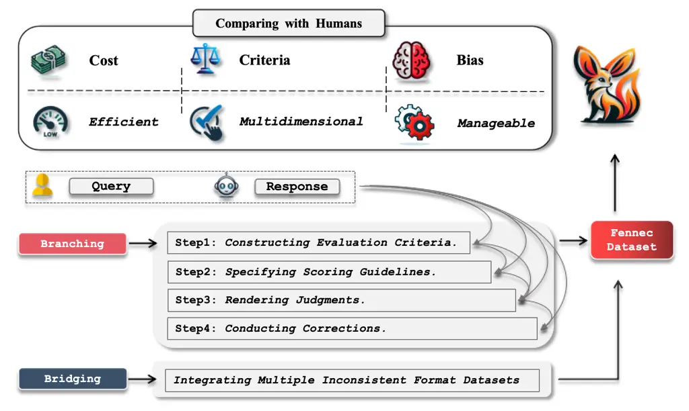
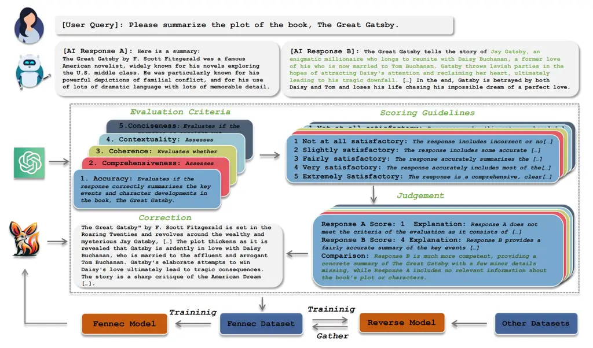
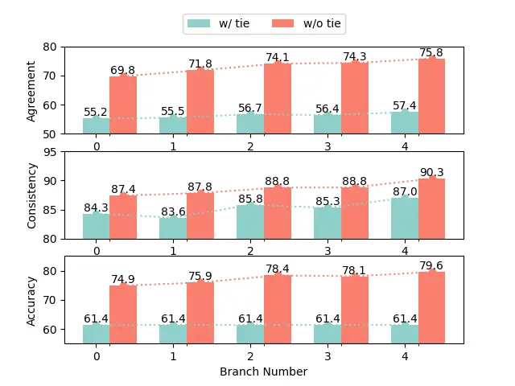
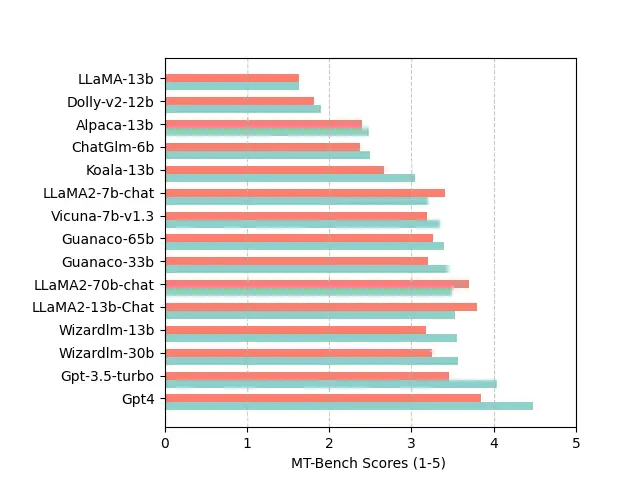
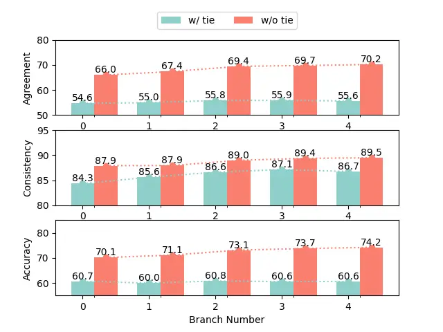
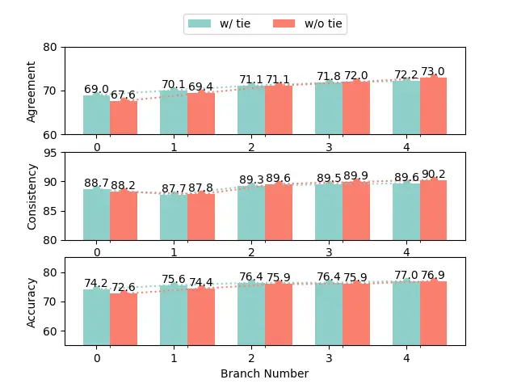

# Fennec: Fine-grained Language Model Evaluation and Correction Extended through Branching and Bridging

Xiaobo Liang ^(∗) Email: <xbliang3@stu.suda.edu.cn>    Haoke Zhang
^(†)^(†)thanks:   Equal Contribution Email: <zctang@stu.suda.edu.cn>   
Helan hu Email: <huhelan@stu.pku.edu.cn>    Juntao Li ^(†)^(†)thanks:
Corresponding Author Email: <xujun03@baidu.com>    Jun Xu
Email: [ljt@suda.edu.cn](mailto:)    Min Zhang
Email: [minzhang@suda.edu.cn](mailto:) Affiliation: Soochow University
Affiliation: Peking University Affiliation: Baidu Inc.

###### Abstract

The rapid advancement of large language models has given rise to a
plethora of applications across a myriad of real-world tasks, mainly
centered on aligning with human intent. However, the complexities
inherent in human intent necessitate a dependence on labor-intensive and
time-consuming human evaluation. To alleviate this constraint, we delve
into the paradigm of employing open-source large language models as
evaluators, aligning with the prevailing trend of utilizing GPT-4.
Particularly, we present a step-by-step evaluation framework: Fennec,
capable of Fine-grained EvaluatioN and correctioN Extended through
branChing and bridging. Specifically, the branching operation dissects
the evaluation task into various dimensions and granularities, thereby
alleviating the challenges associated with evaluation. Concurrently, the
bridging operation amalgamates diverse training datasets, augmenting the
variety of evaluation tasks. In experimental trials, our 7B model
consistently outperforms open-source larger-scale evaluation models
across various widely adopted benchmarks in terms of both Agreement and
Consistency, closely approaching the capabilities of GPT-4. We employ
the fine-grained correction capabilities induced by the evaluation model
to refine multiple model responses, and the results show that the
refinement elevates the quality of responses, leading to an improvement
of 1-2 points on the MT-Bench. Our code is available at Github¹¹ 1
[https://github.com/dropreg/Fennec](https://github.com/dropreg/Fennec).

## 1 Introduction

The inherent complexity of real-world tasks has led to a deficiency in
impartial and equitable evaluations among diverse models Saunders et al.
(2022); Liang et al. (2022), compelling dependence on evaluation methods
that are both effective and efficient. As an alternative to human
evaluation, the use of Large Language Models (LLMs) in automatic
evaluation techniques Zheng et al. (2023); Dubois et al. (2023) has
demonstrated improved efficiency and controllability: (i) cost:
Alleviating the requirements for domain experts, thereby facilitating
scale expansion. (ii) criteria: Enabling the formulation of predefined
evaluation criterion, reducing the ongoing cost of negotiation Markov
et al. (2023). (iii) bias: Mitigating model biases by refining training
data, preventing the incorporation of challenging-to-rectify human
biases Zheng et al. (2023). These advantages position automated
evaluation techniques as an indispensable component in the future
landscape of conversation tasks. In this paper, we focus on the
evaluation of the conversational ability of an LLM assistant Bai et al.
(2022); Zhou et al. (2023), specifically scenarios involving a human
intent query and the response provided by AI. Our goal is to evaluate
how effectively these responses can better understand and fulfill the
user’s authentic intent and requirements.



Figure 1: The illustration of Fennec showcases the construction of data
for model training through branching and bridging for conversational
task evaluation.

The adoption of GPT-4 OpenAI (2023) API calls as an evaluation model or
utilizing the self-instruct Wang et al. (2022) data as a training corpus
for developing new evaluation models has become a prevailing
methodology. However, such methods often overlook the inherent
variations in the capabilities of the backbone models. For example,
smaller LLMs (such as the 7B variants) lack the robust commonsense and
reasoning abilities presented in their larger counterparts (exceeding
100B), thereby frequently giving rise to hallucinatory outputs and even
making erroneous judgments Chen et al. (2023). Our approach integrates a
sequential thought methodology, like chain-of-thought Wei et al. (2022),
enriching the language model with contextual information to
significantly augment the accuracy of its outputs. We employ a branching
operation akin to the methodologies posited in Branch-Solve-Merge Saha
et al. (2023), as depicted in Figure 1. Concretely, the model initiates
the generation of multiple evaluation criteria based on the user query.
Subsequently, it formulates detailed scoring guidelines for these
criteria. The evidence information generated from these intermediate
processes is supplied to the evaluation model to render judgments for
given AI responses and furnish corresponding elucidations. The diverse
comments generated can be directly fed into the evaluation model to
generate corrections for the original responses. Our methodology aids
the model in exploring a broader spectrum of evaluation dimensions and
adapting to diverse grading granularity, thereby enhancing its
adaptability across various scenarios. To ensure reproducibility and
version control Kim et al. (2023), we establish a new open-source
training dataset and utilize it to train our evaluation model.²² 2 Our
uploaded anonymous code and dataset will be released at
[https://anonymous.com](https://anonymous.com).

The scalability of the model is a crucial capability for addressing a
variety of instructions and conversational tasks. What is especially
noteworthy is the common limitation where numerous evaluation models are
exclusively trained on datasets with inconsistent data formats, leading
to poor scalability and even performance degradation on
out-of-distribution datasets. Therefore, a key aspect of scaling up
models is the adoption of a uniform data format and the integration of
multiple datasets for model training. We have developed a bridging
operation to integrate additional datasets into our training corpus.
This involves training a reverse model using existing datasets, where
criteria and scoring guidelines are generated from evaluation judgments.
This expansion of our dataset enhances generalization capabilities
without undermining the existing strengths of the evaluation model.

We conduct a comprehensive examination of Fennec across various
evaluation tasks, encompassing both pairwise-eval and single-eval, and
scenarios such as Auto-P, PandaLM test set, and MT-bench benchmarks. The
results emphasize the superiority of our method over recent endeavors in
evaluation modeling, showcasing competitive performance comparable to
GPT-4 on some specific datasets. Furthermore, our model excels in
refining responses with low scores, leading to enhanced performance in
MT-Bench. In summary:

1.  (I)
    We propose a step-by-step evaluation framework Fennec by
    incorporating branching and bridging techniques. This initiative
    aims to replace human evaluation across a spectrum of conversational
    tasks with complex intents.
2.  (II)
    We released a novel open-source training dataset and a freely
    accessible evaluation model for training and inference with Fennec.
3.  (III)
    Our extensive experiments and analyses provide fresh insights for
    future evaluation endeavors, tackling aspects like the establishment
    of fine-grained evaluation.

These contributions pave the way for the development of automated
evaluation techniques and the construction of private models.



Figure 2: This Figure illustrates Fennec to handle two conversation
responses. We systematically define the dimensions of evaluation and
scoring granularity to construct a context for the dialogue response.
Subsequently, we derive judgments and correction outcomes. More detailed
output results can be referenced in the Appendix A.2.

## 2 Related Work

With significant advancements in large language models across diverse
open-end generation tasks, traditional evaluation metrics such as
BLEU Papineni et al. (2002), ROUGE ROUGE (2004), BERTScore Zhang et al.
(2019), and GPTScore Fu et al. (2023) no longer sufficiently capture the
nuanced performance gaps among various models in these tasks. As a
result, Chatbot Arena Zheng et al. (2023) has emerged as a widely
embraced artificial evaluation platform, utilizing Elo rating to rank
different open-source models. In addition to human evaluation methods,
API-based approaches, exemplified by GPT-4 OpenAI (2023), have
demonstrated the ability to yield judgments closely aligned with those
of human experts. However, these methods are plagued by prohibitive
costs, uncontrolled versioning, closed-source nature Kim et al. (2023),
and potential risks of data leakage and performance instability. To
mitigate these challenges, initiatives such as PandaLM Wang et al.
(2023b), JudgeLM Zhu et al. (2023), Auto-J Li et al. (2023), etc., have
endeavored to leverage open-source models and collected evaluation data
to train dedicated evaluation models. The consistency between these
models and human evaluations on specific datasets can either match or
surpass that achieved by GPT-4. Our research methodology aligns with
mainstream practices, primarily concentrating on evaluation tasks that
involve more universal and complex conversational data. Additionally,
certain task-oriented and multi-agent evaluation methods Jiang et al.
(2023b); Liu et al. (2023); Chan et al. (2023), owing to their
specificity, fall outside the current scope of this work. Nonetheless,
it is noteworthy that Fennec can naturally adapt to these tasks and
scenarios.

In particular, Wang et al. (2023b) employed human annotated dataset to
fine-tune large language models, leading to the development of an
evaluation model.  Li et al. (2023) constructed an evaluation dataset
covering 58 scenarios through heuristic filtering strategies and
post-processing methods and subsequently trained a 13B evaluation model
with it.  Zhu et al. (2023) established a training dataset of 100k
instances and focused on designing various training methods, such as
swap augmentation, reference support, and reference drop, to alleviate
bias problems within the evaluation model during training. Works most
similar to ours include Branch-Solve-Merge (BSM) Saha et al. (2023) and
Prometheus Kim et al. (2023), both of which also decompose the
evaluation process. However, Saha et al. (2023) only propose a task
decomposition method without addressing specific inconsistencies, such
as evaluation dimensions and scales. Kim et al. (2023) decompose the
evaluation task during data construction but adopt a one-step inference
strategy, limiting its evaluation capabilities. Our approach takes into
account the strengths of previous methodologies, incorporating both
branch reasoning and multi-step generation. What is particularly
noteworthy is its commitment to maintaining consistency between training
and inference, supporting various evaluation scenarios.

## 3 Approach

We leverage the dataset $`\mathcal{D}_{\texttt{train}}`$
$`=\{\texttt{Prompt},\mathcal{X},\mathcal{Y}\}`$ for training the
evaluation model, where each sample consists of a specific Prompt, a
paired input $`\mathcal{X}`$, and the correlated output $`\mathcal{Y}`$.
As shown in Figure 2, we offer a thorough explanation of the branching
operation with a focus on dataset construction and the bridging
operation to consolidate multiple datasets used for training the
evaluation model.

### 3.1 Branching

Initially, we utilize GPT-4 model $`\mathcal{P}_{\texttt{G4}}`$ as a
substitute for human annotation to generate the aforementioned dataset
$`\mathcal{D}_{\texttt{train}}`$, which encompasses four sub-datasets
$`\{\mathcal{D}_{\texttt{criteria}},\mathcal{D}_{\texttt{score}},\mathcal{D}_{\texttt{judge}},\mathcal{D}_{\texttt{correction}}\}`$.
It is noteworthy that our evaluation model, during the inference, will
adopt the same procedural steps as the data construction process,
commonly denoted as behavior cloning Ouyang et al. (2022).

Given the paired user query and their corresponding AI assistant
response data
$`\{\mathcal{Q}_{\texttt{user}},\mathcal{R}_{\texttt{AI}}\}`$, we first
generate criteria datasets
$`\mathcal{D}_{\texttt{criteria}}=\{\mathcal{X}_{\texttt{c}},\mathcal{Y}_{\texttt{c}}\}`$
across multiple evaluation dimensions for each query. In this context,
the incorporation of multiple dimensions aims to expand candidate space,
enabling thorough exploration and facilitating the identification of
more rational evaluation Saha et al. (2023). We specify the maximum
dimensions $`N`$ to control the candidate spaces:

```math
\displaystyle\mathcal{Y}_{\texttt{c}}\sim\mathcal{P}_{\texttt{G4}}(\mathcal{Y}|\texttt{Prompt}_{\texttt{c}},\mathcal{X}_{\texttt{c}}), \tag{1}
```

where $`\mathcal{X}_{\texttt{c}}\in\{\mathcal{Q}_{\texttt{user}}\}`$ and
$`\texttt{Prompt}_{\texttt{c}}`$ serve as the language instruction to
guide the language model to generate appropriate outputs.

The scoring guidelines can serve the purpose of offering a more
fine-grained specification for diverse responses, enabling subtle
distinctions between different responses. It is crucial to finely design
scoring guidelines
$`\mathcal{D}_{\texttt{score}}=\{\mathcal{X}_{\texttt{s}},\mathcal{Y}_{\texttt{c}},\mathcal{Y}_{\texttt{s}}\}`$
to circumscribe the model’s decision:

```math
\displaystyle\mathcal{Y}_{\texttt{s}}\sim\mathcal{P}_{\texttt{G4}}(\mathcal{Y}|\texttt{Prompt}_{\texttt{s}},\mathcal{X}_{\texttt{s}},\mathcal{Y}_{\texttt{c}}), \tag{2}
```

where $`\mathcal{X}_{\texttt{s}}\in\{\mathcal{Q}_{\texttt{user}}\}`$ and
$`\texttt{Prompt}_{\texttt{s}}`$ guide the model
$`\mathcal{P}_{\texttt{G4}}`$ to generate detailed scoring guidelines
ranging from 1 to 5 for the current sample.

Based on the established criteria and scoring guidelines, the final
evaluation judgments $`\mathcal{D}_{\texttt{judge}}`$
$`=\{\mathcal{X}_{\texttt{j}},\mathcal{Y}_{\texttt{j}},\mathcal{Y}_{\texttt{c}},\mathcal{Y}_{\texttt{s}}\}`$
can be derived:

```math
\displaystyle\mathcal{Y}_{\texttt{j}}\sim\mathcal{P}_{\texttt{G4}}(\mathcal{Y}|\texttt{Prompt}_{\texttt{j}},\mathcal{X}_{\texttt{j}},\mathcal{Y}_{\texttt{c}},\mathcal{Y}_{\texttt{s}}), \tag{3}
```

where
$`\mathcal{X}_{\texttt{j}}\in\{(\mathcal{Q}_{\texttt{user}},\mathcal{R}_{\texttt{AI}})\}`$.
The $`\texttt{Prompt}_{\texttt{j}}`$ can be classified into two
categories: single-eval and pairwise-eval. Single-evaluation primarily
addresses scenarios where only a singular response necessitates
evaluation. Meanwhile, when faced with scenarios demanding judgment
between two responses, we opt for the pairwise-evaluation. The
distinction between the two manners lies in the fact that pairwise-eval
considers two responses, thereby establishing mutual references that
enhance the accuracy of scoring. Please note that our new dataset is
only constructed using the pairwise-evaluation method and achieves the
ability for single-evaluation through a bridging operation. It is
noteworthy that the criteria and scoring guidelines provide explicit
guidance on scoring considerations, thereby simplifying the task of
predicting judgments and minimizing errors.

We aggregate all the evaluation judgements
$`\mathcal{\widehat{Y}}_{j}=\sum_{i=1}^{N}\mathcal{Y}_{\texttt{j},i}`$
across all $`N`$ dimensions to generate correction suggestion datasets
$`\mathcal{D}_{\texttt{correction}}`$
$`=\{\mathcal{X}_{\texttt{corr}},\mathcal{Y}_{\texttt{corr}},\mathcal{\widehat{Y}}_{\texttt{j}}\}`$,
which will be employed to make focused refinements:

```math
\displaystyle\mathcal{Y}_{\texttt{corr}}\sim\mathcal{P}_{\texttt{G4}}(\mathcal{Y}|\texttt{Prompt}_{\texttt{corr}},\mathcal{X}_{\texttt{corr}},\mathcal{\widehat{Y}}_{\texttt{j}}), \tag{4}
```

where
$`\mathcal{X}_{\texttt{corr}}\in\{(\mathcal{Q}_{\texttt{user}},\mathcal{R}_{\texttt{AI}})\}`$.
Every AI response receiving a low score (scores below 3, as specified in
the paper) requires correction to attain a more objective and
constructive reply.

The aforementioned evaluation process encompasses four distinct tasks,
and we aggregate all these data $`\mathcal{D}_{\texttt{train}}`$ to
fine-tune an open-source pre-trained LLM $`\mathcal{P}_{\theta}`$
through autoregressive modeling:

```math
\displaystyle\mathcal{Y}\sim\overrightarrow{\mathcal{P}_{\theta}}(\mathcal{Y}|\texttt{Prompt},\mathcal{X}). \tag{5}
```

Following the training, in the evaluation phase, we systematically
execute the aforementioned procedures to generate evaluation judgments
and refine AI responses. All prompts and specific details are available
for reference in the Appendix A.1.

### 3.2 Bridging

Increasing the number of tasks and improving data quality Wei et al.
(2021); Chung et al. (2022) has proven effective in guiding LLM toward
better alignment with expected behaviors. We elaborate on the
integration of additional datasets to expand both quantity and usage
scenarios.

Generally, the majority of existing training datasets of evaluation
models provide judgment results $`\mathcal{Y}_{\texttt{j}}`$ but lack
comprehensive evaluation criteria $`\mathcal{Y}_{\texttt{c}}`$ and
scoring guidance $`\mathcal{Y}_{\texttt{s}}`$. To address this, we train
a reverse model $`\overleftarrow{\mathcal{P}_{\theta}}`$ using the
previously constructed evaluation dataset
$`\mathcal{D}_{\texttt{train}}`$. This model will generate the missing
conditions based on judgment results:

```math
\displaystyle\mathcal{\overline{Y}}_{\texttt{c}} \displaystyle\sim\overleftarrow{\mathcal{P}_{\theta}}(\mathcal{Y}|\texttt{Prompt}_{rc},\mathcal{X}_{\texttt{r}},\mathcal{Y}_{\texttt{j}}), \tag{6}
```

```math
\displaystyle\mathcal{\overline{Y}}_{\texttt{s}} \displaystyle\sim\overleftarrow{\mathcal{P}_{\theta}}(\mathcal{Y}|\texttt{Prompt}_{rs},\mathcal{X}_{\texttt{r}},\mathcal{\overline{Y}}_{\texttt{c}},\mathcal{Y}_{\texttt{j}}),
```

where
$`\mathcal{X}_{\texttt{r}}\in\{(\mathcal{Q}_{\texttt{user}},\mathcal{R}_{\texttt{AI}})\}`$.
We utilize $`\texttt{Prompt}_{rs}`$ and $`\texttt{Prompt}_{rc}`$ as
instructions to ensure that the model outputs are correlated with both
the dialogue response and the judgment. The new judgment datasets
$`\mathcal{D}_{\texttt{judge}}`$
$`=\{\mathcal{X}_{\texttt{j}},\mathcal{Y}_{\texttt{j}},\mathcal{\overline{Y}}_{\texttt{c}},\mathcal{\overline{Y}}_{\texttt{s}}\}`$
can be incorporated into the dataset $`\mathcal{D}_{\texttt{train}}`$ to
train the evaluation model $`\overrightarrow{\mathcal{P}_{\theta}}`$. To
ensure the effectiveness of the training process, we filter out
behaviorally inconsistent data, thereby ensuring high quality.

This approach can be extended to novel scenarios through the
standardization of task and prompt formats. For example, as mentioned
earlier, we do not specifically construct training data for single-eval.
Instead, we integrate datasets with single-eval capabilities through a
bridging mechanism.

## 4 Implementation

In this section, we present a detailed implementation of how to
construct training datasets for evaluation models. Specifically, we
employ the branching method to construct
$`\mathcal{D}_{\texttt{Fennec}}`$, subsequently utilizing bridging
techniques to establish $`\mathcal{D}_{\texttt{Fennec-bridging}}`$.

### 4.1 Training Dataset Construction

For the currently available open-source datasets, there are no datasets
suitable for training models using a branching workflow, as illustrated
in Table 1. Drawing inspiration from the latest release, specifically
the conversational dataset³³ 3
[https://github.com/GAIR-NLP/auto-j/blob/main/data/training/pairwise_traindata.jsonl](https://github.com/GAIR-NLP/auto-j/blob/main/data/training/pairwise_traindata.jsonl)
in the Auto-J Li et al. (2023), we have leveraged the capabilities of
GPT-4 to systematically regenerate data for each stage within the
workflow, as $`\mathcal{D}_{\texttt{Fennec}}`$. This dataset comprises a
total of 57k instances, including 3,314 entries for the formulation of
evaluation criteria ($`N=5`$), where additional comprehensive data
statistical details can be found in Appendix A.3.

In recent open-source evaluation endeavors Li et al. (2023); Zhu et al.
(2023); Kim et al. (2023), a prevailing practice is the direct
presentation of judgments, notably lacking associated criteria and
scoring guidance. We employ bridging techniques to systematically
construct these missing information. (1)
$`\mathcal{D}_{\texttt{Auto-J}}`$: Auto-J comprises 3,436 paired
training samples, encompassing a range of tasks such as summarization,
exam questions, and code analysis, spanning 58 diverse scenarios. Each
scenario consists of 100 individual samples. We utilized a reverse model
$`\overleftarrow{\mathcal{P}_{\theta}}`$ to generate specific conditions
for these samples. Considering that judgments may involve various
specifications, the resulting scoring guidance could potentially
encompass multiple evaluation criteria, thereby highlighting the model’s
capacity for generalization beyond strict adherence to the training
data. (2) $`\mathcal{D}_{\texttt{JudgeLM}}`$: JudgeLM⁴⁴ 4
[https://huggingface.co/datasets/BAAI/JudgeLM-100K](https://huggingface.co/datasets/BAAI/JudgeLM-100K)
comprises 100k evaluation samples, derived from responses provided by 11
LLMs. We filter out inappropriate samples in the dataset that require
high-quality reference answers to achieve scores. (3)
$`\mathcal{D}_{\texttt{Prometheus}}`$: Prometheus⁵⁵ 5
[https://huggingface.co/datasets/kaist-ai/Feedback-Collection](https://huggingface.co/datasets/kaist-ai/Feedback-Collection)
consists of 1k fine-grained score rubrics, 20K instructions, and 100K
responses and language feedbacks generated by GPT-4. We selectively
sample a portion of the data to incorporate into the training dataset,
rather than utilizing the entirety of the available data.

In the pairwise evaluation, variations in the positions of two different
AI responses may lead to inconsistencies in output results. This
phenomenon is commonly referred to as positional bias Wang et al.
(2023a); Zheng et al. (2023). To address this concern, we have
proactively employed a common practice: using data augmentation
techniques, specifically by exchanging the order of responses during
training. Similarly, we will employ this method to filter out samples
from the training data exhibiting inconsistent predicted results.

| Dataset                           | $`\mathcal{D}_{\texttt{criteria}}`$ | $`\mathcal{D}_{\texttt{score}}`$ | $`\mathcal{D}_{\texttt{judge}}`$ | $`\mathcal{D}_{\texttt{correction}}`$ |
| --------------------------------- | ----------------------------------- | -------------------------------- | -------------------------------- | ------------------------------------- |
| Auto-J                            | ✗                                   | ✗                                | ✓                                | ✗                                     |
| JudgeLM                           | ✗                                   | ✗                                | ✓                                | ✗                                     |
| Prometheus                        | ✓^(∗)                               | ✓^(∗)                            | ✓                                | ✗                                     |
| $`\mathcal{D}_{\texttt{Fennec}}`$ | ✓                                   | ✓                                | ✓                                | ✓                                     |

Table 1: The datasets used for training the evaluation model encompass
diverse task-related data scenarios. ( ✓^(∗) signifies that the original
work did not encompass the generation of these options during
inference.)

### 4.2 Training and Inference

|                                       |      |                                            |                       |                         |                       |                         |                       |                         |
| ------------------------------------- | ---- | ------------------------------------------ | --------------------- | ----------------------- | --------------------- | ----------------------- | --------------------- | ----------------------- |
| Methods                               | Size | Dataset                                    | Auto-P                |                         | PandaLM-test          |                         | MT-Bench              |                         |
|                                       |      |                                            | Agreement$`\uparrow`$ | Consistency$`\uparrow`$ | Agreement$`\uparrow`$ | Consistency$`\uparrow`$ | Agreement$`\uparrow`$ | Consistency$`\uparrow`$ |
| Open-source/Closed-source Chat Models |      |                                            |                       |                         |                       |                         |                       |                         |
| GPT-4                                 | \-   | \-                                         | 62.28                 | 86.28                   | 60.06                 | 74.67                   | 46.71                 | 67.26                   |
| GPT-3.5                               | \-   | \-                                         | 42.74                 | 62.43                   | \-                    | \-                      | \-                    | \-                      |
| Zephyr                                | 7B   | \-                                         | 31.15                 | 57.21                   | 48.42                 | 68.16                   | 31.38                 | 54.98                   |
| Trained Evaluation Models             |      |                                            |                       |                         |                       |                         |                       |                         |
| Zephyr                                | 7B   | $`\mathcal{D}_{\texttt{Auto-J}}`$          | 51.67                 | 82.06                   | 60.26                 | 79.28                   | 52.82                 | 84.19                   |
| Zephyr                                | 7B   | $`\mathcal{D}_{\texttt{JudgeLM}}`$         | 46.98                 | 84.48                   | 44.54                 | 85.28                   | 46.35                 | 86.26                   |
| PandaLM                               | 7B   | PandaLM                                    | 39.44                 | 66.88                   | \-                    | \-                      | \-                    | \-                      |
| JudgeLM                               | 7B   | JudgeLM                                    | 46.96                 | 72.30                   | 58.26                 | 76.08                   | 44.25                 | 68.66                   |
| Auto-J                                | 13B  | Auto-J                                     | 54.96                 | 83.41                   | 60.68                 | 78.64                   | 50.41                 | 77.84                   |
| Ours                                  |      |                                            |                       |                         |                       |                         |                       |                         |
| Fennec                                | 7B   | $`\mathcal{D}_{\texttt{Fennec}}`$          | 55.80                 | 85.52                   | 70.67                 | 87.89                   | 55.24                 | 86.15                   |
|                                       | 7B   | $`\mathcal{D}_{\texttt{Fennec-bridging}}`$ | 57.40                 | 87.00                   | 72.17                 | 89.69                   | 55.65                 | 86.73                   |

Table 2: The main results on three benchmarks, evaluated through the
pairwise-eval, bolded numbers represent the current best results. (Due
to the frequent format errors in GPT-3.5 results, some experiments did
not include it.)

We utilize Zephyr-7B Chat⁶⁶ 6
[https://github.com/huggingface/alignment-handbook](https://github.com/huggingface/alignment-handbook) Tunstall
et al. (2023), an aligned version of Mistral-7B Jiang et al. (2023a), as
the backbone to train an evaluation model. We train our model with three
epochs on $`8`$ A100s (40GB). We use a cosine learning rate scheduler
with a peak learning rate of $`1e-5`$ and $`10\%`$ warmup steps. We
train all models with a global batch size of $`512`$ and use packing
with a sequence length of $`2,048`$ tokens. It is noteworthy that,
despite its diverse origins, the data within
$`\mathcal{D}_{\texttt{Fennec-bridging}}`$ has been standardized into a
uniform training format, thereby facilitating the utilization of
fine-tuning frameworks for training. During inference, we do not adopt a
sampling approach for correction; instead, other processes utilized a
temperature setting of $`0`$ for result generation.

## 5 Experiments

### 5.1 Pairwise Evaluation

We leverage three benchmarks to compare the performance of different
evaluation models under the pairwise evaluation setting by comparing two
distinct AI responses of different models: Auto-P Li et al. (2023),
PandaLM⁷⁷ 7
[https://github.com/WeOpenML/PandaLM](https://github.com/WeOpenML/PandaLM) Wang
et al. (2023b), and MT-bench⁸⁸ 8
[https://github.com/lm-sys/FastChat/blob/main/fastchat/llm_judge/README.md](https://github.com/lm-sys/FastChat/blob/main/fastchat/llm_judge/README.md) Zheng
et al. (2023) (Due to the model’s paradigm and contextual constraints,
our evaluation specifically focused on the first round of results). To
emphasize the efficacy of our approach, we have selected recent works as
baselines, including PandaLM, JudgeLM Zhu et al. (2023), and Auto-J,
which have been trained using specific training datasets for evaluation.
Additionally, we introduce untrained baselines like Zephyr, alongside
robust commercial models GPT-3.5 and GPT-4. Furthermore, we employ
Consistency after exchanging response orders and Agreement in consistent
assessments aligning with human judgments as the fundamental metrics for
the current task. Particularly noteworthy is the fact that the agreement
metric does not represent the accuracy of all data. Instead, it
indicates the accuracy of model predictions when there is consistency.

As depicted in Table 2, the results demonstrate that our model, trained
on the $`\mathcal{D}_{\texttt{Fennec}}`$ dataset, consistently
outperforms existing open-source evaluation models across multiple
benchmarks. This highlights the efficacy of the branching method in
improving a model’s judgment capability on conversational data.
Furthermore, the Fennec not only surpasses Auto-J on the Auto-P dataset
but also maintains performance across other datasets, emphasizing the
effectiveness of our approach. It indicates a substantial improvement in
the model’s generalization capacity through multiple dimensional and
granular evaluations. Additionally, the utilization of the
$`\mathcal{D}_{\texttt{Fennec-bridging}}`$ dataset further enhances
model performance, substantiating the scalability of the bridging
method. Furthermore, we compared the performance under the same backbone
model, Zephyr, training with different datasets, such as training with
filtered $`\mathcal{D}_{\texttt{Auto-J}}`$ and
$`\mathcal{D}_{\texttt{JudgeLM}}`$. The results indicate that these
bridging datasets do not surpass the performance of Fennec. Through this
comparison, we not only validate the effectiveness of our data
construction and inference approach but also demonstrate that bridging
can harmonize the advantages of multiple datasets to further enhance the
evaluation model.

### 5.2 Single Evaluation

For single evaluation, the task involves assigning a reasonable score to
an individual response without relying on any references. While the
absence of references may lead to a performance reduction, there are
still numerous real-world scenarios where evaluating individual
responses is necessary. In these settings, there is a widespread absence
of human-annotated evaluation datasets, and the lack of a unified domain
and granularity in scoring makes evaluation challenging. In order to
effectively test the consistency between model judgment results and
human behavior, we continue to employ three benchmarks similar to
pairwise evaluation settings. Diverging from previous evaluation
metrics, single-eval doesn’t require swapping the order of responses.
Hence, we employ Accuracy as the metric to validate the model.

|               |        |              |          |
| ------------- | ------ | ------------ | -------- |
| Methods       | Auto-P | PandaLM-test | MT-Bench |
| Pairwise-Eval |        |              |          |
| Auto-J        | 60.28  | 69.44        | 58.08    |
| PandaLM       | \-     | 59.26        | \-       |
| Fennec        | 61.84  | 76.91        | 60.60    |
| Single-Eval   |        |              |          |
| Prometheus    | 47.09  | 45.54        | 47.89    |
| Fennec        | 58.15  | 61.46        | 58.85    |

Table 3: The results evaluated through single-eval, employing Accuracy
as the evaluation metric.

As shown in Table 3, it reveals a significant superiority of our
approach over the Prometheus, even surpassing certain reference-based
evaluation models like PandaLM. One major reason is that our method can
provide clearer evaluation rules, which aid in implicit alignment across
different evaluations, resulting in more accurate scoring.
Simultaneously, the results also demonstrate that the bridging approach
can effectively decompose various evaluation processes, facilitating
seamless extension to new scenarios. Besides, we present the Accuracy
results of pairwise-eval, highlighting its performance superiority over
single-eval. Such results align with previous research findings:
reference items play a pivotal role in evaluations, indicating the
preference for employing pairwise evaluation in practical applications.

### 5.3 Response Correction

| Models               | MT-Bench | Impr $`\uparrow`$ |
| -------------------- | -------- | ----------------- |
| GPT-4                | 8.96     | \-                |
| WizardLM-30B         | 7.13     | \-                |
| LLaMA2-13B Chat      | 7.06     | \-                |
| LLaMA2-70B Chat      | 6.99     | \-                |
| LLaMA2-7B Chat       | 6.26     | \-                |
| w/ Fennec Correction | 7.15     | \+ 0.89           |
| Alpaca-13B           | 4.97     | \-                |
| w/ Fennec Correction | 6.84     | \+ 1.87           |

Table 4: The main results on the MT-bench, refined through Fennec
correction to enhance the chat model’s output. (Impr signifies the
performance improvement.)

To test the model’s performance in response correction, we conducted an
evaluation and correction (if necessary) using the MT-bench dataset. In
contrast to the aforementioned dataset, this dataset comprises 160
questions spanning eight distinct domains of knowledge (we solely
utilized results from the first turn). Specifically, we employed the
output of Alpaca Taori et al. (2023) and LLaMA2 Chat Touvron et al.
(2023) models as the dialogues requiring evaluation, and subsequently
utilized Fennec for evaluation and correction. We employ GPT-4 to assign
scores ranging from 1 to 10 Zheng et al. (2023) and also include the
results of WizardLM Xu et al. (2023) for comparison.

The results are shown in Table 4, and it is evident that the responses
after correction exhibit a significant performance improvement.
LLaMA2-7B Chat achieved an improvement of 0.89 points, and Alpaca showed
a notable increase of 1.87 points. Notably, for the lower-performing LLM
assistant, a more substantial enhancement is observed compared to
stronger models. This emphasizes the critical role of our Fennec
correction step in achieving satisfactory responses, particularly for
responses with lower performance. Moreover, the results demonstrate that
after refinement, the model performance of LLaMA2-7B Chat even surpasses
that of LLaMA2 13B and 70B Chat models, highlighting the effectiveness
of our approach.

## 6 Discussions and Analysis

### 6.1 Exploring the Effectiveness of Branching



Figure 3: The Figure illustrates the performance of Fennec on Auto-P
with varying branch numbers.

In this section, we delve into the examination of the influence of
varying branch numbers on performance evaluation. As presented in
Table 3, the results encompass diverse branch numbers, ranging from 1 to
5, on Auto-P (other results refer to Appendix A.4). The results reveal
an ascending trend in both Agreement and Consistency. However, in
contrast, Accuracy demonstrates minimal to no variation. For a deeper
understanding, we carried out a recalibration experiment on the model’s
performance metrics, excluding samples labeled as “tie”. This analysis
revealed an improvement in consistency across all metrics.

From the observations, we can conclude that the branching strategy
proven more effective in distinguishing disparities among various
dialogue responses, enabling the identification of a clear winner rather
than settling for a tied judgment. Nevertheless, the increase in branch
numbers may not authentically reflect changes in model performance,
particularly in datasets abundant with tied samples. Therefore, an
evaluation exclusively on samples labeled as “win/los” becomes
essential. It is important to note that instances labeled as “tie”
represent a compromise made by human annotators encountering challenges
in identifying more suitable evaluation dimensions. Our approach adeptly
addresses this limitation and is particularly suitable for accurately
distinguishing responses in various scenarios. This flexibility allows
for tailored adjustments to mitigate its shortcomings.

### 6.2 The Impact of Backbone Model

| Backbone       | Auto-P                |                         |     |
| -------------- | --------------------- | ----------------------- | --- |
|                | Agreement$`\uparrow`$ | Consistency$`\uparrow`$ |     |
| LLaMA2-7B Chat | 44.68                 | 86.67                   |     |
| Mistral-7B     | 54.49                 | 84.25                   |     |
| Zephyr-7B      | 55.80                 | 85.52                   |     |

Table 5: The results for different backbone models.

To investigate how different backbone models affect evaluation datasets,
we utilized the $`\mathcal{D}_{\texttt{Fennec}}`$ dataset to train
various baseline models. In contrast to the Zephyr used in previous
studies, we also tested models such as Mistral-7B Jiang et al. (2023a)
(without alignment to the preference dataset) and the LLaMA2-7B Chat
model. The results presented in Table 5 illustrate the performance of
these evaluation models on Auto-P. The findings indicate that Fennec,
trained with Zephyr, outperforms all other models. By contrasting these
results with Mistral, the aligned model demonstrates superior
performance compared to the original model. This emphasizes the notion
that aligning the backbone models with human-like behavioral
capabilities leads to significant improvements in the evaluation models’
performance. This phenomenon also encourages us to train the evaluation
model in the future to preferentially utilize aligned models.

### 6.3 System-level Ranking



Figure 4: Values and ranking on MT-Bench. (We rescale the GPT-4 scores
to 1-5 by multiplying with factor 0.5.)

As an evaluation model, a crucial attribute is the ability to rank
different models, especially for comparing the performance of models
trained with different settings or datasets. We gathered output results
from diverse open-source LLMs, including LLaMA2, Dolly Conover et al.
(2023), ChatGLM Zeng et al. (2022), Koala Geng et al. (2023),
Guanaco Dettmers et al. (2023), etc. To achieve the experiment, we
utilized single-eval to obtain the final scores and then compared the
ranking results with GPT-4. From the results in Figure 4, it is evident
that Fennec aligns well with GPT-4. This showcases our model’s capacity
to discern subtle response differences through multidimensional
evaluations, resulting in more accurate judgments. Certainly, it is
inevitable that evaluating some complex data may be challenging. We
believe that this phenomenon can be improved by leveraging a larger
backbone and more extensive datasets.

## 7 Conclusion

In this work, we present Fennec, a step-by-step framework designed for
evaluating conversational response using a branching mechanism,
facilitating a systematic generation of evaluation results.
Additionally, we introduce a novel training dataset and an expansion
method called bridging to enhance the model’s performance and
scalability. Fennec demonstrates remarkable performance and correction
capabilities compared to the current state-of-the-art open-source
evaluation models across various benchmarks. In the near future, we
envision more works exploring the application of branching mechanisms in
fine-grained evaluation tasks. Considering its efficacy in discerning
subtle differences, we believe this approach holds promise for
evaluation in complex conversational scenarios.

## Limitations

The need to address two current points for improvement in our model is
evident. Firstly, we employ a branching method for evaluation,
unavoidably leading to increased inference time. In the current
approach, there is an absence of an effective ranking system for the
candidate space, necessitating traversal to identify suitable evaluation
criteria. Therefore, an expected improvement involves efficiently
ranking the candidate space through preference training, aiding in the
identification of high-priority evaluation criteria within a reasonable
time limit. Additionally, another aspect to consider is that the current
training data and scenarios are limited, allowing evaluation only for
content related to single-turn dialogues and common scenarios.
Consequently, in future work, our goal is to expand the range of usage
scenarios, encompassing multi-turn dialogues and knowledge-intensive
situations such as fact verification and common-sense reasoning.

## Ethics Statement

One notable aspect is whether our dataset includes content requiring
ethical scrutiny. Issues related to hallucinatory outputs and erroneous
content are often encountered in LLMs. However, in the construction of
our dataset, we rigorously controlled the sources of dialogue data
required and used GPT-4 for content generation. Currently, ChatGPT has
strict content moderation, filtering out a significant portion of
inappropriate content. However, the use of our model for content
moderation is still debatable. Our model is designed to identify and
correct inappropriate model outputs, but currently, such content has not
been present in the training data. Of course, we will address this in
future work to make better judgments about additional content.

## References

- Bai et al. (2022) Yuntao Bai, Andy Jones, Kamal Ndousse, Amanda
  Askell, Anna Chen, Nova DasSarma, Dawn Drain, Stanislav Fort, Deep
  Ganguli, Tom Henighan, et al. 2022. Training a helpful and harmless
  assistant with reinforcement learning from human feedback. _arXiv
  preprint arXiv:2204.05862_.
- Chan et al. (2023) Chi-Min Chan, Weize Chen, Yusheng Su, Jianxuan Yu,
  Wei Xue, Shanghang Zhang, Jie Fu, and Zhiyuan Liu. 2023. Chateval:
  Towards better llm-based evaluators through multi-agent debate. _arXiv
  preprint arXiv:2308.07201_.
- Chen et al. (2023) Anthony Chen, Panupong Pasupat, Sameer Singh,
  Hongrae Lee, and Kelvin Guu. 2023. Purr: Efficiently editing language
  model hallucinations by denoising language model corruptions. _arXiv
  preprint arXiv:2305.14908_.
- Chung et al. (2022) Hyung Won Chung, Le Hou, Shayne Longpre, Barret
  Zoph, Yi Tay, William Fedus, Yunxuan Li, Xuezhi Wang, Mostafa
  Dehghani, Siddhartha Brahma, et al. 2022. Scaling
  instruction-finetuned language models. _arXiv preprint
  arXiv:2210.11416_.
- Conover et al. (2023) Mike Conover, Matt Hayes, Ankit Mathur, Xiangrui
  Meng, Jianwei Xie, Jun Wan, Ali Ghodsi, Patrick Wendell, and Matei
  Zaharia. 2023. [Hello dolly: Democratizing the magic of chatgpt with
  open
  models](https://www.databricks.com/blog/2023/03/24/hello-dolly-democratizing-magic-chatgpt-open-models.html).
- Dettmers et al. (2023) Tim Dettmers, Artidoro Pagnoni, Ari Holtzman,
  and Luke Zettlemoyer. 2023. Qlora: Efficient finetuning of quantized
  llms. _arXiv preprint arXiv:2305.14314_.
- Dubois et al. (2023) Yann Dubois, Xuechen Li, Rohan Taori, Tianyi
  Zhang, Ishaan Gulrajani, Jimmy Ba, Carlos Guestrin, Percy Liang, and
  Tatsunori B Hashimoto. 2023. Alpacafarm: A simulation framework for
  methods that learn from human feedback. _arXiv preprint
  arXiv:2305.14387_.
- Fu et al. (2023) Jinlan Fu, See-Kiong Ng, Zhengbao Jiang, and Pengfei
  Liu. 2023. Gptscore: Evaluate as you desire. _arXiv preprint
  arXiv:2302.04166_.
- Geng et al. (2023) Xinyang Geng, Arnav Gudibande, Hao Liu, Eric
  Wallace, Pieter Abbeel, Sergey Levine, and Dawn Song. 2023. [Koala: A
  dialogue model for academic
  research](https://bair.berkeley.edu/blog/2023/04/03/koala/). Blog
  post.
- Jiang et al. (2023a) Albert Q Jiang, Alexandre Sablayrolles, Arthur
  Mensch, Chris Bamford, Devendra Singh Chaplot, Diego de las Casas,
  Florian Bressand, Gianna Lengyel, Guillaume Lample, Lucile Saulnier,
  et al. 2023a. Mistral 7b. _arXiv preprint arXiv:2310.06825_.
- Jiang et al. (2023b) Dongfu Jiang, Yishan Li, Ge Zhang, Wenhao Huang,
  Bill Yuchen Lin, and Wenhu Chen. 2023b. Tigerscore: Towards building
  explainable metric for all text generation tasks. _arXiv preprint
  arXiv:2310.00752_.
- Kim et al. (2023) Seungone Kim, Jamin Shin, Yejin Cho, Joel Jang,
  Shayne Longpre, Hwaran Lee, Sangdoo Yun, Seongjin Shin, Sungdong Kim,
  James Thorne, et al. 2023. Prometheus: Inducing fine-grained
  evaluation capability in language models. _arXiv preprint
  arXiv:2310.08491_.
- Li et al. (2023) Junlong Li, Shichao Sun, Weizhe Yuan, Run-Ze Fan, Hai
  Zhao, and Pengfei Liu. 2023. Generative judge for evaluating
  alignment. _arXiv preprint arXiv:2310.05470_.
- Liang et al. (2022) Percy Liang, Rishi Bommasani, Tony Lee, Dimitris
  Tsipras, Dilara Soylu, Michihiro Yasunaga, Yian Zhang, Deepak
  Narayanan, Yuhuai Wu, Ananya Kumar, et al. 2022. Holistic evaluation
  of language models. _arXiv preprint arXiv:2211.09110_.
- Liu et al. (2023) Minqian Liu, Ying Shen, Zhiyang Xu, Yixin Cao, Eunah
  Cho, Vaibhav Kumar, Reza Ghanadan, and Lifu Huang. 2023. X-eval:
  Generalizable multi-aspect text evaluation via augmented instruction
  tuning with auxiliary evaluation aspects. _arXiv preprint
  arXiv:2311.08788_.
- Markov et al. (2023) Todor Markov, Chong Zhang, Sandhini Agarwal,
  Florentine Eloundou Nekoul, Theodore Lee, Steven Adler, Angela Jiang,
  and Lilian Weng. 2023. A holistic approach to undesired content
  detection in the real world. In _Proceedings of the AAAI Conference on
  Artificial Intelligence_, volume 37, pages 15009–15018.
- OpenAI (2023) OpenAI. 2023. [Gpt-4 technical
  report](http://arxiv.org/abs/2303.08774).
- Ouyang et al. (2022) Long Ouyang, Jeffrey Wu, Xu Jiang, Diogo Almeida,
  Carroll Wainwright, Pamela Mishkin, Chong Zhang, Sandhini Agarwal,
  Katarina Slama, Alex Ray, et al. 2022. Training language models to
  follow instructions with human feedback. _Advances in Neural
  Information Processing Systems_, 35:27730–27744.
- Papineni et al. (2002) Kishore Papineni, Salim Roukos, Todd Ward, and
  Wei-Jing Zhu. 2002. Bleu: a method for automatic evaluation of machine
  translation. In _Proceedings of the 40th annual meeting of the
  Association for Computational Linguistics_, pages 311–318.
- ROUGE (2004) Lin CY ROUGE. 2004. A package for automatic evaluation of
  summaries. In _Proceedings of Workshop on Text Summarization of ACL,
  Spain_, volume 5.
- Saha et al. (2023) Swarnadeep Saha, Omer Levy, Asli Celikyilmaz, Mohit
  Bansal, Jason Weston, and Xian Li. 2023. Branch-solve-merge improves
  large language model evaluation and generation. _arXiv preprint
  arXiv:2310.15123_.
- Saunders et al. (2022) William Saunders, Catherine Yeh, Jeff Wu,
  Steven Bills, Long Ouyang, Jonathan Ward, and Jan Leike. 2022.
  Self-critiquing models for assisting human evaluators. _arXiv preprint
  arXiv:2206.05802_.
- Taori et al. (2023) Rohan Taori, Ishaan Gulrajani, Tianyi Zhang, Yann
  Dubois, Xuechen Li, Carlos Guestrin, Percy Liang, and Tatsunori B.
  Hashimoto. 2023. Stanford alpaca: An instruction-following llama
  model.
  [https://github.com/tatsu-lab/stanford_alpaca](https://github.com/tatsu-lab/stanford_alpaca).
- Touvron et al. (2023) Hugo Touvron, Louis Martin, Kevin Stone, Peter
  Albert, Amjad Almahairi, Yasmine Babaei, Nikolay Bashlykov, Soumya
  Batra, Prajjwal Bhargava, Shruti Bhosale, et al. 2023. Llama 2: Open
  foundation and fine-tuned chat models. _arXiv preprint
  arXiv:2307.09288_.
- Tunstall et al. (2023) Lewis Tunstall, Edward Beeching, Nathan
  Lambert, Nazneen Rajani, Kashif Rasul, Younes Belkada, Shengyi Huang,
  Leandro von Werra, Clémentine Fourrier, Nathan Habib, et al. 2023.
  Zephyr: Direct distillation of lm alignment. _arXiv preprint
  arXiv:2310.16944_.
- Wang et al. (2023a) Peiyi Wang, Lei Li, Liang Chen, Dawei Zhu,
  Binghuai Lin, Yunbo Cao, Qi Liu, Tianyu Liu, and Zhifang Sui. 2023a.
  Large language models are not fair evaluators. _arXiv preprint
  arXiv:2305.17926_.
- Wang et al. (2023b) Yidong Wang, Zhuohao Yu, Zhengran Zeng, Linyi
  Yang, Cunxiang Wang, Hao Chen, Chaoya Jiang, Rui Xie, Jindong Wang,
  Xing Xie, et al. 2023b. Pandalm: An automatic evaluation benchmark for
  llm instruction tuning optimization. _arXiv preprint
  arXiv:2306.05087_.
- Wang et al. (2022) Yizhong Wang, Yeganeh Kordi, Swaroop Mishra, Alisa
  Liu, Noah A Smith, Daniel Khashabi, and Hannaneh Hajishirzi. 2022.
  Self-instruct: Aligning language model with self generated
  instructions. _arXiv preprint arXiv:2212.10560_.
- Wei et al. (2021) Jason Wei, Maarten Bosma, Vincent Y Zhao, Kelvin
  Guu, Adams Wei Yu, Brian Lester, Nan Du, Andrew M Dai, and Quoc V
  Le. 2021. Finetuned language models are zero-shot learners. _arXiv
  preprint arXiv:2109.01652_.
- Wei et al. (2022) Jason Wei, Xuezhi Wang, Dale Schuurmans, Maarten
  Bosma, Fei Xia, Ed Chi, Quoc V Le, Denny Zhou, et al. 2022.
  Chain-of-thought prompting elicits reasoning in large language models.
  _Advances in Neural Information Processing Systems_, 35:24824–24837.
- Xu et al. (2023) Can Xu, Qingfeng Sun, Kai Zheng, Xiubo Geng, Pu Zhao,
  Jiazhan Feng, Chongyang Tao, and Daxin Jiang. 2023. Wizardlm:
  Empowering large language models to follow complex instructions.
  _arXiv preprint arXiv:2304.12244_.
- Zeng et al. (2022) Aohan Zeng, Xiao Liu, Zhengxiao Du, Zihan Wang,
  Hanyu Lai, Ming Ding, Zhuoyi Yang, Yifan Xu, Wendi Zheng, Xiao Xia,
  et al. 2022. Glm-130b: An open bilingual pre-trained model. _arXiv
  preprint arXiv:2210.02414_.
- Zhang et al. (2019) Tianyi Zhang, Varsha Kishore, Felix Wu, Kilian Q
  Weinberger, and Yoav Artzi. 2019. Bertscore: Evaluating text
  generation with bert. _arXiv preprint arXiv:1904.09675_.
- Zheng et al. (2023) Lianmin Zheng, Wei-Lin Chiang, Ying Sheng, Siyuan
  Zhuang, Zhanghao Wu, Yonghao Zhuang, Zi Lin, Zhuohan Li, Dacheng Li,
  Eric Xing, et al. 2023. Judging llm-as-a-judge with mt-bench and
  chatbot arena. _arXiv preprint arXiv:2306.05685_.
- Zhou et al. (2023) Chunting Zhou, Pengfei Liu, Puxin Xu, Srini Iyer,
  Jiao Sun, Yuning Mao, Xuezhe Ma, Avia Efrat, Ping Yu, Lili Yu,
  et al. 2023. Lima: Less is more for alignment. _arXiv preprint
  arXiv:2305.11206_.
- Zhu et al. (2023) Lianghui Zhu, Xinggang Wang, and Xinlong Wang. 2023.
  Judgelm: Fine-tuned large language models are scalable judges. _arXiv
  preprint arXiv:2310.17631_.

## Appendix A Appendix

### A.1 The Prompts of Fennec

In Table 7, we initially present the system messages for training Fennec
models. These messages can set specific prompts for each execution step,
aiding the model in generating improved results. In Table 9, we
illustrate the prompts needed for each task in the branching process.
These instructions assist the model in generating outputs in a
particular format. Utilizing these specific output formats helps us
extract reply scores more effectively through rule-based approaches. In
Table 8, we have rephrased the evaluation instructions from previous
Auto-J and JudgeLM approaches, incorporating evaluation dimensions and
scoring rules. For Prometheus data, we employed single-evaluation
prompts, as previously mentioned.

### A.2 The Details of Overview

In this section, we present the comprehensive set of data generated
throughout the dialogue training process. This encompasses: 1) Crafting
evaluation criteria, as delineated in Table 11. 2) Articulating scoring
guidelines, elucidated in Table 11. 3) Generating judgments, explicated
in Tables 12, 13, 14, and 15. 4) Creating correction content, as
detailed in Table 16. This meticulous documentation encapsulates the
multifaceted aspects involved in the training process and provides a
structured overview of the evaluative components employed.

|                                            |             |
| ------------------------------------------ | ----------- |
| Datasets                                   | Data Number |
| Evaluation Criteria                        | 3,314       |
| Scoring Guidelines                         | 16,493      |
| Judgement                                  | 32,986      |
| Correction                                 | 4,846       |
| $`\mathcal{D}_{\texttt{Fennec}}`$          | 57,639      |
| $`\mathcal{D}_{\texttt{Auto-J}}`$          | 6,872       |
| $`\mathcal{D}_{\texttt{JudgeLM}}`$         | 53,548      |
| $`\mathcal{D}_{\texttt{Prometheus}}`$      | 16,730      |
| $`\mathcal{D}_{\texttt{Fennec-bridging}}`$ | 134,789     |

Table 6: The statistics of training datasets.

### A.3 The Statistics of Training Datasets

The Table 6 presents data statistics of the Fennec training dataset.
Considering that GPT-4 API may deem some queries in the conversational
data unanswerable, these have been excluded from the final dataset.
Notably, within the $`\mathcal{D}_{\texttt{Fennec-bridging}}`$ dataset,
data from $`\mathcal{D}_{\texttt{Auto-J}}`$,
$`\mathcal{D}_{\texttt{JudgeLM}}`$, and
$`\mathcal{D}_{\texttt{Prometheus}}`$ were subject to filtering to
expedite the training process. In this context, our primary criterion
for filtering out redundant data was the consistency in predicted
scores.



Figure 5: The Figure illustrates the performance of Fennec on MT-bench
with varying branch numbers.



Figure 6: The performance of Fennec on the PandaLM test set with varying
branch numbers.

### A.4 Exploring the Effectiveness of Branching

We present Fennec’s performance, manipulating the branch number on both
the PandaLM test set and MT-bench, as depicted in Figure 5 and Figure 6.
Remarkably, MT-Bench demonstrates a significant 30% occurrence of tie
labels, surpassing the PandaLM dataset’s more modest 10% frequency. In
situations where “tie” label samples are less frequent in the evaluation
dataset, our model significantly outperforms GPT-4, especially in
evaluations that incorporate multiple branches. This supports the claim
that our model excels in situations requiring discernment in response
refinement.

| Step               | Content                                                                                                                                                                                                                                                                 |
| ------------------ | ----------------------------------------------------------------------------------------------------------------------------------------------------------------------------------------------------------------------------------------------------------------------- |
| Criterion          | You are a fair, faithful, and helpful content evaluation assistant. Kindly assist me in accomplishing the assigned task by creating Evaluation Criteria for the provided dialogue.                                                                                      |
| Scoring Guidelines | You are a fair, faithful, and helpful content evaluation assistant. Kindly assist me finalize the assigned task by developing Evaluation Criteria into comprehensive Scoring Guidelines.                                                                                |
| Pairwise-eval      | You are a fair, faithful, and helpful content evaluation assistant. Kindly assist me in finishing the assigned task by providing Pairwise Evaluations for the given dialogue. (Tips: This entails evaluating responses through the comparison of two distinct replies.) |
| Single-eval        | You are a fair, faithful, and helpful content evaluation assistant. Please assist me in completing the assigned task by providing Single-Score Evaluations for the given dialogue. (Tips: This involves assessing individual responses independently.)                  |
| Correction         | You are an assistant capable of assisting in content modification. It is necessary to correct and refine the dialogue based on User Queries, Responses, and corresponding Evaluation results.                                                                           |

Table 7: System messages for Fennec.

| Step    | Content                                                                                                                                                                                                                                                                                                                                                                                                                                                                                                                                                                                                                                                                                                                                                                                                                                                                                                                                                                                                                                                      |
| ------- | ------------------------------------------------------------------------------------------------------------------------------------------------------------------------------------------------------------------------------------------------------------------------------------------------------------------------------------------------------------------------------------------------------------------------------------------------------------------------------------------------------------------------------------------------------------------------------------------------------------------------------------------------------------------------------------------------------------------------------------------------------------------------------------------------------------------------------------------------------------------------------------------------------------------------------------------------------------------------------------------------------------------------------------------------------------ |
| Auto-J  | Given a \[User Query\], please score the responses from two AI assistants according to the \[Evaluation Criteria\] and \[Scoring Guideline\]. Ensure a comparative and objective \[Judge Result\] based on the evaluation criteria and scoring guideline, aiming to identify deficiencies in the response content. Here are the instructions to assess and compare the two responses:1. Pinpoint the key factors to distinguish these two responses.2. Conclude your comparison by providing a final decision on which response is better, or they are tied. Begin your final decision statement with “So, the final decision is Response 1 / Response 2 / Tie”. Ensure that your decision aligns coherently with the comprehensive evaluation and comparison you’ve provided.\*\*\*\[User Query\]:query\*\*\*Evaluation Criteria\]:criteria\*\*\*\[Scoring Guideline\]:scoring\*\*\*\[The Start of Response 1\]:response1\[The End of Response 1\]\*\*\*\[The Start of Response 2\]:response2\[The End of Response 2\]\*\*\*Please return \[Judge Result\]: |
| JudgeLM | Given a \[User Query\], please score the responses from two AI assistants according to the \[Evaluation Criteria\] and \[Scoring Guideline\]. Ensure a comparative and objective assessment based on the evaluation criteria and scoring guideline, aiming to identify deficiencies in the response content. Provide a final score of 1-10 along with relevant explanations.\*\*\*\[User Query\]:query\*\*\*\[Evaluation Criteria\]:criteria\*\*\*\[Scoring Guideline\]:scoring\*\*\*\[The Start of Assistant 1’s Response\]:response1\[The End of Assistant 1’s Response\]\*\*\*\[The Start of Assistant 2’s Response\]:response2\[The End of Assistant 2’s Response\]\*\*\*Please return \[Judge Result\]:                                                                                                                                                                                                                                                                                                                                                 |

Table 8: Bridging prompts for Fennec.

| Step               | Content                                                                                                                                                                                                                                                                                                                                                                                                                                                                                                                                                                                                                                                                                                                                                                                                                                                                                                               |
| ------------------ | --------------------------------------------------------------------------------------------------------------------------------------------------------------------------------------------------------------------------------------------------------------------------------------------------------------------------------------------------------------------------------------------------------------------------------------------------------------------------------------------------------------------------------------------------------------------------------------------------------------------------------------------------------------------------------------------------------------------------------------------------------------------------------------------------------------------------------------------------------------------------------------------------------------------- |
| Criteria           | For evaluating human satisfaction with responses from an AI assistant based on a \[User Query\], we need to brainstorm and establish five \[Evaluation Criteria\] directly linked to the user’s query. These criteria play a crucial role in objectively assessing response content, with higher priority and greater evaluation weight.\*\*\*As an illustration:1. Relevance: Evaluate whether the response is directly related to the user’s query.2. Criterion: Assess the correctness of the information provided in the response. etc.\*\*\*\[User Query\]:query\*\*\*Please return five \[Evaluation Criteria\]:                                                                                                                                                                                                                                                                                                |
| Scoring Guidelines | Consider a \[User Query\] and \[Evaluation Criteria\] for evaluating response satisfaction. Reflect on these criteria and offer a comprehensive \[Scoring Guideline\] on a scale of 1-5 (1 represents ’Not at all satisfactory’ and 5 represents ’Extremely satisfactory’). Ensure that these guidelines are closely tied to both the user query and the assessment criteria, allowing for a precise evaluation of possible responses to the user query. Conduct a detailed comparison of the \[Scoring Guideline\] to ease adherence and assist individuals in assigning reasonable scores.\*\*\*\[User Query\]:query\*\*\*\[Evaluation Criteria\]:criteria\*\*\*Please return detailed \[Scoring Guideline\]:                                                                                                                                                                                                       |
| Pairwise-eval      | Given a \[User Query\], please score the responses (A and B) from two AI assistants according to the \[Evaluation Criteria\] and \[Scoring Guideline\]. Ensure a comparative and objective assessment based on the evaluation criteria and scoring guideline, aiming to identify deficiencies in the response content. Provide a final score of 1-5 along with relevant explanations.\*\*\*\[User Query\]:query\*\*\*\[Evaluation Criteria\]:criteria\*\*\*\[Scoring Guideline\]:scoring\*\*\*\[The Start of Response A\]:response1\[The End of Response A\]\*\*\*\[The Start of Response B\]:response2\[The End of Response B\]\*\*\*Please return \[Judge Result\] as follows:Response A Score: 3Explanation: Explanation of the score for the Response A.Response B Score: 3Explanation: Explanation of the score for the Response B.Comparison: The comparison of the Response A and Response B.\[Judge Result\]: |
| Single-eval        | Given a \[User Query\], please score the responses from AI assistants according to the \[Evaluation Criteria\] and \[Scoring Guideline\]. Ensure a comparative and objective assessment based on the evaluation criteria and scoring guideline, aiming to identify deficiencies in the response content.\*\*\*\[User Query\]:query\*\*\*\[Evaluation Criteria\]:criteria\*\*\*\[Scoring Guideline\]:scoring\*\*\*\[The Start of Response\]:response\[The End of Response\]\*\*\*Assign a score as an integer between 1 and 5. Provide a detailed \[Judge Result\] strictly based on the given Scoring Guideline, refraining from a general evaluation. Please return \[Judge Result\] as follows:Response Score: 3Explanation: Explanation of the score for the Response.Please return \[Judge Result\]:                                                                                                              |
| Correction         | Provided with a \[User Query\], the AI assistant’s \[Original Response\], and a comprehensive objective evaluation of the response, please attend to the identified shortcomings in the original response according to the \[Judge Result\]. Make certain that the modified response remains objective, non-harmful, and constructive in addressing the user’s query intent, while also aligning with human behavioral norms.\*\*\*\[User Query\]:query\*\*\*\[The Start of Original Response\]:response\[The End of Original Response\]\*\*\*\[The Start of Judge Result\]:judge\[The End of Judge Result\]. Kindly return one final \[Modified Response\] for user query directly without additional information.Please return \[Modified Response\]:                                                                                                                                                               |

Table 9: Evaluation prompts for Fennec.

| Data          | Content                                                                                                                                                                                                                                                                                                                                                                                                                                                                                                                                                                                                           |
| ------------- | ----------------------------------------------------------------------------------------------------------------------------------------------------------------------------------------------------------------------------------------------------------------------------------------------------------------------------------------------------------------------------------------------------------------------------------------------------------------------------------------------------------------------------------------------------------------------------------------------------------------- |
| User Query    | Please summarize the plot of the book, The Great Gatsby.                                                                                                                                                                                                                                                                                                                                                                                                                                                                                                                                                          |
| AI Response A | Here is a summary: The Great Gatsby by F. Scott Fitzgerald was a famous American novelist, widely known for his novels exploring the U.S. middle class. He was particularly known for his powerful depictions of familial conflict, and for his use of lots of dramatic language with lots of memorable detail.                                                                                                                                                                                                                                                                                                   |
| AI Response B | The Great Gatsby tells the story of Jay Gatsby, an enigmatic millionaire who longs to reunite with Daisy Buchanan, a former love of his who is now married to Tom Buchanan. Gatsby throws lavish parties in the hopes of attracting Daisy’s attention and reclaiming her heart, ultimately leading to his tragic downfall. Throughout the story, Gatsby’s story of love and loss is contrasted with the hollowness and false values of the wealthy and powerful people that surround him. In the end, Gatsby is betrayed by both Daisy and Tom and loses his life chasing his impossible dream of a perfect love. |

Table 10: The exhibited conversational data comprises user query and
responses generated by two selected AI.

| Data               | Content                                                                                                                                                                                                                                                                                                                                                                                                                                                                                                                                                                                                                                                                                                                                                                                                                                                                                                                                                                                                                                                                                                                                                                                                                                                                                                                                                                                                                                                                                                                                                                                                                   |
| ------------------ | ------------------------------------------------------------------------------------------------------------------------------------------------------------------------------------------------------------------------------------------------------------------------------------------------------------------------------------------------------------------------------------------------------------------------------------------------------------------------------------------------------------------------------------------------------------------------------------------------------------------------------------------------------------------------------------------------------------------------------------------------------------------------------------------------------------------------------------------------------------------------------------------------------------------------------------------------------------------------------------------------------------------------------------------------------------------------------------------------------------------------------------------------------------------------------------------------------------------------------------------------------------------------------------------------------------------------------------------------------------------------------------------------------------------------------------------------------------------------------------------------------------------------------------------------------------------------------------------------------------------------- |
| Criteria           | Accuracy: Evaluates if the response correctly summarizes the key events and character developments in the book, The Great Gatsby.                                                                                                                                                                                                                                                                                                                                                                                                                                                                                                                                                                                                                                                                                                                                                                                                                                                                                                                                                                                                                                                                                                                                                                                                                                                                                                                                                                                                                                                                                         |
| Scoring Guidelines | 1. Not at all satisfactory: The response includes incorrect or no information about the plot of The Great Gatsby. Major events and character developments are misunderstood or unmentioned. 2. Slightly satisfactory: The response includes some accurate information about the plot and characters of The Great Gatsby, but significant elements are omitted or misrepresented. The explanation may lack cohesion or be difficult to follow. 3. Fairly satisfactory: The response accurately summarizes the main plot and provides some details about character developments in The Great Gatsby but lacks emphasis on key events. Not all major points are touched upon, or the explanation lacks thoroughness or clarity. 4. Very satisfactory: The response accurately includes most of the main plot points and character developments in The Great Gatsby, demonstrating a good understanding of the novel. Some minor elements may be missing, or the explanation may have small inaccuracies. 5. Extremely Satisfactory: The response is a comprehensive, clear, and precise summary of the plot of The Great Gatsby, capturing all major events and significant character developments. It reflects a deep understanding and thorough reading of the novel. In Summary: 1 Major inaccuracies and omissions are present. 2 Some correct information, but many key points are missed or inaccurate. 3 Good summary, although some key events or character developments may be missing. 4 Nearly complete summary with minor omissions or slight inaccuracies. 5 Full, comprehensive summary with perfect accuracy. |
| Judgement          | Response A Score: 1 Explanation: Response A does not meet the criteria of the evaluation as it consists of incorrect information and does not include any details about the book’s plot or characters. The explanation given is more about F. Scott Fitzgerald, who is the author of the book and not the actual content of the book. The details provided are incorrect and irrelevant. Response B Score: 4 Explanation: Response B provides a fairly accurate summary of the key events and characters in The Great Gatsby. It discussed the main character, Jay Gatsby, his love interest Daisy, her husband Tom Buchanan, and the consequences Gatsby faces due to his unrequited love for Daisy. The AI could have included more context and detail about the theme of the American Dream and the time period to secure a score of 5. Comparison: Response B is much more competent, providing a concrete summary of The Great Gatsby with a few minor details missing, while Response A includes no relevant information about the book’s plot or characters.                                                                                                                                                                                                                                                                                                                                                                                                                                                                                                                                                       |

Table 11: The scoring guidelines and judgment for the “Accuracy”
evaluation criterion.

| Data               | Content                                                                                                                                                                                                                                                                                                                                                                                                                                                                                                                                                                                                                                                                                                                                                                                                                                                                                                                                                                                                                                                                                                                                                                                                                                                                                                                                                                                                                                                                                                                                                                                                                                                                                                                                                                                                                                                                                                                  |
| ------------------ | ------------------------------------------------------------------------------------------------------------------------------------------------------------------------------------------------------------------------------------------------------------------------------------------------------------------------------------------------------------------------------------------------------------------------------------------------------------------------------------------------------------------------------------------------------------------------------------------------------------------------------------------------------------------------------------------------------------------------------------------------------------------------------------------------------------------------------------------------------------------------------------------------------------------------------------------------------------------------------------------------------------------------------------------------------------------------------------------------------------------------------------------------------------------------------------------------------------------------------------------------------------------------------------------------------------------------------------------------------------------------------------------------------------------------------------------------------------------------------------------------------------------------------------------------------------------------------------------------------------------------------------------------------------------------------------------------------------------------------------------------------------------------------------------------------------------------------------------------------------------------------------------------------------------------ |
| Criteria           | Comprehensiveness: Assesses if the response encapsulates all important elements in the book, including themes, plot lines, and crucial characters.                                                                                                                                                                                                                                                                                                                                                                                                                                                                                                                                                                                                                                                                                                                                                                                                                                                                                                                                                                                                                                                                                                                                                                                                                                                                                                                                                                                                                                                                                                                                                                                                                                                                                                                                                                       |
| Scoring Guidelines | 1. Not at all satisfactory: Not at all satisfactory: The response has either not answered the query or only mentioned the name of the book without any further details about its plot, themes, or important characters. 2. Slightly satisfactory: The response addresses only a part of the user query, for instance, highlights one or two main events in the plot or mentions one main character, leaving out other significant elements of the story. 3. Fairly satisfactory: The response provides a synopsis of the plot and identifies major characters but lacks depth such as nuances in the storyline, interconnectedness of characters, or omission of crucial themes that the book also addresses. 4. Very satisfactory: The response provides a comprehensive summary of the plot, identifies all the essential characters, including their contribution to the plot, but only briefly touches upon the thematic elements in the book or their interpretations. 5. Extremely Satisfactory: The response provides a thorough summary of the plot, identifies all key characters and explains their role in the story, and discusses major themes in the book like the American Dream, wealth, and social stratification. It also interprets how these themes play out against the backdrop of the 1920’s American society, a core element in “The Great Gatsby”. The response provides an in-depth understanding of the text and stimulates further thinking. In Summary: In comparing these guidelines, it is crucial to remember that a score of one means that the response is inadequate and fails to satisfy the user’s query. In contrast, a score of five means that the response is robust and offers a comprehensive understanding of the book, meeting all the user’s expectations. Intermediate scores between 2 to 4 progressively signify the extent of completeness and detail in the response. |
| Judgement          | Response A Score: 1 Explanation: Response A failed to provide a satisfactory summary of “The Great Gatsby.” There’s only a general background about the author but no specific information related to the plot, characters, or themes of the book, which is the primary requirement of the user’s query. This response doesn’t meet the necessary criteria for comprehensiveness, as it does not encapsulate any important elements of the book. Response B Score: 3 Explanation: Response B mildly satisfies the query. It has summarized the plot and mentioned the lead characters, i.e., Jay Gatsby, Daisy Buchanan, and Tom Buchanan. However, the response doesn’t delve deeper into the nuances of the plotline, interconnectedness of characters, and fails to mention the significant themes of the story. The summary is good but lacks depth and complexity. Comparison: Response B is superior to Response A as it provides specific details about the plot and characters of “The Great Gatsby,” partially satisfying the user’s query. On the other hand, Response A did not provide any important details about the book aside from a generic reference to the author’s other works. Therefore, in terms of comprehensiveness, Response B clearly outmatches Response A.                                                                                                                                                                                                                                                                                                                                                                                                                                                                                                                                                                                                                                  |

Table 12: The scoring guidelines and judgment for the
“Comprehensiveness” evaluation criterion.

| Data               | Content                                                                                                                                                                                                                                                                                                                                                                                                                                                                                                                                                                                                                                                                                                                                                                                                                                                                                                                                                                                                                                                                                                                                                                                                                                                                                                                                                                                                                                                                                                                                                                                                                                                                                                                                                                                                                                                                                                                                                                                                                                                                                                                 |
| ------------------ | ----------------------------------------------------------------------------------------------------------------------------------------------------------------------------------------------------------------------------------------------------------------------------------------------------------------------------------------------------------------------------------------------------------------------------------------------------------------------------------------------------------------------------------------------------------------------------------------------------------------------------------------------------------------------------------------------------------------------------------------------------------------------------------------------------------------------------------------------------------------------------------------------------------------------------------------------------------------------------------------------------------------------------------------------------------------------------------------------------------------------------------------------------------------------------------------------------------------------------------------------------------------------------------------------------------------------------------------------------------------------------------------------------------------------------------------------------------------------------------------------------------------------------------------------------------------------------------------------------------------------------------------------------------------------------------------------------------------------------------------------------------------------------------------------------------------------------------------------------------------------------------------------------------------------------------------------------------------------------------------------------------------------------------------------------------------------------------------------------------------------- |
| Criteria           | Coherence: Evaluates whether the response is logically structured, ensuring that the storyline summarization flows sensibly from the beginning to the end.                                                                                                                                                                                                                                                                                                                                                                                                                                                                                                                                                                                                                                                                                                                                                                                                                                                                                                                                                                                                                                                                                                                                                                                                                                                                                                                                                                                                                                                                                                                                                                                                                                                                                                                                                                                                                                                                                                                                                              |
| Scoring Guidelines | 1. Not at all satisfactory: The summary does not reflect the plot of The Great Gatsby. The response is scattered and lacks logical progression. There’s no connection stated between the beginning, middle, and end of the story and it’s unclear what happens in the book based on the response. 2. Slightly satisfactory: The summary minimally reflects the plot of The Great Gatsby, but significant details are missing or misrepresented. The response shows an attempt at logical progression, but is not successful, and might jump around chronologically within the storyline. 3. Moderately satisfactory: The summary represents the main plot of The Great Gatsby in a partially clear and coherent way. Major plot points are captured and the storyline shows some discernable organization, but minor details may be overlooked or misrepresented. There may exist gaps in chronological progression. 4. Very satisfactory: The summary clearly represents the main plot of The Great Gatsby and most key events are captured accurately. The storyline logically progresses from the beginning to end, although minor details may still be overlooked or slightly misrepresented. 5. Extremely Satisfactory: The summary accurately and concisely encompasses the entire plot of The Great Gatsby. It is detailed and thorough, capturing all key events from the beginning to the end in a logically coherent fashion. No major or minor details are overlooked, and the response reflects a clear and complete understanding of the book. In Summary: the scoring increases from 1 to 5, the summary provided becomes more thorough, accurate, and logically structured. At lower scores, there are large gaps within the summary, misrepresentations of important details, and poor flow, whereas at higher scores the response accurately represents every aspect of the plot in a very detailed, thorough, and logical manner. A score of 1 would indicate a lack of understanding of the story, while a score of 5 would reflect a complete understanding and perfect representation of the plot. |
| Judgement          | Response A Score: 1 Explanation: Response A does not summarize the plot of The Great Gatsby at all. It only provides a general comment on the author’s body of work, rather than focusing on the plot of the requested book. It completely fails to mention any storyline or character in the novel, thus not providing any form of summarization, resulting in the lowest score as per the Scoring Guideline. Response B Score: 4 Explanation: Response B provides an accurate overview of the main plot of The Great Gatsby. It covers the central character, Jay Gatsby, his longing for Daisy Buchanan, the parties he throws, and his tragic downfall. However, it fails to mention some minor but vital details such as the role of the narrator, Nick Carraway, and the dichotomy between East Egg and West Egg. Therefore, though very satisfactory, the score cannot reach the highest rank due to slightly missed details. Comparison: Comparatively, Response B provides a clear, logically structured plot summary of The Great Gatsby, but Response A does not address the user query at all. Response B shows understanding and knowledge of the book, lacking a bit in detail. On the other hand, Response A does not reflect any understanding of the book, resulting in a lower score.                                                                                                                                                                                                                                                                                                                                                                                                                                                                                                                                                                                                                                                                                                                                                                                                                 |

Table 13: The scoring guidelines and judgment for the “Coherence”
evaluation criterion.

| Data               | Content                                                                                                                                                                                                                                                                                                                                                                                                                                                                                                                                                                                                                                                                                                                                                                                                                                                                                                                                                                                                                                                                                                                                                                                                                                                                                                                                                                                                                                                                                                                                                                                                                                                                                                                                                                                                                                                                                                                                                                                                       |
| ------------------ | ------------------------------------------------------------------------------------------------------------------------------------------------------------------------------------------------------------------------------------------------------------------------------------------------------------------------------------------------------------------------------------------------------------------------------------------------------------------------------------------------------------------------------------------------------------------------------------------------------------------------------------------------------------------------------------------------------------------------------------------------------------------------------------------------------------------------------------------------------------------------------------------------------------------------------------------------------------------------------------------------------------------------------------------------------------------------------------------------------------------------------------------------------------------------------------------------------------------------------------------------------------------------------------------------------------------------------------------------------------------------------------------------------------------------------------------------------------------------------------------------------------------------------------------------------------------------------------------------------------------------------------------------------------------------------------------------------------------------------------------------------------------------------------------------------------------------------------------------------------------------------------------------------------------------------------------------------------------------------------------------------------- |
| Criteria           | Contextuality: Assesses whether the response reflects the contextual background of the book, such as the social and cultural setting in which the story is set.                                                                                                                                                                                                                                                                                                                                                                                                                                                                                                                                                                                                                                                                                                                                                                                                                                                                                                                                                                                                                                                                                                                                                                                                                                                                                                                                                                                                                                                                                                                                                                                                                                                                                                                                                                                                                                               |
| Scoring Guidelines | 1. Not at all satisfactory: Responses under this category barely address the user query. They do not provide an accurate or any summary of “The Great Gatsby”. Any mention of the social, cultural, or geographic context in which the story is set is incorrect or completely missing. 2. Not very satisfactory: These responses do provide a summary of the book, however, they are laden with inaccuracies or missing key points from the novel’s plot. They have a slight mention of the social and cultural setting of the book, but the references added are incorrect, vague, or tangential. 3. Moderately satisfactory: Responses falling under this category attempt to provide an accurate summary of “The Great Gatsby”. They may have minor inaccuracies, but overall, the key elements of the plot are included. They also touch upon the contextual background of the book but may fail to provide a detailed view of the social and cultural atmosphere pertinent to the storyline. 4. Very satisfactory: These responses deliver an accurate and comprehensive summary of “The Great Gatsby”, identifying crucial plot points. The responses also include a clear discussion of the social and cultural setting, indicating an understanding of the impact of these factors on the narrative; however, more depth or precision may be required. 5. Extremely Satisfactory: Responses in this category not only provide a very accurate, detailed, and comprehensive summary of “The Great Gatsby” but also successfully weave in a rich understanding of the social and cultural setting. These responses demonstrate how the contextual atmosphere of the Roaring Twenties contributes to the characters’ motivations, decisions, and the plot’s progression. In Summary: One should consider these guidelines fluid rather than strictly dichotomous. Responses might also display characteristics from adjacent categories and should be rated according to the evaluator’s best judgment. |
| Judgement          | Response A Score: 1 Explanation: Response A does not provide a summary of “The Great Gatsby”. It only mentions the author and vaguely discusses his style, missing the user query altogether which asked for a summary of the plot. It has no mention of the social, cultural, or geographic context in which the story is set. The rating thus falls under the Score 1 category of the scoring guideline. Response B Score: 4 Explanation: Response B provides a coherent summary of “The Great Gatsby”, identifying key plot points such as Gatsby’s longing for Daisy, his extravagant parties, and his tragic end. Furthermore, it also hints at the social and cultural setting of the novel by mentioning the ’wealthy and powerful’ people and their ’false values.’ However, it could have explored the contextual setting, such as the Roaring Twenties, in more depth to score higher. Therefore, it falls under the Score 4 category of the scoring guideline. Comparison: Response B superiorly addresses the user query compared to Response A, providing not only an accurate summary of the book but also reflecting, to a certain degree, the social and cultural setting of the story. Response A, on the other hand, doesn’t even address the user’s query about summarizing the book’s plot.                                                                                                                                                                                                                                                                                                                                                                                                                                                                                                                                                                                                                                                                                               |

Table 14: The scoring guidelines and judgment for the “Contextuality”
evaluation criterion.

| Data               | Content                                                                                                                                                                                                                                                                                                                                                                                                                                                                                                                                                                                                                                                                                                                                                                                                                                                                                                                                                                                                                                                                                                                                                                                                                                                                                                                                                                                                                                                                                                                                                                                                                                                                                                                                                                                                                                                                                                                                                                   |
| ------------------ | ------------------------------------------------------------------------------------------------------------------------------------------------------------------------------------------------------------------------------------------------------------------------------------------------------------------------------------------------------------------------------------------------------------------------------------------------------------------------------------------------------------------------------------------------------------------------------------------------------------------------------------------------------------------------------------------------------------------------------------------------------------------------------------------------------------------------------------------------------------------------------------------------------------------------------------------------------------------------------------------------------------------------------------------------------------------------------------------------------------------------------------------------------------------------------------------------------------------------------------------------------------------------------------------------------------------------------------------------------------------------------------------------------------------------------------------------------------------------------------------------------------------------------------------------------------------------------------------------------------------------------------------------------------------------------------------------------------------------------------------------------------------------------------------------------------------------------------------------------------------------------------------------------------------------------------------------------------------------- |
| Criteria           | Conciseness: Evaluates if the response is succinct yet comprehensive, providing a complete summary without unnecessary digression or redundancy.                                                                                                                                                                                                                                                                                                                                                                                                                                                                                                                                                                                                                                                                                                                                                                                                                                                                                                                                                                                                                                                                                                                                                                                                                                                                                                                                                                                                                                                                                                                                                                                                                                                                                                                                                                                                                          |
| Scoring Guidelines | 1. Not at all satisfactory: The response doesn’t summarize the plot of ’The Great Gatsby’ or it includes wrong details. It rambles or digresses significantly from the main request, or is overly verbose without providing sufficient detail about the story. 2. Not very satisfactory: The response gives a vague or partial plot of the book. There’s some digression or redundancy, but some key elements of the story are mentioned. Some unnecessary details make the summary less concise. 3. Moderately satisfactory: The response summarizes the main plot of ’The Great Gatsby’, but it might miss some important details or contain some unnecessary information. There’s a balance between conciseness and comprehensiveness. 4. Very satisfactory: The response is fairly concise yet comprehensive. It manages to summarize the main plot of ’The Great Gatsby’ without much digression. It might miss minor details or add a bit of extra information, but overall it maintains good balance between brevity and thoroughness. 5. Extremely Satisfactory: The response perfectly summarizes ’The Great Gatsby’. It’s concise, sticking to the important details only, yet comprehensive, covering all key aspects of the plot. It doesn’t include any unnecessary information or digress from the query, achieving a perfect balance of conciseness and comprehensiveness. In Summary: This scoring guideline serves as a standard when evaluating responses, making sure they cater to the user query while adhering to the chosen evaluation criteria, i.e., conciseness and comprehensiveness in this case. Comparatively, a response scoring 1 or 2 on this scale would need significant improvement, while a response scoring 3 demonstrates average adherence. A score of 4 indicates that the response was strong, whereas a score of 5 should be reserved for responses that exemplify an ideal balance between conciseness and comprehensiveness. |
| Judgement          | Response A Score: 1 Explanation: Response A doesn’t provide a strong and concise summary of ’The Great Gatsby’. It does not adhere to user’s request of summarizing the plot. Rather, it digresses into talking about the author, which is irrelevant. The story of the book itself is not explained at all, which is a clear deviation from the user query. Hence, falling into the first category of our scoring guideline. Response B Score: 5 Explanation: Response B manages to balance conciseness and comprehensiveness perfectly, as defined in category five of the scoring guidelines. It discusses the key elements of the plot of ’The Great Gatsby’ succinctly. It talks about the protagonist, his love interest, as well as thematic elements of the book like false values of the rich and Gatsby’s tragic end, without unnecessary information or digression. Comparison: The comparison of these two responses highlights the deficiencies in Response A. It doesn’t address the user query at all, whereas Response B not only answers the query but does so in a succinct and comprehensive manner, striking a perfect balance between being brief yet detailed. Therefore, Response B should be considered as the ideal response.                                                                                                                                                                                                                                                                                                                                                                                                                                                                                                                                                                                                                                                                                                                    |

Table 15: The scoring guidelines and judgment for the “Conciseness”
evaluation criterion.

| Data                  | Content                                                                                                                                                                                                                                                                                                                                                                                                                                                                                                                                                                                                                                                                                                                                                                                                                                                                                      |
| --------------------- | -------------------------------------------------------------------------------------------------------------------------------------------------------------------------------------------------------------------------------------------------------------------------------------------------------------------------------------------------------------------------------------------------------------------------------------------------------------------------------------------------------------------------------------------------------------------------------------------------------------------------------------------------------------------------------------------------------------------------------------------------------------------------------------------------------------------------------------------------------------------------------------------- |
| Response A Correction | “The Great Gatsby” by F. Scott Fitzgerald is set in the Roaring Twenties and revolves around the wealthy and mysterious Jay Gatsby, who is known for his lavish parties. The novel is narrated by Nick Carraway, Gatsby’s neighbor, who recounts his observations about the lifestyle in Long Island’s West Egg neighborhood. The plot thickens as it is revealed that Gatsby is ardently in love with Daisy Buchanan, who is married to the affluent and arrogant Tom Buchanan. Gatsby’s elaborate attempts to win Daisy’s love ultimately lead to tragic consequences. The story is a sharp critique of the American Dream, exploring themes of wealth, social status, love, and disillusionment.                                                                                                                                                                                          |
| Response B Correction | The Great Gatsby is a riveting tale of Jay Gatsby, a mysterious millionaire, pining for his former lover, Daisy Buchanan. However, Daisy is now married to Tom Buchanan. Hoping to attract Daisy, Gatsby organizes extravagant parties, which emphasizes the extravagance and emptiness of the wealthy elite. The narrative delves into Gatsby’s relentless pursuit of his romantic ideals, only to be met with tragic repercussions. More so, Gatsby’s infatuation with Daisy also symbolizes his pursuit of the American Dream, a critical theme in the book. The story highlights how his quest for love intertwines with Daisy and Tom’s, leading to a tragic climax where Gatsby is let down by those he trusted. The narrative comments on the hollowness of high society and explores themes such as wealth, love, and illusion, making it a poignant critique of the American Dream. |

Table 16: Results of AI responses correction following the previous
evaluation feedback.
