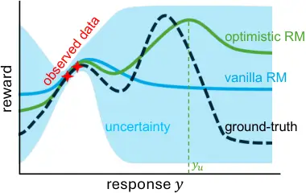

# Self-Exploring Language Models: Active Preference Elicitation for Online Alignment

Shenao Zhang   Donghan Yu   Hiteshi Sharma   Han Zhong   Zhihan Liu
Affiliation: Northwestern University        
Affiliation: Microsoft         Affiliation: Peking University    Ziyi
Yang    Shuohang Wang    Hany Hassan    Zhaoran Wang
Affiliation: Northwestern University        
Affiliation: Microsoft        

###### Abstract

Preference optimization, particularly through Reinforcement Learning
from Human Feedback (RLHF), has achieved significant success in aligning
Large Language Models (LLMs) to adhere to human intentions. Unlike
offline alignment with a fixed dataset, online feedback collection from
humans or AI on model generations typically leads to more capable reward
models and better-aligned LLMs through an iterative process. However,
achieving a globally accurate reward model requires systematic
exploration to generate diverse responses that span the vast space of
natural language. Random sampling from standard reward-maximizing LLMs
alone is insufficient to fulfill this requirement. To address this
issue, we propose a bilevel objective optimistically biased towards
potentially high-reward responses to actively explore
out-of-distribution regions. By solving the inner-level problem with the
reparameterized reward function, the resulting algorithm, named
Self-Exploring Language Models (SELM), eliminates the need for a
separate RM and iteratively updates the LLM with a straightforward
objective. Compared to Direct Preference Optimization (DPO), the SELM
objective reduces indiscriminate favor of unseen extrapolations and
enhances exploration efficiency. Our experimental results demonstrate
that when fine-tuned on Zephyr-7B-SFT and Llama-3-8B-Instruct models,
SELM significantly boosts the performance on instruction-following
benchmarks such as MT-Bench and AlpacaEval 2.0, as well as various
standard academic benchmarks in different settings. Our code and models
are available at
[https://github.com/shenao-zhang/SELM](https://github.com/shenao-zhang/SELM).

## 1 Introduction

Large Language Models (LLMs) have recently achieved significant success
largely due to their ability to follow instructions with human intent.
As the defacto method for aligning LLMs, Reinforcement Learning from
Human Feedback (RLHF) works by maximizing the reward function, either a
separate model (Ouyang et al., 2022; Bai et al., 2022; Gao et al., 2023)
or reparameterized by the LLM policy (Rafailov et al., 2024b; Rafailov
et al., 2024a; Azar et al., 2023; Zhao et al., 2023), which is learned
from the prompt-response preference data labeled by humans. The key to
the success of alignment is the response diversity within the preference
data, which prevents reward models (RMs) from getting stuck in local
optima, thereby producing more capable language models.

Offline alignment methods (Rafailov et al., 2024b; Tang et al., 2024)
attempt to manually construct diverse responses for fixed prompts (Cui
et al., 2023; Ivison et al., 2023; Zhu et al., 2023), which,
unfortunately, struggles to span the nearly infinite space of natural
language. On the other hand, online alignment follows an iterative
procedure: sampling responses from the LLM and receiving feedback to
form new preference data for RM training (Ouyang et al., 2022; Guo
et al., 2024). The former step helps explore out-of-distribution (OOD)
regions through randomness in sampling. However, in standard online RLHF
frameworks, maximizing the expected reward learned from the collected
data is the only objective for the LLM, sampling from which often leads
to responses clustered around local optima. This passive exploration
mechanism can suffer from overfitting and premature convergence, leaving
the potentially high-reward regions unexplored.

To address this issue, we propose an active exploration method for
online alignment that elicits novel favorable responses. In its simplest
form, an optimism term $`\alpha\max_{y}r(x,y)`$ is added to the
reward-fitting objective (e.g., the negative log-likelihood loss
$`\mathcal{L}_{\text{lr}}`$ on dataset $`\mathcal{D}`$), resulting in a
bilevel optimization objective for the reward model $`r`$:

```math
\displaystyle\max_{r}\max_{y}\alpha r(x,y)-\mathcal{L}_{\text{lr}}(r;\mathcal{D}), \tag{1.1}
```

where $`\alpha`$ is a hyperparameter controlling the degree of optimism.
The intuition is illustrated in Figure 1. Specifically, minimizing the
vanilla reward-fitting loss $`\mathcal{L}_{\text{lr}}`$ is likely to
give a locally accurate RM that overfits the observed data and gets
stuck in local minima. Random sampling from this vanilla RM may take a
long time to explore the OOD regions that contain the best response. By
incorporating the optimism term, we obtain an RM that both fits the data
well and has a large $`\max_{y}r(x,y)`$. This ensures that the greedy
response $`y_{u}`$ from it is either globally optimal when uncertainty
in high-reward regions is eliminated, or potentially good in unexplored
areas where $`r(x,y_{u})`$ can be arbitrarily huge due to the relaxed
reward-fitting loss. Feedback from humans on these responses $`y_{u}`$
can then reduce uncertainty and train a more accurate RM.



Figure 1: Intuition of our method. For a fixed prompt $`x`$, a reward
model $`r(x,y)`$ tries to fit the ground-truth reward $`r^{*}(x,y)`$.
The blue and green RMs are equally good when using standard
reward-fitting loss $`\mathcal{L}_{\text{lr}}`$, since the observed
preference data (red stars) are fitted equally well. However, the green
RM has a larger $`\max_{y}r(x,y)`$ and thus a lower optimistically
biased loss $`\mathcal{L}_{\text{lr}}-\alpha\max_{y}r(x,y)`$. Therefore,
the response $`y_{u}`$ at which the uncertainty is high can be elicited
and then proceeded for human feedback to reduce uncertainty.

In this paper, we formulate this idea within the context of online
direct alignment, where the LLM is iteratively updated without a
separate RM. We first introduce two modifications to the bilevel RM
objective in (1.1), namely adding KL constraints and using relative
maximum reward. Then we derive a simple LLM training objective by
applying the closed-form solution of the inner-level problem and
reparameterizing the reward with the LLM policy. The resulting iterative
algorithm is called Self-Exploring Language Models (SELM). We show that
the policy gradient of SELM is biased towards more rewarding areas.
Furthermore, by reducing the chance of generating responses that are
assigned low implicit rewards, SELM mitigates the indiscriminate
favoring of unseen extrapolations in DPO (Rafailov et al., 2024b;
Rafailov et al., 2024a) and enhances exploration efficiency.

In experiments, we implement SELM using Zephyr-7B-SFT (Tunstall et al.,
2023b) and Llama-3-8B-Instruct (Meta, 2024) as base models. By
fine-tuning solely on the UltraFeedback (Cui et al., 2023) dataset and
using the small-sized PairRM (Jiang et al., 2023) for iterative AI
feedback, SELM boosts the performance of Zephyr-7B-SFT and
Llama-3-8B-Instruct by a large margin on AlpacaEval 2.0 (Dubois et al., 2024) ($`+16.24\%`$ and $`+11.75\%`$ LC win rates) and MT-Bench (Zheng
et al., 2024) ($`+2.31`$ and $`+0.32`$). SELM also demonstrates strong
performance on standard academic benchmarks and achieves higher pairwise
LC win rates against the very strong iterative DPO baseline, with almost
no additional computational overhead under fair comparisons.

## 2 Related Work

#### Data Synthesis for LLMs.

A key challenge for fine-tuning language models to align with users’
intentions lies in the collection of demonstrations, including both the
SFT instruction-following expert data and the RLHF preference data.
Gathering such data from human labelers is expensive, time-consuming,
and sometimes suffers from variant quality (Ouyang et al., 2022; Köpf
et al., 2024). To address this issue, synthetic data (Liu et al., 2024a)
has been used for aligning LLMs. One line of work focuses on generating
plausible instruction prompts for unlabeled data by regarding the target
output as instruction-following responses (Li et al., 2023a; Wu et al.,
2023; Josifoski et al., 2023; Taori et al., 2023; Li et al., 2024a).
Besides, high-quality data can also be distilled from strong models for
fine-tuning weaker ones (Gunasekar et al., 2023; Abdin et al., 2024; Li
et al., 2023b; Ding et al., 2023; Peng et al., 2023). To construct
synthetic datasets for offline RLHF, a popular pipeline (Cui et al.,
2023; Tunstall et al., 2023b; Wang et al., 2024b; Ivison et al., 2023;
Zhu et al., 2023) involves selecting responses sampled from various LLMs
on a set of prompts in the hope to increase the diversity of the data
that can span the whole language space. However, data manually collected
in such a passive way does not consider what improves the model most
through its training, leaving the potentially high-reward regions
unexplored.

#### Iterative Online Preference Optimization.

Compared to offline RLHF algorithms (Rafailov et al., 2024b; Zhao
et al., 2023; Azar et al., 2023) that collect preference datasets ahead
of training, online RLHF (Ouyang et al., 2022; Guo et al., 2024),
especially the iterative/batched online RLHF (Bai et al., 2022; Xu
et al., 2023; Chen et al., 2022; Gulcehre et al., 2023; Hoang Tran,
2024; Xiong et al., 2023; Calandriello et al., 2024; Rosset et al., 2024) has the potential to gather better and better synthetic data as
the model improves. As a special case, self-aligned models match their
responses with desired behaviors, such as model-generated feedback (Yuan
et al., 2024; Yuanzhe Pang et al., 2024; Sun et al., 2024; Wang et al.,
2024a). Unfortunately, the above methods still passively explore by
relying on the randomness during sampling and easily get stuck at local
optima and overfit to the current data due to the vast space of natural
language. A notable exception is Dwaracherla et al. (2024), which
proposed to use ensembles of RMs to approximately measure the
uncertainty for posterior-sampling active exploration. On the contrary,
our method explores based on the optimistic bias and does not estimate
the uncertainty explicitly, bypassing the need to fit multiple RMs.

#### Active Exploration.

In fact, active exploration has been widely studied beyond LLMs. Similar
to Dwaracherla et al. (2024), most existing sample-efficient RL
algorithms first estimate the uncertainty of the environment using
historical data and then either plan with optimism (Auer, 2002; Russo
and Van Roy, 2013; Jin et al., 2020; Mehta et al., 2023; Das et al.,
2024), or select the optimal action from a statistically plausibly set
of values sampled from the posterior distribution (Strens, 2000; Osband
et al., 2013; Osband et al., 2023; Zhang, 2022; Li et al., 2024c). The
proposed self-exploration objective can be categorized as an
optimism-based exploration method. However, most previous works require
the estimation of the upper confidence bound, which is often
intractable. Ensemble methods (Osband et al., 2024; Chua et al., 2018;
Lu and Van Roy, 2017) can serve as approximations to estimate the
uncertainty but are still computationally inefficient.

#### Concurrent Work.

We highlight the concurrent work (to the first version of the current
paper) of Xie et al. (2024); Cen et al. (2024); Liu et al. (2024c),
among which Xie et al. (2024) establishes the first analysis of the
sample complexity of a DPO algorithm in the online setting of RLHF
(formulated as MDPs). All of them focus on incorporating an SFT loss or
a similar term (as bonus or penalty) alongside the DPO loss as an
optimistic or pessimistic adjustment in the online or offline setting,
respectively. Xie et al. (2024); Cen et al. (2024) and the current paper
focus on the former, while Liu et al. (2024c) focuses on the latter. In
the second version of the current paper, we provide the sample
complexity of SELM following the proof technique of Xie et al. (2024).
Through a reduction technique from Xie et al. (2024), we show how to
connect the sample complexity of SELM to that of existing RL algorithms
(Zhong et al., 2022; Liu et al., 2024b), which are not tailored to RLHF
but enjoy strong theoretical guarantees.

## 3 Background

#### Large Language Models.

A language model $`\pi\in\Delta_{\mathcal{Y}}^{\mathcal{X}}`$ typically
takes the prompt $`x\in\mathcal{X}`$ as input and outputs the response
$`y\in\mathcal{Y}`$. Here, $`\mathcal{X}`$ and $`\mathcal{Y}`$ are
finite spaces of prompts and responses, respectively. Given the prompt
$`x\in\mathcal{X}`$, a discrete probability distribution
$`\pi(\cdot\mid x)\in\Delta_{\mathcal{Y}}`$ is generated, where
$`\Delta_{\mathcal{Y}}`$ is the set of discrete distributions over
$`\mathcal{Y}`$. After pretraining and Supervised Fine-Tuning (SFT),
preference alignment is employed to enhance the ability of the language
model to follow instructions with human intentions.

#### Reinforcement Learning from Human Feedback (RLHF).

Standard RLHF frameworks consist of learning a reward model and then
optimizing the LLM policy using the learned reward.

Specifically, a point-wise reward
$`r(x,y):\mathcal{X}\times\mathcal{Y}\rightarrow\mathcal{R}`$ represents
the Elo score (Elo and Sloan, 1978) of the response $`y`$ given the
prompt $`x`$. Then the preference distribution can be expressed by the
Bradley-Terry model that distinguishes between the preferred response
$`y_{w}`$ and the dispreferred response $`y_{l}`$ given prompt $`x`$,
denoted as $`y_{w}\succ y_{l}\mid x`$, using the logistic function
$`\sigma`$:

```math
\displaystyle p(y_{w}\succ y_{l}\mid x) \displaystyle:=\mathbb{E}_{h}\bigl[\mathmybb{1}(h\text{ prefers }y_{w}\text{ over }y_{l}\text{ given }x)\bigr]
```

```math
\displaystyle\,=\sigma\bigl(r(x,y_{w})-r(x,y_{l})\bigr)=\frac{\exp\bigl(r(x,y_{w})\bigr)}{\exp\bigl(r(x,y_{w})\bigr)+\exp\bigl(r(x,y_{l})\bigr)}, \tag{3.1}
```

where $`h`$ denotes the human rater and the expectation is over $`h`$ to
account for the randomness of the choices of human raters we ask for
their preference. When provided a static dataset of $`N`$ comparisons
$`\mathcal{D}=\{x_{i},y_{w,i},y_{l,i}\}_{i=1}^{N}`$, the parameterized
reward model can be learned by minimizing the following negative
log-likelihood loss:

```math
\displaystyle\mathcal{L}_{\text{lr}}(r;\mathcal{D})=-\mathbb{E}_{(x,y_{w},y_{l})\sim\mathcal{D}}\bigl[\log\sigma\bigl(r(x,y_{w})-r(x,y_{l})\bigr)\bigr]. \tag{3.2}
```

Using the learned reward, the LLM policy
$`\pi\in\Delta_{\mathcal{Y}}^{\mathcal{X}}`$ is optimized with
reinforcement learning (RL) to maximize the expected reward while
maintaining a small deviation from some base reference policy
$`\pi_{\text{ref}}`$, i.e., maximizing the following objective

```math
\displaystyle\mathcal{J}(\pi)=\mathbb{E}_{x\sim\mathcal{D},y\sim\pi(\cdot\mid x)}\bigl[r(x,y)\bigr]-\beta\mathbb{D}_{\text{KL}}(\pi\,||\,\pi_{\text{ref}}), \tag{3.3}
```

where $`\beta`$ is a hyperparameter and
$`\mathbb{D}_{\text{KL}}(\pi\,||\,\pi_{\text{ref}}):=\mathbb{E}_{x\sim\mathcal{D}}[\text{KL}(\pi(\cdot\mid x)\,||\,\pi_{\text{ref}}(\cdot\mid x))]`$
is the expected Kullback-Leibler (KL) divergence. An ideal
$`\pi_{\text{ref}}`$ is the policy that helps mitigate the distribution
shift issue (Rafailov et al., 2024b; Guo et al., 2024) between the true
preference distribution and the policy $`\pi`$ during the off-policy RL
training. Since we only have access to the dataset $`\mathcal{D}`$
sampled from the unavailable true preference distribution,
$`\pi_{\text{ref}}`$ can be obtained by fine-tuning on the preferred
responses in $`\mathcal{D}`$ or simply setting
$`\pi_{\text{ref}}=\pi^{\text{SFT}}`$ and performing RLHF based on the
SFT model.

#### Direct Alignment from Preference.

With the motivation to get rid of a separate reward model, which is
computationally costly to train, recent works (Rafailov et al., 2024b;
Azar et al., 2023; Zhao et al., 2023; Tunstall et al., 2023b; Ethayarajh
et al., 2024) derived the preference loss as a function of the policy by
changing of variables. Among them, DPO (Rafailov et al., 2024b) shows
that when the BT model in (3.1) can perfectly fit the preference, the
global optimizers of the RLHF objective in (3.3) and the following loss
are equivalent:

```math
\displaystyle\mathcal{L}_{\text{DPO}}(\pi;\mathcal{D})=-\mathbb{E}_{(x,y_{w},y_{l})\sim\mathcal{D}}\biggl[\log\sigma\biggl(\beta\log\frac{\pi(y_{w}\mid x)}{\pi_{\text{ref}}(y_{w}\mid x)}-\beta\log\frac{\pi(y_{l}\mid x)}{\pi_{\text{ref}}(y_{l}\mid x)}\biggr)\biggr].
```

## 4 Self-Exploring Language Models

### 4.1 RM-Free Objective for Active Exploration

In this section, we present several modifications to the optimistically
biased objective (1.1) motivated in the introduction. Then we derive an
RM-free objective for the LLM policy and analyze how active exploration
works by examining its gradient.

First, we consider the equivalence of (1.1):
$`\max_{r}-\mathcal{L}_{\text{lr}}(r;\mathcal{D})+\alpha\max_{\pi}\mathbb{E}_{y\sim\pi}[r(x,y)]`$,
where the inner $`\pi`$ is deterministic when optimal. To account for
the change of $`\pi`$ relative to the reference policy
$`\pi_{\text{ref}}`$, we introduce two modifications: (1) replacing the
optimistic bias term $`\max_{\pi}\mathbb{E}_{y\sim\pi}[r(x,y)]`$ with
$`\max_{\pi}\mathbb{E}_{y\sim\pi,y^{\prime}\sim\pi_{\text{ref}}}[r(x,y)-r(x,y^{\prime})]`$,
and (2) incorporating a KL-divergence loss term between $`\pi`$ and
$`\pi_{\text{ref}}`$. These changes ensure that the resulting optimistic
RM elicits responses with high potential unknown to the reference policy
$`\pi_{\text{ref}}`$ while minimizing the deviation between $`\pi`$ and
$`\pi_{\text{ref}}`$.

Formally, for the reward $`r`$, the bilevel optimization problem with
optimism is formulated as:

```math
\displaystyle\max_{r}-\mathcal{L}_{\text{lr}}(r;\mathcal{D}_{t})+\alpha\max_{\pi}\Biggl(\underbrace{\mathbb{E}_{\begin{subarray}{c}x\sim\mathcal{D}_{t},y\sim\pi(\cdot\mid x)\\
y^{\prime}\sim\pi_{\text{ref}}(\cdot\mid x)\end{subarray}}\Bigl[r(x,y)-r(x,y^{\prime})\Bigr]-\beta\mathbb{D}_{\text{KL}}(\pi\,||\,\pi_{\text{ref}})}_{\mathcal{F}(\pi;r)}\Biggr), \tag{4.1}
```

where $`\mathcal{D}_{t}=\{x_{i},y_{w,i}^{t},y_{l,i}^{t}\}_{i=1}^{N}`$ is
the associated dataset at iteration $`t`$ and
$`\mathcal{L}_{\text{lr}}`$ is the logistic regression loss defined in
(3.2). The nested optimization in (4.1) can be handled by first solving
the inner optimization $`\mathcal{F}(\pi;r)`$ to obtain $`\pi_{r}`$ that
is optimal under $`r`$. The solution is as follows and we defer all the
derivations in this section to Appendix A.

```math
\displaystyle\pi_{r}(y\mid x):=\mathop{\mathrm{argmax}}_{\pi}\mathcal{F}(\pi;r)=\frac{1}{Z(x)}\pi_{\text{ref}}(y\mid x)\exp\bigl(r(x,y)/\beta\bigr),
```

where the partition function
$`Z(x)=\sum_{y}\pi_{\text{ref}}(y|x)\exp(r(x,y)/\beta)`$. By
substituting $`\pi=\pi_{r}`$ into $`\mathcal{F}(\pi;r)`$, we can rewrite
the bilevel objective in (4.1) as a single-level one:

```math
\displaystyle\max_{r}-\mathcal{L}_{\text{lr}}(r;\mathcal{D}_{t})+\alpha\mathcal{F}(\pi_{r};r).
```

Following the implicit reward formulation in DPO, we reparameterize the
reward function with $`\theta\in\Theta`$ as
$`\widehat{r}_{\theta}(x,y)=\beta(\log\pi_{\theta}(y\mid x)-\log\pi_{\text{ref}}(y\mid x))`$,
which is the optimal solution of (3.3) and can express all reward
classes consistent with the BT model as proved in (Rafailov et al.,
2024b). With the above change of variable, we obtain the RM-free
objective for direct preference alignment with optimism:

```math
\displaystyle\max_{\pi_{\theta}}-\mathcal{L}_{\text{DPO}}(\pi_{\theta};\mathcal{D}_{t})-\alpha\beta\mathbb{E}_{x\sim\mathcal{D},y\sim\pi_{\text{ref}}(\cdot\mid x)}\bigl[\log\pi_{\theta}(y\mid x)\bigr]. \tag{4.2}
```

We now analyze how this new objective encourages active exploration.
Specifically, we derive the gradient of (4.2) with respect to $`\theta`$
as

```math
\displaystyle\underbrace{\beta\mathbb{E}_{(x,y_{w},y_{l})\sim\mathcal{D}_{t}}\Bigl[\sigma\bigl(\widehat{r}_{\theta}(x,y_{l})-\widehat{r}_{\theta}(x,y_{w})\bigr)\bigl(\nabla_{\theta}\log\pi_{\theta}(y_{w}\mid x)-\nabla_{\theta}\log\pi_{\theta}(y_{l}\mid x)\bigr)\Bigr]}_{-\nabla_{\theta}\mathcal{L}_{\text{DPO}}(\pi_{\theta};\mathcal{D}_{t})}
```

```math
\displaystyle\qquad\qquad\qquad\qquad\qquad\qquad-\alpha\beta\mathbb{E}_{x\sim\mathcal{D},y\sim\pi_{\theta}(\cdot\mid x)}\bigl[\exp\bigl(-\widehat{r}_{\theta}(x,y)/\beta\bigr)\nabla_{\theta}\log\pi_{\theta}(y\mid x)\bigr]. \tag{4.3}
```

We note that the second line, corresponding to the gradient of the
optimism term, decreases the log-likelihood of response $`y`$ generated
by $`\pi_{\theta}`$ that has a high value of
$`\exp(-\widehat{r}_{\theta}(x,y)/\beta)`$. Therefore, the added
optimism term biases the gradient toward parameter regions that can
elicit responses $`y`$ with high implicit reward
$`\widehat{r}_{\theta}`$, consistent with our intuition outlined in
Figure 1.

This also explains why
$`\mathbb{E}_{\pi_{\text{ref}}}[\log\pi_{\theta}]`$ is minimized in our
objective (4.2), which is equivalent to maximizing the KL divergence
between $`\pi_{\text{ref}}`$ and $`\pi_{\theta}`$, while the reverse KL
in the policy optimization objective (3.3) is minimized. For the DPO
gradient
$`\nabla_{\theta}\mathcal{L}_{\text{DPO}}(\pi_{\theta};\mathcal{D}_{t})`$,
the degree of deviation of policy $`\pi_{\theta}`$ from
$`\pi_{\text{ref}}`$ only affects the preference estimated with
$`\widehat{r}_{\theta}`$. In other words,
$`\sigma(\widehat{r}_{\theta}(x,y_{l})-\widehat{r}_{\theta}(x,y_{w}))`$
is a scalar value and the policy deviation only determines the step size
of the policy gradient, instead of its direction. On the other hand, our
added exploration term directly controls the direction of the gradient
toward potentially more rewarding areas while still fitting the
preference data in $`\mathcal{D}_{t}`$. As more feedback data is
collected iteratively, deviating from the unbiasedly fitted model incurs
a higher DPO loss, which ultimately dominates our objective at
convergence. This mechanism ensures that the resulting LLM effectively
balances between exploring novel responses and exploiting previously
observed ones, leading to a more accurate and aligned model.

### 4.2 Algorithm

With the optimistically biased objective derived above, the language
model can actively generate OOD responses worth exploring. Human or AI
feedback follows to reduce the uncertainty in these regions. These two
steps are executed iteratively to get a more and more aligned model.

In practice, we split the offline preference dataset into three portions
with equal sizes, one for each iteration. Besides, we use AI rankers,
such as external RMs, to provide feedback on the model-generated
response and the original chosen, rejected responses. The complete
pseudocode of our algorithm, named Self-Exploring Language Models
(SELM), is outlined in Algorithm 1.

0:  Reference model $`\pi_{\text{ref}}`$, preference dataset
$`\mathcal{D}`$, online iterations $`T`$, optimism coefficient
$`\alpha`$.

1:  for iteration $`t=1,2,\ldots,T`$ do

2:   Set $`\mathcal{D}_{t}`$ as the $`t`$-th portion of $`\mathcal{D}`$
and generate $`y\sim\pi_{\text{ref}}(\cdot\mid x)`$ for each prompt
$`x`$ in $`\mathcal{D}_{t}`$.

3:   Rank $`\{y,y_{w},y_{l}\}`$ and update $`\mathcal{D}_{t}`$ to
contain the best (chosen) and worst (rejected) responses.

4:   Train the LLM
$`\pi_{\theta_{t}}=\mathop{\mathrm{argmax}}_{\pi_{\theta}}\{-\mathcal{L}_{\text{DPO}}(\pi_{\theta};\mathcal{D}_{t})-\alpha\mathbb{E}_{x\sim\mathcal{D}_{t}}[\log\pi_{\theta}(y\mid x)]\}`$,
let $`\pi_{\text{ref}}=\pi_{\theta_{t}}`$.

5:  end for

Algorithm 1 Self-Exploring Language Models (SELM)

## 5 Analysis

### 5.1 Self-Exploration Reduces Indiscriminate Favor of Unseen Extrapolations

It has been observed recently (Rafailov et al., 2024a; Pal et al., 2024;
Xu et al., 2024) that DPO decreases the likelihood of responses
generated by the reference policy. It is because for any prompt $`x`$,
at convergence when $`\pi_{\theta}\neq\pi_{\text{ref}}`$, it holds that

```math
\displaystyle\mathbb{E}_{y\sim\pi_{\text{ref}}}\bigl[\widehat{r}_{\theta}(x,y)/\beta\bigr]=\mathbb{E}_{y\sim\pi_{\text{ref}}}\bigl[\log\pi_{\theta}(y\mid x)-\log\pi_{\text{ref}}(y\mid x)\bigr]=-\text{KL}\bigl(\pi_{\text{ref}}(\cdot\mid x)\,||\,\pi_{\theta}(\cdot\mid x)\bigr)<0,
```

while at the beginning of training when
$`\pi_{\theta}=\pi_{\text{ref}}`$, the above terms are zero. Thus, the
expected implicit reward $`\widehat{r}_{\theta}`$ as well as the
likelihood of $`\pi_{\theta}`$ will decrease on the reference model’s
responses. This indicates that DPO stimulates a biased distribution
favoring unseen extrapolated responses. In the online iterative setting
that we consider, the LLM policy generates responses and receives
preference feedback alternately, where biasing towards OOD regions may
sometimes help discover outstanding novel responses. However, DPO
indiscriminately favors unseen extrapolations and passively explores
based purely on the randomness inherent in sampling from the LLM. As a
consequence, the vast space of natural language makes it almost
impossible to exhaustively explore all the possible responses and
identify those that most effectively benefit alignment.

Next, we demonstrate that SELM mitigates this issue by performing guided
exploration. Specifically, consider the proposed self-exploration
objective in (4.2), which, in addition to the standard DPO loss, also
minimizes
$`\mathbb{E}_{x,y\sim\pi_{\text{ref}}}[\log\pi_{\theta}(y\mid x)]`$. We
now investigate how the probability distribution changes with this term
incorporated.

###### Theorem 5.1.

For any $`\rho\in\Theta`$ in the policy parameter space, let
$`\widehat{r}_{\rho}(x,y)=\beta(\log\pi_{\rho}(y\mid x)-\log\pi_{\text{ref}}(y\mid x))`$
be the reparameterized implicit reward. Denote $`\pi^{\min}_{\rho}`$ as
the policy that minimizes the expected implicit reward under the KL
constraint, i.e.,

```math
\displaystyle\pi^{\min}_{\rho}(\cdot\mid x):=\mathop{\mathrm{argmin}}_{\pi}\mathbb{E}_{x,y\sim\pi(\cdot\mid x)}\bigl[\widehat{r}_{\rho}(x,y)\bigr]+\beta\mathbb{D}_{\text{KL}}(\pi\,||\,\pi_{\rho}). \tag{5.1}
```

Then minimizing
$`\mathbb{E}_{x,y\sim\pi_{\text{ref}}}[\log\pi_{\theta}(y|x)]`$
decreases the likelihood of responses sampled from
$`\pi^{\min}_{\rho}`$:

```math
\displaystyle\min_{\pi_{\theta}}\mathbb{E}_{x,y\sim\pi_{\text{ref}}(\cdot\mid x)}\bigl[\log\pi_{\theta}(y\mid x)\bigr]=\min_{\pi_{\theta}}\mathbb{E}_{x,y\sim\pi^{\min}_{\rho}(\cdot\mid x)}\bigl[\log\pi_{\theta}(y\mid x)\bigr].
```

The proofs for theorems in this section can be found in Appendix B and
C. The above theorem states that maximizing the divergence between
$`\pi_{\theta}`$ and $`\pi_{\text{ref}}`$ is essentially reducing the
probability of generating responses with low implicit rewards
reparameterized by any policy parameter $`\rho`$ during training. In
other words, the LLM policy not only exploits the existing preference
data but also learns to avoid generating the text $`y`$ that is assigned
a low reward value. This process occurs in every iteration with updated
reference models. Consequently, responses with high potential rewards
are selectively preferred and many commonplace responses receive a small
probability mass, thus mitigating the indiscriminate favoring of unseen
responses and improving the exploration efficiency. In the next section,
we will formally prove that the self-exploration mechanism is
sample-efficient.

### 5.2 Self-Exploration is Provably Sample-Efficient

Following the proof technique of Xie et al. (2024), we provide the
sample efficiency of the self-exploration mechanism by establishing a
sublinear cumulative regret. Specifically, the cumulative regret
$`\mathcal{R}(T)`$ up to $`T`$ iterations is defined as the cumulative
performance discrepancy between the learned policy $`\pi_{t}`$ at
iteration $`t`$ and the optimal policy $`\pi^{*}`$ over the run of the
algorithm:

```math
\displaystyle\mathcal{R}(T) \displaystyle=\sum_{t=1}^{T}[\mathcal{J}(\pi^{*})-\mathcal{J}(\pi_{t})].
```

The key idea is a reduction technique from Xie et al. (2024), which
connects the sample complexity of SELM to that of existing RL algorithms
(Zhong et al., 2022; Liu et al., 2024b). It is worth noting that the
theoretical version of the self-exploration mechanism (Algorithm 2) is a
bit different from the practical one used in the numerical experiments
and is closer to the proposed algorithm in Xie et al. (2024).

###### Assumption 5.2 (Realizable Policy Class with Regularity Condition).

We assume access to a policy class $`\Pi`$ containing the optimal policy
$`\pi^{*}`$. Moreover, we assume that

```math
\displaystyle\left|\log\frac{\pi(y\mid x)}{\pi_{\mathrm{ref}}(y\mid x)}\right|\leq R_{\max}.
```

for any $`\pi\in\Pi`$ and prompt-response pair $`(x,y)`$.

Assumption 5.2 stipulates that the policy class $`\Pi`$ is sufficiently
comprehensive to include the optimal policy. Additionally, it imposes a
bounded condition on $`\log(\pi/\pi_{\mathrm{ref}})`$, which has been
identified as the implicit reward function for DPO (Rafailov et al.,
2024b).

###### Theorem 5.3.

Under Assumption 5.2, let
$`\eta=\sqrt{Td_{\mathrm{PGEC}}/(\exp(4R_{\max})\log(|\Pi|/\delta))}`$,
$`\alpha=2/(\eta\exp(4R_{\max}))`$, and $`\delta\in(0,1)`$. Then with
probability at least $`1-\delta`$, we have

```math
\displaystyle\mathcal{R}(T) \displaystyle\lesssim\sqrt{d_{\mathrm{PGEC}}\cdot\exp(2R_{\max})\cdot T\cdot\log(|\Pi|/\delta)},
```

where $`\lesssim`$ omits absolute constants, and $`d_{\mathrm{PGEC}}`$
is a preference-based version of Generalized Eluder Coefficient (Zhong
et al., 2022, GEC;) defined in Appendix C.1 capturing the complexity of
learning problem. For log-linear policy class
$`\Pi=\{\pi_{\theta}:\pi_{\theta}(y{\,|\,}x)\propto\exp(\langle\phi(x,y),\theta\rangle/\beta)\}`$
with $`d`$-dimensional feature $`\phi`$, it holds that
$`d_{\mathrm{PGEC}}\leq\widetilde{O}(d)`$.

The proof technique is from Xie et al. (2024), which connects RLHF with
RL and allows us to use the preference-based version of GEC (Zhong
et al., 2022; Liu et al., 2024b) as the complexity measure to
characterize the cumulative regret $`\mathcal{R}(T)`$. We restate the
proof technique from Xie et al. (2024) for completeness. We emphasize
that it is not a novel contribution of the present work. Since the
cumulative regret is sublinear in the number of iterations $`T`$, the
above theorem indicates that the policy $`\pi_{t}`$ converges to the
optimal $`\pi^{*}`$ within sufficient iterations. Moreover, by the
standard online-to-batch argument, Theorem 5.3 shows that SELM is
capable of finding an $`\varepsilon`$-optimal policy with a sample
complexity of $`\widetilde{O}(1/\varepsilon^{2})`$. This highlights the
sample efficiency of SELM from the theoretical perspective.

## 6 Experiments

### 6.1 Experiment Setup

We adopt UltraFeedback (Cui et al., 2023) as our training dataset, which
contains 61k preference pairs of single-turn conversations. For the
external ranker during online alignment, we choose the small-sized
PairRM (0.4B) (Jiang et al., 2023). All experiments are conducted on
8xA100 GPUs.

Due to the absence of performant open-source online direct alignment
codebases at the time of this study, we first implement an iterative
version of DPO as the baseline, adhering to the same steps as Algorithm
1 but training the LLM with the standard DPO objective. Then we conduct
a grid search over hyperparameters, such as the batch size, learning
rate, and iteration number, to identify the optimal settings for the
iterative DPO baseline. We follow these best settings to train SELM. In
addition, we apply iterative DPO and SELM on instruction fine-tuned
models. Specifically, we consider two series of LLMs: Zephyr (Tunstall
et al., 2023b) and Llama-3 (Meta, 2024), to demonstrate the robustness
of SELM. Since the official Zephyr-7B-$`\beta`$ model is fine-tuned with
DPO on the same UltraFeedback dataset, to avoid overoptimization, we
choose Zephyr-7B-SFT¹¹ 1
https://huggingface.co/HuggingFaceH4/mistral-7b-sft-beta as the base
model and perform $`3`$ iterations of SELM after a single iteration of
standard DPO training on the first portion of the training data (we
refer to this model as Zephyr-7B-DPO). For Llama-3-8B-Instruct²² 2
https://huggingface.co/meta-llama/Meta-Llama-3-8B-Instruct that is
already fine-tuned with RLHF, we directly apply $`3`$ iterations of SELM
training.

### 6.2 Experiment Results

We first report the performance of SELM and the baselines on the
instruction-following chat benchmarks AlpacaEval 2.0 (Dubois et al., 2024) and MT-Bench (Zheng et al., 2024) in Table 1. We can observe that
for AlpacaEval 2.0, SELM significantly boosts Zephyr-7B-SFT and
Llama-3-8B-Instruct, achieving length-controlled (LC) win rate
improvements of $`+16.24\%`$ and $`+11.75\%`$, respectively. This
enhancement results in models that are competitive with or even superior
to much larger LLMs, such as Yi-34B-Chat (Young et al., 2024) and
Llama-3-70B-Instruct. For the multi-turn MT-Bench, which exhibits higher
variance, we report the average scores of SELM and DPO baselines across
$`3`$ runs. We observe that SELM improves the scores by $`+2.31`$ and
$`+0.32`$, respectively. Furthermore, the proposed method self-explores
and enhances the model monotonically, with consistent performance
improvements in each iteration. This validates the robustness of our
algorithm. Compared to other iterative post-training algorithms, such as
SPIN (Chen et al., 2024), DNO (Rosset et al., 2024), and SPPO (Wu
et al., 2024), SELM gains more improvements on both benchmarks when
using the weaker base model (Zephyr-7B-SFT), and achieves the best
performance when using Llama-3-8B-Instruct as the base model.

[TABLE]

Table 1: Results on AlpacaEval 2.0 and MT-Bench averaged with $`3`$
runs. Names inside the brackets are the models that are aligned based
upon. The red arrows indicate the increment or decrement from the base
model. Compared to iterative DPO and other online alignment baselines,
SELM gains more improvements based on the weaker Zephyr-7B-SFT model and
achieves superior performance that is competitive with much larger SOTA
models when fine-tuned from Llama-3-8B-Instruct.

Notably, the implemented iterative DPO is obtained through comprehensive
grid searches of hyperparameters and practical designs (see Appendix D
for details), making it a strong baseline comparable with SOTA online
alignment algorithms fine-tuned from more advanced models. For example,
DPO Iter 3 (Zephyr) achieves an MT-Bench score of $`7.46`$, representing
a $`2.16`$ improvement over Zephyr-SFT ($`5.30`$) and coming close to
DNO ($`7.48`$), which is fine-tuned from the stronger model Orca-2.5-SFT
($`6.88`$). Additionally, SPPO achieves an MT-Bench score of $`7.59`$, a
modest improvement of $`0.08`$ over Mistral-it ($`7.51`$). SELM
leverages the optimal hyperparameters of iterative DPO while delivering
improvements with almost zero additional computational overhead.

We also conduct pairwise comparisons between SELM, iterative DPO, and
the base models to validate the effectiveness of our method. The results
for AlpacaEval 2.0 are shown in Figure 2. We observe that with the same
number of training iterations and data, SELM consistently outperforms
the iterative DPO counterpart. Additionally, when using Zephyr-7B-SFT as
the base model, SELM outperforms iterative DPO even when the latter is
trained with twice the data.

Figure 2: Pairwise comparison between SELM, iterative DPO, and base
models. Scores represent the LC win rates of the row models against the
column models. Models positioned in higher rows have higher LC win rates
against the base model and thus better performance.

Beyond instruction-following benchmarks, we also evaluate SELM and the
baselines on several academic benchmarks, including GSM8K (Cobbe et al.,
2021), HellaSwag (Zellers et al., 2019), ARC challenge (Clark et al.,
2018), TruthfulQA (Lin et al., 2021), EQ-Bench (Paech, 2023), and
OpenBookQA (OBQA) (Mihaylov et al., 2018). To better reflect the
capabilities of LLMs, we adopt various settings for these benchmarks,
including zero-shot, few-shot, and few-shot Chain-of-Thought (CoT)
settings. The accuracy results for these multiple-choice QA benchmarks
are provided in Table 2. It can be observed that both our method and the
baselines can degrade after the RLHF phase on some benchmarks, which is
known as the alignment tax (Askell et al., 2021; Noukhovitch et al.,
2024; Li et al., 2024b). Nevertheless, our method is still able to
improve the base models on most of the benchmarks and offers the best
overall performance.

We note that SELM is one of the instantiations of the proposed
self-exploration objective in (1.1), with reparameterized reward
functions and algorithm-specific designs described in Section 4.2, such
as the dataset partition and update rule. However, this objective is not
restricted to the current implementation and can also be directly
applied to any other online alignment framework, with or without a
separate reward model, regardless of differences in algorithm designs.
Thus, the proposed method is orthogonal to and can be integrated
directly into the recent online RLHF workflows (Dong et al., 2024; Xiong
et al., 2023; Hu et al., 2024) that incorporate additional delicate
designs with carefully curated datasets.

[TABLE]

Table 2: Performance comparison between SELM and the baselines on
academic multi-choice QA benchmarks in standard zero-shot, few-shot, and
CoT settings. Here, n-s refers to n-shot. The red and blue texts
represent the best and the second-best results.

### 6.3 Ablation Study

Figure 3: Ablation on the optimism coefficient $`\alpha`$ and the change
of the reward distribution. Left: The length-controlled win rates of
SELM with different $`\alpha`$ on AlpacaEval 2.0. Middle: Comparison of
reward distributions at iteration 2 with different $`\alpha`$. Right:
SELM initially explores and then shifts to higher-reward regions as more
training iterations are performed.

We first provide ablation studies to better understand the explorative
optimism term. We begin by investigating the effect of the optimism
coefficient $`\alpha`$. In Figure 3 (Left), we plot the LC win rates of
SELM when using Zephyr-7B-SFT as the base model for different $`\alpha`$
in the AlpacaEval 2.0 benchmark. We find that setting a small
$`\alpha`$, such as $`0.0001`$, leads to very similar behaviors to the
iterative DPO ($`\alpha=0`$) baseline, while SELM with a large
$`\alpha`$ may become overly optimistic and thus not very effective.
These results meet our expectations, suggesting that proper values of
$`\alpha`$ are essential for achieving the best trade-off between
exploration and exploitation.

Next, we study the difference in reward distributions with varied
$`\alpha`$ and iterations. Specifically, for prompts from the 2k test
set of UltraFeedback, we greedily sample from the LLM and generate
rewards for the responses with PairRM. We then calculate the fraction of
data that lies in each partition of rewards. The results for different
$`\alpha`$ values of SELM Iter 2 (Zephyr) in Figure 3 (Middle) indicates
that increasing $`\alpha`$ results in distributions that are
concentrated in higher-reward regions.

Figure 4: Difference of implicit reward between SELM and DPO on the
chosen and rejected responses. SELM assigns a higher implicit reward
than DPO for both responses.

Additionally, Figure 3 (Right) demonstrates that the reward distribution
shifts to the right (higher) as more training iterations are performed.
This shift corresponds to an initial exploration phase, where the LLM
generates uncertain responses of varying quality, followed by an
exploitation phase as feedback is incorporated and more training data is
collected.

We also conduct ablation studies on the implicit reward captured by the
SELM and DPO models. Recall that for both SELM and DPO, the implicit
reward takes the form of
$`\widehat{r}_{\theta}(x,y)=\beta(\log\pi_{\theta}(y\mid x)-\log\pi_{\text{ref}}(y\mid x))`$.
We calculate the reward difference
$`\widehat{r}_{\text{SELM}}(x,y)-\widehat{r}_{\text{DPO}}(x,y)`$ for
each prompt $`x`$ in the UltraFeedback holdout test set. Here, we study
the implicit reward of the good (chosen) and bad (rejected) responses,
so $`y=y_{w}`$ or $`y=y_{l}`$. We then sort the reward difference and
plot the results for Zephyr-based models after iteration 1 in Figure 4.
The plot clearly shows that for both chosen and rejected responses, SELM
produces higher implicit rewards compared to DPO, aligning with the
proposed optimistically biased self-exploration objective.

Figure 5: SELM actively explores by favoring high-reward responses.

In Section 5, we show that SELM engages in more active exploration by
prioritizing high-reward responses compared to DPO, which
indiscriminately favors unseen extrapolations and explores passively. To
validate this, we sample three responses from SELM and DPO Iter 2
(Zephyr) for each prompt and we calculate the subtraction of the mean
implicit rewards. As illustrated in Figure 5, SELM consistently achieves
higher implicit rewards across most prompts, with the positive reward
differences being notably larger in magnitude, supporting our claim
regarding SELM’s active exploration behavior.

## 7 Conclusion & Future Work

In this paper, we introduced an active preference elicitation method for
the online alignment of large language models. By incorporating an
optimism term into the reward-fitting objective, the proposed bilevel
self-exploring objective effectively balances between exploiting
observed data and exploring potentially high-reward regions. Unlike
standard online RLHF algorithms that passively explore the response
space by sampling from the training LLM, whose sole objective is
maximizing the expected learned reward, our method actively seeks
diverse and high-quality responses. This self-exploration mechanism
helps mitigate the risk of premature convergence and overfitting when
the reward model is only locally accurate. To optimize this bilevel
objective, we solve the inner-level problem and reparameterize the
reward with the LLM policy, resulting in a simple yet novel iterative
alignment algorithm called Self-Exploring Language Models (SELM).
Compared to DPO, SELM is provably sample-efficient and improves the
exploration efficiency by selectively favoring responses with high
potential rewards rather than indiscriminately sampling unseen
responses.

Our experiments, conducted with Zephyr-7B-SFT and Llama-3-8B-Instruct
models, demonstrate the efficacy of SELM with consistent improvements on
AlpacaEval 2.0, MT-Bench, and academic benchmarks with minimal
computational overhead. These results underscore the ability of SELM to
enhance the alignment and capabilities of LLMs by promoting more diverse
and high-quality responses. Since the proposed technique is orthogonal
to the adopted online RLHF workflow, it will be interesting to apply our
method within more sophisticated alignment frameworks with advanced
designs, which we would like to leave as future work.

## References

- Abbasi-Yadkori et al. (2011) Abbasi-Yadkori, Y., Pál, D. and
  Szepesvári, C. (2011). Improved algorithms for linear stochastic
  bandits. Advances in neural information processing systems, 24.
- Abdin et al. (2024) Abdin, M., Jacobs, S. A., Awan, A. A., Aneja, J.,
  Awadallah, A., Awadalla, H., Bach, N., Bahree, A., Bakhtiari, A.,
  Behl, H. et al. (2024). Phi-3 technical report: A highly capable
  language model locally on your phone. arXiv preprint arXiv:2404.14219.
- Agarwal et al. (2020) Agarwal, A., Kakade, S., Krishnamurthy, A. and
  Sun, W. (2020). Flambe: Structural complexity and representation
  learning of low rank mdps. Advances in neural information processing
  systems, 33 20095–20107.
- Askell et al. (2021) Askell, A., Bai, Y., Chen, A., Drain, D.,
  Ganguli, D., Henighan, T., Jones, A., Joseph, N., Mann, B.,
  DasSarma, N. et al. (2021). A general language assistant as a
  laboratory for alignment. arXiv preprint arXiv:2112.00861.
- Auer (2002) Auer, P. (2002). Using confidence bounds for
  exploitation-exploration trade-offs. Journal of Machine Learning
  Research, 3 397–422.
- Azar et al. (2023) Azar, M. G., Rowland, M., Piot, B., Guo, D.,
  Calandriello, D., Valko, M. and Munos, R. (2023). A general
  theoretical paradigm to understand learning from human preferences.
  arXiv preprint arXiv:2310.12036.
- Bai et al. (2022) Bai, Y., Jones, A., Ndousse, K., Askell, A., Chen,
  A., DasSarma, N., Drain, D., Fort, S., Ganguli, D., Henighan, T.
  et al. (2022). Training a helpful and harmless assistant with
  reinforcement learning from human feedback. arXiv preprint
  arXiv:2204.05862.
- Calandriello et al. (2024) Calandriello, D., Guo, D., Munos, R.,
  Rowland, M., Tang, Y., Pires, B. A., Richemond, P. H., Lan, C. L.,
  Valko, M., Liu, T. et al. (2024). Human alignment of large language
  models through online preference optimisation. arXiv preprint
  arXiv:2403.08635.
- Cen et al. (2024) Cen, S., Mei, J., Goshvadi, K., Dai, H., Yang, T.,
  Yang, S., Schuurmans, D., Chi, Y. and Dai, B. (2024).
  Value-incentivized preference optimization: A unified approach to
  online and offline rlhf. arXiv preprint arXiv:2405.19320.
- Chen et al. (2022) Chen, X., Zhong, H., Yang, Z., Wang, Z. and
  Wang, L. (2022). Human-in-the-loop: Provably efficient
  preference-based reinforcement learning with general function
  approximation. In International Conference on Machine Learning. PMLR.
- Chen et al. (2024) Chen, Z., Deng, Y., Yuan, H., Ji, K. and Gu, Q.
  (2024). Self-play fine-tuning converts weak language models to strong
  language models. arXiv preprint arXiv:2401.01335.
- Chua et al. (2018) Chua, K., Calandra, R., McAllister, R. and
  Levine, S. (2018). Deep reinforcement learning in a handful of trials
  using probabilistic dynamics models. Advances in neural information
  processing systems, 31.
- Clark et al. (2018) Clark, P., Cowhey, I., Etzioni, O., Khot, T.,
  Sabharwal, A., Schoenick, C. and Tafjord, O. (2018). Think you have
  solved question answering? try arc, the ai2 reasoning challenge. arXiv
  preprint arXiv:1803.05457.
- Cobbe et al. (2021) Cobbe, K., Kosaraju, V., Bavarian, M., Chen, M.,
  Jun, H., Kaiser, L., Plappert, M., Tworek, J., Hilton, J., Nakano, R.
  et al. (2021). Training verifiers to solve math word problems. arXiv
  preprint arXiv:2110.14168.
- Cui et al. (2023) Cui, G., Yuan, L., Ding, N., Yao, G., Zhu, W., Ni,
  Y., Xie, G., Liu, Z. and Sun, M. (2023). Ultrafeedback: Boosting
  language models with high-quality feedback. arXiv preprint
  arXiv:2310.01377.
- Das et al. (2024) Das, N., Chakraborty, S., Pacchiano, A. and
  Chowdhury, S. R. (2024). Provably sample efficient rlhf via active
  preference optimization. arXiv preprint arXiv:2402.10500.
- Ding et al. (2023) Ding, N., Chen, Y., Xu, B., Qin, Y., Zheng, Z., Hu,
  S., Liu, Z., Sun, M. and Zhou, B. (2023). Enhancing chat language
  models by scaling high-quality instructional conversations. arXiv
  preprint arXiv:2305.14233.
- Dong et al. (2024) Dong, H., Xiong, W., Pang, B., Wang, H., Zhao, H.,
  Zhou, Y., Jiang, N., Sahoo, D., Xiong, C. and Zhang, T. (2024). Rlhf
  workflow: From reward modeling to online rlhf. arXiv e-prints
  arXiv–2405.
- Dubois et al. (2024) Dubois, Y., Galambosi, B., Liang, P. and
  Hashimoto, T. B. (2024). Length-controlled alpacaeval: A simple way to
  debias automatic evaluators. arXiv preprint arXiv:2404.04475.
- Dwaracherla et al. (2024) Dwaracherla, V., Asghari, S. M., Hao, B. and
  Van Roy, B. (2024). Efficient exploration for llms. arXiv preprint
  arXiv:2402.00396.
- Elo and Sloan (1978) Elo, A. E. and Sloan, S. (1978). The rating of
  chessplayers: Past and present. Ishi Press International.
- Ethayarajh et al. (2024) Ethayarajh, K., Xu, W., Muennighoff, N.,
  Jurafsky, D. and Kiela, D. (2024). Kto: Model alignment as prospect
  theoretic optimization. arXiv preprint arXiv:2402.01306.
- Gao et al. (2023) Gao, L., Schulman, J. and Hilton, J. (2023). Scaling
  laws for reward model overoptimization. In International Conference on
  Machine Learning. PMLR.
- Gulcehre et al. (2023) Gulcehre, C., Paine, T. L., Srinivasan, S.,
  Konyushkova, K., Weerts, L., Sharma, A., Siddhant, A., Ahern, A.,
  Wang, M., Gu, C. et al. (2023). Reinforced self-training (rest) for
  language modeling. arXiv preprint arXiv:2308.08998.
- Gunasekar et al. (2023) Gunasekar, S., Zhang, Y., Aneja, J.,
  Mendes, C. C. T., Del Giorno, A., Gopi, S., Javaheripi, M., Kauffmann,
  P., de Rosa, G., Saarikivi, O. et al. (2023). Textbooks are all you
  need. arXiv preprint arXiv:2306.11644.
- Guo et al. (2024) Guo, S., Zhang, B., Liu, T., Liu, T., Khalman, M.,
  Llinares, F., Rame, A., Mesnard, T., Zhao, Y., Piot, B. et al. (2024).
  Direct language model alignment from online ai feedback. arXiv
  preprint arXiv:2402.04792.
- Hoang Tran (2024) Hoang Tran, B. H., Chris Glaze (2024).
  Snorkel-mistral-pairrm-dpo.  
  [https://huggingface.co/snorkelai/Snorkel-Mistral-PairRM-DPO](https://huggingface.co/snorkelai/Snorkel-Mistral-PairRM-DPO)
- Hu et al. (2024) Hu, J., Wu, X., Wang, W., Xianyu, Zhang, D. and
  Cao, Y. (2024). Openrlhf: An easy-to-use, scalable and
  high-performance rlhf framework.
- Ivison et al. (2023) Ivison, H., Wang, Y., Pyatkin, V., Lambert, N.,
  Peters, M., Dasigi, P., Jang, J., Wadden, D., Smith, N. A.,
  Beltagy, I. et al. (2023). Camels in a changing climate: Enhancing lm
  adaptation with tulu 2. arXiv preprint arXiv:2311.10702.
- Jiang et al. (2023) Jiang, D., Ren, X. and Lin, B. Y. (2023).
  Llm-blender: Ensembling large language models with pairwise ranking
  and generative fusion. arXiv preprint arXiv:2306.02561.
- Jin et al. (2020) Jin, C., Yang, Z., Wang, Z. and Jordan, M. I.
  (2020). Provably efficient reinforcement learning with linear function
  approximation. In Conference on learning theory. PMLR.
- Josifoski et al. (2023) Josifoski, M., Sakota, M., Peyrard, M. and
  West, R. (2023). Exploiting asymmetry for synthetic training data
  generation: Synthie and the case of information extraction. arXiv
  preprint arXiv:2303.04132.
- Kim et al. (2024) Kim, D., Kim, Y., Song, W., Kim, H., Kim, Y.,
  Kim, S. and Park, C. (2024). sdpo: Don’t use your data all at once.
  arXiv preprint arXiv:2403.19270.
- Köpf et al. (2024) Köpf, A., Kilcher, Y., von Rütte, D., Anagnostidis,
  S., Tam, Z. R., Stevens, K., Barhoum, A., Nguyen, D., Stanley, O.,
  Nagyfi, R. et al. (2024). Openassistant conversations-democratizing
  large language model alignment. Advances in Neural Information
  Processing Systems, 36.
- Li et al. (2024a) Li, J., Zeng, S., Wai, H.-T., Li, C., Garcia, A. and
  Hong, M. (2024a). Getting more juice out of the sft data: Reward
  learning from human demonstration improves sft for llm alignment.
  arXiv preprint arXiv:2405.17888.
- Li et al. (2024b) Li, S., Lin, R. and Pei, S. (2024b). Multi-modal
  preference alignment remedies regression of visual instruction tuning
  on language model. arXiv preprint arXiv:2402.10884.
- Li et al. (2023a) Li, X., Yu, P., Zhou, C., Schick, T., Zettlemoyer,
  L., Levy, O., Weston, J. and Lewis, M. (2023a). Self-alignment with
  instruction backtranslation. arXiv preprint arXiv:2308.06259.
- Li et al. (2023b) Li, Y., Bubeck, S., Eldan, R., Del Giorno, A.,
  Gunasekar, S. and Lee, Y. T. (2023b). Textbooks are all you need ii:
  phi-1.5 technical report. arXiv preprint arXiv:2309.05463.
- Li et al. (2024c) Li, Y., Xu, J., Han, L. and Luo, Z.-Q. (2024c).
  Hyperagent: A simple, scalable, efficient and provable reinforcement
  learning framework for complex environments. arXiv preprint
  arXiv:2402.10228.
- Lin et al. (2021) Lin, S., Hilton, J. and Evans, O. (2021).
  Truthfulqa: Measuring how models mimic human falsehoods. arXiv
  preprint arXiv:2109.07958.
- Liu et al. (2024a) Liu, R., Wei, J., Liu, F., Si, C., Zhang, Y., Rao,
  J., Zheng, S., Peng, D., Yang, D., Zhou, D. and Dai, A. M. (2024a).
  Best practices and lessons learned on synthetic data for language
  models.
- Liu et al. (2024b) Liu, Z., Lu, M., Xiong, W., Zhong, H., Hu, H.,
  Zhang, S., Zheng, S., Yang, Z. and Wang, Z. (2024b). Maximize to
  explore: One objective function fusing estimation, planning, and
  exploration. Advances in Neural Information Processing Systems, 36.
- Liu et al. (2024c) Liu, Z., Lu, M., Zhang, S., Liu, B., Guo, H., Yang,
  Y., Blanchet, J. and Wang, Z. (2024c). Provably mitigating
  overoptimization in rlhf: Your sft loss is implicitly an adversarial
  regularizer. arXiv preprint arXiv:2405.16436.
- Lu and Van Roy (2017) Lu, X. and Van Roy, B. (2017). Ensemble
  sampling. Advances in neural information processing systems, 30.
- Mehta et al. (2023) Mehta, V., Das, V., Neopane, O., Dai, Y.,
  Bogunovic, I., Schneider, J. and Neiswanger, W. (2023). Sample
  efficient reinforcement learning from human feedback via active
  exploration.
- Meta (2024) Meta (2024). Introducing meta llama 3: The most capable
  openly available llm to date.  
  [https://ai.meta.com/blog/meta-llama-3/](https://ai.meta.com/blog/meta-llama-3/)
- Mihaylov et al. (2018) Mihaylov, T., Clark, P., Khot, T. and
  Sabharwal, A. (2018). Can a suit of armor conduct electricity? a new
  dataset for open book question answering. arXiv preprint
  arXiv:1809.02789.
- Noukhovitch et al. (2024) Noukhovitch, M., Lavoie, S., Strub, F. and
  Courville, A. C. (2024). Language model alignment with elastic reset.
  Advances in Neural Information Processing Systems, 36.
- Osband et al. (2013) Osband, I., Russo, D. and Van Roy, B. (2013).
  (more) efficient reinforcement learning via posterior sampling.
  Advances in Neural Information Processing Systems, 26.
- Osband et al. (2023) Osband, I., Wen, Z., Asghari, S. M., Dwaracherla,
  V., Ibrahimi, M., Lu, X. and Van Roy, B. (2023). Approximate thompson
  sampling via epistemic neural networks. In Uncertainty in Artificial
  Intelligence. PMLR.
- Osband et al. (2024) Osband, I., Wen, Z., Asghari, S. M., Dwaracherla,
  V., Ibrahimi, M., Lu, X. and Van Roy, B. (2024). Epistemic neural
  networks. Advances in Neural Information Processing Systems, 36.
- Ouyang et al. (2022) Ouyang, L., Wu, J., Jiang, X., Almeida, D.,
  Wainwright, C., Mishkin, P., Zhang, C., Agarwal, S., Slama, K.,
  Ray, A. et al. (2022). Training language models to follow instructions
  with human feedback. Advances in neural information processing
  systems, 35 27730–27744.
- Paech (2023) Paech, S. J. (2023). Eq-bench: An emotional intelligence
  benchmark for large language models. arXiv preprint arXiv:2312.06281.
- Pal et al. (2024) Pal, A., Karkhanis, D., Dooley, S., Roberts, M.,
  Naidu, S. and White, C. (2024). Smaug: Fixing failure modes of
  preference optimisation with dpo-positive. arXiv preprint
  arXiv:2402.13228.
- Peng et al. (2023) Peng, B., Li, C., He, P., Galley, M. and Gao, J.
  (2023). Instruction tuning with gpt-4. arXiv preprint
  arXiv:2304.03277.
- Rafailov et al. (2024a) Rafailov, R., Hejna, J., Park, R. and Finn, C.
  (2024a). From $`r`$ to $`q^{*}`$: Your language model is secretly a
  q-function. arXiv preprint arXiv:2404.12358.
- Rafailov et al. (2024b) Rafailov, R., Sharma, A., Mitchell, E.,
  Manning, C. D., Ermon, S. and Finn, C. (2024b). Direct preference
  optimization: Your language model is secretly a reward model. Advances
  in Neural Information Processing Systems, 36.
- Rosset et al. (2024) Rosset, C., Cheng, C.-A., Mitra, A., Santacroce,
  M., Awadallah, A. and Xie, T. (2024). Direct nash optimization:
  Teaching language models to self-improve with general preferences.
  arXiv preprint arXiv:2404.03715.
- Russo and Van Roy (2013) Russo, D. and Van Roy, B. (2013). Eluder
  dimension and the sample complexity of optimistic exploration.
  Advances in Neural Information Processing Systems, 26.
- Strens (2000) Strens, M. (2000). A bayesian framework for
  reinforcement learning. In ICML, vol. 2000.
- Sun et al. (2024) Sun, Z., Shen, Y., Zhou, Q., Zhang, H., Chen, Z.,
  Cox, D., Yang, Y. and Gan, C. (2024). Principle-driven self-alignment
  of language models from scratch with minimal human supervision.
  Advances in Neural Information Processing Systems, 36.
- Tang et al. (2024) Tang, Y., Guo, D. Z., Zheng, Z., Calandriello, D.,
  Cao, Y., Tarassov, E., Munos, R., Pires, B. Á., Valko, M., Cheng, Y.
  et al. (2024). Understanding the performance gap between online and
  offline alignment algorithms. arXiv preprint arXiv:2405.08448.
- Taori et al. (2023) Taori, R., Gulrajani, I., Zhang, T., Dubois, Y.,
  Li, X., Guestrin, C., Liang, P. and Hashimoto, T. B. (2023). Stanford
  alpaca: An instruction-following llama model.
  [https://github.com/tatsu-lab/stanford_alpaca](https://github.com/tatsu-lab/stanford_alpaca).
- Tunstall et al. (2023a) Tunstall, L., Beeching, E., Lambert, N.,
  Rajani, N., Huang, S., Rasul, K., Rush, A. M. and Wolf, T. (2023a).
  The alignment handbook.
  [https://github.com/huggingface/alignment-handbook](https://github.com/huggingface/alignment-handbook).
- Tunstall et al. (2023b) Tunstall, L., Beeching, E., Lambert, N.,
  Rajani, N., Rasul, K., Belkada, Y., Huang, S., von Werra, L.,
  Fourrier, C., Habib, N. et al. (2023b). Zephyr: Direct distillation of
  lm alignment. arXiv preprint arXiv:2310.16944.
- Wang et al. (2024a) Wang, X., Chen, J., Wang, Z., Zhou, Y., Zhou, Y.,
  Yao, H., Zhou, T., Goldstein, T., Bhatia, P., Huang, F. et al.
  (2024a). Enhancing visual-language modality alignment in large vision
  language models via self-improvement. arXiv preprint arXiv:2405.15973.
- Wang et al. (2024b) Wang, Y., Ivison, H., Dasigi, P., Hessel, J.,
  Khot, T., Chandu, K., Wadden, D., MacMillan, K., Smith, N. A.,
  Beltagy, I. et al. (2024b). How far can camels go? exploring the state
  of instruction tuning on open resources. Advances in Neural
  Information Processing Systems, 36.
- Wang et al. (2023) Wang, Y., Liu, Q. and Jin, C. (2023). Is rlhf more
  difficult than standard rl? arXiv preprint arXiv:2306.14111.
- Wu et al. (2023) Wu, S., Lu, K., Xu, B., Lin, J., Su, Q. and Zhou, C.
  (2023). Self-evolved diverse data sampling for efficient instruction
  tuning. arXiv preprint arXiv:2311.08182.
- Wu et al. (2024) Wu, Y., Sun, Z., Yuan, H., Ji, K., Yang, Y. and
  Gu, Q. (2024). Self-play preference optimization for language model
  alignment. arXiv preprint arXiv:2405.00675.
- Xie et al. (2024) Xie, T., Foster, D. J., Krishnamurthy, A., Rosset,
  C., Awadallah, A. and Rakhlin, A. (2024). Exploratory preference
  optimization: Harnessing implicit q\*-approximation for
  sample-efficient rlhf. arXiv preprint arXiv:2405.21046.
- Xiong et al. (2023) Xiong, W., Dong, H., Ye, C., Zhong, H., Jiang, N.
  and Zhang, T. (2023). Gibbs sampling from human feedback: A provable
  kl-constrained framework for rlhf. arXiv preprint arXiv:2312.11456.
- Xu et al. (2023) Xu, J., Lee, A., Sukhbaatar, S. and Weston, J.
  (2023). Some things are more cringe than others: Preference
  optimization with the pairwise cringe loss. arXiv preprint
  arXiv:2312.16682.
- Xu et al. (2024) Xu, S., Fu, W., Gao, J., Ye, W., Liu, W., Mei, Z.,
  Wang, G., Yu, C. and Wu, Y. (2024). Is dpo superior to ppo for llm
  alignment? a comprehensive study. arXiv preprint arXiv:2404.10719.
- Young et al. (2024) Young, A., Chen, B., Li, C., Huang, C., Zhang, G.,
  Zhang, G., Li, H., Zhu, J., Chen, J., Chang, J. et al. (2024). Yi:
  Open foundation models by 01. ai. arXiv preprint arXiv:2403.04652.
- Yuan et al. (2024) Yuan, W., Pang, R. Y., Cho, K., Sukhbaatar, S.,
  Xu, J. and Weston, J. (2024). Self-rewarding language models. arXiv
  preprint arXiv:2401.10020.
- Yuanzhe Pang et al. (2024) Yuanzhe Pang, R., Yuan, W., Cho, K., He,
  H., Sukhbaatar, S. and Weston, J. (2024). Iterative reasoning
  preference optimization. arXiv e-prints arXiv–2404.
- Zellers et al. (2019) Zellers, R., Holtzman, A., Bisk, Y., Farhadi, A.
  and Choi, Y. (2019). Hellaswag: Can a machine really finish your
  sentence? arXiv preprint arXiv:1905.07830.
- Zhang (2022) Zhang, S. (2022). Conservative dual policy optimization
  for efficient model-based reinforcement learning. Advances in neural
  information processing systems, 35 25450–25463.
- Zhang (2006) Zhang, T. (2006). From $`\varepsilon`$-entropy to
  kl-entropy: Analysis of minimum information complexity density
  estimation. The Annals of Statistics 2180–2210.
- Zhao et al. (2023) Zhao, Y., Joshi, R., Liu, T., Khalman, M.,
  Saleh, M. and Liu, P. J. (2023). Slic-hf: Sequence likelihood
  calibration with human feedback. arXiv preprint arXiv:2305.10425.
- Zheng et al. (2024) Zheng, L., Chiang, W.-L., Sheng, Y., Zhuang, S.,
  Wu, Z., Zhuang, Y., Lin, Z., Li, Z., Li, D., Xing, E. et al. (2024).
  Judging llm-as-a-judge with mt-bench and chatbot arena. Advances in
  Neural Information Processing Systems, 36.
- Zhong et al. (2024) Zhong, H., Feng, G., Xiong, W., Zhao, L., He, D.,
  Bian, J. and Wang, L. (2024). Dpo meets ppo: Reinforced token
  optimization for rlhf. arXiv preprint arXiv:2404.18922.
- Zhong et al. (2022) Zhong, H., Xiong, W., Zheng, S., Wang, L., Wang,
  Z., Yang, Z. and Zhang, T. (2022). Gec: A unified framework for
  interactive decision making in mdp, pomdp, and beyond. arXiv preprint
  arXiv:2211.01962.
- Zhu et al. (2023) Zhu, B., Frick, E., Wu, T., Zhu, H. and Jiao, J.
  (2023). Starling-7b: Improving llm helpfulness and harmlessness with
  rlaif.

## Appendix A Derivations in Section 4.1

We begin by deriving (4.2). The solution for the inner-level
optimization problem of (4.1) is as follows:

```math
\displaystyle\max_{\pi}\mathcal{F}(\pi;r) \displaystyle=\max_{\pi}\mathbb{E}_{\begin{subarray}{c}x\sim\mathcal{D}_{t},y\sim\pi(\cdot\mid x)\\
y^{\prime}\sim\pi_{\text{ref}}(\cdot\mid x)\end{subarray}}\Bigl[r(x,y)-r(x,y^{\prime})\Bigr]-\beta\mathbb{D}_{\text{KL}}(\pi\,||\,\pi_{\text{ref}})
```

```math
\displaystyle=\mathbb{E}_{x\sim\mathcal{D}_{t}}\Bigl[\beta\log\mathbb{E}_{y\sim\pi_{\text{ref}}(\cdot\mid x)}\bigl[\exp(r(x,y)/\beta)\bigr]\Bigr]-\mathbb{E}_{x\sim\mathcal{D}_{t},y^{\prime}\sim\pi_{\text{ref}}(\cdot\mid x)}\bigl[r(x,y^{\prime})\bigr] \tag{A.1}
```

When the reward $`r`$ is reparameterized by
$`\widehat{r}_{\theta}(x,y)=\beta(\log\pi_{\theta}(y\mid x)-\log\pi_{\text{ref}}(y\mid x))`$,
we have that the first term in (A.1) is $`0`$. The bilevel objective
(4.1) then becomes

```math
\displaystyle\max_{r}-\mathcal{L}_{\text{lr}}(r;\mathcal{D}_{t})-\alpha\mathbb{E}_{x\sim\mathcal{D},y^{\prime}\sim\pi_{\text{ref}}(\cdot\mid x)}\bigl[r(x,y^{\prime})\bigr].
```

By reparameterizing the reward with the LLM, we obtain the desired
results in (4.2).

Then we provide the derivation of (4.3). We primarily consider the
gradient of the newly incorporated term
$`\mathbb{E}_{x\sim\mathcal{D},y\sim\pi_{\text{ref}}(\cdot\mid x)}[\log\pi_{\theta}(y\mid x)]`$.
Specifically, we have

```math
\displaystyle\nabla_{\theta}\mathbb{E}_{x\sim\mathcal{D},y\sim\pi_{\text{ref}}(\cdot\mid x)}\bigl[\log\pi_{\theta}(y\mid x)\bigr] \displaystyle=\mathbb{E}_{x\sim\mathcal{D}}\Bigl[\sum_{y}\pi_{\text{ref}}(y\mid x)\nabla_{\theta}\log\pi_{\theta}(y\mid x)\Bigr]
```

```math
\displaystyle=\mathbb{E}_{x\sim\mathcal{D},y\sim\pi_{\theta}}\Bigl[\frac{\pi_{\text{ref}}(y\mid x)}{\pi_{\theta}(y\mid x)}\nabla_{\theta}\log\pi_{\theta}(y\mid x)\Bigr]
```

```math
\displaystyle=\mathbb{E}_{x\sim\mathcal{D},y\sim\pi_{\theta}}\Bigl[\exp\bigl(-\widehat{r}_{\theta}(x.y)/\beta\bigr)\nabla_{\theta}\log\pi_{\theta}(y\mid x)\Bigr].
```

For the derivation of the DPO gradient
$`\nabla_{\theta}\mathcal{L}_{\text{DPO}}(\pi_{\theta};\mathcal{D}_{t})`$,
we refer the readers to Rafailov et al. (2024b).

## Appendix B Proof of Theorem 5.1

###### Proof of Theorem 5.1.

The solution to the KL-constrained reward minimization objective (5.1)
is

```math
\displaystyle\pi^{\min}_{\rho}(y\mid x)=\pi_{\rho}(y\mid x)\exp\bigl(-\widehat{r}_{\rho}(x,y)/\beta\bigr)/Z(x),
```

where
$`Z(x)=\sum_{y}\pi_{\rho}(y\mid x)\exp(-\widehat{r}_{\rho}(x,y)/\beta)=1`$.
Then we have $`\pi^{\min}_{\rho}(y\mid x)=\pi_{\text{ref}}(y\mid x)`$,
i.e., the reference policy $`\pi_{\text{ref}}`$ achieves the lowest
implicit reward reparameterized by any $`\rho`$. ∎

## Appendix C Proof of Theorem 5.3

We use the reduction technique from Xie et al. (2024) to connect the
sample complexity of SELM to that of existing RL algorithms (Zhong
et al., 2022; Liu et al., 2024b). We restate the proof technique from
Xie et al. (2024) for completeness. We emphasize that it is not a novel
contribution of the present work. It is worth noting that the
theoretical version of the self-exploration mechanism (Algorithm 2) is a
bit different from the practical one used in the numerical experiments
and is closer to the proposed algorithm in Xie et al. (2024).

We present the following theoretical version of the proposed
self-exploration algorithm. The key modification in Algorithm 1 lies in
its pragmatic strategy for constructing the chosen and rejected
responses. Despite this adjustment, the core principles of leveraging
the self-exploration objective during online alignment remain the same.

0:  Reference model $`\pi_{\text{ref}}`$, preference dataset
$`\mathcal{D}_{0}=\varnothing`$, prompt distribution $`\nu`$, online
iterations $`T`$, optimism coefficient $`\alpha`$,
$`\pi_{0}=\pi_{\text{ref}}`$.

1:  for iteration $`t=1,2,\ldots,T`$ do

2:   Sample $`x_{t}\sim\nu`$, $`y_{t}^{1}\sim\pi_{t-1}(\cdot\mid x)`$,
$`y_{t}^{2}\sim\pi_{\mathrm{ref}}(\cdot\mid x)`$.

3:   Update the preference data
$`\mathcal{D}_{t}=\mathcal{D}_{t-1}\cup\{(x_{t},y_{t}^{1},y_{t}^{2})\}`$

4:   Train the LLM
$`\pi_{t}=\mathop{\mathrm{argmax}}_{\pi}\{-\mathcal{L}_{\text{DPO}}(\pi;\mathcal{D}_{t})-\alpha\cdot\mathbb{E}_{x\sim\nu}\mathbb{E}_{y\sim\pi_{\mathrm{ref}}(\cdot\mid x)}[\log\pi(y\mid x)]\}`$,
let $`\pi_{\text{ref}}=\pi_{t}`$.

5:  end for

Algorithm 2 Self-Exploring Language Models (SELM; Theoretical Version)

###### Definition C.1 (Preference-based GEC).

For the function class $`\Pi`$, we define the preference-based GEC
(PGEC) as the smallest $`d_{\mathrm{GPEC}}`$ as

```math
\displaystyle\sum_{t=1}^{T}\mathbb{E}_{(x,y,y^{\prime})\sim(\nu,\pi_{\mathrm{ref}},\pi_{t})}\left[\log\frac{\pi^{*}(y{\,|\,}x)}{\pi_{\mathrm{ref}}(y{\,|\,}x)}-\log\frac{\pi_{t}(y{\,|\,}x)}{\pi_{\mathrm{ref}}(y{\,|\,}x)}-\log\frac{\pi^{*}(y^{\prime}{\,|\,}x)}{\pi_{\mathrm{ref}}(y^{\prime}{\,|\,}x)}+\log\frac{\pi_{t}(y^{\prime}\mid x)}{\pi_{\mathrm{ref}}(y^{\prime}\mid x)}\right]
```

```math
\displaystyle\leq\sqrt{d_{\mathrm{PGEC}}\sum_{t=1}^{T}\sum_{\tau=1}^{t-1}\mathbb{E}_{(x,y,y^{\prime})\sim(\nu,\pi_{\mathrm{ref}},\pi^{\tau})}\left[\log\frac{\pi^{*}(y{\,|\,}x)}{\pi_{\mathrm{ref}}(y{\,|\,}x)}-\log\frac{\pi^{\tau}(y{\,|\,}x)}{\pi_{\mathrm{ref}}(y{\,|\,}x)}-\log\frac{\pi^{*}(y^{\prime}{\,|\,}x)}{\pi_{\mathrm{ref}}(y^{\prime}{\,|\,}x)}+\log\frac{\pi^{\tau}(y^{\prime}\mid x)}{\pi_{\mathrm{ref}}(y^{\prime}\mid x)}\right]^{2}}
```

```math
\displaystyle\hskip 18.49988pt+4\sqrt{d_{\mathrm{PGEC}}T}.
```

The definition of PGEC is a preference-based version of Generalized
Eluder Coefficient (GEC) proposed by (Zhong et al., 2022). Intuitively,
both PGEC and GEC establish a crucial connection between _prediction
error_ and _in-sample estimation error_, effectively transforming regret
minimization into an online estimation problem. For a comprehensive
explanation and in-depth discussion, readers are directed to Zhong
et al. (2022). A slight difference is that the PGEC here is defined with
respect to the policy class, while the GEC in Zhong et al. (2022) is
defined with respect to the model or value class. These can be connected
if we regard the implicit reward class $`\log(\pi/\pi_{\mathrm{ref}})`$
as the model or value class. As an important example, if we consider the
log-linear function class
$`\Pi=\{\pi_{\theta}:\pi_{\theta}(y\mid x)\propto\exp(\langle\phi(x,y),\theta\rangle/\beta)\}`$,
we can show that $`d_{\mathrm{PGEC}}=\widetilde{O}(d)`$ by the
elliptical potential lemma (Abbasi-Yadkori et al., 2011; Zhong et al.,
2022). Another remark is that here the PGEC is defined in the bandit
formulation, and it can be naturally extended to the token-wise MDP
formulation (Zhong et al., 2024; Rafailov et al., 2024a; Xie et al., 2024) and further connects to the eluder dimension in the context of
preference-based MDPs (Chen et al., 2022; Wang et al., 2023).
Specifically, if we regard the generation process of LLMs as token-level
MDPs where the generation of each token serves as one step, the learning
objective is maximizing

```math
\displaystyle\mathcal{J}(\pi)=\mathbb{E}_{x\sim\nu,\tau\sim\pi}\left[r(\tau)-\beta\log\frac{\pi(\tau{\,|\,}x)}{\pi_{\mathrm{ref}}(\tau{\,|\,}x)}\right].
```

Here $`\tau`$ is the full trajectory starting from $`x`$. We can
similarly define the PGEC (Definition C.1) for token-wise MDPs by
replacing the response $`y,y^{\prime}`$ in the bandit formulation with
the trajectories $`\tau,\tau^{\prime}`$ in the token-wise MDP
formulation. We have the following informal theorem:

###### Theorem C.2 (Regret for MDP Formulation (informal)).

With proper parameter choice, it holds with probability at least
$`1-\delta`$ that

```math
\displaystyle\mathcal{R}(T) \displaystyle\lesssim\sqrt{d_{\mathrm{PGEC}}\cdot\exp(2V_{\max})\cdot T\cdot\log(|\Pi|/\delta)},
```

where $`V_{\max}`$ is a bounded coefficient for toekn-wise MDPs, similar
to the one described in Assumption 5.2.

### C.1 Proof of Theorem 5.3

###### Proof of Theorem 5.3.

We first decompose the regret as

```math
\displaystyle\mathcal{R}(T) \displaystyle=\sum_{t=1}^{T}[\mathcal{J}(\pi^{*})-\mathcal{J}(\pi_{t})]
```

```math
\displaystyle=\sum_{t=1}^{T}\left(\mathbb{E}_{x\sim\nu,y\sim\pi^{*}(\cdot\mid x)}\left[r(x,y)-\beta\log\frac{\pi^{*}(y\mid x)}{\pi_{\mathrm{ref}}(y\mid x)}\right]-\mathbb{E}_{x\sim\nu,y\sim\pi_{t}(\cdot\mid x)}\left[r(x,y)-\beta\log\frac{\pi_{t}(y\mid x)}{\pi_{\mathrm{ref}}(y\mid x)}\right]\right)
```

```math
\displaystyle=\sum_{t=1}^{T}\left(\mathbb{E}_{x\sim\nu,y\sim\pi_{\mathrm{ref}}(\cdot\mid x)}\left[r(x,y)-\beta\log\frac{\pi^{*}(y\mid x)}{\pi_{\mathrm{ref}}(y\mid x)}\right]-\mathbb{E}_{x\sim\nu,y\sim\pi_{t}(\cdot\mid x)}\left[r(x,y)-\beta\log\frac{\pi_{t}(y\mid x)}{\pi_{\mathrm{ref}}(y\mid x)}\right]\right),
```

where the last line uses the fact that

```math
\displaystyle r(x,y)-\beta\log\frac{\pi^{*}(y\mid x)}{\pi_{\mathrm{ref}}(y\mid x)}=\beta\cdot\log Z_{r}(x), \tag{C.1}
```

which is independent of the response $`y`$. Rearranging the above regret
decomposition, we have

```math
\displaystyle\mathcal{R}(T) \displaystyle=\sum_{t=1}^{T}\left(\mathbb{E}_{x\sim\nu,y\sim\pi_{\mathrm{ref}}(\cdot\mid x)}\left[r(x,y)-\beta\log\frac{\pi^{*}(y\mid x)}{\pi_{\mathrm{ref}}(y\mid x)}\right]-\mathbb{E}_{x\sim\nu,y\sim\pi_{t}(\cdot\mid x)}\left[r(x,y)-\beta\log\frac{\pi_{t}(y\mid x)}{\pi_{\mathrm{ref}}(y\mid x)}\right]\right)
```

```math
\displaystyle=\sum_{t=1}^{T}\mathbb{E}_{x\sim\nu,y\sim\pi_{\mathrm{ref}}(\cdot\mid x)}\left[\beta\log\frac{\pi_{t}(y\mid x)}{\pi^{*}(y\mid x)}\right]
```

```math
\displaystyle\hskip 18.49988pt+\sum_{t=1}^{T}\mathbb{E}_{x\sim\nu,y\sim\pi_{\mathrm{ref}}(\cdot\mid x),y^{\prime}\sim\pi_{t}(\cdot\mid x)}\left[r(x,y)-\beta\log\frac{\pi_{t}(y{\,|\,}x)}{\pi_{\mathrm{ref}}(y{\,|\,}x)}-r(x,y^{\prime})+\beta\log\frac{\pi_{t}(y^{\prime}\mid x)}{\pi_{\mathrm{ref}}(y^{\prime}\mid x)}\right]
```

```math
\displaystyle=\sum_{t=1}^{T}\mathbb{E}_{x\sim\nu,y\sim\pi_{\mathrm{ref}}(\cdot\mid x)}\left[\beta\log\frac{\pi_{t}(y\mid x)}{\pi^{*}(y\mid x)}\right]
```

```math
\displaystyle\hskip 18.49988pt+\beta\sum_{t=1}^{T}\mathbb{E}_{(x,y,y^{\prime})\sim(\nu,\pi_{\mathrm{ref}},\pi_{t})}\left[\log\frac{\pi^{*}(y{\,|\,}x)}{\pi_{\mathrm{ref}}(y{\,|\,}x)}-\log\frac{\pi_{t}(y{\,|\,}x)}{\pi_{\mathrm{ref}}(y{\,|\,}x)}-\log\frac{\pi^{*}(y^{\prime}{\,|\,}x)}{\pi_{\mathrm{ref}}(y^{\prime}{\,|\,}x)}+\log\frac{\pi_{t}(y^{\prime}\mid x)}{\pi_{\mathrm{ref}}(y^{\prime}\mid x)}\right], \tag{C.2}
```

where the last line uses (C.1). By the definition of PGEC in
Definition C.1, we have

```math
\displaystyle\sum_{t=1}^{T}\mathbb{E}_{(x,y,y^{\prime})\sim(\nu,\pi_{\mathrm{ref}},\pi_{t})}\left[\log\frac{\pi^{*}(y{\,|\,}x)}{\pi_{\mathrm{ref}}(y{\,|\,}x)}-\log\frac{\pi_{t}(y{\,|\,}x)}{\pi_{\mathrm{ref}}(y{\,|\,}x)}-\log\frac{\pi^{*}(y^{\prime}{\,|\,}x)}{\pi_{\mathrm{ref}}(y^{\prime}{\,|\,}x)}+\log\frac{\pi_{t}(y^{\prime}\mid x)}{\pi_{\mathrm{ref}}(y^{\prime}\mid x)}\right]
```

```math
\displaystyle\leq\sqrt{d_{\mathrm{PGEC}}\sum_{t=1}^{T}\sum_{\tau=1}^{t-1}\mathbb{E}_{(x,y,y^{\prime})\sim(\nu,\pi_{\mathrm{ref}},\pi^{\tau})}\left[\log\frac{\pi^{*}(y{\,|\,}x)}{\pi_{\mathrm{ref}}(y{\,|\,}x)}-\log\frac{\pi^{\tau}(y{\,|\,}x)}{\pi_{\mathrm{ref}}(y{\,|\,}x)}-\log\frac{\pi^{*}(y^{\prime}{\,|\,}x)}{\pi_{\mathrm{ref}}(y^{\prime}{\,|\,}x)}+\log\frac{\pi^{\tau}(y^{\prime}\mid x)}{\pi_{\mathrm{ref}}(y^{\prime}\mid x)}\right]^{2}}
```

```math
\displaystyle\hskip 18.49988pt+4\sqrt{d_{\mathrm{PGEC}}T}
```

```math
\displaystyle\leq\frac{d_{\mathrm{PGEC}}}{4\eta}+\eta\sum_{t=1}^{T}\sum_{\tau=1}^{t-1}\mathbb{E}_{(x,y,y^{\prime})\sim(\nu,\pi_{\mathrm{ref}},\pi^{\tau})}\left[\log\frac{\pi^{*}(y{\,|\,}x)}{\pi_{\mathrm{ref}}(y{\,|\,}x)}-\log\frac{\pi^{\tau}(y{\,|\,}x)}{\pi_{\mathrm{ref}}(y{\,|\,}x)}-\log\frac{\pi^{*}(y^{\prime}{\,|\,}x)}{\pi_{\mathrm{ref}}(y^{\prime}{\,|\,}x)}+\log\frac{\pi^{\tau}(y^{\prime}\mid x)}{\pi_{\mathrm{ref}}(y^{\prime}\mid x)}\right]^{2},
```

```math
\displaystyle\hskip 18.49988pt+4\sqrt{d_{\mathrm{PGEC}}T}, \tag{C.3}
```

where the last inequality follows from the fact that
$`\sqrt{xy}\leq x/(4\eta)+\eta y`$ for any $`x,y,\eta>0`$.

By the updating rule of
$`\pi_{t+1}=\mathop{\mathrm{argmax}}_{\pi}\{-\mathcal{L}_{\text{DPO}}(\pi;\mathcal{D}_{t})-\alpha\cdot\mathbb{E}_{x\sim\nu}\mathbb{E}_{y\sim\pi_{\mathrm{ref}}(\cdot\mid x)}[\log\pi(y\mid x)]\}`$,
we have

```math
\displaystyle-\mathcal{L}_{\text{DPO}}(\pi_{t};\mathcal{D}_{t-1})-\alpha\cdot\mathbb{E}_{x\sim\nu,y\sim\pi_{\mathrm{ref}}(\cdot\mid x)}[\log\pi_{t}(y\mid x)]
```

```math
\displaystyle\qquad\geq-\mathcal{L}_{\text{DPO}}(\pi^{*};\mathcal{D}_{t-1})-\alpha\cdot\mathbb{E}_{x\sim\nu,y\sim\pi_{\mathrm{ref}}(\cdot\mid x)}[\log\pi^{*}(y\mid x)],
```

which equivalents to that

```math
\displaystyle\mathbb{E}_{x\sim\nu,y\sim\pi_{\mathrm{ref}}(\cdot\mid x)}\left[\beta\log\frac{\pi_{t}(y\mid x)}{\pi^{*}(y\mid x)}\right]\leq\frac{\beta}{\alpha}\cdot\left(\mathcal{L}_{\mathrm{DPO}}(\pi^{*};\mathcal{D}_{t-1})-\mathcal{L}_{\mathrm{DPO}}(\pi_{t};\mathcal{D}_{t-1})\right). \tag{C.4}
```

We upper bound the right handsise of (C.4) via the following lemma.

###### Lemma C.3 (Concentration).

For any $`t\in[T]`$ and $`0<\delta<1`$, it holds with probability
$`1-\delta`$ that

```math
\displaystyle\mathcal{L}_{\mathrm{DPO}}(\pi^{*};\mathcal{D}_{t-1})-\mathcal{L}_{\mathrm{DPO}}(\pi_{t};\mathcal{D}_{t-1})
```

```math
\displaystyle\lesssim-\frac{2}{\exp(4R_{\max})}\cdot\sum_{\tau=1}^{t-1}\mathbb{E}_{(x,y,y^{\prime})\sim(\nu,\pi_{\mathrm{ref}},\pi^{\tau})}\left[\log\frac{\pi^{*}(y{\,|\,}x)}{\pi_{\mathrm{ref}}(y{\,|\,}x)}-\log\frac{\pi^{\tau}(y{\,|\,}x)}{\pi_{\mathrm{ref}}(y{\,|\,}x)}-\log\frac{\pi^{*}(y^{\prime}{\,|\,}x)}{\pi_{\mathrm{ref}}(y^{\prime}{\,|\,}x)}+\log\frac{\pi^{\tau}(y^{\prime}\mid x)}{\pi_{\mathrm{ref}}(y^{\prime}\mid x)}\right]^{2}
```

```math
\displaystyle\hskip 18.49988pt+\log(|\Pi|/\delta).
```

###### Proof.

The proof of this lemma follows the standard MLE analysis (Zhang, 2006)
and its application for standard reward-based RL (Agarwal et al., 2020;
Liu et al., 2024b). Recent works (Liu et al., 2024c; Xie et al., 2024;
Cen et al., 2024) also applies this result for RLHF. For brevity, we
omit the detailed proof here and direct readers to these related works
for the proof. ∎

Combining (C.2), (C.3), (C.4), and Lemma C.3, together with the
parameter choice $`\alpha=2/(\eta\exp(4R_{\max}))`$, we obtain

```math
\displaystyle\mathcal{R}(T) \displaystyle\lesssim\frac{\beta Td_{\mathrm{PGEC}}}{\eta}+\beta\eta\cdot{\exp(4R_{\max})}\log(|\Pi|/\delta)+4\sqrt{d_{\mathrm{PGEC}}T}
```

```math
\displaystyle\lesssim\sqrt{d_{\mathrm{PGEC}}\cdot\exp(2R_{\max})\cdot T\cdot\log(|\Pi|/\delta)},
```

where the last line follows from the fact that
$`\eta=\sqrt{Td_{\mathrm{PGEC}}/(\exp(4R_{\max})\log(|\Pi|/\delta))}`$.
Therefore, we finish the proof of Theorem 5.3. ∎

## Appendix D Experiment Setup

In experiments, we use the Alignment Handbook (Tunstall et al., 2023a)
framework as our codebase. We find the best hyperparameter settings for
the strong iterative DPO baseline by conducting a grid search over the
iteration number, batch size, learning rate, and label update rule. The
results for the Zephyr-based models are shown in Figure 6. Specifically,
we find that using the same amount of data, updating the model too many
iterations can lead to instability. So we set the iteration number to
$`3`$ for Llama3-It-based and Zephyr-based models (excluding the first
iteration of DPO training). Besides, we observe that choosing different
batch sizes has a large effect on the models’ performance and the
optimal batch size heavily depends on the model architecture. In
experiments, we set the batch size to $`256`$ and $`128`$ for the
Zephyr-based and Llama3-It-based models, respectively. For the learning
rate, we consider three design choices: cyclic learning rate with
constant cycle amplitude, linearly decayed cycle amplitude, and decayed
cycle amplitude at the last iteration. We find that a decaying cycle
amplitude performs better than constant amplitudes in general. Thus, for
Zephyr-based models, we set the learning to $`5e-7`$ for the first three
iterations and $`1e-7`$ for the last iteration. In each iteration, the
warmup ratio is $`0.1`$. For Llama3-It-based models, we use a linearly
decayed learning rate from $`5e-7`$ to $`1e-7`$ within $`3`$ iterations
with the same warmup ratio. We also test two update ways for the
preference data. One is to rank $`y_{w},y_{l},y_{\text{ref}}`$ and keep
the best and worst responses in the updated dataset, which is the
setting that is described in the main paper. The other is to compare
$`y_{w}`$ and $`y_{\text{ref}}`$ and replace the chosen or rejected
response by $`y_{\text{ref}}`$ based on the comparison result. We find
that the former design performs better than the latter. We also compared
with stepwise DPO (Kim et al., 2024), which updates the reference model
at each iteration but uses the original dataset instead of the updated
one. This demonstrates that exploring and collecting new data is
necessary.

Figure 6: Ablation of the iterative DPO baseline. We conduct a grid
search over the iteration number, batch size, learning rate, and designs
of the dataset update rule.

For the proposed SELM method, we follow the above hyperparameter
settings for a fair comparison. The optimism coefficient $`\alpha`$ is
searched over $`0.005`$, $`0.001`$, $`0.0005`$, and $`0.0001`$ and is
selected based on the average external reward on the holdout test set of
UltraFeedback. We set $`\alpha=0.001`$ for Zephyr-based SELM and
$`\alpha=0.0001`$ for Llama3-It-based SELM. For training SELM based on
other models, we recommend setting $`\alpha=0.005`$ or $`0.001`$ as it
shows minimal sensitivity to variations.
