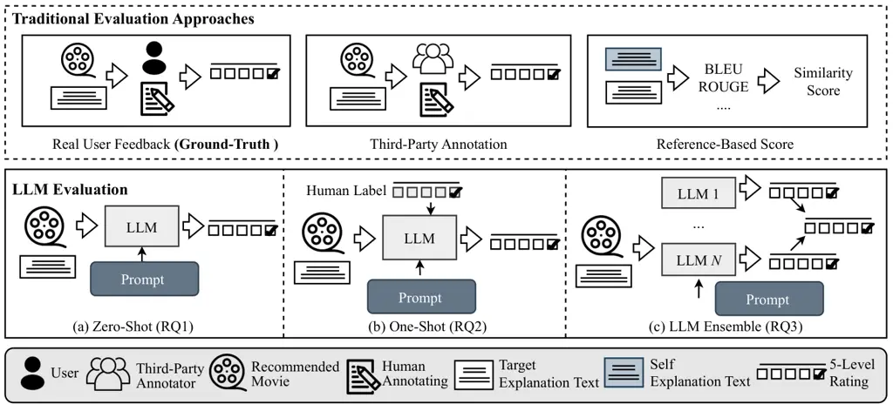

# Large Language Models as Evaluators for Recommendation Explanations

DOI: [XXXXXXX.XXXXXXX](https://doi.org/XXXXXXX.XXXXXXX)Price: 15.00ISBN: 978-1-4503-XXXX-X/18/06

Xiaoyu Zhang email: <zhxy0925@gmail.com> Affiliation: Tsinghua
University, Beijing, China , Yishan Li email:
<liyisha19@mails.tsinghua.edu.cn> Affiliation: Tsinghua University,
Beijing, China , Jiayin Wang email: <jiayinwangthu@gmail.com>
Affiliation: Tsinghua University, Beijing, China , Bowen Sun email:
<sun-bw22@mails.tsinghua.edu.cn> Affiliation: Tsinghua University,
Beijing, China , Weizhi Ma email: <mawz12@hotmail.com>
Affiliation: Tsinghua University, Beijing, China , Peijie Sun email:
<sun.hfut@gmail.com> Affiliation: Tsinghua University, Beijing, China
and Min Zhang email: <z-m@tsinghua.edu.cn> Affiliation: Tsinghua
University, Beijing, China

2018

###### Abstract.

The explainability of recommender systems has attracted significant
attention in academia and industry. Many efforts have been made for
explainable recommendations, yet evaluating the quality of the
explanations remains a challenging and unresolved issue. In recent
years, leveraging LLMs as evaluators presents a promising avenue in
Natural Language Processing tasks (e.g., sentiment classification,
information extraction), as they perform strong capabilities in
instruction following and common-sense reasoning. However, evaluating
recommendation explanatory texts is different from these NLG tasks, as
its criteria are related to human perceptions and are usually
subjective.

In this paper, we investigate whether LLMs can serve as evaluators of
recommendation explanations. To answer the question, we utilize real
user feedback on explanations given from previous work and additionally
collect third-party annotations and LLM evaluations. We design and apply
a 3-level meta-evaluation strategy to measure the correlation between
evaluator labels and the ground truth provided by users. Our experiments
reveal that LLMs, such as GPT4, can provide comparable evaluations with
appropriate prompts and settings. We also provide further insights into
combining human labels with the LLM evaluation process and utilizing
ensembles of multiple heterogeneous LLM evaluators to enhance the
accuracy and stability of evaluations. Our study verifies that utilizing
LLMs as evaluators can be an accurate, reproducible and cost-effective
solution for evaluating recommendation explanation texts. Our code is
available here¹¹ 1 https://github.com/Xiaoyu-SZ/LLMasEvaluator.

## 1. Introduction

Explainability has always been a topic of great concern within the field
of recommendation (Zhang and Chen, 2020; Chen et al., 2022; Sun et al.,
2020; Sun et al., 2021). Researchers explore various methods to help
users understand why recommendation systems give certain results. Among
these methods, the text-based explanation emerges as a kind of prominent
and widely-used approach (Chen et al., 2021a; Li et al., 2021; Li
et al., 2022). Through explanation text, systems can present the reason
for recommendations to users in natural language, thereby increasing
user trust and comprehensibility of the given results.

An effective evaluation should ensure the explanations truly resonate
with users and meet their expectations. However, with advanced
approaches developed for generating explanatory text, assessing their
quality remains an issue that has yet to be adequately resolved.
Existing methods for evaluation can be categorized into three main
types: self-report, third-party annotations, and reference-based
metrics. Conducting user studies to obtain self-reported feedback can
most accurately reflect user experience. This approach requires
evaluations to be recorded alongside the recommendations and is,
therefore, difficult to obtain and use in public datasets. Third-party
annotations can reflect human feedback and are relatively accessible.
Still, manual labeling is expensive, time-consuming, and lack of
scalability. Reference-based metrics assess the quality of the target
text based on the reference text and offer a standard assessment that is
relatively easy to acquire. Common metrics such as BLEU (Papineni
et al., 2002), and ROUGE (Lin, 2004) calculate the similarity between
the generated text and the reference text. However, there may not exist
reference texts for the scenario (many use reviews as a substitute). In
addition, these textual similarities metrics may not ideally reflect
user perception of recommendation explanation (Wen et al., 2022; Freitag
et al., 2022). These limitations highlight the need to develop
evaluation methodologies that are in-line with human experience, easy to
acquire, and reproducible.

Recently, the development of large language models (LLM) sheds new light
on the evaluation of various neural language generation (NLG)
tasks (Kocmi and Federmann, 2023; Wang et al., 2023a; Wang et al.,
2023b; Fu et al., 2023). Considering that LLMs can follow human
instructions and their language modeling ability, LLMs can make adequate
evaluations under reference-free settings with appropriate prompt (Liu
et al., 2023a; He et al., 2024). LLM offers an appealing solution for
evaluating the quality of recommendation explanations since it is
efficient (lower cost than manual labeling) and widely applicable
(almost no dataset limitation). In a study on the design of explainable
recommendation method (Lei et al., 2023), researchers introduce LLMs to
evaluate the quality of explanations generated. However, we state that
successes in the evaluation of general NLG tasks can not be migrated to
the evaluation of explainable recommendations without verification.
Unlike those NLG tasks that are already been examined, evaluating
recommendation explanation text is more sophisticated. The reason is
that measuring the quality of recommendations involves a group of
diverse goals, e.g. persuasiveness, transparency (Balog and Radlinski,
2020), etc. Additionally, a large portion of these goals are related to
the subjective perception of users. All these factors add to the
difficulty of assessing the quality of recommendation explanation texts.
These considerations underscore the need to further explore the
feasibility of leveraging LLM as a potential solution for text-based
explainable recommendation evaluation.

In this paper, we are concerned with the research question: Can LLM
serve as an evaluator of recommendation explanation text? In particular,
we delve into three detailed inquiries:

RQ1 Can LLMs evaluate different aspects of user perceptions about the
recommendation explanation texts in a zero-shot setting?

RQ2 Can LLMs collaborate with human labels to enhance the effectiveness
of evaluation?

RQ3 Can LLMs collaborate with each other to enhance the effectiveness of
evaluation?

To answer these research questions, we use data from a user study in
previous work (Lu et al., 2023), including the users’ ratings on 4
aspects of the provided explanatory texts, as well as the
self-explanation text of the users for the recommended movies. Our study
is based on the premise that the user receiving the recommendation is
the ground-truth evaluator for the quality of the explanation. To study
the reliability of LLM annotations, we additionally collect third-party
annotations and LLM annotations under human instructions. To
comprehensively compare between evaluators, we design and apply a
3-level meta-evaluation strategy to measure the correlation between
evaluator annotations and user labels on different aspects. We compare
the evaluation accuracy of LLM evaluators with third-party annotations
and commonly used reference-based metrics, i.e., BLEU (Papineni et al., 2002) and ROUGE (Lin, 2004).

Our main findings are: (1) Certain zero-shot LLMs, such as GPT4, can
attain evaluation accuracy comparable to or better than traditional
methods, with performance varying across different aspects. (2) The
effectiveness of one-shot learning depends on backbone LLMs.
Particularly, personalized cases can assist GPT4 in learning user
scoring bias. (3) Ensembling the scoring of multiple heterogeneous LLMs
can improve the accuracy and stability of evaluation.

In summary, our contributions include investigating the feasibility of
using zero-LLM as the evaluator for explainable recommendations,
discussing possible collaboration paradigms between LLM and human
labels, and exploring the aggregations of multiple LLM evaluators. We
propose that LLM can be a reproducible and cost-effective solution for
evaluating recommendation explanation text with appropriate prompts and
settings. Compared with traditional methods, LLM-based evaluators can be
applied to new datasets with few limitations. By introducing this
evaluation approach, we aspire to contribute to the advancement of the
area of explainable recommendation.

## 2. Experimental Setup



Figure 1. Traditional evaluation approaches vs. utilizing LLMs for
evaluations.

### 2.1. Problem Formulation

We use $`\mathcal{U}=(u_{1},u_{2},...u_{|\mathcal{U}|})`$ to denote the
set of users in an RS (Recommendation System). The RS recommend multiple
items to each user $`u`$, which are defined as
$`\mathcal{I}_{u}=(i_{1},i_{2},...,i_{|\mathcal{I}_{u}|})`$. When the
item $`i\in\mathcal{I}_{u}`$ is recommended to the user $`u`$,
explanation texts are generated by a group of generation methods, which
are denoted as
$`\mathcal{G}=(g_{1}(\cdot),g_{2}(\cdot),...,g_{|\mathcal{G}|}(\cdot))`$.
$`E_{u,i}=g(u,i)`$ denotes the explanation text given by $`g`$ when
recommending item $`i`$ to user $`u`$.

$`f(\cdot)`$ denotes the evaluation methods for $`E`$. We assume that
users in the system are the most accurate evaluators for explanations of
items recommended to them. Their evaluations are denoted as
$`\mathbf{s_{(u,i,E)}}=f_{u}(i,E)`$. When utilizing $`f_{LLM}`$ to
approximate $`f_{u}`$, the evaluation given by LLM can be represented
as:

```math
\hat{\mathbf{s}}_{LLM(u,i,E)}=f_{LLM}(u,i,E)=LLM(u,i,g(\cdot),\mathcal{P})
```

where $`\mathcal{P}`$ denotes the prompt that contains human
instructions.

Meta-evaluation method $`h(\cdot)`$ based on correlation metrics are
introduced to measure the similarity between $`\mathbf{s}`$ and
$`\hat{\mathbf{s}}`$. The accuracy of the evaluation given by LLM can be
expressed as $`h(\mathbf{s},\hat{\mathbf{s}}_{LLM})`$. In our paper, we
examine the feasibility of $`f_{LLM}`$ by analysing the value of
$`h(\mathbf{s},\hat{\mathbf{s}}_{LLM})`$.
$`h(\mathbf{s},\hat{\mathbf{s}}_{t})`$ and
$`h(\mathbf{s},\hat{\mathbf{s}}_{r})`$ are used as referent standards,
where $`\hat{\mathbf{s}}_{t}`$ denotes evaluation given by third-party
annotators, and $`\hat{\mathbf{s}}_{r}`$ denotes evaluation given by
referenece-based metrics.

### 2.2. Data Construction

#### 2.2.1. Data overview

Lu et al. (2023) create a movie recommendation platform. It first
captures user preferences, and then gives personalized recommendations
along with text-formed explanations generated by a series of systems. We
utilize two parts of the data: 1) self-explanations written by users, 2)
1-5 ratings of users to explanations generated by different methods in
terms of 4 aspects, which are persuasiveness, transparency, accuracy,
and satisfaction.

Formally, 39 participants are included in $`\mathcal{U}`$ and
$`\mathcal{I}`$ are movies from Movielens Latest dataset²² 2
https://grouplens.org/datasets/movielens/latest/. $`\mathcal{I}_{u}`$
denotes the itemset recommended to the user $`u`$, which includes the
top-8 movies calculated by BiasedMF (Rendle et al., 2012).
$`\mathcal{G}`$ includes a series of systems used to generate the
explanatory texts. Most of these methods are template-based methods,
e.g. user-based method, which generates explanations in the form of:
“\[N%\] of users who share similar watching tastes with you like \[MOVIE
TITLE\] after watching it.” $`\mathcal{G}`$ also includes the system
that directly generates the complete natural language sentence, i.e.,
peer-explanation written by others. The data includes the
self-explanation for each user-item pair. Since they are written by
users themselves, there is no evaluation rating attached.

In summary, the data comprises entries from 39 users, each of whom
received recommendations for 8 movies. For each user-movie pair,
approximately 8 explanations are generated, resulting in a total of
around 2,500 text entries. The data are collected in Chinese. We take
this data as ground truth $`\mathbf{s}`$ in the experiments. We
additionally collect evaluation scores $`\mathbf{\hat{s}}`$ given by
third-party annotators, LLMs and quantitative metrics. The evaluation
approaches from which the data is derived are illustrated in Figure 1.

#### 2.2.2. Evaluations from users

For each explanation text $`E`$ generated, the user is asked to give a
5-scale Likert score to the explanations. The user feedback of the
explanation is given on 4 aspects:

Persuasiveness: This explanation is convincing to me;

Transparency: Based on this explanation, I understand why this movie is
recommended;

Accuracy: This explanation is consistent with my interests;

Satisfaction: I am satisfied with this explanation.

These 5-scale Likert questions are also utilized in collecting
third-party evaluations and LLM evaluations to ensure consistency in the
definitions of aspects. The user annotation for each explanatory text
$`\mathbf{s}_{(u,i,E)}`$ is a one-dimensional vector of length 4, with
elements being integers between 1 to 5.

#### 2.2.3. Evaluation from third-party annotators

We employ two annotators to evaluate the explanatory text from the
above-mentioned four aspects. The annotators are informed that the user
is utilizing a movie recommendation platform and receiving film
recommendations along with the reasons for those recommendations. The
annotators are asked to score the explanatory text in an item-wise
manner. The third-party annotation for each explanatory text
$`\mathbf{\hat{s}}_{t(u,i,E)}`$ is a one-dimensional vector of length 4,
with elements being integers between 1 to 5.

#### 2.2.4. Evaluation from Quantitative metrics

We utilize BLEU (Papineni et al., 2002) and ROUGE (Lin, 2004) to
evaluate the explanatory text, taking the self-explanations written by
users as reference texts. The evaluation score $`\mathbf{\hat{s}}_{r}`$
is a float that measures text similarity.

### 2.3. LLM as Evaluator

#### 2.3.1. LLM Evaluator Construction

We utilize pre-trained LLMs to provide annotations for each explanation
text $`E`$. The large language model receives the movie name and the
corresponding explanation text, accompanied by a prompt $`\mathcal{P}`$
to describe the context. Although $`E`$ is in Chinese as introduced in
Section 2.2.1, we apply $`\mathcal{P}`$ in English to ensure a
standardized prompt design. The LLM evaluation for each explanatory text
$`\mathbf{\hat{s}}_{LLM(u,i,E)}`$ is a one-dimensional vector of length
4, with elements being integers between 1 to 5. Our experiments are
based on item-wise evaluation, where only one text entry is evaluated at
a time. This approach aligns with the setup in the user study.

To investigate the aforementioned RQs, three basic methods are used to
construct the LLM evaluator, as illustrated in Figure 1. First, we
directly use zero-shot LLMs for evaluation. Then, we consider providing
human labels as contextual information to enhance their abilities to
learn user subjective perceptions. Finally, inspired by the traditional
approach of collecting multiple annotators labels and then averaging the
results, we similarly ensemble the results of multiple annotations. When
constructing LLM evaluators, we aim to maintain the simplicity and
transferability of the approaches. Therefore, we have not leveraged
other common methods that require model training, such as fine-tuning.

Figure 2. The outline of evaluation prompt templates applied in our
study.

#### 2.3.2. Prompt Construction

In the section, we mainly introduce how we construct the prompt
$`\mathcal{P}`$. The prompt is designed to guide the LLM in evaluating
the quality of explanatory text from specified aspects. It includes
several key components, briefed in Figure 2. We attempted to integrate
user information in the prompt but found that this approach did not
improve performance and sometimes even decreased it. Following, we
describe in detail the different settings in prompt constructions.

Single-Aspect vs. Multiple-Aspect. The difference between single and
multiple-aspect prompts lies in the Aspect part. A multiple-aspect
prompt instructs the model to evaluate all four aspects concurrently,
while a single-aspect prompt focuses on one aspect at a time. Utilizing
single-aspect prompts necessitates more times of interactions with LLM
compared to multiple-aspect prompts. Experimental results under the two
settings are presented and compared in RQ1, Section 2.4.

1: procedure PersonalizedOneShot

2:   for each user $`u`$ in $`\mathcal{U}`$ do

3:    Randomly choose item $`i_{0}`$ from $`\mathcal{I}_{u}`$

4:    Collect user evaluations on explanatory text $`E=g(u,i_{0})`$ as
$`\mathbf{s_{0}}_{g}`$ for each $`g`$ in $`\mathcal{G}`$

5:    for each movie $`i`$ in $`\mathcal{I}_{u}`$, each $`g`$ in
$`\mathcal{G}`$ do

6:      $`Prompt\leftarrow`$ ConstructPrompt($`i`$, $`g(u,i)`$,
$`\mathbf{s_{0}}_{g}`$)

7:      $`Result\leftarrow`$ LLM($`Prompt`$)

8:      Parse $`Result`$ and process the answer

9:    end for

10:   end for

11: end procedure

12: procedure Non-PersonalizedOneShot

13:   Randomly choose user-item pair $`(u_{0},i_{0})`$

14:   Collect user evaluations on explanatory text $`E=g(u_{0},i_{0})`$
as $`\mathbf{s_{0}}_{g}`$ for each $`g`$ in $`\mathcal{G}`$

15:   for each user $`u`$ in $`\mathcal{U}`$,each movie $`i`$ in
$`\mathcal{I}_{u}`$, each $`g`$ in $`\mathcal{G}`$ do

16:    $`Prompt\leftarrow`$ ConstructPrompt($`i`$, $`g(u,i)`$,
$`\mathbf{s_{0}}_{g}`$)

17:    $`Result\leftarrow`$ LLM($`Prompt`$)

18:    Parse $`Result`$ and process the answer

19:   end for

20: end procedure

Algorithm 1 Comparison of personalized and non-personalized one-shot
learning process

Zero-Shot vs. One-Shot. Zero-shot learning presents the task without any
example and relies solely on the pre-trained knowledge and reasoning
ability of the LLM. While this may result in a lack of context-specific
guidance, the advantage is that it can be applied directly to datasets
without manual labeling.

To explore whether humans and LLM can collaborate on evaluation, we
investigate the impact of utilizing human labels as contextual
information in LLM evaluation. Our primary focus is on one-shot learning
and includes one human label in the prompt. To enhance the LLM’s ability
to learn personalized preferences, we employ personalized one-shot
learning. This approach involves providing the scoring example from the
same user for the target data. Formally, for the user $`u`$, item $`i`$
and explanation $`E=g(u,i)`$, the personalized example is the scoring
given to $`E^{\prime}=g(u,i_{0})`$, which is the explanation generated
by the same system $`g`$ and the same user $`u`$ on a randomly chosen
movie item $`i_{0}`$. The methods help the prompt $`\mathcal{P}`$
incorporate personal information. However, a limitation is that it still
requires collecting real user feedback, which is expansive and sometimes
impractical. Hence, we also investigate non-personalized one-shot
prompts. In this setting, all examples are from randomly selected
$`(u_{0},i_{0})`$ pair. That is, the example can come from another user
and are easier to collect in practice. Formally, for the user $`u`$,
item $`i`$ and explanation $`E=g(u,i)`$, the non-personalized example is
the scoring given to $`E^{\prime}=g(u_{0},i_{0})`$. We summarize the
personalized and non-personalized one-shot learning procedures in
Algorithm 1 to better illustrate the example selection process and their
differences. Experimental results under different example settings are
presented and compared in RQ2, Section 4.

### 2.4. Three-Level Meta Evaluation

Good evaluation requires that evaluation efforts themselves be
evaluated (Stufflebeam et al., 1974). Employing the suitable
meta-evaluation method $`h(\cdot)`$ is crucial for thoroughly examining
the evaluation procedure. Correlation coefficients, such as
Pearson($`r`$), Spearman($`\rho`$), and Kendall($`\tau`$) coefficients,
have served as a widely used metric for gauging the similarity in trends
between two arrays of ratings or scores (Liu et al., 2023b). In NLG, the
strategy of meta-evaluation can be divided into two levels:
Dataset-Level and Sample-Level (Liu et al., 2023b). Formally, given a
dataset $`\mathcal{D}`$ consisting of a set of source data
$`\mathcal{X}=(x_{1},x_{2},....,x_{|\mathcal{X}|})`$ and generation
methods
$`\mathcal{G}=(g_{1}(\cdot),g_{2}(\cdot),...,g_{|\mathcal{G}|}(\cdot))`$
and correlation metric $`r(\cdot)`$ dataset-level and sample-level meta
evaluation are expressed as:

Dataset Level

```math
h_{D}(\mathbf{s},\hat{\mathbf{s}})=r\left(\left(\mathbf{s}_{1},\mathbf{s}_{2},...\mathbf{s}_{|\mathcal{X}||\mathcal{G}|}\right),\left(\hat{\mathbf{s}}_{1},\hat{\mathbf{s}}_{2},...\hat{\mathbf{s}}_{|\mathcal{X}||\mathcal{G}|}\right)\right)\\
```

Sample Level

```math
h_{S}(\mathbf{s},\hat{\mathbf{s}})=\frac{1}{|\mathcal{X}|}\sum_{i=1}^{|\mathcal{X}|}r\left(\left(\mathbf{s}_{(i,1)},...\mathbf{s}_{(i,|\mathcal{G}|)}\right),\left(\hat{\mathbf{s}}_{(i,1)},...\hat{\mathbf{s}}_{(i,|\mathcal{G}|)}\right)\right)
```

Previous studies have not discussed a multiple-level meta-evaluation
when assessing the quality of evaluation metrics for explainable
recommendations. However, considering multiple-level meta-evaluation in
explainable recommendations is worthwhile. This is because the
distribution of ground-truth labels or evaluations generated by models
may differ between users or user-item pairs. Consequently, while an
evaluation metric might effectively capture trends within specific
groups (such as comparing the qualities of a group of texts derived from
the same user-movie pair), it may struggle to accurately depict trends
across groups (such as capturing certain users’ inclination to provide
higher ratings).

Therefore, we propose a 3-level strategy for meta-evaluation on
recommendation explanations. Our motivation is to divide the data into
groups at various grain scales and measure the correlation between
evaluation results with ground-truth labels within each group. The three
proposed levels are Dataset-Level, User-Level, and Pair-Level. Together,
they provide a comprehensive view for $`h`$:

Dataset Level correlation calculates the correlation of all scores. The
total number of data can be expressed as
$`|\mathcal{D}|=|\mathcal{U}|\cdot|\mathcal{I}_{u}|\cdot|\mathcal{G}|`$.

```math
h_{D}(\mathbf{s},\hat{\mathbf{s}})=r\left(\left(\mathbf{s}_{1},\mathbf{s}_{2},...\mathbf{s}_{|\mathcal{D}|}\right),\left(\hat{\mathbf{s}}_{1},\hat{\mathbf{s}}_{2},...\hat{\mathbf{s}}_{|\mathcal{D}|}\right)\right)
```

User Level correlation calculates the correlation within the data of
each user and then averages it. The total number of data derived from
the same user $`u`$ can be expressed as
$`|\mathcal{D}_{u}|=\cdot|\mathcal{I}_{u}|\cdot|\mathcal{G}|`$.

```math
h_{U}(\mathbf{s},\hat{\mathbf{s}})=\frac{1}{|\mathcal{U}|}\sum_{u}r\left(\left(\mathbf{s}_{1},\mathbf{s}_{2},...\mathbf{s}_{|\mathcal{D}_{u}|}\right),\left(\hat{\mathbf{s}}_{1},\hat{\mathbf{s}}_{2},...\hat{\mathbf{s}}_{|\mathcal{D}_{u}|}\right)\right)
```

Pair Level correlation calculates the correlation within the data of
each user-item pair and then averages it. $`|\mathcal{G}|`$ explanation
texts are derived from the same user-item pair by
$`g_{1}(\cdot),g_{2}(\cdot),...,g_{\mathcal{G}}(\cdot)`$.

```math
h_{P}(\mathbf{s},\hat{\mathbf{s}})=\frac{1}{|\mathcal{U}|\cdot|\mathcal{I}_{u}|}\sum_{u,i\in\mathcal{I}_{u}}r\left(\left(\mathbf{s}_{1},\mathbf{s}_{2},...\mathbf{s}_{|\mathcal{G}|}\right),\left(\hat{\mathbf{s}}_{1},\hat{\mathbf{s}}_{2},...\hat{\mathbf{s}}_{|\mathcal{G}|}\right)\right)
```

Referring to correlations on which level depends on the settings of the
task. For instance, if an evaluation metric is used to compare between
$`\mathcal{G}`$, it is more important to look at the Pair-Level
correlation between the results from the evaluation metric and
ground-truth labels. When the study requires a measure of satisfaction
with the recommendation explanation text by different users of the
system, the results of Dataset-Level correlation should be referred to.

We use a concrete example to illustrate the possible variation of the
same evaluation metric at different levels. For instance, our
experimental results in Section 2.4 found that BLEU-4 scoring results
correlate poorly or even negatively with ground-truth labels at the
Dataset-Level, whereas correlations improve at User-Level and
Pair-Level. This discrepancy arises because BLEU-4 computes the token
similarity between the target text and the reference text. Some
reference texts may contain more commonly used token combinations than
others, potentially inflating the BLEU-4 score. This introduces a bias
into the evaluation process that is unrelated to user perceptions,
thereby impacting the Dataset-Level correlation. Full experimental
results and analyses can be found in Section 2.4.

| Dataset-Level / User-Level / Pair-Level (%) |                        |                       |                        |                       |                       |
| ------------------------------------------- | ---------------------- | --------------------- | ---------------------- | --------------------- | --------------------- |
| Method                                      | Persuasiveness         | Transparency          | Accuracy               | Satisfaction          | Average               |
| Random                                      | -0.55 / 0.52 / 1.81    | 0.65 / -0.43 / -2.58  | -0.41 / 4.12 / 3.98    | 0.36 / -2.26 / 5.88   | 0.01 / 0.49 / 2.27    |
| Reference-based Metric                      |                        |                       |                        |                       |                       |
| BLEU-1                                      | 11.68 / 15.84 / 17.07  | 10.06 / 12.69 / 14.44 | 6.43 / 10.71 / 12.18   | 11.36 / 12.91 / 15.79 | 9.88 / 13.04 / 14.87  |
| BLEU-4                                      | -1.17 / 7.68 / 13.53   | -3.47 / 4.13 / 10.24  | -4.63 / 4.8 / 8.96     | 0.61 / 6.86 / 12.09   | -2.16 / 5.86 / 11.21  |
| ROUGE-1-F                                   | 14.16 / 16.39 / 17.56  | 11.93 / 12.74 / 14.45 | 8.61 / 11.02 / 12.83   | 12.87 / 13.2 / 16.23  | 11.89 / 13.34 / 15.27 |
| ROUGE-L-F                                   | 14.16 / 16.39 / 17.56  | 11.93 / 12.74 / 14.45 | 8.61 / 11.02 / 12.83   | 12.87 / 13.2 / 16.23  | 11.89 / 13.34 / 15.27 |
| Annnotation                                 |                        |                       |                        |                       |                       |
| Annotator-1                                 | 19.88 / 18.31 / 16.72  | 15.66 / 16.18 / 11.31 | 10.16 / 9.78 / 9.77    | 14.93 / 13.28 / 12.69 | 15.16 / 14.39 / 12.62 |
| Annotator-2                                 | 21.4 / 21.17 / 20.9    | 25.97 / 26.42 / 27.84 | 10.96 / 10.96 / 9.32   | 8.86 / 9.72 / 9.43    | 16.8 / 17.07 / 16.87  |
| Average                                     | 23.33 / 22.25 / 20.93  | 24.53 / 25.36 / 23.12 | 12.83 / 12.52 / 11.19  | 13.9 / 13.54 / 13.16  | 18.65 / 18.42 / 17.10 |
| Single-Aspect Prompt                        |                        |                       |                        |                       |                       |
| Llama2-7B                                   | -4.02 / -3.32 / -3.9   | -1.52 / -2.92 / -5.43 | -1.11 / -1.88 / -3.76  | 0.74 / 2.72 / 4.54    | -1.48 / -1.35 / -2.14 |
| Llama2-13B                                  | 8.39 / 9.5 / 10.91     | 10.64 / 11.67 / 10.68 | -4.44 / -4.52 / -0.96  | -0.18 / 1.12 / 0.94   | 3.60 / 4.44 / 5.39    |
| Qwen1.5-7B                                  | 5.81 / 8.14 / 10.78    | 5.49 / 5.07 / 6.15    | 6.26 / 6.35 / 5.07     | -1.97 / -1.52 / -2.42 | 3.9 / 4.51 / 4.89     |
| Qwen1.5-14B                                 | 7.13 / 6.92 / 7.01     | 22.61 / 22.75 / 22.33 | 28.65 / 30.71 / 35.11  | 13.88 / 13.68 / 13.94 | 18.07 / 18.52 / 19.60 |
| GPT3.5-Turbo                                | 26.81 / 26.36 / 29.58  | 20.62 / 21.22 / 25.01 | 16.33 / 15.56 / 17.93  | 9.95 / 7.75 / 6.33    | 18.43 / 17.72 / 19.71 |
| GPT4                                        | 18.36 / 19.78 / 22.03  | 20.17 / 21.57 / 23.62 | 14.46 / 15.61 / 14.33  | 7.49 / 5.92 / 3.17    | 15.12 / 15.72 / 15.79 |
| Multiple-Aspect Prompt                      |                        |                       |                        |                       |                       |
| Llama2-7B                                   | -1.26 / -2.85 / -14.34 | -2.2 / -2.59 / -8.87  | -3.36 / -7.23 / -16.36 | 1.74 / 1.99 / 1.82    | -1.27 / -2.67 / -9.44 |
| Llama2-13B                                  | 17.04 / 17.33 / 18.56  | 4.26 / 3.41 / 10.25   | 3.59 / 2.1 / 2.24      | 17.93 / 16.82 / 18.52 | 10.71 / 9.92 / 12.39  |
| Qwen1.5-7B                                  | 13.0 / 13.26 / 13.08   | 11.75 / 11.74 / 15.28 | -0.8 / -0.34 / -0.49   | 10.63 / 9.28 / 15.6   | 8.65 / 8.49 / 10.87   |
| Qwen1.5-14B                                 | 25.85 / 26.53 / 32.28  | 18.16 / 18.45 / 22.03 | 12.25 / 11.32 / 15.26  | 15.82 / 14.83 / 18.26 | 18.02 / 17.78 / 21.96 |
| GPT3.5-Turbo                                | 26.41 / 26.36 / 28.2   | 11.16 / 9.86 / 11.38  | 12.09 / 10.63 / 11.15  | 20.93 / 19.56 / 20.78 | 17.65 / 16.61 / 17.88 |
| GPT4                                        | 27.26 / 28.25 / 28.99  | 12.68 / 12.17 / 13.26 | 20.30 / 22.04 / 24.93  | 24.05 / 25.12 / 27.35 | 21.07 / 21.90 / 23.63 |

Table 1. The 3-level Pearson correlation between the results given by
the evaluator and the ground-truth label given by users. Bold fonts
denote the best results among all tested evaluators and the underlines
show the second-best results.

(a) GPT4 (M)

(b) Qwen1.5-14B (M)

Figure 3. Comparison of 3-level Pearson correlations for zero-shot,
(non-personalized) one-shot, and personalized one-shot learning on
GPT4(M) and Qwen(M). (M) denotes the multiple-aspect version.

## 3. zero-shot LLM can be a competitive evaluator

To investigate the quality of assessments given by zero-shot LLMs and
answer RQ1, we conduct a 3-level meta-evaluation, with the concrete
process introduced in Section 2.4. The 5-level scores from real users
are used as ground-truth labels. Zero-shot LLMs instructed by prompts
are utilized as evaluators for recommendation explanations. We calculate
Pearson correlations between evaluator results with user labels as the
evaluation accuracy. It should be noted that the evaluation accuracy
here refers to the correctness of the assessment given by the evaluator,
which is different from the aspect of Accuracy when evaluating
recommendation explanation, referring to whether the text is consistent
with the user’s interests. We test the accuracy of referenced-based
metrics, third-party annotation, and LLM-based evaluator and demonstrate
in Table 1.

Experimental Setting. We conduct experiments with 6 LLMs, including
Llama2-7B (Touvron et al., 2023), Llama2-13B (Touvron et al., 2023),
Qwen1.5-7B (Bai et al., 2023), Qwen1.5-14B (Bai et al., 2023),
GPT3.5-Turbo and GPT4 (et al., 2024)³³ 3 https://openai.com/api/. The
temperatures of LLMs are set to 0. The results returned by LLM are
parsed to integer scores from 1 to 5. For the null value in user labels,
we set it to 3 since it represents the unknown user attitude. For the
null value in LLM labels, we set it to 0 since it is usually caused by
parsing failures, which should bring penalties to the correlation score.

LLMs can achieve evaluation accuracy that is comparable to or surpasses
traditional methods. As shown in Table 1, there are variations in the
evaluation accuracy across models. GPT-4 demonstrates the highest
performance, followed by GPT-3.5 and Qwen1.5-14B, which both show
adequate evaluation accuracy. Qwen1.5-7B and Llama2-14B display moderate
labeling capabilities, whereas Llama2-7B exhibits poor performance.

In average performance of different aspects, GPT-4 surpasses both
third-party annotators and reference-based metrics. GPT3.5 and Qwen1.5
demonstrate comparable accuracy to the third-party annotator, also
out-performing reference-based metric.

Evaluation accuracies of evaluators are aspect-dependent. When analyzing
the performance across different aspects, we can see that the
third-party annotators show better evaluation accuracy in Persuasiveness
and Transparency than Accuracy and Satisfaction. This implies that
Accuracy and Satisfaction are more subject, displaying greater
individual variability. Thus, third-party annotations may not be
satisfactory solutions in these aspects. Experiments indicate that LLMs,
particularly GPT-4, perform better in these areas. However, regarding
Transparency, LLMs are inferior to human labeling. In subsequent
sections, we discuss strategies for enhancing the zero-shot LLM
evaluator.

Results from multiple-aspect prompt v.s. single-aspect prompt. The
multiple-aspect involves LLM scoring a text across 4 aspects
simultaneously, while in the latter, it assesses each aspect
individually. We find that several LLM evaluators (LLama2-13B,
Qwen1.5-7B, GPT3.5, GPT4) perform notably better on Satisfaction when
using the multiple-aspect prompt. This may be due to user satisfaction
being a composite consideration of various dimensions. Thus, scoring on
other aspects acts as an implicit Chain-Of-Thought (Wei et al., 2022)
process that enhances the zero-shot reasoning ability of LLMs (Kojima
et al., 2022). Conversely, the single-aspect prompt yields better
results on the Transparency aspect with several LLMs. This may be
because the evaluation of Transparency is relatively independent, and
separate scoring allows the model to better understand the task without
interference from other aspects. Overall, we would recommend the
multiple-aspect version, as it has no significant gap with single-aspect
but requires fewer interactions. Our experiments on RQ2 and RQ3 are also
conducted on multiple-aspect prompts.

Evaluators show varying trends across meta-evaluation levels. The
varying trends across levels underscore the importance of selecting the
appropriate level based on the objectives of the task. Human annotators
have similar correlations, i.e., evaluation accuracy across three
levels. Reference-based metric primarily demonstrates a trend where
results follow Pair-Level \> User-Level \> Dataset-Level. A particularly
notable example is BLEU-4, which performs even worse than random at the
Dataset-Level while performing considerably better at the Pair-Level.
This discrepancy in results arises since BLEU-4 emphasizes the
co-occurrence of 4-gram tokens in target and reference texts. Thus, it
is influenced by the specific words in the reference text. At the
Dataset-Level, this introduces bias unrelated to user perception.

|         |            |            |          |          |
| ------- | ---------- | ---------- | -------- | -------- |
| Human   | GPT3.5 (S) | GPT3.5 (M) | GPT4 (S) | GPT4 (M) |
| 0.111\$ | 0.00123\$  | 0.000364\$ | 0.0652\$ | 0.0256\$ |

Table 2. The cost (\$) of evaluating a single text entry on four
aspects, where (S/M) denotes single/multiple-aspect prompt.

Cost of LLM vs. human annotators. We present the expenses associated
with evaluating a single text entry across 4 aspects, including both
third-party human annotators and closed-source LLMs in Table 2. The
utilization of closed-source LLMs (Llama2 and Qwen) incurs no charges.
It can be observed that the cost of multiple-aspect prompt evaluation is
lower than that of single-aspect prompt evaluation. Even for the most
costly LLM configuration, i.e., GPT4 (S), the cost remains lower than
that of human annotation. Thus, we propose that LLM offers a
cost-effective solution for evaluating recommendation explanations.

## 4. LLM evaluators with in-context learning

Having investigated zero-shot LLM-based evaluators in Section  2.4, we
would like to further discuss RQ2, i.e., whether LLM can get better
results by collaborating with human annotators. Concretely, we adopt
one-shot learning to exploit human labeling. The generation of zero-shot
and one-shot prompts are detailed in Section 2.3.2. We conduct the
experiments on an open-source and a closed-source LLM respectively,
which are GPT4 and Qwen1.5-14B. Results are shown in Figure 3, where the
one-shot in the legend refers to the non-personalized one-shot. We can
see that whether human labeling can enhance the evaluation accuracy of
the LLM is highly dependent on the prompt design and the backbone model
used. Following this, we detail the effects on the two LLMs.

Both personalized and non-personalized examples benefit the evaluation
accuracy of GPT4. As shown in Figure 3(a), incorporating human labels
helps align the LLM with user preferences, making GPT4(M) perform as
well as or better than third-party human annotators across all aspects
simultaneously. Concretely, we find that personalized one-shot learning
improves performance over zero-shot on all trails. Interestingly,
non-personalized one-shot learning also yields improvements over
zero-shot learning on most trails, though Satisfaction decreases at the
Dataset and User Levels. Therefore, considering collecting real user
labeling on public datasets is impractical, our experiments demonstrate
that for GPT-4, labels from other users can still guide LLMs in
evaluating user perceptions.

Personalized cases facilitate GPT-4 in learning user scoring bias. When
comparing the results of GPT4 across different learning strategies and
three levels, we notice that for zero-shot and non-personalized
one-shot, the Pair-Level evaluation accuracy consistently surpasses that
of the Dataset-Level, but this is not the case for personalized one-shot
learning. This indicates that while the evaluator based on zero-shot and
non-personalized one-shot learning can distinguish between
recommendation texts generated for the same user-movie pair, it may not
be good at capturing biases inherent in user rating, such as higher
overall ratings from one user compared to another. Introducing
personalized examples can mitigate the issue.

Non-personalized one-shot learning does not work well on Qwen1.5-14B. We
observe that non-personalized one-shot learning does not effectively
improve and even impairs the performance of Qwen1.5-14B as the
evaluator, as shown in Figure 3(b). This may be because single-shot
prompts from other users introduce additional bias into Qwen1.5-14B’s
ratings. Personalized one-shot learning brings improvements in Accuracy
and Satisfaction. These two aspects, as mentioned in Section 2.4,
exhibit greater individual variability than others. Introducing
personalized information helps Qwen1.5-14B better capture subjective
user perception.

In summary, personalized one-shot learning can effectively enhance the
evaluation accuracy of GPT4 and on Accuracy and Satisfaction of
Qwen1.5-14B. Nevertheless, the process of collecting corresponding user
labels is often challenging, particularly on publicly available
datasets. As an alternative solution, the incorporation of labels from
other users can also enhance the evaluation provided by GPT-4. Despite
this, human annotation remains relatively expensive. In the next
section, we discuss how to improve the accuracy and stability of
evaluations without human labeling.

Figure 4. Distribution of evaluation accuracy from ensemble results of
\#N LLM evaluators. Values on the x-axis denote \#N.

## 5. Two heads are better than one

In RQ1, although LLMs can achieve comparable evaluation accuracy on
average of tested aspects, we find that the evaluation accuracy of LLMs
varies by aspect. For instance, the evaluation accuracy of GPT-4 on
Transparency is less ideal compared to other aspects. This raises the
question of how to apply LLM evaluators to untested data or aspects to
ensure the evaluation quality. Inspired by the common method utilized in
human annotation to average the ratings given by multiple annotators, we
ensemble results from various LLMs. We explore RQ3, conducting
experiments on 5 LLM evaluators from RQ1 (excluding Llama2-7B). We
ensemble multiple LLMs by averaging their ratings to obtain the final
scores. In Figure 4, the x-axis represents the number of LLMs included
in the ensemble and the y-axis indicates the corresponding evaluation
accuracy.

Ensemble of multiple LLMs improves evaluation accuracy and stability. In
Figure 4, we can see that the expectation of evaluation accuracy (mean)
increases with \#N on all level aspects. In addition, the lower bound of
the evaluation accuracy also rises. This suggests that ensemble multiple
LLMs can mitigate the issue of a single evaluator performing poorly on
certain aspects, such as Qwen1.5-7B on Accuracy aspect.

The upper bound of evaluation accuracy decreases as \#N rises on
Accuracy aspect. We notice that while the expectation (mean) of accuracy
increases with \#N, the upper bound of evaluation accuracy starts to
decline when \#N $`\geq 3`$ on the Accuracy aspect. This may be due to
the subjective nature of Accuracy aspect, which results in suboptimal
outcomes when there are too many evaluators. Another possible reason is
that, as observed in Table 1, two LLMs (Llama2-13B and Qwen1.5-7B)
perform relatively poor on the Accuracy aspect, which could negatively
impact the effectiveness of LLM ensembles.

In summary, when dealing with untested datasets and aspects, we
recommend aggregating zero-shot LLM evaluators to ensure more stable
evaluations.

## 6. Related Work

Evaluating Explainable Recommendation Evaluation of explainable
recommendations has been an important topic. In previous studies, widely
used evaluation approaches include online user study, third-party
annotation, and reference-based metrics. An online user study is the
most accurate method to evaluate user perceptions. In Ex3 (Xian et al.,
2021), authors deploy their model online and observe an increase in
traffic. User studies are also utilized to help gain insights about
explainable recommendations.  Lu et al. (2023) track users’ intentions,
expectations, and experiences in interactions with an explainable
recommendation system.  Balog and Radlinski (2020) investigate the
relationship between various goals in explainable recommendations. The
limitation of this line of evaluation is that it is hard to acquire,
especially on public datasets. Researchers resort to third-party
annotations as human labels. Some utilize crowdsourcing to collect
labels (Wen et al., 2022) and others employ experienced annotators (Chen
et al., 2021b; Lei et al., 2023). Although they are easier to obtain
compared to real user labels, human labels are still expensive. In
addition, our experimental results find that third-party annotations may
be less accurate on aspects that are highly subjective. Reference-based
metrics, e.g. BLEU (Papineni et al., 2002), ROUGE (Lin, 2004) and their
variants (Sellam et al., 2020) are utilized by calculating the
similarity of target texts with reference texts. BLEU and ROUGE are
almost the most common methods for evaluating text-based recommendation
explanations (Li et al., 2022; Li et al., 2021). These quantitative
metrics are easy to acquire and have a standard calculation process.
This line of methods is limited to datasets with reference text
attached, i.e., self-explanations or reviews.

Studies exist proposing and utilizing novel evaluation methods for
explainable recommendations, each with its own advantages and
limitations.  Xu et al. (2023) propose a model agnostic framework that
evaluates explanations from the aspects of faithfulness and
scrutability. ExpScore (Wen et al., 2022) design models to generate
evaluations from human labels. These methods have limited applicability
or require collecting a certain quantity of human labels.
RecExplainer (Lei et al., 2023) utilizes both human and LLM as
annotators for generated explanations. To the best of our knowledge, we
are the first to conduct a meta-evaluation on LLM for recommendation
explanations to comprehensively study its capability for the task.

LLM-based NLG Evaluation The emergence of LLM has sparked interest in
its potential applications in evaluating NLG tasks.  Gilardi et al.
(2023) investigate that ChatGPT outperforms crowd workers on annotating
various NLG tasks. Previous studies find that LLM can be effective
annotators on various tasks when prompting appropriately (Fu et al.,
2023; Kocmi and Federmann, 2023; Wang et al., 2023b; Wang et al.,
2023a). In-context learning (ICL) is also employed to generate
annotations using few-shot learning (Brown et al., 2020; Shin et al.,
2021; Rubin et al., 2022). Researchers summarize the advancements in the
field into surveys (Tan et al., 2024; Chang et al., 2024). Among these
studies, the one most similar to ours is the evaluation of personalized
text generation, e.g., reviews, comments on social media, etc (Wang
et al., 2023a). Our work adds to these studies by utilizing LLMs as
evaluators for recommendation explanation texts.

## 7. Conclusion

In this paper, we investigate the feasibility of utilizing LLMs as
evaluators for recommendation explanation texts. We leverage real user
feedback as ground-truth labels to validate the quality of LLM
evaluation. Our studies consider zero-shot LLM evaluation, collaborating
with human labels and the ensemble of multiple LLMs. Our key findings
include 1) some LLMs, such as GPT-4, can achieve evaluation accuracy
comparable to or better than traditional methods; 2) GPT4 can
effectively learn preference from human labels; 3) when applying to
untested datasets and aspects, aggregating multiple heterogeneous
zero-shot LLMs is recommended to improve the accuracy and stability of
the evaluation. We propose that LLM can be a reproducible and
cost-effective solution for evaluating recommendation explanations. As a
preliminary investigation into the meta-evaluation of LLM on
recommendation explanations, our work is limited to text-based
explanations. In the future, unified evaluation protocols that encompass
a broader range of explanation formats can be studied. In addition,
developing novel methodologies to further enhance the evaluation
accuracy of LLMs is also an important area worth considering.

## References

- Bai et al. (2023) Jinze Bai, Shuai Bai, Yunfei Chu, Zeyu Cui, Kai
  Dang, Xiaodong Deng, Yang Fan, Wenbin Ge, Yu Han, Fei Huang, Binyuan
  Hui, Luo Ji, Mei Li, Junyang Lin, Runji Lin, Dayiheng Liu, Gao Liu,
  Chengqiang Lu, Keming Lu, Jianxin Ma, Rui Men, Xingzhang Ren,
  Xuancheng Ren, Chuanqi Tan, Sinan Tan, Jianhong Tu, Peng Wang, Shijie
  Wang, Wei Wang, Shengguang Wu, Benfeng Xu, Jin Xu, An Yang, Hao Yang,
  Jian Yang, Shusheng Yang, Yang Yao, Bowen Yu, Hongyi Yuan, Zheng Yuan,
  Jianwei Zhang, Xingxuan Zhang, Yichang Zhang, Zhenru Zhang, Chang
  Zhou, Jingren Zhou, Xiaohuan Zhou, and Tianhang Zhu. 2023. Qwen
  Technical Report. _arXiv preprint arXiv:2309.16609_ (2023).
- Balog and Radlinski (2020) Krisztian Balog and Filip Radlinski. 2020.
  Measuring Recommendation Explanation Quality: The Conflicting Goals of
  Explanations. In _Proceedings of the 43rd International ACM SIGIR
  Conference on Research and Development in Information Retrieval_
  (Virtual Event, China) _(SIGIR ’20)_. Association for Computing
  Machinery, New York, NY, USA, 329–338.
  [https://doi.org/10.1145/3397271.3401032](https://doi.org/10.1145/3397271.3401032)
- Brown et al. (2020) Tom Brown, Benjamin Mann, Nick Ryder, Melanie
  Subbiah, Jared D Kaplan, Prafulla Dhariwal, Arvind Neelakantan, Pranav
  Shyam, Girish Sastry, Amanda Askell, Sandhini Agarwal, Ariel
  Herbert-Voss, Gretchen Krueger, Tom Henighan, Rewon Child, Aditya
  Ramesh, Daniel Ziegler, Jeffrey Wu, Clemens Winter, Chris Hesse, Mark
  Chen, Eric Sigler, Mateusz Litwin, Scott Gray, Benjamin Chess, Jack
  Clark, Christopher Berner, Sam McCandlish, Alec Radford, Ilya
  Sutskever, and Dario Amodei. 2020. Language Models are Few-Shot
  Learners. , 1877–1901 pages.
  [https://proceedings.neurips.cc/paper_files/paper/2020/file/1457c0d6bfcb4967418bfb8ac142f64a-Paper.pdf](https://proceedings.neurips.cc/paper_files/paper/2020/file/1457c0d6bfcb4967418bfb8ac142f64a-Paper.pdf)
- Chang et al. (2024) Yupeng Chang, Xu Wang, Jindong Wang, Yuan Wu,
  Linyi Yang, Kaijie Zhu, Hao Chen, Xiaoyuan Yi, Cunxiang Wang, Yidong
  Wang, Wei Ye, Yue Zhang, Yi Chang, Philip S. Yu, Qiang Yang, and Xing
  Xie. 2024. A Survey on Evaluation of Large Language Models. _ACM
  Trans. Intell. Syst. Technol._ 15, 3, Article 39 (mar 2024), 45 pages.
  [https://doi.org/10.1145/3641289](https://doi.org/10.1145/3641289)
- Chen et al. (2021a) Hanxiong Chen, Xu Chen, Shaoyun Shi, and Yongfeng
  Zhang. 2021a. Generate Natural Language Explanations for
  Recommendation. _CoRR_ abs/2101.03392 (2021).
- Chen et al. (2022) Xu Chen, Yongfeng Zhang, and Ji-Rong Wen. 2022.
  Measuring "Why" in Recommender Systems: a Comprehensive Survey on the
  Evaluation of Explainable Recommendation. arXiv:2202.06466 \[cs.IR\]
- Chen et al. (2021b) Zhongxia Chen, Xiting Wang, Xing Xie, Mehul
  Parsana, Akshay Soni, Xiang Ao, and Enhong Chen. 2021b. Towards
  explainable conversational recommendation. In _Proceedings of the
  Twenty-Ninth International Conference on International Joint
  Conferences on Artificial Intelligence_. 2994–3000.
- et al. (2024) OpenAI et al. 2024. GPT-4 Technical Report.
  arXiv:2303.08774 \[cs.CL\]
- Freitag et al. (2022) Markus Freitag, Ricardo Rei, Nitika Mathur,
  Chi-kiu Lo, Craig Stewart, Eleftherios Avramidis, Tom Kocmi, George
  Foster, Alon Lavie, and André F. T. Martins. 2022. Results of WMT22
  Metrics Shared Task: Stop Using BLEU – Neural Metrics Are Better and
  More Robust. In _Proceedings of the Seventh Conference on Machine
  Translation (WMT)_, Philipp Koehn, Loïc Barrault, Ondřej Bojar, Fethi
  Bougares, Rajen Chatterjee, Marta R. Costa-jussà, Christian Federmann,
  Mark Fishel, Alexander Fraser, Markus Freitag, Yvette Graham, Roman
  Grundkiewicz, Paco Guzman, Barry Haddow, Matthias Huck, Antonio
  Jimeno Yepes, Tom Kocmi, André Martins, Makoto Morishita, Christof
  Monz, Masaaki Nagata, Toshiaki Nakazawa, Matteo Negri, Aurélie Névéol,
  Mariana Neves, Martin Popel, Marco Turchi, and Marcos Zampieri (Eds.).
  Association for Computational Linguistics, Abu Dhabi, United Arab
  Emirates (Hybrid), 46–68.
  [https://aclanthology.org/2022.wmt-1.2](https://aclanthology.org/2022.wmt-1.2)
- Fu et al. (2023) Jinlan Fu, See-Kiong Ng, Zhengbao Jiang, and Pengfei
  Liu. 2023. GPTScore: Evaluate as You Desire.
  arXiv:2302.04166 \[cs.CL\]
- Gilardi et al. (2023) Fabrizio Gilardi, Meysam Alizadeh, and Maël
  Kubli. 2023. ChatGPT outperforms crowd workers for text-annotation
  tasks. _Proceedings of the National Academy of Sciences_ 120, 30
  (2023), e2305016120.
  [https://doi.org/10.1073/pnas.2305016120](https://doi.org/10.1073/pnas.2305016120)
  arXiv:https://www.pnas.org/doi/pdf/10.1073/pnas.2305016120
- He et al. (2024) Xingwei He, Zhenghao Lin, Yeyun Gong, A-Long Jin,
  Hang Zhang, Chen Lin, Jian Jiao, Siu Ming Yiu, Nan Duan, and Weizhu
  Chen. 2024. AnnoLLM: Making Large Language Models to Be Better
  Crowdsourced Annotators. arXiv:2303.16854 \[cs.CL\]
- Kocmi and Federmann (2023) Tom Kocmi and Christian Federmann. 2023.
  Large Language Models Are State-of-the-Art Evaluators of Translation
  Quality. arXiv:2302.14520 \[cs.CL\]
- Kojima et al. (2022) Takeshi Kojima, Shixiang (Shane) Gu, Machel Reid,
  Yutaka Matsuo, and Yusuke Iwasawa. 2022. Large Language Models are
  Zero-Shot Reasoners. In _Advances in Neural Information Processing
  Systems_, S. Koyejo, S. Mohamed, A. Agarwal, D. Belgrave, K. Cho, and
  A. Oh (Eds.), Vol. 35. Curran Associates, Inc., 22199–22213.
  [https://proceedings.neurips.cc/paper_files/paper/2022/file/8bb0d291acd4acf06ef112099c16f326-Paper-Conference.pdf](https://proceedings.neurips.cc/paper_files/paper/2022/file/8bb0d291acd4acf06ef112099c16f326-Paper-Conference.pdf)
- Lei et al. (2023) Yuxuan Lei, Jianxun Lian, Jing Yao, Xu Huang, Defu
  Lian, and Xing Xie. 2023. RecExplainer: Aligning Large Language Models
  for Recommendation Model Interpretability. arXiv:2311.10947 \[cs.IR\]
- Li et al. (2021) Lei Li, Yongfeng Zhang, and Li Chen. 2021.
  Personalized Transformer for Explainable Recommendation.
  arXiv:2105.11601 \[cs.IR\]
- Li et al. (2022) Lei Li, Yongfeng Zhang, and Li Chen. 2022.
  Personalized prompt learning for explainable recommendation. _arXiv
  preprint arXiv:2202.07371_ (2022).
- Lin (2004) Chin-Yew Lin. 2004. ROUGE: A Package for Automatic
  Evaluation of Summaries. In _Text Summarization Branches Out_.
  Association for Computational Linguistics, Barcelona, Spain, 74–81.
  [https://aclanthology.org/W04-1013](https://aclanthology.org/W04-1013)
- Liu et al. (2023a) Yang Liu, Dan Iter, Yichong Xu, Shuohang Wang,
  Ruochen Xu, and Chenguang Zhu. 2023a. G-Eval: NLG Evaluation using
  GPT-4 with Better Human Alignment. arXiv:2303.16634 \[cs.CL\]
- Liu et al. (2023b) Yuxuan Liu, Tianchi Yang, Shaohan Huang, Zihan
  Zhang, Haizhen Huang, Furu Wei, Weiwei Deng, Feng Sun, and Qi Zhang.
  2023b. Calibrating LLM-Based Evaluator. arXiv:2309.13308 \[cs.CL\]
- Lu et al. (2023) Hongyu Lu, Weizhi Ma, Yifan Wang, Min Zhang, Xiang
  Wang, Yiqun Liu, Tat-Seng Chua, and Shaoping Ma. 2023. User Perception
  of Recommendation Explanation: Are Your Explanations What Users Need?
  _ACM Trans. Inf. Syst._ 41, 2 (2023), 48:1–48:31.
  [https://doi.org/10.1145/3565480](https://doi.org/10.1145/3565480)
- Papineni et al. (2002) Kishore Papineni, Salim Roukos, Todd Ward, and
  Wei-Jing Zhu. 2002. Bleu: a Method for Automatic Evaluation of Machine
  Translation. In _Proceedings of the 40th Annual Meeting of the
  Association for Computational Linguistics, July 6-12, 2002,
  Philadelphia, PA, USA_. ACL, 311–318.
  [https://doi.org/10.3115/1073083.1073135](https://doi.org/10.3115/1073083.1073135)
- Rendle et al. (2012) Steffen Rendle, Christoph Freudenthaler, Zeno
  Gantner, and Lars Schmidt-Thieme. 2012. BPR: Bayesian Personalized
  Ranking from Implicit Feedback. _CoRR_ abs/1205.2618 (2012).
- Rubin et al. (2022) Ohad Rubin, Jonathan Herzig, and Jonathan
  Berant. 2022. Learning To Retrieve Prompts for In-Context Learning.
  arXiv:2112.08633 \[cs.CL\]
- Sellam et al. (2020) Thibault Sellam, Dipanjan Das, and Ankur P.
  Parikh. 2020. BLEURT: Learning Robust Metrics for Text Generation.
  arXiv:2004.04696 \[cs.CL\]
- Shin et al. (2021) Richard Shin, Christopher H. Lin, Sam Thomson,
  Charles Chen, Subhro Roy, Emmanouil Antonios Platanios, Adam Pauls,
  Dan Klein, Jason Eisner, and Benjamin Van Durme. 2021. Constrained
  Language Models Yield Few-Shot Semantic Parsers.
  arXiv:2104.08768 \[cs.CL\]
- Stufflebeam et al. (1974) Daniel L Stufflebeam et al. 1974.
  _Meta-evaluation_. Evaluation Center, College of Education, Western
  Michigan University Kalamazoo.
- Sun et al. (2020) Peijie Sun, Le Wu, Kun Zhang, Yanjie Fu, Richang
  Hong, and Meng Wang. 2020. Dual learning for explainable
  recommendation: Towards unifying user preference prediction and review
  generation. In _Proceedings of The Web Conference 2020_. 837–847.
- Sun et al. (2021) Peijie Sun, Le Wu, Kun Zhang, Yu Su, and Meng
  Wang. 2021. An unsupervised aspect-aware recommendation model with
  explanation text generation. _ACM Transactions on Information Systems
  (TOIS)_ 40, 3 (2021), 1–29.
- Tan et al. (2024) Zhen Tan, Alimohammad Beigi, Song Wang, Ruocheng
  Guo, Amrita Bhattacharjee, Bohan Jiang, Mansooreh Karami, Jundong Li,
  Lu Cheng, and Huan Liu. 2024. Large Language Models for Data
  Annotation: A Survey. arXiv:2402.13446 \[cs.CL\]
- Touvron et al. (2023) Hugo Touvron, Louis Martin, Kevin Stone, Peter
  Albert, Amjad Almahairi, Yasmine Babaei, Nikolay Bashlykov, Soumya
  Batra, Prajjwal Bhargava, Shruti Bhosale, Dan Bikel, Lukas Blecher,
  Cristian Canton Ferrer, Moya Chen, Guillem Cucurull, David Esiobu,
  Jude Fernandes, Jeremy Fu, Wenyin Fu, Brian Fuller, Cynthia Gao,
  Vedanuj Goswami, Naman Goyal, Anthony Hartshorn, Saghar Hosseini, Rui
  Hou, Hakan Inan, Marcin Kardas, Viktor Kerkez, Madian Khabsa, Isabel
  Kloumann, Artem Korenev, Punit Singh Koura, Marie-Anne Lachaux,
  Thibaut Lavril, Jenya Lee, Diana Liskovich, Yinghai Lu, Yuning Mao,
  Xavier Martinet, Todor Mihaylov, Pushkar Mishra, Igor Molybog, Yixin
  Nie, Andrew Poulton, Jeremy Reizenstein, Rashi Rungta, Kalyan Saladi,
  Alan Schelten, Ruan Silva, Eric Michael Smith, Ranjan Subramanian,
  Xiaoqing Ellen Tan, Binh Tang, Ross Taylor, Adina Williams, Jian Xiang
  Kuan, Puxin Xu, Zheng Yan, Iliyan Zarov, Yuchen Zhang, Angela Fan,
  Melanie Kambadur, Sharan Narang, Aurelien Rodriguez, Robert Stojnic,
  Sergey Edunov, and Thomas Scialom. 2023. Llama 2: Open Foundation and
  Fine-Tuned Chat Models. arXiv:2307.09288 \[cs.CL\]
- Wang et al. (2023b) Jiaan Wang, Yunlong Liang, Fandong Meng, Zengkui
  Sun, Haoxiang Shi, Zhixu Li, Jinan Xu, Jianfeng Qu, and Jie Zhou.
  2023b. Is ChatGPT a Good NLG Evaluator? A Preliminary Study.
  arXiv:2303.04048 \[cs.CL\]
- Wang et al. (2023a) Yaqing Wang, Jiepu Jiang, Mingyang Zhang, Cheng
  Li, Yi Liang, Qiaozhu Mei, and Michael Bendersky. 2023a. Automated
  Evaluation of Personalized Text Generation using Large Language
  Models. arXiv:2310.11593 \[cs.CL\]
- Wei et al. (2022) Jason Wei, Xuezhi Wang, Dale Schuurmans, Maarten
  Bosma, brian ichter, Fei Xia, Ed Chi, Quoc V Le, and Denny Zhou. 2022.
  Chain-of-Thought Prompting Elicits Reasoning in Large Language Models.
  In _Advances in Neural Information Processing Systems_, S. Koyejo,
  S. Mohamed, A. Agarwal, D. Belgrave, K. Cho, and A. Oh (Eds.),
  Vol. 35. Curran Associates, Inc., 24824–24837.
  [https://proceedings.neurips.cc/paper_files/paper/2022/file/9d5609613524ecf4f15af0f7b31abca4-Paper-Conference.pdf](https://proceedings.neurips.cc/paper_files/paper/2022/file/9d5609613524ecf4f15af0f7b31abca4-Paper-Conference.pdf)
- Wen et al. (2022) Bingbing Wen, Yunhe Feng, Yongfeng Zhang, and Chirag
  Shah. 2022. ExpScore: Learning Metrics for Recommendation Explanation.
  In _Proceedings of the ACM Web Conference 2022_ (\<conf-loc\>,
  \<city\>Virtual Event, Lyon\</city\>, \<country\>France\</country\>,
  \</conf-loc\>) _(WWW ’22)_. Association for Computing Machinery, New
  York, NY, USA, 3740–3744.
  [https://doi.org/10.1145/3485447.3512269](https://doi.org/10.1145/3485447.3512269)
- Xian et al. (2021) Yikun Xian, Tong Zhao, Jin Li, Jim Chan, Andrey
  Kan, Jun Ma, Xin Luna Dong, Christos Faloutsos, George Karypis, S.
  Muthukrishnan, and Yongfeng Zhang. 2021. EX3: Explainable
  Attribute-aware Item-set Recommendations. In _Proceedings of the 15th
  ACM Conference on Recommender Systems_ (Amsterdam, Netherlands)
  _(RecSys ’21)_. Association for Computing Machinery, New York, NY,
  USA, 484–494.
  [https://doi.org/10.1145/3460231.3474240](https://doi.org/10.1145/3460231.3474240)
- Xu et al. (2023) Zhichao Xu, Hansi Zeng, Juntao Tan, Zuohui Fu,
  Yongfeng Zhang, and Qingyao Ai. 2023. A Reusable Model-agnostic
  Framework for Faithfully Explainable Recommendation and System
  Scrutability. _ACM Trans. Inf. Syst._ 42, 1, Article 29 (aug 2023),
  29 pages.
  [https://doi.org/10.1145/3605357](https://doi.org/10.1145/3605357)
- Zhang and Chen (2020) Yongfeng Zhang and Xu Chen. 2020. Explainable
  Recommendation: A Survey and New Perspectives. _Foundations and
  Trends® in Information Retrieval_ 14, 1 (2020), 1–101.
  [https://doi.org/10.1561/1500000066](https://doi.org/10.1561/1500000066)
