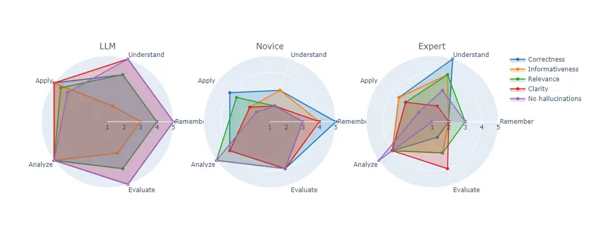

^(\*1)

# The Challenges of Evaluating LLM Applications: An Analysis of Automated, Human, and LLM-Based Approaches

Bhashithe Abeysinghe

   Ruhan Circi

###### Abstract

Chatbots have been an interesting application of natural language
generation since its inception. With novel transformer based Generative
AI methods, building chatbots have become trivial. Chatbots which are
targeted at specific domains for example medicine and psychology are
implemented rapidly. This however, should not distract from the need to
evaluate the chatbot responses. Especially because the natural language
generation community does not entirely agree upon how to effectively
evaluate such applications. With this work we discuss the issue further
with the increasingly popular LLM based evaluations and how they
correlate with human evaluations. Additionally, we introduce a
comprehensive factored evaluation mechanism that can be utilized in
conjunction with both human and LLM-based evaluations. We present the
results of an experimental evaluation conducted using this scheme in one
of our chatbot implementations which consumed educational reports, and
subsequently compare automated, traditional human evaluation, factored
human evaluation, and factored LLM evaluation. Results show that factor
based evaluation produces better insights on which aspects need to be
improved in LLM applications and further strengthens the argument to use
human evaluation in critical spaces where main functionality is not
direct retrieval.

###### keywords

LLM,Human Evaluation ,Evaluation Challenges ,factor based evaluation
,LLM Evaluation

^(†)^(†)copyrightyear: 2024^(†)^(†)copyright: Copyright for this paper
by its authors. Use permitted under Creative Commons License Attribution
4.0 International (CC BY 4.0).^(†)^(†)venue: The First Workshop on Large
Language Models for Evaluation in Information Retrieval, 18 July 2024,
Washington DC, United States^(†)^(†)email:
babeysinghe@air.org^(†)^(†)address: American Institutes for Research,
Arlington, VA^(†)^(†)email: rcirci@air.org^(†)^(†)corresp: Corresponding
author.

## 1 Introduction

The landscape of chatbot development is rapidly evolving, propelled by
advancements in Large Language Model (LLM) APIs. While the pace of
development is exciting, there is a gap between building an LLM-powered
application and building a reliable system with LLMs. This challenge
requires carefully considering whether the final product satisfies all
requirements and evaluate it to test its alignment with performance and
ethical standards. As highlighted by Srivastava et al. (2023), this
evaluation process should encompass both a technical assessment and a
trust-oriented framework. It is essential to ensure a balance between
operational efficiency and responsible usage.

Figure 1: Median of Likert scale ratings of each evaluator. Each spoke
shows how an evaluator rated a response based on the question type from
Blooms Taxonomy.

This process is further complicated by common pitfalls in LLMs, as
several authors Gallegos et al. (2023); Huang et al. (2023); Ji et al.
(2023); Kaddour et al. (2023) mention areas of LLM could make mistakes,
such as hallucination, tone, and output formatting. Effective evaluation
can help to improve and maintain validation and consistency to avoid
common pitfalls. The development of an effective evaluation system is
timely for researchers and developers alike, given the propagation of
LLM based generative applications such as chatbots.

The development cycle of a generic LLM-based application typically
covers three phases: a) selection of LLM, b) iterative development of
the application, and c) operational deployment of the app. The
evaluation of LLMs themselves, as discussed in various papers Guo et al.
(2023); Liang et al. (2023) is beyond the scope of this brief. However,
it is essential to note that the quality of the base LLM is a
fundamental component in leveraging its capabilities effectively and
minimizing risk in the resulting application. For applications,
developers may follow different development approaches (e.g.,
fine-tuning, chaining, prompting, Retrieval Augmented Generation (RAG),
LLM search combined with Knowledge graphs, etc.) and each approach
demands tailored evaluation steps e.g., quality of data used in
fine-tuning or prompting styles Nori et al. (2023), or chunk size and
quantity in RAG Gao et al. (2023). This paper explores three fundamental
approaches for evaluating the final response (i.e., output) generated by
LLM-based chatbots namely automated metrics, human evaluation and LLM
based evaluation. With respect to human evaluation we investigate
preferential evaluation and factored evaluation methods.

## 2 Background

Chatbots interact with users in such a way that they resolve user
queries. Some chatbots are domain specific Abd-Alrazaq et al. (2020)
while others are general purpose chatbots noa (2023). Evaluating a
chatbot largely hinges on the intended use and specialization of the
chatbot. In reviewing 16 papers on this topic, we summarized several key
components that require attention for the evaluation; among these, the
clear definition of the chatbot’s intended purpose (i.e., use case -
that specify business goal or client expectations, and user interaction
with app) is critical. Such clarity helps for a focused evaluation of
whether the chatbot attains its designated purpose.

The components described in Table 1 suggest that chatbots can be
evaluated on different factors (also known as factors or dimensions),
such as their ability to answer the users’ queries completely, their
linguistic effectiveness, and their ability to recall information
(either through information retrieval or memory). Additional metrics may
include the system’s response time, usability, and intuitiveness.

|                     |                                      |
| ------------------- | ------------------------------------ |
| Key components      | Description                          |
| Response properties | Correctness of output                |
|                     | Readability/tone                     |
| Grading approach    | One uttarance                        |
|                     | Conversation                         |
|                     | Comparative/preference               |
| User experience     | Number of interactions per user      |
|                     | Helpful suggestions from the bot     |
|                     | The intuitiveness of the application |

Table 1: Components of evaluation for an LLM powered application

Currently, there are no common methods or agreed upon best practices
that are robust enough to evaluate LLM-based applications. As pointed
out in almost all the prior work on this topic, a notable challenge is
the lack of consensus on appropriate evaluation criteria and metrics.
Therefore, researchers and developers bear the responsibility of
choosing evaluation methods that are most appropriate for their unique
application. This responsibility may not only increase development
timelines but may also lead to underpowered statistical evaluations Card
et al. (2020); van der Lee et al. (2019). A resounding issue of
automated metrics is that they are inconsistent with results and may not
always correlate with human evaluation. But many still prefer to use
them in evaluation due to being readily available and also easily
repeatable Banerjee and Lavie (2005); Lin (2004); Papineni et al.
(2002); Sellam et al. (2020); Zhang et al. (2020). Which is not the case
with human evaluation, it is expensive and will not be repeatable in the
same context even if one uses the same humans Finch et al. (2023);
van der Lee et al. (2019); van der Lee et al. (2021). We must
acknowledge the work where generative AI models which are being used at
the evaluation step such as ChatEval, GPTScore and ARES Chan et al.
(2023); Fu et al. (2023); Saad-Falcon et al. (2024) which are novel
applications of LLMs. Svikhnushina and Pu (2023) discusses about
“bot-play” where an already evaluated LLM being used in evaluating a new
un-evaluated LLM. When considering LLM based evaluators, one must make
sure the evaluator LLM produces acceptable and accurate decisions to a
given threshold.

Human evaluation remains the most widely accepted form of evaluation in
research studies despite frequent reports of underpowered results Clark
et al. (2021); van der Lee et al. (2019). Several attempts have been
called for the standardization of human evaluation methods Howcroft and
Rieser (2021); van der Lee et al. (2021), but its costly nature often
leads researchers to report on systems with statistically insufficient
power. Additionally, the sensitivity of human evaluators to the framing
of questions (framed negatively or positively) is reported to influence
outcomes Schoch et al. (2020). For conversational or dialogue systems,
the common standard of human evaluation is Quality on Likert scales.
Quality can vary across tasks, and it encompasses multiple factors such
as correctness, relevance, informativeness, consistency, understanding,
etc. Finch et al. (2023). van der Lee et al. (2019) suggest using a
minimum of 100 questions rated on 5 or 7-point Likert scales to evaluate
multiple dimensions. This seems to be a difficult goal to achieve due to
the expensive nature of human evaluation.

The variability in expert opinions has led to multiple recommendations
for refining human evaluation approaches. Engaging at least four experts
is recommended, but more is preferable for robust results van der Lee
et al. (2021). However, using expert evaluations may not always be
productive, particularly if the system is not designed for expert use
Clark et al. (2021). In cases where the number of available experts is
limited, a comparative (also known as preferential) evaluation approach
is often preferred. Additionally, it is advisable to involve about 10 to
60 non-expert users - the intended end-users of the system - in the
evaluation process and to ensure that the Inter Annotator Agreement
(IAA) is reported for reliability (refer to Table 3 in van der Lee
et al. (2019) for best practices). It is also imperative to use external
evaluators who have not taken part in the conversation to judge the
conversation Finch et al. (2023). Vijayaraghavan et al. (2020) discusses
the complexities in explaining human evaluations; noting that
individuals with varying levels of expertise can provide divergent
assessments of the same response, this again shows the importance of
employing many humans with varying expertise to completely evaluate such
a system.

In summarizing insights from reviewed research articles, it is evident
that human evaluation remains a common and indispensable element in the
evaluation pipeline of chatbot systems, albeit implemented at different
stages. Additionally, a diverse selection of metrics is frequently
employed to assess various aspects of chatbot responses. Utilizing
evaluator LLMs seems to be a promising approach that warrants
exploration due to its potential to offer efficient and scalable
evaluation. While the current focus is on the evaluation, a potentially
critical factor, often overlooked, is the nature of the data used for
testing and evaluation and many papers lack specificity regarding the
types of questions posed to chatbots. We propose that incorporating a
range of question types, informed by cognitive psychology frameworks
such as Bloom’s Taxonomy, could significantly enhance the systematic
evaluation of chatbot responses and the insights drawn from such an
evaluation.

Figure 2: Screen capture of the EdTalk chatbot answering a question

To experiment with the evaluation procedures, we implement a chatbot
first (Figure 2). This implementation follows industry standards such as
Retrieval Augmented Generation (RAG), Vector Databases etc. to create a
chatbot. The chatbot EdTalk aims to assist users in _navigating and
comprehending lengthy reports_ by harnessing the power of LLMs and the
goals are to have _minimal hallucination_ and _strict adherence_ to
factual information from its knowledge base. The goal of this chatbot is
to make the educational reports such as Condition of Education
accessible to a wide range of readers. Hence, chatbots knowledge base is
built with the said reports. By evaluating EdTalk, we investigate if
this chatbot aligns with its initial goals. Simultaneously we find if
the chatbot is able to consistently follow the goals for various
different types of questions in Bloom’s Taxonomy. Later we compare the
results from various evaluation procedures including automated, human
and LLM-based to find what is more informative with respect to the
development of this chatbot.

|                                                       |                                                                                                                                                                                                                                                                                                                                                                                                                                              |                                                                                                                                                                                                                                                                                                                                                                                                                                                                                                                                                                                                                                                                                                                                                                                                                                                                                                                                        |
| ----------------------------------------------------- | -------------------------------------------------------------------------------------------------------------------------------------------------------------------------------------------------------------------------------------------------------------------------------------------------------------------------------------------------------------------------------------------------------------------------------------------- | -------------------------------------------------------------------------------------------------------------------------------------------------------------------------------------------------------------------------------------------------------------------------------------------------------------------------------------------------------------------------------------------------------------------------------------------------------------------------------------------------------------------------------------------------------------------------------------------------------------------------------------------------------------------------------------------------------------------------------------------------------------------------------------------------------------------------------------------------------------------------------------------------------------------------------------- |
| Question                                              | Expert response                                                                                                                                                                                                                                                                                                                                                                                                                              | Generated response                                                                                                                                                                                                                                                                                                                                                                                                                                                                                                                                                                                                                                                                                                                                                                                                                                                                                                                     |
| What challenges did schools face during the pandemic? | Schools experienced many other challenges—besides staffing-related ones—during their recovery from the coronavirus pandemic. Some of these other issues facing public schools included reported increases in student and teacher absenteeism, student socioemotional and behavioral development, and an increase in the percentage of students seeking mental health services from school, as compared with before the coronavirus pandemic. | Schools faced many challenges during the pandemic besides staffing-related issues. Some of these challenges included reported increases in student and teacher absenteeism, student socioemotional and behavioral development, and an increase in the percentage of students seeking mental health services from school, as compared with before the coronavirus pandemic. In particular, in April 2022, some 70 percent of public schools reported that the percentage of students who had sought mental health services from school had increased since the start of the coronavirus pandemic. Overall, only 12 percent of schools strongly agreed and 44 percent moderately agreed that their school was able to effectively provide mental health services to all students in need. So, schools faced challenges related to student mental health, absenteeism, and socioemotional and behavioral development during the pandemic. |

Table 2: Scenario from Condition of Education report 2023, the example
question, Annotator expert response, generated response. Similar
response pairs are used in the BLEURT evaluation

## 3 Evaluation procedures

We understand that chatbots, like any software will have an iterative
implementation where the developers would be updating components which
make up the chatbot. Each of these components and the full system need
to be evaluated for reliability and performance. In this section we dive
into various evaluation procedures we conducted and briefly explain how
they were implemented. But we only focus on the utterance-based
evaluation; meaning that we shall only be investigating procedures which
are built to look at responses of the chatbot. Other components
performance such as the semantic search used for retrieval in RAG is not
in scope for this investigation.

To conduct the evaluation we employ the service of 5 humans. Initially,
one of the human evaluators, having access to the content to be
evaluated, generated 40 questions based on Bloom’s Taxonomy Armstrong
(2010). The purpose behind adopting Bloom’s Taxonomy was to determine
the efficacy of the chatbot in responding to different types of
questions. This approach adds another unique dimension to the evaluation
process, enabling us to evaluate the quality of the chatbot’s responses
against different types of questions. It should be noted that the
specific questions used in the evaluation were dependent on the use case
of the chatbot implementation and have not been disclosed in this
article.

Then a pair of humans hereafter known as - _annotators_, write their own
responses to the above questions. Later another pair hereafter known
as - _evaluators_ determines the quality of the responses. Both pairs
consists of an expert and a novice. An expert is someone who has been
working with these reports for more than 2 years and a novice is new to
the area but has some experience with the content.

### 3.1 Automated evaluation

Selecting an automated evaluation model is one crucial step. We do not
select n-gram based methods because of the issues that literature points
out and hence, we utilize embedding based methods. In that regard we
believe BLUERT Sellam et al. (2020) to be the best out of the selection.
We must not forget that this methods would still sometimes produce
inconsistent results, but as it is repeatable, it can be used at the
rapid development stage to test parameters such as chunk sizes, overlap
sizes etc. BLEURT requires a reference text and a generated text to
compute similarity, and Sellam et al. (2020) suggests using a specific
checkpoint to achieve best comparison¹¹ 1
[https://github.com/google-research/bleurt?tab=readme-ov-file#checkpoints](https://github.com/google-research/bleurt?tab=readme-ov-file#checkpoints),
an example of the reference text (Expert response) and the generated
text (generated response) is given in the Table 2. Evaluating if the
chatbot responses are similar to _annotators_ is straightforward with
BLEURT.

### 3.2 Human evaluation

Human evaluation on the other hand is a bit complex. There is
traditional human evaluation which is typically a preferential rating of
what response a human would prefer more. While this is an acceptable
measure van der Lee et al. (2019), it may still miss insights from the
results. We conduct this traditional preferential evaluation first to
start the human evaluation. The humans do not need to be experts in the
domain to conduct this type of evaluation Clark et al. (2021).

Then we enlist evaluators to rate responses of the chatbot for the
previously created questions. Rating will be conducted on a few factors
Fu et al. (2023); van der Lee et al. (2019). We carefully select these
factors so that we can effectively evaluate many aspects of the chatbot,
where many of the selected factors were inspired by van der Lee et al.
(2019). We develop a 5-point Likert scale-based questionnaire from which
we collect expert ratings for the chatbot responses.

Instructions on how to perform the ratings were given prior to the
_evaluators_. Table 3 shows what questions an evaluator should ask
before rating a response for a criterion. The criterions are set up so
that a response with all the accurate and relevant information, without
unnecessary information, in the most clear and concise manner is rated
high. We also take hallucinations into the equation as well; this covers
most quality criteria a generative AI application should look for.
Evaluators are also free to refer the text where the questions re based
off of, but we did not make the previous Annotator responses available
for the Evaluators. We gave example ratings for a few questions and
responses which were not part of the 40 selected above, these included
examples for ratings 1, 3 and 5. Evaluators were free to determine how
to assign the intermediate ratings.

|                 |                                                                                                     |
| --------------- | --------------------------------------------------------------------------------------------------- |
| Criterion       | Description                                                                                         |
| Relevance       | If the facts presented are required by the question?                                                |
| Informativeness | Are all the facts called by the question presented by the response?                                 |
| Correctness     | How correct the generated response?                                                                 |
| Clarity         | Does the question call for a certain formatting ofr the answer or is the response brief or verbose? |
| hallucination   | Is the answer a hallucinated reference, information etc.?                                           |

Table 3: Criteria for the Likert scale questionnaire

### 3.3 LLM-based evaluation

The evaluation procedure being discussed is a relatively new one, and
there is currently limited literature available to support its
reliability as compared to human evaluation. The purpose of this study
is to contribute to the existing literature by comparing human-based
evaluation with LLM-based evaluation. The researchers used the same
instructions that were given to human evaluators to prompt the LLM for
evaluation. In addition, examples for each Likert scale value were
provided to ensure that the LLM was aligned with the evaluation
criteria, this is the only difference between the human instructions as
humans do not receive examples for all Likert scales. The evaluation
prompt included the question, facts retrieved from the content, and the
response generated by the chatbot, as per the methodology proposed by
Saad-Falcon et al. (2024). The responses were evaluated for a given
factor at a time, and the generated evaluation responses were processed
to extract similar Likert scales from the LLM. The LLM evaluators did
not have access to the Annotator responses created in the automated
evaluation step, but LLM evaluator did have access to the content of the
document. This allowed the researchers to compare the LLM-based
evaluation with the human evaluation in a similar light.

## 4 Results

In this section, the results of all evaluation procedures are compared
and contrasted. The purpose is to gain an understanding of what was
learned from each experiment and to identify any advantages or
disadvantages associated with each method. Bloom’s Taxonomy is used to
make comparisons, but the specific types within the taxonomy are not
explained in this work.

|            |        |        |
| ---------- | ------ | ------ |
| Type       | Expert | Novice |
| Remember   | 0.45   | 0.40   |
| Understand | 0.61   | 0.55   |
| Apply      | 0.44   | 0.24   |
| Analyze    | 0.47   | 0.41   |
| Evaluate   | 0.22   | 0.31   |

Table 4: Automated evaluation results; each generated answer is compared
against a human (Expert or Novice) and the BLEURT score is reported
herewith

Table 4 presents the results captured by the automated evaluation
experiment. As we explain in the previous sections, here we use BLEURT
Sellam et al. (2020) as the metric to compute similarities of the
generated response against a human written answer. This evaluation can
be conducted rapidly if the human written responses are readily
available. Meaning that the human needs to only write the response once,
where it is possible to repeatedly run the evaluation after the
parameters of the application are altered. It is not clear how to
compare two BLEURT scores for a similar task where multiple reference
text are used. Upon inspection and comparison of BLEURT values, it was
noted that for some question types, expert and novice fell into similar
ranges. For both humans, the generated response has a lower similarity
in _Evaluate_ questions. For _Apply_ questions, while Experts similarity
is at 0.44, novice has 0.24. Highest similarities were reported in both
humans at _Understand_ questions.

|            |                               |
| ---------- | ----------------------------- |
| Type       | Generated response preference |
| Remember   | 31%                           |
| Understand | 100%                          |
| Apply      | 0%                            |
| Analyze    | 57%                           |
| Evaluate   | 33%                           |

Table 5: Percentage of preference of generated response in the
preferential rating evaluation

|                 |                           |
| --------------- | ------------------------- |
| Criterion       | Krippendorff’s $`\alpha`$ |
| Correctness     | 0.12                      |
| Informativeness | 0.18                      |
| Relevance       | 0.31                      |
| Clarity         | 0.52                      |
| Hallucinations  | 0.31                      |

Table 6: Agreement of human annotators using Krippendorff’s alpha

|        |            |             |                 |           |         |                |
| ------ | ---------- | ----------- | --------------- | --------- | ------- | -------------- |
|        | Type       | Correctness | Informativeness | Relevance | Clarity | Hallucinations |
| Expert | Remember   | 2           | 2               | 3         | 2       | 3              |
|        | Understand | 5           | 4               | 4         | 2       | 3              |
|        | Apply      | 3.5         | 3.5             | 3         | 3       | 2              |
|        | Analyze    | 4           | 4               | 4         | 4       | 5              |
|        | Evaluate   | 2           | 3               | 3         | 4       | 1              |
| Novice | Remember   | 5           | 4               | 3         | 4       | 3              |
|        | Understand | 3           | 3               | 2         | 2       | 2              |
|        | Apply      | 4           | 2.5             | 3.5       | 2.5     | 2              |
|        | Analyze    | 4           | 4               | 5         | 4       | 5              |
|        | Evaluate   | 4           | 4               | 4         | 4       | 4              |
| LLM    | Remember   | 4           | 3               | 4         | 5       | 5              |
|        | Understand | 4           | 2               | 4         | 5       | 5              |
|        | Apply      | 5           | 5               | 4.5       | 5       | 4              |
|        | Analyze    | 5           | 5               | 5         | 5       | 5              |
|        | Evaluate   | 4           | 3               | 4         | 5       | 5              |

Table 7: Factored evaluation results; median across question type.
Higher the better.

We conducted traditional human evaluation through preferential rating
first, this type of evaluation does not require domain experts to
conduct evaluation and is much faster considering the other human
evaluation methods. Here we find that the chatbots answers are preferred
only 47% (on average) of the time, Table 5 present results broken down
into the same Bloom’s Taxonomy type. This measure does not reveal
anything about what areas are needed improvement in order to perform
better. Which is typically why the community prefers factored human
evaluation.

Table 7 reports the results of the factored evaluation in both human and
LLM procedures. Since we used Likert scales to capture ratings, we have
reported the results via medians of each factor and question type. The
visualized results are displayed in Figure 1, which clearly highlight
the notable differences between novices and experts in their approaches
to response analysis. The graph underscores the importance of
recognizing individual variations in cognitive processing and
interpretation of information.

Using the factored human evaluation procedure, we were able to
experimentally figure out previously elusive facts about the generative
application. When we initially conducted trivial automated and human
evaluation (preferential), if we do not break questions down to Bloom’s
Taxonomy, we only get one measure to test if the chatbot works within
the parameters of an acceptable application. This is not usually enough
to understand the underlying complex issues of LLMs, and if they are
present in the LLM-powered application or not. RAG systems are built to
retrieve information which is available in context. This means that when
posed with _Remember_ questions, they must perform well, but as the
results from the expert show; EdTalk does not perform well with
_Remember_ questions (Table 7 and Figure 1). It shows also that chatbot
responses are not consistent enough to say anything related to other
question types. This result reveals while RAG chatbots should be great
at answering retrieval based questions they sometimes do not work as
intended in the perspective of a human. We also note that the automated
evaluation with BLEURT showed similar patterns with each of the question
type as well, but when we take the novice into account, the similarity
is not present anymore. One advantage in this type of evaluation is that
we can now check the inter-rater reliability, and we show this in Table 6. We notice the major issue pointed out by many prior work here with,
where humans not agreeing in their reviews. Also by categorizing
questions into factors we notice that human agreement is moderate in
_Clarity_ but all other factors are low agreement. One disadvantage we
notice here is the ability of repeating the evaluation effort, same
humans may rate these responses differently if we change the order or
the framing of the questions in the questionnaire van der Lee et al.
(2019); Clark et al. (2021).

## 5 Discussion

The goal of this work is to illustrate how challenging it is to evaluate
an LLM based application, especially evaluating a chatbot with current
methodologies including automated, human and LLM procedures. We first
demonstrate that there are advantages and disadvantages in all three of
these approaches. We also note the differences of results gained from
all three evaluation procedures, there is very little correlation
between these results and it would be difficult to suggest one to be
used. We also observed that the experts evaluation results are a bit
stricter and resulted lower scores generally for many factors. The
novice had looked at the chatbot in a favorable light and we notice the
slightly elevated scores. Using an LLM to evaluate the chatbot responses
seems to be not reliable as the LLM scores its own responses high. In
our experimental case, we used the same LLM (GPT-3.5) to generate the
responses and also as the evaluator LLM. This is not the ideal setting
as Svikhnushina and Pu (2023) points out, in Svikhnushina and Pu (2023)
authors point out if an LLM is not evaluated it must be evaluated using
an already evaluated LLM or a higher order LLM. Given this situation of
uncertain evaluations from any procedure, we should not distract the
readers from the need for evaluating. To improve the reliability of
evaluation, we suggest increasing the number of humans used in the
factored human evaluation. Also enlisting a wide range of expertise
would create a smoothed preview of the results; however, this would
increase the expensiveness of the evaluation. As van der Lee et al.
(2019) suggests, enlisting a larger amount of intended users of a
chatbot would still not be ideal as these users may also create
confusion on whats correct and whats not. Allowing untrained humans to
make judgments on the factors will not yield the most accurate results,
similar to the case we have with LLM results in Figure 1.

One deciding factor would be the repeatability and the amount of funds a
person has toward evaluating a chatbot. In this regard we note while
automated procedures are repeatable, low reliability of these metrics
make a case against them. Human evaluation is considered the gold
standard, while that can be true research indicates that the human
disagreement is a greater issue; we also notice this issue indicated in
Table 6. LLM evaluators are a novel adaptation of LLMs, its greatest
adversary right now is not having enough research to support its
reliability. We observe that in some cases LLM evaluators have similar
responses to human evaluators. But this is not the case always, in most
instances LLM evaluators tend to be overly confident in the response
being correct. We cannot reject the promise in LLM evaluators as we can
set various personalities and take various versions of its evaluation
rapidly Chan et al. (2023), but this also must be explored in terms of
whether a person of such an expertise would rate the same response in a
similar way. Further research needs to be conducted in understanding how
LLMs can help us evaluate LLMs.

###### Acknowledgements.

Abhinav Cheruvu for helping with implementation of the chatbot and to
Tabitha Tezil, Erika Kessler and Jijun Zhang for helping with human
evaluation.

## References

- Srivastava et al. (2023) B. Srivastava, K. Lakkaraju, T. Koppel,
  V. Narayanan, A. Kundu, S. Joshi, Evaluating Chatbots to Promote
  Users’ Trust – Practices and Open Problems, 2023. URL:
  [http://arxiv.org/abs/2309.05680](http://arxiv.org/abs/2309.05680),
  arXiv:2309.05680 \[cs\].
- Gallegos et al. (2023) I. O. Gallegos, R. A. Rossi, J. Barrow, M. M.
  Tanjim, S. Kim, F. Dernoncourt, T. Yu, R. Zhang, N. K. Ahmed, Bias and
  Fairness in Large Language Models: A Survey, 2023. URL:
  [http://arxiv.org/abs/2309.00770](http://arxiv.org/abs/2309.00770).
  doi:[10.48550/arXiv.2309.00770](https://doi.org/10.48550/arXiv.2309.00770),
  arXiv:2309.00770 \[cs\].
- Huang et al. (2023) L. Huang, W. Yu, W. Ma, W. Zhong, Z. Feng,
  H. Wang, Q. Chen, W. Peng, X. Feng, B. Qin, T. Liu, A Survey on
  Hallucination in Large Language Models: Principles, Taxonomy,
  Challenges, and Open Questions, 2023. URL:
  [http://arxiv.org/abs/2311.05232](http://arxiv.org/abs/2311.05232).
  doi:[10.48550/arXiv.2311.05232](https://doi.org/10.48550/arXiv.2311.05232),
  arXiv:2311.05232 \[cs\].
- Ji et al. (2023) Z. Ji, N. Lee, R. Frieske, T. Yu, D. Su, Y. Xu,
  E. Ishii, Y. J. Bang, A. Madotto, P. Fung, Survey of Hallucination in
  Natural Language Generation, ACM Computing Surveys 55 (2023) 1–38.
  URL:
  [https://dl.acm.org/doi/10.1145/3571730](https://dl.acm.org/doi/10.1145/3571730).
  doi:[10.1145/3571730](https://doi.org/10.1145/3571730).
- Kaddour et al. (2023) J. Kaddour, J. Harris, M. Mozes, H. Bradley,
  R. Raileanu, R. McHardy, Challenges and Applications of Large Language
  Models, 2023. URL:
  [http://arxiv.org/abs/2307.10169](http://arxiv.org/abs/2307.10169).
  doi:[10.48550/arXiv.2307.10169](https://doi.org/10.48550/arXiv.2307.10169),
  arXiv:2307.10169 \[cs\].
- Guo et al. (2023) Z. Guo, R. Jin, C. Liu, Y. Huang, D. Shi, Supryadi,
  L. Yu, Y. Liu, J. Li, B. Xiong, D. Xiong, Evaluating Large Language
  Models: A Comprehensive Survey, 2023. URL:
  [http://arxiv.org/abs/2310.19736](http://arxiv.org/abs/2310.19736).
  doi:[10.48550/arXiv.2310.19736](https://doi.org/10.48550/arXiv.2310.19736),
  arXiv:2310.19736 \[cs\].
- Liang et al. (2023) P. Liang, R. Bommasani, T. Lee, D. Tsipras,
  D. Soylu, M. Yasunaga, Y. Zhang, D. Narayanan, Y. Wu, A. Kumar,
  B. Newman, B. Yuan, B. Yan, C. Zhang, C. Cosgrove, C. D. Manning,
  C. Ré, D. Acosta-Navas, D. A. Hudson, E. Zelikman, E. Durmus,
  F. Ladhak, F. Rong, H. Ren, H. Yao, J. Wang, K. Santhanam, L. Orr,
  L. Zheng, M. Yuksekgonul, M. Suzgun, N. Kim, N. Guha, N. Chatterji,
  O. Khattab, P. Henderson, Q. Huang, R. Chi, S. M. Xie, S. Santurkar,
  S. Ganguli, T. Hashimoto, T. Icard, T. Zhang, V. Chaudhary, W. Wang,
  X. Li, Y. Mai, Y. Zhang, Y. Koreeda, Holistic Evaluation of Language
  Models, 2023. URL:
  [http://arxiv.org/abs/2211.09110](http://arxiv.org/abs/2211.09110).
  doi:[10.48550/arXiv.2211.09110](https://doi.org/10.48550/arXiv.2211.09110),
  arXiv:2211.09110 \[cs\].
- Nori et al. (2023) H. Nori, Y. T. Lee, S. Zhang, D. Carignan,
  R. Edgar, N. Fusi, N. King, J. Larson, Y. Li, W. Liu, R. Luo, S. M.
  McKinney, R. O. Ness, H. Poon, T. Qin, N. Usuyama, C. White,
  E. Horvitz, Can Generalist Foundation Models Outcompete
  Special-Purpose Tuning? Case Study in Medicine, 2023. URL:
  [http://arxiv.org/abs/2311.16452](http://arxiv.org/abs/2311.16452).
  doi:[10.48550/arXiv.2311.16452](https://doi.org/10.48550/arXiv.2311.16452),
  arXiv:2311.16452 \[cs\].
- Gao et al. (2023) Y. Gao, Y. Xiong, X. Gao, K. Jia, J. Pan, Y. Bi,
  Y. Dai, J. Sun, H. Wang, Retrieval-Augmented Generation for Large
  Language Models: A Survey, 2023. URL:
  [http://arxiv.org/abs/2312.10997](http://arxiv.org/abs/2312.10997).
  doi:[10.48550/arXiv.2312.10997](https://doi.org/10.48550/arXiv.2312.10997),
  arXiv:2312.10997 \[cs\].
- Abd-Alrazaq et al. (2020) A. Abd-Alrazaq, Z. Safi, M. Alajlani,
  J. Warren, M. Househ, K. Denecke, Technical Metrics Used to Evaluate
  Health Care Chatbots: Scoping Review, Journal of Medical Internet
  Research 22 (2020) e18301. URL:
  [http://www.jmir.org/2020/6/e18301/](http://www.jmir.org/2020/6/e18301/).
  doi:[10.2196/18301](https://doi.org/10.2196/18301).
- noa (2023) Vicuna: An Open-Source Chatbot Impressing GPT-4 with 90%\*
  ChatGPT Quality \| LMSYS Org, 2023. URL:
  [https://lmsys.org/blog/2023-03-30-vicuna](https://lmsys.org/blog/2023-03-30-vicuna).
- Card et al. (2020) D. Card, P. Henderson, U. Khandelwal, R. Jia,
  K. Mahowald, D. Jurafsky, With Little Power Comes Great
  Responsibility, 2020. URL:
  [http://arxiv.org/abs/2010.06595](http://arxiv.org/abs/2010.06595),
  arXiv:2010.06595 \[cs\].
- van der Lee et al. (2019) C. van der Lee, A. Gatt, E. Van Miltenburg,
  S. Wubben, E. Krahmer, Best practices for the human evaluation of
  automatically generated text, in: Proceedings of the 12th
  International Conference on Natural Language Generation, 2019, pp.
  355–368.
- Banerjee and Lavie (2005) S. Banerjee, A. Lavie, METEOR: An Automatic
  Metric for MT Evaluation with Improved Correlation with Human
  Judgments, in: J. Goldstein, A. Lavie, C.-Y. Lin, C. Voss (Eds.),
  Proceedings of the ACL Workshop on Intrinsic and Extrinsic Evaluation
  Measures for Machine Translation and/or Summarization, Association for
  Computational Linguistics, Ann Arbor, Michigan, 2005, pp. 65–72. URL:
  [https://aclanthology.org/W05-0909](https://aclanthology.org/W05-0909).
- Lin (2004) C.-Y. Lin, ROUGE: A Package for Automatic Evaluation of
  Summaries, in: Text Summarization Branches Out, Association for
  Computational Linguistics, Barcelona, Spain, 2004, pp. 74–81. URL:
  [https://aclanthology.org/W04-1013](https://aclanthology.org/W04-1013).
- Papineni et al. (2002) K. Papineni, S. Roukos, T. Ward, W.-J. Zhu,
  Bleu: a Method for Automatic Evaluation of Machine Translation, in:
  P. Isabelle, E. Charniak, D. Lin (Eds.), Proceedings of the 40th
  Annual Meeting of the Association for Computational Linguistics,
  Association for Computational Linguistics, Philadelphia, Pennsylvania,
  USA, 2002, pp. 311–318. URL:
  [https://aclanthology.org/P02-1040](https://aclanthology.org/P02-1040).
  doi:[10.3115/1073083.1073135](https://doi.org/10.3115/1073083.1073135).
- Sellam et al. (2020) T. Sellam, D. Das, A. P. Parikh, BLEURT: Learning
  Robust Metrics for Text Generation, 2020. URL:
  [http://arxiv.org/abs/2004.04696](http://arxiv.org/abs/2004.04696).
  doi:[10.48550/arXiv.2004.04696](https://doi.org/10.48550/arXiv.2004.04696),
  arXiv:2004.04696 \[cs\].
- Zhang et al. (2020) T. Zhang, V. Kishore, F. Wu, K. Q. Weinberger,
  Y. Artzi, BERTScore: Evaluating Text Generation with BERT, 2020. URL:
  [http://arxiv.org/abs/1904.09675](http://arxiv.org/abs/1904.09675).
  doi:[10.48550/arXiv.1904.09675](https://doi.org/10.48550/arXiv.1904.09675),
  arXiv:1904.09675 \[cs\].
- Finch et al. (2023) S. E. Finch, J. D. Finch, J. D. Choi, Don’t Forget
  Your ABC’s: Evaluating the State-of-the-Art in Chat-Oriented Dialogue
  Systems, 2023. URL:
  [http://arxiv.org/abs/2212.09180](http://arxiv.org/abs/2212.09180),
  arXiv:2212.09180 \[cs\].
- van der Lee et al. (2021) C. van der Lee, A. Gatt, E. van Miltenburg,
  E. Krahmer, Human evaluation of automatically generated text: Current
  trends and best practice guidelines, Computer Speech & Language
  67 (2021) 101151. URL:
  [https://www.sciencedirect.com/science/article/pii/S088523082030084X](https://www.sciencedirect.com/science/article/pii/S088523082030084X).
  doi:[10.1016/j.csl.2020.101151](https://doi.org/10.1016/j.csl.2020.101151).
- Chan et al. (2023) C.-M. Chan, W. Chen, Y. Su, J. Yu, W. Xue,
  S. Zhang, J. Fu, Z. Liu, ChatEval: Towards Better LLM-based Evaluators
  through Multi-Agent Debate, 2023. URL:
  [http://arxiv.org/abs/2308.07201](http://arxiv.org/abs/2308.07201),
  arXiv:2308.07201 \[cs\].
- Fu et al. (2023) J. Fu, S.-K. Ng, Z. Jiang, P. Liu, GPTScore: Evaluate
  as You Desire, 2023. URL:
  [http://arxiv.org/abs/2302.04166](http://arxiv.org/abs/2302.04166),
  arXiv:2302.04166 \[cs\].
- Saad-Falcon et al. (2024) J. Saad-Falcon, O. Khattab, C. Potts,
  M. Zaharia, ARES: An Automated Evaluation Framework for
  Retrieval-Augmented Generation Systems, 2024. URL:
  [http://arxiv.org/abs/2311.09476](http://arxiv.org/abs/2311.09476),
  arXiv:2311.09476 \[cs\].
- Svikhnushina and Pu (2023) E. Svikhnushina, P. Pu, Approximating
  Online Human Evaluation of Social Chatbots with Prompting, in:
  S. Stoyanchev, S. Joty, D. Schlangen, O. Dusek, C. Kennington,
  M. Alikhani (Eds.), Proceedings of the 24th Meeting of the Special
  Interest Group on Discourse and Dialogue, Association for
  Computational Linguistics, Prague, Czechia, 2023, pp. 268–281. URL:
  [https://aclanthology.org/2023.sigdial-1.25](https://aclanthology.org/2023.sigdial-1.25).
- Clark et al. (2021) E. Clark, T. August, S. Serrano, N. Haduong,
  S. Gururangan, N. A. Smith, All That’s ’Human’ Is Not Gold: Evaluating
  Human Evaluation of Generated Text, 2021. URL:
  [http://arxiv.org/abs/2107.00061](http://arxiv.org/abs/2107.00061),
  arXiv:2107.00061 \[cs\].
- Howcroft and Rieser (2021) D. M. Howcroft, V. Rieser, What happens if
  you treat ordinal ratings as interval data? Human evaluations in NLP
  are even more under-powered than you think, in: M.-F. Moens, X. Huang,
  L. Specia, S. W.-t. Yih (Eds.), Proceedings of the 2021 Conference on
  Empirical Methods in Natural Language Processing, Association for
  Computational Linguistics, Online and Punta Cana, Dominican Republic,
  2021, pp. 8932–8939. URL:
  [https://aclanthology.org/2021.emnlp-main.703](https://aclanthology.org/2021.emnlp-main.703).
  doi:[10.18653/v1/2021.emnlp-main.703](https://doi.org/10.18653/v1/2021.emnlp-main.703).
- Schoch et al. (2020) S. Schoch, D. Yang, Y. Ji, “This is a Problem,
  Don’t You Agree?” Framing and Bias in Human Evaluation for Natural
  Language Generation, in: S. Agarwal, O. Dušek, S. Gehrmann,
  D. Gkatzia, I. Konstas, E. Van Miltenburg, S. Santhanam (Eds.),
  Proceedings of the 1st Workshop on Evaluating NLG Evaluation,
  Association for Computational Linguistics, Online (Dublin, Ireland),
  2020, pp. 10–16. URL:
  [https://aclanthology.org/2020.evalnlgeval-1.2](https://aclanthology.org/2020.evalnlgeval-1.2).
- Vijayaraghavan et al. (2020) V. Vijayaraghavan, J. B. Cooper, R. L.
  J., Algorithm Inspection for Chatbot Performance Evaluation, Procedia
  Computer Science 171 (2020) 2267–2274. URL:
  [https://linkinghub.elsevier.com/retrieve/pii/S1877050920312370](https://linkinghub.elsevier.com/retrieve/pii/S1877050920312370).
  doi:[10.1016/j.procs.2020.04.245](https://doi.org/10.1016/j.procs.2020.04.245).
- Armstrong (2010) P. Armstrong, Bloom’s Taxonomy, 2010. URL:
  [https://cft.vanderbilt.edu/guides-sub-pages/blooms-taxonomy/](https://cft.vanderbilt.edu/guides-sub-pages/blooms-taxonomy/).

## Appendix A Prompts

This section notes the prompts that have been used in this work, we
first note the prompt that has been utilized in the RAG process in the
chatbot for clarity and then a sample prompt that was

### A.1 RAG Prompt

The user asks the question \<question\>. Here are some facts that could
be used to support the question, \<facts delimited by semicolons\>.

You must first investigate if it is possible to support an answer with
the available facts If you do not have facts to support an answer, step
by step explaining your reasoning behind each action you must come up
with a answer by processing, applying and evaluating facts as needed.
Otherwise you must only respond with ”I dont know” and do not output
anything else.

### A.2 LLM Evaluator Prompt

Here in this prompt we only add the prompt used with the “Correctness”
criterion and similar prompts can be drawn for others.

You are an expert education researcher.

You are given a set of facts, a question that relates to the text of
these facts and an answer for the given question.

Your task is to evaluate if the answer is a good answer to the given
question based off of a criterion and also considering the facts.

Evaluation steps:

1. Read the facts: Start by carefully reading the facts provided.
   Understand the context, main points, and any relevant details.

2. Analyze the Question: Examine the question that relates to the facts.
   Ensure you have a clear understanding of what the question is asking
   for.

3. Review the Answer: Carefully read the answer provided and assess it
   based only on the following criterion:

Correctness: Does the answer provide accurate information based on the
paragraph text?

4. Assign a Score: Use the 5-point scale to assign a score to the
   answer:

Score 1: If the answer is wrong compared with the facts for the question

Score 2: If the answer is mostly wrong compared with the facts for the
question

Score 3: If the answer is partly correct given the facts for the
question

Score 4: If the answer is mostly correct given the facts for the
question

Score 5: If the answer is correct given the facts for the question

5. Document Scores: Keep a record of the scores and feedback for
   reference.

This can be helpful for tracking progress and ensuring consistency in
your evaluations.

The facts: \\verb\|\<relevant_facts\>\|

The Question for this facts: \\verb\|\<question\>\|

The Answer: \\verb\|\<response\>\|

Score:
