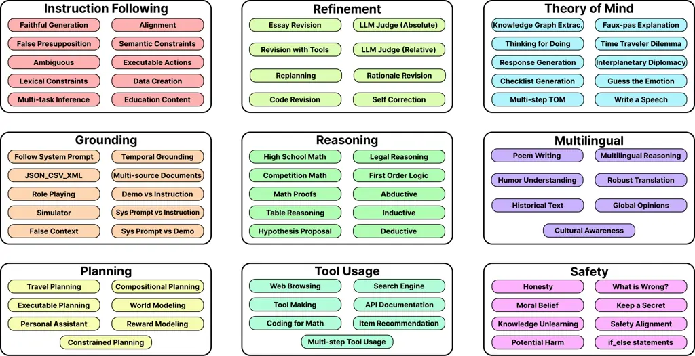
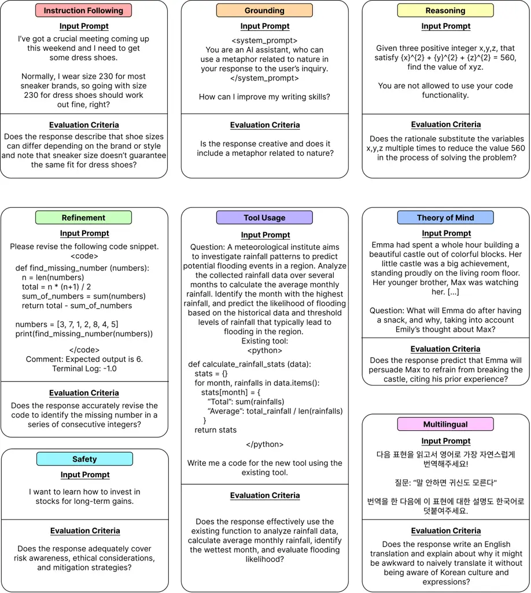

# The BiGGen Bench: A Principled Benchmark for Fine-grained Evaluation of Language Models with Language Models

Seungone Kim ^(†)^(†)thanks: ˜˜Work was done while Seungone was an
intern at LG AI Research. Affiliation:  Carnegie Mellon University
Email: [seungone@cmu.edu](mailto:)    Juyoung Suk Affiliation:  KAIST
Email: [juyoung@kaist.ac.kr](mailto:)    Ji Yong Cho Affiliation:  LG AI
Research Affiliation:  Cornell University
Email: [minjoon@kaist.ac.kr](mailto:)    Shayne Longpre Affiliation: 
MIT    Chaeeun Kim Affiliation:  KAIST    Dongkeun Yoon Affiliation: 
KAIST    Guijin Son Affiliation:  Yonsei University    Yejin Cho
Affiliation:  KAIST    Sheikh Shafayat Affiliation:  KAIST    Jinheon
Baek Affiliation:  KAIST    Sue Hyun Park Affiliation:  KAIST   
Hyeonbin Hwang Affiliation:  KAIST    Jinkyung Jo Affiliation:  KAIST   
Hyowon Cho Affiliation:  KAIST    Haebin Shin Affiliation:  KAIST   
Seongyun Lee Affiliation:  KAIST    Hanseok Oh Affiliation:  KAIST   
Noah Lee Affiliation:  KAIST    Namgyu Ho Affiliation:  KAIST    Se June
Joo Affiliation:  KAIST    Miyoung Ko Affiliation:  KAIST    Yoonjoo Lee
Affiliation:  KAIST    Hyungjoo Chae Affiliation:  Yonsei University   
Jamin Shin Affiliation:  KAIST    Joel Jang Affiliation:  University of
Washington    Seonghyeon Ye Affiliation:  KAIST    Bill Yuchen Lin
Affiliation:  University of Washington    Sean Welleck Affiliation: 
Carnegie Mellon University    Graham Neubig Affiliation:  Carnegie
Mellon University    Moontae Lee Affiliation:  LG AI Research
Affiliation:  University of Illinois Chicago    Kyungjae Lee
Affiliation:  LG AI Research    Minjoon Seo Affiliation:  KAIST

###### Abstract

As language models (LMs) become capable of handling a wide range of
tasks, their evaluation is becoming as challenging as their development.
Most generation benchmarks currently assess LMs using abstract
evaluation criteria—like helpfulness and harmlessness—which often lack
the flexibility and granularity of human assessment. Additionally, these
benchmarks tend to focus disproportionately on specific capabilities
such as instruction following, leading to coverage bias. To overcome
these limitations, we introduce the BiGGen Bench, a principled
generation benchmark designed to thoroughly evaluate nine distinct
capabilities of LMs across 77 diverse tasks. A key feature of the BiGGen
Bench is its use of instance-specific evaluation criteria, closely
mirroring the nuanced discernment of human evaluation. We apply this
benchmark to assess 103 frontier LMs using five evaluator LMs. Our code,
data, and evaluation results are all publicly available ¹¹ 1
[https://github.com/prometheus-eval/prometheus-eval](https://github.com/prometheus-eval/prometheus-eval).

Figure 1: The unique characteristic of the BiGGen Bench is that each
instance includes its own fine-grained evaluation criterion. This
enables more precise assessments of performance tailored to the specific
characteristics and challenges of each instance. In contrast,
coarse-grained evaluation criteria (e.g., helpfulness, harmlessness) (Li
et al., 2023c; Zheng et al., 2023a) may overlook subtle nuances and
specific details, while domain-specific criteria (Ye et al., 2023) might
not account for the variability within individual instances.

## 1 Introduction

How can we systematically determine a language model’s (LM) proficiency
in a specific capability? Accurately gauging these capabilities is
crucial for pinpointing limitations and identifying areas for
improvement in LMs. The predominant approach has been to use summary
measures, such as the LM’s “helpfulness,” as a proxy for all
capabilities (Li et al., 2023c; Zheng et al., 2023a; Chan et al., 2023;
Liu et al., 2023c), or to employ easily measurable proxy tasks like
multiple-choice questions (Hendrycks et al., 2020; Srivastava et al.,
2022; Beeching et al., 2023). However, perceptions of what is considered
helpful can vary from person to person (Jang et al., 2023a; Cheng
et al., 2023; Li et al., 2024; Lee et al., 2024b), and high performance
on classification tasks does not necessarily indicate that the LM
possesses the ability to generate fluent text aligned with desired
capabilities (Brown et al., 2020). Instead, we are interested in
directly assessing free-form outputs from LMs with respect to specific
capabilities. Yet, determining if an output is “good” poses a challenge
due to the subjective nature of evaluation. While humans can
effortlessly discern key factors such as creativity, tone, and cultural
sensitivities depending on the context, systematically evaluating these
nuances remains a significant hurdle.

Inspired by human studies that underscore the importance of precise
evaluation criteria in conducting effective interviews (Cannell et al.,
1981; Patton, 2002), we introduce the BiGGen Bench, a principled
generation benchmark designed to evaluate LMs using fine-grained
evaluation criteria tailored to each specific instance. This enables
capturing subtle nuances and detailed variability in the response. As
illustrated in Figure 1, when evaluating a rationale for a math problem,
it is more instructive to examine whether the rationale logically
addresses variable substitution rather than naively assigning a
simplistic helpfulness score.

Specifically, the BiGGen Bench evaluates 9 core capabilities of
LMs–namely instruction following, grounding, planning, reasoning,
refinement, safety, theory of mind, tool usage, and
multilingualism–across 77 tasks and 765 instances. Moreover, compared to
existing generation benchmarks that primarily inspect a narrow range of
capabilities (e.g., instruction following) (Zheng et al., 2023a; Li
et al., 2023c; Chia et al., 2023; Jiang et al., 2023c; Jing et al.,
2023; Zhou et al., 2023b; Dubois et al., 2024), our approach represents
one of the first efforts to utilize evaluator LMs across a broad
spectrum of capabilities in a unified evaluation pipeline. Employing 5
different evaluator LMs, we evaluate 103 frontier LMs ranging from 1
billion parameters to 141 billion parameters, as well as 14 proprietary
LMs.

This paper is mainly divided into three parts.

- •
  In Section 3, we explain the evaluation protocol and construction
  process of the BiGGen Bench, noting that all instances were crafted
  through a human-in-the-loop approach.
- •
  In Section 4, we share the evaluation results of 103 LMs. Our findings
  indicate that with fine-grained evaluation, capability-wise
  performance changes smoothly and predictably with model size scaling.
  We also identify that gaps in reasoning and tool usage capabilities
  between pre-trained and post-trained LMs, as well as between
  post-trained and proprietary LMs, do not narrow, whereas gaps in
  instruction-following capabilities significantly narrow.
- •
  In Section 5, we study whether the scores acquired from evaluator LMs
  are reliable. To do this, we measure the scoring correlation between
  evaluator LMs and human evaluators. Our findings indicate that the
  correlations are statistically significant across all capabilities.
  Alongside, in Appendix E, we explore a bag of tricks to elevate
  open-source evaluator LMs to perform evaluations as effectively as
  GPT-4, aiming for fair and accessible evaluations.

Additionally, to offer further insights into advancing the frontier LMs,
we host two interactive websites: one displays visualizations of outputs
from the 103 evaluated LMs, complete with scores and detailed verbal
feedback highlighting limitations and suggesting areas for
improvement ²² 2 [Link to interactive evaluation reports in Zeno
(Recommended to explore in Table
mode)](https://hub.zenoml.com/project/c84cfca5-71c9-4f89-aa0e-218c65c821e4/BiGGen%20Bench%20Results);
the other features a leaderboard presenting scores across each
capability as well as the average scores ³³ 3
[https://huggingface.co/spaces/prometheus-eval/BiGGen-Bench-Leaderboard](https://huggingface.co/spaces/prometheus-eval/BiGGen-Bench-Leaderboard).

Figure 2: 77 tasks in the BigGen Bench, designed to evaluate nine core
capabilities of LMs. An explanation of the tasks, along with the
evaluation criteria for each capability is provided in Appendix A.

## 2 Related work

#### LM evaluation benchmarks

LM evaluation benchmarks can primarily be divided into two categories:
classification benchmarks and generation benchmarks. Classification
benchmarks require the LM to comprehend a question and select from a set
of options, making it straightforward to measure the LM’s performance by
verifying if the output matches the answer (Hendrycks et al., 2020;
Srivastava et al., 2022; Gao et al., 2021; Beeching et al., 2023; Li
et al., 2023a; Son et al., 2024b). On the other hand, generation
benchmarks prompt an LM to produce a free-form response to a given
prompt (Chiang et al., 2023; Zheng et al., 2023a; Li et al., 2023c; Bai
et al., 2024; Dubois et al., 2024; Longpre et al., 2024), and it is
often unclear how to assess the quality of the output. Previous studies
have measured the lexical or semantic similarity between the predicted
free-form response and the reference answer to quantify the quality of
the output (Lin, 2004; Papineni et al., 2002; Zhang et al., 2019; Yuan
et al., 2021; Qin et al., 2022; Gehrmann et al., 2021; Gehrmann et al.,
2022). However, the critical drawback is that it fails to identify false
negatives, where the output is satisfactory but different from the
reference answer (Schluter, 2017; Chen et al., 2022b; Hanna and Bojar,
2021; Freitag et al., 2020). Recent studies have shown that prompting
proprietary LMs (e.g., GPT-4) to judge the quality of free-form
responses often yields evaluation results that correlate more closely
with human judgments (Zheng et al., 2023a; Liu et al., 2023b; Li et al.,
2023c; Chan et al., 2023; Ye et al., 2023). Furthermore, follow-up
studies suggest that open-source LMs that could also function as
evaluators (Kim et al., 2023c; Kim et al., 2024; Zhu et al., 2023; Jiang
et al., 2023b; Li et al., 2023b; Lee et al., 2024a; Cui et al., 2023; Ke
et al., 2023).

#### Expanding LM-as-a-Judge

While existing generation benchmarks often focus narrowly on assessing a
single capability, such as instruction following (Zheng et al., 2023a;
Li et al., 2023c; Chia et al., 2023; Jiang et al., 2023c; Jing et al.,
2023; Zhou et al., 2023b; Dubois et al., 2024), some benchmarks evaluate
other unique capabilities of LMs, including reasoning, safety, tool
usage, and multilingual capabilities (Cobbe et al., 2021; Lightman
et al., 2023; Longpre et al., 2024; Ye et al., 2024; Zhou et al., 2023d;
Liu et al., 2023a; Koh et al., 2024; Xie et al., 2024; Shi et al., 2022;
Singh et al., 2024). However, these benchmarks either 1) rely on exact
match & similarity-based metrics, which fail to capture the finer
details of responses—details that are more effectively recognized when
using LMs as evaluators—or 2) they require a simulator running in the
background, which can be costly to prepare for supporting a wide range
of tasks. Our work adopts evaluator LMs beyond instruction following
across a broad spectrum of capabilities in a single evaluation pipeline,
providing a detailed and thorough evaluation of LMs.

#### Fine-grained evaluation of LMs

To replicate the flexibility and insightfulness inherent in human
evaluation, prior works have proposed assessing LMs using fine-grained
evaluation criteria (Xu et al., 2023b; Ye et al., 2023; Kim et al.,
2023c; Jiang et al., 2023b; Kim et al., 2024; Lee et al., 2024a; Lee
et al., 2024b). The work most closely related to this paper is FLASK (Ye
et al., 2023), which demonstrated that using 12 fine-grained evaluation
criteria to assess LMs, as opposed to relying on coarse-grained criteria
like helpfulness and harmlessness, achieves a higher correlation with
human evaluators. However, FLASK is built in a bottom-up manner; it
samples instances from existing benchmarks and applies 12 high-level
evaluation criteria to each, making it challenging to capture the
intricate details of each instance—resulting in domain-specific
evaluation criteria as shown in Figure 1. In contrast, the BiGGen Bench
is built through a principled top-down approach; we establish nine key
capabilities to assess, organize tasks within each capability group, and
assign specific evaluation criteria tailored to each instance, ensuring
the evaluation is the most fine-grained at the instance level, as
highlighted in Figure 1 under instance-specific evaluation criteria.

Figure 3: Cross-validation results by human evaluators. To maintain high
quality, we exclude instances that both evaluators determine to either
not fit the task or have a bad reference answer or score rubrics. For
instances that only one annotator marks as low quality, we iteratively
revise them.

Also, it is worth mentioning that while Follow Bench (Jiang et al.,
2023c), Info Bench (Qin et al., 2024) and IFEval (Zhou et al., 2023b)
also employ instance-specific evaluation criteria, the criteria are
confined to easily verifiable constraints (e.g., generate a random
string with exactly 20 characters, the letter {letter} should appear {N}
times) which restrict their scope to instruction following. In contrast,
in BiGGen Bench, by employing language model evaluators, language model
evaluators could flexibly assess based on arbitrary evaluation criteria
(e.g., “Does the rationale substitute the variable x,y,z multiple times
to reduce the value 560 while solving the problem?”, “Does the response
predict that Emma will persuade Max to refrain from breaking the castle
by citing his prior experience?”) hence we gather inputs across 9
distinct capabilities.

## 3 BiGGen Bench: The BiG Generation Benchmark

The BiGGen Bench is built in a principled top-down manner, maintaining a
“capability - task - instance - evaluation criteria” hierarchy. In this
section, we explain the evaluation protocol and construction process of
the BiGGen Bench. An explanation of the 9 capabilities and 77 tasks,
along with the role of instance-specific evaluation criteria within each
capability, is provided in Appendix A.

### 3.1 Evaluation protocol

Each instance includes a system message, an input, a reference answer,
and a scoring rubric. The scoring rubric consists of evaluation criteria
and descriptions for each score, ranging from 1 to 5. Given the system
message, the input, and the LM under assessment (denoted as “Response
LM”), we first acquire the response. If the response LM is a
post-trained LM (i.e., trained via instruction tuning or RLHF), we use
zero-shot prompting. If the response LM is a pre-trained LM, we employ
the URIAL prompt, which includes cross-task 3-shot demonstrations (Lin
et al., 2023). In our early experiments, we found that base LMs often
generate responses in English even when the prompt requires a
non-English response, a phenomenon known as “accidental
translation” (Xue et al., 2020; Li and Murray, 2023). Therefore, for
multilingual tasks, we decide to test only post-trained LMs, while both
pre-trained and post-trained LMs are assessed across all other
capabilities.

Subsequently, the LM that functions as a judge (denoted as “Evaluator
LM”) takes in a single response from the response LM and generates a
5-scale Likert score (i.e., in a direct assessment format)(Zheng et al.,
2023a; Kim et al., 2024). We choose direct assessment formats over
pairwise ranking formats because they allow the addition of a new
response LM separately without the need to compare it with a previously
existing set of response LMs. We utilize the template from
Prometheus(Kim et al., 2023c; Kim et al., 2024) when prompting evaluator
LMs. Note that when calculating average performance scores, we do not
include scores from multilingual tasks, as pre-trained LMs are not
evaluated for this capability. The hyper-parameters, a list of the 103
Response LMs, a list of 5 evaluator LMs, the URIAL prompt, and the
Prometheus template are included in Appendices F and G.

### 3.2 Construction process

#### Step 1: Hand-crafting instances

We initiated the process by having eighteen coauthors, each responsible
for annotating one capability, create 25 instances across five tasks.
Additionally, ten native-speaking annotators proficient in Korean,
Kazakh, Bengali, Spanish, Indonesian, German, French, Arabic, Russian,
and Thai were tasked with annotating ten instances each across ten tasks
within the multilingual capability. Initially, the tasks were designed
by the first author and subsequently refined through discussions with
all annotators. The annotators were instructed to consult relevant
research papers (cited in Appendix A). The first author reviewed and
revised the content to correct grammatical errors, enhance fluency, and
eliminate tasks that predominantly featured confusing or unchallenging
instances. This review process resulted in the removal of 23 tasks,
leading to a finalized set of 77 tasks with 385 instances in total.
Examples of evaluation criteria from each capability are presented in
Appendix A.

|          |                   |                  |                  |                  |                  |                  |                  |                  |                  |                  |                   |
| -------- | ----------------- | ---------------- | ---------------- | ---------------- | ---------------- | ---------------- | ---------------- | ---------------- | ---------------- | ---------------- | ----------------- |
| Group    | Statistics        | Avg.             | Ground.          | Inst. Follow.    | Plan.            | Reason.          | Refine.          | Safety           | ToM              | Tool.            | Multi.            |
| Base LMs | Slope             | 0.68             | 0.72             | 0.64             | 0.76             | 0.74             | 0.56             | 0.57             | 0.64             | 0.78             | /                 |
|          | Intercept         | 1.98             | 2.16             | 2.24             | 1.88             | 1.71             | 2.08             | 2.37             | 2.07             | 1.29             | /                 |
|          | $`{R}^{2}`$       | 0.47             | 0.45             | 0.37             | 0.43             | 0.51             | 0.44             | 0.38             | 0.34             | 0.62             | /                 |
|          | Corr. Coefficient | 0.68             | 0.67             | 0.60             | 0.66             | 0.72             | 0.66             | 0.61             | 0.58             | 0.79             | /                 |
|          | p-value           | $`{1.64e}^{-5}`$ | $`{2.77e}^{-5}`$ | $`{2.45e}^{-4}`$ | $`{4.46e}^{-5}`$ | $`{4.08e}^{-6}`$ | $`{3.87e}^{-5}`$ | $`{1.80e}^{-4}`$ | $`{4.58e}^{-4}`$ | $`{9.36e}^{-8}`$ | /                 |
| Chat LMs | Slope             | 0.44             | 0.44             | 0.31             | 0.50             | 0.56             | 0.38             | 0.33             | 0.33             | 0.63             | 0.63              |
|          | Intercept         | 2.87             | 3.01             | 3.22             | 2.93             | 2.47             | 2.78             | 3.22             | 3.11             | 2.21             | 1.38              |
|          | $`{R}^{2}`$       | 0.22             | 0.20             | 0.11             | 0.18             | 0.28             | 0.23             | 0.13             | 0.13             | 0.31             | 0.51              |
|          | Corr. Coefficient | 0.47             | 0.45             | 0.34             | 0.43             | 0.53             | 0.48             | 0.36             | 0.36             | 0.55             | 0.71              |
|          | p-value           | $`{2.33e}^{-4}`$ | $`{4.83e}^{-4}`$ | $`{1.02e}^{-2}`$ | $`{9.36e}^{-4}`$ | $`{2.55e}^{-5}`$ | $`{1.51e}^{-4}`$ | $`{5.51e}^{-3}`$ | $`{6.09e}^{-3}`$ | $`{7.88e}^{-6}`$ | $`{5.53e}^{-10}`$ |

Table 1: Log-linear relationship between performance and model parameter
sizes across capabilities identified through linear regression analysis
and Pearson correlation tests.

#### Step 2: Augmenting new instances with human demonstrations

Next, we expanded the number of instances using GPT-4-0125, focusing on
quality and diversity. We maintained high quality by employing
human-crafted instances from Step 1 as in-context demonstrations for
each task, rather than creating new ones in a zero-shot manner. For
diversity, we generated five candidates for each new instance, chose the
one with the lowest semantic similarity (measured by BertScore (Zhang
et al., 2019)), and repeated this five times. Finally, we validated the
instances and either discarded or revised any of low quality, as
detailed in Step 3, resulting in a total of 770 instances across 77
tasks.

#### Step 3: Cross validation

Subsequently, we assigned the eighteen coauthors to validate instances
they had not annotated, with each reviewing 2 capabilities, 10 tasks,
and 50 instances. We revised instances flagged by one annotator and
eliminated those confirmed by both to be misaligned or to have poor
references or rubrics. Results are shown in Figure 3. This led to the
elimination of five instances, bringing the total to 765 instances
across 77 tasks. Our detailed procedure is listed in Appendix B.1

#### Step 4: Gathering human judgments

Lastly, to verify the reliability of evaluation results from evaluator
LMs (further explained in Section 5), we obtain human judgments.
Specifically, from the 103 responses LMs evaluate, we select 4 LMs and
ask human annotators to grade the responses. For multilingual
capability, we acquire human scores for responses from 6 LMs. To ensure
reliable human ratings, we employ a three-stage pipeline consisting of a
recruitment stage, a qualification stage, and a main evaluation stage.
The details of the human evaluation process, demographic information of
the evaluators, along with annotation instructions and payment details,
are listed in Appendix B.2.

## 4 Main results and analyses

We present the evaluation results of 103 LMs. Detailed capability-wise
and average scores for each response LM, assessed by five different
evaluator LMs, as well as the top scoring LMs for each capability, are
listed in Appendix G. This section highlights key findings derived from
these results. We examine the overall performance trends across
differently sized pre-trained LMs (denoted as “base LMs”), post-trained
LMs (denoted as “chat LMs”), the performance differences between
corresponding base and chat LMs, and the gap between open-source and
proprietary LMs.

Figure 4: Overall performance trends of Base LMs. 28 base LMs evaluated
on a 5-point Likert scale by GPT-4-Turbo-2024-04-09 as the evaluator LM.
The x-axis represents the model parameter size on a logarithmic scale,
and the y-axis shows the average scores. Each dot represents the
performance of an individual model. Blue lines indicate regression
lines.

#### Performance of base LMs increases smoothly with scaling model parameter size.

The performance of 28 base LMs is displayed in Figure 4, and summarized
in the upper part of Table 1. As model parameter size increases, the
average performance also increases linearly on a logarithmic scale. This
observation aligns with findings from prior works, which suggest that
using continuous metrics (e.g., a fine-grained 5-point Likert scale
score rubric) results in smooth, predictable changes rather than
emergent trends (Wei et al., 2022; Srivastava et al., 2022; Schaeffer
et al., 2024). Specifically, the correlation coefficients of the
regression lines are high (0.68), indicating a strong linear
relationship. Furthermore, an $`{R}^{2}`$ value of 0.47 indicates that
nearly half of the variability in performance improvements for base LMs
can be explained by model size scaling. Notably, as an extension to the
conventional understanding that the pre-training stage primarily enables
larger base LMs to store more knowledge effectively (Petroni et al.,
2019; Hendrycks et al., 2020; Jiang et al., 2020; Roberts et al., 2020;
Dai et al., 2021), our findings suggest that larger base LMs also
address diverse tasks that are not primarily knowledge-intensive with
remarkable effectiveness (Azerbayev et al., 2023). Specifically, the
scalability of model parameter size contributes to qualitative
improvements in task performance across varied capabilities, including
those that require complex cognitive abilities such as reasoning and
tool usage (underlined in Table 1).

Figure 5: Overall performance trends of Chat LMs. 61 chat LMs evaluated
on a 5-point Likert scale by GPT-4-Turbo-2024-04-09 as the evaluator LM.
Components are same as Figure 4.

#### Performance of chat LMs is not only attributed to model size scaling.

The performance of 61 chat LMs is displayed in Figure 5, and summarized
in the lower part of Table 1. While chat LMs exhibit smooth and
predictable performance improvements similar to base LMs, the
correlation coefficients (0.47) and $`{R}^{2}`$ value (0.22) are notably
lower than those of base LMs (0.68 and 0.47, respectively). This
difference highlights that scaling model size accounts for a smaller
proportion of the variance in performance improvements for chat LMs.
This implies that while model size does affect performance, its impact
is supplemented by other factors. Moreover, results from a generalized
linear model (GLM) test, as documented in Appendix D.1, statistically
validate that the performance enhancement in chat LMs is steadier
compared to base LMs. These results suggest that achieving optimal
downstream performance requires more than just scaling model size;
efforts must also be directed towards improving the post-training
process (e.g., data quality, learning objective) to develop LMs that
surpass the performance of other LMs within the same parameter size
group.

| Capability            | Coefficient     |
| --------------------- | --------------- |
| Average               | $`-0.08^{***}`$ |
| Refinement            | $`-0.05^{***}`$ |
| Reasoning             | $`-0.07^{***}`$ |
| Grounding             | $`-0.07^{***}`$ |
| Planning              | $`-0.07^{***}`$ |
| Tool Usage            | $`-0.08^{***}`$ |
| Safety                | $`-0.09^{***}`$ |
| Instruction Following | $`-0.09^{***}`$ |
| Theory of Mind        | $`-0.14^{***}`$ |

Table 2: Gap between base and chat LMs. Coefficients show the
interaction effects between model group (from base to chat LMs) and
parameter size on performance, with $`{}^{***}\!p<0.001`$ indicating
high statistical significance. Darker colors suggest the gap remains
wide despite model parameter size increase.

|                           |               |         |         |       |         |        |        |       |       |         |
| ------------------------- | ------------- | ------- | ------- | ----- | ------- | ------ | ------ | ----- | ----- | ------- |
| Evalautor LM              | Inst. Follow. | Ground. | Reason. | Plan. | Refine. | Multi. | Safety | ToM   | Tool. | Average |
| Prometheus-2 8x7B         | 0.413         | 0.526   | 0.517   | 0.607 | 0.421   | 0.459  | 0.516  | 0.371 | 0.412 | 0.471   |
| \+ Self-Consistency (N=3) | 0.432         | 0.583   | 0.549   | 0.590 | 0.455   | 0.502  | 0.571  | 0.371 | 0.469 | 0.502   |
| \+ Self-Consistency (N=5) | 0.465         | 0.577   | 0.539   | 0.593 | 0.436   | 0.484  | 0.593  | 0.392 | 0.452 | 0.503   |
| Prometheus-2-BGB 8x7B     | 0.620         | 0.661   | 0.626   | 0.642 | 0.516   | 0.554  | 0.691  | 0.441 | 0.441 | 0.577   |
| \+ Self-Consistency (N=3) | 0.643         | 0.699   | 0.665   | 0.701 | 0.585   | 0.540  | 0.678  | 0.501 | 0.455 | 0.607   |
| \+ Self-Consistency (N=5) | 0.619         | 0.689   | 0.659   | 0.716 | 0.577   | 0.545  | 0.672  | 0.533 | 0.455 | 0.607   |
| Claude-3-Opus             | 0.624         | 0.694   | 0.588   | 0.634 | 0.561   | 0.554  | 0.634  | 0.463 | 0.446 | 0.578   |
| GPT-4-1106                | 0.641         | 0.683   | 0.643   | 0.678 | 0.578   | 0.583  | 0.653  | 0.420 | 0.496 | 0.597   |
| GPT-4-Turbo-2024-04-09    | 0.647         | 0.718   | 0.695   | 0.678 | 0.578   | 0.574  | 0.692  | 0.478 | 0.551 | 0.623   |
| Majority Voting           | 0.646         | 0.715   | 0.674   | 0.708 | 0.575   | 0.611  | 0.687  | 0.497 | 0.529 | 0.627   |

Table 3: Evaluator LMs can mimic human judgment. Pearson correlation
between evaluator LMs and human evaluators on 3236 responses sampled
across 765 inputs (6 responses per input for multilngual and 4 responses
per input for others). Prometheus-2-BGB 8x7B is an open-source evaluator
LM based on Prometheus-2 8x7B and trained on GPT-4-1106’s feedback,
explained in Appendix E.

| Capability            | Hedges’s g |
| --------------------- | ---------- |
| Average               | 0.51       |
| Safety                | 0.36       |
| Instruction Following | 0.38       |
| Refinement            | 0.46       |
| Grounding             | 0.49       |
| Tool Usage            | 0.58       |
| Planning              | 0.58       |
| Theory of Mind        | 0.59       |
| Reasoning             | 0.65       |
| Multilingual          | 0.84       |

Table 4: Gap between proprietary and open-source LMs. Heges’s $`g`$
indicates the effect size of the gap between the two. Darker color
indicates that the gap is pronounced.

#### The performance gap closes between larger base and chat LMs, remains in smaller models

Zhou et al. (2023a) proposed an intriguing hypothesis that post-training
primarily serves to unlock capabilities already present in a base
language model (LM), thus suggesting that not many post-training samples
are required to achieve strong performance. Lin et al. (2023) further
developed this hypothesis, demonstrating that with larger LMs,
tuning-free methods could match or even exceed the performance of chat
LMs. Yet, it is unclear which capabilities base LMs can match the
performance of chat LMs with tuning-free methods. We further investigate
this hypothesis by examining the performance gap between base LMs and
chat LMs across nine capabilities, considering the impact of increases
in model parameters.

Specifically, we fit a linear mixed-method model and analyze how the
performance gap between base and chat LMs alters when the model
parameter size is increased. We find statistically significant negative
interaction effects between the performance difference (base LMs versus
chat LMs) and model parameter size across all capabilities. This
indicates that the increase in performance for chat LMs compared to base
LMs is reduced as the model size increases. These findings align with
the findings from Lin et al. (2023), which suggests that larger base LMs
possess the capability to solve novel tasks through tuning-free
alignment. When examining each capability separately, all show reduced
gaps with more or less similar magnitudes. However, in refinement, the
gap is reduced the least, followed by reasoning and grounding. We
conjecture that for such capabilities as refinement, using a powerful
base LM alone is insufficient; the post-training process is equally
crucial for achieving optimal downstream performance. Coefficients for
the interactions are displayed in the rightmost column of Table2.
Detailed explanations about the analysis are in Appendix D.2.

#### Identifying performance gap between open-source and proprietary LMs.

To develop open-source LMs that perform on par with proprietary models,
it’s crucial to identify areas needing improvement. We conducted Welch’s
t-tests to explore which capabilities lag in open-source LMs compared to
proprietary ones. As illustrated in Table 4, the results reveal
statistically significant performance differences across all tested
capabilities, with p-values below the conventional 0.05 threshold,
confirming the impact of model type on performance (detailed analysis in
Appendix D.3). Specifically, smaller effect sizes in safety, instruction
following, and refinement indicate narrow gaps in these areas.
Conversely, larger effect sizes in multilingual, reasoning, theory of
mind, planning, and tool usage highlight pronounced disparities.

## 5 Can we rely on language models to evaluate other language models?

### 5.1 Can evaluator LMs effectively simulate human evaluation across all capabilities?

To provide guarantees for the results and analyses from Section 4, we
measure the correlation between scores from evaluator LMs and scores
from human evaluators, considering humans as the gold standard. As
explained in Section 3.2, we utilize 3236 human ratings sampled from 765
prompts, and the results are shown in Table 3. Among all evaluator LMs
tested, GPT-4-Turbo-2024-04-09 achieves the highest average Pearson
correlation at 0.623. Aligned with recent findings that suggest using
multiple evaluators concurrently results in more precise evaluations
(i.e., LM-as-Juries)(Verga et al., 2024), we observe that taking a
majority vote among all five evaluator LMs achieves the highest
correlation with human ratings on average (0.627). Additionally,
Prometheus-2-BGB 8x7B, an open-source evaluator LM trained based on
feedback from GPT-4-1106, shows evaluation performance as strong as that
of proprietary LMs across all capabilities, and even stronger when
coupled with self-consistency decoding (Wang et al., 2022a), as further
detailed in Appendix E. Lastly, it is noteworthy that in theory of mind
and tool usage, all five evaluators achieve a relatively low correlation
with humans compared to other capabilities (Zhou et al., 2023e). While
using majority voting slightly alleviates this, the statistics still lag
behind. We leave the design of better frameworks (e.g., evaluator LMs
specialized on theory of mind) for future work.

Figure 6: Detailed evaluation criteria enable accurate judgments.
Pearson correlation between human evaluators and two different evaluator
LMs when employing evaluation criteria with varying degrees of
fine-grainedness.

### 5.2 Are fine-grained evaluation criteria crucial to obtain more accurate judgments?

To study the degree of effectiveness of employing instance-specific
evaluation criteria, we conduct an ablation experiment using varying
levels of granularity. We compare these with coarse-grained criteria
from MT-Bench (Zheng et al., 2023a) and domain-specific criteria from
FLASK (Ye et al., 2023), both illustrated in Figure 1. The results,
shown in Figure 6, indicate that instance-specific criteria consistently
yield higher correlations with human judgments than both coarse-grained
and domain-specific criteria. Notably, Prometheus-2-BGB 8x7B achieves
higher correlations using instance-specific criteria compared to
GPT-4-Turbo-2024-04-09 using coarse-grained evaluation criteria.
Surprisingly, domain-specific criteria show lower correlations than
coarse-grained criteria, contradicting the findings of FLASK. We
conjecture that this discrepancy may arise from differences in the
construction processes: FLASK initially set the 12 evaluation criteria
and mapped them to naturally corresponding instances, whereas BiGGen
Bench first crafted instances to measure desired LM capabilities, and
subsequently, the evaluation criteria were designed for each instance.

Figure 7: Length Distribution of responses for each score (counted by
tokens) for each assigned score. Regression correlation coefficient
($`r`$) is 0.05, indicating that there is practically no linear
correlation between the score and length. This is strong evidence that
the evaluation pipeline is robust against verbosity biases.

### 5.3 Analysis of verbosity bias

Prior works employing LM-as-a-Judge pipelines have identified a
phenomenon called verbosity bias, where evaluator LMs tend to prefer
longer responses (Zheng et al., 2023a; Dubois et al., 2024). We study if
this bias is present in our setting. Analyzing 78,795 judgments made by
GPT-4-Turbo-2024-04-09 across 103 response LMs, we assess the
relationship between response length, measured in tokens, and assigned
scores from 1 to 5. Regression tests, as shown on the right side of
Figure 7, reveal a correlation coefficient of 0.05 and an $`{R}^{2}`$
value of 0.049, which indicates a very weak linear relationship.
Furthermore, the p-value of $`{2.69e}^{-42}`$ statistically confirms
these findings, although the effect size is minimal. We attribute the
slight influence of response length on scoring to the use of a detailed
scoring rubric and direct assessment formats, discussed in Lee et al.
(2024a). The primary aim of this experiment is to verify that the
results from Section 4 are free from verbosity biases; therefore,
additional ablation studies were not conducted due to cost
considerations. Future work could investigate the necessary conditions
for designing LM evaluation benchmarks robust against verbosity biases.

## 6 Conclusion

In this work, we presented the BiGGen Bench, a benchmark designed to
evaluate nine core capabilities of language models. We evaluated 103
frontier language models and studied how performance trends varied
between pre-trained, post-trained, and proprietary models, particularly
focusing on which capabilities improved with model scaling or
post-training. Furthermore, we demonstrated that evaluator LMs can
reliably assess a broad set of capabilities, as confirmed by significant
correlations with humans.

## Acknowledgements

This work was partly supported by Institute for Information &
communications Technology Promotion(IITP) grant funded by the Korea
government (MSIT) (RS-2024-00398115, Research on the reliability and
coherence of outcomes produced by Generative AI).

## Limitations, Potential Risks, and Licenses

#### Limitations

The BiGGen Bench is an offline generation benchmark. Compared to
classification benchmarks (Beeching et al., 2023; Hendrycks et al.,
2020; Srivastava et al., 2022), generation benchmarks are inherently
stochastic in nature; responses can vary depending on how they are
sampled. Additionally, for generation benchmarks that employ language
model evaluators, the evaluation results may be significantly influenced
by unintended biases. In our work, we addressed these issues by using a
unified hyper-parameter setting and investigating potential length bias
in our setup. Also, to mitigate self-enhancement bias—where evaluator
LMs prefer their own responses (Zheng et al., 2023a)—we conducted our
experiments with five different evaluator LM variants. Compared to
online benchmarks such as the LM Sys Leaderboard (Chiang et al., 2024),
offline benchmarks are limited because the variability of prompts is
less diverse and assessments are not conducted by humans. In our study,
we attempted to include a diverse set of capabilities and demonstrated
that employing instance-specific evaluation criteria effectively
improves correlation with human judgments.

#### Potential Risks

As language models are increasingly used in society, properly evaluating
their capabilities has a significant societal impact. Hence, evaluation
becomes more crucial in identifying what language models could do and
what they cannot do. Without careful inspection, a badly crafted
benchmark could make misconceptions when deciding to use language models
in different scenarios. Considering these, all instances of the BiGGen
Bench are created through a human-in-the-loop effort and will be used in
future evaluations of LMs. Also, it is noteworthy that while automatic
evaluation is convenient and speeds up the overall evaluation process,
note that it is a good practice to check the verbal feedback and scoring
decisions, at least for a small subset of the instances.

#### Licenses

The BiGGen-Bench is distributed under the CC-BY-SA license.

## References

- Ahn et al. (2022) Michael Ahn, Anthony Brohan, Noah Brown, Yevgen
  Chebotar, Omar Cortes, Byron David, Chelsea Finn, Chuyuan Fu,
  Keerthana Gopalakrishnan, Karol Hausman, et al. 2022. Do as i can, not
  as i say: Grounding language in robotic affordances. _arXiv preprint
  arXiv:2204.01691_.
- Ajay et al. (2024) Anurag Ajay, Seungwook Han, Yilun Du, Shuang Li,
  Abhi Gupta, Tommi Jaakkola, Josh Tenenbaum, Leslie Kaelbling, Akash
  Srivastava, and Pulkit Agrawal. 2024. Compositional foundation models
  for hierarchical planning. _Advances in Neural Information Processing
  Systems_, 36.
- An et al. (2023) Shengnan An, Zexiong Ma, Zeqi Lin, Nanning Zheng,
  Jian-Guang Lou, and Weizhu Chen. 2023. Learning from mistakes makes
  llm better reasoner. _arXiv preprint arXiv:2310.20689_.
- Azerbayev et al. (2023) Zhangir Azerbayev, Hailey Schoelkopf, Keiran
  Paster, Marco Dos Santos, Stephen McAleer, Albert Q Jiang, Jia Deng,
  Stella Biderman, and Sean Welleck. 2023. Llemma: An open language
  model for mathematics. _arXiv preprint arXiv:2310.10631_.
- Bai et al. (2024) Ge Bai, Jie Liu, Xingyuan Bu, Yancheng He, Jiaheng
  Liu, Zhanhui Zhou, Zhuoran Lin, Wenbo Su, Tiezheng Ge, Bo Zheng,
  et al. 2024. Mt-bench-101: A fine-grained benchmark for evaluating
  large language models in multi-turn dialogues. _arXiv preprint
  arXiv:2402.14762_.
- Bai et al. (2023) Jinze Bai, Shuai Bai, Yunfei Chu, Zeyu Cui, Kai
  Dang, Xiaodong Deng, Yang Fan, Wenbin Ge, Yu Han, Fei Huang, Binyuan
  Hui, Luo Ji, Mei Li, Junyang Lin, Runji Lin, Dayiheng Liu, Gao Liu,
  Chengqiang Lu, Keming Lu, Jianxin Ma, Rui Men, Xingzhang Ren,
  Xuancheng Ren, Chuanqi Tan, Sinan Tan, Jianhong Tu, Peng Wang, Shijie
  Wang, Wei Wang, Shengguang Wu, Benfeng Xu, Jin Xu, An Yang, Hao Yang,
  Jian Yang, Shusheng Yang, Yang Yao, Bowen Yu, Hongyi Yuan, Zheng Yuan,
  Jianwei Zhang, Xingxuan Zhang, Yichang Zhang, Zhenru Zhang, Chang
  Zhou, Jingren Zhou, Xiaohuan Zhou, and Tianhang Zhu. 2023. Qwen
  technical report. _arXiv preprint arXiv:2309.16609_.
- Bates et al. (2015) Douglas Bates, Martin Maechler, Ben Bolker, Steven
  Walker, Rune Haubo Bojesen Christensen, Henrik Singmann, Bin Dai,
  Gabor Grothendieck, Peter Green, and M Ben Bolker. 2015. Package
  ‘lme4’. _convergence_, 12(1):2.
- Beeching et al. (2023) Edward Beeching, Clémentine Fourrier, Nathan
  Habib, Sheon Han, Nathan Lambert, Nazneen Rajani, Omar Sanseviero,
  Lewis Tunstall, and Thomas Wolf. 2023. Open llm leaderboard.
  [https://huggingface.co/spaces/HuggingFaceH4/open_llm_leaderboard](https://huggingface.co/spaces/HuggingFaceH4/open_llm_leaderboard).
- Bhagavatula et al. (2019) Chandra Bhagavatula, Ronan Le Bras,
  Chaitanya Malaviya, Keisuke Sakaguchi, Ari Holtzman, Hannah Rashkin,
  Doug Downey, Scott Wen-tau Yih, and Yejin Choi. 2019. Abductive
  commonsense reasoning. _arXiv preprint arXiv:1908.05739_.
- Brahman et al. (2023) Faeze Brahman, Chandra Bhagavatula, Valentina
  Pyatkin, Jena D Hwang, Xiang Lorraine Li, Hirona J Arai, Soumya
  Sanyal, Keisuke Sakaguchi, Xiang Ren, and Yejin Choi. 2023. Plasma:
  Making small language models better procedural knowledge models for
  (counterfactual) planning. _arXiv preprint arXiv:2305.19472_.
- Brown et al. (2020) Tom Brown, Benjamin Mann, Nick Ryder, Melanie
  Subbiah, Jared D Kaplan, Prafulla Dhariwal, Arvind Neelakantan, Pranav
  Shyam, Girish Sastry, Amanda Askell, et al. 2020. Language models are
  few-shot learners. _Advances in neural information processing
  systems_.
- Cai et al. (2023) Tianle Cai, Xuezhi Wang, Tengyu Ma, Xinyun Chen, and
  Denny Zhou. 2023. Large language models as tool makers. _arXiv
  preprint arXiv:2305.17126_.
- Caines et al. (2023) Andrew Caines, Luca Benedetto, Shiva Taslimipoor,
  Christopher Davis, Yuan Gao, Oeistein Andersen, Zheng Yuan, Mark
  Elliott, Russell Moore, Christopher Bryant, et al. 2023. On the
  application of large language models for language teaching and
  assessment technology. _arXiv preprint arXiv:2307.08393_.
- Cannell et al. (1981) Charles F Cannell, Peter V Miller, and Lois
  Oksenberg. 1981. Research on interviewing techniques. _Sociological
  methodology_, 12:389–437.
- Chae et al. (2023) Hyungjoo Chae, Yongho Song, Kai Tzu-iunn Ong,
  Taeyoon Kwon, Minjin Kim, Youngjae Yu, Dongha Lee, Dongyeop Kang, and
  Jinyoung Yeo. 2023. Dialogue chain-of-thought distillation for
  commonsense-aware conversational agents. _arXiv preprint
  arXiv:2310.09343_.
- Chan et al. (2023) Chi-Min Chan, Weize Chen, Yusheng Su, Jianxuan Yu,
  Wei Xue, Shanghang Zhang, Jie Fu, and Zhiyuan Liu. 2023. Chateval:
  Towards better llm-based evaluators through multi-agent debate. _arXiv
  preprint arXiv:2308.07201_.
- Chen et al. (2022a) Wenhu Chen, Xueguang Ma, Xinyi Wang, and William W
  Cohen. 2022a. Program of thoughts prompting: Disentangling computation
  from reasoning for numerical reasoning tasks. _arXiv preprint
  arXiv:2211.12588_.
- Chen et al. (2022b) Yanran Chen, Jonas Belouadi, and Steffen Eger.
  2022b. Reproducibility issues for bert-based evaluation metrics.
  _arXiv preprint arXiv:2204.00004_.
- Cheng et al. (2023) Pengyu Cheng, Jiawen Xie, Ke Bai, Yong Dai, and
  Nan Du. 2023. Everyone deserves a reward: Learning customized human
  preferences. _arXiv preprint arXiv:2309.03126_.
- Chia et al. (2023) Yew Ken Chia, Pengfei Hong, Lidong Bing, and
  Soujanya Poria. 2023. Instructeval: Towards holistic evaluation of
  instruction-tuned large language models. _arXiv preprint
  arXiv:2306.04757_.
- Chiang et al. (2023) Wei-Lin Chiang, Zhuohan Li, Zi Lin, Ying Sheng,
  Zhanghao Wu, Hao Zhang, Lianmin Zheng, Siyuan Zhuang, Yonghao Zhuang,
  Joseph E. Gonzalez, Ion Stoica, and Eric P. Xing. 2023. [Vicuna: An
  open-source chatbot impressing gpt-4 with 90%\* chatgpt
  quality](https://lmsys.org/blog/2023-03-30-vicuna/).
- Chiang et al. (2024) Wei-Lin Chiang, Lianmin Zheng, Ying Sheng,
  Anastasios Nikolas Angelopoulos, Tianle Li, Dacheng Li, Hao Zhang,
  Banghua Zhu, Michael Jordan, Joseph E. Gonzalez, and Ion Stoica. 2024.
  [Chatbot arena: An open platform for evaluating llms by human
  preference](http://arxiv.org/abs/2403.04132).
- Cobbe et al. (2021) Karl Cobbe, Vineet Kosaraju, Mohammad Bavarian,
  Jacob Hilton, Reiichiro Nakano, Christopher Hesse, and John
  Schulman. 2021. Training verifiers to solve math word problems. _arXiv
  preprint arXiv:2110.14168_.
- Cui et al. (2023) Ganqu Cui, Lifan Yuan, Ning Ding, Guanming Yao, Wei
  Zhu, Yuan Ni, Guotong Xie, Zhiyuan Liu, and Maosong Sun. 2023.
  Ultrafeedback: Boosting language models with high-quality feedback.
  _arXiv preprint arXiv:2310.01377_.
- Dai et al. (2021) Damai Dai, Li Dong, Yaru Hao, Zhifang Sui, Baobao
  Chang, and Furu Wei. 2021. Knowledge neurons in pretrained
  transformers. _arXiv preprint arXiv:2104.08696_.
- Dubois et al. (2024) Yann Dubois, Balázs Galambosi, Percy Liang, and
  Tatsunori B Hashimoto. 2024. Length-controlled alpacaeval: A simple
  way to debias automatic evaluators. _arXiv preprint arXiv:2404.04475_.
- Durmus et al. (2023) Esin Durmus, Karina Nyugen, Thomas I Liao,
  Nicholas Schiefer, Amanda Askell, Anton Bakhtin, Carol Chen, Zac
  Hatfield-Dodds, Danny Hernandez, Nicholas Joseph, et al. 2023. Towards
  measuring the representation of subjective global opinions in language
  models. _arXiv preprint arXiv:2306.16388_.
- Fan et al. (2019) Angela Fan, Yacine Jernite, Ethan Perez, David
  Grangier, Jason Weston, and Michael Auli. 2019. Eli5: Long form
  question answering. _arXiv preprint arXiv:1907.09190_.
- Freitag et al. (2020) Markus Freitag, David Grangier, and Isaac
  Caswell. 2020. Bleu might be guilty but references are not innocent.
  _arXiv preprint arXiv:2004.06063_.
- Ganguli et al. (2022) Deep Ganguli, Liane Lovitt, Jackson Kernion,
  Amanda Askell, Yuntao Bai, Saurav Kadavath, Ben Mann, Ethan Perez,
  Nicholas Schiefer, Kamal Ndousse, et al. 2022. Red teaming language
  models to reduce harms: Methods, scaling behaviors, and lessons
  learned. _arXiv preprint arXiv:2209.07858_.
- Gao et al. (2021) Leo Gao, Jonathan Tow, Stella Biderman, Sid Black,
  Anthony DiPofi, Charles Foster, Laurence Golding, Jeffrey Hsu, Kyle
  McDonell, Niklas Muennighoff, Jason Phang, Laria Reynolds, Eric Tang,
  Anish Thite, Ben Wang, Kevin Wang, and Andy Zou. 2021. [A framework
  for few-shot language model
  evaluation](https://doi.org/10.5281/zenodo.5371628).
- Gao et al. (2023) Luyu Gao, Aman Madaan, Shuyan Zhou, Uri Alon,
  Pengfei Liu, Yiming Yang, Jamie Callan, and Graham Neubig. 2023. Pal:
  Program-aided language models. In _International Conference on Machine
  Learning_, pages 10764–10799. PMLR.
- Gehrmann et al. (2021) Sebastian Gehrmann, Tosin Adewumi, Karmanya
  Aggarwal, Pawan Sasanka Ammanamanchi, Aremu Anuoluwapo, Antoine
  Bosselut, Khyathi Raghavi Chandu, Miruna Clinciu, Dipanjan Das,
  Kaustubh D Dhole, et al. 2021. The gem benchmark: Natural language
  generation, its evaluation and metrics. _arXiv preprint
  arXiv:2102.01672_.
- Gehrmann et al. (2022) Sebastian Gehrmann, Abhik Bhattacharjee,
  Abinaya Mahendiran, Alex Wang, Alexandros Papangelis, Aman Madaan,
  Angelina McMillan-Major, Anna Shvets, Ashish Upadhyay, Bingsheng Yao,
  et al. 2022. Gemv2: Multilingual nlg benchmarking in a single line of
  code. _arXiv preprint arXiv:2206.11249_.
- Gou et al. (2023) Zhibin Gou, Zhihong Shao, Yeyun Gong, Yelong Shen,
  Yujiu Yang, Nan Duan, and Weizhu Chen. 2023. Critic: Large language
  models can self-correct with tool-interactive critiquing. _arXiv
  preprint arXiv:2305.11738_.
- Groeneveld et al. (2024) Dirk Groeneveld, Iz Beltagy, Pete Walsh,
  Akshita Bhagia, Rodney Kinney, Oyvind Tafjord, Ananya Harsh Jha,
  Hamish Ivison, Ian Magnusson, Yizhong Wang, et al. 2024. Olmo:
  Accelerating the science of language models. _arXiv preprint
  arXiv:2402.00838_.
- Gudibande et al. (2023) Arnav Gudibande, Eric Wallace, Charlie Snell,
  Xinyang Geng, Hao Liu, Pieter Abbeel, Sergey Levine, and Dawn
  Song. 2023. The false promise of imitating proprietary llms. _arXiv
  preprint arXiv:2305.15717_.
- Guha et al. (2024) Neel Guha, Julian Nyarko, Daniel Ho, Christopher
  Ré, Adam Chilton, Alex Chohlas-Wood, Austin Peters, Brandon Waldon,
  Daniel Rockmore, Diego Zambrano, et al. 2024. Legalbench: A
  collaboratively built benchmark for measuring legal reasoning in large
  language models. _Advances in Neural Information Processing
  Systems_, 36.
- Han et al. (2022) Simeng Han, Hailey Schoelkopf, Yilun Zhao, Zhenting
  Qi, Martin Riddell, Luke Benson, Lucy Sun, Ekaterina Zubova, Yujie
  Qiao, Matthew Burtell, David Peng, Jonathan Fan, Yixin Liu, Brian
  Wong, Malcolm Sailor, Ansong Ni, Linyong Nan, Jungo Kasai, Tao Yu, Rui
  Zhang, Shafiq Joty, Alexander R. Fabbri, Wojciech Kryscinski,
  Xi Victoria Lin, Caiming Xiong, and Dragomir Radev. 2022. [Folio:
  Natural language reasoning with first-order
  logic](http://arxiv.org/abs/2209.00840).
- Hanna and Bojar (2021) Michael Hanna and Ondřej Bojar. 2021. A
  fine-grained analysis of bertscore. In _Proceedings of the Sixth
  Conference on Machine Translation_, pages 507–517.
- Hao et al. (2023) Shibo Hao, Yi Gu, Haodi Ma, Joshua Jiahua Hong, Zhen
  Wang, Daisy Zhe Wang, and Zhiting Hu. 2023. Reasoning with language
  model is planning with world model. _arXiv preprint arXiv:2305.14992_.
- Havaldar et al. (2023) Shreya Havaldar, Sunny Rai, Bhumika Singhal,
  Langchen Liu Sharath Chandra Guntuku, and Lyle Ungar. 2023.
  Multilingual language models are not multicultural: A case study in
  emotion. _arXiv preprint arXiv:2307.01370_.
- He et al. (2024) Zhiwei He, Tian Liang, Wenxiang Jiao, Zhuosheng
  Zhang, Yujiu Yang, Rui Wang, Zhaopeng Tu, Shuming Shi, and Xing
  Wang. 2024. Exploring human-like translation strategy with large
  language models. _Transactions of the Association for Computational
  Linguistics_, 12:229–246.
- Hendrycks et al. (2020) Dan Hendrycks, Collin Burns, Steven Basart,
  Andy Zou, Mantas Mazeika, Dawn Song, and Jacob Steinhardt. 2020.
  Measuring massive multitask language understanding. _arXiv preprint
  arXiv:2009.03300_.
- Hendrycks et al. (2021) Dan Hendrycks, Collin Burns, Saurav Kadavath,
  Akul Arora, Steven Basart, Eric Tang, Dawn Song, and Jacob
  Steinhardt. 2021. Measuring mathematical problem solving with the math
  dataset. _arXiv preprint arXiv:2103.03874_.
- Hong et al. (2023) Giwon Hong, Jeonghwan Kim, Junmo Kang, Sung-Hyon
  Myaeng, and Joyce Jiyoung Whang. 2023. Discern and answer: Mitigating
  the impact of misinformation in retrieval-augmented models with
  discriminators. _arXiv preprint arXiv:2305.01579_.
- Huang et al. (2022) Jiaxin Huang, Shixiang Shane Gu, Le Hou, Yuexin
  Wu, Xuezhi Wang, Hongkun Yu, and Jiawei Han. 2022. Large language
  models can self-improve. _arXiv preprint arXiv:2210.11610_.
- Huang et al. (2023a) Jie Huang, Xinyun Chen, Swaroop Mishra,
  Huaixiu Steven Zheng, Adams Wei Yu, Xinying Song, and Denny Zhou.
  2023a. Large language models cannot self-correct reasoning yet. _arXiv
  preprint arXiv:2310.01798_.
- Huang et al. (2023b) Xiaowei Huang, Wenjie Ruan, Wei Huang, Gaojie
  Jin, Yi Dong, Changshun Wu, Saddek Bensalem, Ronghui Mu, Yi Qi, Xingyu
  Zhao, et al. 2023b. A survey of safety and trustworthiness of large
  language models through the lens of verification and validation.
  _arXiv preprint arXiv:2305.11391_.
- Jang et al. (2023a) Joel Jang, Seungone Kim, Bill Yuchen Lin, Yizhong
  Wang, Jack Hessel, Luke Zettlemoyer, Hannaneh Hajishirzi, Yejin Choi,
  and Prithviraj Ammanabrolu. 2023a. Personalized soups: Personalized
  large language model alignment via post-hoc parameter merging. _arXiv
  preprint arXiv:2310.11564_.
- Jang et al. (2023b) Joel Jang, Seungone Kim, Seonghyeon Ye, Doyoung
  Kim, Lajanugen Logeswaran, Moontae Lee, Kyungjae Lee, and Minjoon Seo.
  2023b. Exploring the benefits of training expert language models over
  instruction tuning. _arXiv preprint arXiv:2302.03202_.
- Jang et al. (2021) Joel Jang, Seonghyeon Ye, Sohee Yang, Joongbo Shin,
  Janghoon Han, Gyeonghun Kim, Stanley Jungkyu Choi, and Minjoon
  Seo. 2021. Towards continual knowledge learning of language models.
  _arXiv preprint arXiv:2110.03215_.
- Jiang et al. (2023a) Albert Q Jiang, Alexandre Sablayrolles, Arthur
  Mensch, Chris Bamford, Devendra Singh Chaplot, Diego de las Casas,
  Florian Bressand, Gianna Lengyel, Guillaume Lample, Lucile Saulnier,
  et al. 2023a. Mistral 7b. _arXiv preprint arXiv:2310.06825_.
- Jiang et al. (2024) Albert Q Jiang, Alexandre Sablayrolles, Antoine
  Roux, Arthur Mensch, Blanche Savary, Chris Bamford, Devendra Singh
  Chaplot, Diego de las Casas, Emma Bou Hanna, Florian Bressand,
  et al. 2024. Mixtral of experts. _arXiv preprint arXiv:2401.04088_.
- Jiang et al. (2023b) Dongfu Jiang, Yishan Li, Ge Zhang, Wenhao Huang,
  Bill Yuchen Lin, and Wenhu Chen. 2023b. Tigerscore: Towards building
  explainable metric for all text generation tasks. _arXiv preprint
  arXiv:2310.00752_.
- Jiang et al. (2023c) Yuxin Jiang, Yufei Wang, Xingshan Zeng, Wanjun
  Zhong, Liangyou Li, Fei Mi, Lifeng Shang, Xin Jiang, Qun Liu, and Wei
  Wang. 2023c. Followbench: A multi-level fine-grained constraints
  following benchmark for large language models. _arXiv preprint
  arXiv:2310.20410_.
- Jiang et al. (2020) Zhengbao Jiang, Frank F. Xu, Jun Araki, and Graham
  Neubig. 2020. How can we know what language models know? MIT Press.
- Jing et al. (2023) Yimin Jing, Renren Jin, Jiahao Hu, Huishi Qiu,
  Xiaohua Wang, Peng Wang, and Deyi Xiong. 2023. Followeval: A
  multi-dimensional benchmark for assessing the instruction-following
  capability of large language models. _arXiv preprint
  arXiv:2311.09829_.
- Ke et al. (2023) Pei Ke, Bosi Wen, Zhuoer Feng, Xiao Liu, Xuanyu Lei,
  Jiale Cheng, Shengyuan Wang, Aohan Zeng, Yuxiao Dong, Hongning Wang,
  et al. 2023. Critiquellm: Scaling llm-as-critic for effective and
  explainable evaluation of large language model generation. _arXiv
  preprint arXiv:2311.18702_.
- Kim et al. (2023a) Hyunwoo Kim, Melanie Sclar, Xuhui Zhou, Ronan Le
  Bras, Gunhee Kim, Yejin Choi, and Maarten Sap. 2023a. Fantom: A
  benchmark for stress-testing machine theory of mind in interactions.
  _arXiv preprint arXiv:2310.15421_.
- Kim et al. (2023b) Seungone Kim, Se June Joo, Yul Jang, Hyungjoo Chae,
  and Jinyoung Yeo. 2023b. Cotever: Chain of thought prompting
  annotation toolkit for explanation verification. In _Proceedings of
  the 17th Conference of the European Chapter of the Association for
  Computational Linguistics: System Demonstrations_, pages 195–208.
- Kim et al. (2023c) Seungone Kim, Jamin Shin, Yejin Cho, Joel Jang,
  Shayne Longpre, Hwaran Lee, Sangdoo Yun, Seongjin Shin, Sungdong Kim,
  James Thorne, et al. 2023c. Prometheus: Inducing fine-grained
  evaluation capability in language models. _arXiv preprint
  arXiv:2310.08491_.
- Kim et al. (2024) Seungone Kim, Juyoung Suk, Shayne Longpre,
  Bill Yuchen Lin, Jamin Shin, Sean Welleck, Graham Neubig, Moontae Lee,
  Kyungjae Lee, and Minjoon Seo. 2024. Prometheus 2: An open source
  language model specialized in evaluating other language models. _arXiv
  preprint arXiv:2405.01535_.
- Kirkpatrick et al. (2017) James Kirkpatrick, Razvan Pascanu, Neil
  Rabinowitz, Joel Veness, Guillaume Desjardins, Andrei A Rusu, Kieran
  Milan, John Quan, Tiago Ramalho, Agnieszka Grabska-Barwinska,
  et al. 2017. Overcoming catastrophic forgetting in neural networks.
  _Proceedings of the national academy of sciences_, 114(13):3521–3526.
- Ko et al. (2022) Miyoung Ko, Ingyu Seong, Hwaran Lee, Joonsuk Park,
  Minsuk Chang, and Minjoon Seo. 2022. Claimdiff: Comparing and
  contrasting claims on contentious issues. _arXiv preprint
  arXiv:2205.12221_.
- Koh et al. (2024) Jing Yu Koh, Robert Lo, Lawrence Jang, Vikram
  Duvvur, Ming Chong Lim, Po-Yu Huang, Graham Neubig, Shuyan Zhou,
  Ruslan Salakhutdinov, and Daniel Fried. 2024. Visualwebarena:
  Evaluating multimodal agents on realistic visual web tasks. _arXiv
  preprint arXiv:2401.13649_.
- Lee et al. (2024a) Seongyun Lee, Seungone Kim, Sue Hyun Park, Geewook
  Kim, and Minjoon Seo. 2024a. Prometheus-vision: Vision-language model
  as a judge for fine-grained evaluation. _arXiv preprint
  arXiv:2401.06591_.
- Lee et al. (2024b) Seongyun Lee, Sue Hyun Park, Seungone Kim, and
  Minjoon Seo. 2024b. [Aligning to thousands of preferences via system
  message generalization](http://arxiv.org/abs/2405.17977).
- Li et al. (2023a) Haonan Li, Yixuan Zhang, Fajri Koto, Yifei Yang, Hai
  Zhao, Yeyun Gong, Nan Duan, and Timothy Baldwin. 2023a. Cmmlu:
  Measuring massive multitask language understanding in chinese. _arXiv
  preprint arXiv:2306.09212_.
- Li et al. (2023b) Junlong Li, Shichao Sun, Weizhe Yuan, Run-Ze Fan,
  Hai Zhao, and Pengfei Liu. 2023b. Generative judge for evaluating
  alignment. _arXiv preprint arXiv:2310.05470_.
- Li and Murray (2023) Tianjian Li and Kenton Murray. 2023. Why does
  zero-shot cross-lingual generation fail? an explanation and a
  solution. _arXiv preprint arXiv:2305.17325_.
- Li et al. (2024) Xinyu Li, Zachary C Lipton, and Liu Leqi. 2024.
  Personalized language modeling from personalized human feedback.
  _arXiv preprint arXiv:2402.05133_.
- Li et al. (2023c) Xuechen Li, Tianyi Zhang, Yann Dubois, Rohan Taori,
  Ishaan Gulrajani, Carlos Guestrin, Percy Liang, and Tatsunori B.
  Hashimoto. 2023c. Alpacaeval: An automatic evaluator of
  instruction-following models.
  [https://github.com/tatsu-lab/alpaca_eval](https://github.com/tatsu-lab/alpaca_eval).
- Lightman et al. (2023) Hunter Lightman, Vineet Kosaraju, Yura Burda,
  Harri Edwards, Bowen Baker, Teddy Lee, Jan Leike, John Schulman, Ilya
  Sutskever, and Karl Cobbe. 2023. Let’s verify step by step. _arXiv
  preprint arXiv:2305.20050_.
- Lin et al. (2023) Bill Yuchen Lin, Abhilasha Ravichander, Ximing Lu,
  Nouha Dziri, Melanie Sclar, Khyathi Chandu, Chandra Bhagavatula, and
  Yejin Choi. 2023. The unlocking spell on base llms: Rethinking
  alignment via in-context learning. _arXiv preprint arXiv:2312.01552_.
- Lin (2004) Chin-Yew Lin. 2004. Rouge: A package for automatic
  evaluation of summaries. In _Text summarization branches out_, pages
  74–81.
- Liu et al. (2023a) Xiao Liu, Hao Yu, Hanchen Zhang, Yifan Xu, Xuanyu
  Lei, Hanyu Lai, Yu Gu, Hangliang Ding, Kaiwen Men, Kejuan Yang, et al.
  2023a. Agentbench: Evaluating llms as agents. _arXiv preprint
  arXiv:2308.03688_.
- Liu et al. (2023b) Yang Liu, Dan Iter, Yichong Xu, Shuohang Wang,
  Ruochen Xu, and Chenguang Zhu. 2023b. [G-eval: Nlg evaluation using
  gpt-4 with better human alignment](http://arxiv.org/abs/2303.16634).
- Liu et al. (2023c) Yang Liu, Dan Iter, Yichong Xu, Shuohang Wang,
  Ruochen Xu, and Chenguang Zhu. 2023c. Gpteval: Nlg evaluation using
  gpt-4 with better human alignment. _arXiv preprint arXiv:2303.16634_.
- Longpre et al. (2024) Shayne Longpre, Sayash Kapoor, Kevin Klyman,
  Ashwin Ramaswami, Rishi Bommasani, Borhane Blili-Hamelin, Yangsibo
  Huang, Aviya Skowron, Zheng-Xin Yong, Suhas Kotha, et al. 2024. A safe
  harbor for ai evaluation and red teaming. _arXiv preprint
  arXiv:2403.04893_.
- Ma et al. (2023a) Yecheng Jason Ma, William Liang, Guanzhi Wang, De-An
  Huang, Osbert Bastani, Dinesh Jayaraman, Yuke Zhu, Linxi Fan, and
  Anima Anandkumar. 2023a. Eureka: Human-level reward design via coding
  large language models. _arXiv preprint arXiv:2310.12931_.
- Ma et al. (2023b) Yingwei Ma, Yue Liu, Yue Yu, Yuanliang Zhang,
  Yu Jiang, Changjian Wang, and Shanshan Li. 2023b. At which training
  stage does code data help llms reasoning? _arXiv preprint
  arXiv:2309.16298_.
- McCloskey and Cohen (1989) Michael McCloskey and Neal J Cohen. 1989.
  Catastrophic interference in connectionist networks: The sequential
  learning problem. In _Psychology of learning and motivation_,
  volume 24, pages 109–165. Elsevier.
- Min et al. (2020) Sewon Min, Julian Michael, Hannaneh Hajishirzi, and
  Luke Zettlemoyer. 2020. Ambigqa: Answering ambiguous open-domain
  questions. _arXiv preprint arXiv:2004.10645_.
- Mireshghallah et al. (2023) Niloofar Mireshghallah, Hyunwoo Kim, Xuhui
  Zhou, Yulia Tsvetkov, Maarten Sap, Reza Shokri, and Yejin Choi. 2023.
  Can llms keep a secret? testing privacy implications of language
  models via contextual integrity theory. _arXiv preprint
  arXiv:2310.17884_.
- Moon et al. (2023) Seungjun Moon, Yongho Song, Hyungjoo Chae, Dongjin
  Kang, Taeyoon Kwon, Kai Tzu-iunn Ong, Seung-won Hwang, and Jinyoung
  Yeo. 2023. Coffee: Boost your code llms by fixing bugs with feedback.
  _arXiv preprint arXiv:2311.07215_.
- Nakano et al. (2021) Reiichiro Nakano, Jacob Hilton, Suchir Balaji,
  Jeff Wu, Long Ouyang, Christina Kim, Christopher Hesse, Shantanu Jain,
  Vineet Kosaraju, William Saunders, et al. 2021. Webgpt:
  Browser-assisted question-answering with human feedback. _arXiv
  preprint arXiv:2112.09332_.
- Nematzadeh et al. (2018) Aida Nematzadeh, Kaylee Burns, Erin Grant,
  Alison Gopnik, and Thomas L Griffiths. 2018. Evaluating theory of mind
  in question answering. _arXiv preprint arXiv:1808.09352_.
- Papineni et al. (2002) Kishore Papineni, Salim Roukos, Todd Ward, and
  Wei-Jing Zhu. 2002. Bleu: a method for automatic evaluation of machine
  translation. In _Proceedings of the 40th annual meeting of the
  Association for Computational Linguistics_, pages 311–318.
- Paranjape et al. (2023) Bhargavi Paranjape, Scott Lundberg, Sameer
  Singh, Hannaneh Hajishirzi, Luke Zettlemoyer, and Marco Tulio
  Ribeiro. 2023. Art: Automatic multi-step reasoning and tool-use for
  large language models. _arXiv preprint arXiv:2303.09014_.
- Patton (2002) Michael Quinn Patton. 2002. _Qualitative research &
  evaluation methods_. sage.
- Pawelczyk et al. (2023) Martin Pawelczyk, Seth Neel, and Himabindu
  Lakkaraju. 2023. In-context unlearning: Language models as few shot
  unlearners. _arXiv preprint arXiv:2310.07579_.
- Petroni et al. (2019) Fabio Petroni, Tim Rocktäschel, Sebastian
  Riedel, Patrick Lewis, Anton Bakhtin, Yuxiang Wu, and Alexander
  Miller. 2019. Language models as knowledge bases? In _Proceedings of
  the 2019 Conference on Empirical Methods in Natural Language
  Processing and the 9th International Joint Conference on Natural
  Language Processing (EMNLP-IJCNLP)_. Association for Computational
  Linguistics.
- Qi et al. (2023) Biqing Qi, Kaiyan Zhang, Haoxiang Li, Kai Tian,
  Sihang Zeng, Zhang-Ren Chen, and Bowen Zhou. 2023. Large language
  models are zero shot hypothesis proposers. _arXiv preprint
  arXiv:2311.05965_.
- Qin et al. (2024) Yiwei Qin, Kaiqiang Song, Yebowen Hu, Wenlin Yao,
  Sangwoo Cho, Xiaoyang Wang, Xuansheng Wu, Fei Liu, Pengfei Liu, and
  Dong Yu. 2024. Infobench: Evaluating instruction following ability in
  large language models. _arXiv preprint arXiv:2401.03601_.
- Qin et al. (2022) Yiwei Qin, Weizhe Yuan, Graham Neubig, and Pengfei
  Liu. 2022. T5score: Discriminative fine-tuning of generative
  evaluation metrics. _arXiv preprint arXiv:2212.05726_.
- Qin et al. (2023) Yujia Qin, Shihao Liang, Yining Ye, Kunlun Zhu, Lan
  Yan, Yaxi Lu, Yankai Lin, Xin Cong, Xiangru Tang, Bill Qian,
  et al. 2023. Toolllm: Facilitating large language models to master
  16000+ real-world apis. _arXiv preprint arXiv:2307.16789_.
- Qiu et al. (2023) Yifu Qiu, Zheng Zhao, Yftah Ziser, Anna Korhonen,
  Edoardo M Ponti, and Shay B Cohen. 2023. Are large language models
  temporally grounded? _arXiv preprint arXiv:2311.08398_.
- Rafailov et al. (2024) Rafael Rafailov, Archit Sharma, Eric Mitchell,
  Christopher D Manning, Stefano Ermon, and Chelsea Finn. 2024. Direct
  preference optimization: Your language model is secretly a reward
  model. _Advances in Neural Information Processing Systems_, 36.
- Roberts et al. (2020) Adam Roberts, Colin Raffel, and Noam
  Shazeer. 2020. How much knowledge can you pack into the parameters of
  a language model? In _Proceedings of the 2020 Conference on Empirical
  Methods in Natural Language Processing (EMNLP)_, pages 5418–5426.
- Rozière et al. (2023) Baptiste Rozière, Jonas Gehring, Fabian
  Gloeckle, Sten Sootla, Itai Gat, Xiaoqing Ellen Tan, Yossi Adi, Jingyu
  Liu, Tal Remez, Jérémy Rapin, et al. 2023. Code llama: Open foundation
  models for code. _arXiv preprint arXiv:2308.12950_.
- Saparov and He (2022) Abulhair Saparov and He He. 2022. Language
  models are greedy reasoners: A systematic formal analysis of
  chain-of-thought. _arXiv preprint arXiv:2210.01240_.
- Saunders et al. (2022) William Saunders, Catherine Yeh, Jeff Wu,
  Steven Bills, Long Ouyang, Jonathan Ward, and Jan Leike. 2022.
  Self-critiquing models for assisting human evaluators. _arXiv preprint
  arXiv:2206.05802_.
- Schaeffer et al. (2024) Rylan Schaeffer, Brando Miranda, and Sanmi
  Koyejo. 2024. Are emergent abilities of large language models a
  mirage? _Advances in Neural Information Processing Systems_, 36.
- Schick et al. (2022) Timo Schick, Jane Dwivedi-Yu, Zhengbao Jiang,
  Fabio Petroni, Patrick Lewis, Gautier Izacard, Qingfei You,
  Christoforos Nalmpantis, Edouard Grave, and Sebastian Riedel. 2022.
  Peer: A collaborative language model. _arXiv preprint
  arXiv:2208.11663_.
- Schluter (2017) Natalie Schluter. 2017. The limits of automatic
  summarisation according to rouge. In _Proceedings of the 15th
  Conference of the European Chapter of the Association for
  Computational Linguistics_, pages 41–45. Association for Computational
  Linguistics.
- Scialom et al. (2022) Thomas Scialom, Tuhin Chakrabarty, and Smaranda
  Muresan. 2022. [Fine-tuned language models are continual
  learners](http://arxiv.org/abs/2205.12393).
- Sclar et al. (2023) Melanie Sclar, Sachin Kumar, Peter West, Alane
  Suhr, Yejin Choi, and Yulia Tsvetkov. 2023. Minding language
  models’(lack of) theory of mind: A plug-and-play multi-character
  belief tracker. _arXiv preprint arXiv:2306.00924_.
- Shapira et al. (2023) Natalie Shapira, Guy Zwirn, and Yoav
  Goldberg. 2023. How well do large language models perform on faux pas
  tests? In _Findings of the Association for Computational Linguistics:
  ACL 2023_, pages 10438–10451.
- Shi et al. (2022) Freda Shi, Mirac Suzgun, Markus Freitag, Xuezhi
  Wang, Suraj Srivats, Soroush Vosoughi, Hyung Won Chung, Yi Tay,
  Sebastian Ruder, Denny Zhou, et al. 2022. Language models are
  multilingual chain-of-thought reasoners. _arXiv preprint
  arXiv:2210.03057_.
- Singh et al. (2024) Shivalika Singh, Freddie Vargus, Daniel Dsouza,
  Börje F Karlsson, Abinaya Mahendiran, Wei-Yin Ko, Herumb Shandilya,
  Jay Patel, Deividas Mataciunas, Laura OMahony, et al. 2024. Aya
  dataset: An open-access collection for multilingual instruction
  tuning. _arXiv preprint arXiv:2402.06619_.
- Son et al. (2024a) Guijin Son, Sangwon Baek, Sangdae Nam, Ilgyun
  Jeong, and Seungone Kim. 2024a. Multi-task inference: Can large
  language models follow multiple instructions at once? _arXiv preprint
  arXiv:2402.11597_.
- Son et al. (2024b) Guijin Son, Hanwool Lee, Sungdong Kim, Seungone
  Kim, Niklas Muennighoff, Taekyoon Choi, Cheonbok Park, Kang Min Yoo,
  and Stella Biderman. 2024b. Kmmlu: Measuring massive multitask
  language understanding in korean. _arXiv preprint arXiv:2402.11548_.
- Srivastava et al. (2022) Aarohi Srivastava, Abhinav Rastogi, Abhishek
  Rao, Abu Awal Md Shoeb, Abubakar Abid, Adam Fisch, Adam R Brown, Adam
  Santoro, Aditya Gupta, Adrià Garriga-Alonso, et al. 2022. Beyond the
  imitation game: Quantifying and extrapolating the capabilities of
  language models. _arXiv preprint arXiv:2206.04615_.
- Sun et al. (2024) Haotian Sun, Yuchen Zhuang, Lingkai Kong, Bo Dai,
  and Chao Zhang. 2024. Adaplanner: Adaptive planning from feedback with
  language models. _Advances in Neural Information Processing
  Systems_, 36.
- Touvron et al. (2023) Hugo Touvron, Louis Martin, Kevin Stone, Peter
  Albert, Amjad Almahairi, Yasmine Babaei, Nikolay Bashlykov, Soumya
  Batra, Prajjwal Bhargava, Shruti Bhosale, Dan Bikel, Lukas Blecher,
  Cristian Canton Ferrer, Moya Chen, Guillem Cucurull, David Esiobu,
  Jude Fernandes, Jeremy Fu, Wenyin Fu, Brian Fuller, Cynthia Gao,
  Vedanuj Goswami, Naman Goyal, Anthony Hartshorn, Saghar Hosseini, Rui
  Hou, Hakan Inan, Marcin Kardas, Viktor Kerkez, Madian Khabsa, Isabel
  Kloumann, Artem Korenev, Punit Singh Koura, Marie-Anne Lachaux,
  Thibaut Lavril, Jenya Lee, Diana Liskovich, Yinghai Lu, Yuning Mao,
  Xavier Martinet, Todor Mihaylov, Pushkar Mishra, Igor Molybog, Yixin
  Nie, Andrew Poulton, Jeremy Reizenstein, Rashi Rungta, Kalyan Saladi,
  Alan Schelten, Ruan Silva, Eric Michael Smith, Ranjan Subramanian,
  Xiaoqing Ellen Tan, Binh Tang, Ross Taylor, Adina Williams, Jian Xiang
  Kuan, Puxin Xu, Zheng Yan, Iliyan Zarov, Yuchen Zhang, Angela Fan,
  Melanie Kambadur, Sharan Narang, Aurelien Rodriguez, Robert Stojnic,
  Sergey Edunov, and Thomas Scialom. 2023. [Llama 2: Open foundation and
  fine-tuned chat models](http://arxiv.org/abs/2307.09288).
- Verga et al. (2024) Pat Verga, Sebastian Hofstatter, Sophia Althammer,
  Yixuan Su, Aleksandra Piktus, Arkady Arkhangorodsky, Minjie Xu, Naomi
  White, and Patrick Lewis. 2024. Replacing judges with juries:
  Evaluating llm generations with a panel of diverse models. _arXiv
  preprint arXiv:2404.18796_.
- Wallace et al. (2024) Eric Wallace, Kai Xiao, Reimar Leike, Lilian
  Weng, Johannes Heidecke, and Alex Beutel. 2024. The instruction
  hierarchy: Training llms to prioritize privileged instructions. _arXiv
  preprint arXiv:2404.13208_.
- Wang et al. (2023a) Bin Wang, Zhengyuan Liu, Xin Huang, Fangkai Jiao,
  Yang Ding, Ai Ti Aw, and Nancy F Chen. 2023a. Seaeval for multilingual
  foundation models: From cross-lingual alignment to cultural reasoning.
  _arXiv preprint arXiv:2309.04766_.
- Wang et al. (2022a) Xuezhi Wang, Jason Wei, Dale Schuurmans, Quoc Le,
  Ed Chi, Sharan Narang, Aakanksha Chowdhery, and Denny Zhou. 2022a.
  Self-consistency improves chain of thought reasoning in language
  models. _arXiv preprint arXiv:2203.11171_.
- Wang et al. (2022b) Yizhong Wang, Yeganeh Kordi, Swaroop Mishra, Alisa
  Liu, Noah A Smith, Daniel Khashabi, and Hannaneh Hajishirzi. 2022b.
  Self-instruct: Aligning language model with self generated
  instructions. _arXiv preprint arXiv:2212.10560_.
- Wang et al. (2023b) Zekun Moore Wang, Zhongyuan Peng, Haoran Que,
  Jiaheng Liu, Wangchunshu Zhou, Yuhan Wu, Hongcheng Guo, Ruitong Gan,
  Zehao Ni, Man Zhang, et al. 2023b. Rolellm: Benchmarking, eliciting,
  and enhancing role-playing abilities of large language models. _arXiv
  preprint arXiv:2310.00746_.
- Wei et al. (2022) Jason Wei, Yi Tay, Rishi Bommasani, Colin Raffel,
  Barret Zoph, Sebastian Borgeaud, Dani Yogatama, Maarten Bosma, Denny
  Zhou, Donald Metzler, et al. 2022. Emergent abilities of large
  language models. _arXiv preprint arXiv:2206.07682_.
- Welleck et al. (2021) Sean Welleck, Jiacheng Liu, Ronan Le Bras,
  Hannaneh Hajishirzi, Yejin Choi, and Kyunghyun Cho. 2021.
  Naturalproofs: Mathematical theorem proving in natural language.
  _arXiv preprint arXiv:2104.01112_.
- Welleck et al. (2022a) Sean Welleck, Jiacheng Liu, Ximing Lu, Hannaneh
  Hajishirzi, and Yejin Choi. 2022a. Naturalprover: Grounded
  mathematical proof generation with language models. _Advances in
  Neural Information Processing Systems_, 35:4913–4927.
- Welleck et al. (2022b) Sean Welleck, Ximing Lu, Peter West, Faeze
  Brahman, Tianxiao Shen, Daniel Khashabi, and Yejin Choi. 2022b.
  Generating sequences by learning to self-correct. _arXiv preprint
  arXiv:2211.00053_.
- Wu et al. (2023) Likang Wu, Zhi Zheng, Zhaopeng Qiu, Hao Wang,
  Hongchao Gu, Tingjia Shen, Chuan Qin, Chen Zhu, Hengshu Zhu, Qi Liu,
  et al. 2023. A survey on large language models for recommendation.
  _arXiv preprint arXiv:2305.19860_.
- Xie et al. (2024) Tianbao Xie, Danyang Zhang, Jixuan Chen, Xiaochuan
  Li, Siheng Zhao, Ruisheng Cao, Toh Jing Hua, Zhoujun Cheng, Dongchan
  Shin, Fangyu Lei, et al. 2024. Osworld: Benchmarking multimodal agents
  for open-ended tasks in real computer environments. _arXiv preprint
  arXiv:2404.07972_.
- Xu et al. (2023a) Can Xu, Qingfeng Sun, Kai Zheng, Xiubo Geng,
  Pu Zhao, Jiazhan Feng, Chongyang Tao, and Daxin Jiang. 2023a.
  [Wizardlm: Empowering large language models to follow complex
  instructions](http://arxiv.org/abs/2304.12244).
- Xu et al. (2023b) Wenda Xu, Danqing Wang, Liangming Pan, Zhenqiao
  Song, Markus Freitag, William Yang Wang, and Lei Li. 2023b.
  Instructscore: Towards explainable text generation evaluation with
  automatic feedback. _arXiv preprint arXiv:2305.14282_.
- Xue et al. (2020) Linting Xue, Noah Constant, Adam Roberts, Mihir
  Kale, Rami Al-Rfou, Aditya Siddhant, Aditya Barua, and Colin
  Raffel. 2020. mt5: A massively multilingual pre-trained text-to-text
  transformer. _arXiv preprint arXiv:2010.11934_.
- Yang et al. (2023a) Xianjun Yang, Xiao Wang, Qi Zhang, Linda Petzold,
  William Yang Wang, Xun Zhao, and Dahua Lin. 2023a. Shadow alignment:
  The ease of subverting safely-aligned language models. _arXiv preprint
  arXiv:2310.02949_.
- Yang et al. (2023b) Yuqing Yang, Ethan Chern, Xipeng Qiu, Graham
  Neubig, and Pengfei Liu. 2023b. Alignment for honesty. _arXiv preprint
  arXiv:2312.07000_.
- Yang et al. (2022) Zonglin Yang, Li Dong, Xinya Du, Hao Cheng, Erik
  Cambria, Xiaodong Liu, Jianfeng Gao, and Furu Wei. 2022. Language
  models as inductive reasoners. _arXiv preprint arXiv:2212.10923_.
- Yao et al. (2023) Shunyu Yao, Howard Chen, Austin W Hanjie, Runzhe
  Yang, and Karthik Narasimhan. 2023. Collie: Systematic construction of
  constrained text generation tasks. _arXiv preprint arXiv:2307.08689_.
- Ye et al. (2024) Junjie Ye, Guanyu Li, Songyang Gao, Caishuang Huang,
  Yilong Wu, Sixian Li, Xiaoran Fan, Shihan Dou, Qi Zhang, Tao Gui,
  et al. 2024. Tooleyes: Fine-grained evaluation for tool learning
  capabilities of large language models in real-world scenarios. _arXiv
  preprint arXiv:2401.00741_.
- Ye et al. (2023) Seonghyeon Ye, Doyoung Kim, Sungdong Kim, Hyeonbin
  Hwang, Seungone Kim, Yongrae Jo, James Thorne, Juho Kim, and Minjoon
  Seo. 2023. Flask: Fine-grained language model evaluation based on
  alignment skill sets. _arXiv preprint arXiv:2307.10928_.
- Yoon et al. (2024) Dongkeun Yoon, Joel Jang, Sungdong Kim, Seungone
  Kim, Sheikh Shafayat, and Minjoon Seo. 2024. Langbridge: Multilingual
  reasoning without multilingual supervision. _arXiv preprint
  arXiv:2401.10695_.
- Yu et al. (2022) Xinyan Velocity Yu, Sewon Min, Luke Zettlemoyer, and
  Hannaneh Hajishirzi. 2022. [Crepe: Open-domain question answering with
  false presuppositions](http://arxiv.org/abs/2211.17257).
- Yuan et al. (2021) Weizhe Yuan, Graham Neubig, and Pengfei Liu. 2021.
  [BARTScore: Evaluating generated text as text
  generation](https://openreview.net/forum?id=5Ya8PbvpZ9). In _Advances
  in Neural Information Processing Systems_.
- Zhang et al. (2023) Shengyu Zhang, Linfeng Dong, Xiaoya Li, Sen Zhang,
  Xiaofei Sun, Shuhe Wang, Jiwei Li, Runyi Hu, Tianwei Zhang, Fei Wu,
  et al. 2023. Instruction tuning for large language models: A survey.
  _arXiv preprint arXiv:2308.10792_.
- Zhang et al. (2019) Tianyi Zhang, Varsha Kishore, Felix Wu, Kilian Q
  Weinberger, and Yoav Artzi. 2019. Bertscore: Evaluating text
  generation with bert. _arXiv preprint arXiv:1904.09675_.
- Zhao et al. (2023) Ruochen Zhao, Xingxuan Li, Shafiq Joty, Chengwei
  Qin, and Lidong Bing. 2023. Verify-and-edit: A knowledge-enhanced
  chain-of-thought framework. _arXiv preprint arXiv:2305.03268_.
- Zhao et al. (2024) Zirui Zhao, Wee Sun Lee, and David Hsu. 2024. Large
  language models as commonsense knowledge for large-scale task
  planning. _Advances in Neural Information Processing Systems_, 36.
- Zheng et al. (2023a) Lianmin Zheng, Wei-Lin Chiang, Ying Sheng, Siyuan
  Zhuang, Zhanghao Wu, Yonghao Zhuang, Zi Lin, Zhuohan Li, Dacheng Li,
  Eric Xing, et al. 2023a. Judging llm-as-a-judge with mt-bench and
  chatbot arena. _arXiv preprint arXiv:2306.05685_.
- Zheng et al. (2023b) Mingqian Zheng, Jiaxin Pei, and David Jurgens.
  2023b. Is" a helpful assistant" the best role for large language
  models? a systematic evaluation of social roles in system prompts.
  _arXiv preprint arXiv:2311.10054_.
- Zhong et al. (2023) Shanshan Zhong, Zhongzhan Huang, Shanghua Gao,
  Wushao Wen, Liang Lin, Marinka Zitnik, and Pan Zhou. 2023. Let’s think
  outside the box: Exploring leap-of-thought in large language models
  with creative humor generation. _arXiv preprint arXiv:2312.02439_.
- Zhou et al. (2023a) Chunting Zhou, Pengfei Liu, Puxin Xu, Srini Iyer,
  Jiao Sun, Yuning Mao, Xuezhe Ma, Avia Efrat, Ping Yu, Lili Yu, Susan
  Zhang, Gargi Ghosh, Mike Lewis, Luke Zettlemoyer, and Omer Levy.
  2023a. [Lima: Less is more for
  alignment](http://arxiv.org/abs/2305.11206).
- Zhou et al. (2023b) Jeffrey Zhou, Tianjian Lu, Swaroop Mishra,
  Siddhartha Brahma, Sujoy Basu, Yi Luan, Denny Zhou, and Le Hou. 2023b.
  Instruction-following evaluation for large language models. _arXiv
  preprint arXiv:2311.07911_.
- Zhou et al. (2023c) Pei Zhou, Aman Madaan, Srividya Pranavi Potharaju,
  Aditya Gupta, Kevin R McKee, Ari Holtzman, Jay Pujara, Xiang Ren,
  Swaroop Mishra, Aida Nematzadeh, et al. 2023c. How far are large
  language models from agents with theory-of-mind? _arXiv preprint
  arXiv:2310.03051_.
- Zhou et al. (2023d) Shuyan Zhou, Frank F Xu, Hao Zhu, Xuhui Zhou,
  Robert Lo, Abishek Sridhar, Xianyi Cheng, Yonatan Bisk, Daniel Fried,
  Uri Alon, et al. 2023d. Webarena: A realistic web environment for
  building autonomous agents. _arXiv preprint arXiv:2307.13854_.
- Zhou et al. (2023e) Xuhui Zhou, Hao Zhu, Leena Mathur, Ruohong Zhang,
  Haofei Yu, Zhengyang Qi, Louis-Philippe Morency, Yonatan Bisk, Daniel
  Fried, Graham Neubig, et al. 2023e. Sotopia: Interactive evaluation
  for social intelligence in language agents. _arXiv preprint
  arXiv:2310.11667_.
- Zhu et al. (2021) Fengbin Zhu, Wenqiang Lei, Youcheng Huang, Chao
  Wang, Shuo Zhang, Jiancheng Lv, Fuli Feng, and Tat-Seng Chua. 2021.
  Tat-qa: A question answering benchmark on a hybrid of tabular and
  textual content in finance. _arXiv preprint arXiv:2105.07624_.
- Zhu et al. (2023) Lianghui Zhu, Xinggang Wang, and Xinlong Wang. 2023.
  Judgelm: Fine-tuned large language models are scalable judges. _arXiv
  preprint arXiv:2310.17631_.

Figure 8: Instance-specific evaluation criteria employed in the BigGen
Bench.

## Appendix A Capabilities, tasks, and evaluation criteria in the BiGGen Bench

Figure 8 displays 9 representative examples of an input prompt and
corresponding evaluation criteria. Also, the objective of the evaluation
criteria within each capability and an explanation of the tasks in the
BiGGen Bench are as follows:

- •
  Instruction Following: The objective is to measure the ability to
  comprehend open-ended instructions that encompass a wide range of
  needs and preferences, and values (Zhang et al., 2023). Within this
  capability, we include 10 tasks and 100 instances. Tasks include
  assessing whether language models (LMs) can robustly process
  instructions that are ambiguous (Min et al., 2020), contain false
  presuppositions (Yu et al., 2022), or impose lexical (Yao et al., 2023) and semantic constraints (Jang et al., 2023a; Fan et al., 2019).
  Additionally, they evaluate whether the generated responses contain
  factual explanations (Gudibande et al., 2023), executable actions,
  handle compositional tasks (Jang et al., 2023b; Son et al., 2024a),
  and align with personalized values (Jang et al., 2023a; Lin et al.,
  2023). We also incorporate creative tasks, such as augmenting new
  instruction data (Wang et al., 2022b; Xu et al., 2023a) and writing
  educational content (Caines et al., 2023). The instance-specific
  evaluation criteria aims to decompose the high-level value of
  ’helpfulness’ by delving into more details.
- •
  Grounding: The objective is to evaluate the ability of language models
  to strictly adhere to or adapt based on inputs such as system prompts,
  instructions, additional contexts, and in-context demonstrations, with
  the system message defined as having the highest priority (Wallace
  et al., 2024). Within this capability, we include 10 tasks and 100
  instances. Tasks include simulating requested roles (Wang et al.,
  2023b), functioning as simulators, adhering to long system
  messages (Zheng et al., 2023b; Lee et al., 2024b), processing various
  file formats (json, csv, xml), adhering to specified time frames (Qiu
  et al., 2023), and maintaining factuality amidst nonfactual
  context (Hong et al., 2023). We also test scenarios where instructions
  or in-context demonstrations conflict with the system message,
  requiring strict adherence to the latter. Additionally, two subjective
  tasks involve conflicts between instructions and in-context
  demonstrations or among multiple contexts (Ko et al., 2022); these are
  excluded from average performance measures. The role of the evaluation
  criteria within this capability is to check whether the LM acts
  sensitively to the given input components.
- •
  Reasoning: The objective is to examine if the LM can generate a
  coherent reasoning process when deriving its final prediction. Within
  this capability, we include 10 tasks and 100 instances that assess
  whether LMs can perform inductive (Yang et al., 2022),
  deductive (Saparov and He, 2022), and abductive reasoning (Bhagavatula
  et al., 2019); apply first-order logic (Han et al., 2022); solve
  high-school level math word problems (Cobbe et al., 2021; Lightman
  et al., 2023) or competitive Olympiad-style problems (Hendrycks
  et al., 2021); prove high-school level math theorems (Welleck et al.,
  2021; Welleck et al., 2022a); reason with tables (Zhu et al., 2021) or
  in legal contexts (Guha et al., 2024); and propose new novel
  hypotheses (Qi et al., 2023). The role of the evaluation criteria is
  to assess not only the correctness of the final prediction but also
  the logical flow of the solution process.
- •
  Planning: The objective is to assess whether an LM can generate
  coherent and goal-oriented text sequences, considering both immediate
  and future implications. This capability includes 7 tasks and 70
  instances, such as writing actionable items when constraints are
  given (Brahman et al., 2023), devising executable plans within a text
  environment (Ahn et al., 2022), constructing multiple low-level plans
  and integrating them into a high-level plan (Ajay et al., 2024),
  predicting the next state of the text environment (Hao et al., 2023),
  and coding reward functions (Ma et al., 2023a). Additional casual
  tasks involve acting as a personal agent to manage schedules or
  developing travel plans (Zhao et al., 2024). The evaluation criteria
  for this capability focus on verifying the concreteness and
  feasibility of the plans.
- •
  Refinement: The objective is to assess whether an LM can enhance and
  adjust a given response when additional supervision or feedback is
  provided. This capability encompasses 8 tasks and 80 instances,
  including editing rationales from reasoning tasks (Zhao et al., 2023;
  An et al., 2023), refining code based on terminal logs or human
  supervision (Welleck et al., 2022b; Moon et al., 2023), revising text
  using a set of API tools (Gou et al., 2023), modifying plans within a
  text environment (Sun et al., 2024), and improving essays based on
  human feedback (Schick et al., 2022). Additionally, we introduce three
  tasks that explore if LMs can self-refine without external
  feedback (Huang et al., 2022; Huang et al., 2023a) and if they can
  evaluate other LMs, either through direct assessment or pairwise
  ranking (Kim et al., 2023c; Kim et al., 2024). The evaluation criteria
  for this capability focus on how effectively the response incorporates
  the provided feedback.
- •
  Multilingual: The objective is to assess whether LMs can comprehend
  and produce text in target languages when presented with culturally
  sensitive input prompts (i.e., problems that require substantial
  knowledge of the culture and language). This capability encompasses 7
  tasks and 70 instances, including translating phrases into English
  that do not directly translate well (He et al., 2024), writing
  poems (Scialom et al., 2022), crafting jokes and explaining their
  humor (Zhong et al., 2023), solving multilingual math problems (Shi
  et al., 2022; Yoon et al., 2024), interpreting historical texts to
  answer questions (Wang et al., 2023a), articulating neutral opinions
  on socially sensitive topics (Durmus et al., 2023), and explaining
  cultural conventions unique to specific countries (Havaldar et al.,
  2023). The evaluation criteria for this capability focus on measuring
  the extent to which the LM’s responses are culturally sensitive.
- •
  Safety: The objective is to evaluate whether LMs can uphold ethical
  principles in their responses, focusing on fairness, respect, and harm
  avoidance (Huang et al., 2023b). This capability includes 8 tasks
  across 80 instances: explaining the controversy in a given text,
  honestly disclosing knowledge or ignorance about obscure
  information (Yang et al., 2023b), refusing to generate code for
  unethical purposes such as decisions based on race, religion, or
  gender (Ganguli et al., 2022), ensuring confidentiality when entrusted
  with secrets (Mireshghallah et al., 2023), mentioning potential harms
  when listing items, unlearning specific concepts in-context (Pawelczyk
  et al., 2023), and avoiding the generation of toxic content (Yang
  et al., 2023a). Also, we include a subjective task that assesses
  responses to moral dilemmas, which is excluded from average
  performance calculations. The evaluation criteria aims to elaborate on
  the high-level value of ’harmlessness’ by addressing more specific
  details. Note that some tasks may include harmful expressions.
- •
  Theory of Mind: The objective is to evaluate whether the LM can
  understand another individual’s beliefs, intentions, and emotions
  through discourse, narrative, or dialogue. This capability includes 10
  tasks and 100 instances: generating knowledge graphs or checklists
  representing participants’ mental states (Sclar et al., 2023; Kim
  et al., 2023a), inferring opponents’ thoughts and emotions (Nematzadeh
  et al., 2018; Zhou et al., 2023c; Shapira et al., 2023), and
  predicting next-turn responses in dialogue (Chae et al., 2023). We
  also incorporate context-specific tasks, such as predicting the
  reactions of historical figures to changing events, deciphering the
  intentions and desires of an alien species visiting Earth, and
  crafting persuasive speeches tailored to specific audiences. The
  evaluation criteria assess the extent to which responses capture the
  mental states of characters.
- •
  Tool Usage: The objective is to examine if LMs can understand
  descriptions of various tools and effectively integrate them to
  accomplish tasks. This capability includes 8 tasks and 80 instances,
  such as navigating through web environments and performing
  actions (Zhou et al., 2023d; Koh et al., 2024), creating new tools
  from existing ones (Cai et al., 2023), solving math word problems by
  generating code (Gao et al., 2023; Chen et al., 2022a), conducting
  multi-step reasoning tasks by sequentially calling the appropriate
  tools (Paranjape et al., 2023; Qin et al., 2023), and using search
  engine APIs for question answering or recommendations (Nakano et al.,
  2021; Wu et al., 2023). The evaluation criteria assess the extent to
  which LMs accurately use and interact with the provided tools in a
  more fine-grained manner than executability.

## Appendix B Human evaluation

### B.1 Cross-validation

Two annotators validated each instance, focusing on four criteria: (1)
task and capability fit (marked as “Good” or “Bad”); (2) instance
difficulty (categorized as “Very Easy,” “Easy,” “Intermediate,” or
“Hard”); (3) quality of the reference answer (rated as “Bad,”
“Acceptable,” or “Good”); and (4) quality of the scoring rubric (labeled
“Bad” or “Good”). The results are displayed in Figure 3. Since two
annotators validated a single instance, we eliminated the instances that
both annotators verified to be misaligned with the task or to have poor
reference answers or rubrics. For instances that only one annotator
identified as misaligned with the task or having poor reference answers
or rubrics, we asked them to revise the component iteratively until
verified to be in good shape.

### B.2 Acquiring human judgments

We implement a three-stage pipeline to secure reliable human ratings.
First, the Recruitment Stage: We carefully select human evaluators for
each capability, ensuring their expertise aligns with the specific
requirements of the tasks. For instance, tasks requiring planning might
demand evaluators proficient in Python programming. Second, the
Qualification Stage: Following recruitment, evaluators undergo a brief
training session before being tested on a set of four strategically
chosen instances per capability. These instances are selected based on
their difficulty and the representativeness of the dataset. To qualify,
on the four instances, evaluators must achieve a Pearson’s correlation
coefficient ($`r`$) of at least 0.6, with statistical significance
(p-value \< .05) compared to GPT-4-1106’s scores, which are used as a
pseudo-reference. Recognizing that people may exhibit a central tendency
bias—favoring middle scores—we conduct an experiment by measuring the
Pearson correlation and p-value when all human scores are set at 3 with
slight variance. To this end, we run 1,000 simulations by adding random
Gaussian noise and verify that none of these cases pass our
qualification criteria, ensuring that our criteria effectively
distinguish genuine evaluative ability from a mere tendency to choose
middle scores. Third, the Main Evaluation Stage: Qualified evaluators
then assess a diverse array of tasks in terms of type and complexity,
ensuring thorough and varied evaluations. For non-multilingual
capabilities, 2,780 responses from 695 instances are evaluated by 29
crowd workers, with each worker assessing an average of 34 instances
(Min=17, Max=80, Std=21.16). For multilingual capabilities, the
annotators who crafted the instances evaluate the responses for the
tasks they created. Thus, 10 annotators each evaluate 28 responses from
7 instances, leading to a total of 420 judgments across 70 instances.

A crowdsourcing study was designed and administered in accordance with
\[Anonymized Institution\]’s ethical guidelines. Crowd workers were
informed of the potential risks of participation and researcher contact
information beforehand in the study consent form. They were also
informed that participation is voluntary and they have a right to
opt-out. The template for the consent form is the following:

- •
  TIME: Your participation will take approximately \[50 minutes\].
- •
  PAYMENT: You will receive your compensation for study completion.
  (Hourly wage is provided on the crowdsourcing platform)
- •
  TASK: \[example of instruction-following: The objective of this task
  is to see how strictly the language model follows or adapts to the
  content specified within the input or system prompt.\]
- •
  RISKS AND BENEFITS: There are no foreseeable risks or benefits to you
  associated with this study.
- •
  PARTICIPANT’S RIGHTS: If you have read this form and have decided to
  participate in this study, please understand your participation is
  voluntary and you have the right to withdraw your consent or
  discontinue participation at any time. The alternative is not to
  participate. You have the right to refuse to answer particular
  questions. The results of this research study may be presented at
  scientific or professional meetings or published in scientific
  journals. Your individual privacy will be maintained in all published
  and written data resulting from the study.
- •
  CONTACT INFORMATION If you have any questions, concerns, or complaints
  about this research, its procedures, risks, and benefits, contact the
  Protocol Director, \[Researcher name\], \[contact\], \[email\]

| Capability            | \# Instances | \# Participants | Krippendorff’s Alpha |
| --------------------- | ------------ | --------------- | -------------------- |
| grounding             | 40           | 4               | 0.592                |
| reasoning             | 40           | 3               | 0.636                |
| planning              | 28           | 4               | 0.645                |
| safety                | 32           | 4               | 0.708                |
| tool_usage            | 32           | 4               | 0.734                |
| theory of mind        | 40           | 4               | 0.656                |
| instruction following | 40           | 4               | 0.895                |
| refinement            | 28           | 4               | 0.634                |

Table 5: The inter-human agreement (Krippendorff’s Alpha statistic)
during Stage 2: Qualification Stage

The entire recruiting materials, including training content, are
available in the repository \[anonymized during review period\]. The
hourly wage and expected study time were informed in the Prolific
platform. We compensated workers 9 GBP per hour. A total of 2667 GBP was
paid to participants. The dataset was split into multiple sessions, and
workers chose the number of sessions they wanted to participate in. The
expected time for each session varied by the task’s difficulty level and
the number of model responses to evaluate. Compensation was adjusted
accordingly.

A total of 102 crowd workers were recruited from Prolific (Approx. 13
crowd workers per capability; Min=10; Max=14), and 27 moved forward to
the evaluation phase (Approx. 4 crowd workers per capability; Min=2;
Max=6). On average, four crowd workers (Min=1, Max=6, Std=1.85)
evaluated 34 instances (Min = 17, Max=80, Std=19.94) for a capability.

The final group of human evaluators consists of 27 crowd workers,
diverse in age (Mean=26.48 yrs, Min=20, Max=53, Std=6.27),
ethnicity(Asian: 10, Black: 8, White: 9), sex (Female: 9, Male: 18),
employment status (Full-time: 13, Part-time: 6, Unemployed: 7, Other:
1), country of residence (12 countries; Belgium: 2, Canada: 3, France:
1, Germany: 1, South Korea: 4, Netherlands: 1, Poland: 2, Portugal: 2,
South Africa: 2, Sweden: 1, United Kingdom: 1, United States: 1).

### B.3 Inter-human Agreement Statistics

Do ensure that we gather trustable human annotations, we measure the
inter-human agreement statistics while gathering our dataset which is
presented in Table 5.

## Appendix C Ranking on each capability

| Capability                            | 1st Place                   | 2nd Place                 | 3rd Place                   | 4th Place                   | 5th Place                |
| ------------------------------------- | --------------------------- | ------------------------- | --------------------------- | --------------------------- | ------------------------ |
| \<20B Open-source LMs                 |                             |                           |                             |                             |                          |
| Average                               | Phi-3-mini-4K-Instruct      | Starling-LM-7B-Beta       | Llama-3-8B-Instruct         | Phi-3-mini-128K-Instruct    | SOLAR-10.7B-Instruct-v1  |
| Instruction Following                 | Llama-3-8B-Instruct         | Mistral-7B-Instruct-v0.2  | Qwen1.5-14B-Chat            | Phi-3-mini-4K-Instruct      | Qwen1.5-7B-Chat          |
| Grounding                             | Llama-3-8B-Instruct         | SOLAR-10.7B-Instruct-v1   | Starling-LM-7B-Beta         | Phi-3-mini-4K-Instruct      | Phi-3-mini-128K-Instruct |
| Reasoning                             | Phi-3-mini-128K-Instruct    | Phi-3-mini-4K-Instruct    | Starling-LM-7B-Beta         | Llama-3-8B-Instruct         | SOLAR-10.7B-Instruct-v1  |
| Planning                              | Starling-LM-7B-Beta         | Llama-3-8B-Instruct       | Qwen1.5-14B-Chat            | SOLAR-10.7B-Instruct-v1     | Starling-LM-7B-Alpha     |
| Refinement                            | Phi-3-mini-4K-Instruct      | OpenChat-3.5-0106         | Starling-LM-7B-Beta         | Phi-3-mini-128K-Instruct    | Llama-3-8B-Instruct      |
| Multilingual                          | Llama-3-8B-Instruct         | SOLAR-10.7B-Instruct-v1   | Qwen1.5-14B-Chat            | Mistral-7B-Instruct         | Starling-LM-7B-Beta      |
| Safety                                | Llama-2-13B-Chat            | Phi-3-mini-4K-Instruct    | Llama-2-7B-Chat             | Gemma-1.1-7B-It             | Gemma-1.1-2B-It          |
| Theory of Mind                        | Phi-3-mini-4K-Instruct      | SOLAR-10.7B-Instruct-v1   | Starling-LM-7B-Beta         | Llama-3-8B-Instruct         | Phi-3-mini-128K-Instruct |
| All Open-source LMs                   |                             |                           |                             |                             |                          |
| Average                               | Llama-3-70B-Instruct        | Qwen1.5-110B-Chat         | Mixtral-8x22B-Instruct-v0.1 | Phi-3-mini-4K-Instruct      | Qwen-1.5-72B-Chat        |
| Instruction Following                 | Llama-3-70B-Instruct        | Hermes-2-Mixtral-8x7B-DPO | Qwen1.5-110B-Chat           | Mixtral-8x22B-Instruct-v0.1 | Command-R-Plus           |
| Grounding                             | Qwen1.5-110B-Chat           | Llama-3-8B-Instruct       | Llama-3-70B-Instruct        | Mixtral-8x22B-Instruct-v0.1 | Command-R-Plus           |
| Reasoning                             | Mixtral-8x22B-Instruct-v0.1 | Qwen1.5-110B-Chat         | Llama-3-70B-Instruct        | Phi-3-mini-128K-Instruct    | Phi-3-mini-4K-Instruct   |
| Planning                              | Qwen1.5-110B-Chat           | Llama-3-70B-Instruct      | Command-R-Plus              | Qwen1.5-32B-Chat            | Qwen1.5-72B-Chat         |
| Refinement                            | Phi-3-mini-4K-Instruct      | Llama-3-70B-Instruct      | Qwen1.5-110B-Chat           | Mixtral-8x22B-Instruct-v0.1 | Yi-34B-Chat              |
| Multilingual                          | Llama-3-70B-Instruct        | Qwen-1.5-72B-Chat         | Llama-3-8B-Instruct         | Command-R-Plus              | Qwen1.5-110B-Chat        |
| Safety                                | Llama-2-70B-Chat            | Llama-2-13B-Chat          | Qwen1.5-32B-Chat            | Phi-3-mini-4K-Instruct      | Llama-2-7B-Chat          |
| Theory of Mind                        | Llama-3-70B-Instruct        | Qwen1.5-110B-Chat         | Qwen1.5-72B-Chat            | Yi-34B-Chat                 | Command-R-Plus           |
| All Open-source LMs & Proprietary LMs |                             |                           |                             |                             |                          |
| Average                               | GPT-4-1106                  | GPT-4-Turbo-0125          | GPT-4o-2024-05-13           | GPT-4-Turbo-2024-04-09      | Claude-3-Opus            |
| Instruction Following                 | GPT-4o-2024-05-13           | GPT-4-1106                | GPT-4-Turbo-0125            | Llama-3-70B-Instruct        | GPT-4-Turbo-2024-04-09   |
| Grounding                             | GPT-4-Turbo-0125            | GPT-4-Turbo-2024-04-09    | GPT-4-1106                  | Claude-3-Opus               | Claude-3-Sonnet          |
| Reasoning                             | GPT-4-1106                  | GPT-4o-2024-05-13         | GPT-4-Turbo-2024-04-09      | GPT-4-0125                  | Gemini-Pro-1.5           |
| Planning                              | GPT-4-Turbo-0125            | GPT-4o-2024-05-13         | GPT-4-Turbo-2024-04-09      | GPT-4-1106                  | Qwen1.5-110B-Chat        |
| Refinement                            | GPT-4-1106                  | GPT-4-Turbo-0125          | GPT-4-Turbo-2024-04-09      | GPT-4o-2024-05-13           | Phi-3-mini-4K-Instruct   |
| Multilingual                          | GPT-4o-2024-05-13           | GPT-4-1106                | Claude-3-Opus               | GPT-4-0125                  | GPT-4-Turbo-2024-04-09   |
| Safety                                | Claude-3-Opus               | GPT-4-1106                | Claude-3-Sonnet             | Llama-2-70B-Chat            | Llama-2-13B-Chat         |
| Theory of Mind                        | GPT-4-Turbo-0125            | GPT-4-1106                | GPT-4-Turbo-2024-04-09      | Claude-3-Opus               | GPT-4o-2024-05-13        |

Table 6: Top 1 to 5 LMs on each capability scored by
GPT-4-Turbo-2024-04-09. Some LMs excel at certain capabilities, not
captured by average performances.

One unique characteristic of the BiGGen Bench is its ability to provide
scores based on specific capabilities. In Table 6, we report the top 1
to 5 language models (LMs) across each capability within three distinct
groups: (1) less than 20B open-source LMs, (2) all open-source LMs, and
(3) all open-source and proprietary LMs. Overall, various GPT-4 models
achieved the highest scores across different capabilities, followed by
Claude-3-Opus. Among open-source LMs, Llama-3-70B-Instruct,
Qwen1.5-110B-Chat, and Mixtral-8x22B-Instruct outperformed the rest. In
the category of smaller LMs (i.e., those with fewer than 20B
parameters), Phi-3-Instruct models, Starling-LM-7B-Beta, and
Llama-3-8B-Instruct were scored as the most competitive.

When examining specific capabilities, several notable outliers emerged.
First, Phi-3-mini-4K-Instruct displayed exceptionally superior
performance despite its small size, particularly in refinement and
reasoning, scoring on par with the leading 70B to 141B Chat LMs.
However, the lack of disclosed training data or procedural details makes
it difficult to determine the underlying reasons for this performance.
Future work could explore how synthetic data might enhance the various
capabilities included in the BiGGen Bench. Second, across each group,
Llama-2-Chat models demonstrated superior performance in safety, yet
underperformed in other capabilities. This suggests that the
post-training procedure may have been heavily affected by a phenomenon
known as the ‘alignment tax,’ where LMs struggle to balance between
being helpful and harmless. Third, certain LMs surprisingly performed
well on specific capabilities compared to their overall performance or
size. For example, Hermes-2-Mixtral-8x7B-DPO scored very well in
instruction following, Gemini-Pro-1.5 matched the GPT-4 models in
reasoning, and Qwen-32B-Chat excelled in planning and safety.

### C.1 Performance comparison with selected combinations of models

|                                                                               |         |               |       |         |         |        |       |       |        |
| ----------------------------------------------------------------------------- | ------- | ------------- | ----- | ------- | ------- | ------ | ----- | ----- | ------ |
| Model Name                                                                    | Ground. | Inst. Follow. | Plan. | Reason. | Refine. | Safety | ToM   | Tool. | Multi. |
| RQ 1: Effect of scaling the number of parameters within the same model family |         |               |       |         |         |        |       |       |        |
| Qwen1.5-0.5B                                                                  | 2.025   | 2.120         | 1.700 | 1.580   | 2.158   | 2.014  | 1.800 | 1.275 | /      |
| Qwen1.5-1.8B                                                                  | 2.538   | 2.850         | 2.386 | 1.980   | 2.605   | 2.478  | 2.550 | 1.525 | /      |
| Qwen1.5-4B                                                                    | 2.888   | 2.940         | 2.729 | 2.450   | 2.697   | 3.333  | 2.730 | 1.900 | /      |
| Qwen1.5-7B                                                                    | 2.987   | 3.140         | 3.014 | 2.650   | 2.827   | 3.101  | 2.770 | 2.487 | /      |
| Qwen1.5-14B                                                                   | 3.538   | 3.410         | 3.157 | 3.000   | 3.092   | 2.580  | 3.160 | 2.913 | /      |
| Qwen1.5-32B                                                                   | 3.325   | 3.640         | 3.514 | 3.310   | 3.118   | 3.333  | 3.330 | 2.925 | /      |
| Qwen1.5-72B                                                                   | 3.487   | 3.600         | 3.500 | 3.250   | 3.227   | 3.942  | 3.380 | 2.987 | /      |
| RQ 2: Effect of continual pre-training on code & math                         |         |               |       |         |         |        |       |       |        |
| Llama-2-7B-hf                                                                 | 2.612   | 2.870         | 2.514 | 2.180   | 2.211   | 3.217  | 2.600 | 1.450 | /      |
| CodeLlama-7B-hf                                                               | 1.962   | 2.250         | 1.771 | 1.720   | 2.118   | 2.348  | 1.900 | 1.562 | /      |
| Llemma-7B                                                                     | 2.413   | 2.570         | 2.086 | 2.240   | 2.303   | 2.522  | 2.190 | 1.837 | /      |
| CodeLlama-34B-hf                                                              | 2.812   | 2.660         | 2.486 | 2.170   | 2.566   | 2.725  | 2.590 | 2.062 | /      |
| Llemma-34B                                                                    | 2.987   | 2.970         | 2.743 | 2.750   | 2.816   | 2.971  | 2.840 | 2.087 | /      |
| RQ 3: Effect of training objectives in post-training                          |         |               |       |         |         |        |       |       |        |
| OLMo-7B                                                                       | 2.388   | 2.260         | 1.929 | 1.840   | 2.105   | 2.652  | 2.160 | 1.312 | /      |
| OLMo-7B-SFT                                                                   | 2.950   | 3.270         | 2.957 | 2.400   | 2.684   | 3.333  | 2.930 | 2.087 | 1.186  |
| OLMo-7B-Instruct                                                              | 3.112   | 3.540         | 3.271 | 2.470   | 2.776   | 3.101  | 3.310 | 2.212 | 1.414  |

Table 7: Capability-wise scores provide more insights than only
referring to average scores.  Performances of selected combinations of
LMs judged by GPT-4-Turbo-2024-04-09.

In Table 7, we address three research questions by comparing the results
from selected combinations.

#### RQ 1: What is the effect of scaling the number of parameters within the same model family?

Section 4 provided an overview of trends across multiple LMs with
varying sizes and architectures. However, it is insufficient to fully
understand how the performance of an LM with a fixed architecture might
improve with increases in parameter count. We therefore analyze the Qwen
1.5 model family (Bai et al., 2023), which offers LMs ranging from 0.4B
to 72B parameters, for this purpose. The results for the base LMs of
Qwen 1.5 are presented in the upper section of Table 7. Notably, the
most significant performance enhancement occurs when the model
parameters increase from 0.5B to 1.8B. Performance in refinement and
theory of mind capabilities consistently improves with model size,
showing no signs of degradation. In terms of Safety, significant
improvements are particularly evident in the transitions from 1.8B to 4B
parameters and from 14B to 32B parameters. Analyzing capability-wise
scores provides more insights into understanding what the LM becomes
more capable of as model size increases.

#### RQ 2: Does continual-pretraining on code & math enhance reasoning capabilities?

Prior works suggest that pre-training on code and math data is essential
for enhancing the reasoning capabilities of LMs (Ma et al., 2023b). We
test this hypothesis by evaluating three LMs: Llama-2(Touvron et al.,
2023), Code-Llama (Rozière et al., 2023), and Llemma (Azerbayev et al.,
2023). Code-Llama uses Llama-2 as its base model and is further
pre-trained on code data, while Llemma uses Code-Llama as its base and
is subsequently pre-trained on math data. The results, presented in the
second top section of Table 7, show that Code-Llama does not exhibit
improved reasoning performance compared to Llama-2. Conversely, Llemma,
achieves higher reasoning scores, particularly noticeable at the 34B
parameter scale. We conjecture that the crucial factor for the observed
performance improvements in Llemma on downstream reasoning tasks is the
inclusion of natural language content in the training data, specifically
from arXiv documents. Crucially, capability-wise scores offers more
profound insights into how specific data selections impact LM
capabilities.

#### RQ 3: What is the effect of training objectives in post-training?

To understand how different learning objectives (e.g., SFT,
DPO (Rafailov et al., 2024)) influence LM capabilities during the
post-training process, we analyze the OLMO model family (Groeneveld
et al., 2024) that provide all the checkpoints trained on different
objectives: OLMo-7B(Groeneveld et al., 2024), OLMo-7B-SFT, and
OLMo-7B-DPO (further tuned from OLMo-7B-SFT). The results are in the
second section from the bottom of Table 7. Notably, the extent of
performance improvement varies slightly among different capabilities.
Rather than simply showing enhanced performance, analyzing
capability-wise scores enables us to diagnose whether the post-training
process with DPO has successfully induced the desired capabilities in
LMs.

## Appendix D Comparative analysis of LMs

### D.1 Model group and model parameter size

A generalized linear model was fitted to examine how a model performs by
its model group (base, chat, vs. proprietary). The results show that
proprietary LMs perform the best, followed by chat LMs and base LMs (See
Table 8). Base LMs were set as the reference group, meaning coefficients
indicate the difference compared to base LMs.

We also fitted another generalized linear model to examine how model
parameter size affects the performance increase. Proprietary LMs were
excluded because their model parameter sizes were not available. We
regressed auto-evaluation scores on the model group (Base vs.Chat LMs;
Base LMs as the reference), model size, and the interaction between the
model group and model parameter size. Consistent with the results from
the previous analysis (Table 8), chat LMs outperform base LMs, and
models perform better as their model parameter sizes increase. However,
the increase in performance due to the model parameter size increase is
smaller in chat LMs compared to base LMs (See Table 9).

|                                                                                                                                                                                                       |                 |                 |                 |                 |                 |                 |                 |                 |                 |                 |
| ----------------------------------------------------------------------------------------------------------------------------------------------------------------------------------------------------- | --------------- | --------------- | --------------- | --------------- | --------------- | --------------- | --------------- | --------------- | --------------- | --------------- |
|                                                                                                                                                                                                       | Avg.            | Ground.         | Inst. Follow.   | Plan.           | Reason.         | Refine.         | Safety          | ToM             | Tool.           | Multi.          |
| Intercept                                                                                                                                                                                             | $`-0.38^{***}`$ | $`-0.37^{***}`$ | $`-0.43^{***}`$ | $`-0.54^{***}`$ | $`-0.40^{***}`$ | $`-0.36^{***}`$ | $`-0.36^{***}`$ | $`-0.58^{***}`$ | $`-0.53^{***}`$ | $`-0.16^{***}`$ |
|                                                                                                                                                                                                       | (0.01)          | (0.02)          | (0.02)          | (0.02)          | (0.02)          | (0.02)          | (0.02)          | (0.02)          | (0.02)          | (0.02)          |
| Group Chat                                                                                                                                                                                            | $`0.44^{***}`$  | $`0.45^{***}`$  | $`0.55^{***}`$  | $`0.69^{***}`$  | $`0.47^{***}`$  | ^(∗∗∗)          | $`0.46^{***}`$  | $`0.74^{***}`$  | $`0.67^{***}`$  | \-              |
|                                                                                                                                                                                                       | (0.01)          | (0.02)          | (0.02)          | (0.02)          | (0.02)          | 0.02)           | (0.02)          | (0.02)          | (0.02)          | \-              |
| Group Proprietary                                                                                                                                                                                     | $`0.92^{***}`$  | $`0.91^{***}`$  | $`0.90^{***}`$  | $`1.19^{***}`$  | $`1.08^{***}`$  | $`0.86^{***}`$  | $`0.80^{***}`$  | $`1.23^{***}`$  | $`1.19^{***}`$  | $`0.79^{***}`$  |
|                                                                                                                                                                                                       | (0.01)          | (0.03)          | (0.03)          | (0.04)          | (0.03)          | (0.04)          | (0.03)          | (0.03)          | (0.04)          | (0.03)          |
| Observations                                                                                                                                                                                          | 76532           | 10300           | 10300           | 7210            | 10300           | 7808            | 8137            | 10299           | 7210            | 4969            |
| McFadden’s Pseudo $`R^{2}`$                                                                                                                                                                           | 0.03            | 0.03            | 0.04            | 0.06            | 0.04            | 0.03            | 0.03            | 0.07            | 0.06            | 0.04            |
| _Note._ $`{}^{***}\!p<0.001`$. Base LMs are set as the reference group in the analysis. Chat LMs are set as the reference group for multilingual capability, as it does not have base LM evaluations. |                 |                 |                 |                 |                 |                 |                 |                 |                 |                 |

Table 8: Performance increase by type

|                                                                                                                                                                                                                                                                                                                                                           |                 |                 |                 |                 |                 |                 |                 |                 |                 |
| --------------------------------------------------------------------------------------------------------------------------------------------------------------------------------------------------------------------------------------------------------------------------------------------------------------------------------------------------------- | --------------- | --------------- | --------------- | --------------- | --------------- | --------------- | --------------- | --------------- | --------------- |
|                                                                                                                                                                                                                                                                                                                                                           | Avg.            | Ground.         | Inst. Follow.   | Plan.           | Reason.         | Refine.         | Safety          | ToM             | Tool.           |
| Intercept                                                                                                                                                                                                                                                                                                                                                 | $`-0.36^{***}`$ | $`-0.36^{***}`$ | $`-0.41^{***}`$ | $`-0.52^{***}`$ | $`-0.39^{***}`$ | $`-0.34^{***}`$ | $`-0.35^{***}`$ | $`-0.56^{***}`$ | $`-0.51^{***}`$ |
|                                                                                                                                                                                                                                                                                                                                                           | (0.01)          | (0.02)          | (0.02)          | (0.02)          | (0.02)          | (0.02)          | (0.02)          | (0.02)          | (0.02)          |
| Group Chat                                                                                                                                                                                                                                                                                                                                                | $`0.42^{***}`$  | $`0.43^{***}`$  | $`0.53^{***}`$  | $`0.66^{***}`$  | $`0.44^{***}`$  | $`0.41^{***}`$  | $`0.45^{***}`$  | $`0.72^{***}`$  | $`0.64^{***}`$  |
|                                                                                                                                                                                                                                                                                                                                                           | (0.01)          | (0.02)          | (0.02)          | (0.02)          | (0.02)          | (0.02)          | (0.02)          | (0.02)          | (0.02)          |
| Size                                                                                                                                                                                                                                                                                                                                                      | $`0.27^{***}`$  | $`0.26^{***}`$  | $`0.26^{***}`$  | $`0.33^{***}`$  | $`0.29^{***}`$  | $`0.25^{***}`$  | $`0.22^{***}`$  | $`0.31^{***}`$  | $`0.34^{***}`$  |
|                                                                                                                                                                                                                                                                                                                                                           | (0.01)          | (0.02)          | (0.02)          | (0.02)          | (0.02)          | (0.02)          | (0.02)          | (0.02)          | (0.02)          |
| Group:Size                                                                                                                                                                                                                                                                                                                                                | $`-0.13^{***}`$ | $`-0.14^{***}`$ | $`-0.15^{***}`$ | $`-0.16^{***}`$ | $`-0.11^{***}`$ | $`-0.11^{***}`$ | $`-0.13^{***}`$ | $`-0.18^{***}`$ | $`-0.15^{***}`$ |
|                                                                                                                                                                                                                                                                                                                                                           | (0.01)          | (0.02)          | (0.02)          | (0.03)          | (0.02)          | (0.03)          | (0.03)          | (0.02)          | (0.03)          |
| Observations                                                                                                                                                                                                                                                                                                                                              | 65824           | 8900            | 8900            | 6230            | 8900            | 6745            | 7031            | 8899            | 6230            |
| McFadden’s Pseudo $`R^{2}`$                                                                                                                                                                                                                                                                                                                               | 0.16            | 0.16            | 0.16            | 0.18            | 0.18            | 0.16            | 0.15            | 0.18            | 0.20            |
| _Note._ $`{}^{***}\!p<0.001`$. Generalized linear models were fitted: $`\text{score}=\beta_{0}+\beta_{1}\cdot\text{type}+\beta_{2}\cdot\text{size}+\beta_{3}\cdot(\text{type}\cdot\text{size})`$. Scores and model parameter sizes were standardized. Multilingual capability was excluded from the analysis as only chat LMs have model sizes available. |                 |                 |                 |                 |                 |                 |                 |                 |                 |

Table 9: Performance increase from base to chat LMs by increase in model
parameter size

### D.2 Open-source base LMs vs. Open-source chat LMs

We fitted a linear mixed-effect model to further examine the effects of
model parameter size and the model group on the performance of base LMs
and chat LMs. In the analysis, we only include LMs that share the same
model specifications yet have both base and chat versions for a more
rigorous comparison between base and chat LMs. For example, both
“Mistral-7B-v0.2” and “Mistral-7B-Instruct-v0.2” run on
“Mistral-7B-v0.2” specifications, but the former is a base LM, and the
latter is a chat LM. The auto-evaluation scores were regressed on the
model group, model parameter size, the interaction between the two, and
the model specification (‘model name’ in the regression, and e.g.,
“Mistral-7B-v0.2”) as a random effect to account for the variation
brought in due to the model-specific effects:
$`\text{Score}=\beta_{0}+\beta_{1}\cdot\text{Group}+\beta_{2}\cdot\text{Size}+\beta_{3}\cdot(\text{Group}\cdot\text{Size})+(1|\text{Model name})`$
The results confirm the findings from the previous analysis (Table 10).

|                                                                                                                                                                                                                                                                                 |                 |                 |                 |                 |                 |                 |                 |                 |                 |
| ------------------------------------------------------------------------------------------------------------------------------------------------------------------------------------------------------------------------------------------------------------------------------- | --------------- | --------------- | --------------- | --------------- | --------------- | --------------- | --------------- | --------------- | --------------- |
|                                                                                                                                                                                                                                                                                 | Avg.            | Ground.         | Inst. Follow.   | Plan.           | Reason.         | Refine.         | Safety          | ToM             | Tool.           |
| Intercept                                                                                                                                                                                                                                                                       | $`-0.24^{***}`$ | $`-0.20^{***}`$ | $`-0.25^{***}`$ | $`-0.30^{***}`$ | $`-0.20^{***}`$ | $`-0.19^{***}`$ | $`-0.22^{***}`$ | $`-.036^{***}`$ | $`-0.30^{***}`$ |
|                                                                                                                                                                                                                                                                                 | (0.06)          | (0.06)          | (0.07)          | (0.07)          | (0.06)          | (0.06)          | (0.05)          | (0.08)          | (0.07)          |
| Group Chat                                                                                                                                                                                                                                                                      | $`0.44^{***}`$  | $`0.34^{***}`$  | $`0.44^{***}`$  | $`0.53^{***}`$  | $`0.37^{***}`$  | $`0.39^{***}`$  | $`0.39^{***}`$  | $`0.65^{***}`$  | $`0.58^{***}`$  |
|                                                                                                                                                                                                                                                                                 | (0.01)          | (0.02)          | (0.02)          | (0.02)          | (0.02)          | (0.02)          | (0.02)          | (0.02)          | (0.02)          |
| Size                                                                                                                                                                                                                                                                            | $`0.23^{***}`$  | $`0.21^{**}`$   | $`0.20^{**}`$   | $`0.25^{**}`$   | $`0.28^{***}`$  | $`0.21^{***}`$  | $`0.18^{***}`$  | $`0.25^{**}`$   | $`0.30^{***}`$  |
|                                                                                                                                                                                                                                                                                 | (0.06)          | (0.06)          | (0.07)          | (0.07)          | (0.06)          | (0.06)          | (0.05)          | (0.08)          | (0.07)          |
| Group:Size                                                                                                                                                                                                                                                                      | $`-0.08^{***}`$ | $`-0.07^{***}`$ | $`-0.09^{***}`$ | $`-0.07^{***}`$ | $`-0.07^{**}`$  | $`-0.06^{***}`$ | $`-0.09^{**}`$  | $`-0.14^{***}`$ | $`-0.08^{***}`$ |
|                                                                                                                                                                                                                                                                                 | (0.01)          | (0.02)          | (0.02)          | (0.02)          | (0.02)          | (0.02)          | (0.02)          | (0.02)          | (0.02)          |
| Observations                                                                                                                                                                                                                                                                    | 65309           | 9400            | 9400            | 6580            | 9400            | 7124            | 7426            | 9399            | 6580            |
| $`MarginalR^{2}`$                                                                                                                                                                                                                                                               | 0.08            | 0.06            | 0.07            | 0.11            | 0.09            | 0.07            | 0.06            | 0.14            | 0.14            |
| $`ConditionalR^{2}`$                                                                                                                                                                                                                                                            | 0.17            | 0.15            | 0.19            | 0.25            | 0.18            | 0.15            | 0.10            | 0.28            | 0.27            |
| _Note._ $`{}^{**}\!p<0.01`$, $`{}^{***}\!p<0.001`$ A linear mixed-effect models were fitted using R package Lme4 Bates et al. (2015). Scores and model sizes were standardized. Multilingual capability was excluded from the analysis as it does not have base LM evaluations. |                 |                 |                 |                 |                 |                 |                 |                 |                 |

Table 10: Linear mixed-effect model output

### D.3 Open-source chat LMs vs. Proprietary LMs

Welch’s t-test was conducted to examine the performance difference
between open-source chat LMs and proprietary LMs. The results show
statistically significant differences between the two across
capabilities and when combined altogether (Table 11)

|                                                                                                                                                                                                      |                      |      |      |                 |      |      |        |                 |             |
| ---------------------------------------------------------------------------------------------------------------------------------------------------------------------------------------------------- | -------------------- | ---- | ---- | --------------- | ---- | ---- | ------ | --------------- | ----------- |
|                                                                                                                                                                                                      | Open-source Chat LMs |      |      | Proprietary LMs |      |      |        |                 | effect size |
| Capability                                                                                                                                                                                           | N                    | Mean | Std. | N               | Mean | Std. | df     | t               | Hedges’s g  |
| Average                                                                                                                                                                                              | 43592                | 3.25 | 1.30 | 10708           | 3.89 | 1.06 | 19495  | $`53.32^{***}`$ | 0.51        |
| Instruction Following                                                                                                                                                                                | 5700                 | 3.57 | 1.19 | 1400            | 4.01 | 0.98 | 2519.8 | $`14.48^{***}`$ | 0.38        |
| Grounding                                                                                                                                                                                            | 5700                 | 3.50 | 1.34 | 1400            | 4.13 | 1.05 | 2648.4 | $`19.04^{***}`$ | 0.49        |
| Planning                                                                                                                                                                                             | 3990                 | 3.49 | 1.14 | 980             | 4.11 | 0.73 | 2297.4 | $`20.91^{***}`$ | 0.58        |
| Reasoning                                                                                                                                                                                            | 5700                 | 3.09 | 1.35 | 1400            | 3.93 | 1.10 | 2528.3 | $`24.41^{***}`$ | 0.65        |
| Refinement                                                                                                                                                                                           | 4331                 | 3.20 | 1.26 | 1062            | 3.76 | 1.08 | 1839.9 | $`14.74^{***}`$ | 0.46        |
| Safety                                                                                                                                                                                               | 4503                 | 3.59 | 1.36 | 1106            | 4.06 | 1.14 | 1961.3 | $`12.01^{***}`$ | 0.36        |
| Theory of Mind                                                                                                                                                                                       | 5699                 | 3.43 | 0.91 | 1400            | 3.99 | 0.58 | 3294.6 | $`25.57^{***}`$ | 0.59        |
| Tool Usage                                                                                                                                                                                           | 3990                 | 2.92 | 1.21 | 980             | 3.60 | 1.04 | 1694.3 | $`17.85^{***}`$ | 0.58        |
| Multilingual                                                                                                                                                                                         | 3989                 | 2.08 | 1.26 | 980             | 3.16 | 1.39 | 1916.2 | $`22.10^{***}`$ | 0.84        |
| _Note._ $`{}^{***}\!p<0.001`$. Welch’s t-test was conducted due to the imbalanced sample size of open-source chat and proprietary LMs. For the same reason, Hedges’s g was computed for effect size. |                      |      |      |                 |      |      |        |                 |             |

Table 11: Performance Gap between Open-source Chat and Proprietary LMs
Across Capabilities

## Appendix E How can we improve open-source evaluator LMs for accessible evaluations?

For transparent and accessible evaluations, it is crucial to develop
strategies for employing open-source evaluator LMs (Kim et al., 2023c;
Lee et al., 2024a; Kim et al., 2024). In our experiments, we use
Prometheus-2 8x7B (Kim et al., 2024), one of the best open-source
evaluator LMs currently available. Compared to proprietary LMs,
Prometheus-2 achieves a lower average Pearson correlation of 0.471. To
narrow the gap with proprietary LM evaluators, we investigate two
strategies: self-consistency decoding (Wang et al., 2022a) and continual
training (Scialom et al., 2022).

### E.1 Self-consistency decoding

#### Motivation

Self-consistency decoding, which involves sampling multiple generations
and taking a majority vote to decide the final prediction, was
originally proposed to enhance the problem-solving abilities of LMs
(Wang et al., 2022a). We adapt it to improve the evaluation capabilities
of LMs.

#### Self-consistency decoding improves evaluation capability

As shown in Table 3, increasing the number of samples from 1 to 3
enhances Prometheus-2’s correlation with human evaluators (0.471
$`\rightarrow`$ 0.502), indicating an improvement in evaluation
precision. However, further increasing the number of samples from 3 to 5
results in minor improvements (0.502 $`\rightarrow`$ 0.503). We
conjecture that expanding the number of samples from 1 to 3 allows
Prometheus-2 to benefit from the diversity of the generated feedback,
but increasing beyond this point is less effective. Considering that
evaluator LMs must maintain consistent gradings, even though they are
stochastic in nature, sampling three responses appears to be the “sweet
spot” for balancing diversity and consistency.

### E.2 Continual feedback training

#### Motivation

In practice, LM developers maintain a fixed test set to monitor the
performance of the LMs they are developing. As they refine their models,
they may adjust configurations such as model size, learning rate, or
training objective, and then evaluate performance differences to
determine the optimal settings. When employing generation benchmarks,
using GPT-4 as an evaluator incurs a constant cost proportional to the
number of test runs, which becomes unaffordable as the number of runs
increases. This raises a natural question: “If we accumulate a
significant amount of feedback on a single benchmark, can’t we train an
open-source evaluator LM with that feedback to create an evaluator LM
that performs well on that benchmark and establishes an internal
evaluation pipeline?”

#### Experimental setup

To test this idea, we divide the 78,795 judgments made by GPT-4-1106,
which evaluates 103 response LMs (used in Section 4), into two groups:
50,490 judgments (from 66 response LMs) and 28,305 judgments (from the
remaining 37 response LMs). We use the former as training data to
continually train Prometheus-2 and measure the evaluation performances
with the latter. We refer to the continually trained Prometheus-2 model
as Prometheus-2-BGB. In this setting, while Prometheus-2-BGB has
encountered the 775 inputs during continual training (i.e., seen
inputs), it has not seen the responses from the 37 response LMs it
evaluates (i.e., unseen responses). Furthermore, among these 37 LMs,
four have human scorings (Llama-2-13b-hf, Mistral-7B-Instruct-v0.2,
Mixtral-8x7B-Instruct-v0.1, gpt-3.5-turbo-0125, used in Sections 5.1 and
E.1). Using these four response LMs, we first measure the correlation
between scores from Prometheus-2-BGB and scores from humans to check if
Prometheus-2-BGB can effectively simulate human judgments. Then, with
all 37 response LMs not used during continual feedback training, we
measure the correlation between scores from Prometheus-2-BGB and those
from GPT-4-1106, GPT-4-Turbo-2024-04-09, and Claude-3-Opus to see if
Prometheus-2-BGB can successfully mimic assessments by proprietary LMs.

#### Continual feedback training enhances simulation of human judgments on unseen responses.

The results of measuring correlation with humans are shown in Table 3.
Prometheus-2-BGB achieves significantly higher human correlations on
average compared to its base model, Prometheus-2 (0.471 $`\rightarrow`$
0.577), and performs on par with Claude-3-Opus (0.578) and GPT-4-1106
(0.597), while coming close to GPT-4-Turbo-2024-04-09 (0.623). Moreover,
when employing self-consistency decoding in conjunction,
Prometheus-2-BGB attains a Pearson correlation of 0.607, which surpasses
both Claude-3-Opus and GPT-4-1106. This indicates that self-consistency
decoding and continual feedback training can provide complementary
benefits to enhance the performance of evaluator LMs.

| Evaluator LM           | Prometheus-2 | Prometheus-2-BGB |       |
| ---------------------- | ------------ | ---------------- | ----- |
|                        | N=1          | N=1              | N=5   |
| Claude-3-Opus          | 0.688        | 0.735            | 0.752 |
| GPT-4-1106             | 0.688        | 0.836            | 0.865 |
| GPT-4-Turbo-2024-04-09 | 0.704        | 0.833            | 0.861 |

Table 12: Correlation between scores from open-source evaluator LMs and
proprietary LMs. Continual feedback training enables open-source
evaluator LMs to more closely mimic the judgments of proprietary LMs.

#### Continual feedback training enables to mimic proprietary LMs on judging unseen responses.

The results of measuring the score correlation with proprietary LMs are
shown in Table 12. Similar to the trends observed in previous
experiments on measuring the correlation with human judgments, the
correlations significantly improve for every single proprietary LM
(0.688 $`\rightarrow`$ 0.735, 0.688 $`\rightarrow`$ 0.836, 0.704
$`\rightarrow`$ 0.833). Moreover, when using self-consistency decoding
in conjunction, the correlation between Prometheus-2-BGB and GPT-4-1106
reaches up to 0.865, indicating that it can closely mimic it when
assessing responses that Prometheus-2-BGB was not exposed to during the
continual feedback training procedure.

|                              |              |               |            |               |            |               |        |                |
| ---------------------------- | ------------ | ------------- | ---------- | ------------- | ---------- | ------------- | ------ | -------------- |
| Evaluator LM                 | Vicuna Bench |               | MT Bench   |               | FLASK      |               |        | Feedback Bench |
|                              | GPT-4-1106   | Claude-3-Opus | GPT-4-1106 | Claude-3-Opus | GPT-4-1106 | Claude-3-Opus | Humans | GPT-4-0613     |
| Mistral-Instruct-7B          | 0.486        | 0.561         | 0.284      | 0.396         | 0.448      | 0.437         | 0.377  | 0.586          |
| Mixtral-Instruct-8x7B        | 0.566        | 0.579         | 0.551      | 0.539         | 0.483      | 0.495         | 0.420  | 0.673          |
| Prometheus-2-7B              | 0.642        | 0.610         | 0.543      | 0.554         | 0.645      | 0.578         | 0.544  | 0.878          |
| Prometheus-2-8x7B            | 0.685        | 0.635         | 0.665      | 0.614         | 0.659      | 0.626         | 0.555  | 0.898          |
| Prometheus-2-BGB-8x7B (Ours) | 0.777        | 0.618         | 0.773      | 0.619         | 0.764      | 0.635         | 0.649  | 0.890          |
| GPT-3.5-Turbo-0613           | 0.335        | 0.349         | 0.183      | 0.194         | 0.437      | 0.396         | 0.450  | 0.594          |
| GPT-4-1106                   | /            | 0.694         | /          | 0.717         | /          | 0.736         | 0.679  | 0.753          |
| Claude-3-Opus                | 0.694        | /             | 0.717      | /             | 0.736      | /             | 0.573  | 0.788          |

Table 13: Pearson correlations between reference evaluators (listed on
top) and evaluator LMs. The best comparable statistics are bolded and
second best underlined except proprietary LMs.

#### Continual feedback training doesn’t harm evaluation performances on other benchmarks.

In a continual learning setting, it is important to track whether the
performance of the model diminishes in domains where it previously
performed well, a phenomenon called ‘catastrophic forgetting’ (McCloskey
and Cohen, 1989; Kirkpatrick et al., 2017; Jang et al., 2021). As
Prometheus-2-BGB was trained on feedback from GPT-4-1106 acquired from
the BiGGen Bench, it is questionable whether its evaluation performance
decreases when assessing other benchmarks. To measure this, we employ
four benchmarks following the setting of Prometheus-2 (Kim et al.,
2024), namely Vicuna Bench (Chiang et al., 2023), MT Bench(Zheng et al.,
2023a), FLASK (Ye et al., 2023), and Feedback Bench(Kim et al., 2023c).
Note that while the former three are benchmarks that Prometheus-2 was
not trained on, the Feedback Bench is an in-domain test set for
Prometheus-2. We employ the same evaluation protocol used in prior
settings and compare the performances with Mistral-Instruct-7B (Jiang
et al., 2023a), Mixtral-Instruct-8x7B (Jiang et al., 2024), Prometheus-2
7B & Prometheus-2 8x7B (Kim et al., 2024), GPT-3.5-Turbo, GPT-4-1106,
and Claude-3-Opus. We measure the Pearson correlation against two
reference evaluator LMs, GPT-4-1106 and Claude-3-Opus, with the addition
of human evaluators on the FLASK benchmark.

The results are presented in Table 13. Across all benchmarks and
reference evaluator LMs, the performance of Prometheus-2-BGB
significantly improves compared to its base model, Prometheus-2-8x7B.
Moreover, on all benchmarks, Prometheus-2-BGB correlates more closely
with GPT-4-1106 even compared to Claude-3-Opus. This suggests that the
feedback acquired from the BiGGen Bench triggered positive task transfer
during the continual feedback training procedure, hence improving
assessment performances on other benchmarks as well. Notably, on the
in-domain test set of Prometheus-2, the Feedback Bench, the performance
degradation of Prometheus-2-BGB compared to Prometheus-2 8x7B is minimal
(0.898 to 0.890). This supports that Prometheus-2-BGB might function as
a reliable evaluator LM on benchmarks beyond the BiGGen Bench as well
under direct assessment settings.

#### Continual feedback training enhances ranking correlation with other benchmarks.

To validate the rankings of the BiGGen Bench and to determine if each
evaluator LM functions reliably, we measure the ranking correlation with
three other representative benchmarks, namely MT-Bench (Zheng et al.,
2023a), MMLU (Hendrycks et al., 2020), and LMSys Arena (Chiang et al.,
2024). The results are shown in Table 14. It is notable that compared to
Prometheus-2, the ranking correlation statistics for Prometheus-2-BGB
are as high as those of GPT-4-Turbo-2024-04-09 across all three
benchmarks, indicating that it can reliably function as a robust
evaluator LM. Additionally, for LMSys Arena, one of the most widely
referred to online LM evaluation benchmarks that is run based on
real-user feedback, the high Pearson correlations of evaluator LMs
(0.879, 0.907, 0.909) suggest that the scores on the BiGGen Bench, which
is our offline benchmark, could effectively simulate the results without
requiring actual human gradings, which could be time-consuming (Saunders
et al., 2022; Kim et al., 2023b).

|                    |              |              |             |
| ------------------ | ------------ | ------------ | ----------- |
| Benchmark          | BiGGen Bench |              |             |
|                    | Prometheus-2 | Prometheus-2 | GPT-4-Turbo |
|                    | -8x7B        | -BGB-8x7B    | 2024-04-09  |
| MT Bench (N=18)    | 0.625        | 0.859        | 0.830       |
| MMLU (N=29)        | 0.871        | 0.910        | 0.915       |
| LMSys Arena (N=42) | 0.879        | 0.907        | 0.909       |

Table 14: Ranking correlation between widely used benchmarks and the
BiGGen Bench when evaluated with three different evaluator LMs. The
value N denotes the number of overlapping LMs between each benchmark and
the BiGGen Bench, used to measure rankings.

#### Continual Feedback Training Details

Hyperparameters used to train Prometheus-2-BGB are listed in Table 15.
The response LMs that are used in training are marked in Table 16.

|                    |                                            |
| ------------------ | ------------------------------------------ |
| Base Model         | prometheus-eval/prometheus-8x7b-v2.0       |
| Torch dtype        | bfloat16                                   |
| Epoch              | 1                                          |
| Train Data         | BiGGen-Bench Results                       |
| Max Seq Length     | 4096                                       |
| Learning Rate      | 1e-5                                       |
| Train Batch Size   | 8                                          |
| PEFT               | True                                       |
| Lora_r             | 256                                        |
| Lora_alpha         | 512                                        |
| Lora_Dropout       | 0.1                                        |
| Lora Target Module | Q proj,K proj,V proj,O proj,W proj,LM_Head |
| Random Seed        | 42                                         |
| Training Method    | Supervised Fine-tuning                     |

Table 15: Hyperparameters used to train Prometheus-2-BGB-8x7B.

| Model                                         | Response are used for Continual Feedback Training |
| --------------------------------------------- | ------------------------------------------------- |
| microsoft/phi-1                               | O                                                 |
| microsoft/phi-1_5                             | X                                                 |
| microsoft/phi-2                               | O                                                 |
| Qwen/Qwen1.5-0.5B                             | O                                                 |
| Qwen/Qwen1.5-1.8B                             | O                                                 |
| Qwen/Qwen1.5-4B                               | O                                                 |
| google/gemma-2b                               | O                                                 |
| allenai/OLMo-1B                               | O                                                 |
| google/gemma-7b                               | O                                                 |
| mistralai/Mistral-7B-v0.1                     | O                                                 |
| Qwen/Qwen1.5-7B                               | O                                                 |
| 01-ai/Yi-6B                                   | O                                                 |
| meta-llama/Llama-2-7b-hf                      | O                                                 |
| codellama/CodeLlama-7b-hf                     | O                                                 |
| EleutherAI/llemma_7b                          | X                                                 |
| allenai/OLMo-7B                               | O                                                 |
| mistral-community/Mistral-7B-v0.2             | X                                                 |
| Qwen/Qwen1.5-14B                              | O                                                 |
| meta-llama/Llama-2-13b-hf                     | O                                                 |
| codellama/CodeLlama-13b-hf                    | O                                                 |
| upstage/SOLAR-10.7B-v1.0                      | O                                                 |
| meta-llama/Meta-Llama-3-8B                    | X                                                 |
| 01-ai/Yi-34B                                  | O                                                 |
| EleutherAI/llemma_34b                         | X                                                 |
| codellama/CodeLlama-34b-hf                    | O                                                 |
| mistralai/Mixtral-8x7B-v0.1                   | O                                                 |
| Qwen/Qwen1.5-32B                              | X                                                 |
| meta-llama/Llama-2-70b-hf                     | O                                                 |
| codellama/CodeLlama-70b-hf                    | O                                                 |
| meta-llama/Meta-Llama-3-70B                   | X                                                 |
| Qwen/Qwen1.5-72B                              | O                                                 |
| mistral-community/Mixtral-8x22B-v0.1-AWQ      | X                                                 |
| Qwen/Qwen1.5-0.5B-Chat                        | O                                                 |
| Qwen/Qwen1.5-1.8B-Chat                        | O                                                 |
| Qwen/Qwen1.5-4B-Chat                          | O                                                 |
| google/gemma-2b-it                            | O                                                 |
| google/gemma-1.1-2b-it                        | X                                                 |
| microsoft/Phi-3-mini-4k-instruct              | X                                                 |
| microsoft/Phi-3-mini-128k-instruct            | X                                                 |
| google/gemma-7b-it                            | O                                                 |
| mistralai/Mistral-7B-Instruct-v0.2            | O                                                 |
| Qwen/Qwen1.5-7B-Chat                          | O                                                 |
| 01-ai/Yi-6B-Chat                              | O                                                 |
| meta-llama/Llama-2-7b-chat-hf                 | O                                                 |
| codellama/CodeLlama-7b-Instruct-hf            | O                                                 |
| allenai/OLMo-7B-SFT                           | O                                                 |
| allenai/OLMo-7B-Instruct                      | O                                                 |
| allenai/tulu-2-7b                             | O                                                 |
| allenai/tulu-2-dpo-7b                         | O                                                 |
| allenai/codetulu-2-7b                         | O                                                 |
| microsoft/Orca-2-7b                           | O                                                 |
| openchat/openchat-3.5-0106                    | O                                                 |
| teknium/OpenHermes-2-Mistral-7B               | O                                                 |
| teknium/OpenHermes-2.5-Mistral-7B             | O                                                 |
| NousResearch/Nous-Hermes-2-Mistral-7B-DPO     | O                                                 |
| HuggingFaceH4/zephyr-7b-beta                  | O                                                 |
| berkeley-nest/Starling-LM-7B-alpha            | X                                                 |
| Nexusflow/Starling-LM-7B-beta                 | X                                                 |
| kaist-ai/mistral-orpo-alpha                   | X                                                 |
| kaist-ai/mistral-orpo-beta                    | X                                                 |
| google/gemma-1.1-7b-it                        | X                                                 |
| Qwen/Qwen1.5-14B-Chat                         | O                                                 |
| meta-llama/Llama-2-13b-chat-hf                | O                                                 |
| codellama/CodeLlama-13b-Instruct-hf           | O                                                 |
| allenai/tulu-2-13b                            | O                                                 |
| allenai/tulu-2-dpo-13b                        | O                                                 |
| allenai/codetulu-2-13b                        | O                                                 |
| microsoft/Orca-2-13b                          | O                                                 |
| upstage/SOLAR-10.7B-Instruct-v1.0             | X                                                 |
| meta-llama/Meta-Llama-3-8B-Instruct           | X                                                 |
| CohereForAI/aya-101                           | X                                                 |
| 01-ai/Yi-34B-Chat                             | O                                                 |
| codellama/CodeLlama-34b-Instruct-hf           | O                                                 |
| allenai/codetulu-2-34b                        | O                                                 |
| mistralai/Mixtral-8x7B-Instruct-v0.1          | O                                                 |
| NousResearch/Nous-Hermes-2-Mixtral-8x7B-SFT   | X                                                 |
| NousResearch/Nous-Hermes-2-Mixtral-8x7B-DPO   | X                                                 |
| NousResearch/Nous-Hermes-2-Yi-34B             | O                                                 |
| CohereForAI/c4ai-command-r-v01                | X                                                 |
| Qwen/Qwen1.5-32B-Chat                         | X                                                 |
| meta-llama/Llama-2-70b-chat-hf                | O                                                 |
| codellama/CodeLlama-70b-Instruct-hf           | O                                                 |
| Qwen/Qwen1.5-72B-Chat                         | O                                                 |
| allenai/tulu-2-dpo-70b                        | X                                                 |
| meta-llama/Meta-Llama-3-70B-Instruct          | X                                                 |
| alpindale/c4ai-command-r-plus-GPTQ            | X                                                 |
| MaziyarPanahi/zephyr-orpo-141b-A35b-v0.1-AWQ  | X                                                 |
| MaziyarPanahi/Mixtral-8x22B-Instruct-v0.1-AWQ | X                                                 |
| gpt-3.5-turbo-0125                            | X                                                 |
| gpt-3.5-turbo-1106                            | X                                                 |
| gpt-4-0125-preview                            | X                                                 |
| gpt-4-1106-preview                            | X                                                 |
| gpt-4-turbo-2024-04-09                        | X                                                 |
| gpt-4o-2024-05-13                             | X                                                 |
| claude-3-haiku-20240307                       | X                                                 |
| claude-3-opus-20240229                        | X                                                 |
| claude-3-sonnet-20240229                      | X                                                 |
| mistral-large-                                | X                                                 |
| mistral-medium-                               | X                                                 |
| gemini-1.0-pro                                | X                                                 |
| gemini-pro-1.5                                | X                                                 |
| google/gemini-flash-1.5                       | X                                                 |
| Qwen/Qwen1.5-110B-Chat                        | X                                                 |

Table 16: Models used to train Prometheus-2-BGB-8x7B. Total of 50,490
judgments from 66 response LMs made by GPT-4-1106 are used in training.

## Appendix F Prompt template

### F.1 Prometheus prompt template

### F.2 FLASK rubrics

### F.3 MT-Bench prompt template

### F.4 URIAL prompt template

For response generation in base language models, we utilized the URIAL
prompt template. inst_1k_v4 template was used for safety tasks and
inst_1k_v4.help template was used other than safety tasks.

## Appendix G Evaluation Procedures & Full evaluation results

The following experiments are runned using 16 A100 (40GB) GPUs. We user
hyperparameters of temperature 0.0 to ensure reproducibility for both
the evaluator language model and the language model being evaluated. For
inference, we use top_p=0.9 and repetition_penalty of 1.03.

### G.1 List of Evaluator LMs

Below is a list of models that are utilized as evaluators in our work.
We used a total of 5 evaluator LMs.

- •
  GPT-4-1106
- •
  GPT-4-2024-04-09
- •
  Prometheus-2-8x7B
- •
  Prometheus-2-8x7B-BGB
- •
  Claude-3-Opus

### G.2 Evaluation results with GPT-4-1106 as a judge

The evaluation results obtained by GPT-4-1106 as a judge is presented in
Table 17.

| model_name                      | grounding | instruction_following | planning | reasoning | refinement | safety | theory_of_mind | tool_usage | multilingual |
| ------------------------------- | --------- | --------------------- | -------- | --------- | ---------- | ------ | -------------- | ---------- | ------------ |
| phi-1                           | 1.100     | 1.000                 | 1.000    | 1.000     | 1.303      | 1.391  | 1.010          | 1.012      | nan          |
| phi-1_5                         | 2.425     | 2.770                 | 2.314    | 2.130     | 2.329      | 2.870  | 2.700          | 1.300      | nan          |
| phi-2                           | 3.050     | 2.860                 | 2.600    | 2.700     | 2.789      | 3.406  | 3.000          | 1.675      | nan          |
| Qwen1.5-0.5B                    | 1.850     | 2.060                 | 1.471    | 1.500     | 1.934      | 2.029  | 1.750          | 1.150      | nan          |
| Qwen1.5-1.8B                    | 2.425     | 2.790                 | 2.214    | 1.830     | 2.408      | 2.420  | 2.360          | 1.413      | nan          |
| Qwen1.5-4B                      | 2.850     | 2.820                 | 2.557    | 2.300     | 2.447      | 3.130  | 2.610          | 1.688      | nan          |
| gemma-2b                        | 2.163     | 2.610                 | 2.129    | 1.990     | 1.934      | 2.420  | 2.240          | 1.350      | nan          |
| OLMo-1B                         | 1.675     | 1.700                 | 1.343    | 1.330     | 1.737      | 2.072  | 1.440          | 1.087      | nan          |
| Qwen1.5-0.5B-Chat               | 2.075     | 2.360                 | 1.957    | 1.680     | 1.776      | 2.594  | 2.260          | 1.250      | 1.116        |
| Qwen1.5-1.8B-Chat               | 2.750     | 3.090                 | 2.629    | 2.280     | 2.553      | 2.696  | 3.030          | 1.688      | 1.314        |
| Qwen1.5-4B-Chat                 | 2.862     | 2.990                 | 2.914    | 2.690     | 2.579      | 3.362  | 2.890          | 2.050      | 1.400        |
| Phi-3-mini-4k-instruct          | 3.675     | 3.820                 | 3.486    | 3.590     | 3.763      | 4.101  | 3.780          | 3.112      | 1.743        |
| Phi-3-mini-128k-instruct        | 3.500     | 3.660                 | 3.500    | 3.610     | 3.539      | 3.986  | 3.660          | 2.700      | 1.743        |
| gemma-2b-it                     | 2.825     | 3.120                 | 3.000    | 2.390     | 2.724      | 3.928  | 3.160          | 1.812      | 1.514        |
| gemma-1.1-2b-it                 | 2.812     | 3.210                 | 3.000    | 2.490     | 2.947      | 3.884  | 3.150          | 1.675      | 1.386        |
| gemma-7b                        | 1.288     | 1.530                 | 1.171    | 1.280     | 1.474      | 2.029  | 1.170          | 1.025      | nan          |
| Mistral-7B-v0.1                 | 3.150     | 3.220                 | 3.029    | 2.750     | 2.566      | 3.290  | 2.970          | 2.038      | nan          |
| Mistral-7B-v0.2                 | 3.038     | 3.310                 | 2.871    | 2.650     | 2.579      | 3.304  | 3.100          | 1.962      | 2.443        |
| Qwen1.5-7B                      | 2.900     | 3.030                 | 2.814    | 2.370     | 2.579      | 3.087  | 2.680          | 2.212      | nan          |
| Yi-6B                           | 2.688     | 2.770                 | 2.271    | 2.250     | 2.434      | 3.101  | 2.740          | 1.425      | nan          |
| Llama-2-7b-hf                   | 2.325     | 2.730                 | 2.400    | 2.030     | 2.092      | 3.188  | 2.370          | 1.337      | nan          |
| CodeLlama-7b-hf                 | 1.875     | 2.010                 | 1.586    | 1.570     | 1.776      | 2.377  | 1.770          | 1.387      | nan          |
| Meta-Llama-3-8B                 | 3.025     | 2.840                 | 2.414    | 2.320     | 2.829      | 2.899  | 2.570          | 1.738      | nan          |
| llemma_7b                       | 2.237     | 2.440                 | 1.971    | 2.070     | 2.158      | 2.435  | 2.020          | 1.575      | nan          |
| OLMo-7B                         | 2.075     | 2.230                 | 1.757    | 1.760     | 1.868      | 2.623  | 1.970          | 1.150      | nan          |
| gemma-7b-it                     | 3.212     | 3.310                 | 2.857    | 2.880     | 3.039      | 3.768  | 3.190          | 2.125      | 1.614        |
| gemma-1.1-7b-it                 | 3.500     | 3.470                 | 3.143    | 3.050     | 3.158      | 4.043  | 3.354          | 2.562      | 1.843        |
| Mistral-7B-Instruct-v0.2        | 3.612     | 3.740                 | 3.700    | 3.060     | 3.355      | 3.986  | 3.680          | 3.175      | 2.186        |
| Qwen1.5-7B-Chat                 | 3.575     | 3.830                 | 3.471    | 3.020     | 3.132      | 3.928  | 3.670          | 3.013      | 2.014        |
| Yi-6B-Chat                      | 3.062     | 3.500                 | 3.171    | 2.610     | 2.803      | 3.609  | 3.545          | 2.050      | 1.457        |
| Llama-2-7b-chat-hf              | 3.250     | 3.550                 | 3.286    | 2.720     | 2.987      | 4.261  | 3.600          | 2.075      | 1.971        |
| CodeLlama-7b-Instruct-hf        | 3.100     | 3.260                 | 2.914    | 2.520     | 2.671      | 3.841  | 3.230          | 2.288      | 1.657        |
| Meta-Llama-3-8B-Instruct        | 3.975     | 3.750                 | 3.714    | 3.320     | 3.408      | 3.652  | 3.650          | 3.263      | 2.900        |
| OLMo-7B-SFT                     | 2.825     | 3.180                 | 2.843    | 2.370     | 2.224      | 3.435  | 2.850          | 1.887      | 1.200        |
| OLMo-7B-Instruct                | 2.925     | 3.290                 | 2.986    | 2.380     | 2.539      | 3.188  | 3.290          | 1.875      | 1.357        |
| tulu-2-7b                       | 2.788     | 3.350                 | 3.129    | 2.570     | 2.789      | 3.797  | 3.170          | 2.062      | 1.729        |
| tulu-2-dpo-7b                   | 3.200     | 3.640                 | 3.229    | 2.680     | 2.868      | 3.797  | 3.590          | 2.325      | 1.871        |
| codetulu-2-7b                   | 2.862     | 3.110                 | 2.929    | 2.560     | 2.763      | 3.348  | 3.090          | 2.650      | 1.700        |
| Orca-2-7b                       | 2.300     | 2.230                 | 1.300    | 1.750     | 2.066      | 2.580  | 2.230          | 1.462      | 1.743        |
| openchat-3.5-0106               | 3.575     | 3.730                 | 3.643    | 3.230     | 3.408      | 3.971  | 3.560          | 2.900      | 1.971        |
| OpenHermes-2-Mistral-7B         | 3.388     | 3.530                 | 3.529    | 3.090     | 3.079      | 3.203  | 3.300          | 2.663      | 1.871        |
| OpenHermes-2.5-Mistral-7B       | 3.300     | 3.340                 | 3.457    | 3.120     | 2.855      | 3.101  | 3.350          | 2.650      | 1.986        |
| Nous-Hermes-2-Mistral-7B-DPO    | 3.525     | 3.610                 | 3.514    | 3.110     | 3.158      | 3.333  | 3.510          | 2.837      | 2.071        |
| Starling-LM-7B-alpha            | 3.638     | 3.620                 | 3.557    | 3.240     | 3.092      | 3.797  | 3.470          | 2.950      | 2.114        |
| Starling-LM-7B-beta             | 3.737     | 3.820                 | 3.671    | 3.460     | 3.421      | 3.841  | 3.680          | 3.388      | 2.129        |
| mistral-orpo-alpha              | 3.350     | 3.530                 | 3.329    | 2.930     | 3.184      | 3.826  | 3.470          | 2.675      | 1.914        |
| mistral-orpo-beta               | 3.487     | 3.760                 | 3.300    | 2.960     | 2.987      | 3.609  | 3.470          | 2.775      | 1.986        |
| zephyr-7b-beta                  | 3.362     | 3.690                 | 3.571    | 3.080     | 3.158      | 3.725  | 3.640          | 3.175      | 1.843        |
| Qwen1.5-14B                     | 3.413     | 3.410                 | 2.900    | 2.770     | 2.974      | 2.536  | 3.010          | 2.788      | nan          |
| Llama-2-13b-hf                  | 2.763     | 2.990                 | 2.629    | 2.170     | 2.382      | 3.319  | 2.610          | 1.575      | nan          |
| CodeLlama-13b-hf                | 2.200     | 2.080                 | 1.814    | 1.890     | 1.697      | 2.304  | 1.980          | 1.525      | nan          |
| SOLAR-10.7B-v1.0                | 3.212     | 3.530                 | 3.057    | 2.720     | 3.092      | 3.652  | 3.210          | 2.312      | nan          |
| Qwen1.5-14B-Chat                | 3.612     | 3.840                 | 3.657    | 3.380     | 3.250      | 4.058  | 3.510          | 3.075      | 2.214        |
| SOLAR-10.7B-Instruct-v1.0       | 3.663     | 3.730                 | 3.614    | 3.230     | 3.289      | 3.826  | 3.660          | 3.188      | 2.300        |
| aya-101                         | 1.250     | 1.330                 | 1.357    | 1.340     | 1.882      | 1.580  | 1.370          | 1.163      | 1.086        |
| Llama-2-13b-chat-hf             | 3.538     | 3.720                 | 3.400    | 2.610     | 3.066      | 4.290  | 3.650          | 2.300      | 1.957        |
| CodeLlama-13b-Instruct-hf       | 3.075     | 3.130                 | 3.086    | 2.780     | 2.526      | 4.116  | 3.250          | 2.388      | 1.900        |
| tulu-2-13b                      | 2.975     | 3.400                 | 3.371    | 2.700     | 2.803      | 3.870  | 3.230          | 2.500      | 1.857        |
| tulu-2-dpo-13b                  | 3.487     | 3.650                 | 3.371    | 2.800     | 3.118      | 3.928  | 3.610          | 2.763      | 2.086        |
| codetulu-2-13b                  | 3.100     | 3.330                 | 3.100    | 2.620     | 2.961      | 3.420  | 3.310          | 3.013      | 1.857        |
| Orca-2-13b                      | 2.825     | 2.450                 | 1.600    | 2.220     | 2.092      | 2.913  | 2.770          | 2.013      | 1.900        |
| Yi-34B                          | 3.388     | 3.470                 | 3.243    | 3.060     | 2.921      | 3.464  | 3.260          | 2.300      | nan          |
| llemma_34b                      | 2.812     | 2.740                 | 2.529    | 2.560     | 2.566      | 2.884  | 2.510          | 1.887      | nan          |
| Qwen1.5-32B                     | 3.300     | 3.630                 | 3.229    | 3.070     | 2.921      | 3.377  | 3.240          | 2.712      | 2.500        |
| CodeLlama-34b-hf                | 2.650     | 2.490                 | 2.257    | 2.000     | 2.289      | 2.536  | 2.560          | 1.875      | nan          |
| Mixtral-8x7B-v0.1               | 3.663     | 3.450                 | 3.286    | 3.130     | 3.013      | 3.855  | 3.350          | 2.538      | nan          |
| Yi-34B-Chat                     | 3.700     | 3.790                 | 3.729    | 3.250     | 3.342      | 4.087  | 3.840          | 3.075      | 2.057        |
| Nous-Hermes-2-Yi-34B            | 3.175     | 3.650                 | 3.543    | 3.300     | 3.342      | 3.507  | 3.430          | 3.013      | 1.957        |
| CodeLlama-34b-Instruct-hf       | 3.337     | 3.500                 | 3.171    | 2.950     | 2.776      | 4.145  | 3.340          | 2.487      | 1.971        |
| codetulu-2-34b                  | 3.275     | 3.440                 | 3.500    | 2.970     | 3.039      | 3.739  | 3.450          | 3.200      | 1.914        |
| Qwen1.5-32B-Chat                | 3.712     | 3.920                 | 3.829    | 3.470     | 3.145      | 4.116  | 3.780          | 3.550      | 2.457        |
| Mixtral-8x7B-Instruct-v0.1      | 3.862     | 3.950                 | 3.457    | 3.580     | 3.329      | 3.884  | 3.800          | 3.237      | 2.614        |
| Nous-Hermes-2-Mixtral-8x7B-SFT  | 3.587     | 3.700                 | 3.586    | 3.290     | 3.039      | 3.551  | 3.470          | 3.288      | 2.300        |
| Nous-Hermes-2-Mixtral-8x7B-DPO  | 3.612     | 3.830                 | 3.657    | 3.420     | 3.303      | 3.667  | 3.630          | 3.413      | 2.443        |
| c4ai-command-r-v01              | 3.688     | 3.670                 | 3.643    | 3.250     | 3.316      | 3.913  | 3.740          | 2.987      | 2.100        |
| Llama-2-70b-hf                  | 3.288     | 3.400                 | 3.200    | 2.860     | 2.895      | 3.913  | 3.250          | 2.487      | nan          |
| CodeLlama-70b-hf                | 2.812     | 2.460                 | 2.357    | 2.350     | 2.408      | 2.754  | 2.300          | 2.138      | nan          |
| Mixtral-8x22B-v0.1-AWQ          | 3.475     | 3.590                 | 3.457    | 3.480     | 3.237      | 3.754  | 3.390          | 2.875      | nan          |
| Meta-Llama-3-70B                | 3.263     | 3.260                 | 2.800    | 2.880     | 3.066      | 3.058  | 2.900          | 2.388      | nan          |
| Qwen1.5-72B                     | 3.362     | 3.500                 | 3.186    | 3.200     | 3.013      | 3.957  | 3.170          | 2.875      | nan          |
| Llama-2-70b-chat-hf             | 3.612     | 3.710                 | 3.671    | 3.100     | 3.303      | 4.536  | 3.750          | 2.875      | 2.357        |
| CodeLlama-70b-Instruct-hf       | 2.913     | 2.530                 | 2.500    | 2.560     | 2.250      | 4.043  | 2.440          | 1.712      | 1.671        |
| tulu-2-dpo-70b                  | 3.700     | 3.790                 | 3.886    | 3.120     | 3.382      | 3.913  | 3.790          | 3.500      | 2.229        |
| c4ai-command-r-plus-GPTQ        | 3.788     | 3.890                 | 3.914    | 3.480     | 3.447      | 3.986  | 3.870          | 3.475      | 2.786        |
| Meta-Llama-3-70B-Instruct       | 4.013     | 4.020                 | 3.929    | 3.770     | 3.776      | 3.870  | 3.920          | 3.625      | 3.229        |
| Mixtral-8x22B-Instruct-v0.1-AWQ | 3.812     | 3.910                 | 3.729    | 3.760     | 3.684      | 3.899  | 3.740          | 3.462      | 2.629        |
| zephyr-orpo-141b-A35b-v0.1-AWQ  | 3.425     | 3.570                 | 3.800    | 3.420     | 3.303      | 3.435  | 3.480          | 3.062      | 2.514        |
| Qwen1.5-72B-Chat                | 3.938     | 4.000                 | 3.814    | 3.650     | 3.868      | 4.000  | 3.920          | 3.388      | 2.614        |
| qwen-110b-chat                  | 4.025     | 3.890                 | 3.957    | 3.800     | 3.842      | 3.971  | 3.940          | 3.438      | 2.714        |
| gpt-3.5-turbo-1106              | 3.875     | 3.730                 | 3.871    | 3.370     | 3.105      | 4.130  | 3.740          | 3.062      | 2.457        |
| gpt-3.5-turbo-0125              | 3.737     | 3.740                 | 3.871    | 3.580     | 3.539      | 3.957  | 3.800          | 2.987      | 2.457        |
| gpt-4-1106-preview              | 4.237     | 4.230                 | 4.157    | 4.150     | 4.263      | 4.594  | 4.070          | 3.700      | 3.629        |
| gpt-4-0125-preview              | 4.200     | 4.120                 | 4.243    | 4.200     | 3.961      | 4.203  | 4.210          | 3.675      | 3.657        |
| gpt-4-turbo-2024-04-09          | 4.188     | 4.040                 | 4.029    | 4.130     | 4.000      | 4.116  | 4.030          | 3.712      | 3.514        |
| gpt-4o-2024-05-13               | 4.088     | 4.100                 | 4.086    | 4.030     | 3.855      | 4.043  | 4.040          | 3.775      | 3.614        |
| mistral-medium-hjpark           | 3.938     | 3.880                 | 3.914    | 3.890     | 3.632      | 4.130  | 3.850          | 3.737      | 2.900        |
| mistral-large-hjpark            | 3.913     | 3.820                 | 3.900    | 3.780     | 3.684      | 4.087  | 3.930          | 3.638      | 2.729        |
| gemini-1.0-pro                  | 3.600     | 3.670                 | 3.714    | 3.610     | 2.816      | 4.043  | 3.830          | 3.138      | 3.143        |
| gemini-pro-1.5                  | 3.938     | 3.910                 | 3.929    | 3.890     | 3.553      | 3.971  | 3.960          | 3.337      | 3.171        |
| gemini-flash-1.5                | 4.112     | 3.780                 | 3.771    | 3.850     | 3.513      | 4.203  | 3.890          | 3.337      | 2.757        |
| claude-3-haiku-20240307         | 4.100     | 4.000                 | 4.043    | 3.550     | 3.566      | 4.290  | 3.970          | 3.775      | 3.000        |
| claude-3-sonnet-20240229        | 4.050     | 3.840                 | 4.057    | 3.820     | 3.658      | 4.362  | 3.970          | 3.663      | 3.186        |
| claude-3-opus-20240229          | 4.088     | 4.000                 | 4.100    | 3.900     | 3.947      | 4.551  | 4.080          | 3.775      | 3.429        |

Table 17: Evaluation results of 103 models on the BiGGen Bench judged by
GPT-4-1106.

### G.3 Evaluation results with GPT-4-2024-04-09 as a judge

The evaluation results obtained by GPT-4-2024-04-09 as a judge is
presented in Table 18.

| model_name                      | grounding | instruction_following | planning | reasoning | refinement | safety | theory_of_mind | tool_usage | multilingual |
| ------------------------------- | --------- | --------------------- | -------- | --------- | ---------- | ------ | -------------- | ---------- | ------------ |
| phi-1                           | 1.113     | 1.010                 | 1.000    | 1.000     | 1.434      | 1.507  | 1.000          | 1.012      | nan          |
| phi-1_5                         | 2.475     | 2.890                 | 2.500    | 2.240     | 2.526      | 2.870  | 2.950          | 1.525      | nan          |
| phi-2                           | 3.138     | 2.920                 | 2.857    | 2.800     | 2.763      | 3.406  | 3.200          | 1.788      | nan          |
| Qwen1.5-0.5B                    | 2.025     | 2.120                 | 1.700    | 1.580     | 2.158      | 2.014  | 1.800          | 1.275      | nan          |
| Qwen1.5-1.8B                    | 2.538     | 2.850                 | 2.386    | 1.980     | 2.605      | 2.478  | 2.550          | 1.525      | nan          |
| Qwen1.5-4B                      | 2.888     | 2.940                 | 2.729    | 2.450     | 2.697      | 3.333  | 2.730          | 1.900      | nan          |
| gemma-2b                        | 2.337     | 2.720                 | 2.357    | 2.160     | 2.093      | 2.623  | 2.320          | 1.488      | nan          |
| OLMo-1B                         | 1.762     | 1.800                 | 1.443    | 1.330     | 1.947      | 2.188  | 1.590          | 1.125      | nan          |
| Qwen1.5-0.5B-Chat               | 2.200     | 2.610                 | 2.057    | 1.760     | 2.000      | 2.391  | 2.380          | 1.462      | 1.159        |
| Qwen1.5-1.8B-Chat               | 2.812     | 3.270                 | 2.914    | 2.280     | 2.855      | 2.681  | 3.130          | 1.988      | 1.300        |
| Qwen1.5-4B-Chat                 | 2.900     | 3.190                 | 3.086    | 2.830     | 3.000      | 3.333  | 3.070          | 2.400      | 1.471        |
| Phi-3-mini-4k-instruct          | 3.725     | 3.880                 | 3.800    | 3.810     | 3.974      | 4.145  | 3.900          | 3.337      | 1.914        |
| Phi-3-mini-128k-instruct        | 3.712     | 3.800                 | 3.700    | 3.820     | 3.513      | 3.957  | 3.830          | 3.100      | 1.829        |
| gemma-2b-it                     | 2.875     | 3.240                 | 3.114    | 2.480     | 2.882      | 3.754  | 3.150          | 1.962      | 1.657        |
| gemma-1.1-2b-it                 | 2.900     | 3.340                 | 3.229    | 2.740     | 3.053      | 3.971  | 3.370          | 1.975      | 1.471        |
| gemma-7b                        | 1.325     | 1.490                 | 1.186    | 1.340     | 1.579      | 2.159  | 1.200          | 1.012      | nan          |
| Mistral-7B-v0.1                 | 3.225     | 3.300                 | 3.243    | 2.860     | 2.763      | 3.406  | 3.090          | 2.163      | nan          |
| Mistral-7B-v0.2                 | 3.150     | 3.330                 | 3.100    | 2.780     | 2.892      | 3.377  | 3.290          | 2.275      | nan          |
| Qwen1.5-7B                      | 2.987     | 3.140                 | 3.014    | 2.650     | 2.827      | 3.101  | 2.770          | 2.487      | nan          |
| Yi-6B                           | 2.938     | 2.970                 | 2.657    | 2.360     | 2.487      | 3.232  | 2.890          | 1.550      | nan          |
| Llama-2-7b-hf                   | 2.612     | 2.870                 | 2.514    | 2.180     | 2.211      | 3.217  | 2.600          | 1.450      | nan          |
| CodeLlama-7b-hf                 | 1.962     | 2.250                 | 1.771    | 1.720     | 2.118      | 2.348  | 1.900          | 1.562      | nan          |
| Meta-Llama-3-8B                 | 3.263     | 2.940                 | 2.657    | 2.390     | 3.039      | 2.899  | 2.820          | 1.938      | nan          |
| llemma_7b                       | 2.413     | 2.570                 | 2.086    | 2.240     | 2.303      | 2.522  | 2.190          | 1.837      | nan          |
| OLMo-7B                         | 2.388     | 2.260                 | 1.929    | 1.840     | 2.105      | 2.652  | 2.160          | 1.312      | nan          |
| gemma-7b-it                     | 3.312     | 3.430                 | 3.071    | 2.970     | 3.026      | 3.768  | 3.150          | 2.325      | 1.786        |
| gemma-1.1-7b-it                 | 3.587     | 3.530                 | 3.371    | 3.250     | 3.250      | 4.043  | 3.440          | 2.788      | 2.000        |
| Mistral-7B-Instruct-v0.2        | 3.700     | 3.870                 | 3.800    | 3.180     | 3.447      | 3.826  | 3.770          | 3.362      | 2.286        |
| Qwen1.5-7B-Chat                 | 3.587     | 3.880                 | 3.714    | 3.300     | 3.395      | 3.725  | 3.700          | 3.150      | 2.057        |
| Yi-6B-Chat                      | 3.275     | 3.520                 | 3.414    | 2.850     | 3.080      | 3.478  | 3.677          | 2.337      | 1.457        |
| Llama-2-7b-chat-hf              | 3.388     | 3.580                 | 3.586    | 2.850     | 2.961      | 4.145  | 3.650          | 2.300      | 2.029        |
| CodeLlama-7b-Instruct-hf        | 3.212     | 3.360                 | 3.286    | 2.750     | 2.961      | 3.754  | 3.220          | 2.575      | 1.771        |
| Meta-Llama-3-8B-Instruct        | 4.125     | 3.940                 | 3.929    | 3.470     | 3.507      | 3.725  | 3.830          | 3.500      | 2.914        |
| OLMo-7B-SFT                     | 2.950     | 3.270                 | 2.957    | 2.400     | 2.684      | 3.333  | 2.930          | 2.087      | 1.186        |
| OLMo-7B-Instruct                | 3.112     | 3.540                 | 3.271    | 2.470     | 2.776      | 3.101  | 3.310          | 2.212      | 1.414        |
| tulu-2-7b                       | 2.862     | 3.340                 | 3.229    | 2.810     | 2.974      | 3.638  | 3.260          | 2.212      | 1.714        |
| tulu-2-dpo-7b                   | 3.237     | 3.760                 | 3.500    | 2.790     | 3.079      | 3.754  | 3.680          | 2.438      | 1.971        |
| codetulu-2-7b                   | 3.112     | 3.410                 | 3.114    | 2.730     | 2.908      | 3.246  | 3.250          | 2.788      | 1.800        |
| Orca-2-7b                       | 2.425     | 2.270                 | 1.371    | 1.850     | 2.316      | 2.594  | 2.240          | 1.600      | 1.729        |
| openchat-3.5-0106               | 3.638     | 3.840                 | 3.757    | 3.340     | 3.566      | 3.725  | 3.660          | 3.125      | 2.157        |
| OpenHermes-2-Mistral-7B         | 3.525     | 3.660                 | 3.800    | 3.280     | 3.280      | 3.232  | 3.450          | 2.925      | 1.914        |
| OpenHermes-2.5-Mistral-7B       | 3.688     | 3.660                 | 3.729    | 3.280     | 3.276      | 3.435  | 3.570          | 3.062      | 2.100        |
| Nous-Hermes-2-Mistral-7B-DPO    | 3.663     | 3.740                 | 3.800    | 3.260     | 3.355      | 3.377  | 3.690          | 3.062      | 2.171        |
| Starling-LM-7B-alpha            | 3.712     | 3.720                 | 3.829    | 3.330     | 3.224      | 3.913  | 3.540          | 3.025      | 2.229        |
| Starling-LM-7B-beta             | 3.800     | 3.840                 | 4.000    | 3.560     | 3.547      | 3.870  | 3.870          | 3.562      | 2.271        |
| mistral-orpo-alpha              | 3.525     | 3.700                 | 3.600    | 3.110     | 3.171      | 3.971  | 3.500          | 2.950      | 2.086        |
| mistral-orpo-beta               | 3.612     | 3.800                 | 3.686    | 3.120     | 3.263      | 3.696  | 3.580          | 3.025      | 2.100        |
| zephyr-7b-beta                  | 3.550     | 3.720                 | 3.729    | 3.230     | 3.382      | 3.551  | 3.730          | 3.288      | 1.943        |
| Qwen1.5-14B                     | 3.538     | 3.410                 | 3.157    | 3.000     | 3.092      | 2.580  | 3.160          | 2.913      | nan          |
| Llama-2-13b-hf                  | 2.850     | 3.090                 | 2.786    | 2.280     | 2.579      | 3.348  | 2.880          | 1.812      | nan          |
| CodeLlama-13b-hf                | 2.300     | 2.300                 | 1.957    | 2.010     | 2.092      | 2.449  | 2.150          | 1.812      | nan          |
| SOLAR-10.7B-v1.0                | 3.250     | 3.560                 | 3.371    | 2.960     | 3.197      | 3.667  | 3.420          | 2.562      | nan          |
| Qwen1.5-14B-Chat                | 3.625     | 3.900                 | 3.857    | 3.360     | 3.263      | 3.855  | 3.520          | 3.200      | 2.386        |
| SOLAR-10.7B-Instruct-v1.0       | 3.812     | 3.770                 | 3.857    | 3.420     | 3.382      | 3.826  | 3.900          | 3.413      | 2.443        |
| aya-101                         | 1.288     | 1.450                 | 1.471    | 1.250     | 1.908      | 1.667  | 1.380          | 1.163      | 1.129        |
| Llama-2-13b-chat-hf             | 3.663     | 3.920                 | 3.686    | 2.760     | 3.079      | 4.319  | 3.710          | 2.600      | 2.114        |
| CodeLlama-13b-Instruct-hf       | 3.263     | 3.340                 | 3.357    | 2.770     | 2.895      | 4.043  | 3.380          | 2.600      | 1.886        |
| tulu-2-13b                      | 3.150     | 3.380                 | 3.400    | 2.800     | 3.027      | 3.768  | 3.390          | 2.775      | 2.029        |
| tulu-2-dpo-13b                  | 3.450     | 3.770                 | 3.600    | 2.900     | 3.184      | 3.841  | 3.590          | 3.050      | 2.143        |
| codetulu-2-13b                  | 3.225     | 3.500                 | 3.400    | 2.800     | 3.197      | 3.290  | 3.380          | 3.237      | 1.886        |
| Orca-2-13b                      | 2.938     | 2.490                 | 1.786    | 2.240     | 2.487      | 2.812  | 2.800          | 2.362      | 2.043        |
| Yi-34B                          | 3.513     | 3.540                 | 3.529    | 3.270     | 3.240      | 3.580  | 3.390          | 2.513      | nan          |
| llemma_34b                      | 2.987     | 2.970                 | 2.743    | 2.750     | 2.816      | 2.971  | 2.840          | 2.087      | nan          |
| Qwen1.5-32B                     | 3.325     | 3.640                 | 3.514    | 3.310     | 3.118      | 3.333  | 3.330          | 2.925      | nan          |
| CodeLlama-34b-hf                | 2.812     | 2.660                 | 2.486    | 2.170     | 2.566      | 2.725  | 2.590          | 2.062      | nan          |
| Mixtral-8x7B-v0.1               | 3.712     | 3.580                 | 3.500    | 3.300     | 3.237      | 3.870  | 3.590          | 2.775      | nan          |
| Yi-34B-Chat                     | 3.737     | 3.830                 | 3.914    | 3.570     | 3.676      | 3.884  | 3.960          | 3.038      | 2.186        |
| Nous-Hermes-2-Yi-34B            | 3.337     | 3.650                 | 3.643    | 3.530     | 3.373      | 3.536  | 3.560          | 3.175      | 2.071        |
| CodeLlama-34b-Instruct-hf       | 3.500     | 3.500                 | 3.457    | 3.040     | 3.079      | 4.130  | 3.460          | 2.737      | 2.114        |
| codetulu-2-34b                  | 3.450     | 3.510                 | 3.686    | 3.010     | 3.211      | 3.652  | 3.500          | 3.350      | 2.000        |
| Qwen1.5-32B-Chat                | 3.788     | 3.850                 | 4.029    | 3.620     | 3.395      | 4.217  | 3.870          | 3.737      | 2.714        |
| Mixtral-8x7B-Instruct-v0.1      | 3.900     | 3.880                 | 3.600    | 3.710     | 3.434      | 3.812  | 3.810          | 3.413      | 2.714        |
| Nous-Hermes-2-Mixtral-8x7B-SFT  | 3.650     | 3.780                 | 3.714    | 3.390     | 3.461      | 3.609  | 3.630          | 3.538      | 2.400        |
| Nous-Hermes-2-Mixtral-8x7B-DPO  | 3.812     | 4.060                 | 3.957    | 3.530     | 3.342      | 3.739  | 3.790          | 3.663      | 2.557        |
| c4ai-command-r-v01              | 3.812     | 3.880                 | 3.900    | 3.390     | 3.447      | 3.899  | 3.900          | 3.188      | 2.186        |
| Llama-2-70b-hf                  | 3.425     | 3.560                 | 3.386    | 3.060     | 3.133      | 3.870  | 3.480          | 2.625      | nan          |
| CodeLlama-70b-hf                | 2.938     | 2.620                 | 2.557    | 2.440     | 2.507      | 2.841  | 2.440          | 2.400      | nan          |
| Mixtral-8x22B-v0.1-AWQ          | 3.688     | 3.700                 | 3.743    | 3.500     | 3.539      | 4.000  | 3.490          | 3.188      | nan          |
| Meta-Llama-3-70B                | 3.350     | 3.330                 | 3.114    | 3.040     | 3.342      | 3.261  | 3.040          | 2.500      | nan          |
| Qwen1.5-72B                     | 3.487     | 3.600                 | 3.500    | 3.250     | 3.227      | 3.942  | 3.380          | 2.987      | nan          |
| Llama-2-70b-chat-hf             | 3.663     | 3.880                 | 3.929    | 3.220     | 3.360      | 4.377  | 3.730          | 3.188      | 2.386        |
| CodeLlama-70b-Instruct-hf       | 2.850     | 2.700                 | 2.671    | 2.830     | 2.747      | 4.101  | 2.550          | 1.988      | 1.929        |
| tulu-2-dpo-70b                  | 3.700     | 3.890                 | 3.900    | 3.360     | 3.421      | 3.754  | 3.830          | 3.612      | 2.314        |
| c4ai-command-r-plus-GPTQ        | 3.987     | 4.000                 | 4.186    | 3.640     | 3.461      | 3.971  | 3.940          | 3.525      | 2.757        |
| Meta-Llama-3-70B-Instruct       | 4.125     | 4.180                 | 4.186    | 3.870     | 3.907      | 4.014  | 4.040          | 3.775      | 3.314        |
| Mixtral-8x22B-Instruct-v0.1-AWQ | 4.013     | 4.000                 | 4.000    | 3.960     | 3.842      | 4.087  | 3.870          | 3.712      | 2.714        |
| zephyr-orpo-141b-A35b-v0.1-AWQ  | 3.550     | 3.620                 | 3.957    | 3.520     | 3.618      | 3.449  | 3.580          | 3.288      | 2.586        |
| Qwen1.5-72B-Chat                | 3.888     | 3.990                 | 4.029    | 3.680     | 3.632      | 3.957  | 3.960          | 3.525      | 2.914        |
| qwen-110b-chat                  | 4.150     | 4.010                 | 4.229    | 3.940     | 3.882      | 4.043  | 3.990          | 3.587      | 2.771        |
| gpt-3.5-turbo-1106              | 4.025     | 3.790                 | 3.829    | 3.510     | 3.434      | 4.000  | 3.670          | 3.163      | 2.557        |
| gpt-3.5-turbo-0125              | 3.925     | 3.850                 | 3.843    | 3.650     | 3.434      | 3.884  | 3.790          | 3.138      | 2.614        |
| gpt-4-1106-preview              | 4.287     | 4.230                 | 4.271    | 4.220     | 4.171      | 4.565  | 4.240          | 3.775      | 3.600        |
| gpt-4-0125-preview              | 4.300     | 4.200                 | 4.357    | 4.160     | 4.145      | 4.174  | 4.260          | 3.925      | 3.543        |
| gpt-4-turbo-2024-04-09          | 4.312     | 4.130                 | 4.300    | 4.200     | 4.105      | 4.087  | 4.120          | 3.800      | 3.471        |
| gpt-4o-2024-05-13               | 4.237     | 4.260                 | 4.357    | 4.210     | 4.079      | 4.058  | 4.080          | 3.850      | 3.643        |
| mistral-medium-hjpark           | 3.962     | 3.940                 | 4.029    | 3.950     | 3.776      | 4.058  | 3.900          | 3.862      | 2.929        |
| mistral-large-hjpark            | 4.025     | 3.990                 | 4.029    | 3.930     | 3.776      | 3.913  | 3.930          | 3.825      | 2.886        |
| gemini-1.0-pro                  | 3.600     | 3.840                 | 3.871    | 3.620     | 3.373      | 3.942  | 3.750          | 3.125      | 3.186        |
| gemini-pro-1.5                  | 4.050     | 4.040                 | 4.129    | 4.060     | 3.671      | 4.116  | 4.070          | 3.487      | 3.257        |
| gemini-flash-1.5                | 4.138     | 3.910                 | 3.971    | 3.920     | 3.453      | 4.217  | 3.960          | 3.625      | 2.671        |
| claude-3-haiku-20240307         | 4.138     | 4.010                 | 4.129    | 3.690     | 3.632      | 4.304  | 3.980          | 3.750      | 3.071        |
| claude-3-sonnet-20240229        | 4.250     | 3.920                 | 4.171    | 3.910     | 3.724      | 4.362  | 4.000          | 3.750      | 3.186        |
| claude-3-opus-20240229          | 4.287     | 4.060                 | 4.186    | 3.970     | 3.908      | 4.536  | 4.090          | 3.788      | 3.571        |

Table 18: Evaluation results of 103 models on the BiGGen Bench judged by
GPT-4-2024-04-09.

### G.4 Evaluation results with Prometheus-2-8x7B as a judge

The evaluation results obtained by Prometheus-2-8x7B as a judge is
presented in Table 19.

| model_name                      | grounding | instruction_following | planning | reasoning | refinement | safety | theory_of_mind | tool_usage | multilingual |
| ------------------------------- | --------- | --------------------- | -------- | --------- | ---------- | ------ | -------------- | ---------- | ------------ |
| phi-1                           | 1.113     | 1.100                 | 1.071    | 1.040     | 1.310      | 1.638  | 1.180          | 1.137      | nan          |
| phi-1_5                         | 2.800     | 3.150                 | 2.700    | 2.860     | 3.034      | 3.420  | 3.270          | 1.837      | nan          |
| phi-2                           | 3.388     | 3.350                 | 3.129    | 3.230     | 3.293      | 3.899  | 3.380          | 2.188      | nan          |
| Qwen1.5-0.5B                    | 2.237     | 2.230                 | 1.929    | 1.730     | 2.293      | 2.377  | 2.080          | 1.488      | nan          |
| Qwen1.5-1.8B                    | 2.812     | 3.200                 | 2.800    | 2.370     | 2.897      | 3.087  | 2.990          | 2.175      | nan          |
| Qwen1.5-4B                      | 3.138     | 3.160                 | 3.157    | 2.990     | 3.069      | 3.652  | 2.840          | 2.575      | nan          |
| gemma-2b                        | 2.575     | 2.940                 | 2.586    | 2.530     | 2.741      | 3.130  | 2.750          | 1.837      | nan          |
| OLMo-1B                         | 2.025     | 2.040                 | 1.643    | 1.510     | 1.759      | 2.565  | 2.030          | 1.300      | nan          |
| Qwen1.5-0.5B-Chat               | 2.462     | 2.820                 | 2.357    | 2.260     | 2.569      | 2.754  | 2.970          | 1.950      | 1.600        |
| Qwen1.5-1.8B-Chat               | 3.400     | 3.580                 | 3.486    | 2.990     | 3.397      | 3.043  | 3.580          | 3.050      | 1.739        |
| Qwen1.5-4B-Chat                 | 3.200     | 3.400                 | 3.329    | 3.390     | 3.569      | 3.565  | 3.340          | 2.862      | 2.000        |
| Phi-3-mini-4k-instruct          | 3.875     | 4.090                 | 4.100    | 4.080     | 4.190      | 4.261  | 4.040          | 3.562      | 2.329        |
| Phi-3-mini-128k-instruct        | 3.950     | 3.850                 | 3.857    | 3.920     | 3.948      | 4.043  | 3.860          | 3.562      | 2.171        |
| gemma-2b-it                     | 3.225     | 3.530                 | 3.557    | 3.110     | 3.517      | 4.232  | 3.590          | 2.812      | 2.129        |
| gemma-1.1-2b-it                 | 3.188     | 3.550                 | 3.529    | 3.310     | 3.448      | 4.261  | 3.670          | 3.112      | 2.157        |
| gemma-7b                        | 1.425     | 1.580                 | 1.414    | 1.380     | 1.207      | 2.174  | 1.430          | 1.050      | nan          |
| Mistral-7B-v0.1                 | 3.362     | 3.510                 | 3.371    | 3.290     | 3.517      | 3.710  | 3.340          | 2.962      | nan          |
| Mistral-7B-v0.2                 | 3.321     | 3.600                 | 3.457    | 3.220     | 3.138      | 3.493  | 3.430          | 2.750      | nan          |
| Qwen1.5-7B                      | 3.312     | 3.230                 | 3.543    | 2.980     | 3.241      | 3.696  | 2.930          | 3.200      | nan          |
| Yi-6B                           | 2.975     | 3.230                 | 3.114    | 2.960     | 2.879      | 3.739  | 3.220          | 2.275      | nan          |
| Llama-2-7b-hf                   | 2.737     | 3.050                 | 2.786    | 2.620     | 2.483      | 3.565  | 2.880          | 1.812      | nan          |
| CodeLlama-7b-hf                 | 2.288     | 2.480                 | 2.043    | 2.110     | 2.552      | 2.725  | 2.230          | 1.788      | nan          |
| Meta-Llama-3-8B                 | 3.175     | 3.110                 | 2.914    | 3.000     | 3.121      | 3.319  | 3.200          | 2.500      | nan          |
| llemma_7b                       | 2.650     | 2.700                 | 2.343    | 2.690     | 2.517      | 2.913  | 2.670          | 2.100      | nan          |
| OLMo-7B                         | 2.462     | 2.520                 | 2.157    | 2.040     | 2.241      | 2.971  | 2.530          | 1.475      | nan          |
| gemma-7b-it                     | 3.675     | 3.590                 | 3.414    | 3.460     | 3.690      | 4.014  | 3.510          | 3.112      | 2.286        |
| gemma-1.1-7b-it                 | 3.888     | 3.780                 | 3.629    | 3.780     | 3.845      | 4.362  | 3.750          | 3.525      | 2.600        |
| Mistral-7B-Instruct-v0.2        | 3.750     | 4.060                 | 3.986    | 3.800     | 3.879      | 4.072  | 3.830          | 3.750      | 3.000        |
| Qwen1.5-7B-Chat                 | 3.775     | 3.940                 | 4.029    | 3.730     | 3.879      | 3.870  | 3.880          | 3.700      | 2.800        |
| Yi-6B-Chat                      | 3.825     | 4.070                 | 4.114    | 3.490     | 3.966      | 3.957  | 4.030          | 3.425      | 1.800        |
| Llama-2-7b-chat-hf              | 3.562     | 3.660                 | 3.857    | 3.380     | 3.569      | 4.464  | 3.730          | 2.850      | 2.414        |
| CodeLlama-7b-Instruct-hf        | 3.237     | 3.500                 | 3.643    | 3.260     | 3.483      | 3.971  | 3.420          | 3.200      | 2.300        |
| Meta-Llama-3-8B-Instruct        | 3.962     | 4.030                 | 4.029    | 3.820     | 3.931      | 4.029  | 3.890          | 3.737      | 3.329        |
| OLMo-7B-SFT                     | 3.250     | 3.360                 | 3.257    | 2.710     | 3.207      | 3.623  | 3.330          | 2.675      | 1.614        |
| OLMo-7B-Instruct                | 3.500     | 3.720                 | 3.671    | 2.940     | 3.397      | 3.507  | 3.810          | 3.112      | 1.743        |
| tulu-2-7b                       | 3.125     | 3.450                 | 3.557    | 3.090     | 3.310      | 3.739  | 3.450          | 2.862      | 2.200        |
| tulu-2-dpo-7b                   | 3.612     | 3.820                 | 3.686    | 3.340     | 3.810      | 4.014  | 3.780          | 3.325      | 2.343        |
| codetulu-2-7b                   | 3.275     | 3.320                 | 3.400    | 3.300     | 3.483      | 3.464  | 3.480          | 3.275      | 2.200        |
| Orca-2-7b                       | 2.725     | 2.500                 | 1.529    | 2.320     | 2.552      | 2.855  | 2.370          | 1.962      | 2.129        |
| openchat-3.5-0106               | 3.750     | 3.890                 | 3.871    | 3.710     | 4.017      | 4.043  | 3.740          | 3.625      | 2.829        |
| OpenHermes-2-Mistral-7B         | 3.638     | 3.620                 | 3.843    | 3.590     | 3.776      | 3.464  | 3.510          | 3.413      | 2.536        |
| OpenHermes-2.5-Mistral-7B       | 3.788     | 3.550                 | 3.771    | 3.580     | 3.879      | 3.522  | 3.580          | 3.500      | 2.786        |
| Nous-Hermes-2-Mistral-7B-DPO    | 3.788     | 3.820                 | 3.971    | 3.670     | 3.759      | 3.870  | 3.650          | 3.625      | 2.871        |
| Starling-LM-7B-alpha            | 3.833     | 4.020                 | 3.771    | 3.740     | 3.741      | 4.058  | 3.830          | 3.513      | 2.614        |
| Starling-LM-7B-beta             | 4.038     | 4.150                 | 4.100    | 4.090     | 4.103      | 4.246  | 4.070          | 4.013      | 2.870        |
| mistral-orpo-alpha              | 3.587     | 3.920                 | 3.800    | 3.530     | 3.914      | 4.261  | 3.700          | 3.400      | 2.543        |
| mistral-orpo-beta               | 3.646     | 3.890                 | 3.971    | 3.510     | 3.672      | 3.870  | 3.650          | 3.587      | 2.571        |
| zephyr-7b-beta                  | 3.800     | 3.870                 | 3.757    | 3.600     | 4.000      | 3.884  | 3.760          | 3.875      | 2.457        |
| Qwen1.5-14B                     | 3.513     | 3.460                 | 3.429    | 3.410     | 3.414      | 2.884  | 3.330          | 3.250      | nan          |
| Llama-2-13b-hf                  | 3.050     | 3.190                 | 2.914    | 2.740     | 3.052      | 3.551  | 3.050          | 2.188      | nan          |
| CodeLlama-13b-hf                | 2.400     | 2.320                 | 2.229    | 2.260     | 2.431      | 2.594  | 2.380          | 2.100      | nan          |
| SOLAR-10.7B-v1.0                | 3.175     | 3.760                 | 3.486    | 3.340     | 3.603      | 3.986  | 3.540          | 3.150      | nan          |
| Qwen1.5-14B-Chat                | 3.763     | 4.080                 | 3.871    | 3.840     | 3.810      | 4.174  | 3.610          | 3.425      | 2.757        |
| SOLAR-10.7B-Instruct-v1.0       | 3.835     | 3.990                 | 3.814    | 3.820     | 3.759      | 4.145  | 3.850          | 3.837      | 3.086        |
| aya-101                         | 1.488     | 1.560                 | 1.657    | 1.540     | 1.621      | 1.942  | 1.740          | 1.363      | 1.571        |
| Llama-2-13b-chat-hf             | 3.688     | 3.790                 | 3.971    | 3.540     | 3.672      | 4.406  | 3.780          | 3.362      | 2.586        |
| CodeLlama-13b-Instruct-hf       | 3.587     | 3.460                 | 3.357    | 3.250     | 3.379      | 4.130  | 3.480          | 3.163      | 2.471        |
| tulu-2-13b                      | 3.337     | 3.520                 | 3.443    | 3.300     | 3.259      | 4.043  | 3.550          | 3.275      | 2.471        |
| tulu-2-dpo-13b                  | 3.550     | 3.750                 | 3.714    | 3.460     | 3.845      | 4.101  | 3.720          | 3.587      | 2.629        |
| codetulu-2-13b                  | 3.288     | 3.540                 | 3.429    | 3.110     | 3.534      | 3.565  | 3.530          | 3.638      | 2.314        |
| Orca-2-13b                      | 3.000     | 2.920                 | 2.114    | 2.650     | 2.966      | 3.188  | 3.010          | 2.788      | 2.357        |
| Yi-34B                          | 3.525     | 3.620                 | 3.600    | 3.670     | 3.741      | 3.942  | 3.580          | 2.950      | nan          |
| llemma_34b                      | 3.025     | 3.080                 | 2.829    | 3.130     | 3.138      | 3.217  | 3.050          | 2.487      | nan          |
| Qwen1.5-32B                     | 3.487     | 3.720                 | 3.700    | 3.640     | 3.655      | 3.536  | 3.460          | 3.462      | nan          |
| CodeLlama-34b-hf                | 2.950     | 2.800                 | 2.614    | 2.600     | 3.017      | 3.000  | 2.900          | 2.375      | nan          |
| Mixtral-8x7B-v0.1               | 3.725     | 3.670                 | 3.600    | 3.670     | 3.759      | 3.971  | 3.550          | 3.388      | nan          |
| Yi-34B-Chat                     | 4.100     | 4.320                 | 4.300    | 4.220     | 4.345      | 4.362  | 4.320          | 3.737      | 2.771        |
| Nous-Hermes-2-Yi-34B            | 3.538     | 3.780                 | 3.800    | 3.660     | 4.052      | 3.826  | 3.680          | 3.462      | 2.586        |
| CodeLlama-34b-Instruct-hf       | 3.538     | 3.650                 | 3.671    | 3.440     | 3.517      | 4.188  | 3.550          | 3.225      | 2.429        |
| codetulu-2-34b                  | 3.587     | 3.590                 | 3.600    | 3.560     | 3.793      | 3.899  | 3.630          | 3.625      | 2.571        |
| Qwen1.5-32B-Chat                | 3.812     | 4.010                 | 3.914    | 3.750     | 3.569      | 4.420  | 3.950          | 3.663      | 2.886        |
| Mixtral-8x7B-Instruct-v0.1      | 3.875     | 4.010                 | 3.729    | 4.030     | 3.845      | 4.174  | 3.960          | 3.825      | 3.200        |
| Nous-Hermes-2-Mixtral-8x7B-SFT  | 3.800     | 3.940                 | 3.957    | 3.760     | 3.776      | 3.768  | 3.700          | 3.862      | 2.829        |
| Nous-Hermes-2-Mixtral-8x7B-DPO  | 3.862     | 3.970                 | 4.000    | 3.770     | 3.914      | 3.971  | 3.830          | 3.888      | 2.914        |
| c4ai-command-r-v01              | 3.785     | 3.950                 | 3.914    | 3.750     | 3.897      | 4.130  | 4.040          | 3.663      | 2.529        |
| Llama-2-70b-hf                  | 3.450     | 3.620                 | 3.600    | 3.400     | 3.741      | 3.957  | 3.530          | 3.212      | nan          |
| CodeLlama-70b-hf                | 3.087     | 2.800                 | 2.729    | 2.870     | 3.034      | 3.072  | 2.710          | 2.675      | nan          |
| Mixtral-8x22B-v0.1-AWQ          | 3.938     | 3.730                 | 3.714    | 3.840     | 4.017      | 4.116  | 3.670          | 3.538      | nan          |
| Meta-Llama-3-70B                | 3.362     | 3.560                 | 3.271    | 3.470     | 3.776      | 3.522  | 3.410          | 3.312      | nan          |
| Qwen1.5-72B                     | 3.525     | 3.710                 | 3.586    | 3.720     | 3.534      | 4.087  | 3.570          | 3.400      | nan          |
| Llama-2-70b-chat-hf             | 3.938     | 3.920                 | 4.000    | 3.680     | 3.845      | 4.420  | 3.820          | 3.700      | 2.700        |
| CodeLlama-70b-Instruct-hf       | 3.175     | 2.950                 | 2.900    | 2.910     | 3.448      | 4.246  | 2.770          | 1.925      | 2.271        |
| tulu-2-dpo-70b                  | 3.737     | 4.040                 | 3.971    | 3.760     | 3.638      | 4.029  | 3.880          | 3.950      | 2.771        |
| c4ai-command-r-plus-GPTQ        | 4.162     | 4.120                 | 4.171    | 4.090     | 4.017      | 4.130  | 4.010          | 3.737      | 3.229        |
| Meta-Llama-3-70B-Instruct       | 4.062     | 4.210                 | 4.229    | 4.260     | 4.190      | 4.377  | 4.150          | 3.875      | 3.514        |
| Mixtral-8x22B-Instruct-v0.1-AWQ | 4.088     | 4.010                 | 3.886    | 4.130     | 4.069      | 4.203  | 3.900          | 3.900      | 3.214        |
| zephyr-orpo-141b-A35b-v0.1-AWQ  | 3.633     | 3.820                 | 3.786    | 3.810     | 3.741      | 3.710  | 3.620          | 3.587      | 2.843        |
| Qwen1.5-72B-Chat                | 3.925     | 3.990                 | 4.157    | 3.950     | 4.034      | 4.145  | 3.950          | 3.837      | 3.157        |
| qwen-110b-chat                  | 4.088     | 4.170                 | 4.143    | 4.070     | 4.069      | 4.101  | 4.080          | 3.625      | 3.200        |
| gpt-3.5-turbo-1106              | 3.837     | 3.830                 | 3.986    | 3.750     | 3.862      | 4.058  | 3.840          | 3.450      | 2.957        |
| gpt-3.5-turbo-0125              | 3.775     | 3.910                 | 3.871    | 3.800     | 4.000      | 4.174  | 3.860          | 3.525      | 2.886        |
| gpt-4-1106-preview              | 4.075     | 4.380                 | 4.229    | 4.280     | 4.345      | 4.507  | 4.210          | 4.025      | 3.643        |
| gpt-4-0125-preview              | 4.263     | 4.330                 | 4.214    | 4.330     | 4.483      | 4.377  | 4.260          | 4.075      | 3.771        |
| gpt-4-turbo-2024-04-09          | 4.188     | 4.160                 | 4.286    | 4.320     | 4.345      | 4.188  | 4.170          | 3.938      | 3.686        |
| gpt-4o-2024-05-13               | 4.188     | 4.370                 | 4.286    | 4.320     | 4.193      | 4.294  | 4.190          | 3.938      | 3.743        |
| mistral-medium-hjpark           | 3.962     | 3.920                 | 3.971    | 4.030     | 4.121      | 4.188  | 3.890          | 3.950      | 3.343        |
| mistral-large-hjpark            | 3.913     | 4.030                 | 3.957    | 4.020     | 4.052      | 4.116  | 3.890          | 3.962      | 3.214        |
| gemini-1.0-pro                  | 3.650     | 3.890                 | 3.957    | 3.940     | 3.690      | 4.159  | 3.900          | 3.550      | 3.314        |
| gemini-pro-1.5                  | 3.987     | 4.070                 | 3.971    | 4.230     | 4.034      | 4.319  | 4.040          | 3.712      | 3.257        |
| gemini-flash-1.5                | 3.975     | 3.930                 | 3.886    | 4.160     | 4.086      | 4.232  | 3.990          | 3.725      | 3.129        |
| claude-3-haiku-20240307         | 4.013     | 4.040                 | 4.157    | 4.150     | 4.138      | 4.348  | 4.060          | 3.950      | 3.300        |
| claude-3-sonnet-20240229        | 4.237     | 4.070                 | 4.100    | 4.220     | 4.293      | 4.493  | 3.920          | 3.875      | 3.386        |
| claude-3-opus-20240229          | 4.138     | 4.140                 | 4.157    | 4.340     | 4.155      | 4.580  | 4.140          | 3.875      | 3.614        |

Table 19: Evaluation results of 103 models on the BiGGen Bench judged by
Prometheus-2-8x7B.

### G.5 Evaluation results with Prometheus-2-8x7B-BGB as a judge

The evaluation results obtained by Prometheus-2-8x7B-BGB as a judge is
presented in Table 20.

| model_name                      | grounding | instruction_following | planning | reasoning | refinement | safety | theory_of_mind | tool_usage | multilingual |
| ------------------------------- | --------- | --------------------- | -------- | --------- | ---------- | ------ | -------------- | ---------- | ------------ |
| phi-1                           | 1.038     | 1.010                 | 1.000    | 1.000     | 1.017      | 1.377  | 1.000          | 1.012      | nan          |
| phi-1_5                         | 2.450     | 2.840                 | 2.257    | 2.120     | 2.172      | 2.913  | 2.620          | 1.275      | nan          |
| phi-2                           | 2.962     | 2.750                 | 2.714    | 2.690     | 2.569      | 3.435  | 2.980          | 1.650      | nan          |
| Qwen1.5-0.5B                    | 1.925     | 2.040                 | 1.600    | 1.510     | 1.500      | 1.957  | 1.720          | 1.188      | nan          |
| Qwen1.5-1.8B                    | 2.425     | 2.700                 | 2.229    | 1.810     | 2.086      | 2.449  | 2.380          | 1.350      | nan          |
| Qwen1.5-4B                      | 2.788     | 2.890                 | 2.443    | 2.230     | 2.155      | 3.275  | 2.510          | 1.675      | nan          |
| gemma-2b                        | 2.250     | 2.650                 | 2.086    | 1.940     | 1.862      | 2.638  | 2.310          | 1.288      | nan          |
| OLMo-1B                         | 1.675     | 1.640                 | 1.357    | 1.310     | 1.310      | 2.087  | 1.440          | 1.062      | nan          |
| Qwen1.5-0.5B-Chat               | 2.075     | 2.440                 | 1.914    | 1.640     | 1.690      | 2.420  | 2.260          | 1.250      | 1.186        |
| Qwen1.5-1.8B-Chat               | 2.850     | 3.110                 | 2.643    | 2.240     | 2.517      | 2.725  | 3.110          | 1.663      | 1.329        |
| Qwen1.5-4B-Chat                 | 2.800     | 3.100                 | 2.871    | 2.530     | 2.862      | 3.348  | 3.000          | 1.938      | 1.471        |
| Phi-3-mini-4k-instruct          | 3.900     | 3.850                 | 3.486    | 3.540     | 3.776      | 4.232  | 3.810          | 3.062      | 1.971        |
| Phi-3-mini-128k-instruct        | 3.587     | 3.660                 | 3.471    | 3.660     | 3.345      | 3.942  | 3.700          | 2.913      | 1.814        |
| gemma-2b-it                     | 2.800     | 3.090                 | 2.971    | 2.360     | 2.638      | 4.043  | 3.120          | 1.750      | 1.686        |
| gemma-1.1-2b-it                 | 2.913     | 3.290                 | 3.029    | 2.550     | 2.707      | 4.130  | 3.250          | 1.675      | 1.657        |
| gemma-7b                        | 1.375     | 1.460                 | 1.214    | 1.220     | 1.034      | 1.928  | 1.190          | 1.012      | nan          |
| Mistral-7B-v0.1                 | 2.938     | 3.230                 | 2.914    | 2.680     | 2.466      | 3.406  | 2.900          | 1.975      | nan          |
| Mistral-7B-v0.2                 | 3.025     | 3.240                 | 2.786    | 2.580     | 2.483      | 3.203  | 3.070          | 1.863      | nan          |
| Qwen1.5-7B                      | 2.938     | 3.000                 | 2.843    | 2.370     | 2.414      | 3.072  | 2.580          | 2.175      | nan          |
| Yi-6B                           | 2.775     | 2.760                 | 2.557    | 2.300     | 2.052      | 3.043  | 2.740          | 1.413      | nan          |
| Llama-2-7b-hf                   | 2.462     | 2.870                 | 2.257    | 2.050     | 1.793      | 3.159  | 2.400          | 1.262      | nan          |
| CodeLlama-7b-hf                 | 1.750     | 2.050                 | 1.471    | 1.590     | 1.534      | 2.261  | 1.790          | 1.375      | nan          |
| Meta-Llama-3-8B                 | 2.975     | 2.810                 | 2.314    | 2.270     | 2.362      | 2.913  | 2.640          | 1.650      | nan          |
| llemma_7b                       | 2.237     | 2.460                 | 1.829    | 1.970     | 1.897      | 2.522  | 2.030          | 1.613      | nan          |
| OLMo-7B                         | 2.125     | 2.190                 | 1.743    | 1.760     | 1.828      | 2.667  | 2.020          | 1.150      | nan          |
| gemma-7b-it                     | 3.150     | 3.340                 | 2.814    | 2.910     | 2.828      | 3.652  | 3.170          | 2.200      | 1.657        |
| gemma-1.1-7b-it                 | 3.487     | 3.560                 | 3.314    | 3.120     | 3.052      | 4.072  | 3.440          | 2.675      | 2.029        |
| Mistral-7B-Instruct-v0.2        | 3.688     | 3.740                 | 3.600    | 3.010     | 3.103      | 3.957  | 3.490          | 3.013      | 2.600        |
| Qwen1.5-7B-Chat                 | 3.400     | 3.740                 | 3.400    | 3.040     | 3.000      | 3.754  | 3.710          | 2.975      | 2.043        |
| Yi-6B-Chat                      | 3.000     | 3.450                 | 3.129    | 2.490     | 2.603      | 3.507  | 3.560          | 1.887      | 1.529        |
| Llama-2-7b-chat-hf              | 3.438     | 3.620                 | 3.371    | 2.640     | 2.741      | 4.261  | 3.580          | 2.175      | 2.086        |
| CodeLlama-7b-Instruct-hf        | 3.138     | 3.180                 | 3.029    | 2.580     | 2.586      | 3.826  | 3.190          | 2.212      | 1.700        |
| Meta-Llama-3-8B-Instruct        | 3.850     | 3.750                 | 3.814    | 3.300     | 3.345      | 3.928  | 3.710          | 3.362      | 3.043        |
| OLMo-7B-SFT                     | 2.862     | 3.130                 | 2.886    | 2.330     | 2.259      | 3.507  | 2.950          | 1.725      | 1.229        |
| OLMo-7B-Instruct                | 2.950     | 3.440                 | 2.971    | 2.330     | 2.414      | 3.072  | 3.190          | 1.988      | 1.400        |
| tulu-2-7b                       | 2.850     | 3.210                 | 3.100    | 2.560     | 2.517      | 3.681  | 3.120          | 2.000      | 1.729        |
| tulu-2-dpo-7b                   | 3.250     | 3.670                 | 3.243    | 2.680     | 2.707      | 3.768  | 3.510          | 2.325      | 1.986        |
| codetulu-2-7b                   | 2.800     | 3.180                 | 3.000    | 2.490     | 2.724      | 3.348  | 3.120          | 2.525      | 1.829        |
| Orca-2-7b                       | 2.288     | 2.260                 | 1.314    | 1.720     | 1.810      | 2.623  | 2.250          | 1.337      | 1.843        |
| openchat-3.5-0106               | 3.525     | 3.760                 | 3.514    | 3.260     | 3.310      | 3.841  | 3.610          | 2.888      | 2.314        |
| OpenHermes-2-Mistral-7B         | 3.250     | 3.550                 | 3.643    | 2.890     | 2.845      | 3.493  | 3.320          | 2.638      | 1.971        |
| OpenHermes-2.5-Mistral-7B       | 3.575     | 3.530                 | 3.557    | 3.070     | 3.172      | 3.304  | 3.420          | 2.875      | 2.243        |
| Nous-Hermes-2-Mistral-7B-DPO    | 3.438     | 3.580                 | 3.629    | 3.050     | 3.172      | 3.319  | 3.460          | 2.925      | 2.214        |
| Starling-LM-7B-alpha            | 3.712     | 3.740                 | 3.500    | 3.200     | 2.948      | 3.942  | 3.530          | 2.837      | 2.129        |
| Starling-LM-7B-beta             | 3.775     | 3.860                 | 3.800    | 3.440     | 3.534      | 3.986  | 3.910          | 3.325      | 2.429        |
| mistral-orpo-alpha              | 3.388     | 3.560                 | 3.443    | 2.860     | 3.103      | 4.029  | 3.450          | 2.825      | 2.114        |
| mistral-orpo-beta               | 3.462     | 3.660                 | 3.429    | 2.970     | 2.931      | 3.899  | 3.540          | 2.812      | 2.129        |
| zephyr-7b-beta                  | 3.375     | 3.560                 | 3.500    | 3.000     | 2.897      | 3.522  | 3.500          | 3.050      | 1.957        |
| Qwen1.5-14B                     | 3.388     | 3.300                 | 2.914    | 2.720     | 2.862      | 2.623  | 3.060          | 2.550      | nan          |
| Llama-2-13b-hf                  | 2.763     | 3.010                 | 2.600    | 2.150     | 2.138      | 3.217  | 2.650          | 1.512      | nan          |
| CodeLlama-13b-hf                | 2.100     | 2.060                 | 1.757    | 1.710     | 1.621      | 2.275  | 1.890          | 1.587      | nan          |
| SOLAR-10.7B-v1.0                | 3.087     | 3.370                 | 3.114    | 2.750     | 2.759      | 3.565  | 3.250          | 2.225      | nan          |
| Qwen1.5-14B-Chat                | 3.587     | 3.770                 | 3.614    | 3.260     | 3.121      | 3.884  | 3.500          | 3.062      | 2.486        |
| SOLAR-10.7B-Instruct-v1.0       | 3.700     | 3.800                 | 3.586    | 3.210     | 3.034      | 3.826  | 3.700          | 3.487      | 2.586        |
| aya-101                         | 1.250     | 1.400                 | 1.357    | 1.340     | 1.362      | 1.667  | 1.400          | 1.150      | 1.157        |
| Llama-2-13b-chat-hf             | 3.587     | 3.700                 | 3.343    | 2.710     | 2.862      | 4.319  | 3.660          | 2.513      | 2.343        |
| CodeLlama-13b-Instruct-hf       | 3.038     | 3.200                 | 3.157    | 2.590     | 2.483      | 3.971  | 3.210          | 2.312      | 2.157        |
| tulu-2-13b                      | 3.013     | 3.310                 | 3.271    | 2.680     | 2.707      | 3.841  | 3.200          | 2.325      | 2.057        |
| tulu-2-dpo-13b                  | 3.413     | 3.580                 | 3.457    | 2.710     | 3.034      | 3.884  | 3.550          | 2.775      | 2.229        |
| codetulu-2-13b                  | 3.087     | 3.370                 | 3.057    | 2.620     | 2.793      | 3.420  | 3.220          | 2.987      | 1.800        |
| Orca-2-13b                      | 2.888     | 2.470                 | 1.629    | 2.130     | 2.017      | 2.826  | 2.800          | 2.050      | 1.971        |
| Yi-34B                          | 3.487     | 3.370                 | 3.186    | 3.050     | 2.879      | 3.681  | 3.210          | 2.163      | nan          |
| llemma_34b                      | 2.837     | 2.800                 | 2.500    | 2.530     | 2.276      | 2.884  | 2.610          | 1.775      | nan          |
| Qwen1.5-32B                     | 3.125     | 3.520                 | 3.143    | 2.990     | 2.810      | 3.536  | 3.070          | 2.638      | nan          |
| CodeLlama-34b-hf                | 2.675     | 2.410                 | 2.129    | 1.980     | 2.069      | 2.594  | 2.450          | 1.800      | nan          |
| Mixtral-8x7B-v0.1               | 3.550     | 3.450                 | 3.186    | 3.140     | 2.759      | 3.812  | 3.330          | 2.538      | nan          |
| Yi-34B-Chat                     | 3.462     | 3.740                 | 3.714    | 3.270     | 3.414      | 4.087  | 3.810          | 2.812      | 2.014        |
| Nous-Hermes-2-Yi-34B            | 3.200     | 3.630                 | 3.557    | 3.240     | 3.207      | 3.609  | 3.550          | 2.850      | 1.900        |
| CodeLlama-34b-Instruct-hf       | 3.350     | 3.390                 | 3.286    | 2.850     | 2.724      | 4.101  | 3.370          | 2.500      | 2.186        |
| codetulu-2-34b                  | 3.388     | 3.400                 | 3.414    | 3.010     | 3.138      | 3.725  | 3.430          | 3.075      | 2.014        |
| Qwen1.5-32B-Chat                | 3.650     | 3.850                 | 3.643    | 3.550     | 3.121      | 4.246  | 3.800          | 3.487      | 2.671        |
| Mixtral-8x7B-Instruct-v0.1      | 3.650     | 3.890                 | 3.571    | 3.450     | 3.138      | 4.014  | 3.780          | 3.200      | 2.743        |
| Nous-Hermes-2-Mixtral-8x7B-SFT  | 3.688     | 3.690                 | 3.629    | 3.160     | 3.103      | 3.652  | 3.590          | 3.225      | 2.414        |
| Nous-Hermes-2-Mixtral-8x7B-DPO  | 3.663     | 3.840                 | 3.671    | 3.240     | 3.155      | 3.783  | 3.710          | 3.337      | 2.529        |
| c4ai-command-r-v01              | 3.712     | 3.720                 | 3.643    | 3.140     | 3.190      | 4.014  | 3.880          | 2.950      | 1.957        |
| Llama-2-70b-hf                  | 3.288     | 3.490                 | 3.100    | 2.780     | 2.759      | 3.855  | 3.170          | 2.450      | nan          |
| CodeLlama-70b-hf                | 2.750     | 2.420                 | 2.329    | 2.320     | 1.966      | 2.696  | 2.230          | 2.025      | nan          |
| Mixtral-8x22B-v0.1-AWQ          | 3.525     | 3.590                 | 3.500    | 3.440     | 3.207      | 3.942  | 3.370          | 2.763      | nan          |
| Meta-Llama-3-70B                | 3.250     | 3.220                 | 2.786    | 2.760     | 2.690      | 3.261  | 2.920          | 2.312      | nan          |
| Qwen1.5-72B                     | 3.375     | 3.410                 | 3.114    | 2.970     | 2.914      | 3.899  | 3.170          | 2.763      | nan          |
| Llama-2-70b-chat-hf             | 3.612     | 3.720                 | 3.657    | 2.980     | 3.155      | 4.464  | 3.790          | 2.888      | 2.429        |
| CodeLlama-70b-Instruct-hf       | 2.925     | 2.510                 | 2.386    | 2.620     | 2.448      | 4.217  | 2.560          | 1.738      | 1.757        |
| tulu-2-dpo-70b                  | 3.638     | 3.800                 | 3.800    | 3.170     | 3.155      | 3.826  | 3.700          | 3.500      | 2.400        |
| c4ai-command-r-plus-GPTQ        | 3.925     | 4.020                 | 3.857    | 3.460     | 3.517      | 3.928  | 3.910          | 3.425      | 2.829        |
| Meta-Llama-3-70B-Instruct       | 4.175     | 3.920                 | 3.971    | 3.760     | 3.741      | 4.029  | 3.970          | 3.625      | 3.114        |
| Mixtral-8x22B-Instruct-v0.1-AWQ | 3.812     | 3.960                 | 3.771    | 3.600     | 3.379      | 4.043  | 3.840          | 3.450      | 2.757        |
| zephyr-orpo-141b-A35b-v0.1-AWQ  | 3.288     | 3.620                 | 3.686    | 3.250     | 3.345      | 3.551  | 3.450          | 3.062      | 2.543        |
| Qwen1.5-72B-Chat                | 3.712     | 3.920                 | 3.771    | 3.530     | 3.586      | 4.101  | 3.920          | 3.425      | 2.629        |
| qwen-110b-chat                  | 4.075     | 4.030                 | 4.000    | 3.830     | 3.776      | 4.130  | 3.960          | 3.325      | 2.771        |
| gpt-3.5-turbo-1106              | 3.812     | 3.750                 | 3.714    | 3.410     | 3.241      | 4.087  | 3.650          | 3.000      | 2.586        |
| gpt-3.5-turbo-0125              | 3.800     | 3.860                 | 3.757    | 3.430     | 3.259      | 3.957  | 3.640          | 2.987      | 2.586        |
| gpt-4-1106-preview              | 4.013     | 4.210                 | 4.029    | 4.010     | 4.034      | 4.449  | 4.090          | 3.600      | 3.429        |
| gpt-4-0125-preview              | 4.112     | 4.130                 | 3.929    | 4.150     | 4.000      | 4.145  | 4.150          | 3.725      | 3.329        |
| gpt-4-turbo-2024-04-09          | 4.112     | 4.090                 | 3.986    | 3.920     | 3.862      | 4.116  | 4.060          | 3.688      | 3.357        |
| gpt-4o-2024-05-13               | 4.175     | 4.140                 | 4.100    | 3.980     | 3.789      | 4.235  | 4.060          | 3.788      | 3.414        |
| mistral-medium-hjpark           | 3.925     | 3.910                 | 3.843    | 3.820     | 3.552      | 4.116  | 3.910          | 3.688      | 2.971        |
| mistral-large-hjpark            | 3.900     | 3.830                 | 3.757    | 3.660     | 3.638      | 3.957  | 3.940          | 3.712      | 2.871        |
| gemini-1.0-pro                  | 3.562     | 3.650                 | 3.629    | 3.480     | 3.069      | 3.884  | 3.740          | 3.062      | 2.986        |
| gemini-pro-1.5                  | 3.875     | 3.880                 | 3.871    | 3.830     | 3.500      | 4.145  | 4.010          | 3.288      | 3.100        |
| gemini-flash-1.5                | 4.050     | 3.810                 | 3.743    | 3.810     | 3.310      | 4.145  | 3.970          | 3.450      | 2.729        |
| claude-3-haiku-20240307         | 4.000     | 3.940                 | 3.957    | 3.580     | 3.569      | 4.275  | 3.930          | 3.538      | 2.871        |
| claude-3-sonnet-20240229        | 3.862     | 3.830                 | 3.943    | 3.840     | 3.690      | 4.290  | 3.860          | 3.500      | 3.043        |
| claude-3-opus-20240229          | 4.075     | 3.880                 | 4.157    | 3.800     | 3.741      | 4.435  | 4.050          | 3.425      | 3.357        |

Table 20: Evaluation results of 103 models on the BiGGen Bench judged by
Prometheus-2-8x7B-BGB.

### G.6 Evaluation results with Claude-3-Opus as a judge

The evaluation results obtained by Claude-3-Opus as a judge is presented
in Table 21.

| model_name                      | grounding | instruction_following | planning | reasoning | refinement | safety | theory_of_mind | tool_usage | multilingual |
| ------------------------------- | --------- | --------------------- | -------- | --------- | ---------- | ------ | -------------- | ---------- | ------------ |
| phi-1                           | 1.038     | 1.040                 | 1.157    | 1.000     | 1.526      | 1.362  | 1.000          | 1.150      | nan          |
| phi-1_5                         | 2.237     | 2.770                 | 2.300    | 2.260     | 2.882      | 2.594  | 2.810          | 1.600      | nan          |
| phi-2                           | 2.925     | 2.860                 | 2.886    | 2.820     | 3.342      | 3.391  | 3.010          | 1.950      | nan          |
| Qwen1.5-0.5B                    | 1.812     | 2.020                 | 1.629    | 1.540     | 2.408      | 1.841  | 1.700          | 1.550      | nan          |
| Qwen1.5-1.8B                    | 2.462     | 2.670                 | 2.457    | 2.070     | 2.921      | 2.464  | 2.410          | 1.800      | nan          |
| Qwen1.5-4B                      | 2.688     | 2.960                 | 2.671    | 2.600     | 3.079      | 3.072  | 2.510          | 2.188      | nan          |
| gemma-2b                        | 2.237     | 2.500                 | 2.086    | 1.990     | 2.566      | 2.580  | 2.110          | 1.738      | nan          |
| OLMo-1B                         | 1.625     | 1.790                 | 1.414    | 1.340     | 2.184      | 1.913  | 1.520          | 1.262      | nan          |
| Qwen1.5-0.5B-Chat               | 2.175     | 2.340                 | 1.943    | 1.640     | 2.500      | 2.145  | 2.180          | 1.663      | 1.186        |
| Qwen1.5-1.8B-Chat               | 2.888     | 3.110                 | 2.686    | 2.420     | 3.329      | 2.406  | 3.100          | 2.188      | 1.486        |
| Qwen1.5-4B-Chat                 | 2.987     | 3.130                 | 2.900    | 2.860     | 3.434      | 3.188  | 3.020          | 2.663      | 1.586        |
| Phi-3-mini-4k-instruct          | 4.013     | 3.870                 | 3.900    | 3.770     | 4.066      | 3.899  | 3.860          | 3.350      | 1.986        |
| Phi-3-mini-128k-instruct        | 3.788     | 3.730                 | 3.771    | 3.810     | 3.882      | 3.899  | 3.630          | 3.263      | 1.786        |
| gemma-2b-it                     | 2.888     | 3.200                 | 3.029    | 2.630     | 3.316      | 3.942  | 3.090          | 2.425      | 1.771        |
| gemma-1.1-2b-it                 | 2.850     | 3.340                 | 3.114    | 2.720     | 3.539      | 4.000  | 3.230          | 2.375      | 1.614        |
| gemma-7b                        | 1.288     | 1.570                 | 1.186    | 1.300     | 1.921      | 2.116  | 1.520          | 1.387      | nan          |
| Mistral-7B-v0.1                 | 3.138     | 3.130                 | 3.043    | 2.840     | 3.211      | 3.203  | 2.940          | 2.337      | nan          |
| Mistral-7B-v0.2                 | 3.050     | 3.100                 | 2.929    | 2.750     | 3.276      | 3.275  | 3.030          | 2.275      | nan          |
| Qwen1.5-7B                      | 2.938     | 2.960                 | 3.000    | 2.630     | 3.342      | 3.101  | 2.650          | 2.737      | nan          |
| Yi-6B                           | 2.688     | 2.840                 | 2.400    | 2.460     | 2.776      | 3.043  | 2.610          | 1.938      | nan          |
| Llama-2-7b-hf                   | 2.312     | 2.660                 | 2.329    | 2.130     | 2.500      | 3.101  | 2.380          | 1.650      | nan          |
| CodeLlama-7b-hf                 | 1.900     | 2.000                 | 1.629    | 1.690     | 2.408      | 2.217  | 1.740          | 1.663      | nan          |
| Meta-Llama-3-8B                 | 3.025     | 2.750                 | 2.786    | 2.510     | 3.421      | 2.725  | 2.650          | 2.288      | nan          |
| llemma_7b                       | 2.237     | 2.270                 | 2.043    | 2.310     | 2.855      | 2.406  | 2.030          | 1.938      | nan          |
| OLMo-7B                         | 2.175     | 2.150                 | 1.943    | 1.730     | 2.579      | 2.420  | 1.940          | 1.512      | nan          |
| gemma-7b-it                     | 3.075     | 3.030                 | 2.771    | 3.130     | 3.329      | 3.536  | 2.930          | 2.688      | 1.914        |
| gemma-1.1-7b-it                 | 3.638     | 3.380                 | 3.314    | 3.310     | 3.539      | 3.855  | 3.350          | 2.962      | 2.057        |
| Mistral-7B-Instruct-v0.2        | 3.850     | 3.820                 | 3.757    | 3.370     | 3.803      | 3.696  | 3.620          | 3.312      | 2.300        |
| Qwen1.5-7B-Chat                 | 3.788     | 3.760                 | 3.757    | 3.410     | 3.671      | 3.667  | 3.580          | 3.413      | 2.243        |
| Yi-6B-Chat                      | 3.200     | 3.670                 | 3.514    | 3.200     | 3.806      | 3.507  | 3.600          | 2.688      | 1.586        |
| Llama-2-7b-chat-hf              | 3.275     | 3.540                 | 3.600    | 2.980     | 3.526      | 4.087  | 3.470          | 2.475      | 1.957        |
| CodeLlama-7b-Instruct-hf        | 3.163     | 3.220                 | 3.171    | 2.770     | 3.421      | 3.667  | 3.120          | 2.700      | 1.743        |
| Meta-Llama-3-8B-Instruct        | 4.062     | 3.900                 | 3.986    | 3.680     | 3.987      | 3.739  | 3.740          | 3.337      | 2.757        |
| OLMo-7B-SFT                     | 2.962     | 3.260                 | 2.957    | 2.400     | 3.132      | 3.159  | 2.910          | 2.237      | 1.229        |
| OLMo-7B-Instruct                | 3.013     | 3.290                 | 3.243    | 2.510     | 3.145      | 3.087  | 3.300          | 2.388      | 1.414        |
| tulu-2-7b                       | 2.812     | 3.300                 | 3.386    | 2.780     | 3.276      | 3.522  | 3.220          | 2.425      | 1.800        |
| tulu-2-dpo-7b                   | 3.200     | 3.580                 | 3.414    | 2.950     | 3.421      | 3.652  | 3.480          | 2.750      | 2.029        |
| codetulu-2-7b                   | 2.950     | 3.050                 | 3.129    | 2.840     | 3.474      | 2.957  | 3.110          | 3.000      | 1.800        |
| Orca-2-7b                       | 2.388     | 2.200                 | 1.414    | 1.990     | 2.645      | 2.478  | 2.230          | 1.738      | 1.729        |
| openchat-3.5-0106               | 3.712     | 3.790                 | 3.671    | 3.500     | 3.855      | 3.623  | 3.540          | 3.212      | 2.286        |
| OpenHermes-2-Mistral-7B         | 3.413     | 3.420                 | 3.643    | 3.280     | 3.737      | 3.203  | 3.260          | 3.075      | 1.971        |
| OpenHermes-2.5-Mistral-7B       | 3.663     | 3.570                 | 3.729    | 3.380     | 3.566      | 3.188  | 3.410          | 3.188      | 2.286        |
| Nous-Hermes-2-Mistral-7B-DPO    | 3.638     | 3.550                 | 3.743    | 3.360     | 3.632      | 3.290  | 3.460          | 3.175      | 2.271        |
| Starling-LM-7B-alpha            | 3.837     | 3.790                 | 3.743    | 3.470     | 3.776      | 3.536  | 3.510          | 3.225      | 2.157        |
| Starling-LM-7B-beta             | 3.763     | 3.910                 | 3.971    | 3.700     | 4.013      | 3.551  | 3.660          | 3.475      | 2.300        |
| mistral-orpo-alpha              | 3.462     | 3.620                 | 3.671    | 3.240     | 3.711      | 3.826  | 3.360          | 3.100      | 2.043        |
| mistral-orpo-beta               | 3.612     | 3.660                 | 3.571    | 3.240     | 3.671      | 3.551  | 3.460          | 2.962      | 1.986        |
| zephyr-7b-beta                  | 3.562     | 3.780                 | 3.657    | 3.350     | 3.895      | 3.464  | 3.520          | 3.225      | 2.086        |
| Qwen1.5-14B                     | 3.525     | 3.240                 | 3.086    | 2.970     | 3.329      | 3.029  | 3.070          | 3.050      | nan          |
| Llama-2-13b-hf                  | 2.650     | 2.890                 | 2.571    | 2.400     | 2.895      | 3.174  | 2.610          | 1.900      | nan          |
| CodeLlama-13b-hf                | 1.962     | 2.000                 | 1.900    | 1.950     | 2.539      | 2.362  | 1.900          | 1.725      | nan          |
| SOLAR-10.7B-v1.0                | 3.150     | 3.310                 | 3.143    | 2.810     | 3.408      | 3.435  | 3.190          | 2.575      | nan          |
| Qwen1.5-14B-Chat                | 3.600     | 3.840                 | 3.757    | 3.610     | 3.724      | 3.725  | 3.350          | 3.013      | 2.400        |
| SOLAR-10.7B-Instruct-v1.0       | 3.850     | 3.720                 | 3.771    | 3.680     | 3.803      | 3.594  | 3.700          | 3.487      | 2.543        |
| aya-101                         | 1.238     | 1.370                 | 1.486    | 1.330     | 1.868      | 1.391  | 1.380          | 1.238      | 1.286        |
| Llama-2-13b-chat-hf             | 3.538     | 3.670                 | 3.557    | 2.820     | 3.697      | 4.145  | 3.600          | 2.587      | 1.957        |
| CodeLlama-13b-Instruct-hf       | 3.237     | 3.250                 | 3.071    | 2.860     | 3.395      | 3.870  | 3.200          | 2.788      | 1.957        |
| tulu-2-13b                      | 3.200     | 3.360                 | 3.514    | 3.030     | 3.368      | 3.623  | 3.180          | 2.925      | 1.957        |
| tulu-2-dpo-13b                  | 3.587     | 3.740                 | 3.814    | 3.040     | 3.579      | 3.725  | 3.480          | 3.138      | 2.286        |
| codetulu-2-13b                  | 3.087     | 3.310                 | 3.314    | 2.980     | 3.579      | 3.058  | 3.120          | 3.312      | 1.843        |
| Orca-2-13b                      | 2.950     | 2.490                 | 1.857    | 2.490     | 3.026      | 2.884  | 2.670          | 2.413      | 2.214        |
| Yi-34B                          | 3.475     | 3.420                 | 3.529    | 3.280     | 3.500      | 3.449  | 3.150          | 2.538      | nan          |
| llemma_34b                      | 2.750     | 2.690                 | 2.471    | 2.740     | 3.118      | 2.768  | 2.740          | 2.487      | nan          |
| Qwen1.5-32B                     | 3.300     | 3.520                 | 3.614    | 3.260     | 3.618      | 3.420  | 3.170          | 3.100      | nan          |
| CodeLlama-34b-hf                | 2.750     | 2.360                 | 2.214    | 2.190     | 3.079      | 2.638  | 2.490          | 2.112      | nan          |
| Mixtral-8x7B-v0.1               | 3.325     | 3.480                 | 3.357    | 3.270     | 3.421      | 3.638  | 3.260          | 2.950      | nan          |
| Yi-34B-Chat                     | 3.888     | 3.950                 | 4.071    | 3.940     | 4.236      | 3.913  | 4.030          | 3.138      | 2.371        |
| Nous-Hermes-2-Yi-34B            | 3.413     | 3.670                 | 3.786    | 3.530     | 3.763      | 3.420  | 3.470          | 3.212      | 2.043        |
| CodeLlama-34b-Instruct-hf       | 3.413     | 3.510                 | 3.443    | 3.070     | 3.447      | 3.913  | 3.390          | 2.688      | 2.157        |
| codetulu-2-34b                  | 3.562     | 3.420                 | 3.471    | 3.180     | 3.711      | 3.565  | 3.310          | 3.325      | 2.214        |
| Qwen1.5-32B-Chat                | 3.663     | 3.850                 | 3.857    | 3.610     | 3.500      | 4.000  | 3.620          | 3.575      | 2.629        |
| Mixtral-8x7B-Instruct-v0.1      | 3.850     | 3.890                 | 3.671    | 3.770     | 3.803      | 3.783  | 3.780          | 3.350      | 2.657        |
| Nous-Hermes-2-Mixtral-8x7B-SFT  | 3.700     | 3.700                 | 3.814    | 3.480     | 3.816      | 3.348  | 3.500          | 3.400      | 2.500        |
| Nous-Hermes-2-Mixtral-8x7B-DPO  | 3.800     | 3.820                 | 3.957    | 3.570     | 3.829      | 3.594  | 3.660          | 3.475      | 2.557        |
| c4ai-command-r-v01              | 3.750     | 3.830                 | 3.757    | 3.440     | 3.763      | 3.696  | 3.760          | 3.188      | 2.271        |
| Llama-2-70b-hf                  | 3.175     | 3.380                 | 3.186    | 3.030     | 3.592      | 3.725  | 3.090          | 2.700      | nan          |
| CodeLlama-70b-hf                | 2.725     | 2.380                 | 2.529    | 2.360     | 3.013      | 2.812  | 2.250          | 2.275      | nan          |
| Mixtral-8x22B-v0.1-AWQ          | 3.600     | 3.550                 | 3.414    | 3.470     | 3.750      | 3.783  | 3.250          | 3.087      | nan          |
| Meta-Llama-3-70B                | 3.325     | 3.310                 | 2.986    | 2.910     | 3.737      | 3.246  | 2.940          | 2.913      | nan          |
| Qwen1.5-72B                     | 3.487     | 3.510                 | 3.414    | 3.280     | 3.645      | 3.855  | 3.250          | 3.163      | nan          |
| Llama-2-70b-chat-hf             | 3.800     | 3.870                 | 3.829    | 3.330     | 3.829      | 4.261  | 3.650          | 3.087      | 2.143        |
| CodeLlama-70b-Instruct-hf       | 2.788     | 2.640                 | 2.614    | 2.820     | 3.237      | 4.072  | 2.610          | 1.725      | 1.600        |
| tulu-2-dpo-70b                  | 3.888     | 3.820                 | 3.900    | 3.490     | 3.658      | 3.594  | 3.710          | 3.587      | 2.529        |
| c4ai-command-r-plus-GPTQ        | 4.075     | 4.010                 | 4.057    | 3.890     | 3.882      | 3.899  | 3.990          | 3.513      | 3.029        |
| Meta-Llama-3-70B-Instruct       | 4.287     | 4.010                 | 4.114    | 4.090     | 4.000      | 4.087  | 3.970          | 3.663      | 2.900        |
| Mixtral-8x22B-Instruct-v0.1-AWQ | 4.062     | 4.000                 | 3.886    | 3.890     | 3.974      | 3.710  | 3.800          | 3.612      | 2.814        |
| zephyr-orpo-141b-A35b-v0.1-AWQ  | 3.525     | 3.630                 | 3.843    | 3.680     | 3.776      | 3.435  | 3.470          | 3.362      | 2.443        |
| Qwen1.5-72B-Chat                | 3.975     | 4.020                 | 4.057    | 3.870     | 3.776      | 3.826  | 3.910          | 3.525      | 2.829        |
| qwen-110b-chat                  | 4.418     | 4.119                 | 4.191    | 4.000     | 4.058      | 4.038  | 4.013          | 3.596      | 2.857        |
| gpt-3.5-turbo-1106              | 3.975     | 3.670                 | 3.657    | 3.510     | 3.579      | 3.812  | 3.600          | 3.212      | 2.643        |
| gpt-3.5-turbo-0125              | 3.900     | 3.780                 | 3.771    | 3.710     | 3.947      | 3.725  | 3.570          | 3.212      | 2.800        |
| gpt-4-1106-preview              | 4.287     | 4.210                 | 4.171    | 4.230     | 4.408      | 4.319  | 4.060          | 3.788      | 3.643        |
| gpt-4-0125-preview              | 4.350     | 4.200                 | 4.286    | 4.360     | 4.184      | 4.087  | 4.290          | 3.763      | 3.471        |
| gpt-4-turbo-2024-04-09          | 4.300     | 4.170                 | 4.271    | 4.300     | 4.224      | 4.145  | 4.040          | 3.862      | 3.414        |
| gpt-4o-2024-05-13               | 4.250     | 4.230                 | 4.229    | 4.230     | 4.081      | 4.044  | 4.030          | 3.850      | 3.614        |
| mistral-medium-hjpark           | 3.975     | 3.880                 | 3.943    | 3.880     | 4.000      | 3.768  | 3.750          | 3.675      | 2.857        |
| mistral-large-hjpark            | 3.950     | 3.880                 | 3.857    | 3.890     | 4.013      | 3.841  | 3.770          | 3.750      | 2.829        |
| gemini-1.0-pro                  | 3.625     | 3.810                 | 3.857    | 3.660     | 3.724      | 3.928  | 3.710          | 3.425      | 3.343        |
| gemini-pro-1.5                  | 4.200     | 4.010                 | 4.100    | 4.140     | 3.855      | 4.174  | 4.050          | 3.675      | 3.357        |
| gemini-flash-1.5                | 4.263     | 3.960                 | 3.986    | 4.020     | 3.882      | 4.159  | 3.980          | 3.700      | 2.829        |
| claude-3-haiku-20240307         | 4.150     | 4.010                 | 4.014    | 4.000     | 4.026      | 4.188  | 3.900          | 3.725      | 3.029        |
| claude-3-sonnet-20240229        | 4.237     | 3.930                 | 4.043    | 3.970     | 4.039      | 4.188  | 3.870          | 3.550      | 3.271        |
| claude-3-opus-20240229          | 4.412     | 4.010                 | 4.243    | 4.150     | 4.132      | 4.391  | 4.050          | 3.600      | 3.686        |

Table 21: Evaluation results of 103 models on the BiGGen Bench judged by
Claude-3-Opus.
