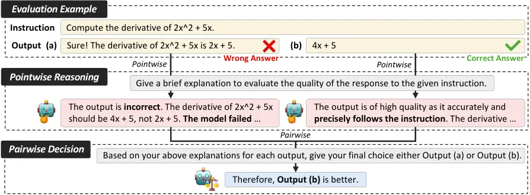

# ![[Uncaptioned image]](arxiv-2406-12319v4--98c59fb7649e.figures/figure-1.webp) The Comparative Trap: Pairwise Comparisons Amplifies Biased Preferences of LLM Evaluators

Hawon Jeong ^(†)^(†)thanks:   Equal contribution    Jimin Hong
Affiliation: ChaeHun Park¹¹footnotemark: 1 Affiliation:  Affiliation: 
KAIST AI Affiliation:  KRAFTON    Hojoon Lee Affiliation: ChaeHun
Park¹¹footnotemark: 1 Affiliation:  Affiliation:  KAIST AI    Jaegul
Choo
Email: [{hawon,ddehun,jimmyh,joonleesky,jchoo}@kaist.ac.kr](mailto:)
Affiliation: ChaeHun Park¹¹footnotemark: 1 Affiliation:  Affiliation: 
KAIST AI

###### Abstract

As large language models (LLMs) are increasingly used as evaluators for
natural language generation tasks, ensuring unbiased assessments is
essential. However, LLM evaluators often display biased preferences,
such as favoring verbosity and authoritative tones. Our empirical
analysis reveals that these biases are exacerbated in pairwise
evaluation, where LLMs directly compare two outputs and easily
prioritize superficial attributes. In contrast, pointwise evaluation,
which assesses outputs independently, is less susceptible to such bias
because each output is judged in isolation. To address the limitations
of the pairwise evaluation, we introduce a novel evaluation method,
PRePair, which integrates pointwise reasoning within a pairwise
framework. PRePair effectively alleviates biased preference, improving
performance on the adversarial benchmark (LLMBar) while outperforming
pointwise evaluation on the standard benchmark (MT-Bench).

## 1 Introduction

Automated evaluation systems are crucial for scaling natural language
generation (NLG) research, offering a more efficient and cost-effective
alternative to human evaluation. Recently, large language models (LLMs)
have been increasingly adopted as automatic evaluators, demonstrating
promising capabilities in assessing various aspects of text quality such
as coherence, relevance, and fluency (Chiang & Lee, 2023; Liu et al.,
2023).

Despite their impressive performance, LLM-based evaluators often display
systematic biases in their preferences—for instance, favoring verbose
responses (Wang et al., 2024a), exhibiting egocentric judgment (Zheng
et al., 2024), or preferring authoritative tones (Chen et al., 2024).
Recent studies have begun to investigate these biases by probing the
evaluator’s ability to follow explicit evaluation instructions in
controlled settings (Zeng et al., 2024; Lambert et al., 2024). In these
evaluations, one output strictly follows the instructions, while the
other is adversarially crafted to exploit evaluator biases—appearing
superficially favorable yet failing to comply with the instructions.
These studies reveal that LLM evaluators not only exhibit biased
preferences but also struggle to identify these deceptive outputs
effectively.

Building on these observations, we first explore how different
evaluation setups influence the biased preferences in LLM evaluators.
Specifically, we compare two common setups: pairwise, where the
evaluator compares two outputs simultaneously and selects the better
one, and pointwise, where each output is evaluated independently and
then selects the one with a higher score. Our experiments demonstrate
that the pairwise setup amplifies the biases of the evaluator,
performing significantly worse than the pointwise setup on adversarial
examples (see Fig. 1 Right). Further analysis reveals that pairwise
evaluators, while recognizing weaknesses in incorrect outputs, often
reach incorrect conclusions.

We hypothesize that the increased bias in pairwise evaluations stems
from the structural differences between the pairwise and pointwise
setups. To illustrate, consider a job interview where the interviewer
must choose between Alice and Bob for a research engineer position.
Although the goal is to select the candidate more suited for the role,
the interviewer might favor Alice simply if she has more fluent speaking
skills despite Bob possibly having stronger technical skills.
Psychological studies support this phenomenon: when directly comparing
options, humans often focus on superficial features rather than
thoroughly evaluating each option (Wright, 1974; Payne, 1976; Olshavsky,
1979). Similarly, in a pairwise setup, LLMs may concentrate on easily
exploitable, superficial attributes, causing adversarial outputs to
appear favorable even when they fail to follow the instructions.

In contrast, pointwise evaluation assesses each output independently,
which allows the model to focus solely on how well the output adheres to
the instructions, without being interrupted by comparative attributes.
This isolation reduces susceptibility to biases and leads to a more
accurate assessment of task compliance. However, pointwise evaluation is
not a silver bullet for all scenarios; Suppose Alice and Bob are equally
fluent speakers. In this case, evaluating both candidates simultaneously
can provide additional context about who is ultimately better suited for
the role. In such cases, the pairwise approach benefits from leveraging
contextual information for non-adversarial examples (See Fig. 1 Left).

Motivated by our findings, we propose a simple yet effective method for
reliable pairwise evaluation, namely PRePair, which stands for Pointwise
Reasoning within a Pairwise evaluation framework (Fig. 2). The key idea
is to first extract unbiased insights from each output using pointwise
reasoning. Then, we combine these individual explanations into a final
decision process for pairwise evaluation, leveraging the strength of
both pointwise and pairwise approaches. Experimental results across
various models demonstrate that PRePair improves the performance of
pairwise evaluators on adversarial datasets. Specifically, PRePair
improves average accuracy by 24.48% across six LLMs on the adversarial
dataset. Moreover, it outperforms the pointwise approach on normal
datasets, demonstrating its versatility and effectiveness.

Our contributions can be summarized as follows: (1) We analyze how
pointwise and pairwise evaluation setups affect LLM assessment in
adversarial scenarios. (2) We identify biases in pairwise evaluation
that favor superficial attributes, making adversarial responses more
likely to be preferred. (3) We propose a hybrid evaluation framework by
integrating pointwise reasoning into pairwise evaluation.

## 2 Related Work

LLMs-based Evaluation The evaluation of NLG systems has traditionally
relied on human annotation and automatic metrics such as BLEU (Papineni
et al., 2002), ROUGE (Lin, 2004), and METEOR (Banerjee & Lavie, 2005).
However, these metrics often fail to capture semantic adequacy and
coherence (Liu et al., 2016; Sai et al., 2022). To address these
limitations, large language models (LLMs) have emerged as evaluators due
to their strong instruction-following capabilities and generalization
across diverse tasks (Kocmi & Federmann, 2023; Lin & Chen, 2023; Min
et al., 2023; Chan et al., 2024; Wang et al., 2024b).

Among various evaluation strategies, pairwise comparison has been
increasingly utilized, where an LLM ranks or selects the better response
between two candidates (Chiang et al., 2024; Zeng et al., 2024; Wang
et al., 2024a; Zhang et al., 2023). This method aligns with human
evaluation practices and has been shown to correlate well with human
judgments (Zheng et al., 2024). However, LLM evaluators exhibit
systematic biases, such as favoring verbose responses (Li et al., 2023;
Zheng et al., 2024) and overrating their own generations (Li et al.,
2023; Koo et al., 2024). Moreover, their rankings can be inconsistent,
as slight prompt variations may lead to different outcomes (Liu et al.,
2023; Zhu et al., 2024). Recent studies suggest that incorporating
explicit evaluation criteria and general guidelines in prompts can
improve their discernment (Zeng et al., 2024). Building on these
insights, we examine how different evaluation setups influence LLM-based
assessment, particularly in adversarial scenarios where biases may be
exacerbated.

Human Behavior with Complex Tasks Psychological research has
demonstrated that decision-makers often simplify their process by
focusing on limited information when handling complex tasks (Payne,
1976; Olshavsky, 1979; Einhorn & Hogarth, 1981). Moreover, Wright (1974)
has indicated that cognitive overload from environmental distractions
reduces decision quality, causing people to overlook important evidence
or rely on irrelevant information. These findings parallel our
intuitions in adversarial evaluation: assessing multiple outputs at once
encourages the model to prioritize superficial aspects, similar to
humans favoring simpler solutions in complex tasks.

## 3 Analyzing LLM Evaluators on Adversarial Evaluation Samples

We now analyze LLM-based evaluators using different datasets and
prompting strategies. We introduce meta-evaluation datasets with
different characteristics and then compare two representative evaluation
approaches on these datasets. Finally, we examine the impacts of
intrinsic biases in LLM evaluators by exploring their reasoning process.

### 3.1 Meta-Evaluation Datasets

In our experiments, we evaluate LLM evaluators using datasets with two
distinct characteristics: Normal and Adversarial. The normal dataset,
MT-Bench  (Zheng et al., 2024), contains responses generated under
standard conditions and reflects real-world evaluation distributions. In
contrast, the adversarial dataset, LLMBar-Adversarial  (Zeng et al.,
2024), consists of responses that appear high-quality but subtly deviate
from the original instruction, testing an evaluator’s ability to detect
misleading outputs. Each evaluation sample in both datasets consists of
(1) an input instruction, (2) a pair of two model-generated responses,
and (3) a human preference label indicating which response is preferred.
The datasets contain a total of 1131 evaluation samples from MT-Bench
and 319 from LLMBar-Adversarial. Further details on each dataset are
provided below.

MT-Bench (Zheng et al., 2024) is a meta-evaluation dataset consisting of
80 multi-turn instructions, each paired with model-generated outputs
from various language models. For our experiments, we use the first-turn
meta-evaluation samples. The dataset includes a total of 1131 human
judgments from two groups: expert labelers (885) and the original
authors (246). This dataset is widely used to assess evaluation metrics
in a setting that reflects real-world model performance.

LLMBar-Adversarial (Zeng et al., 2024) is specifically designed to test
the ability of evaluators to discern instruction-following responses.
The dataset consists of 319 adversarial evaluation samples, where
generated responses exhibit high superficial quality but fail to adhere
to the original instruction. These samples are categorized into four
types: Neighbor Instructions (134), GPT-4 Instructions (92), GPT-4
Unhelpful Outputs (47), and Manual Construction (46). This dataset
serves as a benchmark for evaluating whether LLM evaluators can detect
subtle deviations from the expected responses.

### 3.2 Setup

Pointwise and Pairwise Approaches We compare the two popular approaches
for pairwise text evaluation: pairwise and pointwise (Zheng et al.,
2024; Liusie et al., 2024). In the pairwise approach, an LLM receives an
instruction and two model-generated outputs and then chooses a
higher-quality output. In the pointwise approach, an LLM assigns a
single score on a Likert scale to each generated output independently.
The output with the higher score is considered to be of higher quality.
Please refer to Appendix A.2 for more details.

Implementation Details We use the following LLMs as evaluators to
compare the approaches above (i.e., pointwise and pairwise) on MT-Bench
and LLMBar datasets: Llama-3.1-8B-Instruct (Dubey et al., 2024),
gpt-3.5-turbo, gpt-4, gpt-4o-mini, and gpt-4o (Achiam et al., 2023). We
utilize the original prompts released by each dataset for evaluation.
For LLMBar, we include general rules, such as prioritizing outputs that
accurately follow instructions, as these guidelines generally enhance
evaluation quality (Zeng et al., 2024). The performance of the evaluator
is obtained by comparing its judgments to human judgments within the
datasets. In MT-Bench, since a tie option is allowed, the pairwise
evaluator is prompted to choose one of three options. The scalar value
generated by the pointwise evaluator using the Likert-scale is directly
used for evaluation.¹¹ 1 Evaluation results of pointwise evaluators with
weighted summation on a dataset that does not allow tie-option (i.e.,
RewardBench-Chat (Lambert et al., 2024)) are also presented in
Section 5.3.4. In LLMBar, the human judgments contain only two options
without tie. Following Liu et al. (2023), we use a weighted summation
with token probabilities for the pointwise evaluator.

Figure 1: Results of pointwise and pairwise approaches in
normal (MT-Bench) and adversarial (LLMBar-Adversarial) meta-evaluation
datasets. The difference values represent the change between pointwise
and pairwise approaches for each model under both normal and adversarial
conditions.

|                                                                                                                                                                |
| -------------------------------------------------------------------------------------------------------------------------------------------------------------- |
| Evaluation Sample                                                                                                                                              |
| Instruction: Create a new headline that is witty and summarizes the article. A new study has found that eating spinach can increase intelligence.              |
| Output A: Spinach: The New Brain Food, or Just Another Leafy Green? (Human-preferred)                                                                          |
| Output B: Spinach It To Win: Eating Spinach Can Boost Your Brain Power!                                                                                        |
| Explanations from LLM Evaluator                                                                                                                                |
| Strengths of Output A: Clever play on words with ”Brain Food” and ”Leafy Green”. /Succinctly summarizes the article topic.                                     |
| Weaknesses of Output A: Lacks a direct mention of the study findings. / Could be perceived as slightly less engaging compared to Output B.                     |
| Strengths of Output B: Engaging with the phrase ”Spinach It To Win.” / Clearly states the benefit of eating spinach for brain power.                           |
| Weaknesses of Output B: The use of ”Win” might be seen as slightly exaggerated or sensationalized. / Could be considered a bit informal for certain audiences. |
| Final Judgement of LLM Evaluator                                                                                                                               |
| Therefore, Output B is better.                                                                                                                                 |

Table 1: Explanations and judgment of pairwise evaluators from an
evaluation sample. The correct and incorrect model explanations are
manually highlighted.

### 3.3 Results

Pairwise Comparisons Amplifies the Biased Preference.  Fig. 1 shows the
meta-evaluation results on the two datasets. The pairwise evaluator
performs better than the pointwise evaluator on MT-Bench, while the
pointwise evaluator outperforms the pairwise evaluator on LLMBar. These
contrasting results likely stem from the differences in the evaluation
structure. The pairwise approach excels with normal samples like those
in MT-Bench since it can leverage contextual information by considering
two outputs simultaneously. However, the benefits of the pairwise
approach turn into drawbacks when handling adversarial samples in
LLMBar, as it makes the evaluators more easily susceptible to intrinsic
biases. In contrast, the pointwise approach is relatively less affected
by these biases, resulting in better performance on adversarial samples.

From these observations, we have questioned how pairwise approach
undermines the discerning ability of LLM evaluators on adversarial
examples. Therefore, our subsequent experiments explore how intrinsic
biases impact LLM evaluators using pairwise approach in adversarial
evaluations.

Pairwise Evaluators Do Correct Reasoning behind Incorrect Evaluation. 
To further understand why pairwise evaluation struggles with adversarial
samples in LLMBar, we used a Chain-of-Thought (Kojima et al., 2022, CoT)
prompting to let LLM provide its own reasoning process before making
predictions. Specifically, we encouraged the LLM to explain the
strengths and weaknesses of each output to see if it can accurately
identify issues in low-quality outputs. Then, we manually examine the
explanation provided by LLM for 100 incorrectly predicted samples. More
details on human analysis are described in Appendix A.4.

Our analysis reveals that, despite its incorrect final decisions, the
pairwise evaluator often provides rational explanations for identifying
flaws in low-quality outputs. We find that 64 out of 100 explanations
accurately describe weaknesses that align with our manual annotations.
For example, as shown in Table 1, the pairwise evaluator correctly
identifies problems in a flawed output but ultimately makes the wrong
judgment. This indicates that while the LLM evaluator with the pairwise
approach has the potential to perform better, it is hindered by
intrinsic issues within the pairwise setup. Therefore, addressing these
issues is essential for reliable pairwise evaluation.

## 4 PRePair: Pointwise Reasoning for Pairwise Evaluation

Approach Our analysis in Section 3 revealed two key limitations in
existing LLM-based evaluation methods. First, pairwise evaluators often
struggle with adversarial samples, as they may still prefer a
problematic response despite recognizing its flaws. Second, pointwise
evaluators, which analyze responses independently, tend to perform worse
on normal samples but show greater robustness against adversarial
manipulations. These observations suggest the need for a method that
retains the contextual advantages of pairwise evaluation while reducing
biases that arise from direct comparison.

Figure 2: The overall illustration of PRePair.

To address this, we propose PRePair (Pointwise Reasoning for Pairwise
Evaluation), a hybrid approach that incorporates pointwise reasoning
into a pairwise evaluation framework. Unlike conventional pairwise
evaluation, which directly compares two responses, PRePair first
analyzes each response independently using pointwise reasoning before
making a final pairwise decision. Given an instruction and two candidate
responses, the evaluator reasons about each response separately,
considering its properties without direct reference to the other. These
independent reasoning steps provide structured insights that are then
used in the final pairwise decision, where the evaluator determines the
superior response. By decoupling the reasoning process from direct
comparison, PRePair helps mitigate biases such as favoring verbosity or
model-specific stylistic preferences while maintaining the benefits of
pairwise evaluation.

One trade-off of PRePair is the increased computational cost, as it
requires an additional LLM forward pass for each response before making
a final comparison. However, this overhead can be reduced through
caching, since the pointwise reasoning results for individual responses
can be reused across multiple comparisons. This is particularly
advantageous in ranking tasks, where precomputed reasoning steps allow
for efficient and consistent evaluation. By combining the robustness of
pointwise reasoning with the contextual awareness of pairwise
evaluation, PRePair offers a more reliable evaluation framework,
particularly in adversarial scenarios.

## 5 Experiments

### 5.1 Setup

We conduct experiments on the LLMs described in Section 3.2 and the
Claude-3-Haiku (Anthropic, 2024). We compare our method for the pairwise
approach against the following baselines. w/ CoT generates an
explanation before making a prediction. PRePair\* is an ablated version
of our method that prompts pairwise evaluators to generate individual
explanations for each output, using the same format as PRePair. This
baseline aims to validate the effectiveness of the pointwise reasoning
process. Detailed setups and more results are in Appendix A and B.

|              |           |          |           |       |          |        |
| ------------ | --------- | -------- | --------- | ----- | -------- | ------ |
| Methods      | GPT-3.5-T | Claude-3 | Llama-3.1 | GPT-4 | GPT-4o-m | GPT-4o |
| Pointwise    | 52.35     | -        | 61.44     | 82.76 | 78.05    | 87.77  |
| Pairwise     | 36.05     | 40.75    | 48.59     | 77.74 | 68.03    | 85.89  |
| w/ CoT       | 31.66     | 41.07    | 50.47     | 77.12 | 63.01    | 83.07  |
| w/ PRePair\* | 37.62     | 43.26    | 61.44     | 78.37 | 68.65    | 86.21  |
| w/ PRePair   | 54.23     | 53.60    | 70.84     | 80.88 | 78.06    | 86.21  |

Table 2: LLMBar-Adversarial results. The pairwise approach’s highest and
second-highest scores are highlighted in bold and underlined. PRePair\*
adopts pairwise reasoning but follows the generation format of PRePair.

|              |           |          |       |        |
| ------------ | --------- | -------- | ----- | ------ |
| Methods      | GPT-3.5-T | GPT-4o-m | GPT-4 | GPT-4o |
| Pointwise    | 51.55     | 61.72    | 54.64 | 52.29  |
| Pairwise     | 60.65     | 67.20    | 67.90 | 69.41  |
| w/ CoT       | 61.54     | 65.87    | 66.40 | 67.46  |
| w/ PRePair\* | 60.83     | 64.72    | 66.76 | 69.14  |
| w/ PRePair   | 61.36     | 64.10    | 65.34 | 69.50  |

Table 3: MT-Bench results. The indicators are the same as Table 2.

### 5.2 Results

As shown in Table 2, our method improves the accuracy of pairwise
evaluators on the LLMBar-Adversarial dataset across all tested LLMs,
with the largest gain observed in Llama-3.1. By incorporating pointwise
reasoning, PRePair mitigates biases in direct comparison and enhances
robustness against adversarial responses. A key observation is that
PRePair consistently outperforms PRePair\*, indicating that its
improvements stem from explicit pointwise reasoning rather than
structural modifications alone. Additionally, PRePair sometimes performs
even better than pointwise evaluators, suggesting that while pointwise
reasoning enhances adversarial robustness, integrating it within a
pairwise framework preserves the benefits of contextual evaluation.
Qualitative examples in Appendix C.1 further illustrate how our method
improves reliability compared to standard Chain-of-Thought (CoT)
prompting.

On the MT-Bench dataset (Table 3), pairwise methods achieve similar
performance and consistently outperform the pointwise approach. Since
MT-Bench focuses on general response quality rather than adversarial
robustness, this result suggests that PRePair does not compromise
effectiveness in standard evaluation while offering clear benefits in
adversarial settings. Overall, these results demonstrate that PRePair
effectively balances the strengths of pointwise and pairwise evaluation,
improving reliability against adversarial samples while maintaining
strong performance in normal evaluation tasks.

### 5.3 Analysis

We conduct further analysis to understand PrePair comprehensively as
follows.

|                       |        |         |        |          |       |
| --------------------- | ------ | ------- | ------ | -------- | ----- |
| Methods               | Manual | GPTInst | GPTOut | Neighbor | Total |
| Llama-2-13b-chat      |        |         |        |          |       |
| Pairwise              | 28.26  | 28.26   | 51.06  | 29.10    | 31.97 |
| w/ CoT                | 32.61  | 35.87   | 57.45  | 22.39    | 32.92 |
| w/ PrePair            | 36.96  | 32.61   | 63.83  | 40.30    | 41.07 |
| Llama-2-70b-chat      |        |         |        |          |       |
| Pairwise              | 34.78  | 28.26   | 48.94  | 22.39    | 29.78 |
| w/ CoT                | 43.48  | 29.35   | 48.94  | 39.55    | 38.56 |
| w/ PrePair            | 39.13  | 52.17   | 48.94  | 38.81    | 44.20 |
| Llama-3-8B-Instruct   |        |         |        |          |       |
| Pairwise              | 45.65  | 48.91   | 48.94  | 32.09    | 41.38 |
| w/ CoT                | 54.35  | 46.74   | 48.94  | 41.04    | 45.77 |
| w/ PrePair            | 52.17  | 72.83   | 51.06  | 58.96    | 60.82 |
| Llama-3.1-8B-Instruct |        |         |        |          |       |
| Pairwise              | 60.87  | 73.91   | 61.70  | 52.99    | 61.44 |
| w/ CoT                | 52.17  | 55.43   | 53.19  | 45.52    | 50.47 |
| w/ PrePair            | 69.57  | 77.17   | 53.19  | 73.13    | 70.84 |

Table 4: Accuracies on the LLMBar-Adversarial dataset for different
Llama model variants. Each model is evaluated using Pairwise,
Chain-of-Thought (CoT), and PrePair.

|            |        |         |        |          |       |
| ---------- | ------ | ------- | ------ | -------- | ----- |
| Methods    | Manual | GPTInst | GPTOut | Neighbor | Total |
| Pointwise  | 47.83  | 54.35   | 55.32  | 43.28    | 48.90 |
| Pairwise   | 50.00  | 33.70   | 57.45  | 32.84    | 39.19 |
| w/ PrePair | 58.70  | 57.61   | 57.45  | 35.82    | 48.59 |

Table 5: Accuracies on adversarial datasets for Prometheus-v2-7b (Kim
et al., 2024) model evaluated across different LLMBar-Adversarial
subsets.

#### 5.3.1 Evaluating PrePair to Open-source LLMs

We use the following open-source LLMs to probe the effectiveness of
PrePair: Llama-2-7b/70b-chat (Touvron et al., 2023), Llama-3-8B-Instruct
(Dubey et al., 2024), and Llama-3.1-8b-Instruct (Dubey et al., 2024). As
shown in Table 4, PrePair consistently contributes to better performance
of LLM evaluators on adversarial meta-evaluation datasets.

#### 5.3.2 Evaluating PrePair to a Finetuned LLM Evaluator

We conducted experiments with Prometheus-v2-7B²² 2
[https://huggingface.co/prometheus-eval/prometheus-7b-v2.0](https://huggingface.co/prometheus-eval/prometheus-7b-v2.0)
(Kim et al., 2024), which supports both pointwise and pairwise
evaluations. The evaluation results are shown in Table 5. We observe
consistent trends with our previous results, where a pointwise
evaluation usually performs better than a pairwise one in adversarial
samples, and PrePair increases the performance of pairwise evaluators.

|                  |        |         |        |          |       |
| ---------------- | ------ | ------- | ------ | -------- | ----- |
| Methods          | Manual | GPTInst | GPTOut | Neighbor | Total |
| Pointwise        | 56.52  | 61.96   | 38.30  | 49.25    | 52.35 |
| Pairwise         | 41.30  | 33.70   | 40.43  | 34.33    | 36.05 |
| w/ CoT           | 28.26  | 39.13   | 46.81  | 22.39    | 31.66 |
| w/ SGM           | 52.17  | 55.43   | 46.81  | 55.97    | 53.92 |
| w/ PrePair       | 52.17  | 64.13   | 48.94  | 50.00    | 54.23 |
| w/ PrePair + SGM | 58.70  | 63.04   | 51.06  | 57.46    | 58.31 |

Table 6: LLMBar-Adversarial results with Self-generated Metrics (SGM)
(Saha et al., 2024).

|               |                        |                       |                         |                    |                   |             |
| ------------- | ---------------------- | --------------------- | ----------------------- | ------------------ | ----------------- | ----------- |
| Model         | AlpacaEval -Easy (100) | AlpacaEval -Hard (95) | AlpacaEval -Length (95) | MTBench -Easy (28) | MTBench -Med (40) | Total (358) |
| GPT-3.5-Turbo |                        |                       |                         |                    |                   |             |
| Pointwise     | 75.00                  | 72.63                 | 74.74                   | 92.86              | 75.00             | 75.70       |
| Pairwise      | 89.00                  | 91.58                 | 83.16                   | 100.00             | 80.00             | 87.99       |
| GPT-4         |                        |                       |                         |                    |                   |             |
| Pointwise     | 87.00                  | 84.21                 | 86.32                   | 100.00             | 100.00            | 88.55       |
| Pairwise      | 96.00                  | 95.79                 | 92.63                   | 100.00             | 100.00            | 95.81       |
| GPT-4o-mini   |                        |                       |                         |                    |                   |             |
| Pointwise     | 93.00                  | 88.42                 | 89.47                   | 100.00             | 97.50             | 91.90       |
| Pairwise      | 96.00                  | 94.74                 | 96.84                   | 100.00             | 95.00             | 96.09       |
| GPT-4o        |                        |                       |                         |                    |                   |             |
| Pointwise     | 90.00                  | 89.47                 | 84.21                   | 100.00             | 100.00            | 90.22       |
| Pairwise      | 93.00                  | 92.63                 | 92.63                   | 100.00             | 97.50             | 93.85       |

Table 7: Evaluation results of different evaluation approach on the
RewardBench-Chat (Lambert et al., 2024). The pointwise evaluation
follows a weighted sum aggregation over score token probabilities, while
the pairwise evaluation directly compares two responses.

#### 5.3.3 Extending PrePair with Different Reasoning Strategies

To assess the extensibility of PRePair, we apply it to the
Self-Generated Metric approach (Saha et al., 2024; Zeng et al., 2024),
where LLMs first generate instance-specific evaluation criteria before
making judgments. These criteria are then incorporated into prompts to
guide the evaluation process.

We compare PRePair with standard pairwise evaluation when generating
both metrics and explanations. As shown in Table 6, PRePair consistently
improves performance, suggesting that its reasoning mechanism enhances
evaluation robustness. Moreover, its effectiveness across different
reasoning setups indicates that PRePair can complement other evaluation
strategies, making it a flexible addition to existing frameworks.

#### 5.3.4 Impacts of Different Aggregation Strategies in Pointwise Approach

In pointwise evaluation, the final score for a response is typically
derived through an aggregation strategy, which determines how individual
scoring tokens contribute to the overall decision. A common approach is
to compute a weighted sum over the probabilities of score tokens, which
has been shown to improve performance (Liu et al., 2023). However,
certain benchmarks, such as MT-Bench, allow tie predictions, requiring
an alternative strategy. To accommodate this, our pointwise evaluator
for MT-Bench directly uses the scalar value generated by the model
instead of applying a weighted sum. In contrast, the RewardBench-Chat
subset (Lambert et al., 2024) does not include tie options, allowing a
direct comparison between aggregation strategies. Here, the pointwise
evaluator follows the same setup as in LLMBar, computing scores based on
a weighted sum over Likert-scale integer tokens. The dataset, curated
from AlpacaEval (Dubois et al., 2024) and MT-Bench, consists of 358
samples, each containing an instruction, two model outputs, and a
preference label indicating the superior response without the
possibility of a tie.

Table 7 presents the results, showing that even when using a weighted
sum aggregation, pairwise evaluation still outperforms pointwise
evaluation. This indicates that the aggregation strategy alone does not
bridge the performance gap between the two approaches. These findings
reinforce our claim that pointwise evaluation is particularly beneficial
in adversarial settings, whereas pairwise evaluation remains more
effective in general cases.

#### 5.3.5 Qualitative Result

Table 8 presents a comparison between standard Chain-of-Thought (CoT)
reasoning and our PRePair-based evaluation on a sample from the dataset.
GPT-3.5-Turbo is used as an LLM evaluator. The evaluation involves
assessing two outputs in response to a prompt asking for an illustrative
example of artificial intelligence. The standard CoT evaluator favors
Output (a) for its breadth and coverage of various AI applications,
overlooking the fact that the instruction specifically asks for a single
example. In contrast, PRePair provides a more precise analysis,
recognizing that Output (a) does not strictly follow the instruction,
whereas Output (b) effectively aligns with the task by offering a clear
and illustrative example of AI in action. This example highlights how
PRePair enhances evaluation by focusing on adherence to instructions
rather than surface-level completeness, thereby mitigating biases in
pairwise comparison.

Evaluation Sample Instruction: Generate an example that illustrates the
concept of ”artificial intelligence”. Output A: Artificial intelligence
has numerous applications in real life. Examples include self-driving
cars, facial recognition software, and voice assistants such as Siri and
Alexa. AI is also used in medical applications such as disease
detection, drug development and medical diagnostics. AI is also used in
finance applications such as automated trading, fraud detection and
predictive analytics. Output B: An example of artificial intelligence is
a robotic vacuum cleaner that is able to map out a room and create an
efficient cleaning path. It can also adjust its cleaning strategies
based on different levels of dirt and debris. (Human-preferred) Vanilla
Chain-of-Thought Explanation of Output (a) and Output (b) Output (a)
provides a broader and more comprehensive illustration of the concept of
artificial intelligence by mentioning various real-life applications
across different fields such as technology, medicine, and finance. It
gives a well- rounded view of the capabilities and impact of AI. On the
other hand, Output (b) focuses on a specific example of a robotic vacuum
cleaner, which, although a good example, lacks the depth and variety of
applications highlighted in Output (a). / Decision: Output (a) PrePair
(Ours)) Explanation of Output (a) The output provided goes beyond the
scope of the instruction by listing multiple examples of artificial
intelligence applications rather than generating a single example to
illustrate the concept of ”artificial intelligence.” While the examples
mentioned are relevant and informative, the response fails to precisely
execute the instruction by not focusing on a single illustrative
example. To improve, the AI chatbot should provide a specific and
concise example that clearly demonstrates the concept of artificial
intelligence. Explanation of Output (b) The output provided does a good
job of illustrating the concept of ”artificial intelligence” by giving a
specific example of a robotic vacuum cleaner that demonstrates AI
capabilities. It effectively showcases how AI can be applied in everyday
technology to perform tasks autonomously and adaptively. The example is
relevant, clear, and directly aligns with the instruction given.
Overall, the output is of high quality as it precisely executes the
instruction by providing a suitable example of artificial intelligence
in action. / Decision: Output (b)

Table 8: Explanations and judgment of different pairwise evaluators from
an LLMBar-Adversarial sample. The correct and incorrect generations are
manually highlighted.

## 6 Discussion

In this study, we analyze the reliability of LLM evaluators using two
approaches: pairwise (evaluating outputs simultaneously) and pointwise
(evaluating outputs individually). Our findings show that in adversarial
settings, pairwise evaluators favor superficial attributes with biases.
In contrast, while pointwise evaluators improve performance in those
settings, they struggle in normal settings. Based on these findings, we
propose a hybrid approach, PRePair, which analyzes outputs pointwise
before making a final pairwise decision. We hope our work offers
insights for improving LLM evaluators. Despite its efficacy, however,
PRePair may not be the ultimate solution for LLM-based evaluations. The
ultimate goal should be to enable LLMs to discern response quality based
on human preference hierarchies, even when presented with adversarial
samples simultaneously. Nevertheless, reaching this goal is challenging,
as even powerful proprietary models have yet to achieve this. Therefore,
our work is important for advancing the development of LLM evaluators
that better align with human judgment.

## References

- Achiam et al. (2023) Josh Achiam, Steven Adler, Sandhini Agarwal, Lama
  Ahmad, Ilge Akkaya, Florencia Leoni Aleman, Diogo Almeida, Janko
  Altenschmidt, Sam Altman, Shyamal Anadkat, et al. Gpt-4 technical
  report. _arXiv preprint arXiv:2303.08774_, 2023.
- Anthropic (2024) AI Anthropic. The claude 3 model family: Opus,
  sonnet, haiku. _Claude-3 Model Card_, 2024.
- Banerjee & Lavie (2005) Satanjeev Banerjee and Alon Lavie. METEOR: An
  automatic metric for MT evaluation with improved correlation with
  human judgments. In _Proceedings of the ACL Workshop on Intrinsic and
  Extrinsic Evaluation Measures for Machine Translation and/or
  Summarization_, pp. 65–72, Ann Arbor, Michigan, June 2005. Association
  for Computational Linguistics. URL
  [https://aclanthology.org/W05-0909](https://aclanthology.org/W05-0909).
- Chan et al. (2024) Chi-Min Chan, Weize Chen, Yusheng Su, Jianxuan Yu,
  Wei Xue, Shanghang Zhang, Jie Fu, and Zhiyuan Liu. Chateval: Towards
  better llm-based evaluators through multi-agent debate. In _The
  Twelfth International Conference on Learning Representations_, 2024.
- Chen et al. (2024) Guiming Hardy Chen, Shunian Chen, Ziche Liu, Feng
  Jiang, and Benyou Wang. Humans or llms as the judge? a study on
  judgement biases. _arXiv preprint arXiv:2402.10669_, 2024.
- Chiang & Lee (2023) Cheng-Han Chiang and Hung-yi Lee. Can large
  language models be an alternative to human evaluations? In Anna
  Rogers, Jordan Boyd-Graber, and Naoaki Okazaki (eds.), _Proceedings of
  the 61st Annual Meeting of the Association for Computational
  Linguistics (Volume 1: Long Papers)_, pp. 15607–15631, Toronto,
  Canada, July 2023. Association for Computational Linguistics. doi:
  10.18653/v1/2023.acl-long.870. URL
  [https://aclanthology.org/2023.acl-long.870](https://aclanthology.org/2023.acl-long.870).
- Chiang et al. (2024) Wei-Lin Chiang, Lianmin Zheng, Ying Sheng,
  Anastasios Nikolas Angelopoulos, Tianle Li, Dacheng Li, Banghua Zhu,
  Hao Zhang, Michael Jordan, Joseph E Gonzalez, et al. Chatbot arena: An
  open platform for evaluating llms by human preference. In _Forty-first
  International Conference on Machine Learning_, 2024.
- Dubey et al. (2024) Abhimanyu Dubey, Abhinav Jauhri, Abhinav Pandey,
  Abhishek Kadian, Ahmad Al-Dahle, Aiesha Letman, Akhil Mathur, Alan
  Schelten, Amy Yang, Angela Fan, et al. The llama 3 herd of models.
  _arXiv preprint arXiv:2407.21783_, 2024.
- Dubois et al. (2024) Yann Dubois, Chen Xuechen Li, Rohan Taori, Tianyi
  Zhang, Ishaan Gulrajani, Jimmy Ba, Carlos Guestrin, Percy S Liang, and
  Tatsunori B Hashimoto. Alpacafarm: A simulation framework for methods
  that learn from human feedback. _Advances in Neural Information
  Processing Systems_, 36, 2024.
- Einhorn & Hogarth (1981) Hillel J Einhorn and Robin M Hogarth.
  Behavioral decision theory: Processes of judgment and choice. _Journal
  of Accounting Research_, pp. 1–31, 1981.
- Kim et al. (2024) Seungone Kim, Juyoung Suk, Shayne Longpre,
  Bill Yuchen Lin, Jamin Shin, Sean Welleck, Graham Neubig, Moontae Lee,
  Kyungjae Lee, and Minjoon Seo. Prometheus 2: An open source language
  model specialized in evaluating other language models. _arXiv preprint
  arXiv:2405.01535_, 2024.
- Kocmi & Federmann (2023) Tom Kocmi and Christian Federmann. Large
  language models are state-of-the-art evaluators of translation
  quality. In _Proceedings of the 24th Annual Conference of the European
  Association for Machine Translation_, pp. 193–203, 2023.
- Kojima et al. (2022) Takeshi Kojima, Shixiang Shane Gu, Machel Reid,
  Yutaka Matsuo, and Yusuke Iwasawa. Large language models are zero-shot
  reasoners. In _ICML 2022 Workshop on Knowledge Retrieval and Language
  Models_, 2022.
- Koo et al. (2024) Ryan Koo, Minhwa Lee, Vipul Raheja, Jong Inn Park,
  Zae Myung Kim, and Dongyeop Kang. Benchmarking cognitive biases in
  large language models as evaluators. In Lun-Wei Ku, Andre Martins, and
  Vivek Srikumar (eds.), _Findings of the Association for Computational
  Linguistics ACL 2024_, pp. 517–545, Bangkok, Thailand and virtual
  meeting, August 2024. Association for Computational Linguistics. doi:
  10.18653/v1/2024.findings-acl.29. URL
  [https://aclanthology.org/2024.findings-acl.29](https://aclanthology.org/2024.findings-acl.29).
- Lambert et al. (2024) Nathan Lambert, Valentina Pyatkin, Jacob
  Morrison, LJ Miranda, Bill Yuchen Lin, Khyathi Chandu, Nouha Dziri,
  Sachin Kumar, Tom Zick, Yejin Choi, et al. Rewardbench: Evaluating
  reward models for language modeling. _arXiv preprint
  arXiv:2403.13787_, 2024.
- Li et al. (2023) Ruosen Li, Teerth Patel, and Xinya Du. Prd: Peer rank
  and discussion improve large language model based evaluations, 2023.
- Lin (2004) Chin-Yew Lin. ROUGE: A package for automatic evaluation of
  summaries. In _Text Summarization Branches Out_, pp. 74–81, Barcelona,
  Spain, July 2004. Association for Computational Linguistics. URL
  [https://aclanthology.org/W04-1013](https://aclanthology.org/W04-1013).
- Lin & Chen (2023) Yen-Ting Lin and Yun-Nung Chen. Llm-eval: Unified
  multi-dimensional automatic evaluation for open-domain conversations
  with large language models. In _Proceedings of the 5th Workshop on NLP
  for Conversational AI (NLP4ConvAI 2023)_, pp. 47–58, 2023.
- Liu et al. (2016) Chia-Wei Liu, Ryan Lowe, Iulian Serban, Mike
  Noseworthy, Laurent Charlin, and Joelle Pineau. How NOT to evaluate
  your dialogue system: An empirical study of unsupervised evaluation
  metrics for dialogue response generation. In Jian Su, Kevin Duh, and
  Xavier Carreras (eds.), _Proceedings of the 2016 Conference on
  Empirical Methods in Natural Language Processing_, pp. 2122–2132,
  Austin, Texas, November 2016. Association for Computational
  Linguistics. doi: 10.18653/v1/D16-1230. URL
  [https://aclanthology.org/D16-1230](https://aclanthology.org/D16-1230).
- Liu et al. (2023) Yang Liu, Dan Iter, Yichong Xu, Shuohang Wang,
  Ruochen Xu, and Chenguang Zhu. G-eval: NLG evaluation using gpt-4 with
  better human alignment. In Houda Bouamor, Juan Pino, and Kalika Bali
  (eds.), _Proceedings of the 2023 Conference on Empirical Methods in
  Natural Language Processing_, pp. 2511–2522, Singapore, December 2023.
  Association for Computational Linguistics. doi:
  10.18653/v1/2023.emnlp-main.153. URL
  [https://aclanthology.org/2023.emnlp-main.153](https://aclanthology.org/2023.emnlp-main.153).
- Liusie et al. (2024) Adian Liusie, Potsawee Manakul, and Mark Gales.
  Llm comparative assessment: Zero-shot nlg evaluation through pairwise
  comparisons using large language models. In _Proceedings of the 18th
  Conference of the European Chapter of the Association for
  Computational Linguistics (Volume 1: Long Papers)_, pp. 139–151, 2024.
- Min et al. (2023) Sewon Min, Kalpesh Krishna, Xinxi Lyu, Mike Lewis,
  Wen-tau Yih, Pang Koh, Mohit Iyyer, Luke Zettlemoyer, and Hannaneh
  Hajishirzi. FActScore: Fine-grained atomic evaluation of factual
  precision in long form text generation. In Houda Bouamor, Juan Pino,
  and Kalika Bali (eds.), _Proceedings of the 2023 Conference on
  Empirical Methods in Natural Language Processing_, pp. 12076–12100,
  Singapore, December 2023. Association for Computational Linguistics.
  doi: 10.18653/v1/2023.emnlp-main.741. URL
  [https://aclanthology.org/2023.emnlp-main.741](https://aclanthology.org/2023.emnlp-main.741).
- Olshavsky (1979) Richard W Olshavsky. Task complexity and contingent
  processing in decision making: A replication and extension.
  _Organizational behavior and human performance_, 24(3):300–316, 1979.
- Papineni et al. (2002) Kishore Papineni, Salim Roukos, Todd Ward, and
  Wei-Jing Zhu. Bleu: a method for automatic evaluation of machine
  translation. In _Proceedings of the 40th Annual Meeting of the
  Association for Computational Linguistics_, pp. 311–318, Philadelphia,
  Pennsylvania, USA, July 2002. Association for Computational
  Linguistics. doi: 10.3115/1073083.1073135. URL
  [https://aclanthology.org/P02-1040](https://aclanthology.org/P02-1040).
- Payne (1976) John W Payne. Task complexity and contingent processing
  in decision making: An information search and protocol analysis.
  _Organizational behavior and human performance_, 16(2):366–387, 1976.
- Saha et al. (2024) Swarnadeep Saha, Omer Levy, Asli Celikyilmaz, Mohit
  Bansal, Jason Weston, and Xian Li. Branch-solve-merge improves large
  language model evaluation and generation. In Kevin Duh, Helena Gomez,
  and Steven Bethard (eds.), _Proceedings of the 2024 Conference of the
  North American Chapter of the Association for Computational
  Linguistics: Human Language Technologies (Volume 1: Long Papers)_, pp.
  8352–8370, Mexico City, Mexico, June 2024. Association for
  Computational Linguistics. doi: 10.18653/v1/2024.naacl-long.462. URL
  [https://aclanthology.org/2024.naacl-long.462](https://aclanthology.org/2024.naacl-long.462).
- Sai et al. (2022) Ananya B Sai, Akash Kumar Mohankumar, and Mitesh M
  Khapra. A survey of evaluation metrics used for nlg systems. _ACM
  Computing Surveys (CSUR)_, 55(2):1–39, 2022.
- Touvron et al. (2023) Hugo Touvron, Louis Martin, Kevin Stone, Peter
  Albert, Amjad Almahairi, Yasmine Babaei, Nikolay Bashlykov, Soumya
  Batra, Prajjwal Bhargava, Shruti Bhosale, et al. Llama 2: Open
  foundation and fine-tuned chat models. _arXiv preprint
  arXiv:2307.09288_, 2023.
- Wang et al. (2024a) Peiyi Wang, Lei Li, Liang Chen, Zefan Cai, Dawei
  Zhu, Binghuai Lin, Yunbo Cao, Lingpeng Kong, Qi Liu, Tianyu Liu, and
  Zhifang Sui. Large language models are not fair evaluators. In Lun-Wei
  Ku, Andre Martins, and Vivek Srikumar (eds.), _Proceedings of the 62nd
  Annual Meeting of the Association for Computational Linguistics
  (Volume 1: Long Papers)_, pp. 9440–9450, Bangkok, Thailand, August
  2024a. Association for Computational Linguistics. doi:
  10.18653/v1/2024.acl-long.511. URL
  [https://aclanthology.org/2024.acl-long.511](https://aclanthology.org/2024.acl-long.511).
- Wang et al. (2024b) Tianlu Wang, Ilia Kulikov, Olga Golovneva, Ping
  Yu, Weizhe Yuan, Jane Dwivedi-Yu, Richard Yuanzhe Pang, Maryam
  Fazel-Zarandi, Jason Weston, and Xian Li. Self-taught evaluators.
  _arXiv preprint arXiv:2408.02666_, 2024b.
- Wright (1974) Peter Wright. The harassed decision maker: Time
  pressures, distractions, and the use of evidence. _Journal of applied
  psychology_, 59(5):555, 1974.
- Zeng et al. (2024) Zhiyuan Zeng, Jiatong Yu, Tianyu Gao, Yu Meng,
  Tanya Goyal, and Danqi Chen. Evaluating large language models at
  evaluating instruction following. In _International Conference on
  Learning Representations (ICLR)_, 2024.
- Zhang et al. (2023) Xinghua Zhang, Bowen Yu, Haiyang Yu, Yangyu Lv,
  Tingwen Liu, Fei Huang, Hongbo Xu, and Yongbin Li. Wider and deeper
  llm networks are fairer llm evaluators. _arXiv preprint
  arXiv:2308.01862_, 2023.
- Zheng et al. (2024) Lianmin Zheng, Wei-Lin Chiang, Ying Sheng, Siyuan
  Zhuang, Zhanghao Wu, Yonghao Zhuang, Zi Lin, Zhuohan Li, Dacheng Li,
  Eric Xing, et al. Judging llm-as-a-judge with mt-bench and chatbot
  arena. _Advances in Neural Information Processing Systems_, 36, 2024.
- Zhu et al. (2024) Kaijie Zhu, Qinlin Zhao, Hao Chen, Jindong Wang, and
  Xing Xie. Promptbench: A unified library for evaluation of large
  language models. _Journal of Machine Learning Research_,
  25(254):1–22, 2024.

## Appendix A Experimental Details

### A.1 Models

We use gpt-3.5-turbo-0125, claude-3- haiku-20240307, gpt-4-0613,
gpt-4o-mini- 2024-07-18, and gpt-4o-2024-08-06 for GPT-3.5-Turbo,
Claude-3-Haiku, GPT-4, GPT-4o-mini, and GPT-4o, respectively. The
generation temperature is set to 0 for all models in Table 2 and Table 3. The evaluation results with a different temperature (i.e., 0.7) are
also presented in Table 9.

### A.2 Implementation Details in LLM Evaluators

We present further implementation details of different evaluation
approaches used in our experiments.

##### Pointwise

For the evaluation in MT-Bench, we follow the original prompt in Zheng
et al. (2024) that asks LLMs to choose one of the three options (i.e.,
”Output A is better”, ”Output B is better”, or ”tie”). For LLMBar, we
ask LLMs to evaluate the output in a 5-point Likert scale and obtain a
weighted sum between each integer token and its predicted probability
(Liu et al., 2023). Since Claude API does not support the predictive
probability of each token, we do not apply this weighted-sum strategy of
pointwise evaluator for Claude. Note that PRePair does not require the
token probability as it only performs pointwise reasoning instead of
pointwise final judgments.

##### Pairwise

For the evaluation in MT-Bench, we use the original prompt released by
the authors. For the evaluation in LLMBar, we use the Rules prompt that
specifies general rules for LLM evaluation (e.g., ”prioritize the honest
instruction-following”) as recommended by Zeng et al. (2024). These
general rules are specified in the prompts of both pointwise and
pairwise evaluators.

### A.3 Prompt Details

We present the prompts of different evaluation strategies in Fig. 3 to
Fig. 13.

### A.4 Human annotation Details

The goal of human annotation is to quantitatively assess the LLM’s
understanding of the shortcomings in the answers it incorrectly
identified as correct.³³ 3 The CoT prompting used in this analysis
improved the pairwise evaluation performance from 36.05 to 40.12 but
remained significantly lower than the pointwise evaluation (52.35).
Authors manually examined the explanation provided by the LLM for 100
randomly sampled adversarial examples with incorrect predictions.⁴⁴ 4
Two of the authors with a bachelor’s degree or higher participated in
this annotation process. The examination comprehensively considered the
strengths and weaknesses of both the correct and incorrect outputs.
However, its reliability may be affected by focusing on the cons of
low-quality outputs to assess alignment. A case study of the annotation
is in Appendix C.2.

## Appendix B Additional Results

### B.1 Results with Different Generation Setup

We conduct experiments with reasoning-based evaluation methods when the
decoding temperature is 0.7, as reported in Kojima et al. (2022).
Results in Table 9 demonstrate the effectiveness of PRePair in different
generation configurations.

### B.2 Results with Paraphrased Text Prompt

Table 10 presents the evaluation results using paraphrased prompts
generated by GPT-4. Despite using these variations, PrePair maintains
its effectiveness even in adversarial datasets.

## Appendix C Qualitative Results

### C.1 Qualitative Results of PRePair

We present several case studies utilizing our method in Fig. 14 to 15.
The examples are generated by gpt-3.5-turbo-0125 and gpt-4o.

### C.2 Case Study of Human Annotation

In this section, we examine LLM evaluators’ capability to identify the
shortcomings in the answers it has incorrectly selected as good. The
manual for examination covers three main considerations:

1.  1.  Existence of Superficial Preference: We have examined whether the
        LLM evaluator has demonstrated a preference for responses that,
        despite failing to follow instructions, presented a superficial form
        that the LLM tended to favor.
2.  2.  Validity of Strengths and Weaknesses: We have critically assessed
        whether the evaluator’s judgments of each output’s strengths and
        weaknesses are reasonable and reflect the true quality of the
        responses.
3.  3.  Failure to Follow Instructions: Most importantly, we have focused on
        whether the LLM evaluator has consistently recognized ”failing to
        follow instructions” as the key flaw, as this was the primary focus
        of the examination.

This manual has served as a guide throughout the entire examination
process.

As a result, Fig. 16 to Fig. 19 show that LLM evaluators effectively
identify the critical drawbacks of instruction following failures in
responses they rated highly but are of low quality. This drawbacks are
highlighted in yellow.

Adversarial (319) Methods Natural (100) Manual (46) GPTInst (92) GPTOut
(47) Neighbor (134) Total (319) GPT-3.5-Turbo w/ T=0.0 (Greedy Decoding)
Pointwise 81.00 56.52 61.96 38.30 49.25 52.35 Pairwise 82.00 41.30 33.70
40.43 34.33 36.05 w/ CoT 83.00 28.26 39.13 46.81 22.39 31.66 w/
PrePair\* 82.00 36.96 41.30 46.81 32.09 37.62 w/ PrePair 81.00 52.17
64.13 48.94 50.00 54.23 GPT-3.5-Turbo w/ T=0.7 w/ CoT 84.00 30.43 31.52
44.68 24.63 30.41 w/ PrePair\* 78.00 34.78 44.57 46.81 28.36 36.68 w/
PrePair 81.00 54.35 61.96 57.45 54.48 57.06 GPT-4 w/ T=0.0 (Greedy
Decoding) Pointwise 93.00 84.78 90.22 74.47 79.85 82.76 Pairwise 95.00
71.74 84.78 74.47 76.12 77.74 w/ CoT 94.00 76.09 85.87 74.47 72.39 77.12
w/ PrePair\* 94.00 80.43 84.78 74.47 74.63 78.37 w/ PrePair 93.00 80.43
83.70 78.72 79.85 80.88 GPT-4 w/ T=0.7 w/ CoT 95.00 76.09 86.96 76.60
70.90 77.12 w/ PrePair\* 95.00 73.91 86.96 74.47 76.87 79.00 w/ PrePair
92.00 71.74 83.70 78.72 82.84 80.88 Claude-3-Haiku w/ T=0.0 (Greedy
Decoding) Pairwise 87.00 52.17 46.74 55.32 27.61 40.75 w/ CoT 87.00
43.48 45.65 59.57 30.60 41.07 w/ PrePair\* 81.00 43.48 45.65 65.96 33.58
43.26 w/ PrePair 85.00 60.87 52.17 59.57 50.00 53.60 GPT-4o-mini w/
T=0.0 (Greedy Decoding) Pointwise 91.00 76.09 88.04 61.70 77.61 78.05
Pairwise 87.00 60.87 80.43 65.96 62.69 68.03 w/ CoT 88.00 58.70 72.83
65.96 56.72 63.01 w/ PrePair\* 88.00 67.39 82.61 74.47 57.46 68.65 w/
PrePair 89.00 69.57 91.30 70.21 74.63 78.06 GPT-4o w/ T=0.0 (Greedy
Decoding) Pointwise 96.00 91.30 92.39 78.72 86.57 87.77 Pairwise 97.00
80.43 93.48 80.85 84.33 85.89 w/ CoT 96.00 82.61 90.22 70.21 82.84 83.07
w/ PrePair\* 98.00 84.78 92.39 82.98 83.58 86.21 w/ PrePair 95.00 89.13
91.30 78.72 84.33 86.21 Llama-3.1-8B-Instruct w/ T=0.0 (Greedy Decoding)
Pointwise 84.00 60.87 73.91 61.70 52.99 61.44 Pairwise 83.00 54.35 58.70
46.81 40.30 48.59 w/ CoT 75.00 52.17 55.43 53.19 45.52 50.47 w/
PrePair\* 80.00 63.04 61.96 51.06 64.18 61.44 w/ PrePair 79.00 69.57
77.17 53.19 73.13 70.84

Table 9: LLMBar results with a breakdown of performance in each subset.
Numbers in the parenthesis denote the number of evaluation samples in
each subset. The values in the Total column represent the weighted
average, accounting for the different numbers of examples in each
adversarial data type.

|               |             |              |             |                |             |
| ------------- | ----------- | ------------ | ----------- | -------------- | ----------- |
| Methods       | Manual (46) | GPTInst (92) | GPTOut (47) | Neighbor (134) | Total (319) |
| Pointwise     | 45.65       | 48.91        | 42.55       | 45.52          | 46.08       |
| Pairwise      | 39.13       | 44.57        | 42.55       | 41.79          | 42.32       |
| w/ CoT        | 32.61       | 43.48        | 44.68       | 13.43          | 29.47       |
| w/ PrePair \* | 28.26       | 44.57        | 40.43       | 30.60          | 35.74       |
| w/ PrePair    | 47.83       | 71.74        | 51.06       | 58.96          | 59.88       |

Table 10: Accuracies on adversarial datasets for GPT-3.5-Turbo with
paraphrased text prompts.

Figure 3: The strengths and weaknesses prompt for pairwise evaluation.

Figure 4: The default prompt for pointwise evaluation with LLMBar
dataset.

Figure 5: The default prompt for pairwise evaluation with LLMBar
dataset.

Figure 6: The chain-of-thought prompt for pairwise evaluation with
LLMBar dataset.

Figure 7: The prompts of pointwise analysis and pairwise judgments in
PRePair in LLMBar.

Figure 8: The prompts of pairwise analysis and pairwise judgments in
PRePair\* in LLMBar dataset.

Figure 9: The default prompt for pointwise evaluation with MT-Bench
dataset.

Figure 10: The default prompt for pairwise evaluation with MT-Bench
dataset..

Figure 11: The chain-of-thought prompt for pairwise evaluation with
MT-Bench dataset.

Figure 12: The prompts of pointwise analysis and pairwise judgments in
PRePair with MT-Bench dataset

Figure 13: The prompts of pairwise analysis and pairwise judgments with
PRePair\* in MT-Bench dataset

Figure 14: Sampled prediction results of PRePair and vanilla
chain-of-thought.

Figure 15: Sampled prediction results of PRePair and vanilla
chain-of-thought.

Figure 16: An example of annotated samples described in Section 3.

Figure 17: An example of annotated samples described in Section 3.

Figure 18: An example of annotated samples described in Section 3.

Figure 19: An example of annotated samples described in Section 3.
