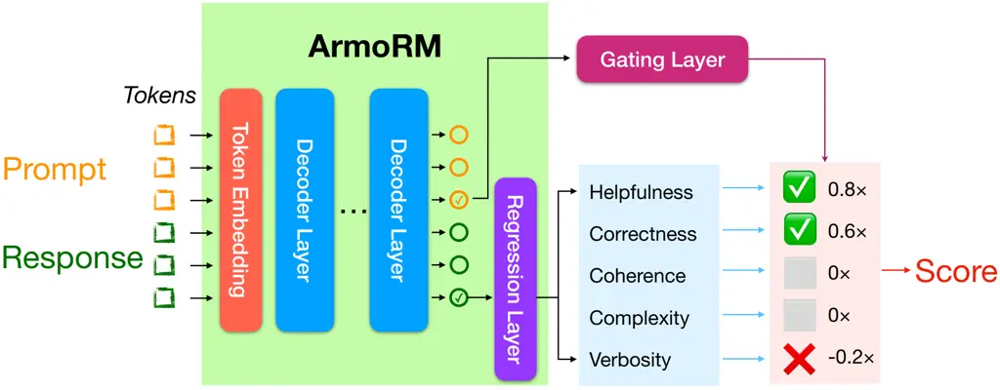

# Interpretable Preferences via Multi-Objective Reward Modeling and Mixture-of-Experts

Haoxiang Wang   Wei Xiong¹¹footnotemark: 1   Tengyang Xie   Han Zhao  
Tong Zhang ^(†)^(†)thanks: Equal contribution. Correspondance to:
Haoxiang Wang ([hwang264@illinois.edu](mailto:hwang264@illinois.edu))
Affiliation: University of Illinois Urbana-Champaign
Affiliation: University of Wisconsin–Madison

###### Abstract

Reinforcement learning from human feedback (RLHF) has emerged as the
primary method for aligning large language models (LLMs) with human
preferences. The RLHF process typically starts by training a reward
model (RM) using human preference data. Conventional RMs are trained on
pairwise responses to the same user request, with relative ratings
indicating which response humans prefer. The trained RM serves as a
proxy for human preferences. However, due to the black-box nature of
RMs, their outputs lack interpretability, as humans cannot intuitively
understand why an RM thinks a response is good or not. As RMs act as
human preference proxies, it is desirable for them to be
human-interpretable to ensure that their internal decision processes are
consistent with human preferences and to prevent reward hacking in LLM
alignment. To build RMs with interpretable preferences, we propose a
two-stage approach: i) train an Absolute-Rating Multi-Objective Reward
Model (ArmoRM) with multi-dimensional absolute-rating data, each
dimension corresponding to a human-interpretable objective (e.g.,
honesty, verbosity, safety); ii) employ a Mixture-of-Experts (MoE)
strategy with a gating network that automatically selects the most
suitable reward objectives based on the context. We efficiently trained
an ArmoRM with Llama-3 8B and a gating network consisting of a shallow
MLP on top of the ArmoRM. Our trained model,
[ArmoRM-Llama3-8B](https://huggingface.co/RLHFlow/ArmoRM-Llama3-8B-v0.1),
obtains state-of-the-art performance on RewardBench, a benchmark
evaluating RMs for language modeling. Notably, the performance of our
model surpasses the LLM-as-a-judge method with GPT-4 judges by a margin,
and approaches the performance of the much larger Nemotron-4 340B reward
model. Our code and model are released at
[https://github.com/RLHFlow/RLHF-Reward-Modeling](https://github.com/RLHFlow/RLHF-Reward-Modeling).

## 1 Introduction

In this paper, we explore the role of reward models (RMs) within the
framework of Reinforcement Learning from Human Feedback (RLHF). RMs play
a crucial role in aligning large language models (LLMs) as they provide
a scalable way to integrate human preferences into the models’ training
process, guiding the optimization of their policies. To be more specific
and provide more context, we first review the most standard and popular
RLHF frameworks and the role of RMs in this framework. Arguably the
dominant RLHF approach is a deep reinforcement learning (DRL)-based
framework, as developed in key studies \[Christiano et al., 2017; Ouyang
et al., 2022; Bai et al., 2022\]. This framework operates in three
stages: 1) Preference data collection; 2) Reward modeling based on the
Bradley-Terry model \[Bradley and Terry, 1952\]; 3) Policy optimization
using Proximal Policy Optimization (PPO) \[Schulman et al., 2017\] and
the reward model constructed in stage 2. This framework has achieved
tremendous success in the post-training of ChatGPT \[Ouyang et al.,
2022\] and Claude \[Bai et al., 2022\]. These ideas also extend to other
approaches, such as rejection sampling fine-tuning \[Dong et al., 2023;
Gulcehre et al., 2023\] and iterative direct preference learning \[Xiong
et al., 2023; Guo et al., 2024; Xie et al., 2024\]. In these approaches,
the intermediate policy is typically iteratively deployed to collect new
responses, uses the reward model to label the responses, and fine-tunes
the model on the newly collected preference data. In all of these RLHF
frameworks, the capacity of the reward model is crucial as it directly
affects the quality of the aligned LLMs.



Figure 1: Architecture of our reward model. It consists of an LLM
backbone, a regression layer for multi-objective reward modeling, and a
gating layer that outputs coefficients to scalarize the reward
objectives into a scalar score.

The most popular reward modeling approach is based on the maximum
likelihood estimation (MLE) of the Bradley-Terry (BT) model \[Bradley
and Terry, 1952\]. Despite its widespread use, the BT model is rather
limited in the capacity of capturing the complicated human preference
\[Munos et al., 2023; Swamy et al., 2024; Ye et al., 2024\]. In addition
to the capacity issue, common RMs, like the BT model, are typically
black-box models that output scores or preferences without providing
human-interpretable explanations, making it subject to the widely
observed phenomenon of reward hacking \[Skalse et al., 2022; Singhal
et al., 2023; Chen et al., 2024\], where the aligned LLMs generate
high-reward responses (rated by the RM) that do not align with actual
human preferences \[Gao et al., 2023; Lin et al., 2023; Coste et al.,
2023\]. A notable example of this is the verbosity bias, where aligned
LLMs produce longer-than-necessary responses because the RM favors
length, regardless of quality \[Singhal et al., 2023; Wang et al.,
2024a; Chen et al., 2024\].

In this work, we aim to enhance reward models by making them more
_interpretable_ \[Molnar, 2020\] and _steerable_ \[Wong et al., 2021\].
Using the aforementioned verbosity bias as an example, suppose the RM’s
output is decomposable, meaning that it assigns a high score to a
response due to two factors: 40% for its helpfulness and 60% for its
length. In this case, we can see that the RM may suffer from the
verbosity bias. Furthermore, if the RM is steerable, we could adjust its
decision-making process to base its scoring 100% on helpfulness. This
would be regardless of response length, thus mitigating the verbosity
bias. Enhancing the interpretability of RMs also allows humans to verify
whether RMs have similar internal decision processes to humans when
acting as proxies for human preferences. We believe that this human-AI
interaction process could ensure that RMs are consistent with human
values and preferences, making RM-aligned LLMs more reliable and robust.

At a high level, we propose a two-stage approach that first trains a
multi-objective RM and then learns a gating layer that scalarizes reward
objectives in a mixture-of-experts way. We then empirically validate its
effectiveness by training such an RM with Llama-3 8B \[Meta, 2024\], and
obtain state-of-the-art performance on RewardBench, a benchmark to
evaluate RMs.

## 2 Related Works

### 2.1 RLHF Algorithms

The PPO-based RLHF framework is first popularized in Christiano et al.
\[2017\] and further developed by Bai et al. \[2022\]; Ouyang et al.
\[2022\] to make ChatGPT and Claude, which leverages a reward model to
provide feedback during the RLHF process. However, getting the PPO work
is challenging in the context of LLMs \[Choshen et al., 2019; Engstrom
et al., 2020\]. Thus, much efforts have been made in proposing
alternative approaches to the PPO, such as the REINFORCE algorithm
variants \[Li et al., 2023; Shao et al., 2024\]. Another popular
approach is the reward-ranked fine-tuning algorithm (RAFT) \[Dong
et al., 2023; Gulcehre et al., 2023\] that was used in LLaMA2 \[Touvron
et al., 2023\], Llama-3 \[Meta, 2024\], Qwen2 \[qwe, 2024\] and Apple
Intelligence. To implement rejection sampling, we typically sample $`n`$
responses per prompt and use a reward model to rank them according to
some criteria. Then, we fine-tune the model on the high-rank responses
(e.g., the one with the highest reward value). This algorithm is a
strong baseline, especially in reasoning tasks \[Aksitov et al., 2023;
Havrilla et al., 2024\]. All approaches mentioned above leverage
external reward models to provide supervision signals during the RLHF
process.

There is also a line of works studying direct preference learning
algorithms \[Zhao et al., 2023; Rafailov et al., 2023; Azar et al.,
2023; Tang et al., 2024\], which bypasses traditional reward modeling to
learn directly from preference datasets in a supervised manner (hence
the name direct preference learning). Direct Preference Optimization
(DPO) is the most representative one. However, the original DPO is an
offline algorithm without further exploration of the environments. The
subsequent studies demonstrate that the online iterative variants
surpass the original DPO with large margins \[Xiong et al., 2023; Liu
et al., 2023; Xu et al., 2023; Rosset et al., 2024; Guo et al., 2024;
Xie et al., 2024; Zhang et al., 2024; Dong et al., 2024\]. Specifically,
we can iteratively deploy the intermediate policy to collect new
responses and use the external reward model to label them, and further
fine-tune the model on the newly collected preference data using the DPO
objective.

To summarize, all the existing popular RLHF algorithms require an
external reward model to provide preference signals to achieve their
best performance.

### 2.2 Reward modeling in RLHF

Traditionally, reward models in RLHF have utilized the Bradley-Terry
(BT) model for preference estimation \[Bradley and Terry, 1952; Ouyang
et al., 2022; Bai et al., 2022; Wang et al., 2023b; Rafailov et al.,
2023\]. Despite its widespread use, the BT model’s inability to handle
complex, in-transitive preferences has been highlighted in recent
studies \[Munos et al., 2023; Swamy et al., 2024; Ye et al., 2024\]. It
is also argued that the DPO-aligned model can serve as a reward function
to provide token-wise rewards \[Rafailov et al., 2024; Zhong et al.,
2024\], which are still confined to the BT model. There are also works
dropping the BT assumption and directly modeling the probability of
response one being preferred over another one \[Jiang et al., 2023; Zhao
et al., 2023; Liu et al., 2023; Dong et al., 2024\]. These models are
referred to as the pairwise preference model, as they take two responses
as the input. Another line of work explores multi-objective reward
models that attempt to capture the complicated human preferences more
effectively \[Touvron et al., 2023; Wang et al., 2023a; Wang et al.,
2024a\]. However, the integration of these multi-dimensional signals
typically relies on naive methods such as linear combinations,
indicating a need for more sophisticated techniques.

## 3 Methodology

### 3.1 Multi-Objective Reward Modeling

Most existing reward models for LLM alignment are trained with
Bradley-Terry loss on pairwise data with annotated preferences \[Bai
et al., 2022; Touvron et al., 2023; Ouyang et al., 2022\], using the
same approach as InstructGPT \[Ouyang et al., 2022\]. The pairwise
preference annotations are essentially binary labels, e.g., $`\{0,1\}`$,
indicating which response is preferred by the annotator. We call them
relative ratings here. However, in some recent high-quality datasets,
the relative ratings are converted from absolute ratings. For instance,
UltraFeedback \[Cui et al., 2023\] is curated with 5-objective absolute
ratings: Overall Score, Instruction Following, Truthfulness, Honesty,
and Helpfulness (each objective has 5 distinct ratings based on
pre-defined rubrics). The dataset is further binarized into pairwise
comparisons, using the Overall Score, or the average score of the
remaining 4 objectives, for training reward models or DPO. The original
ratings are fine-grained, as each objective has continuous integer
rating scores (e.g., 1, 2, 3, 4, 5). However, the binarization process
discards some fine-grained information. For example, a pair of examples
with scores 1:5 is labeled in the same way as another pair with scores
2:3. It is not justified that discarding the fine-grained preference
information is beneficial. Hence, we would like to include all
fine-grained information for reward modeling.

As the training examples come with multi-objective ratings, the
straightforward approach for learning with these ratings is
multi-objective regression¹¹ 1 This approach is also adopted in
Directional Preference Alignment \[Wang et al., 2024a\] and HelpSteer
\[Wang et al., 2023a\].. Here, we briefly introduce the training
procedure. We consider each example to consist of a prompt $`x`$
(including contexts from previous conversation turns), response $`y`$,
and a $`k`$-dimensional rating vector $`r\in\mathbb{R}^{k}`$, where each
dimension corresponds to a reward objective such as helpfulness and
truthfulness. Now, we take a pre-trained decoder-only LLM without the
original output linear layer as the feature extractor $`f_{\theta}`$. We
pass $`x\oplus y`$, the concatenation of $`x`$ and $`y`$, through the
decoder layers and take the hidden state of the final decoder layer on
the last token as a $`d`$-dimensional feature. Also, we attach a new
linear regression layer $`w\in\mathbb{R}^{d\times k}`$ on top of
$`f_{\theta}`$, which outputs a $`k`$-dimensional rating prediction. The
model can be simply trained with regression loss:

```math
\displaystyle\min_{\theta,w}\mathbb{E}_{x,y,r\in D}\|w^{\top}f_{\theta}(x\oplus y)-r\|_{2}^{2} \tag{1}
```

### 3.2 Mixture-of-Experts Scalarization of Reward Objectives

An ArmoRM can predict multi-objective rewards for each response.
However, the multi-dimensional outputs need to be reduced to a scalar
for ranking or pairwise comparisons of test examples. A straightforward
approach is to take a linear combination of multiple objectives \[Hu
et al., 2024\] as in the literature of multitask learning. However,
using fixed combination coefficients is too rigid for complex
application scenarios. For instance, for prompts that could easily
trigger unsafe responses, the safety objective should be assigned a
large coefficient, as we wish the reward model to rank unsafe responses
lower than safe ones. For prompts for math problem assistance, the
safety objective becomes less relevant, and the helpfulness-related
objectives should be the primary focus.

With the insight mentioned above, we propose a MoE-style scalarization
of reward objectives, conditioned on the prompt $`x`$. On the
architecture level, we just need to follow the common MoE practice to
add a gating layer,
$`g_{\phi}:\mathbb{R}^{d}\mapsto\{v\in\mathcal{R}^{k}\mid v_{i}\geq 0~\mathrm{and}~\sum v_{i}=1\}`$,
that outputs non-negative coefficients (summing up to 1) for the reward
objectives based on the feature extracted from the prompt,
$`f_{\theta}(x)\in\mathbb{R}^{d}`$, i.e., the hidden state on the last
token of $`x`$. Notice that $`f_{\theta}(x)`$ is provided for free in
the forward pass of $`f_{\theta}(x\oplus y)`$, making the pipeline
inference-efficient.

The gating layer $`g_{\phi}`$ can simply be a shallow MLP (i.e.,
fully-connected network) that takes the prompt feature $`f_{\theta}(x)`$
and outputs a $`k`$-dimensional vector, followed by a softmax function
to ensure the elements of the output vector are non-negative and summing
up to 1.

However, most reward objectives are highly correlated with verbosity,
which indicates a strong verbosity bias \[Saito et al., 2023\]. Using
non-negative gating coefficients would make the final output inherit the
bias. To resolve the issue, we adjust each reward objective, $`r_{i}`$,
with a penalty using the verbosity reward objective,

```math
\displaystyle r_{i}^{\prime}\leftarrow r_{i}-\lambda_{i}r_{\mathrm{verbose}} \tag{2}
```

where the penalty coefficient $`\lambda_{i}`$ is chosen such that for a
proper correction metric (e.g., Pearson or Spearman correlation
coefficient) and a reference data distribution $`\mathcal{D}`$,

```math
\displaystyle\mathrm{Corr}_{\mathcal{D}}(r_{i}^{\prime},r_{\mathrm{verbose}})=0 \tag{3}
```

The adjusted reward vector is denoted as
$`r^{\prime}\in\mathbb{R}^{k}`$.

Finally, we multiply the gating coefficients to the multi-objective
rewards, to obtain a scalar score $`s`$ for the response $`y`$ given
prompt $`x,`$

```math
\displaystyle R=g_{\phi}(f_{\theta}(x))^{\top}r^{\prime} \tag{4}
```

To train the gating layer, we freeze the backbone and the regression
layer, and only train the gating layer using the Bradley-Terry loss with
an additional scaling variable, $`\beta\in\mathbb{R}`$,

```math
\displaystyle\min_{\phi,\beta}\mathbb{E}\left[-\log\frac{\exp(\beta R_{\mathrm{chosen}})}{\exp(\beta R_{\mathrm{chosen}})+\exp(\beta R_{\mathrm{rejected}})}\right] \tag{5}
```

where $`R_{\mathrm{chosen}}`$ and $`R_{\mathrm{rejected}}`$ are the
preference scores for the chosen and rejected responses in each pairwise
example, $`(x,y_{\mathrm{chosen}},y_{\mathrm{rejected}})`$.

## 4 Experiment

| Method           | Base Model      | Score | Chat | Chat Hard | Safety | Reasoning | Prior Sets (0.5 weight) |
| ---------------- | --------------- | ----- | ---- | --------- | ------ | --------- | ----------------------- |
| HelpSteer2 RM    | Nemotron-4 340B | 89.3  | 95.8 | 87.1      | 91.5   | 93.7      | 67.4                    |
| ArmoRM + MoE     | Llama-3 8B      | 89.0  | 96.9 | 76.8      | 92.2   | 97.3      | 74.3                    |
| HelpSteer2 RM    | Llama-3 70B     | 86.3  | 91.3 | 80.3      | 92.8   | 90.7      | 66.5                    |
| Preference Model | Llama-3 8B      | 85.7  | 98.3 | 65.8      | 89.7   | 94.7      | 74.6                    |
| LLM-as-a-judge   | GPT-4 Turbo     | 84.2  | 95.3 | 74.3      | 87.2   | 86.9      | 70.9                    |
| LLM-as-a-judge   | GPT-4o          | 83.3  | 96.6 | 70.4      | 86.7   | 84.9      | 72.6                    |
| Bradley-Terry    | Llama-3 8B      | 83.6  | 99.4 | 65.1      | 87.8   | 86.4      | 74.9                    |
| Bradley-Terry    | Yi-34B          | 81.4  | 96.9 | 57.2      | 88.2   | 88.5      | 71.4                    |

Table 1: Performance comparison on RewardBench. The benchmark consists
of four primary categories (weight 1.0) and one category of prior sets
(weight 0.5). The weighted average accuracy is computed as the overall
score.

#### Implementation of ArmoRM

We use the Llama-3 8B \[Meta, 2024\] architecture and initialize the
model backbone with parameters from a Bradley-Terry RM of Llama-3 8B
trained by Dong et al. \[2024\]. We append a linear layer to the
backbone, and train it with regression loss while keeping the backbone
frozen. The training involves 19 objectives (including helpfulness,
correctness, verbosity, etc.) from 8 datasets, with details presented in
Appendix A.

#### Implementation of MoE

The gating layer is a ReLU MLP of 3 hidden layers with 1024 hidden
units. For the correlation metric $`\mathrm{Corr}`$ in Eq. (3), we adopt
the Spearman correlation \[Spearman, 1904\], and use UltraFeedback \[Cui
et al., 2023\] as the reference data distribution $`\mathcal{D}`$. The
scaling variable $`\beta`$ is initialized with a value of 100, and the
gating layer is trained with the LLM backbone kept frozen. The training
is conducted on 10 pairwise preference datasets, with details in
Appendix A.

#### Software

Our training code is built with PyTorch \[Paszke et al., 2019\],
HuggingFace’s Transformers \[Wolf et al., 2019\] and Scikit-learn
\[Pedregosa et al., 2011\].

#### Hardware

Training ArmoRM (the multi-objective reward modeling stage) only
involves training the last linear layer (i.e., linear probing), so we
save features extracted from the backbone locally and then conduct
linear probing with Scikit-learn’s linear regression solver on a CPU.
For the MoE stage, we also save features locally, and then train the
gating layer on a single NVIDIA A6000 GPU.

#### Hyperparameters

The gating layer is trained using the AdamW optimizer \[Loshchilov and
Hutter, 2019\] with a learning rate of 0.001 for 10,000 steps with a
batch size of 1024. We also apply a cosine decay learning rate
scheduler.

#### Evaluation Benchmark

RewardBench \[Lambert et al., 2024\] is the first benchmark constructed
to evaluate reward models for language modeling. It consists of a
diverse set of tasks designed to assess the performance of reward models
for LLM alignment, including four primary categories (Chat, Chat Hard,
Safety, Reasoning) and a category of prior sets. Each category consists
of multiple datasets with pairwise preference data, where each pair
includes a chosen and a rejected text response. The overall score is
computed as a weighted average over the five categories, where the four
primary categories have weights 1.0 and the prior-sets category has
weight 0.5.

#### Evaluation Results

Table 1 compares the performance of our approach (ArmoRM + MoE) against
other reward models. Several key observations can be made from these
results:

- •
  Our model significantly outperforms the Llama-3 8B Bradley-Terry RM,
  which provides the LLM backbone for our model. This demonstrates the
  effectiveness of our ArmoRM design and the MoE gating mechanism in
  improving the performance of reward models.
- •
  Our model also outperforms the LLM-as-a-judge approach \[Zheng et al.,
  2023\] with GPT-4 judges by a considerable margin, indicating that our
  model could be used as a cheaper replacement for GPT-4 in many
  annotation jobs.
- •
  Our model of 8B parameters has performance nearly on par with the
  Nemotron-4 340B RM Wang et al. \[2024b\], a giant reward model of 340B
  parameters. This highlights the power and potential of our reward
  modeling approach.

## 5 Conclusion

In this work, we addressed the critical issue of interpretability in
reward models for RLHF in the context of aligning LLMs with human
preferences. We proposed a novel two-stage approach, consisting of an
ArmoRM and a MoE strategy with a gating network. Our ArmoRM, trained
with Llama-3 8B, achieved state-of-the-art performance on RewardBench,
demonstrating the effectiveness of our reward modeling approach.

## References

- qwe \[2024\] Qwen2 technical report. 2024.
- Aksitov et al. \[2023\] Renat Aksitov, Sobhan Miryoosefi, Zonglin Li,
  Daliang Li, Sheila Babayan, Kavya Kopparapu, Zachary Fisher, Ruiqi
  Guo, Sushant Prakash, Pranesh Srinivasan, et al. Rest meets react:
  Self-improvement for multi-step reasoning llm agent. _arXiv preprint
  arXiv:2312.10003_, 2023.
- Azar et al. \[2023\] Mohammad Gheshlaghi Azar, Mark Rowland, Bilal
  Piot, Daniel Guo, Daniele Calandriello, Michal Valko, and Rémi Munos.
  A general theoretical paradigm to understand learning from human
  preferences. _arXiv preprint arXiv:2310.12036_, 2023.
- Bai et al. \[2022\] Yuntao Bai, Andy Jones, Kamal Ndousse, Amanda
  Askell, Anna Chen, Nova DasSarma, Dawn Drain, Stanislav Fort, Deep
  Ganguli, Tom Henighan, et al. Training a helpful and harmless
  assistant with reinforcement learning from human feedback. _arXiv
  preprint arXiv:2204.05862_, 2022.
- Bradley and Terry \[1952\] Ralph Allan Bradley and Milton E Terry.
  Rank analysis of incomplete block designs: I. the method of paired
  comparisons. _Biometrika_, 39(3/4):324–345, 1952.
- Chen et al. \[2024\] Lichang Chen, Chen Zhu, Davit Soselia, Jiuhai
  Chen, Tianyi Zhou, Tom Goldstein, Heng Huang, Mohammad Shoeybi, and
  Bryan Catanzaro. Odin: Disentangled reward mitigates hacking in rlhf.
  _ICML_, 2024.
- Choshen et al. \[2019\] Leshem Choshen, Lior Fox, Zohar Aizenbud, and
  Omri Abend. On the weaknesses of reinforcement learning for neural
  machine translation. _arXiv preprint arXiv:1907.01752_, 2019.
- Christiano et al. \[2017\] Paul F Christiano, Jan Leike, Tom Brown,
  Miljan Martic, Shane Legg, and Dario Amodei. Deep reinforcement
  learning from human preferences. _Advances in neural information
  processing systems_, 30, 2017.
- Coste et al. \[2023\] Thomas Coste, Usman Anwar, Robert Kirk, and
  David Krueger. Reward model ensembles help mitigate overoptimization.
  _arXiv preprint arXiv:2310.02743_, 2023.
- Cui et al. \[2023\] Ganqu Cui, Lifan Yuan, Ning Ding, Guanming Yao,
  Wei Zhu, Yuan Ni, Guotong Xie, Zhiyuan Liu, and Maosong Sun.
  Ultrafeedback: Boosting language models with high-quality
  feedback, 2023.
- Daniele and Suphavadeeprasit \[2023\] Luigi Daniele and
  Suphavadeeprasit. Amplify-instruct: Synthetically generated diverse
  multi-turn conversations for efficient llm training. _arXiv preprint
  arXiv:(coming soon)_, 2023. URL
  [https://huggingface.co/datasets/LDJnr/Capybara](https://huggingface.co/datasets/LDJnr/Capybara).
- Dong et al. \[2023\] Hanze Dong, Wei Xiong, Deepanshu Goyal, Yihan
  Zhang, Winnie Chow, Rui Pan, Shizhe Diao, Jipeng Zhang, KaShun SHUM,
  and Tong Zhang. RAFT: Reward ranked finetuning for generative
  foundation model alignment. _Transactions on Machine Learning
  Research_, 2023. ISSN 2835-8856. URL
  [https://openreview.net/forum?id=m7p5O7zblY](https://openreview.net/forum?id=m7p5O7zblY).
- Dong et al. \[2024\] Hanze Dong, Wei Xiong, Bo Pang, Haoxiang Wang,
  Han Zhao, Yingbo Zhou, Nan Jiang, Doyen Sahoo, Caiming Xiong, and Tong
  Zhang. Rlhf workflow: From reward modeling to online rlhf. _arXiv
  preprint arXiv:2405.07863_, 2024.
- Engstrom et al. \[2020\] Logan Engstrom, Andrew Ilyas, Shibani
  Santurkar, Dimitris Tsipras, Firdaus Janoos, Larry Rudolph, and
  Aleksander Madry. Implementation matters in deep policy gradients: A
  case study on ppo and trpo. _arXiv preprint arXiv:2005.12729_, 2020.
- Ethayarajh et al. \[2022\] Kawin Ethayarajh, Yejin Choi, and Swabha
  Swayamdipta. Understanding dataset difficulty with
  $`\mathcal{V}`$-usable information. In Kamalika Chaudhuri, Stefanie
  Jegelka, Le Song, Csaba Szepesvari, Gang Niu, and Sivan Sabato,
  editors, _Proceedings of the 39th International Conference on Machine
  Learning_, volume 162 of _Proceedings of Machine Learning Research_,
  pages 5988–6008. PMLR, 17–23 Jul 2022.
- Ganguli et al. \[2022\] Deep Ganguli, Liane Lovitt, Jackson Kernion,
  Amanda Askell, Yuntao Bai, Saurav Kadavath, Ben Mann, Ethan Perez,
  Nicholas Schiefer, Kamal Ndousse, Andy Jones, Sam Bowman, Anna Chen,
  Tom Conerly, Nova DasSarma, Dawn Drain, Nelson Elhage, Sheer El-Showk,
  Stanislav Fort, Zac Hatfield-Dodds, Tom Henighan, Danny Hernandez,
  Tristan Hume, Josh Jacobson, Scott Johnston, Shauna Kravec, Catherine
  Olsson, Sam Ringer, Eli Tran-Johnson, Dario Amodei, Tom Brown,
  Nicholas Joseph, Sam McCandlish, Chris Olah, Jared Kaplan, and Jack
  Clark. Red teaming language models to reduce harms: Methods, scaling
  behaviors, and lessons learned, 2022.
- Gao et al. \[2023\] Leo Gao, John Schulman, and Jacob Hilton. Scaling
  laws for reward model overoptimization. In _International Conference
  on Machine Learning_, pages 10835–10866. PMLR, 2023.
- Gulcehre et al. \[2023\] Caglar Gulcehre, Tom Le Paine, Srivatsan
  Srinivasan, Ksenia Konyushkova, Lotte Weerts, Abhishek Sharma, Aditya
  Siddhant, Alex Ahern, Miaosen Wang, Chenjie Gu, et al. Reinforced
  self-training (rest) for language modeling. _arXiv preprint
  arXiv:2308.08998_, 2023.
- Guo et al. \[2024\] Shangmin Guo, Biao Zhang, Tianlin Liu, Tianqi Liu,
  Misha Khalman, Felipe Llinares, Alexandre Rame, Thomas Mesnard, Yao
  Zhao, Bilal Piot, et al. Direct language model alignment from online
  ai feedback. _arXiv preprint arXiv:2402.04792_, 2024.
- Havrilla et al. \[2024\] Alex Havrilla, Yuqing Du, Sharath Chandra
  Raparthy, Christoforos Nalmpantis, Jane Dwivedi-Yu, Maksym
  Zhuravinskyi, Eric Hambro, Sainbayar Sukhbaatar, and Roberta Raileanu.
  Teaching large language models to reason with reinforcement learning.
  _arXiv preprint arXiv:2403.04642_, 2024.
- Hu et al. \[2024\] Yuzheng Hu, Ruicheng Xian, Qilong Wu, Qiuling Fan,
  Lang Yin, and Han Zhao. Revisiting scalarization in multi-task
  learning: A theoretical perspective. _Advances in Neural Information
  Processing Systems_, 36, 2024.
- Ji et al. \[2023\] Jiaming Ji, Mickel Liu, Juntao Dai, Xuehai Pan, Chi
  Zhang, Ce Bian, Boyuan Chen, Ruiyang Sun, Yizhou Wang, and Yaodong
  Yang. Beavertails: Towards improved safety alignment of LLM via a
  human-preference dataset. In _Thirty-seventh Conference on Neural
  Information Processing Systems Datasets and Benchmarks Track_, 2023.
  URL
  [https://openreview.net/forum?id=g0QovXbFw3](https://openreview.net/forum?id=g0QovXbFw3).
- Jiang et al. \[2023\] Dongfu Jiang, Xiang Ren, and Bill Yuchen Lin.
  Llm-blender: Ensembling large language models with pairwise comparison
  and generative fusion. In _Proceedings of the 61th Annual Meeting of
  the Association for Computational Linguistics (ACL 2023)_, 2023.
- Kim et al. \[2024a\] Seungone Kim, Jamin Shin, Yejin Cho, Joel Jang,
  Shayne Longpre, Hwaran Lee, Sangdoo Yun, Seongjin Shin, Sungdong Kim,
  James Thorne, and Minjoon Seo. Prometheus: Inducing fine-grained
  evaluation capability in language models. In _The Twelfth
  International Conference on Learning Representations_, 2024a. URL
  [https://openreview.net/forum?id=8euJaTveKw](https://openreview.net/forum?id=8euJaTveKw).
- Kim et al. \[2024b\] Seungone Kim, Juyoung Suk, Shayne Longpre,
  Bill Yuchen Lin, Jamin Shin, Sean Welleck, Graham Neubig, Moontae Lee,
  Kyungjae Lee, and Minjoon Seo. Prometheus 2: An open source language
  model specialized in evaluating other language models, 2024b.
- Lambert et al. \[2024\] Nathan Lambert, Valentina Pyatkin, Jacob
  Morrison, LJ Miranda, Bill Yuchen Lin, Khyathi Chandu, Nouha Dziri,
  Sachin Kumar, Tom Zick, Yejin Choi, et al. Rewardbench: Evaluating
  reward models for language modeling. _arXiv preprint
  arXiv:2403.13787_, 2024.
- Li et al. \[2023\] Ziniu Li, Tian Xu, Yushun Zhang, Yang Yu, Ruoyu
  Sun, and Zhi-Quan Luo. Remax: A simple, effective, and efficient
  reinforcement learning method for aligning large language models.
  _arXiv e-prints_, pages arXiv–2310, 2023.
- Lightman et al. \[2023\] Hunter Lightman, Vineet Kosaraju, Yura Burda,
  Harri Edwards, Bowen Baker, Teddy Lee, Jan Leike, John Schulman, Ilya
  Sutskever, and Karl Cobbe. Let’s verify step by step. _arXiv preprint
  arXiv:2305.20050_, 2023.
- Lin et al. \[2023\] Yong Lin, Lu Tan, Hangyu Lin, Zeming Zheng, Renjie
  Pi, Jipeng Zhang, Shizhe Diao, Haoxiang Wang, Han Zhao, Yuan Yao,
  et al. Speciality vs generality: An empirical study on catastrophic
  forgetting in fine-tuning foundation models. _arXiv preprint
  arXiv:2309.06256_, 2023.
- Liu et al. \[2023\] Tianqi Liu, Yao Zhao, Rishabh Joshi, Misha
  Khalman, Mohammad Saleh, Peter J Liu, and Jialu Liu. Statistical
  rejection sampling improves preference optimization. _arXiv preprint
  arXiv:2309.06657_, 2023.
- Loshchilov and Hutter \[2019\] Ilya Loshchilov and Frank Hutter.
  Decoupled weight decay regularization. In _International Conference on
  Learning Representations_, 2019. URL
  [https://openreview.net/forum?id=Bkg6RiCqY7](https://openreview.net/forum?id=Bkg6RiCqY7).
- Meta \[2024\] Meta. Introducing meta llama 3: The most capable openly
  available llm to date. _Meta AI Blog_, 2024.
  [https://ai.meta.com/blog/meta-llama-3/](https://ai.meta.com/blog/meta-llama-3/).
- Molnar \[2020\] Christoph Molnar. _Interpretable machine learning_.
  Lulu. com, 2020.
- Munos et al. \[2023\] Rémi Munos, Michal Valko, Daniele Calandriello,
  Mohammad Gheshlaghi Azar, Mark Rowland, Zhaohan Daniel Guo, Yunhao
  Tang, Matthieu Geist, Thomas Mesnard, Andrea Michi, et al. Nash
  learning from human feedback. _arXiv preprint arXiv:2312.00886_, 2023.
- Ouyang et al. \[2022\] Long Ouyang, Jeffrey Wu, Xu Jiang, Diogo
  Almeida, Carroll Wainwright, Pamela Mishkin, Chong Zhang, Sandhini
  Agarwal, Katarina Slama, Alex Ray, et al. Training language models to
  follow instructions with human feedback. _Advances in Neural
  Information Processing Systems_, 35:27730–27744, 2022.
- Paszke et al. \[2019\] Adam Paszke, Sam Gross, Francisco Massa, Adam
  Lerer, James Bradbury, Gregory Chanan, Trevor Killeen, Zeming Lin,
  Natalia Gimelshein, Luca Antiga, et al. Pytorch: An imperative style,
  high-performance deep learning library. _Advances in neural
  information processing systems_, 32, 2019.
- Pedregosa et al. \[2011\] F. Pedregosa, G. Varoquaux, A. Gramfort,
  V. Michel, B. Thirion, O. Grisel, M. Blondel, P. Prettenhofer,
  R. Weiss, V. Dubourg, J. Vanderplas, A. Passos, D. Cournapeau,
  M. Brucher, M. Perrot, and E. Duchesnay. Scikit-learn: Machine
  learning in Python. _Journal of Machine Learning Research_,
  12:2825–2830, 2011.
- Rafailov et al. \[2023\] Rafael Rafailov, Archit Sharma, Eric
  Mitchell, Stefano Ermon, Christopher D Manning, and Chelsea Finn.
  Direct preference optimization: Your language model is secretly a
  reward model. _arXiv preprint arXiv:2305.18290_, 2023.
- Rafailov et al. \[2024\] Rafael Rafailov, Joey Hejna, Ryan Park, and
  Chelsea Finn. From r to q\*: Your language model is secretly a
  q-function. _arXiv preprint arXiv:2404.12358_, 2024.
- Rosset et al. \[2024\] Corby Rosset, Ching-An Cheng, Arindam Mitra,
  Michael Santacroce, Ahmed Awadallah, and Tengyang Xie. Direct nash
  optimization: Teaching language models to self-improve with general
  preferences. _arXiv preprint arXiv:2404.03715_, 2024.
- Saito et al. \[2023\] Keita Saito, Akifumi Wachi, Koki Wataoka, and
  Youhei Akimoto. Verbosity bias in preference labeling by large
  language models. _arXiv preprint arXiv:2310.10076_, 2023.
- Schulman et al. \[2017\] John Schulman, Filip Wolski, Prafulla
  Dhariwal, Alec Radford, and Oleg Klimov. Proximal policy optimization
  algorithms. _arXiv preprint arXiv:1707.06347_, 2017.
- Shao et al. \[2024\] Zhihong Shao, Peiyi Wang, Qihao Zhu, Runxin Xu,
  Junxiao Song, Mingchuan Zhang, YK Li, Y Wu, and Daya Guo.
  Deepseekmath: Pushing the limits of mathematical reasoning in open
  language models. _arXiv preprint arXiv:2402.03300_, 2024.
- Singhal et al. \[2023\] Prasann Singhal, Tanya Goyal, Jiacheng Xu, and
  Greg Durrett. A long way to go: Investigating length correlations in
  rlhf. _arXiv preprint arXiv:2310.03716_, 2023.
- Skalse et al. \[2022\] Joar Skalse, Nikolaus HR Howe, Dmitrii
  Krasheninnikov, and David Krueger. Defining and characterizing reward
  hacking. corr, abs/2209.13085, 2022. doi: 10.48550. _arXiv preprint
  arXiv.2209.13085_, 2022.
- Spearman \[1904\] Charles Spearman. The proof and measurement of
  association between two things. _The American Journal of Psychology_,
  15(1):72–101, 1904. doi: 10.2307/1412159. URL
  [https://doi.org/10.2307/1412159](https://doi.org/10.2307/1412159).
- Swamy et al. \[2024\] Gokul Swamy, Christoph Dann, Rahul Kidambi,
  Zhiwei Steven Wu, and Alekh Agarwal. A minimaximalist approach to
  reinforcement learning from human feedback. _arXiv preprint
  arXiv:2401.04056_, 2024.
- Tang et al. \[2024\] Yunhao Tang, Zhaohan Daniel Guo, Zeyu Zheng,
  Daniele Calandriello, Rémi Munos, Mark Rowland, Pierre Harvey
  Richemond, Michal Valko, Bernardo Ávila Pires, and Bilal Piot.
  Generalized preference optimization: A unified approach to offline
  alignment. _arXiv preprint arXiv:2402.05749_, 2024.
- Touvron et al. \[2023\] Hugo Touvron, Louis Martin, Kevin Stone, Peter
  Albert, Amjad Almahairi, Yasmine Babaei, Nikolay Bashlykov, Soumya
  Batra, Prajjwal Bhargava, Shruti Bhosale, et al. Llama 2: Open
  foundation and fine-tuned chat models. _arXiv preprint
  arXiv:2307.09288_, 2023.
- Wang et al. \[2024a\] Haoxiang Wang, Yong Lin, Wei Xiong, Rui Yang,
  Shizhe Diao, Shuang Qiu, Han Zhao, and Tong Zhang. Arithmetic control
  of llms for diverse user preferences: Directional preference alignment
  with multi-objective rewards. In _ACL_, 2024a.
- Wang et al. \[2023a\] Zhilin Wang, Yi Dong, Jiaqi Zeng, Virginia
  Adams, Makesh Narsimhan Sreedhar, Daniel Egert, Olivier Delalleau,
  Jane Polak Scowcroft, Neel Kant, Aidan Swope, and Oleksii Kuchaiev.
  Helpsteer: Multi-attribute helpfulness dataset for steerlm, 2023a.
- Wang et al. \[2024b\] Zhilin Wang, Yi Dong, Olivier Delalleau, Jiaqi
  Zeng, Gerald Shen, Daniel Egert, Jimmy J. Zhang, Makesh Narsimhan
  Sreedhar, and Oleksii Kuchaiev. Helpsteer2: Open-source dataset for
  training top-performing reward models, 2024b.
- Wang et al. \[2023b\] Ziqi Wang, Le Hou, Tianjian Lu, Yuexin Wu,
  Yunxuan Li, Hongkun Yu, and Heng Ji. Enable language models to
  implicitly learn self-improvement from data. _arXiv preprint
  arXiv:2310.00898_, 2023b.
- Weyssow et al. \[2024\] Martin Weyssow, Aton Kamanda, and Houari
  Sahraoui. Codeultrafeedback: An llm-as-a-judge dataset for aligning
  large language models to coding preferences. _arXiv preprint
  arXiv:2403.09032_, 2024.
- Wolf et al. \[2019\] Thomas Wolf, Lysandre Debut, Victor Sanh, Julien
  Chaumond, Clement Delangue, Anthony Moi, Pierric Cistac, Tim Rault,
  Rémi Louf, Morgan Funtowicz, et al. Huggingface’s transformers:
  State-of-the-art natural language processing. _arXiv preprint
  arXiv:1910.03771_, 2019.
- Wong et al. \[2021\] Eric Wong, Shibani Santurkar, and Aleksander
  Madry. Leveraging sparse linear layers for debuggable deep networks.
  In _International Conference on Machine Learning_, pages 11205–11216.
  PMLR, 2021.
- Xie et al. \[2024\] Tengyang Xie, Dylan J Foster, Akshay
  Krishnamurthy, Corby Rosset, Ahmed Awadallah, and Alexander Rakhlin.
  Exploratory preference optimization: Harnessing implicit
  q\*-approximation for sample-efficient rlhf. _arXiv preprint
  arXiv:2405.21046_, 2024.
- Xiong et al. \[2023\] Wei Xiong, Hanze Dong, Chenlu Ye, Ziqi Wang, Han
  Zhong, Heng Ji, Nan Jiang, and Tong Zhang. Iterative preference
  learning from human feedback: Bridging theory and practice for rlhf
  under kl-constraint. 2023.
- Xu et al. \[2023\] Jing Xu, Andrew Lee, Sainbayar Sukhbaatar, and
  Jason Weston. Some things are more cringe than others: Preference
  optimization with the pairwise cringe loss. _arXiv preprint
  arXiv:2312.16682_, 2023.
- Ye et al. \[2024\] Chenlu Ye, Wei Xiong, Yuheng Zhang, Nan Jiang, and
  Tong Zhang. A theoretical analysis of nash learning from human
  feedback under general kl-regularized preference. _arXiv preprint
  arXiv:2402.07314_, 2024.
- Young et al. \[2024\] Alex Young, Bei Chen, Chao Li, Chengen Huang,
  Ge Zhang, Guanwei Zhang, Heng Li, Jiangcheng Zhu, Jianqun Chen, Jing
  Chang, et al. Yi: Open foundation models by 01. ai. _arXiv preprint
  arXiv:2403.04652_, 2024.
- Zhang et al. \[2024\] Shenao Zhang, Donghan Yu, Hiteshi Sharma, Ziyi
  Yang, Shuohang Wang, Hany Hassan, and Zhaoran Wang. Self-exploring
  language models: Active preference elicitation for online alignment.
  _arXiv preprint arXiv:2405.19332_, 2024.
- Zhao et al. \[2023\] Yao Zhao, Rishabh Joshi, Tianqi Liu, Misha
  Khalman, Mohammad Saleh, and Peter J Liu. Slic-hf: Sequence likelihood
  calibration with human feedback. _arXiv preprint
  arXiv:2305.10425_, 2023.
- Zheng et al. \[2023\] Lianmin Zheng, Wei-Lin Chiang, Ying Sheng,
  Siyuan Zhuang, Zhanghao Wu, Yonghao Zhuang, Zi Lin, Zhuohan Li,
  Dacheng Li, Eric Xing, Hao Zhang, Joseph E. Gonzalez, and Ion Stoica.
  Judging LLM-as-a-judge with MT-bench and chatbot arena. In
  _Thirty-seventh Conference on Neural Information Processing Systems
  Datasets and Benchmarks Track_, 2023. URL
  [https://openreview.net/forum?id=uccHPGDlao](https://openreview.net/forum?id=uccHPGDlao).
- Zhong et al. \[2024\] Han Zhong, Guhao Feng, Wei Xiong, Li Zhao,
  Di He, Jiang Bian, and Liwei Wang. Dpo meets ppo: Reinforced token
  optimization for rlhf. _arXiv preprint arXiv:2404.18922_, 2024.

## Appendix A Experimental Details

#### Licenses

The model we use and fine-tune follows the Meta Llama3 license. All the
datasets we use are open-sourced and can be used for research purposes
(some could be used for commercial purposes, such as HelpSteer \[Wang
et al., 2023a\]).

#### Personally Identifying Info or Offensive Content

For all datasets used in this work, according to their data curation
process descriptions, they do not contain any information that names or
uniquely identifies individual people, except for some examples that
contain celebrity names. However, BeaverTails \[Ji et al., 2023\],
PKU-RLHF \[Ji et al., 2023\], and HH-RLHF \[Bai et al., 2022, Ganguli
et al., 2022\] contain offensive content, which is deliberately selected
to build human preference datasets that aim to teach LLMs which
responses are safe to generate.

#### Multi-Objective Training Datasets

In the stage of multi-objective reward modeling, we use training
datasets with corresponding reward objectives detailed below.

- •
  HelpSteer \[Wang et al., 2023a\] (35k data):
  - –
    helpsteer-helpfulness
  - –
    helpsteer-correctness
  - –
    helpsteer-coherence
  - –
    helpsteer-complexity
  - –
    helpsteer-verbosity (This is the verbosity objective we use in Eq.
    (2) and (3))

- •
  UltraFeedback \[Cui et al., 2023\] (240k data):
  - –
    ultrafeedback-overall-score
  - –
    ultrafeedback-instruction-following
  - –
    ultrafeedback-truthfulness
  - –
    ultrafeedback-honesty
  - –
    ultrafeedback-helpfulness

- •
  BeaverTails-30k \[Ji et al., 2023\] (30k data):
  - –
    beavertails-is-safe

- •
  CodeUltraFeedback \[Weyssow et al., 2024\] (50k data):
  - –
    code-complexity
  - –
    code-style
  - –
    code-explanation
  - –
    code-instruction-following
  - –
    code-readability

- •
  Prometheus \[Kim et al., 2024a\] (200k data):
  - –
    prometheus-score

- •
  Argilla-Capybara²² 2
  [https://hf.co/datasets/argilla/Capybara-Preferences-Filtered](https://hf.co/datasets/argilla/Capybara-Preferences-Filtered)
  \[Daniele and Suphavadeeprasit, 2023\] (15k data):
  - –
    argilla-overall-quality

- •
  Argilla-OpenOrca³³ 3
  [https://hf.co/datasets/argilla/distilabel-intel-orca-dpo-pairs](https://hf.co/datasets/argilla/distilabel-intel-orca-dpo-pairs)
  (13k data):
  - –
    argilla-judge-lm

- •
  Argilla-Math-Preference⁴⁴ 4
  [https://hf.co/datasets/argilla/distilabel-math-preference-dpo](https://hf.co/datasets/argilla/distilabel-math-preference-dpo)
  (2.4k data): This dataset shares the objective
  ultrafeedback-instruction-following with UltraFeedback

#### Multi-Objective Data Pre-processing

When merging multiple datasets with absolute ratings (e.g.,
UltraFeedback and HelpSteer), we observe some issues with the data.
Here, we present the issues and our approach to tackle them:

- •
  Different Rating Scales: Different datasets may have different scales
  for the ratings. For instance, HelpSteer has a rating scale of 0-4,
  while UltraFeedback’s is 1-10. We linearly transform all ratings to
  make them between 0 and 1. For BeaverTails with True/False ratings
  (indicating safe or unsafe), we treat True as 1 and False as 0.
- •
  Similar Objectives: There are some very similar objectives from
  different datasets. For example, the Helpfulness objective appears in
  both HelpSteer and UltraFeedback, and the Correctness objective of
  HelpSteer is quite similar to the Truthfulness of UltraFeedback. After
  carefully examining the datasets, we decided to treat similar
  objectives as separate objectives, as they are rated by different
  judges following different rubrics. For instance, data from HelpSteer
  are rated by 200 U.S.-based human annotators following customized
  rubrics, and UltraFeedback data are labeled with GPT-4 following
  another set of rubrics.
- •
  Missing Labels of the Merged Dataset: When merging multiple datasets,
  each example of the merged dataset only has a subset of ratings; for
  example, each example from HelpSteer only has 5 ratings originating
  from the HelpSteer dataset, and it does not have ratings for other
  objectives (e.g., the objectives from UltraFeedback or BeaverTails).
  Hence, when optimizing the regression loss, we simply ignore the
  missing rating dimensions of each example and only compute the loss on
  the remaining dimensions.

#### Training Data of MoE

In the stage of the gating layer, we use the following preference
datasets:

- •
  HelpSteer \[Wang et al., 2023a\] (37k pairs)
- •
  UltraFeedback \[Cui et al., 2023\] (340k pairs)
- •
  SHP \[Ethayarajh et al., 2022\] (93k pairs)
- •
  HH-RLHF \[Bai et al., 2022, Ganguli et al., 2022\] (157k pairs)
- •
  PKU-SafeRLHF-30K \[Ji et al., 2023\]
- •
  Argilla-Capybara (15k pairs)
- •
  Argilla-Math-Preferences (2.4k pairs)
- •
  CodeUltraFeedback \[Weyssow et al., 2024\] (50k pairs)
- •
  PRM-Phase-2 \[Lightman et al., 2023\] (80k pairs)
- •
  Prometheus2-Preference-Collection \[Kim et al., 2024b\] (200k pairs)

#### Preference Data Pre-processing

For datasets that are not binarized into response pairs (e.g.,
HelpSteer, UltraFeedback, SHP), we take the binarized versions
pre-processed in Dong et al. \[2024\].

61
