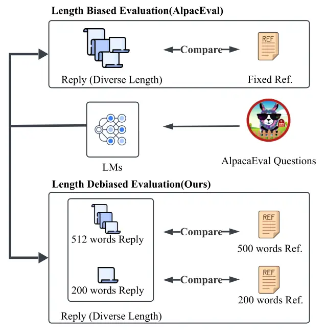
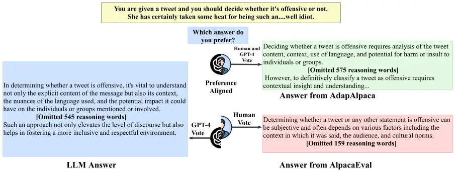
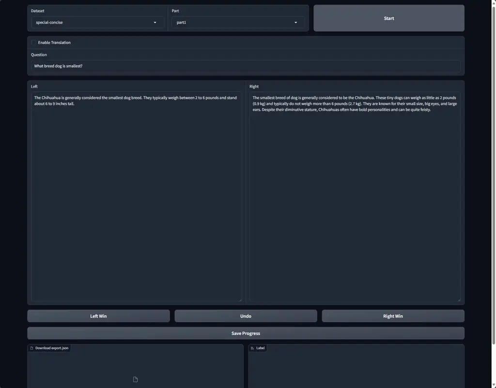

# Explaining Length Bias in LLM-Based Preference Evaluations

Zhengyu Hu Affiliation:  Thrust of Artificial Intelligence, HKUST
(Guangzhou), China    Linxin Song Affiliation:  University of Southern
California    Jieyu Zhang Affiliation:  University of Washington   
Zheyuan Xiao Affiliation:  Thrust of Artificial Intelligence, HKUST
(Guangzhou), China Affiliation:  Resideo    Tianfu Wang Affiliation: 
Thrust of Artificial Intelligence, HKUST (Guangzhou), China    Zhenyu
Chen Affiliation:  MeiTuan    Jianxun Lian Affiliation:  Microsoft   
Nicholas Jing Yuan Affiliation:  Microsoft    Kaize Ding Affiliation: 
Northwestern University    Hui Xiong Affiliation:  Thrust of Artificial
Intelligence, HKUST (Guangzhou), China Affiliation:  Department of
Computer Science and Engineering, HKUST, Hong Kong SAR, China

###### Abstract

The use of large language models (LLMs) as judges, particularly in
preference comparisons has become widespread, but this reveals a notable
bias towards longer responses, undermining the reliability of such
evaluations. To better understand such bias, we propose to decompose the
preference evaluation metric, specifically the _win rate_, into two key
components: _desirability_ and _information mass_, where the former is
length-independent and related to trustworthiness such as correctness,
toxicity, and consistency, and the latter is length-dependent and
represents the amount of information in the response. We empirically
demonstrated the decomposition through controlled experiments and found
that response length impacts evaluations by influencing information
mass. To derive a reliable evaluation metric that assesses content
quality without being confounded by response length, we propose
AdapAlpaca, a simple yet effective adjustment to win rate measurement.
Specifically, AdapAlpaca ensures a fair comparison of response quality
by aligning the lengths of reference and test model responses under
equivalent length intervals.

## 1 Introduction

As LLMs are increasingly deployed across various domains of artificial
intelligence, from natural language processing to complex
decision-making systems (Song et al., 2024b; Song et al., 2025a; Zhang
et al., 2024b; Hu et al., 2025; Liu et al., 2025a), ensuring their
performance, reliability, and fairness has become a critical
challenge (Hu et al., 2024a; Liu et al., 2025b; Wang et al., 2023b; Song
et al., 2023; Wang et al., 2024; Li et al., 2025; Song et al., 2025b).
LLM-based auto-evaluators have emerged as a crucial tool in this
context, offering a cost-effective and scalable alternative to
labor-intensive human evaluations (Li et al., 2024a; Li et al., 2024b;
Dubois et al., 2024b; Song et al., 2024a; Zhan et al., 2025). Despite
their advantages, these automated systems are not without their
shortcomings, particularly concerning the introduction and perpetuation
of biases (Wang et al., 2023a; Ma et al., 2025; Wang et al., 2025; Song
et al., 2025c). One of the important biases observed in LLM-based
evaluations is the preference for longer textual responses. Previous
empirical studies have explored a strong correlation between the length
of response and its perceived quality represented by win rate (Zhao
et al., 2024; Dubois et al., 2024a; Park et al., 2024). However, it is
not reasonable to simply attribute the preference to length since length
is only the surface factor for the quality of a sentence. Therefore, in
this work, we investigate the following question: what are the major
factors contributing to the win rate?

To solve this problem, we propose a new framework that decomposes the
_quality_ of a response, as measured by its win rate in pairwise
comparisons, into two distinct components: (1) desirability, which is
independent of length and reflects the trustworthiness of the response,
encompassing factors such as correctness, toxicity, and consistency; and
(2) information mass, which is dependent on length and represents the
amount of information in the response, measurable through conditional
entropy. We validate our hypothesis by testing win rates in two
different scenarios: (i) comparing normal responses with those differing
in desirability (e.g., Logical to be desired and Biased not desired),
and (ii) comparing normal responses with concise and detailed responses,
which vary in information mass. Our experiments demonstrate that
responses with negative desirability significantly decrease the win
rate, whereas information mass, when not negatively influenced by
desirability, is positively correlated with the win rate, thus
confirming the effectiveness of our metric. Following this finding, we
design a new prompt called "Quality Enhancement" to improve information
mass with positive desirability. This prompt enables GPT-4 to achieve
state-of-the-art results on AlpacaEval, increasing the win rate from
50.00% to 70.16%.



Figure 1: Comparison between AlpacaEval and AdapAlpaca (Ours). In
AlpacaEval, the reference answer has a fixed length, regardless of the
length of the test model’s answer. In contrast, AdapAlpaca dynamically
selects a reference answer that matches the length of the test model’s
answer.

Through our decomposition of the quality of a response, we observe that
response length impacts evaluations primarily by influencing information
mass. However, a reliable evaluation metric should assess content
quality without being confounded by extraneous factors such as response
length (Koo et al., 2023; Ye et al., 2024; Dubois et al., 2024a), we
further propose AdapAlpaca, a benchmark designed to improve evaluation
fairness. By ensuring that responses are compared at the same length
intervals, AdapAlpaca effectively mitigates length bias, enabling
accurate content quality assessments (see Figure 1). With AdapAlpaca, we
further analyze length bias in Direct Preference Optimization
(DPO) Rafailov et al. (2023) to examine the findings in prior work (Gu
et al., 2024; Ivison et al., 2023; Liu et al., 2024) that DPO lengthens
model responses. Specifically, we test TÜLU2 (Ivison et al., 2023) and
TÜLU2-dpo models at 7B, 13B, and 70B scales on AlpacaEval and
AdapAlpaca. Our results indicate that DPO leads to higher human
preference, but this gain is amplified by response length, with
AlpacaEval showing higher win rates gain than AdapAlpaca. Our major
findings and contributions are as follows:

- •
  We propose a novel interpretation of win rate, emphasizing
  desirability and information mass, offering a more precise LLM
  performance measure. Based on this interpretation, we develop the
  "Quality Enhancement" prompt, which improves win rates by boosting
  information mass with positive desirability. This prompt improves win
  rates across multiple LLMs, with average increases of 23.44% for
  GPT-3.5, 16.48% for GPT-4, 22.28% for LLAMA3-70b, and 20.40% for
  Qwen1.5 72B.
- •
  To mitigate length bias, we introduce AdapAlpaca, a method that aligns
  the response lengths of the reference and test model, enabling a fair
  comparison of desirability and information mass under the same length
  intervals.
- •
  Using both AlpacaEval and AdapAlpaca, we analyze the impact of length
  bias in DPO. Our experiments with TÜLU2 and TÜLU2-dpo models at 7B,
  13B, and 70B scales show that DPO leads to higher human preference,
  but this gain is amplified by response length, with AlpacaEval showing
  higher win rates gain than AdapAlpaca.

## 2 Related Work

Reference-free Evaluation Metrics. Reference-free evaluation metrics
have a long history (Louis and Nenkova, 2013), which evaluates the
generated text based on intrinsic properties and coherence with the
context. Although they achieve high accuracy on matching
inner-annotator, the achievement suffers from spurious correlations such
as perplexity and length (Durmus et al., 2022). Recently, people have
started using a strong model (e.g., GPT-4) as an evaluator to perform a
zero-shot reference-free evaluation on the weak models (Shen et al.,
2023; Dubois et al., 2024b; Chen et al., 2023; Park et al., 2024).
However, leveraging a strong model’s intrinsic knowledge to perform
reference-free evaluation ignores the prompt preference of the strong
model, for example, the prompt’s length.

Correlation Between Length and Win Rate. Previous research reveals that
sentence length will influence the evaluation of trustworthiness.
Specifically, when using a GPT-4 to represent human preference, it will
prefer to choose a long sentence rather than a short sentence (Dubois
et al., 2024a; Ivison et al., 2023; Gu et al., 2024; Hu et al., 2024b;
Koo et al., 2023; Wang et al., 2023a; Wu and Aji, 2023; Dubois et al.,
2024b; Chen et al., 2023; Hu et al., 2024c). Such preference will
introduce a length-correlated bias and help the model with
long-generation sentences gain a high score on human preference
evaluation. Although these approaches show a high correlation to human
preference, debiasing such as automated evaluation is highly valuable.
(Dubois et al., 2024a) proposes a length-controlled (LC) win rate by
removing the length-correlated term in the win rate regression model.
The new LC win rate shows an even performance between concise and
verbose input and a higher correlation when compared with human
preference.

## 3 Understanding the Major Factors of Win Rate

To interpret the correlation between length and win rate, we propose a
new framework based on quality, which includes _desirability_
(length-independent, related to trustworthiness) and _information mass_
(length-dependent, represented by conditional entropy). We validate our
hypothesis through two scenarios: (1) testing the impact of different
desirability on win rate with the same information mass, and (2) testing
the influence of different information mass on win rate with the same
desirability.

### 3.1 Preliminary

Evaluation protocol. We utilize the AlpacaEval dataset (Li et al.,
2023b) to assess human preferences. AlpacaEval is a reference-free
evaluation dataset for LLMs, encompassing 805 instructions that reflect
human interactions on the Alpaca web demo. To ensure a comprehensive
evaluation of human preferences, we extend our testing to additional
datasets, including LIMA (Zhou et al., 2023), Vicuna (Chiang et al.,
2023), Koala (Vu et al., 2023), Wizardlm (Xu et al., 2023), and
Self-Instruct (Wang et al., 2022), in line with previous studies (Chen
et al., 2023; Zhang et al., 2024a; Du et al., 2023; Zhao et al., 2024;
Li et al., 2023a).

Base Models. In our experiments, we follow the setup in the AlpacaEval
Leaderboard ¹¹ 1
[https://tatsu-lab.github.io/alpaca_eval](https://tatsu-lab.github.io/alpaca_eval),
using the GPT-4 Preview (11/06) as Baseline and the Annotator. The
references to GPT-3.5, LLAMA3-70b, and Qwen1.5 72b in the main text
denote gpt-3.5-turbo-0125,
meta-llama/Meta-Llama-3-70B-Instruct (AI@Meta, 2024), and
Qwen/Qwen1.5-72B-Chat (Bai et al., 2023), respectively. Following
previous work (Wei et al., 2024), we calculate conditional entropy using
the method described in  (Von Neumann, 1932). Further details are
provided in Appendix A.6.

Win rate. Assume we have a set of instructions $`x`$. We prompt a test
model $`m`$ to generate a response $`z_{m}`$ for each instruction.
Similarly, we prompt a reference model $`b`$ (referred to as the
"baseline" in AlpacaEval) to generate a response $`z_{b}`$ for each
instruction.²² 2 In this context, $`m`$ stands for ”model” and $`b`$
denotes ”baseline”, which in this paper follows the AlpacaEval
Leaderboard’s use of GPT-4 Preview (11/06). An annotator then evaluates
these responses based on their quality and assigns a preference
$`y\in\{m,b\}`$, indicating which model’s response is superior. To
properly understand the concept of win rate, we first need to define
what we mean by response quality:

###### Definition 1

(Response Quality), denoted as $`Q_{e}(z|x)`$, quantifies the
effectiveness of the model’s response $`z`$ in addressing the given
instruction $`x`$, as evaluated by an annotator $`e`$. Annotator prefer
responses with higher quality.

By leveraging the definition of quality, we can now formulate the win
rate as the comparison of sentence quality as follows:

```math
\text{WinRate}(m,b)=\mathbb{E}_{x}\left[\mathbbm{1}_{Q_{e}(z_{m}\mid x)>Q_{e}(z_{b}\mid x)}\right], \tag{1}
```

where $`\mathbbm{1}`$ is an indicator function and
$`\mathbbm{1}_{Q_{e}(z_{m}\mid x)>Q_{e}(z_{b}\mid x)}`$ represents the
preference distribution for each individual. Previous works (Chen
et al., 2023; Li et al., 2023b; Dubois et al., 2024a; Dubois et al.,
2024b) utilize LLMs as zero-shot evaluators due to their exceptional
performance on real-world tasks. Our experimental setup adheres to the
AlpacaEval Leaderboard (Li et al., 2023b) guidelines, employing the
GPT-4 Preview (11/06)³³ 3 In this paper, unless specified otherwise,
GPT-4 refers to GPT-4 Preview (11/06). as both the Baseline $`b`$ and
the Annotator $`e`$.

(a) AlpacaEval

(b) LIMA

(c) Koala

(d) Self-Instruct

(e) Vicuna

(f) Wizardlm

Figure 2: Validation of desirability’s impact on quality for GPT-4. The
results demonstrate that desirability influences the win rate.

### 3.2 Quality Decomposition

Before discussing the composition of quality, we first define two key
concepts: desirability and information mass. Desirability reflects the
inherent quality attributes of a response that make it reliable and
valuable, irrespective of its length, while information mass captures
the quantity of information in the response, with longer responses
generally containing more content. The definitions of desirability and
information mass are as follows:

###### Definition 2

(Desirability), denoted as $`D_{e}(z|x)`$, measures the probability that
annotator $`e`$ will accept the response $`z`$ given an instruction
$`x`$. It can be influenced by factors such as consistency and toxicity
and is independent of response length.

###### Definition 3

(Information mass), denoted as $`H_{e}(z|x)`$, measures the amount of
information in a response $`z`$ given an instruction $`x`$, as evaluated
by annotator $`e`$. It is represented by conditional entropy and is
directly with response length.

Details on the design rationale are provided in Appendix F. With these
definitions in place, we now present our main hypothesis on answer
quality, starting with an assumption:

(a) AlpacaEval

(b) LIMA

(c) Koala

(d) Self-Instruct

(e) Vicuna

(f) Wizardlm

Figure 3: Validation of information mass’s impact on quality for GPT-4.
The results demonstrate that information mass influences the win rate.

###### Assumption 1

(Quality Decomposition). For a given answer $`z`$ and instruction $`x`$,
the quality $`Q_{e}(z|x)`$ recognized by annotator $`e`$ can be viewed
as a function of two key components:

```math
Q_{e}(z|x)\leftarrow\{D_{e}(z|x),H_{e}(z|x)\}, \tag{2}
```

where $`D_{e}(z|x)`$ denotes the desirability of the response, and
$`H_{e}(z|x)`$ represents the information mass.

To systematically verify our hypothesis, we conduct two experiments
targeting the manipulation of these key components in GPT-4’s responses
in Section 3.3 and Section 3.4. Additional results with more test and
annotator models are provided in Appendix N and Appendix O.

### 3.3 Desirability Influences Quality

To evaluate the impact of desirability on quality, we design experiments
using eight strategies to manipulate response desirability. These
strategies include: (1) Origin: No prompt restrictions. (2) Copy-paste:
Copy GPT-4’s response three times. (3) Biased: Provide biased responses,
favoring certain ideas without justification. (4) Inconsistent: Provide
contradictory information to create confusion. Illogical: Give responses
based on flawed logic or irrelevant information. (5) Verbose: Provide
lengthy responses filled with broad, unrelated details. (6) Toxic: Use
offensive language with an aggressive tone. (7) Relevant: Provide
responses that align with the query. (8) Logical: Base responses on
sound reasoning and valid arguments. The results are shown in Figure 2.
To eliminate the impact of information mass on win rate, we use
conditional entropy to represent information mass and ensure the
information mass of Origin and the other prompts remains as consistent
as possible. The entropy values shown in the Figure 2 represent the
average conditional entropy of the responses for each prompt. Details
for these prompts and relevant implementation are shown in Appendix M,
Appendix A.2 and Appendix A.3. First, we observe that although the
Copy-paste and Origin prompts maintain identical information mass (as
simply replicating text does not increase information), the win rates of
Copy-paste fall below Origin (50%) due to significant consistency
impairments. Second, responses generated from negative prompts (i.e.,
Biased, Inconsistent, Illogical, Verbose, and Toxic) exhibit low
desirability, resulting in win rates substantially lower than Origin
(50%), despite having similar information mass. Conversely, prompts
enhancing desirability (i.e., Consistent and Logical) yield increased
win rates compared to Origin. In summary, desirability plays a
significant role in determining quality.

### 3.4 Information Mass Influences Quality

To evaluate the impact of information mass on quality, we designed
experiments using three distinct strategies to manipulate the
information mass of responses. These strategies include: (1) Origin: No
prompt restrictions. (2) Concise: Request brief responses focusing on
the most crucial points. (3) Detailed: Request comprehensive responses
covering all relevant aspects thoroughly. The corresponding results are
illustrated in Figures 3. Importantly, to isolate the effect of
information mass, we ensured that the prompts did not impose any
constraints on desirability, ensuring comparability. Details of the
prompts and implementation are in Appendix M, Appendix A.1 and
Appendix A.4. Our findings indicate that information mass significantly
affects the win rate without a negative desirability prompt.
Specifically, responses with higher information mass, measured by
conditional entropy, consistently achieved higher win rates. Thus, we
observe the following relationship: Detailed \> Origin \> Concise. These
results confirm that information mass is a crucial factor influencing
the quality of responses.

|                                                            |
| ---------------------------------------------------------- |
|  |

Table 1: The content of the "Quality Enhancement" prompt, designed to
elevate both the information mass and desirability of responses, thereby
enhancing win rates. Keywords such as "relevant" and "logical" are used
to enhance desirability, while "detailed" is used to boost information
mass.

|             |                          |            |       |       |               |        |          |       |
| ----------- | ------------------------ | ---------- | ----- | ----- | ------------- | ------ | -------- | ----- |
| Models      | Methods                  | AlpacaEval | LIMA  | Koala | Self-Instruct | Vicuna | Wizardlm | Avg.  |
| GPT-3.5     | w/o Quality Enhancement  | 15.47      | 9.67  | 11.39 | 21.46         | 8.75   | 16.82    | 13.93 |
|             | with Quality Enhancement | 29.89      | 36.53 | 40.34 | 45.93         | 35.88  | 35.62    | 37.36 |
|             | WR Gain                  | 14.42      | 26.86 | 28.95 | 24.47         | 27.13  | 18.80    | 23.44 |
| GPT-4       | w/o Quality Enhancement  | 50.00      | 50.00 | 50.00 | 50.00         | 50.00  | 50.00    | 50.00 |
|             | with Quality Enhancement | 70.16      | 65.84 | 58.90 | 67.06         | 73.13  | 63.76    | 66.48 |
|             | WR Gain                  | 20.16      | 15.84 | 8.90  | 17.06         | 23.13  | 13.76    | 16.48 |
| LLAMA3-70b  | w/o Quality Enhancement  | 34.32      | 36.63 | 40.12 | 39.70         | 36.74  | 36.99    | 37.81 |
|             | with Quality Enhancement | 56.50      | 60.39 | 61.30 | 64.81         | 63.49  | 51.70    | 59.70 |
|             | WR Gain                  | 22.18      | 23.76 | 21.18 | 25.11         | 26.75  | 14.71    | 22.28 |
| Qwen1.5 72b | w/o Quality Enhancement  | 28.27      | 28.40 | 35.25 | 33.81         | 33.70  | 31.80    | 32.67 |
|             | with Quality Enhancement | 48.87      | 53.34 | 55.40 | 52.43         | 56.49  | 47.13    | 52.28 |
|             | WR Gain                  | 20.60      | 24.94 | 20.15 | 18.62         | 22.79  | 15.33    | 20.40 |

Table 2: Win rates with and without the "Quality Enhancement" prompt,
along with the corresponding win rate gains (WR Gain). "WR Gain"
represents the increase in win rate due to the use of the "Quality
Enhancement".

(a) AlpacaEval

(b) LIMA

(c) Koala

(d) Self-Instruct

(e) Vicuna

(f) Wizardlm

Figure 4: Correlation between information mass and word count for
responses of GPT-4. As the word count increases, the information mass
also increases.

### 3.5 Quality Enhancement Prompt

Our decomposition reveals that responses with good desirability and
higher information mass are generally more favored. Building on this
insight, we propose the ’Quality Enhancement’ prompt (Table 1), designed
to improve both desirability and information mass, thereby increasing
win rates. The keywords "relevant" and "logical" are used to enhance
desirability, while "detailed" is used to boost information mass. Their
effectiveness is validated in Section 3.3 and Section 3.4. We evaluated
this prompt across multiple models, including GPT-3.5, GPT-4,
LLAMA3-70b, and Qwen1.5 72B. The results, summarized in Table 2, with
benchmarks such as LIMA, Vicuna, Koala, Wizardlm, and Self-Instruct. The
consistent improvement in win rates across all tested models underscores
the critical role of response quality in LLM evaluation.



Figure 5: Case study on comparing GPT-4 and human vote on AlpacaEval and
AdapAlpaca. In AlpacaEval, GPT-4 votes for the verbose answer, but
humans vote for the concise reference answer, while in AdapAlpaca, GPT-4
and humans vote for the same answer, demonstrating a better LLM-human
alignment on AdapAlpaca.

## 4 Adaptive AlpacaEval

Here, we analyze the phenomenon observed in prior works (Dubois et al.,
2024a; Chen et al., 2023; Dubois et al., 2024b), which highlights a
positive correlation between response length and win rate. Intuitively,
longer responses tend to encompass more information. To rigorously
quantify this relationship, we use conditional entropy as information
mass in a response $`z`$ given an instruction $`x`$. This analysis is
conducted without constraints on response desirability, ensuring the
correlation between length and information mass remains independent of
desirability factors. As shown in Figure 4, our analysis demonstrates a
clear trend: as the length of a response increases, the information mass
also grows. By integrating this observation with the findings from
Section 3.2, we conclude that the primary mechanism through which length
affects win rate is its contribution to the overall information mass.

Adaptive AlpacaEval (AdapAlpac) is based on the premise that a reliable
evaluation metric should not only assess the content quality but also
ensure that the assessment is not confounded by extraneous factors such
as the length of the response. Central to this approach is the concept
of information mass, which is inherently dependent on response length
and can be quantified using conditional entropy. Our primary aim is to
mitigate scenarios where merely extending the length of a response
artificially inflates its conditional entropy and, thus, its perceived
quality by annotators. This approach involves dynamically adjusting the
evaluation criteria based on response length, thereby providing a more
equitable and accurate measure of a model’s performance. More discussion
can be found in Appendix C and E.

### 4.1 Dataset Generation

To support the development of Adaptive AlpacaEval, we first generate a
diverse dataset using a modified prompting strategy with GPT-4, designed
to produce responses within specific word count ranges. Specifically, we
analyzed the word count distribution within the AlpacaEval dataset,
observing that responses predominantly fall within the 0-1000 word
range. This range was chosen to encompass the full spectrum of response
lengths present in the original AlpacaEval dataset, ensuring
comprehensive evaluation coverage. To systematically explore this range,
we divided it into five equal segments, each representing a distinct
dataset: AdapAlpaca-200: 0-200 words, AdapAlpaca-400: 200-400 words,
AdapAlpaca-600: 400-600 words, AdapAlpaca-800: 600-800 words,
AdapAlpaca-1000: 800-1000 words. Each segment is populated by generating
responses using the dataset generation prompt, with GPT-4 configured to
produce responses that strictly conform to the specified word counts.
The data generation prompt and additional details for AdapAlpaca can be
found in Appendix J.

### 4.2 Case Study

To demonstrate the superiority of AdapAlpaca, we present a case study.
In Figure 5, for the given instruction, we generate a redundant model
answer (shown in the blue box). When evaluated using the current
AlpacaEval response (shown in the red box), the annotator (i.e., GPT-4)
selected this redundant answer, which is significantly unaligned from
human preference, as the simplicity of the question does not warrant
such extensive verbosity. The reason GPT-4 chose this answer is that the
excessive length increases the information mass, artificially inflating
the perceived quality. In contrast, when using AdapAlpaca, it allows us
to control for content while varying the length, thereby isolating the
effect of length from that of content quality.

|                     |            |                    |                   |            |                   |
| ------------------- | ---------- | ------------------ | ----------------- | ---------- | ----------------- |
| LLM Response        | AlpacaEval |                    |                   | AdapAlpaca |                   |
|                     | Human      | LCWR               | WR                | Human      | WR                |
| Concise             | 10.81      | $`35.16_{+24.35}`$ | $`15.96_{+5.15}`$ | 29.56      | $`28.44_{-1.12}`$ |
| Detailed            | 61.61      | $`54.13_{-7.48}`$  | $`65.83_{+4.22}`$ | 56.02      | $`55.36_{-0.78}`$ |
| Quality Enhancement | 66.70      | $`49.37_{-17.33}`$ | $`70.16_{+3.46}`$ | 58.88      | $`57.81_{+1.07}`$ |

Table 3: The subscripts in the LCWR and WR columns indicate the
differences between these metrics and the corresponding Human WR. A
larger absolute value denotes a greater disparity between the
annotator’s evaluation and Human Preference. "LLM Response" denotes
different responses to AlpacaEval questions for GPT-4, with detailed
content available in Section 3.2.

### 4.3 Result of Human Evaluation

Table 3 presents the results of the human study, with details provided
in Appendix D and you can find more results in Appendix I. First, we
test the results of concise, detail, and quality enhancement
(descriptions provided in Section 3 and  3.5) using AlpacaEval, followed
by AdapAlpaca. From the gap values between LCWR and human evaluations,
we observe significant misalignments, indicating inherent problems with
the LCWR metric. In contrast, the win rate calculated using AdapAlpaca
closely aligns with the human results, showing an average difference of
0.99% (1.12% + 1.07% + 0.78% / 3). Additionally, we find that the
difference between human evaluation and WR decreases as the quality of
responses improves (from concise to detailed to Quality Enhancement).
This suggests that as response quality increases, the preferences of
annotators and human evaluators converge. Moreover, we found that the
smallest difference in win rate between GPT-4 and human evaluations
occurs when using the "Quality Enhancement" prompt, which has the
highest levels of desirability and information mass. This further
underscores the importance of enhancing both desirability and
information mass in model responses. Overall, while both AdapAlpaca and
LCWR aim to mitigate length bias in evaluating human preferences, their
approaches differ fundamentally. AdapAlpaca eliminates length bias from
the outset, whereas LCWR attempts to correct for length bias after it
has already influenced the evaluation. The inherent issue with LCWR is
that length significantly impacts human preference, and adjusting for
length retrospectively is not a reliable approach.

### 4.4 DPO and Its Length Bias

Previous work (Gu et al., 2024; Ivison et al., 2023) has shown that
DPO Rafailov et al. (2023) tends to make model responses longer, raising
a natural question: Does the increase in human preference brought by DPO
partly stem from the length of the responses? In other words, does DPO
generate longer replies, thereby increasing their win rate? To
investigate this issue, we conducted tests using the widely-used
TÜLU2 (Ivison et al., 2023) series models. As shown in Table 4, we
tested the models at 7B, 13B, and 70B scales on both AlpacaEval and
AdapAlpaca to measure their win rates and corresponding response
lengths. The results from AlpacaEval and AdapAlpaca indicate that while
DPO does lead to longer model responses, it enhances the model’s human
preference capability (as evidenced by the increased win rate in
AdapAlpaca). However, this gain is amplified by the response length (as
the win rate in AlpacaEval is higher than in AdapAlpaca). Additionally,
we found that all models have higher win rates on AdapAlpaca compared to
AlpacaEval. This is because the responses from GPT-4 (1106) on
AlpacaEval are longer (363 words, see Appendix J.1), which unfairly
amplifies the capabilities of GPT-4 due to its length. These results
emphasize the need for length control in evaluations to reflect true
model performance.

|      |               |             |            |             |
| ---- | ------------- | ----------- | ---------- | ----------- |
| Size | Model         | Winrate (%) |            | Avg. Length |
|      |               | AlpacaEval  | AdapAlpaca |             |
| 7B   | TÜLU 2        | 3.60        | 5.84       | 203.60      |
|      | TÜLU 2+DPO    | 8.33        | 9.04       | 282.92      |
|      | Gain from DPO | 4.73        | 3.20       | \-          |
| 13B  | TÜLU 2        | 4.35        | 8.07       | 192.58      |
|      | TÜLU 2+DPO    | 10.82       | 13.17      | 276.96      |
|      | Gain from DPO | 6.47        | 5.10       | \-          |
| 70B  | TÜLU 2        | 7.34        | 10.94      | 184.26      |
|      | TÜLU 2+DPO    | 15.67       | 17.90      | 267.23      |
|      | Gain from DPO | 8.33        | 6.96       | \-          |

Table 4: Win rate and response length comparison for TÜLU2 models (7B,
13B, and 70B) on AlpacaEval and AdapAlpaca. The results indicate that
while DPO increases response length and improves win rate, the win rate
gain is further amplified by the response length, leading to higher
performance in AlpacaEval compared to AdapAlpaca.

## 5 Length Bias Originating from RLHF

|              |              |        |        |       |       |       |          |        |        |        |       |
| ------------ | ------------ | ------ | ------ | ----- | ----- | ----- | -------- | ------ | ------ | ------ | ----- |
| LLM Response | Reward Model |        |        |       |       |       |          |        |        |        | Avg.  |
|              | Eurus        | Grmdis | Grmsft | UniF  | Debba | Bebla | FsfairRM | Gerew  | Misrmr | InteRM |       |
| Concise      | 1.819        | 1.984  | -2.919 | 0.064 | 2.229 | 4.159 | -1.404   | -0.456 | 5.661  | 0.426  | 1.156 |
| Origin       | 3.564        | 4.009  | -0.505 | 2.901 | 3.305 | 5.142 | 1.830    | 1.066  | 9.440  | 1.558  | 3.231 |
| Detailed     | 3.986        | 4.646  | 1.458  | 3.263 | 3.759 | 5.450 | 2.684    | 2.630  | 10.616 | 2.416  | 4.090 |

Table 5: Scores given by commonly used reward models to concise,
detailed, and original responses from GPT-4. The analysis shows that the
scores consistently decrease from detailed to concise responses,
highlighting the length bias within the reward model.

Figure 6: Analysis of the 14 commonly used preference datasets on
Hugging Face. The analysis shows that the lengths of chosen responses
are generally longer than those of rejected responses, indicating a
length bias in human preference labeling.

Figure 7: RLHF process contributing to length bias in LLMs. Human
labelers often prefer detailed responses, leading to ranking data where
longer responses are ranked higher. This creates a spurious correlation
that the reward model learns and propagates to the aligned model.

We believe that the length bias observed in LLMs essentially originates
from the RLHF (Ouyang et al., 2022) process. As shown in Figure 7,
during the RLHF process, humans may generally prefer more detailed
responses when labeling preference data. This leads to ranking data
where longer responses are generally ranked higher than shorter ones,
causing the reward model to learn this spurious correlation and
incorrectly assume that length is a factor in human preference. This
bias is further propagated to the aligned model during the training
process using the reward model.

To verify our idea, we first analyze 14 commonly used preference
datasets in huggingface, shown in Figure 6. We found that the lengths of
chosen responses are generally longer than those of rejected responses.
As detailed in Table 5, we also analyze the scores given by 10 commonly
used reward models (Lambert et al., 2024) to detailed, original, and
concise responses from GPT-4. The detailed description of these three
prompts can be found in Section 3.4. We find that the scores
consistently decrease across all reward models. The details of these
datasets and reward models can be found in Appendix H. However,
attributing human preference solely to response length is an
oversimplification, as length is merely a superficial factor in how
humans judge the quality of a sentence.

## 6 Conclusion

In this paper, we identify and address the critical issue of length bias
in LLM-based preference evaluations, which undermines the reliability of
win rate metrics. By decomposing win rate into desirability and
information mass, we offer a nuanced understanding of response quality.
Our proposed framework, AdapAlpaca, effectively mitigates length bias by
dynamically adjusting reference answer lengths to match test model
responses, ensuring fairer evaluation metrics. Additionally, our
analysis of DPO demonstrates that its gains in human preference are
influenced by response length, underscoring the importance of unbiased
evaluation benchmarks. Overall, AdapAlpaca provides a robust tool for
advancing reliable and equitable model evaluation.

## 7 Limitations

This study recognizes several limitations that define the scope of our
current work and suggest directions for future research. First,
AdapAlpaca adjusts the length of reference answers to match test model
responses, but this assumes that content quality is preserved across
varying lengths. In practice, truncating or expanding a response may
distort its meaning or quality, introducing unintended artifacts into
the evaluation. Second, while our work primarily focuses on length bias,
other biases in LLM evaluations—such as stylistic preferences,
formatting, or cultural influences—remain unexplored. These factors
could also shape win rates and deserve systematic attention in future
studies.

## 8 Acknowledgement

This work was supported in part by the National Key R&D Program of China
(Grant No.2023YFF0725001),in part by the National Natural Science
Foundation of China (Grant No.92370204),in part by the guangdong Basic
and Applied Basic Research Foundation (Grant No.2023B1515120057),in part
by the Education Bureau of Guangzhou

## References

- Achiam et al. (2023) Josh Achiam, Steven Adler, Sandhini Agarwal, Lama
  Ahmad, Ilge Akkaya, Florencia Leoni Aleman, Diogo Almeida, Janko
  Altenschmidt, Sam Altman, Shyamal Anadkat, and 1 others. 2023. Gpt-4
  technical report. _arXiv preprint arXiv:2303.08774_.
- AI@Meta (2024) AI@Meta. 2024. [Llama 3 model
  card](https://github.com/meta-llama/llama3/blob/main/MODEL_CARD.md).
- Bai et al. (2023) Jinze Bai, Xiaohuan Zhou Shuai Bai, …, and Tianhang
  Zhu. 2023. Qwen technical report. _arXiv preprint arXiv:2309.16609_.
- Baumgartner et al. (2020) Jason Baumgartner, Savvas Zannettou, Brian
  Keegan, Megan Squire, and Jeremy Blackburn. 2020. The pushshift reddit
  dataset. In _Proceedings of the international AAAI conference on web
  and social media_.
- Chen et al. (2023) Lichang Chen, Shiyang Li, Jun Yan, Hai Wang, Kalpa
  Gunaratna, Vikas Yadav, Zheng Tang, Vijay Srinivasan, Tianyi Zhou,
  Heng Huang, and Hongxia Jin. 2023. Alpagasus: Training a better alpaca
  with fewer data. _arXiv preprint arXiv:2307.08701_.
- Chiang et al. (2023) Wei-Lin Chiang, Zhuohan Li, Zi Lin, Ying Sheng,
  Zhanghao Wu, Hao Zhang, Lianmin Zheng, Siyuan Zhuang, Yonghao Zhuang,
  Joseph E. Gonzalez, Ion Stoica, and Eric P. Xing. 2023. [Vicuna: An
  open-source chatbot impressing gpt-4 with 90%\* chatgpt
  quality](https://lmsys.org/blog/2023-03-30-vicuna/).
- Du et al. (2023) Qianlong Du, Chengqing Zong, and Jiajun Zhang. 2023.
  Mods: Model-oriented data selection for instruction tuning. _arXiv
  preprint arXiv:2311.15653_.
- Dubois et al. (2024a) Yann Dubois, Balázs Galambosi, Percy Liang, and
  Tatsunori B Hashimoto. 2024a. Length-controlled alpacaeval: A simple
  way to debias automatic evaluators. _arXiv preprint arXiv:2404.04475_.
- Dubois et al. (2024b) Yann Dubois, Chen Xuechen Li, Rohan Taori,
  Tianyi Zhang, Ishaan Gulrajani, Jimmy Ba, Carlos Guestrin, Percy S
  Liang, and Tatsunori B Hashimoto. 2024b. Alpacafarm: A simulation
  framework for methods that learn from human feedback. _Advances in
  Neural Information Processing Systems_.
- Durmus et al. (2022) Esin Durmus, Faisal Ladhak, and Tatsunori B.
  Hashimoto. 2022. Spurious correlations in reference-free evaluation of
  text generation. In _Annual Meeting of the Association for
  Computational Linguistics_.
- Gu et al. (2024) Yuxian Gu, Li Dong, Furu Wei, and Minlie Huang. 2024.
  Minillm: Knowledge distillation of large language models. In _The
  Twelfth International Conference on Learning Representations_.
- Hu et al. (2024a) Zhengyu Hu, Yichuan Li, Zhengyu Chen, Jingang Wang,
  Han Liu, Kyumin Lee, and Kaize Ding. 2024a. Let’s ask gnn: Empowering
  large language model for graph in-context learning. _arXiv preprint
  arXiv:2410.07074_.
- Hu et al. (2025) Zhengyu Hu, Jianxun Lian, Zheyuan Xiao, Seraphina
  Zhang, Tianfu Wang, Nicholas Jing Yuan, Xing Xie, and Hui Xiong. 2025.
  Unveiling the learning mind of language models: A cognitive framework
  and empirical study. _arXiv preprint arXiv:2506.13464_.
- Hu et al. (2024b) Zhengyu Hu, Linxin Song, Jieyu Zhang, Zheyuan Xiao,
  Jingang Wang, Zhenyu Chen, Jieyu Zhao, and Hui Xiong. 2024b.
  Rethinking llm-based preference evaluation. _arXiv e-prints_.
- Hu et al. (2024c) Zhengyu Hu, Jieyu Zhang, Zhihan Xiong, Alexander
  Ratner, Hui Xiong, and Ranjay Krishna. 2024c. Language model
  preference evaluation with multiple weak evaluators. _arXiv preprint
  arXiv:2410.12869_.
- Ivison et al. (2023) Hamish Ivison, Yizhong Wang, Valentina Pyatkin,
  Nathan Lambert, Matthew Peters, Pradeep Dasigi, Joel Jang, David
  Wadden, Noah A Smith, Iz Beltagy, and 1 others. 2023. Camels in a
  changing climate: Enhancing lm adaptation with tulu 2. _arXiv preprint
  arXiv:2311.10702_.
- Koo et al. (2023) Ryan Koo, Minhwa Lee, Vipul Raheja, Jong Inn Park,
  Zae Myung Kim, and Dongyeop Kang. 2023. Benchmarking cognitive biases
  in large language models as evaluators. _arXiv preprint
  arXiv:2309.17012_.
- Lambert et al. (2024) Nathan Lambert, Valentina Pyatkin, Jacob
  Morrison, LJ Miranda, Bill Yuchen Lin, Khyathi Chandu, Nouha Dziri,
  Sachin Kumar, Tom Zick, Yejin Choi, and 1 others. 2024. Rewardbench:
  Evaluating reward models for language modeling. _arXiv preprint
  arXiv:2403.13787_.
- Li et al. (2024a) Dawei Li, Bohan Jiang, Liangjie Huang, Alimohammad
  Beigi, Chengshuai Zhao, Zhen Tan, Amrita Bhattacharjee, Yuxuan Jiang,
  Canyu Chen, Tianhao Wu, and 1 others. 2024a. From generation to
  judgment: Opportunities and challenges of llm-as-a-judge. _arXiv
  preprint arXiv:2411.16594_.
- Li et al. (2024b) Haitao Li, Qian Dong, Junjie Chen, Huixue Su, Yujia
  Zhou, Qingyao Ai, Ziyi Ye, and Yiqun Liu. 2024b. Llms-as-judges: A
  comprehensive survey on llm-based evaluation methods. _arXiv preprint
  arXiv:2412.05579_.
- Li et al. (2023a) Ming Li, Yong Zhang, Zhitao Li, Jiuhai Chen, Lichang
  Chen, Ning Cheng, Jianzong Wang, Tianyi Zhou, and Jing Xiao. 2023a.
  From quantity to quality: Boosting llm performance with self-guided
  data selection for instruction tuning. _arXiv preprint
  arXiv:2308.12032_.
- Li et al. (2025) Shawn Li, Jiashu Qu, Linxin Song, Yuxiao Zhou, Yuehan
  Qin, Tiankai Yang, and Yue Zhao. 2025. Treble counterfactual vlms: A
  causal approach to hallucination. _EMNLP 2025 (Findings)_.
- Li et al. (2023b) Xuechen Li, Tianyi Zhang, Yann Dubois, Rohan Taori,
  Ishaan Gulrajani, Carlos Guestrin, Percy Liang, and Tatsunori B.
  Hashimoto. 2023b. [Alpacaeval: An automatic evaluator of
  instruction-following
  models](https://github.com/tatsu-lab/alpaca_eval).
- Liu et al. (2024) Wei Liu, Yang Bai, Chengcheng Han, Rongxiang Weng,
  Jun Xu, Xuezhi Cao, Jingang Wang, and Xunliang Cai. 2024. Length
  desensitization in directed preference optimization. _arXiv preprint
  arXiv:2409.06411_.
- Liu et al. (2025a) Yue Liu, Hongcheng Gao, Shengfang Zhai, Xia Jun,
  Tianyi Wu, Zhiwei Xue, Yulin Chen, Kenji Kawaguchi, Jiaheng Zhang, and
  Bryan Hooi. 2025a. Guardreasoner: Towards reasoning-based llm
  safeguards. _arXiv preprint arXiv:2501.18492_.
- Liu et al. (2025b) Yue Liu, Shengfang Zhai, Mingzhe Du, Yulin Chen,
  Tri Cao, Hongcheng Gao, Cheng Wang, Xinfeng Li, Kun Wang, Junfeng
  Fang, Jiaheng Zhang, and Bryan Hooi. 2025b. Guardreasoner-vl:
  Safeguarding vlms via reinforced reasoning. _arXiv preprint
  arXiv:2505.11049_.
- Louis and Nenkova (2013) Annie Louis and Ani Nenkova. 2013.
  Automatically assessing machine summary content without a gold
  standard. _Computational Linguistics_.
- Ma et al. (2025) Chiyu Ma, Enpei Zhang, Yilun Zhao, Wenjun Liu, Yaning
  Jia, Peijun Qing, Lin Shi, Arman Cohan, Yujun Yan, and Soroush
  Vosoughi. 2025. Judging with many minds: Do more perspectives mean
  less prejudice? on bias amplifications and resistance in multi-agent
  based llm-as-judge.
- Mishra et al. (2020) Swaroop Mishra, Anjana Arunkumar, Bhavdeep
  Sachdeva, Chris Bryan, and Chitta Baral. 2020. Dqi: Measuring data
  quality in nlp. _arXiv preprint arXiv:2005.00816_.
- Ouyang et al. (2022) Long Ouyang, Jeff Wu, Xu Jiang, Diogo Almeida,
  Carroll L. Wainwright, Pamela Mishkin, and Ryan J. Lowe Chong Zhang,
  … 2022. Training language models to follow instructions with human
  feedback. In _NeurIPS_.
- Park et al. (2024) Ryan Park, Rafael Rafailov, Stefano Ermon, and
  Chelsea Finn. 2024. Disentangling length from quality in direct
  preference optimization. _arXiv preprint arXiv:2403.19159_.
- Rafailov et al. (2023) Rafael Rafailov, Archit Sharma, Eric Mitchell,
  Stefano Ermon, Christopher D. Manning, and Chelsea Finn. 2023. Direct
  preference optimization: Your language model is secretly a reward
  model. In _NeurIPS_.
- Shen et al. (2023) Wei Shen, Rui Zheng, Wenyu Zhan, Jun Zhao, Shihan
  Dou, Tao Gui, Qi Zhang, and Xuanjing Huang. 2023. Loose lips sink
  ships: Mitigating length bias in reinforcement learning from human
  feedback. In _Conference on Empirical Methods in Natural Language
  Processing_.
- Song et al. (2024a) Linxin Song, Yan Cui, Ao Luo, Freddy Lecue, and
  Irene Li. 2024a. Better explain transformers by illuminating important
  information. _EACL 2024 (Findings)_.
- Song et al. (2025a) Linxin Song, Yutong Dai, Viraj Prabhu, Jieyu
  Zhang, Taiwei Shi, Li Li, Junnan Li, Silvio Savarese, Zeyuan Chen,
  Jieyu Zhao, and 1 others. 2025a. Coact-1: Computer-using agents with
  coding as actions. _arXiv preprint arXiv:2508.03923_.
- Song et al. (2025b) Linxin Song, Xuwei Ding, Jieyu Zhang, Taiwei Shi,
  Ryotaro Shimizu, Rahul Gupta, Yang Liu, Jian Kang, and Jieyu Zhao.
  2025b. Discovering knowledge deficiencies of language models on
  massive knowledge base. _COLM 2025_.
- Song et al. (2024b) Linxin Song, Jiale Liu, Jieyu Zhang, Shaokun
  Zhang, Ao Luo, Shijian Wang, Qingyun Wu, and Chi Wang. 2024b. Adaptive
  in-conversation team building for language model agents. _arXiv
  preprint arXiv:2405.19425_.
- Song et al. (2025c) Linxin Song, Taiwei Shi, and Jieyu Zhao. 2025c.
  The hallucination tax of reinforcement finetuning. _EMNLP 2025
  (Findings)_.
- Song et al. (2023) Linxin Song, Jieyu Zhang, Lechao Cheng, Pengyuan
  Zhou, Tianyi Zhou, and Irene Li. 2023. Nlpbench: Evaluating large
  language models on solving nlp problems. _arXiv preprint
  arXiv:2309.15630_.
- Von Neumann (1932) John Von Neumann. 1932. _Mathematische grundlagen
  der quantenmechanik_. Springer-Verlag.
- Vu et al. (2023) Thuy-Trang Vu, Xuanli He, Gholamreza Haffari, and
  Ehsan Shareghi. 2023. Koala: An index for quantifying overlaps with
  pre-training corpora. _arXiv preprint arXiv:2303.14770_.
- Wang et al. (2023a) Peiyi Wang, Lei Li, Liang Chen, Dawei Zhu,
  Binghuai Lin, Yunbo Cao, Qi Liu, Tianyu Liu, and Zhifang Sui. 2023a.
  Large language models are not fair evaluators. _arXiv preprint
  arXiv:2305.17926_.
- Wang et al. (2024) Shijian Wang, Linxin Song, Jieyu Zhang, Ryotaro
  Shimizu, Ao Luo, Li Yao, Cunjian Chen, Julian McAuley, and Hanqian
  Wu. 2024. Template matters: Understanding the role of instruction
  templates in multimodal language model evaluation and training. _arXiv
  preprint arXiv:2412.08307_.
- Wang et al. (2025) Tianfu Wang, Yi Zhan, Jianxun Lian, Zhengyu Hu,
  Nicholas Jing Yuan, Qi Zhang, Xing Xie, and Hui Xiong. 2025.
  Llm-powered multi-agent framework for goal-oriented learning in
  intelligent tutoring system. In _ACM Web Conference_.
- Wang et al. (2023b) Yidong Wang, Zhuohao Yu, Zhengran Zeng, Linyi
  Yang, Cunxiang Wang, Hao Chen, Chaoya Jiang, Rui Xie, Jindong Wang,
  Xing Xie, and 1 others. 2023b. Pandalm: An automatic evaluation
  benchmark for llm instruction tuning optimization. _arXiv preprint
  arXiv:2306.05087_.
- Wang et al. (2022) Yizhong Wang, Yeganeh Kordi, Swaroop Mishra, Alisa
  Liu, Noah A Smith, Daniel Khashabi, and Hannaneh Hajishirzi. 2022.
  Self-instruct: Aligning language model with self generated
  instructions. _arXiv preprint arXiv:2212.10560_.
- Wei et al. (2024) Lai Wei, Zhiquan Tan, Chenghai Li, Jindong Wang, and
  Weiran Huang. 2024. Large language model evaluation via matrix
  entropy. _arXiv preprint arXiv:2401.17139_.
- Wu and Aji (2023) Minghao Wu and Alham Fikri Aji. 2023. Style over
  substance: Evaluation biases for large language models. _arXiv
  preprint arXiv:2307.03025_.
- Xu et al. (2023) Can Xu, Qingfeng Sun, Kai Zheng, Xiubo Geng, Pu Zhao,
  Jiazhan Feng, Chongyang Tao, and Daxin Jiang. 2023. Wizardlm:
  Empowering large language models to follow complex instructions.
  _arXiv preprint arXiv:2304.12244_.
- Ye et al. (2024) Jiayi Ye, Yanbo Wang, Yue Huang, Dongping Chen, Qihui
  Zhang, Nuno Moniz, Tian Gao, Werner Geyer, Chao Huang, Pin-Yu Chen,
  and 1 others. 2024. Justice or prejudice? quantifying biases in
  llm-as-a-judge. _arXiv preprint arXiv:2410.02736_.
- Yuan et al. (2024) Weizhe Yuan, Richard Yuanzhe Pang, Kyunghyun Cho,
  Sainbayar Sukhbaatar, Jing Xu, and Jason Weston. 2024. Self-rewarding
  language models. _arXiv preprint arXiv:2401.10020_.
- Zhan et al. (2025) Yi Zhan, Qi Liu, Weibo Gao, Zheng Zhang, Tianfu
  Wang, Shuanghong Shen, Junyu Lu, and Zhenya Huang. 2025. Coderagent:
  Simulating student behavior for personalized programming learning with
  large language models. In _International Joint Conference on
  Artificial Intelligence_.
- Zhang et al. (2024a) Qi Zhang, Yiming Zhang, Haobo Wang, and Junbo
  Zhao. 2024a. Recost: External knowledge guided data-efficient
  instruction tuning. _arXiv preprint arXiv:2402.17355_.
- Zhang et al. (2024b) Shaokun Zhang, Jieyu Zhang, Jiale Liu, Linxin
  Song, Chi Wang, Ranjay Krishna, and Qingyun Wu. 2024b. Offline
  training of language model agents with functions as learnable weights.
  _ICML 2024_.
- Zhao et al. (2024) Hao Zhao, Maksym Andriushchenko, Francesco Croce,
  and Nicolas Flammarion. 2024. Long is more for alignment: A simple but
  tough-to-beat baseline for instruction fine-tuning. _arXiv preprint
  arXiv:2402.04833_.
- Zhou et al. (2023) Chunting Zhou, Pengfei Liu, Puxin Xu, Srini Iyer,
  Jiao Sun, Yuning Mao, Xuezhe Ma, Avia Efrat, Ping Yu, Lili Yu, and 1
  others. 2023. Lima: Less is more for alignment. _arXiv preprint
  arXiv:2305.11206_.



Figure 8: Example of the evaluation interface used in the human study,
showing two outputs for a single input query. Participants assessed
which output more accurately addressed the query, demonstrating the
interface’s role in ensuring unbiased evaluation.

## Appendix A Implementation Detail

### A.1 Experiment Setup

In our experiments, we follow the setup in the AlpacaEval Leaderboard⁴⁴
4
[https://tatsu-lab.github.io/alpaca_eval](https://tatsu-lab.github.io/alpaca_eval),
using the GPT-4 Preview (11/06) as Baseline and the Annotator. The
references to GPT-3.5, LLAMA3-70b, and Qwen1.5 72b in the main text
denote gpt-3.5-turbo-0125, meta-llama/Meta-Llama-3-70B-Instruct ⁵⁵ 5
[https://huggingface.co/meta-llama/Meta-Llama-3-70B-Instruct](https://huggingface.co/meta-llama/Meta-Llama-3-70B-Instruct),
and Qwen/Qwen1.5-72B-Chat ⁶⁶ 6
[https://huggingface.co/Qwen/Qwen1.5-72B-Chat](https://huggingface.co/Qwen/Qwen1.5-72B-Chat),
respectively.

### A.2 Ensuring Information Mass Consistency

To ensure the information masses across prompts were consistent in
Section 3.3, we followed an approach similar to the methodology in Yuan
et al. (2024). Specifically, we prompted the LLM to generate responses
multiple times for each condition. For each generation, we constrained
the word count to align with the Origin responses and computed the
conditional entropy of the generated response. We repeated this process
iteratively, fine-tuning the constraints until the conditional entropy
of the responses matched that of the Origin responses within a tolerance
of $`\pm 0.005`$.

### A.3 Case Study for Desirability Prompt

Here, we provide a case study comparing the responses generated by the
"Origin" (Table 6) and "Logical" (Table 7) prompts in Section 3.3. This
case study demonstrates that the Logical prompt indeed produces
responses that are more coherent and logically structured.

|                 |                                                                                                                                                                                                                                                                                                                                                                                                                                                                                                                                                                                                                                                                                                                                                                                                                                                                                                                                                                                                                                                                                                                                                                                                                                                                                                                                                                                                                                                                                                                                                                                                                                                                                                                                                                                                                                                                                                                                                                                                                                                                                                                                                                                                                                                                                                                                                                                                                                                                                                                                                                                                                                                                                                                                                                                                                                                                                                                                                                                                                                                                                                                                                                                                                                                                                                                                                                                                                                                                                                                                                                                                                                                                                                                                                                                                                                                                                                 |
| --------------- | ----------------------------------------------------------------------------------------------------------------------------------------------------------------------------------------------------------------------------------------------------------------------------------------------------------------------------------------------------------------------------------------------------------------------------------------------------------------------------------------------------------------------------------------------------------------------------------------------------------------------------------------------------------------------------------------------------------------------------------------------------------------------------------------------------------------------------------------------------------------------------------------------------------------------------------------------------------------------------------------------------------------------------------------------------------------------------------------------------------------------------------------------------------------------------------------------------------------------------------------------------------------------------------------------------------------------------------------------------------------------------------------------------------------------------------------------------------------------------------------------------------------------------------------------------------------------------------------------------------------------------------------------------------------------------------------------------------------------------------------------------------------------------------------------------------------------------------------------------------------------------------------------------------------------------------------------------------------------------------------------------------------------------------------------------------------------------------------------------------------------------------------------------------------------------------------------------------------------------------------------------------------------------------------------------------------------------------------------------------------------------------------------------------------------------------------------------------------------------------------------------------------------------------------------------------------------------------------------------------------------------------------------------------------------------------------------------------------------------------------------------------------------------------------------------------------------------------------------------------------------------------------------------------------------------------------------------------------------------------------------------------------------------------------------------------------------------------------------------------------------------------------------------------------------------------------------------------------------------------------------------------------------------------------------------------------------------------------------------------------------------------------------------------------------------------------------------------------------------------------------------------------------------------------------------------------------------------------------------------------------------------------------------------------------------------------------------------------------------------------------------------------------------------------------------------------------------------------------------------------------------------------------- |
| Instruction     | "How to improve instance segmentation AP metrics with human knowledge"                                                                                                                                                                                                                                                                                                                                                                                                                                                                                                                                                                                                                                                                                                                                                                                                                                                                                                                                                                                                                                                                                                                                                                                                                                                                                                                                                                                                                                                                                                                                                                                                                                                                                                                                                                                                                                                                                                                                                                                                                                                                                                                                                                                                                                                                                                                                                                                                                                                                                                                                                                                                                                                                                                                                                                                                                                                                                                                                                                                                                                                                                                                                                                                                                                                                                                                                                                                                                                                                                                                                                                                                                                                                                                                                                                                                                          |
| Origin Response | \# Improving the Average Precision (AP) Metric for Instance Segmentation Improving the Average Precision (AP) metric for instance segmentation with human knowledge involves leveraging domain expertise and data curation techniques to refine the model’s performance. Here are several strategies to consider: \## 1. \*\*Data Quality and Annotation\*\* - Ensure high-quality, accurate annotations. Human experts should meticulously label the instances in the training data. - Include challenging cases in the dataset that the model struggles with, such as occlusions, varying scales, and uncommon poses or appearances. - Review and correct annotations regularly to prevent propagating errors through the model. \## 2. \*\*Class Balance and Diversity\*\* - Balance the dataset so that all classes are well-represented, avoiding class imbalance that can bias the model. - Introduce diversity in the training data, including different lighting conditions, backgrounds, and object orientations. \## 3. \*\*Domain-Specific Augmentations\*\* - Apply data augmentation techniques informed by human knowledge about the domain, such as realistic transformations, to make the model more robust to variations in new data. \## 4. \*\*Incorporate Expert Knowledge into Features\*\* - Design or select features that are relevant to the task, possibly guided by domain experts who understand the nuances of the data. - Use human expertise to create rules or heuristics that can aid the model, especially in edge cases where data is scarce. \## 5. \*\*Model Architecture Customization\*\* - Adapt or design neural network architectures that are better suited for the specific characteristics of the data, possibly with input from domain experts. - Use architectures that have proven successful in similar tasks or domains. \## 6. \*\*Transfer Learning\*\* - Apply transfer learning by starting with a model pre-trained on a large, diverse dataset and fine-tuning it on your specific dataset with human-verified labels. \## 7. \*\*Active Learning\*\* - Use an active learning loop where the model is trained on a subset of data, then human experts annotate the most informative samples based on the model’s uncertainty. \## 8. \*\*Error Analysis\*\* - Perform thorough error analysis with experts to understand the types of mistakes the model is making and address them specifically through training data improvements or model adjustments. \## 9. \*\*Ensemble Methods\*\* - Combine predictions from multiple models (ensemble) to improve overall performance. Experts can help select models that complement each other’s strengths and weaknesses. \## 10. \*\*Curriculum Learning\*\* - Implement curriculum learning strategies where the model is first trained on easier examples and progressively exposed to more complex cases, guided by human understanding of the task difficulty hierarchy. \## 11. \*\*Semantic Guidance\*\* - Introduce additional semantic information into the model, such as object relationships or scene context, which might be obvious to humans but not inherently learned by the model. \## 12. \*\*Post-Processing\*\* - Use expert knowledge to design post-processing steps that can refine the model’s raw output, such as graph-based optimization or conditional random fields (CRFs). \## 13. \*\*Human-in-the-Loop\*\* - Implement a human-in-the-loop system where difficult cases are flagged for human review and correction, and the model is continuously updated with this feedback. — By combining machine learning techniques with human expertise, you can iteratively improve the instance segmentation model’s performance and achieve higher AP metrics. Remember that improving AP is often an iterative process of hypothesis, testing, and refinement. |

Table 6: Case Study Comparison: Origin Response.

|                  |                                                                                                                                                                                                                                                                                                                                                                                                                                                                                                                                                                                                                                                                                                                                                                                                                                                                                                                                                                                                                                                                                                                                                                                                                                                                                                                                                                                                                                                                                                                                                                                                                                                                                                                                                                                                                                                                                                                                                                                                                                                                                                                                                                                                                                                                                                                                                                                                                                                                                                                                                                                                                                                                                                                                                                                                                                                                                                                                                                                                                                                                                                                                                                                                                                                                                                                                                                                                                                                                                                                                                                                                                                                                                                                                                                                                                                                                                                                                                                                                                                                                                                                                                                                                                                                                                                                                                                                                                   |
| ---------------- | ----------------------------------------------------------------------------------------------------------------------------------------------------------------------------------------------------------------------------------------------------------------------------------------------------------------------------------------------------------------------------------------------------------------------------------------------------------------------------------------------------------------------------------------------------------------------------------------------------------------------------------------------------------------------------------------------------------------------------------------------------------------------------------------------------------------------------------------------------------------------------------------------------------------------------------------------------------------------------------------------------------------------------------------------------------------------------------------------------------------------------------------------------------------------------------------------------------------------------------------------------------------------------------------------------------------------------------------------------------------------------------------------------------------------------------------------------------------------------------------------------------------------------------------------------------------------------------------------------------------------------------------------------------------------------------------------------------------------------------------------------------------------------------------------------------------------------------------------------------------------------------------------------------------------------------------------------------------------------------------------------------------------------------------------------------------------------------------------------------------------------------------------------------------------------------------------------------------------------------------------------------------------------------------------------------------------------------------------------------------------------------------------------------------------------------------------------------------------------------------------------------------------------------------------------------------------------------------------------------------------------------------------------------------------------------------------------------------------------------------------------------------------------------------------------------------------------------------------------------------------------------------------------------------------------------------------------------------------------------------------------------------------------------------------------------------------------------------------------------------------------------------------------------------------------------------------------------------------------------------------------------------------------------------------------------------------------------------------------------------------------------------------------------------------------------------------------------------------------------------------------------------------------------------------------------------------------------------------------------------------------------------------------------------------------------------------------------------------------------------------------------------------------------------------------------------------------------------------------------------------------------------------------------------------------------------------------------------------------------------------------------------------------------------------------------------------------------------------------------------------------------------------------------------------------------------------------------------------------------------------------------------------------------------------------------------------------------------------------------------------------------------------------------------- |
| Instruction      | "How to improve instance segmentation AP metrics with human knowledge"                                                                                                                                                                                                                                                                                                                                                                                                                                                                                                                                                                                                                                                                                                                                                                                                                                                                                                                                                                                                                                                                                                                                                                                                                                                                                                                                                                                                                                                                                                                                                                                                                                                                                                                                                                                                                                                                                                                                                                                                                                                                                                                                                                                                                                                                                                                                                                                                                                                                                                                                                                                                                                                                                                                                                                                                                                                                                                                                                                                                                                                                                                                                                                                                                                                                                                                                                                                                                                                                                                                                                                                                                                                                                                                                                                                                                                                                                                                                                                                                                                                                                                                                                                                                                                                                                                                                            |
| Logical Response | \# Improving Instance Segmentation AP Metrics with Human Knowledge Improving instance segmentation Average Precision (AP) metrics through the integration of human knowledge requires a strategic blend of domain expertise, algorithmic enhancements, and fine-tuning of model processes. Below is a structured approach to achieve this improvement. — \## 1. Understanding Instance Segmentation AP Instance segmentation AP measures how effectively a model detects and delineates individual objects within an image. It is computed by comparing predicted segmentation masks against ground truth at various Intersection over Union (IoU) thresholds, capturing both precision and recall. Common factors that degrade AP include inaccurate boundaries (leading to low IoU), overlapping objects that the model confuses, or a high frequency of false positives and negatives. — \## 2. Role of Human Knowledge Human expertise can fill gaps that purely data-driven approaches may miss. Experts can identify subtle yet crucial details—such as fine edges in biomedical imaging or nuanced object shapes in autonomous driving scenarios—that generic datasets or fully automated processes might overlook. By embedding this human knowledge into the data lifecycle, models become more robust, accurate, and better aligned with real-world conditions. — \## 3. Strategies to Leverage Human Knowledge \### A. Data Annotation and Augmentation 1. \*\*Improved Labeling Quality\*\* Expert annotators meticulously outline object boundaries and resolve ambiguities in crowded scenes. High-quality annotations directly translate into higher-quality model predictions. 2. \*\*Domain-Specific Data\*\* Curate datasets that accurately reflect target scenarios. In medical imaging, for instance, radiologists or pathologists can ensure that rare but critical cases are included, preventing gaps in training. 3. \*\*Augmentation with Expert Context\*\* Beyond basic flips and rotations, incorporate domain-relevant transformations, such as controlled brightness shifts for nighttime driving or synthetic noise to simulate real-world sensor data. \### B. Model Design and Training 1. \*\*Loss Function Customization\*\* Adapt loss functions to emphasize IoU-sensitive metrics, for example, through focal loss or boundary-aware losses. This alignment ensures that improvements in segmentation boundaries lead to tangible AP gains. 2. \*\*Pretraining on Similar Domains\*\* Leverage pretrained models from closely related tasks, allowing experts to guide architecture selection. This shortcut often yields faster convergence and higher final accuracy. 3. \*\*Human-Guided Active Learning\*\* Experts can identify misclassified or underrepresented samples. Iteratively retraining the model on these challenging instances refines its ability to generalize to complex scenarios. \### C. Post-Processing Enhancements 1. \*\*Refinement Using Rules\*\* Introduce domain-specific heuristics to remove implausible predictions. For example, discard detections that violate known object size constraints or positional rules. 2. \*\*Combination with Traditional Methods\*\* Fuse deep learning outputs with classical techniques (e.g., edge detection, shape constraints) that human experts have validated over time. Such hybrid approaches can further refine object boundaries and minimize false positives. — \## 4. Iterative Feedback Loops Establish a continuous feedback mechanism. Domain experts periodically review model outputs to identify systemic errors. These insights drive subsequent annotation improvements and retraining cycles, fostering a more resilient system over time. — \## Conclusion By strategically integrating human expertise throughout the data pipeline, from annotation to post-processing, instance segmentation models can achieve more accurate and reliable results. This synergy of human insight and machine learning algorithms is pivotal for addressing complex or domain-specific challenges, ultimately elevating AP scores and ensuring robust performance in diverse real-world applications. We compare the GPT-4 “Origin” answer with the “Logical” answer. From this comparison, it is clear that the “Logical” approach yields a more coherent and logically consistent response. |

Table 7: Case Study Comparison: Logical Response.

### A.4 Word Count Statistics of Figure 3

To facilitate a clearer interpretation of the differences among Concise,
Origin, and Detailed responses in Figure 3, we present the average word
counts for each response style across various datasets in Table 8.

|                |            |        |        |               |        |          |
| -------------- | ---------- | ------ | ------ | ------------- | ------ | -------- |
| Response Style | AlpacaEval | LIMA   | Koala  | Self-Instruct | Vicuna | WizardLM |
| Concise        | 112.27     | 83.93  | 187.44 | 81.29         | 44.55  | 199.47   |
| Origin         | 372.73     | 325.00 | 345.23 | 170.45        | 379.30 | 327.20   |
| Detailed       | 488.49     | 416.65 | 423.64 | 239.49        | 462.99 | 423.00   |

Table 8: Average Word Counts for Concise, Origin, and Detailed Responses
across Different Datasets.

### A.5 Information About Use Of AI Assistants

We use GPT-4 as an AI assistant during the preparation of this
manuscript.

### A.6 Conditional Entropy Calculation

In our experiments, conditional entropy serves as a crucial metric for
measuring and ensuring consistent information mass across different
response conditions. We calculate conditional entropy following the
definition used in prior work on quantum information theory (Wei et al.,
2024; Von Neumann, 1932). Specifically, the conditional matrix entropy
of response $`Z`$ given the instruction $`X`$ is expressed as
$`H(Z\mid X)=H(X,Z)-H(X)`$. Here,
$`H(X,Z)=-\mathrm{tr}(\Sigma_{XZ}\,\log\Sigma_{XZ})`$ represents the
joint entropy of $`X`$ and $`Z`$, while
$`H(X)=-\mathrm{tr}(\tilde{\Sigma}_{X}\log\tilde{\Sigma}_{X})`$
represents the entropy of $`X`$. To ensure proper normalization, we
define $`\tilde{\Sigma}_{X}=\Sigma_{XX}/\mathrm{tr}(\Sigma_{XX})`$,
where $`\Sigma_{XX}`$ is the covariance matrix of $`X`$, normalized to
have a trace of 1. This normalization step allows for consistent entropy
calculations across different conditions, ensuring a fair comparison of
conditional entropy values. To compute the joint covariance matrix
$`\Sigma_{XZ}`$, we first concatenate each instruction
$`x_{i}\in\mathbb{R}^{d_{X}}`$ and response
$`z_{i}\in\mathbb{R}^{d_{Z}}`$ into a single vector
$`\mathbf{u}_{i}=\begin{bmatrix}x_{i}\\
z_{i}\end{bmatrix}\in\mathbb{R}^{d_{X}+d_{Z}}`$. We then compute the
mean embedding
$`\bar{\mathbf{u}}=\frac{1}{N}\sum_{i=1}^{N}\mathbf{u}_{i}`$ and
normalize each vector by centering and scaling it as
$`\bar{\mathbf{u}}_{i}=\frac{\mathbf{u}_{i}-\bar{\mathbf{u}}}{\|\mathbf{u}_{i}-\bar{\mathbf{u}}\|_{2}}`$.
Finally, the joint covariance matrix is obtained as
$`\Sigma_{XZ}=\frac{1}{N}\sum_{i=1}^{N}\bar{\mathbf{u}}_{i}\bar{\mathbf{u}}_{i}^{\top}`$.
The resulting covariance matrix $`\Sigma_{XZ}`$ can be expressed as a
block matrix of the form

```math
\Sigma_{XZ}=\begin{bmatrix}\Sigma_{XX}&\Sigma_{XZ}^{(\text{off-diag})}\\
\Sigma_{ZX}^{(\text{off-diag})}&\Sigma_{ZZ}\end{bmatrix},
```

where $`\Sigma_{XX}`$ corresponds to the block associated with $`X`$.

## Appendix B Dataset

#### AlpacaEval

(Dubois et al., 2024b) comprises 805 instructions, including 252 from
the self-instruct test set (Wang et al., 2022), 188 from the Open
Assistant (OASST) test set, 129 from Anthropic’s helpful test set (Zhou
et al., 2023), 80 from the Vicuna test set (Chiang et al., 2023), and
156 from the Koala test set (Vu et al., 2023).

#### LIMA

(Zhou et al., 2023) compiles a training dataset of 1000 prompts and
responses, designed to ensure stylistic consistency in outputs while
maintaining diverse inputs. It also provides an open-source test set of
300 prompts and a development set of 50. The dataset is sourced from a
variety of platforms, mainly community Q&A websites such as Stack
Exchange, wikiHow, and the Pushshift Reddit Dataset (Baumgartner et al.,
2020), along with manually curated examples. Within these Q&A
communities, highly upvoted answers on Reddit often have a humorous or
trolling tone, requiring extra effort to align them with the intended
helpful chat assistant style. In contrast, responses from Stack Exchange
and wikiHow naturally align with this style. The inclusion of
human-authored examples further enhances the dataset’s diversity. Our
research specifically utilizes the test set from the LIMA dataset to
evaluate our models.

#### Vicuna

(Chiang et al., 2023) divides 80 test instructions into eight distinct
categories: Fermi problems, commonsense, roleplay scenarios,
coding/math/writing tasks, counterfactuals, knowledge, and generic
questions. This categorization is intended to thoroughly evaluate
multiple aspects of a chatbot’s performance. Prior research indicates
that the Vicuna dataset generally includes instructions of lower
difficulty and complexity (Xu et al., 2023). In our study, we used the
Vicuna test set to specifically evaluate the performance of large
language models across these varied instruction categories.

#### Self-Instruct

(Wang et al., 2022) consists of 252 human-created test instructions,
each associated with a carefully designed output. This test set is
curated to reflect the real-world applicability of instruction-following
models, covering a broad spectrum of domains including email
composition, social media, productivity software, and coding. The test
instructions vary in style and format, incorporating different task
lengths and diverse input/output types such as bullet lists, tables,
code snippets, and mathematical equations. We employed the Self-Instruct
test set in our research to rigorously assess our model’s capability to
comply with precise instructions across these varied domains.

#### Wizardlm

(Xu et al., 2023) comprises a training set of 70k examples with varied
complexities, initiated from 52k instructional data provided by Alpaca.
Following $`M=4`$ evolutionary cycles, the collection expands to 250k
instructions. In each cycle, from the six newly generated prompts—five
via in-depth evolution and one through in-breadth evolution—one is
chosen randomly for each instruction. ChatGPT then generates responses,
resulting in $`52\times 4\times 3=624\text{k}`$ instruction-response
pairs. The training subset selected for the Evol-Instruct dataset
contains 70k of these instructions. The test set, which includes 218
instructions, is sourced from a variety of platforms such as open-source
projects and online forums, encapsulating 29 unique skills identified
from authentic human tasks. These skills range from Coding Generation &
Debugging to Reasoning, Mathematics, Writing, Handling Complex Formats,
and Mastery over Extensive Disciplines. In our study, we utilized the
Wizardlm test set to thoroughly evaluate our model’s ability to adhere
to detailed instructions.

#### Koala

(Vu et al., 2023) consists of 180 authentic user queries obtained from
the Internet. These queries cover a diverse array of topics and are
generally characterized by a conversational tone, underscoring their
applicability to real-world chat-based applications. To prevent test-set
leakage, we exclude any query that achieves a BLEU score over 20% when
compared to examples from our training set. Furthermore, we do not
consider queries related to programming or non-English languages, as the
capabilities of our crowd-sourced raters—who form our evaluation team—do
not extend to effectively assessing such content. We have exclusively
utilized the Koala test set to assess our model’s capability to process
and respond to genuine user inquiries in a conversational setting.

## Appendix C Discussion on Length Bias

In this section, we discuss length bias from two perspectives: _model
output_ and _evaluation_. From a _model-output perspective_, generating
sufficiently detailed responses can indeed enhance user satisfaction by
providing relevant, in-depth information. Length alone is not inherently
detrimental if it serves a clear purpose: a well-reasoned, thorough
response can be beneficial for clarity and user engagement. However,
verbosity that merely inflates the text without offering meaningful
content can degrade readability and detract from the user experience. As
shown in Table 3, responses with Quality Enhancement achieve higher
human win rates and win rates. From an _evaluation perspective_, length
bias poses a risk of distorting model performance comparisons by
rewarding verbosity over precision. This concern is evident in
benchmarks such as AlpacaEval Li et al. (2023b), where longer outputs
can artificially inflate perceived quality, even when additional content
is only marginally relevant. To address this issue, metrics such as
LCWR (Dubois et al., 2024a) normalize output length to offer a more
equitable assessment of content quality. Our proposed AdapAlpaca further
adopts a proactive stance by mitigating length bias early in the
evaluation pipeline, thus ensuring that win rates reflect genuine
improvements in response quality rather than inflated text length.

## Appendix D Human Evaluation Process

### D.1 Implementation Details

To ensure the robustness of our findings and complement the automated
evaluations, a thorough human evaluation was conducted. The human
evaluation involved 25 participants, all of whom are professionals or
researchers in the tech industry with specific expertise in language
models. These individuals were carefully selected to represent a broad
spectrum of perspectives and expertise levels, ranging from early-career
to senior researchers. Each participant was assigned randomly to
different segments of the dataset to ensure a balanced and unbiased
input across all items evaluated. The dataset, comprising 805 responses
generated for each prompt and compared against a default reference, was
strategically divided into eight distinct parts, each containing
approximately 100 responses. This division was structured to facilitate
manageability and focus during the evaluation process. By dividing the
dataset into smaller, more manageable segments, we aimed to optimize the
evaluation process without overwhelming the evaluators, thus maintaining
a high standard of analysis quality. Each of these eight segments was
then randomly assigned to five different participants. This approach
ensured that every subset of the dataset was evaluated by multiple
individuals, enhancing the reliability and diversity of perspectives in
the assessment process. Random assignment of participants to each
segment helped minimize any potential bias, providing a balanced
evaluation across all parts of the dataset. This method of segmenting
the data and assigning evaluators ensured that each response received
sufficient attention, contributing to the robustness and credibility of
the evaluation results. By implementing this straightforward and
strategic approach to data handling and evaluator assignment, we
maintained a high standard of reliability and fairness throughout the
evaluation process. The evaluation was facilitated using a custom-built
interface on Gradio ⁷⁷ 7
[https://github.com/gradio-app/gradio](https://github.com/gradio-app/gradio),
an open platform known for its robustness in sharing interactive machine
learning models. Detailed instructions were provided to each participant
to minimize user error and bias. The interface displayed questions along
with two model outputs side-by-side, labeled "Left" and "Right," with
their positions randomized to prevent positional bias. Figure 8
illustrates this setup. This comprehensive human evaluation process not
only validated the effectiveness of our proposed methodologies but also
provided critical insights that significantly enriched our understanding
of automated metric evaluations.

### D.2 Inter-Rater Consistency Analysis

To assess the consistency of human evaluations across different raters,
we conducted an inter-rater reliability analysis using Fleiss’ Kappa, a
standard metric for evaluating multi-rater categorical agreement. We
illustrate this with the human study conducted under the Concise prompt
setting of AdapAlpaca. In this study, each segment was evaluated by five
raters, and the Kappa values for each segment are presented in Table 9.

|            |             |          |               |
| ---------- | ----------- | -------- | ------------- |
| Segment ID | \#Responses | \#Raters | Fleiss’ Kappa |
| Segment 1  | 101         | 5        | 0.72          |
| Segment 2  | 101         | 5        | 0.69          |
| Segment 3  | 101         | 5        | 0.70          |
| Segment 4  | 101         | 5        | 0.66          |
| Segment 5  | 101         | 5        | 0.74          |
| Segment 6  | 100         | 5        | 0.71          |
| Segment 7  | 100         | 5        | 0.68          |
| Segment 8  | 100         | 5        | 0.73          |

Table 9: Fleiss’ Kappa values for inter-rater agreement on different
segments in the Concise prompt setting of AdapAlpaca. Higher Kappa
indicates stronger consensus among the five raters assigned to each
segment.

The Kappa values range from 0.66 to 0.74, indicating moderate to
substantial agreement across raters. These results demonstrate that,
despite different segments being allocated to different groups of
participants, the raters assigned to each segment generally reached a
consistent judgment. This level of agreement supports the reliability
and robustness of our human evaluation process. By maintaining a high
degree of consensus across raters, we ensure that subjective biases are
minimized and that the evaluation results reflect an objective and
reproducible assessment of response quality.

## Appendix E Addressing Confounding Factors in Evaluation Metrics

Evaluating the quality of responses solely based on win rates can be
misleading when external factors, such as response length, unduly
influence outcomes. Longer responses may appear more informative or
thorough, thereby increasing the likelihood of higher win rates, even
when the additional content consists of redundant or irrelevant
information. This phenomenon has been noted in widely used benchmarks
like AlpacaEval (Li et al., 2023b), where verbosity can artificially
inflate perceived quality by virtue of longer outputs. Consequently, it
creates an unintended bias, favoring models that produce lengthier
responses over those that prioritize clarity and precision. To address
this issue, various strategies have been proposed to debias response
length. For example, _Length-Controlled Win Rate_ (LCWR) (Dubois et al.,
2024a) ensures that win rates are assessed under similar length
conditions, thereby mitigating the inadvertent benefit conferred by
verbosity. Our work adopts a similar principle through the design of
AdapAlpaca, which seeks to remove length bias from the outset rather
than correcting for it post hoc. By focusing on the core qualities of
content—such as relevance, accuracy, and coherence—rather than
conflating these qualities with response length, the evaluation better
reflects genuine human preferences. Ultimately, a reliable evaluation
metric should measure content quality without being confounded by
extraneous factors. Ensuring that both length and other potential
confounders (e.g., formatting quirks, stylistic flourishes) do not
overshadow intrinsic content quality is essential for fair model
comparison and for fostering genuine advancements in natural language
generation.

## Appendix F Design Rationale for Desirability and Information Mass

The concepts of Desirability and Information Mass were deliberately
designed based on foundational principles in response evaluation to
distinguish the trustworthiness of content from the quantity of
information provided. These metrics were developed not through purely
manual heuristics but rather through a combination of theoretical
reasoning and empirical validation. Specifically, Desirability captures
qualitative aspects of a response, such as coherence, logical
consistency, and correctness, while Information Mass focuses on
quantitative elements like completeness and level of detail. This
distinction ensures a more comprehensive and balanced evaluation of
response quality. A core motivation for separating Desirability and
Information Mass is that certain trustworthiness attributes, such as
toxicity, are fundamentally independent of response length or
information density. For example, a short sentence can be as toxic as a
much longer one. Toxicity relates to the emotional and semantic impact
of language on humans, rather than the number of words or sentence
length. Consider the following examples: Short toxic sentence: “This
person is stupid.” Long toxic sentence: “This person is so unbelievably
incompetent and ignorant that it’s embarrassing to even be in the same
conversation as them. People like this are the reason nothing ever gets
done properly—they’re a complete waste of space and time.” In both
cases, the content is toxic due to its demeaning and hostile nature,
regardless of sentence length. Therefore, attributes such as toxicity
cannot be quantified based on word count or sentence length and instead
depend on the semantic content and emotional tone. This independence
from length underscores why Desirability and Information Mass need to be
treated as distinct dimensions of response evaluation. Empirically, we
validated the independence of Desirability and Information Mass through
controlled experiments in Section 3.3 and Section 3.4. Our results show
that changes in correctness and logical consistency (Desirability)
significantly influence win rates even when response length remains
constant. Conversely, variations in meaningful content (Information
Mass) also affect win rates but are independent of trustworthiness and
logical correctness. These findings confirm that Desirability and
Information Mass represent distinct yet complementary aspects of
response quality.

## Appendix G Potential Negative Societal Impacts

While this research contributes to reducing bias in language model
evaluations, it is important to consider potential indirect societal
impacts that might arise:

#### Dependence on Automated Decision-Making.

This study’s focus on enhancing the accuracy of automated evaluations
may inadvertently promote an over-reliance on AI-driven decision-making
processes. While beneficial in many respects, such reliance could
diminish the value placed on human judgment and intuition in areas where
nuanced understanding and ethical considerations are paramount.

#### Perception and Trust in AI.

By highlighting the capabilities and improvements in AI evaluations,
there might be an overestimation of AI reliability and fairness among
the public and policymakers. This could lead to misplaced trust in AI
systems, overlooking their limitations and the necessity for continuous
oversight and human intervention.

## Appendix H Preference Dataset and Reward Models

In this appendix, we provide detailed information about the preference
datasets and reward models used in Section 5.

### H.1 Preference Datasets

AnthropicHH ⁸⁸ 8
[https://huggingface.co/datasets/Unified-Language-Model-Alignment/Anthropic_HH_Golden](https://huggingface.co/datasets/Unified-Language-Model-Alignment/Anthropic_HH_Golden):
The AnthropicHH dataset evaluates the ULMA technique by replacing
positive samples in a preference dataset with high-quality ’golden’ data
from GPT-4, aiming to enhance alignment methods like RLHF, DPO, and
ULMA.

HC3 ⁹⁹ 9
[https://huggingface.co/datasets/Hello-SimpleAI/HC3](https://huggingface.co/datasets/Hello-SimpleAI/HC3):
The HC3 dataset, presented in "How Close is ChatGPT to Human Experts?
Comparison Corpus, Evaluation, and Detection," offers a pioneering
human-ChatGPT comparison corpus. It enables nuanced evaluations of
ChatGPT’s performance and its closeness to human expert outputs.

SHP ¹⁰¹⁰ 10
[https://huggingface.co/datasets/stanfordnlp/SHP](https://huggingface.co/datasets/stanfordnlp/SHP):
The SHP dataset, from the Stanford Human Preferences project, collects
385K human preferences across 18 subject areas, utilizing naturally
occurring human-written responses on Reddit to enhance RLHF reward
models and NLG evaluation. This dataset emphasizes the utility of
response helpfulness over harm reduction.

WebgptCom ¹¹¹¹ 11
[https://huggingface.co/datasets/openai/webgpt_comparisons](https://huggingface.co/datasets/openai/webgpt_comparisons):
The WebgptCom dataset comprises 19,578 comparisons from the WebGPT
project, designed for reward modeling. It features pairs of
model-generated answers to questions, each scored by humans to determine
preference, supporting the training of a long-form question answering
model aligned with human preferences.

Helpsteer ¹²¹² 12
[https://huggingface.co/datasets/RLHFlow/Helpsteer-preference-standard](https://huggingface.co/datasets/RLHFlow/Helpsteer-preference-standard):
The Helpsteer dataset, utilized for refining reward models in
conversational AI, includes preference data distinguishing helpful from
unhelpful responses. It consists of paired entries labeled as ’chosen’
and ’rejected’, with respective scores reflecting their utility. The
dataset includes 37,131 examples in the training split, emphasizing its
scale for robust model training.

Preference700K ¹³¹³ 13
[https://huggingface.co/datasets/hendrydong/preference_700K](https://huggingface.co/datasets/hendrydong/preference_700K):
The Preference700K dataset comprises 700,000 preference comparisons
between two conversational responses, ’chosen’ and ’rejected’, related
to the same prompt. This large-scale dataset is structured to train and
evaluate models on their ability to discern more favorable
conversational outcomes based on user interaction dynamics.

PreMix ¹⁴¹⁴ 14
[https://huggingface.co/datasets/weqweasdas/preference_dataset_mix2](https://huggingface.co/datasets/weqweasdas/preference_dataset_mix2):
The PreMix dataset features 528,029 comparisons from preprocessed
preference datasets, focusing on dialogues structured with a ’chosen’
and ’rejected’ response based on the same prompt. This dataset aids in
training models to discern the more favorable responses in
conversational settings.

Ultrafeedback ¹⁵¹⁵ 15
[https://huggingface.co/datasets/argilla/ultrafeedback-binarized-preferences-cleaned](https://huggingface.co/datasets/argilla/ultrafeedback-binarized-preferences-cleaned):
Ultrafeedback is an improved version of the original dataset, now
cleaned and binarized using average preference ratings. It eliminates
problematic data from earlier versions, notably those influenced by the
TruthfulQA dataset, and removes contributions from ShareGPT sources,
ensuring cleaner and more reliable data for fine-tuning conversational
AI on preference discernment.

Argilla ¹⁶¹⁶ 16
[https://huggingface.co/datasets/csarron/argilla-ultrafeedback-binarized-preferences-cleaned](https://huggingface.co/datasets/csarron/argilla-ultrafeedback-binarized-preferences-cleaned):
The Argilla dataset is a refined version of the UltraFeedback dataset,
used to train the Zephyr-7B-$`\beta`$ model. This dataset features 64k
prompts with binarized completions, categorizing the highest scored as
’chosen’ and one of the remaining as ’rejected’. It supports various
training techniques including supervised fine-tuning, preference
modeling for reward systems, and generation techniques like rejection
sampling.

Lmsys ¹⁷¹⁷ 17
[https://huggingface.co/datasets/lmsys/lmsys-arena-human-preference-55k](https://huggingface.co/datasets/lmsys/lmsys-arena-human-preference-55k):
The Policy1.4b dataset incorporates labels from the AlpacaFarm dataset
and utilizes generated answers from a 1.4 billion parameter Pythia
policy model. Responses are evaluated using the ’reward-model-human’ as
a gold standard. This dataset is pivotal for refining AI policy models
through precise human preference feedback.

Policy1.4b ¹⁸¹⁸ 18
[https://huggingface.co/datasets/tlc4418/1.4b-policy_preference_data_gold_labelled](https://huggingface.co/datasets/tlc4418/1.4b-policy_preference_data_gold_labelled):
The Prometheus2 dataset, transformed from the
"prometheus-eval/Preference-Collection", is crafted to enhance
fine-grained evaluation capabilities in language models. This dataset
pairs instructions with two responses, scored and chosen based on
preference, facilitating nuanced evaluation and comparison aligned with
human judgment.

Prometheus2 ¹⁹¹⁹ 19
[https://huggingface.co/datasets/RLHFlow/Prometheus2-preference-standard](https://huggingface.co/datasets/RLHFlow/Prometheus2-preference-standard):
The Prometheus2 dataset, transformed from the
"prometheus-eval/Preference-Collection", is crafted to enhance
fine-grained evaluation capabilities in language models. This dataset
pairs instructions with two responses, scored and chosen based on
preference, facilitating nuanced evaluation and comparison aligned with
human judgment.

Combined ²⁰²⁰ 20
[https://huggingface.co/datasets/yoonholee/combined-preference-dataset](https://huggingface.co/datasets/yoonholee/combined-preference-dataset):
The Combined dataset integrates multiple preference datasets into a
unified resource, all examples binarized and standardized. It aggregates
data from diverse sources to create a comprehensive set for training and
evaluating language models on preference understanding.

ElixLatent ²¹²¹ 21
[https://huggingface.co/datasets/Asap7772/elix_latent_preferences_gpt4](https://huggingface.co/datasets/Asap7772/elix_latent_preferences_gpt4):
The ElixLatent dataset, designed around GPT-4, serves as a resource for
training and evaluating latent preference modeling. It provides pairs of
latent responses (’yw’ and ’yl’) and their corresponding contexts (’x’),
allowing researchers to explore the nuances of preference dynamics in
generated text.

### H.2 Reward Models

Eurus ²²²² 22
[https://huggingface.co/openbmb/Eurus-RM-7b](https://huggingface.co/openbmb/Eurus-RM-7b):
Eurus is a reward model trained on UltraInteract, UltraFeedback, and
UltraSafety datasets. It excels in complex reasoning tasks and
outperforms larger models, including GPT-4, by significantly enhancing
language models’ reasoning capabilities.

Grmdis ²³²³ 23
[https://huggingface.co/Ray2333/GRM-llama3-8B-distill](https://huggingface.co/Ray2333/GRM-llama3-8B-distill):
Generalizable Reward Model (GRM), uses hidden state regularization to
enhance generalization in reward models for large language models
(LLMs). Initially built on fixed weights from a Llama-3-based model and
fine-tuned only on a reward head, it significantly improves on standard
benchmarks, demonstrating enhanced reasoning and safety metrics over
existing models.

Grmsft ²⁴²⁴ 24
[https://huggingface.co/Ray2333/GRM-llama3-8B-sftreg](https://huggingface.co/Ray2333/GRM-llama3-8B-sftreg):
It is part of the Generalizable Reward Model (GRM) series, aimed at
enhancing LLMs through hidden state regularization. It excels across
various complex evaluative tasks, outperforming other high-capacity
models in reasoning and safety.

UniF ²⁵²⁵ 25
[https://huggingface.co/Ray2333/reward-model-Mistral-7B-instruct-Unified-Feedback](https://huggingface.co/Ray2333/reward-model-Mistral-7B-instruct-Unified-Feedback):
It is a reward model finetuned on the ’llm-blender/Unified-Feedback’
dataset using the Mistral-7B-Instruct architecture. Achieving an
accuracy of 0.7740 on test sets, it excels at modeling human
preferences. The model integrates diverse preference data from multiple
sources, enhancing its applicability in aligning LLMs to human judgments
across various conversational contexts.

Debba ²⁶²⁶ 26
[https://huggingface.co/OpenAssistant/reward-model-deberta-v3-base](https://huggingface.co/OpenAssistant/reward-model-deberta-v3-base):
Debba is a reward model utilizing Deberta-v3-base, trained to evaluate
QA models and serve as a reward mechanism in RLHF by predicting which
generated answer aligns better with human judgment. It is trained on
datasets such as webgpt_comparisons, summarize_from_feedback, and
synthetic-instruct-gptj-pairwise, ensuring a consistent validation
approach across varying domains.

Bebla ²⁷²⁷ 27
[https://huggingface.co/OpenAssistant/reward-model-deberta-v3-large](https://huggingface.co/OpenAssistant/reward-model-deberta-v3-large):
It is a reward model trained to assess the quality of responses in QA
evaluations and to provide scoring in RLHF. It was developed with
datasets such as webgpt_comparisons, summarize_from_feedback, and
synthetic-instruct-gptj-pairwise, ensuring it can reliably predict human
preferences across diverse contexts.

FsfairRM ²⁸²⁸ 28
[https://huggingface.co/sfairXC/FsfairX-LLaMA3-RM-v0.1](https://huggingface.co/sfairXC/FsfairX-LLaMA3-RM-v0.1):
It is designed for RLHF applications including PPO, iterative SFT, and
iterative DPO. This state-of-the-art reward model is licensed under
PKU-Alignment/PKU-SafeRLHF-30K, demonstrating high performance across
diverse metrics like chat, safety, and reasoning in Reward-Bench.

Gerew ²⁹²⁹ 29
[https://huggingface.co/Ray2333/Gemma-2B-rewardmodel-baseline](https://huggingface.co/Ray2333/Gemma-2B-rewardmodel-baseline):
It is trained using BT loss on the
weqweasdas/preference_dataset_mixture2_and_safe_pku dataset. This model
is designed for efficiently evaluating and aligning LLMs, offering a
baseline performance that is well-suited for smaller-scale applications
requiring rapid assessment of language model outputs.

Misrmr ³⁰³⁰ 30
[https://huggingface.co/hendrydong/Mistral-RM-for-RAFT-GSHF-v0](https://huggingface.co/hendrydong/Mistral-RM-for-RAFT-GSHF-v0):
It is a reward model tailored for iterative Synthetic Frontier Tuning
(SFT) and Dynamic Policy Optimization (DPO). Trained to enhance language
generation tasks, it supports fine-grained reward modeling to improve
the alignment and efficacy of language models in diverse applications.

InteRM ³¹³¹ 31
[https://huggingface.co/internlm/internlm2-1_8b-reward](https://huggingface.co/internlm/internlm2-1_8b-reward):
It is a reward model trained on the foundation of
InternLM2-Chat-1.8B-SFT. This model has been trained using over 2.4
million preference samples, both human-annotated and AI-synthesized,
achieving outstanding performance while ensuring a balance between
helpful and harmless.

## Appendix I Human study with More Model

To provide a more comprehensive view of our human evaluation study, we
conducted experiments on more LLMs, including Llama3-70B and
Qwen1.5-72B. The results are summarized in Tables 11 and 12. These
results further validate AdapAlpaca as a robust metric for aligning
model evaluations with human preferences, effectively addressing the
shortcomings of LCWR.

|                 |                 |          |          |       |         |          |          |             |
| --------------- | --------------- | -------- | -------- | ----- | ------- | -------- | -------- | ----------- |
| Interval        | Vocabulary Size |          | AlpacaWR |       | Entropy |          | INGF     | Word Counts |
|                 | All             | Ans Avg. | WR       | LCWR  | All     | Ans Avg. |          |             |
| AlpacAns Origin | 38474           | 47.79    | 50.00    | 50.00 | 408.83  | 0.5686   | 7376.92  | 363.85      |
| AdapAlpaca-200  | 22612           | 28.08    | 20.73    | 43.81 | 363.55  | 0.5056   | 1618.69  | 145.72      |
| AdapAlpaca-400  | 36943           | 45.89    | 47.34    | 47.40 | 414.39  | 0.5763   | 6003.87  | 355.20      |
| AdapAlpaca-600  | 47691           | 59.24    | 62.58    | 50.97 | 434.77  | 0.6046   | 9086.01  | 540.95      |
| AdapAlpaca-800  | 55362           | 68.77    | 71.20    | 54.31 | 447.48  | 0.6223   | 10320.11 | 708.36      |
| AdapAlpaca-1000 | 66095           | 82.10    | 66.98    | 36.24 | 456.32  | 0.6346   | 10981.84 | 913.44      |

Table 10: Comparison of five quantitative metrics related to quality:
Vocabulary Size, Win Rate relative to AlpacaEval (AlpacaWR), Entropy,
Inter-sample N-gram Frequency (INGF), and Word Counts.

|                     |            |                    |                   |            |                   |
| ------------------- | ---------- | ------------------ | ----------------- | ---------- | ----------------- |
| LLM Response        | AlpacaEval |                    |                   | AdapAlpaca |                   |
|                     | Human      | LCWR               | WR                | Human      | WR                |
| Concise             | 5.67       | $`25.73_{+20.06}`$ | $`11.10_{+5.43}`$ | 7.24       | $`6.10_{-1.14}`$  |
| Detailed            | 46.12      | $`38.62_{-7.50}`$  | $`50.80_{+4.68}`$ | 41.99      | $`42.98_{+0.99}`$ |
| Quality Enhancement | 53.48      | $`42.59_{-10.89}`$ | $`56.50_{+3.02}`$ | 51.63      | $`50.89_{-0.74}`$ |

Table 11: The subscripts in the LCWR and WR columns indicate the
differences between these metrics and the corresponding Human WR. A
larger absolute value denotes a greater disparity between the
annotator’s evaluation and Human Preference. "LLM Response" denotes
different responses to AlpacaEval questions for Llama3-70B, with
detailed content available.

|                     |            |                    |                   |            |                   |
| ------------------- | ---------- | ------------------ | ----------------- | ---------- | ----------------- |
| LLM Response        | AlpacaEval |                    |                   | AdapAlpaca |                   |
|                     | Human      | LCWR               | WR                | Human      | WR                |
| Concise             | 9.24       | $`31.03_{+21.79}`$ | $`13.20_{+3.96}`$ | 8.56       | $`7.40_{-1.16}`$  |
| Detailed            | 45.52      | $`38.50_{-7.02}`$  | $`42.70_{-2.82}`$ | 39.97      | $`38.92_{-1.05}`$ |
| Quality Enhancement | 46.61      | $`40.62_{-5.99}`$  | $`48.87_{+2.26}`$ | 43.18      | $`44.01_{+0.83}`$ |

Table 12: The subscripts in the LCWR and WR columns indicate the
differences between these metrics and the corresponding Human WR. A
larger absolute value denotes a greater disparity between the
annotator’s evaluation and Human Preference. "LLM Response" denotes
different responses to AlpacaEval questions for Qwen1.5-72B.

|                                                            |
| ---------------------------------------------------------- |
|  |

Table 13: Prompt for dataset generation, with {max word}-{min word}
ranges set as 0-200, 200-400, 400-600, 600-800, and 800-1000.

## Appendix J Dataset Information

The data generation prompt, as outlined in Table 13, is carefully
crafted to instruct GPT-4 to generate responses within predefined word
limits. This prompt directed the model to generate content that is
relevant to the given question and strictly adheres to the specified
length constraints.

### J.1 Analysis of the Generated Data

The analysis is structured to quantify each dataset’s basic
characteristics, followed by a comparative assessment to identify any
significant differences attributable to the varying response lengths.
Table 10 presents a comprehensive overview, providing a snapshot of the
informational content across different datasets. Specifically, it
includes vocabulary size, inter-sample N-gram Frequency (INGF) (Mishra
et al., 2020), word counts of the generated dataset, win rate,
length-controlled win rate, and entropy for AlpacaEval-Origin and
AdapAlpaca-200, AdapAlpaca-400, AdapAlpaca-600, AdapAlpaca-800, and
AdapAlpaca-1000. Our findings indicate the following: 1) Longer
responses generally exhibit higher vocabulary sizes and word counts,
suggesting a richer linguistic structure. 2) The INGF metric reveals
that while longer responses tend to include more common N-grams, there
is significant variability in the types of N-grams used, indicating a
creative and diverse use of language. 3) Under Win Rate (WR) metrics,
longer responses disproportionately receive higher preference scores due
to their higher information mass. However, applying the
length-controlled win rate (LCWR) significantly mitigates this bias,
leading to a more balanced distribution of scores across different
response lengths. This analysis aims to ascertain whether this
phenomenon is intrinsic to the response quality or merely a byproduct of
increased length. Our results demonstrate that although longer responses
generally possess higher information mass, the quality of information,
as measured by win rate, does not necessarily increase proportionally.
Excessively lengthy responses can result in a decline in desirability,
such as reduced consistency. For instance, in Table 10, the win rate of
AdapAlpaca-1000 is lower than that of AdapAlpaca-800.

### J.2 Dataset Documentations.

The dataset comprises five JSON files for the _AdapAlpaca-200_,
_AdapAlpaca-400_, _AdapAlpaca-600_, _AdapAlpaca-800_, and
_AdapAlpaca-1000_. Each file is generated using our length control
prompt technique with the Alpaca dataset employing the GPT-4 1106 model.

Each data file contains a list of items with the following fields:

- •
  instruction: the prompt is given to generate the response.
- •
  generator: identifies the model used.
- •
  dataset: specifies the dataset used.
- •
  output_word_count: the word count of the generated response.
- •
  output: the actual text generated by the model.

### J.3 Intended Uses.

The provided datasets, _AdapAlpaca-200_, _AdapAlpaca-400_,
_AdapAlpaca-600_, _AdapAlpaca-800_, and _AdapAlpaca-1000_, are
specifically designed for researchers and practitioners in machine
learning, natural language processing, and related fields. These
datasets are intended to facilitate the evaluation of models that
generate responses of similar lengths. They provide a standardized
framework to repeatedly test and compare the performance of different
models as detailed in our accompanying paper. This aims to ensure
consistent evaluation and benchmarking of models under controlled
conditions that mimic real-world application scenarios.

## Appendix K Human Study on More Artifacts

To ensure that length-controlled generation in AdapAlpaca does not
introduce unintended artifacts that compromise content quality, we
conduct a human evaluation study assessing the presence of three types
of artifacts across different response lengths: confusion, redundancy,
and dilution of meaning. We design this study in response to the concern
that length-conditioned generation may introduce semantic or stylistic
shifts, potentially affecting the fidelity of the response beyond the
scope of information mass. While our method does not forcibly compress
or expand existing responses, it uses GPT-4 to regenerate answers that
naturally fall within specific word-length intervals using carefully
crafted prompts. This raises the question: Do these generations maintain
high clarity, specificity, and non-redundancy, regardless of their
length? To assess this, we sample responses from five buckets of
AdapAlpaca—AdapAlpaca-200, AdapAlpaca-400, AdapAlpaca-600,
AdapAlpaca-800, and AdapAlpaca-1000—each containing responses targeting
a distinct word count interval. For each bucket, we randomly sample 50
instruction-response pairs. Each response is evaluated independently by
five trained annotators along three dimensions, using a 5-point Likert
scale (1 = best, 5 = worst): (1) Confusion. Defined as the degree of
unclear logic, ambiguous phrasing, or inconsistent reasoning within the
response. (2) Redundancy. Defined as the amount of unnecessary
repetition, verbose restatements, or filler content that does not add
informational value. (3) Dilution of Meaning. Defined as the extent to
which the response includes vague or generic content that weakens the
informativeness or specificity. Their Prompt can be found in Table 15.
All annotators received detailed scoring rubrics and example-based
guidelines for consistent judgment. The following average scores were
computed across the 250 samples in each artifact category. As shown in
Table 14, all three metrics remain below 2.0 across all length
intervals, indicating a low level of confusion, redundancy, and dilution
of meaning—even for longer responses. While there is a mild upward trend
as length increases (particularly in redundancy), the absolute magnitude
of change is small and does not suggest significant degradation in
response quality. These results validate the design of our controlled
generation setup: by guiding GPT-4 to produce responses that naturally
fall into target length ranges, we preserve semantic coherence and
content fidelity across varying information mass levels. We believe this
supports the core assumption behind AdapAlpaca—that matched-length
comparisons can be made fairly without introducing spurious artifacts in
the responses themselves.

|                 |           |            |          |
| --------------- | --------- | ---------- | -------- |
| Length Bucket   | Confusion | Redundancy | Dilution |
| AdapAlpaca-200  | 1.23      | 1.33       | 1.37     |
| AdapAlpaca-400  | 1.24      | 1.37       | 1.43     |
| AdapAlpaca-600  | 1.25      | 1.44       | 1.46     |
| AdapAlpaca-800  | 1.24      | 1.51       | 1.49     |
| AdapAlpaca-1000 | 1.29      | 1.57       | 1.53     |

Table 14: Average artifact scores (1 = best, 5 = worst) across different
response length intervals in AdapAlpaca. All values are averaged over 5
annotators and 50 samples per bucket.

## Appendix L Motivation for Quality Decomposition

Our proposed decomposition of response quality into _desirability_ and
_information mass_ is grounded in both practical considerations from LLM
evaluation and theoretical intuitions derived from communication and
information theory. While many prior works have treated response length
as a confounding factor in evaluation Dubois et al. (2024a); Koo et al.
(2023), we posit that length itself is not inherently problematic.
Rather, its influence emerges through two intertwined but
distinguishable dimensions: how much _content_ is conveyed (i.e.,
information mass) and whether that content is _desirable_ in terms of
trustworthiness and utility. Desirability refers to qualities of a
response that are invariant to length, such as factual correctness,
logical coherence, non-toxicity, and consistency with the prompt. These
properties reflect whether a response is acceptable or useful to a human
annotator, regardless of verbosity. From a decision-theoretic
perspective, desirability can be understood as a measure of alignment
between the generated output and the implicit reward signal used in
preference modeling. Information mass, on the other hand, captures the
amount of content present in a response. We draw on classical
information theory, where entropy measures the uncertainty or
information content of a message Von Neumann (1932). In conditional
settings—i.e., given an instruction—responses with more unique,
relevant, and elaborated content exhibit higher conditional entropy. We
operationalize this using a language model to compute the average
token-level conditional entropy, which serves as a tractable proxy for
the richness of the response. This decomposition is also motivated by
cognitive theories of communication, which suggest that human preference
judgments are influenced both by what is said (informativeness) and how
well it is said (coherence, fluency, and alignment with norms). By
modeling response quality as a function of these two components, we
obtain a framework that explains why longer responses often receive
higher win rates: they accumulate more information mass, which is
rewarded by LLM-based annotators—even when desirability remains
constant. Moreover, this formulation enables targeted intervention. For
example, when a model’s win rate is low despite acceptable desirability,
it may benefit from generating responses with higher information mass.
Conversely, increasing length without regard to desirability may
artificially inflate quality judgments without improving actual
usefulness. Our experiments empirically validate that win rate is
influenced by these two components in separable and predictable ways.

|            |                                                                                                                                                                                                                                                                                                                                                                                                                                                                                                                                                                                                                                                                                                                                                                                                                                                                                                                                                                                      |
| ---------- | ------------------------------------------------------------------------------------------------------------------------------------------------------------------------------------------------------------------------------------------------------------------------------------------------------------------------------------------------------------------------------------------------------------------------------------------------------------------------------------------------------------------------------------------------------------------------------------------------------------------------------------------------------------------------------------------------------------------------------------------------------------------------------------------------------------------------------------------------------------------------------------------------------------------------------------------------------------------------------------ |
| Prompt     | Instruction Content                                                                                                                                                                                                                                                                                                                                                                                                                                                                                                                                                                                                                                                                                                                                                                                                                                                                                                                                                                  |
| Confusion  | \### \[Question\] \*(the question.)\* — \### \[Answer\] \*(the answer.)\* — \### Evaluation Guidelines: Confusion refers to unclear logic, ambiguous phrasing, inconsistent reasoning, or abrupt shifts in topic within the response. Please assign a rating from 1 to 5 according to the following scale: - 1 (No confusion): The answer is clear, coherent, and logically consistent throughout. - 2 (Slight confusion): The answer is mostly clear, with minor confusing elements that do not significantly hinder understanding. - 3 (Moderate confusion): The answer contains noticeable points of confusion (e.g., ambiguous wording or unclear logic), though the overall meaning can still be understood. - 4 (High confusion): The answer frequently exhibits confusing elements that substantially impact its clarity and readability. - 5 (Severe confusion): The answer is largely incoherent, confusing, or impossible to understand clearly.                           |
| Redundancy | \### \[Question\] \*(the question.)\* — \### \[Answer\] \*(the answer.)\* — \### Evaluation Guidelines: Redundancy refers to unnecessary repetition of information, overly verbose expressions, or prolonged restatements that do not contribute additional meaningful content. Please assign a rating from 1 to 5 according to the following scale: - 1 (No redundancy): The answer is concise and does not contain unnecessary repetition. - 2 (Slight redundancy): The answer occasionally repeats information, but overall readability and clarity remain strong. - 3 (Moderate redundancy): The answer has noticeable repetitive phrasing or ideas that slightly reduce clarity or conciseness. - 4 (High redundancy): The answer frequently repeats information, negatively impacting readability and efficiency of communication. - 5 (Severe redundancy): The answer is dominated by repetitive or verbose content, significantly reducing clarity or informational value.   |
| Dilution   | \### \[Question\] \*(the question.)\* — \### \[Answer\] \*(the answer.)\* — \### Evaluation Guidelines: Dilution of meaning refers to the presence of vague, generic, or filler content in the answer, resulting in reduced informativeness and specificity. Please assign a rating from 1 to 5 according to the following scale: - 1 (No dilution): The answer consistently provides specific, informative, and meaningful content. - 2 (Slight dilution): The answer is generally specific but contains minor instances of vague or filler content. - 3 (Moderate dilution): The answer includes several sections with general or nonspecific information, noticeably reducing its informativeness. - 4 (High dilution): The answer mostly consists of generic statements or filler material, offering limited specific insights. - 5 (Severe dilution): The answer is overwhelmingly vague, generic, or lacking specific information, providing minimal to no meaningful content. |

Table 15: Evaluation Prompts: Confusion, Redundancy, Dilution Rating
Scales.

## Appendix M Prompt Content

Here, we show the 6 prompts in Table 16 we used to generate the
AlpacaEval answers.

## Appendix N Quality Decomposition Across Diverse Test Model

To ensure our conclusions are not restricted to specific model
architecture, we use LLAMA3-70b (AI@Meta, 2024), Qwen1.5-72b (Bai
et al., 2023), GPT4-o (Achiam et al., 2023) and GPT-3.5 (Achiam et al., 2023) as the backbone model. The results in Figure 9, Figure 10,
Figure 11, Figure 12, Figure 13, Figure 14, Figure 15 and Figure 16 show
that different model backbone does not change the conclusions we
derived.

## Appendix O Quality Decomposition Across Diverse Annotator Model

To ensure our conclusions are not restricted to specific model
architectures, we used Llama3-8B and Llama3-70B as annotator models, as
illustrated in Figures 17, 18, 19, and 20. Our findings show that at
larger model scales, such as Llama3-70B (AI@Meta, 2024), the results are
consistent with those obtained using GPT-4 (1106) (Achiam et al., 2023)
in the main text. However, when using Llama3-8B (AI@Meta, 2024) as the
annotator model, we observe a more pronounced length bias. This is
evidenced by a significantly higher win rate for longer, copy-pasted
responses, indicating that weaker models are more affected by length
bias.

|                                                            |
| ---------------------------------------------------------- |
|  |

|                                                            |
| ---------------------------------------------------------- |
|  |

|                                                            |
| ---------------------------------------------------------- |
|  |

|                                                            |
| ---------------------------------------------------------- |
|  |

|                                                            |
| ---------------------------------------------------------- |
|  |

|                                                            |
| ---------------------------------------------------------- |
|  |

|                                                            |
| ---------------------------------------------------------- |
|  |

|                                                             |
| ----------------------------------------------------------- |
|  |

|                                                             |
| ----------------------------------------------------------- |
|  |

Table 16: The content of Concise, Detail, Toxic, Inconsistent, Biased,
Illogical and Verbose Prompt.

(a) AlpacaEval

(b) LIMA

(c) Koala

(d) Self-Instruct

(e) Vicuna

(f) Wizardlm

Figure 9: Validation of desirability’s impact on quality for LLAMA3-70b.

(a) AlpacaEval

(b) LIMA

(c) Koala

(d) Self-Instruct

(e) Vicuna

(f) Wizardlm

Figure 10: Validation of information mass’s impact on quality for
LLAMA3-70b.

(a) AlpacaEval

(b) LIMA

(c) Koala

(d) Self-Instruct

(e) Vicuna

(f) Wizardlm

Figure 11: Validation of desirability’s impact on quality for
Qwen1.5-72b.

(a) AlpacaEval

(b) LIMA

(c) Koala

(d) Self-Instruct

(e) Vicuna

(f) Wizardlm

Figure 12: Validation of information mass’s impact on quality for
Qwen1.5-72b.

(a) AlpacaEval

(b) LIMA

(c) Koala

(d) Self-Instruct

(e) Vicuna

(f) Wizardlm

Figure 13: Validation of desirability’s impact on quality for GPT4-o.

(a) AlpacaEval

(b) LIMA

(c) Koala

(d) Self-Instruct

(e) Vicuna

(f) Wizardlm

Figure 14: Validation of information mass’s impact on quality for
GPT4-o.

(a) AlpacaEval

(b) LIMA

(c) Koala

(d) Self-Instruct

(e) Vicuna

(f) Wizardlm

Figure 15: Validation of desirability’s impact on quality for GPT-3.5.

(a) AlpacaEval

(b) LIMA

(c) Koala

(d) Self-Instruct

(e) Vicuna

(f) Wizardlm

Figure 16: Validation of information mass’s impact on quality for
GPT-3.5.

(a) AlpacaEval

(b) LIMA

(c) Koala

(d) Self-Instruct

(e) Vicuna

(f) Wizardlm

Figure 17: Validation of desirability’s influence on quality for GPT-4
(using Llama3-8B as the annotator model).

(a) AlpacaEval

(b) LIMA

(c) Koala

(d) Self-Instruct

(e) Vicuna

(f) Wizardlm

Figure 18: Validation of information mass’s influence on quality for
GPT-4 (using Llama3-8B as the annotator model).

(a) AlpacaEval

(b) LIMA

(c) Koala

(d) Self-Instruct

(e) Vicuna

(f) Wizardlm

Figure 19: Validation of desirability’s influence on quality for GPT-4
(using Llama3-70B as the annotator model).

(a) AlpacaEval

(b) LIMA

(c) Koala

(d) Self-Instruct

(e) Vicuna

(f) Wizardlm

Figure 20: Validation of information mass’s influence on quality for
GPT-4 (using Llama3-70B as the annotator model).
