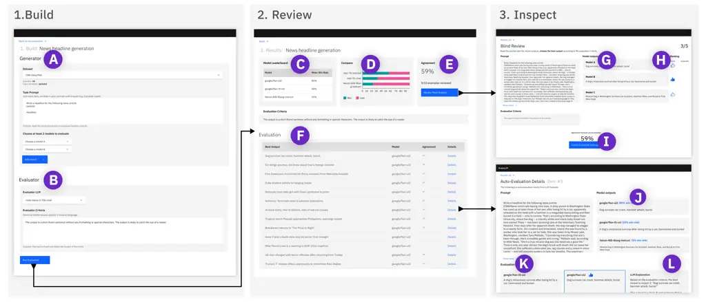
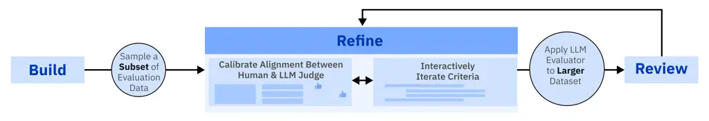
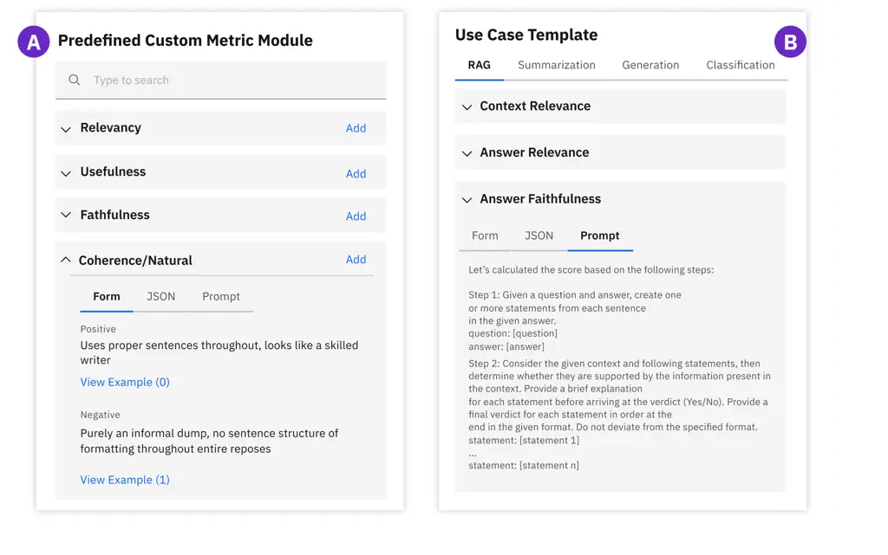
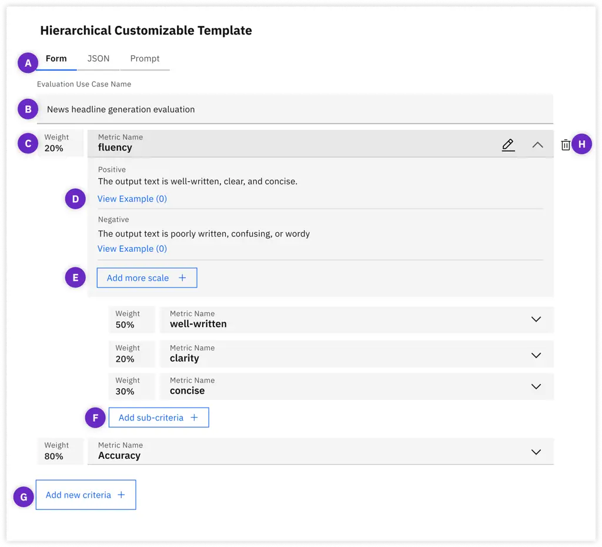
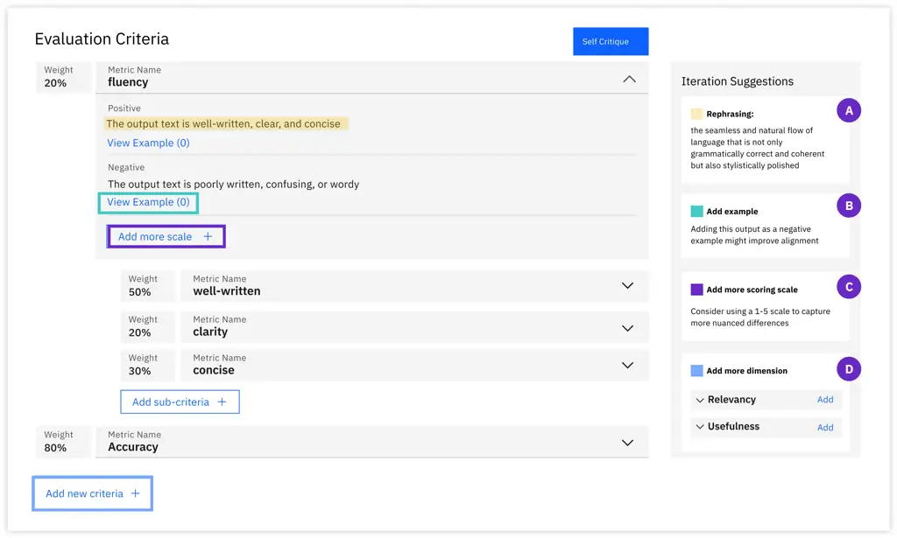
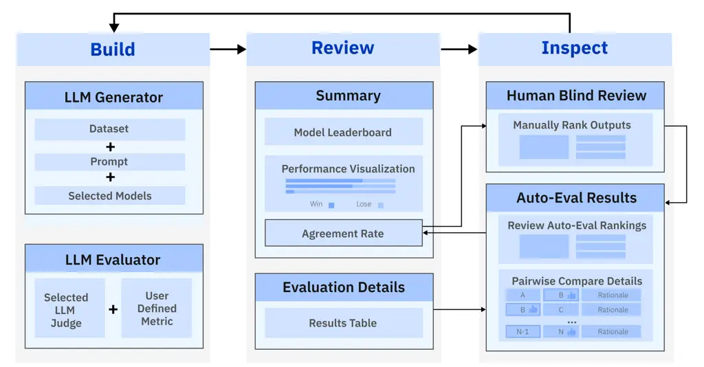

# Human-Centered Design Recommendations for LLM-as-a-Judge

Qian Pan Email: [Qian.Pan@ibm.com](mailto:) Affiliation: IBM Research
Affiliation: Cambridge, MA, USA    Zahra Ashktorab
Email: [zahra.ashktorab1@ibm.com](mailto:) Affiliation: IBM Research
Affiliation: Yorktown Heights, NY, USA    Michael Desmond
Email: [mdesmond@us.ibm.com](mailto:) Affiliation: IBM Research
Affiliation: Yorktown Heights, NY, USA    Martin Santillan Cooper
Email: [msantillancooper@ibm.com](mailto:) Affiliation: IBM Research
Affiliation: Capital Federal, Argentina    James Johnson
Email: [jmjohnson@us.ibm.com](mailto:) Affiliation: IBM Research
Affiliation: Cambridge, MA, USA    Rahul Nair
Email: [rahul.nair@ie.ibm.com](mailto:) Affiliation: IBM Research
Affiliation: Mulhuddart, Dublin, Ireland    Elizabeth Daly
Email: [elizabeth.daly@ie.ibm.com](mailto:) Affiliation: IBM Research
Affiliation: Mulhuddart, Dublin, Ireland    Werner Geyer
Email: [werner.geyer@us.ibm.com](mailto:) Affiliation: IBM Research
Affiliation: Cambridge, MA, USA

###### Abstract

Traditional reference-based metrics, such as BLEU and ROUGE, are less
effective for assessing outputs from Large Language Models (LLMs) that
produce highly creative or superior-quality text, or in situations where
reference outputs are unavailable. While human evaluation remains an
option, it is costly and difficult to scale. Recent work using LLMs as
evaluators (LLM-as-a-judge) is promising, but trust and reliability
remain a significant concern. Integrating human input is crucial to
ensure criteria used to evaluate are aligned with the human’s intent,
and evaluations are robust and consistent. This paper presents a user
study of a design exploration called EvaluLLM, that enables users to
leverage LLMs as customizable judges, promoting human involvement to
balance trust and cost-saving potential with caution. Through interviews
with eight domain experts, we identified the need for assistance in
developing effective evaluation criteria aligning the LLM-as-a-judge
with practitioners’ preferences and expectations. We offer findings and
design recommendations to optimize human-assisted LLM-as-judge systems.

## 1 Introduction

Recent advancements in Large Language Models (LLMs) challenge
traditional methods of assessing natural language generation (NLG)
quality, as known metrics, such as BLEU Papineni et al. (2002) and ROUGE
Lin (2004), fall short for creative tasks. The diverse and expanding
capabilities of LLMs Liang et al. (2022) present a selection challenge
for practitioners, requiring evaluations of extensive outputs across
contexts like summarization and retrieval-augmented generation (RAG).
The subjective and use case-specific nature of emerging NLG tasks often
demands human review, making the evaluation process hard to scale
without suitable automatic metrics. While experts can perform
evaluations, this is costly and impractical for rapid iteration in early
development stages. Gehrmann et al. (2023).

One potential solution to these challenges is to leverage the
capabilities of LLMs to aid in the evaluation process. Despite not
always being accurate, LLMs have the potential to significantly reduce
the workload by identifying outputs where they are not confident, thus
indicating where human input may be required. Additionally, LLMs can
assist practitioners in identifying and customizing criteria specific to
their use case—such as, for example, faithfulness to contextual
information, naturalness of the conversation, and succinctness—with
which they wish to conduct their evaluations. This customization enables
a more targeted and effective assessment of model outputs, tailored to
the specific requirements of their tasks. In this paper, we present
results from a user study of EvaluLLM Desmond et al. (2024), a tool
designed to facilitate the evaluation of model outputs. EvaluLLM
simplifies how practitioners choose LLMs by offering a quick way to
assess and compare their performance across various tasks. This method
accelerates the development of evaluation criteria and helps manage the
growing variety and capabilities of LLMs.

To understand the challenges and user needs in model evaluation that
leverage LLM-as-a-Judge to automate the process, we conducted formative,
semi-structured interviews with 8 practitioners (data scientists,
software engineers, and AI engineers) who have been involved in model
performance evaluation projects over the past year. Our interviews
revealed various challenges and needs. For instance, practitioners
highlighted the necessity for rapid performance comparison across
different setups, the importance of defining evaluation criteria (e.g.,
structured and customizable templates aligned with specific use cases),
and strategies for effectively integrating LLM-as-a-Judge into their
workflow (e.g., starting with a small subset of data before scaling up).
In this paper, we present the following contributions:

- •
  We describe EvaluLLM Desmond et al. (2024), an LLM-Assisted evaluation
  tool that enables users to select multiple models, define custom
  metrics for NLG evaluation, and review the results while providing
  feedback to observe the agreement between human and AI evaluations.
- •
  We present qualitative findings from interviews with domain experts (N
  = 8) revealing challenges and user needs for model evaluation
  workflows including LLM-as-a-judge.
- •
  We make design recommendations and provide example feature designs to
  enable users to define criteria interactively, ensuring transparent
  and rapid access to LLM-as-a-judge’s preferences while balancing
  trade-offs across multiple dimensions in a self-consistent manner.

## 2 Related work

LLMs trained to follow instructions can generate results that surpass
the quality of data produced by humans. This makes it increasingly
challenging to assess the quality of natural language generation (NLG)
outputs Liang et al. (2022) Xiao et al. (2023) Liu et al. (2023b).
Traditional reference-based metrics, such as ROUGE Lin (2004) and BLEU
Papineni et al. (2002), might not effectively capture the essence of LLM
outputs, especially in scenarios where the output space is broad and
varied. This means multiple different outcomes can all be valid, making
it nearly impossible to create sufficiently comprehensive reference
sets. Consequently, these metrics may not be reliable indicators of NLG
output quality, as they often demonstrate a low correlation with human
judgments Freitag et al. (2022).

Recent advances highlight LLMs’ potential as customizable judges, Liu
et al. (2023a) Wang et al. (2023a) Zheng et al. (2023) capable of
adapting to various tasks beyond traditional evaluation methods.
Techniques like G-Eval Liu et al. (2023a) use chain-of-thought prompting
and form-filling to assess NLG quality, while GPTScore Fu et al. (2023)
evaluates using conditional token probabilities, enhancing scoring
granularity. AlpacaEval Li et al. (2023) Yuan et al. (2024) compares
model win rates, and Prometheus Kim et al. (2023a) is a fine-tuned LLM
specifically designed for evaluation tasks. These methods align closely
with human preferences, especially in creative tasks, emphasizing LLMs’
ability to mimic human judgment. Their effectiveness relies on tailored
prompt design and user-defined criteria for precise evaluations. While
not part of this paper, in our own work, we have also done comprehensive
benchmarking of human agreement of different LLM-as-a-judge approaches
for different use cases and we found that depending on use case, LLMs as
judges, and judging approach, we were able to achieve good results. Note
that this is often a hard problem for humans too and inter-rater
reliability can be a good reference.

Previous research has investigated using expert-labeled data to develop
custom evaluation metrics like AUTOCALIBRATE Liu et al. (2023b), but
this method is limited by the availability of such data. For
reference-free evaluations, interactive human involvement is preferable,
allowing users to refine criteria effectively by reviewing outputs.
ConstitutionMaker Petridis et al. (2023) enables feedback on model
outputs to iteratively refine prompts, focusing more on AI prototyping
than evaluation. Other tools like Zeno Cabrera et al. (2023), the
What-If Tool Wexler et al. (2019), and Errudite Wu et al. (2019) help
identify model vulnerabilities by analyzing specific data segments.
EvalLM Kim et al. (2023b) allows users to define criteria interactively,
using LLM-as-a-judges for output ratings, although this can be limited
by LLM reasoning capabilities Zheng et al. (2023). Our study builds on
these insights, proposing a system where practitioners define criteria
in natural language for LLMs to perform pairwise comparisons, enhancing
trust through a "human-in-the-loop" blind review process that eliminates
the need for expert data.

## 3 EvaluLLM

To explore how to support users in developing their own custom
evaluation criteria for accurate and reliable evaluations that align
with human preferences in a trustworthy manner, we designed and deployed
EvaluLLM Desmond et al. (2024). This tool enables users to generate
evaluation outputs by providing a prompt, selecting multiple models, and
defining LLM-as-a-Judge with custom metrics using natural language.
Users can then review the results and provide feedback, inspecting the
agreement between human and AI evaluations through a blind review
process. In this paper, we use EvaluLLM as a conceptual design probe
with users to explore the design space of how to support development of
custom evaluation criteria for accurate and reliable evaluations that
align with human preferences in a trustworthy manner.

The overall user flow of EvaluLLM comprises of three stages (see Figure
1). The build experience focuses on defining the LLM-assisted evaluation
experience to initiate the auto-evaluation process, the review
experience, providing a high-level summary of the evaluation results,
and the inspect experience allows users to manually examine the
generated outputs through a blind review process. The data generated
from this process can be used to calculate the agreement rate, assisting
practitioners in better assessing the agreement between human and
LLM-as-a-judges. This assessment is crucial for calibrating trust and
aids in making informed decisions about whether to change configurations
and rerun the evaluation.

In the absence of reference data, related studies suggest that LLMs may
not be entirely suitable for use as numerical judges Zheng et al.
(2023). This is because grading based on single answers may fail to
detect minor distinctions between specific pairs. Furthermore, the
outcomes could become unreliable, as absolute scores tend to vary more
than relative pairwise results when there are changes in the judging
model Zheng et al. (2023). To mitigate these challenges, EvaluLLM uses a
pairwise comparison approach, as it can reduce the complexity of the
evaluation task by breaking down the comparison of multiple outputs into
smaller decisions between pairs of data which might yield to more
accurate evaluation results at the cost of additional inference
operations. The evaluation method involves making pairwise comparisons
between the outputs of different models, similar to the AlpacaEval
approach Li et al. (2023). However, instead of comparing outputs to a
single reference, they are compared against one another.

Figure 1: EvaluLLM interfaces and key features

### 3.1 Build

The build experience (see Figure 1) includes two major components: the
Generator (Figure 1A) and the Evaluator (Figure 1B). The Generator
section (Figure 1A) is designed to produce evaluation data, supporting
users in selecting a pre-uploaded dataset and inputting their task
prompts. Users can incorporate data variables from the dataset’s
structure into the task prompt using the conventional curly bracket
format. Additionally, the system provides a range of LLMs for users to
choose from for the purpose of performance evaluation. The Evaluator
section (Figure 1B) is where users can choose the LLM-as-a-judge model
for automatic evaluation and specify the custom metrics that the judge
will use to assess the outputs from the generator. This initial version
of EvaluLLM, deliberately provides only a freeform input box to support
maximum creativity, as the aim was to gain more insights into the types
of inputs users would provide to define criteria in natural language and
the kind of support users might need to define custom metrics. Once the
user completes the setup, they can click the "Run Evaluation" button to
initiate the evaluation.

### 3.2 Review

Upon completion of the automatic evaluation, results are available for
review. Users can view a high-level performance summary and a detailed
results table. The summary includes a model leader board (Figure 1C),
ranking selected LLMs by their win rates derived from evaluated output
pairs. The performance visualization (Figure 1D) shows detailed win-loss
statistics for each model based on pairwise comparisons by the
LLM-as-a-judge. Additionally, the agreement rate (Figure 1E) indicates
the alignment between human and LLM-as-judges, helping users gauge the
reliability of evaluations. This feature becomes available after users
manually rate output samples.

### 3.3 Inspect

Users can examine auto-evaluation results through two main methods.
First, users can conduct a blind review, manually inspecting data to
assess the reliability of LLM evaluations (Figure 1G). In this process,
models’ names are hidden to prevent bias, and users select the best
output from all presented outputs. Ratings from this process are used to
calculate an agreement score, which measures alignment between user and
LLM-as-a-judge preferences (Figure 1E, I). After rating, users can view
model identities and the updated agreement score (Figure 1H, I),
providing insight into the effectiveness of the evaluation criteria.
Users can also access detailed results on the review page, which
displays the LLM-as-a-Judge’s aggregated rankings and win rates from
pairwise comparisons (Figure 1J). Evaluation rationales are provided
next to each comparison result (Figure 1L, K), helping users decide
whether to trust the results or adjust settings for a reevaluation.

## 4 Methodology

Our goal was to explore the challenges users encounter during
LLM-assisted model evaluations and, based on our observations, to design
a framework that meets their needs and supports effective collaboration
between humans and LLM-as-a-judges. We used EvaluLLM to facilitate the
creation of evaluation tasks and conducted our research through
semi-structured interviews using Webex. Participants accessed a
prototype of EvaluLLM, shared their screens, and used think-aloud
methods to create evaluation tasks. Each participant worked on the same
task: using an LLM-as-a-judge to identify the best model for generating
headlines from the CNN/Daily Mail dataset.

### 4.1 Participants

We recruited 8 industry professionals (Appendix Table 1) with deep
domain knowledge in model evaluation at a large technology company (2
females and 6 males) via social media recruiting, with participation and
recommendations from various individuals. These industry professionals
primarily consist of data scientists, software engineers, and AI
engineers. Eligible participants were those who had hands-on experience
evaluating large language model performance in their projects in the
past year. The interviews were conducted remotely, and participants
volunteered and consented to the recording of the session, as well as to
the use of the interview results for research purposes.

### 4.2 Data Analysis

Two authors independently reviewed the transcripts from recorded video
sessions to pinpoint users’ needs, system shortcomings, and challenges
in the evaluation workflow. This independent review helped minimize bias
and allowed for a comprehensive data exploration. Each author used a
codebook of example quotes to support the identified themes. The authors
then met to merge similar themes and address any initially missed,
resulting in three main categories: use case challenges, evaluation
criteria, and evaluation workflow, detailed in Appendix Table 2. This
classification captures the complexities of the evaluation process,
encompassing users’ needs, system limitations, and evaluative
challenges.

## 5 Results

Our data analysis identified nine themes, categorized into use case
challenges, evaluation criteria, and evaluation workflow (for a full
list with example quotes see Table 2 in the Appendix).

### 5.1 Use Case Challenges

The system requires users to input a prompt for their specific task,
after which it generates the output and proceeds with the evaluation.
This approach involves sending the identical prompt to various models
for output evaluation. However, this methodology poses limitations for
experienced users who tailor prompts for specific models, such as LLaMA.
Our participants described instances of absence of specifications where
clients lack clarity on the task’s data requirements.

Additionally, there are numerous open-source and closed-source LLM
models available, and users would like to test various setups, e.g.,
model selections, model configurations, and prompts. They would like the
system to support comparison with different setups. Given time
constraints and limited investment resources, it is often impractical to
test all models with their use case data. Teams usually begin with
top-performing models, either from public benchmarks close to their use
case or chosen based on their well-known reputation. Model selection is
transient and highly constrained by project requirements. Instead of
evaluating multiple models’ performance with different prompts, they
typically start with 1-2 models and improve performance through prompt
engineering. This involves running the model with various prompts and
parameter settings, where they often iterate over the setup to match
specific baseline performance. It requires rapid performance comparison
and support for evaluation data, accommodating multiple models and
considering combinations with different setups.

Shifting evaluation priority often occurs as the project progresses. At
the beginning of the project, where the main purpose is often the proof
of concept for a specific proposed solution, the evaluation focus is
mainly around feasibility testing. This involves assessing whether the
proposed system or solution can produce accurate answers. However, as
the project progresses into production, the evaluation purpose might
shift from rapid model performance comparison to continual improvement
with user feedback, performance monitoring, and reporting potential
issues to draw developers’ attentions. As evaluation priorities might
differ for various use cases in different project phases, when designing
an LLM-as-a-Judge solution, shared needs among these different phases
and unique requirements in each phase need to be clearly articulated.
This could help better define and design the experience and interaction
to effectively support the diverse requirements for each phase.

### 5.2 Evaluation Criteria

We identified several themes related to how users developed, changed,
and trusted the evaluation criteria they were working with. While
participants appreciated the flexibility of using the freeform approach
in EvaluLLM, many expressed that they desire structured and customizable
templates for specific use cases that can be tweaked for their purposes.
They believe such templates would help them start with an evaluation
baseline.

Moreover, participants highlighted the necessity of distinct evaluation
criteria for various tasks. For example, they noted that a RAG task
might require one set of criteria, while a creative task might demand
another. Participants often crafted criteria complete with descriptions
and scoring. One typical approach involved naming each criterion,
defining it, and then assigning a score.

Evaluation criteria serve as a medium to communicate user preferences to
the model. An effective criterion not only needs to reflect the user’s
preferences but also must function well to enable the model to
understand and follow instructions. When reflecting on evaluation
criteria, participants expressed the need for multiple rounds of
iterations when refining their criteria. "It can be really hard to
figure out how to express the evaluation criteria in a way that makes
sense to the model. But it can also just be hard in your own mind to
figure out what it means for a title to be good." P2

The importance of giving supporting multiple rounds to refine and expand
criteria emerged when looking at the types of dimensions participants
created. We found that users tend to prioritize more objective metrics
such as accuracy before they start to consider the styling of the
outcome. At the beginning of the project, the primary concern for a
client is getting the correct answer from the model. That is not to say,
that our participants did not care about more subjective criteria, but
that happens later in the process.

Although users might have a rough idea of what they want, it is
challenging to describe everything at the beginning, especially when
they don’t have access to the evaluation data. One participant struggled
during the criteria definition process as he was required to define the
criteria before he could see the output data. Providing the output might
help users articulate what they want or don’t want, assisting them in
iterating the criteria description or adding examples to better align
with their preferences.

Users express a desire for more than just a high-level result summary;
they are keen on obtaining a detailed breakdown of each dimension and a
need for the system to display performance for each criteria
individually. EvaluLLM currently only presents a win rate as a
high-level performance summary metric to showcase the winning model on
the leaderboard. Participants expressed the desire to view performance
across each dimension rather than a high level win-rate.

### 5.3 Evaluation Workflow

While presenting the tool to users, we probed them on their current
evaluation workflows and how they would imagine incorporating EvaluLLM.
Users expressed the challenges they faced when doing manual evaluations
and how they would use automated methods and the EvaluLLM experience to
address those challenges. Although there are only 10 examples in our
testing dataset, generating the evaluation results after user created
the evaluation is time consuming because of calls to the model. Model
calls are expensive and time consuming and one potential way to address
this is to run the evaluation on a subset of the data first.

To evaluate the agreement of the LLM-as-a-Judge preferences with humans,
participants were asked to conduct blind reviews of the model’s output.
These reviews would be utilized to calculate the agreement between the
LLM-as-a-judge and the participants. While it is beneficial to observe
the agreement rate in the summary page, users also desire more control
over the workflow and seek instant feedback during the manual review
process. They would like to see how much the LLM-as-a-judge agrees with
them once they provide feedback and wish for the system to proactively
provide criteria modification suggestions. One way of providing instant
feedback on human-AI agreement is to allow users to either initially
upload human evaluations for comparison with the automatic evaluations.
Another way is to conduct a blind review before the evaluations are
presented, ensuring that users receive instant feedback on human-AI
agreement as soon as the evaluations are ready.

During testing, we observed that some participants might provide overly
detailed instructions for both the task prompt and the evaluation
criteria. The design intention was to simplify the user input
requirements, seeking only the evaluation criteria rather than a
complete evaluation prompt with detailed evaluation process. However,
some participants included the step-by-step evaluation process in the
criteria definition input. Additionally, some participants inquired
about adjusting their evaluations per judge.

As our participants are domain experts in model evaluation, they are
well aware of potential biases in the model. They actively seek
transparency regarding the bias mitigation strategy to effectively
calibrate their trust in LLM-as-a-Judge results. Additionally,
participants were cognizant of self-enhancement bias Zheng et al. (2023)
and expressed concerns about the LLM-as-a-judge being one of the models
to be evaluated. Ensuring transparency for trustworthy evaluation was
deemed crucial by users, such as transparency concerning the prompts
sent to the judge and whether bias mitigation has been implemented. One
user remarked, "It seems like Granite always displays first, and
Flan-UL-2 always comes second. Does the system randomly switch
positions?" P5

### 5.4 Limitations

Our study is based on a small sample of only 8 domain experts,
potentially impacting the generalizability of our findings. In addition,
our methodology primarily concentrated on observing users utilizing our
specific evaluation tool with one pre-defined dataset. This approach may
restrict the broader applicability of our results. Note that EvaluLLM at
the time of this study was a functioning proof-of-concept but not yet a
scalable systems that can be deployed to a large user population.
However, we believe our findings still offer relevant insights into the
challenges and needs users encounter when using LLM-as-a-Judge tools, as
evidenced by our focused line of questioning aimed at understanding how
more automated evaluations integrate into users’ workflows.

## 6 Discussion and Design Recommendations

Our findings highlight user needs across different use cases when using
LLM-as-a-judge. Users require guidance to evaluate model outputs
effectively. We discuss the implications of our findings and propose
design recommendations for LLM-as-a-judge tools and user experiences.

Figure 2: Recommended evaluation workflow: interactive refinement of
criteria with a subset of data prior to applying evaluation to entire
dataset can potentially improve preference alignment and trust
calibration.

### 6.1 Efficient Criteria Iteration

LLMs can generate high-quality outputs aligned with human preferences,
but processing the entire dataset is costly and time-consuming,
especially with methods like pairwise comparisons, which increase
compute costs significantly. To optimize efficiency, it’s advisable to
start a project by allowing users to refine their evaluation criteria
using a representative data sample before scaling up to the full dataset
(see Figure 2). Effective sampling enhances learning for LLM-as-a-Judge
by selecting diverse and representative outputs. Techniques like
clustering Chang et al. (2021) or graph-based search Su et al. (2022)
can aid in output selection for human evaluation. Addressing
misalignments and manually reviewing low-confidence outputs Desmond
et al. (2021) are crucial, as is displaying a subset of evaluations to
lessen users’ cognitive load and facilitate iterative refinement of
evaluation criteria.

### 6.2 Structured and Customizable Templates

For creative generation tasks, it’s crucial to employ diverse, custom
criteria. To streamline this process, we propose providing standard
criteria that are universally applicable across various use cases,
supplemented by customizable templates. As illustrated in our design
explorations (see Appendix Figure 3), users can select from predefined
criteria dimensions (Figure 3A) or utilize recommended templates for
common scenarios (Figure 3B). These templates are designed to be
flexible, allowing easy adaptation to specific user needs.

Further enhancing customization, the proposed templates support
hierarchical organization (see Appendix Figure 4), enabling the addition
of new criteria dimensions (Figure 4G), nesting of sub-criteria (Figure
4F), and removal of unwanted elements (Figure 4H). Users can also adjust
scoring scales (Figure 4E). This hierarchical structure, supported by
findings from related works Zheng et al. (2023) Kim et al. (2023c)
Stureborg et al. (2023), allows users to start with broad criteria and
refine them to capture specific task nuances. To foster ongoing
improvement and reuse, the system should enable users to save and share
these templates (Figure 4B). Considering the benefits of balanced
evaluations, users should be able to adjust the weight of different
criteria dimensions, aligning more closely with human preferences. The
inclusion of reference examples within the templates (Figure 4D) can
further refine the criteria based on actual output data, enhancing the
preference agreement process. This approach not only makes the criteria
definition process more efficient but also ensures consistency and rigor
in evaluating creative tasks, leading to more accurate and effective
assessments.

Providing structured and customizable templates will not only expedite
the process of criteria definition but also foster consistency and rigor
in the evaluation of creative generation tasks, which will contribute to
more accurate and effective evaluations.

### 6.3 Interactive Criteria Iteration

Our findings revealed crafting effective criteria typically requires
multiple iterations. Criteria components such as name, definition,
scale, and examples often need definition and refinement as users
evaluate outputs. Users include examples of both poor and excellent
outputs to help LLM-as-Judges distinguish quality through few-shot
learning techniques. Related work Kim et al. (2023c) indicates that
users often develop new criteria during evaluations. To facilitate this
process, a real-time feedback system that allows users to immediately
see the impact of criteria modifications would be useful. Additionally,
a user-friendly interface that enables easy modification and
experimentation with criteria could significantly improve the efficiency
and customization of the evaluation process.

### 6.4 Ensure Consistency

As human preferences may not be consistent within the same set, aligning
with frequently changing preferences becomes a challenge. A
self-consistency check mechanism can expedite this alignment. When
refining criteria, any discrepancies between human and LLM-as-a-Judge
evaluations should prompt a review of similar sample data
post-calibration. Incorporating an automated consistency checker that
flags potential criteria conflicts or inconsistencies could streamline
the evaluation process by offering actionable solutions to address these
inconsistencies. Leveraging the diversity of logical paths in complex
reasoning tasks, as suggested by recent studies Stanovich and West
(2000), the self-consistency CoT method Wang et al. (2023b) can generate
multiple reasoning paths, selecting the most consistent answers by
averaging over these paths, thus improving evaluation outcomes.

### 6.5 Support Different Setups

Our findings emphasize the need for an LLM to function flexibly as a
judging system throughout different project phases. It should support a
variety of evaluation data configurations, including diverse model
selections, prompts, and settings. While some evaluations may only
compare outputs from a specific prompt and model setting, optimal
performance often requires tailored prompts and settings for each model,
involving substantial prompt engineering and comparison of different
configurations. Thus, the system must not only evaluate common settings
across various models but also assess various prompts and settings for
select models, highlighting the importance of designing an adaptable LLM
judging system.

### 6.6 Adaptable Reference-Based Evaluation

Our user study findings showed that users often start projects without
clear objectives, resulting in evaluations lacking reference data. Users
interacting with the LLM-as-a-Judge system gradually accumulate
reference data, either directly or from external sources, so it could be
beneficial to design systems that incorporate human input to refine
preference correspondence using expert-labeled data Liu et al. (2023b)
or other collected references. This flexible approach enhances the
system’s effectiveness and trustworthiness, ensuring it evolves in line
with user preferences.

### 6.7 Enhance System Transparency

Our findings indicate that users value transparency to comprehend the
LLM’s role as a judge. This encompasses access to essential details like
the specific prompt used (illustrated in Figure 5A) and the
implementation of bias mitigation strategies. To design an effective
LLM-as-a-Judge system, it is critical to make such information readily
available. This can be facilitated by allowing users to view the prompt,
enabling the system to explain evaluation results, and integrating
visualization tools that demonstrate how user inputs affect the
evaluation process.

### 6.8 Proactively Mitigate Potential Bias

Considering the persistent challenge of bias, systems should implement
bias mitigation strategies that include swapping answer order to reduce
position bias Zheng et al. (2023) and treating inconsistent results as
ties, or by randomly assigning positions in large datasets Li et al.
(2023) Zheng et al. (2023). For verbosity bias, the "repetitive list"
attack technique Zheng et al. (2023) challenges LLMs to favor clarity
over length in responses. Furthermore, enhancing LLMs’ abilities in
mathematical and reasoning tasks can be achieved through
Chain-of-Thought approaches Wei et al. (2022), coupled with
reference-guided evaluation where the LLM generates and then evaluates
its own initial responses.

### 6.9 Explore Further Automation

Our study found that task prompts often contain criteria, suggesting the
possibility of extracting them automatically for tailored guidelines.
Related work also shows that users prefer automated prompt refinement
over manual revisions Kim et al. (2023c). Various suggestions(see
Appendix Figure 5), such as rephrasing (Figure 5A), adding reference
examples (Figure 5B), incorporating more scales (Figure 5C), and
introducing additional dimensions (Figure 5D), could be proactively
provided by the system for humans to review to further accelerate
evaluation correspondence. While these areas show promise for further
improving the efficiency of preference correspondence, considering the
limitations of automation systems, it is essential to place humans in
the loop to calibrate accuracy and trustworthiness.

## 7 Conclusion

We studied EvaluLLM, an AI-assisted tool utilizing LLMs alongside humans
as judges for LLM-generated content. Our findings highlight the
potential of LLMs as customizable judges and underscore the importance
of interactive, transparent, and user-centered evaluation processes.
Based on our findings, we offer design suggestions for practitioners
that can help them build more effective , nuanced, adaptable, and
user-friendly evaluation tools that meet diverse needs as compared to
automated benchmarks. Inspired by our user research, we are currently in
the process of rolling out an evolved AI-assisted evaluation tool to a
larger user population to observe "usage in the wild."

## References

- Cabrera et al. (2023) Ángel Alexander Cabrera, Erica Fu, Donald
  Bertucci, Kenneth Holstein, Ameet Talwalkar, Jason I Hong, and Adam
  Perer. 2023. Zeno: An interactive framework for behavioral evaluation
  of machine learning. In _Proceedings of the 2023 CHI Conference on
  Human Factors in Computing Systems_, pages 1–14.
- Chang et al. (2021) Ernie Chang, Xiaoyu Shen, Hui-Syuan Yeh, and Vera
  Demberg. 2021. On training instance selection for few-shot neural text
  generation. _arXiv preprint arXiv:2107.03176_.
- Desmond et al. (2024) Michael Desmond, Zahra Ashktorab, Qian Pan,
  Casey Dugan, and James M. Johnson. 2024. [Evalullm: Llm assisted
  evaluation of generative
  outputs](https://doi.org/10.1145/3640544.3645216). In _Companion
  Proceedings of the 29th International Conference on Intelligent User
  Interfaces_, IUI ’24 Companion, page 30–32, New York, NY, USA.
  Association for Computing Machinery.
- Desmond et al. (2021) Michael Desmond, Evelyn Duesterwald, Kristina
  Brimijoin, Michelle Brachman, and Qian Pan. 2021. Semi-automated data
  labeling. In _NeurIPS 2020 Competition and Demonstration Track_, pages
  156–169. PMLR.
- Freitag et al. (2022) Markus Freitag, Ricardo Rei, Nitika Mathur,
  Chi-kiu Lo, Craig Stewart, Eleftherios Avramidis, Tom Kocmi, George
  Foster, Alon Lavie, and André FT Martins. 2022. Results of wmt22
  metrics shared task: Stop using bleu–neural metrics are better and
  more robust. In _Proceedings of the Seventh Conference on Machine
  Translation (WMT)_, pages 46–68.
- Fu et al. (2023) Jinlan Fu, See-Kiong Ng, Zhengbao Jiang, and Pengfei
  Liu. 2023. Gptscore: Evaluate as you desire. _arXiv preprint
  arXiv:2302.04166_.
- Gehrmann et al. (2023) Sebastian Gehrmann, Elizabeth Clark, and
  Thibault Sellam. 2023. Repairing the cracked foundation: A survey of
  obstacles in evaluation practices for generated text. _Journal of
  Artificial Intelligence Research_, 77:103–166.
- Kim et al. (2023a) Seungone Kim, Jamin Shin, Yejin Cho, Joel Jang,
  Shayne Longpre, Hwaran Lee, Sangdoo Yun, Seongjin Shin, Sungdong Kim,
  James Thorne, et al. 2023a. Prometheus: Inducing fine-grained
  evaluation capability in language models. _arXiv preprint
  arXiv:2310.08491_.
- Kim et al. (2023b) Tae Soo Kim, Yoonjoo Lee, Jamin Shin, Young-Ho Kim,
  and Juho Kim. 2023b. Evallm: Interactive evaluation of large language
  model prompts on user-defined criteria. _arXiv preprint
  arXiv:2309.13633_.
- Kim et al. (2023c) Tae Soo Kim, Yoonjoo Lee, Jamin Shin, Young-Ho Kim,
  and Juho Kim. 2023c. Evallm: Interactive evaluation of large language
  model prompts on user-defined criteria. In _arXiv preprint
  arXiv:2309.13633_.
- Li et al. (2023) Xuechen Li, Tianyi Zhang, Yann Dubois, Rohan Taori,
  Ishaan Gulrajani, Carlos Guestrin, Percy Liang, and Tatsunori B
  Hashimoto. 2023. Alpacaeval: An automatic evaluator of
  instruction-following models. _GitHub repository_.
- Liang et al. (2022) Percy Liang, Rishi Bommasani, Tony Lee, Dimitris
  Tsipras, Dilara Soylu, Michihiro Yasunaga, Yian Zhang, Deepak
  Narayanan, Yuhuai Wu, Ananya Kumar, et al. 2022. Holistic evaluation
  of language models. _arXiv preprint arXiv:2211.09110_.
- Lin (2004) Chin-Yew Lin. 2004. Rouge: A package for automatic
  evaluation of summaries. In _Text summarization branches out_, pages
  74–81.
- Liu et al. (2023a) Yang Liu, Dan Iter, Yichong Xu, Shuohang Wang,
  Ruochen Xu, and Chenguang Zhu. 2023a. Gpteval: Nlg evaluation using
  gpt-4 with better human alignment. _arXiv preprint arXiv:2303.16634_.
- Liu et al. (2023b) Yuxuan Liu, Tianchi Yang, Shaohan Huang, Zihan
  Zhang, Haizhen Huang, Furu Wei, Weiwei Deng, Feng Sun, and Qi Zhang.
  2023b. Calibrating llm-based evaluator. _arXiv preprint
  arXiv:2309.13308_.
- Papineni et al. (2002) Kishore Papineni, Salim Roukos, Todd Ward, and
  Wei-Jing Zhu. 2002. Bleu: a method for automatic evaluation of machine
  translation. In _Proceedings of the 40th annual meeting of the
  Association for Computational Linguistics_, pages 311–318.
- Petridis et al. (2023) Savvas Petridis, Ben Wedin, James Wexler, Aaron
  Donsbach, Mahima Pushkarna, Nitesh Goyal, Carrie J Cai, and Michael
  Terry. 2023. Constitutionmaker: Interactively critiquing large
  language models by converting feedback into principles. _arXiv
  preprint arXiv:2310.15428_.
- Stanovich and West (2000) Keith E. Stanovich and Richard F.
  West. 2000. [Advancing the rationality
  debate](https://doi.org/10.1017/S0140525X00623439). _Behavioral and
  Brain Sciences_, 23(5):701–717.
- Stureborg et al. (2023) Rickard Stureborg, Bhuwan Dhingra, and Jun
  Yang. 2023. Interface design for crowdsourcing hierarchical
  multi-label text annotations. In _Proceedings of the 2023 CHI
  Conference on Human Factors in Computing Systems_, pages 1–17.
- Su et al. (2022) Hongjin Su, Jungo Kasai, Chen Henry Wu, Weijia Shi,
  Tianlu Wang, Jiayi Xin, Rui Zhang, Mari Ostendorf, Luke Zettlemoyer,
  Noah A. Smith, and Tao Yu. 2022. [Selective annotation makes language
  models better few-shot learners](https://arxiv.org/abs/2209.01975).
  _Preprint_, arXiv:2209.01975.
- Wang et al. (2023a) Jiaan Wang, Yunlong Liang, Fandong Meng, Haoxiang
  Shi, Zhixu Li, Jinan Xu, Jianfeng Qu, and Jie Zhou. 2023a. Is chatgpt
  a good nlg evaluator? a preliminary study. _arXiv preprint
  arXiv:2303.04048_.
- Wang et al. (2023b) Xuezhi Wang, Jason Wei, Dale Schuurmans, Quoc Le,
  Ed Chi, Sharan Narang, Aakanksha Chowdhery, and Denny Zhou. 2023b.
  [Self-consistency improves chain of thought reasoning in language
  models](https://arxiv.org/abs/2203.11171). _Preprint_,
  arXiv:2203.11171.
- Wei et al. (2022) Jason Wei, Xuezhi Wang, Dale Schuurmans, Maarten
  Bosma, Fei Xia, Ed Chi, Quoc V Le, Denny Zhou, et al. 2022.
  Chain-of-thought prompting elicits reasoning in large language models.
  _Advances in Neural Information Processing Systems_, 35:24824–24837.
- Wexler et al. (2019) James Wexler, Mahima Pushkarna, Tolga Bolukbasi,
  Martin Wattenberg, Fernanda Viégas, and Jimbo Wilson. 2019. The
  what-if tool: Interactive probing of machine learning models. _IEEE
  transactions on visualization and computer graphics_, 26(1):56–65.
- Wu et al. (2019) Tongshuang Wu, Marco Tulio Ribeiro, Jeffrey Heer, and
  Daniel S Weld. 2019. Errudite: Scalable, reproducible, and testable
  error analysis. In _Proceedings of the 57th Annual Meeting of the
  Association for Computational Linguistics_, pages 747–763.
- Xiao et al. (2023) Ziang Xiao, Susu Zhang, Vivian Lai, and Q Vera
  Liao. 2023. Evaluating nlg evaluation metrics: A measurement theory
  perspective. _arXiv preprint arXiv:2305.14889_.
- Yuan et al. (2024) Weizhe Yuan, Richard Yuanzhe Pang, Kyunghyun Cho,
  Sainbayar Sukhbaatar, Jing Xu, and Jason Weston. 2024. Self-rewarding
  language models. _arXiv preprint arXiv:2401.10020_.
- Zheng et al. (2023) Lianmin Zheng, Wei-Lin Chiang, Ying Sheng, Siyuan
  Zhuang, Zhanghao Wu, Yonghao Zhuang, Zi Lin, Zhuohan Li, Dacheng Li,
  Eric Xing, et al. 2023. Judging llm-as-a-judge with mt-bench and
  chatbot arena. _arXiv preprint arXiv:2306.05685_.

## Appendix A Participant Information

Table 1 shows the details of participants involved in the user study,
predominantly comprising of industry experts such as data scientists,
software engineers, and AI engineers. These professionals have practical
experience in evaluating the performance of large language models in
their projects over the last year.

| ID  | Gender | Job Role                                |
| --- | ------ | --------------------------------------- |
| P1  | Male   | Lead Software Engineer/Data Scientist   |
| P2  | Male   | Principle Data Scientist                |
| P3  | Male   | Lead Software Engineer/Data Scientist   |
| P4  | Male   | Data Scientist                          |
| P5  | Male   | AI Engineer/Data Scientist              |
| P6  | Female | Data Scientist                          |
| P7  | Male   | Senior Technical Manager/Data Scientist |
| P8  | Female | Data Scientist                          |

Table 1: Demographic information from participants in our user study.

## Appendix B Summary of Evaluation Themes and Examples

Table 2 provides further details on evaluation themes generated from the
user study, along with corresponding examples from participants’ quotes.

| Group               | Theme                                              | Example                                                                                                                                                                                                                                                                                                     |
| ------------------- | -------------------------------------------------- | ----------------------------------------------------------------------------------------------------------------------------------------------------------------------------------------------------------------------------------------------------------------------------------------------------------- |
| Use Case Challenges | Absence of Specifications                          | “So we can compare using, metrics such as or BLEU, And this is like this other scenario, which unfortunately is more common, which is client doesn’t even know what they want.” - P5                                                                                                                        |
|                     |                                                    |                                                                                                                                                                                                                                                                                                             |
|                     |                                                    | “It was like eighty-twenty, eighty percent of the time they don’t have it.” - P5                                                                                                                                                                                                                            |
|                     |                                                    |                                                                                                                                                                                                                                                                                                             |
|                     | Support Comparison with Different Setup            | “Say we had five different models and for each model we had 20 different configurations or something like that. Now that’s 100 different combinations. Um, we’d like the limited judge to be to run on like all hundred. Give us an overview. Which are the three that are actually worth looking at?” - P2 |
|                     |                                                    |                                                                                                                                                                                                                                                                                                             |
|                     |                                                    | “GPT 4 as a baseline and we’re just trying to see how close are we getting with these other models in order to replicate the performance.” - P7                                                                                                                                                             |
|                     |                                                    |                                                                                                                                                                                                                                                                                                             |
|                     | Shifting Evaluation Priority                       | “I know that’s like a terrible metric \[confusion matrix\] to be used as the first one, but we have actually done this with a client because they asked us to do so. They’re looking for just accuracy.” - P5                                                                                               |
|                     |                                                    |                                                                                                                                                                                                                                                                                                             |
|                     |                                                    | “GPT 4 as a baseline and we’re just trying to see how close are we getting with these other models in order to replicate the performance.” - P7                                                                                                                                                             |
|                     |                                                    |                                                                                                                                                                                                                                                                                                             |
| Evaluation Criteria | Desire Structured and Customizable Templates       | “A freeform text box is too simple. I would love there to be templates that I can utilize. And at the very least, be able to just edit so that I can get into my use case.” - P7                                                                                                                            |
|                     |                                                    |                                                                                                                                                                                                                                                                                                             |
|                     |                                                    | “More examples might be nice.” - P2                                                                                                                                                                                                                                                                         |
|                     |                                                    |                                                                                                                                                                                                                                                                                                             |
|                     | Need for Multiple Rounds of Iterations             | “It can be really hard to figure out how to express the evaluation criteria in a way that makes sense to the model. But it can also just be hard in your own mind to figure out what it means for a title to be good.” - P2                                                                                 |
|                     |                                                    |                                                                                                                                                                                                                                                                                                             |
|                     |                                                    | “If I think, without having a clearer sense of what the evaluation is, sort of what a baseline evaluation is, it might be nice to have a couple of features of an evaluation that we could just select in like a checkbox. ” - P3                                                                           |
|                     |                                                    |                                                                                                                                                                                                                                                                                                             |
|                     | Display Performance for each Criteria Individually | ”There might be times where you have to trade off on certain kinds of things and Win rate is not necessarily the best metric because there are multiple categories to define what it means to win.” - P7                                                                                                    |
|                     |                                                    |                                                                                                                                                                                                                                                                                                             |
|                     |                                                    | “So I’m covering a lot of ground there, and I know that’s hard for the model to deal with because now the model has to have a whole lot of different criteria, and it’s all drawn up by the ones, but that’s kind of what a good title headline is about.” - P7                                             |
|                     |                                                    |                                                                                                                                                                                                                                                                                                             |
| Evaluation Workflow | Run Evaluation on Subset of Data First             | “We don’t have a problem here because the data set is small. But, like, if there’s like, a 1000. Then it would it make sense to go through the entire batch and we find out your volume criteria needs to be tweaked.” - P2                                                                                 |
|                     |                                                    |                                                                                                                                                                                                                                                                                                             |
|                     |                                                    | “I’d want to iterate on my judge enough for it to get a decent annotator agreement and then let it go wild.” - P2                                                                                                                                                                                           |
|                     |                                                    |                                                                                                                                                                                                                                                                                                             |
|                     | Instant Feedback on Human-AI agreement             | “Tell me when to quit.” -P1                                                                                                                                                                                                                                                                                 |
|                     |                                                    |                                                                                                                                                                                                                                                                                                             |
|                     | Ensuring Transparency for Trustworthy Evaluation   | “So I definitely want, as we discussed earlier, a lot of transparency and exactly what is being sent to the models to generate the responses and then what is then being sent to the LLM as a judge.” - P2                                                                                                  |
|                     |                                                    |                                                                                                                                                                                                                                                                                                             |
|                     |                                                    | “Maybe a small note on, like, you know what the prompt is, like, what the data set is and what the tool is doing.” - P8                                                                                                                                                                                     |

Table 2: Table of evaluation themes and corresponding examples. Themes
are grouped into three categories: use case challenges, evaluation
criteria, and evaluation workflow. Quotes are provided to delineate
themes.

## Appendix C Recommended Designs

Figure (3)(4)(5) show design examples to help illustrate corresponding
design recommendations.

Figure 3: Recommended design to (A) enable users to choose from a list
of predefined custom metric modules and (B) enable users to create a set
of evaluation criteria based on common use cases.

Figure 4: Recommended design to provide structured and customizable
templates that support hierarchical, multi-dimensional evaluations.

Figure 5: Recommended design demonstrating the ability of users to
leverage LLM-as-a-Judge for Criteria Iteration.

## Appendix D EvaluLLM Evaluation Workflow

Figure (6) shows the high-level overview of the EvaluLLM workflow, which
consists of a Build, Review, and Inspect process.

Figure 6: EvaluLLM evaluation workflow overview which consists of a
Build, Review, and Inspect process.
