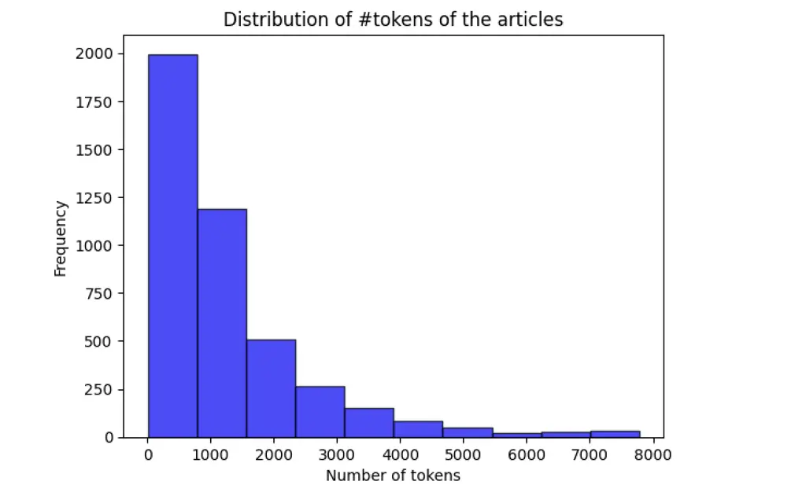
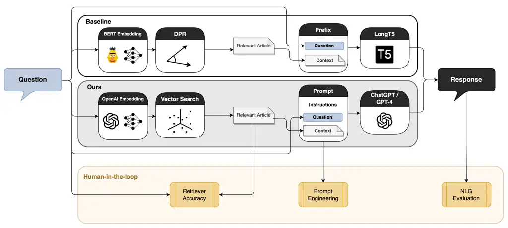

# Towards Optimizing and Evaluating a Retrieval Augmented QA Chatbot using LLMs with Human-in-the-Loop

Anum Afzal    Alexander Kowsik    Rajna Fani    Florian Matthes
Affiliation: School of Computation, Information and Technology
Affiliation: Technical University of Munich Affiliation:  {anum.afzal,
alexander.kowsik, rajna.fani, matthes}@tum.de

###### Abstract

Large Language Models have found application in various mundane and
repetitive tasks including Human Resource (HR) support. We worked with
the domain experts of SAP SE to develop an HR support chatbot as an
efficient and effective tool for addressing employee inquiries. We
inserted a human-in-the-loop in various parts of the development cycles
such as dataset collection, prompt optimization, and evaluation of
generated output. By enhancing the LLM-driven chatbot’s response quality
and exploring alternative retrieval methods, we have created an
efficient, scalable, and flexible tool for HR professionals to address
employee inquiries effectively. Our experiments and evaluation conclude
that GPT-4 outperforms other models and can overcome inconsistencies in
data through internal reasoning capabilities. Additionally, through
expert analysis, we infer that reference-free evaluation metrics such as
G-Eval and Prometheus demonstrate reliability closely aligned with that
of human evaluation.

## 1 Introduction

In recent years, incorporating Artificial Intelligence (AI) into various
sectors has led to significant improvements in automated systems,
particularly in customer service and support. Since the offset of Large
Language Models (LLMs), more companies are now incorporating Natural
Language Processing (NLP) techniques to minimize the need for human
support personnel, especially domain experts Shuster et al. (2021). With
a chatbot providing accurate and comprehensive responses promptly,
domain experts can redirect their focus towards higher-value tasks,
leading to potential cost savings and improved productivity within the
HR department. Moreover, an effective chatbot can play a pivotal role in
enhancing overall employee satisfaction and engagement by delivering
timely and relevant assistance.

To this end, we worked with a SAP SE on developing an HR chatbot to
evaluate the potential of LLMs on industrial data. We used domain
experts as a human-in-the-loop through various iterations of LLM-centric
development such as dataset collection, prompt optimization, and most
importantly the evaluation of model outputs.

The well-known Retrieval Augmented Generation (RAG) Lewis et al. (2021)
approach is ideal for this use case as it allows the model to produce
more grounded answers, hence reducing hallucinations. We optimized
different modules of the standard RAG pipeline such as the retriever and
model prompts, while constantly incorporating feedback from the domain
experts. While the retrieval accuracy of an LLM could still be assessed
to a degree, the generative nature of LLMs makes evaluation of the
generated output quite challenging. To overcome this, we explored the
effectiveness of both traditional reference-based and reference-free
(LLM-based) automatic evaluation metrics while using human evaluation as
a baseline.

We benchmark OpenAI’s models in our experiments while using the
open-source LongT5 Guo et al. (2022) and BERT Devlin et al. (2019) as a
baseline. In essence, both the industry and the research community could
benefit from our findings related to the retriever and the reliability
of automatic evaluation metrics.

## 2 Corpus

The dataset used in the development of the HR chatbot was compiled using
SAP’s internal HR policies with the help of domain experts. While each
sample forms a triplet consisting of a Question, Answer, and Context,
additional metadata such as the user’s region, company, employment
status, and applicable company policies were also included. A snippet of
such a sample is shown in Appendix A.4. The dataset was compiled using
two separate sources to have a mix of a gold dataset (FAQ dataset) and a
user-utterance dataset (UT dataset). Both datasets follow the same
structure and differences exist in the distribution of the questions. We
extracted all unique HR articles to form a knowledge base for answering
new user questions. Additionally, an evaluation set of 6k samples was
used to evaluate both the retriever and the chatbot as a whole.

### 2.1 Dataset Collection

FAQ Dataset (N$`\approx`$48k): This is a collection of potential
questions, along with their corresponding articles and gold-standard
answers. It is carefully created and curated by domain experts based on
the company’s internal policies.

UT Dataset (N$`\approx`$41k): This is a collection of real user
utterances (UT) gathered from previous iterations of the chatbot.
Inspired by a semi-supervised learning approach, a simplistic
text-matching approach was implemented that mapped each user query to a
question from the FAQ dataset. The chatbot logs from this development
cycle were inspected and corrected by the domain experts.

### 2.2 Dataset Statistics

Figure 1 shows that the majority of the articles in our dataset have
under 4k tokens. Hence, they can easily fit into the context window of
OpenAI models. As displayed in Table 1, the most asked questions in the
dataset revolve around payslips, leave days of any kind, and questions
regarding management.

| 10 most frequent user queries                                |
| ------------------------------------------------------------ |
| How can I change my approver?                                |
| Where do I see how much leave I have left?                   |
| How can I view my payslip online?                            |
| Am I paid during maternity leave?                            |
| If I am sick whilst on holiday, can I claim my holiday back? |
| Can I cancel a leave request?                                |
| I have a question about my payslip, who do I contact?        |
| Where can I find information about my payslip?               |
| Do I receive sick pay?                                       |
| How can I have an overview of my leave?                      |

Table 1: Top 10 most frequent user queries

Figure 1: Distribution over the number of tokens of all unique articles
in our HR dataset.

## 3 Methodology

In general, the HR chatbot follows the standard RAG pipeline with
optimizations done on individual modules with the help of domain experts
as shown in Figure 2. The methodology illustrates various parts of the
chatbot pipeline that are influenced by a human-in-the-loop and is
further discussed in Appendix B.

Figure 2: Block diagram of the methodology introduced in our paper,
illustrating baseline and Open AI models, highlighting the role of the
human-in-the-loop during development

### 3.1 Retriever

We compiled a comprehensive knowledge base of all possible HR articles
occurring in the whole dataset as the basis for retrieval, resulting in
roughly 50k unique articles. Given a user utterance, the goal of the
retriever is to find the most relevant article from the collection.
While the technical details for each retriever may differ, in general,
they are both embedding-based. Technical details of the Retriever module
are discussed in Appendix D.1.

Moreover, we developed extensive filter functionalities, ensuring that
the vector search only considers articles relevant to the user, like
their country, region, or employment status as shown in Table 4. For
example, from the top retrieved articles, we filter them to only keep
the ones that are applicable to the employee and then pick the article
with the maximum similarity score from the filtered list.

#### 3.1.1 Dense Passage Retriever (BERT)

Dense Passage Retriever (DPR) fine-tunes bert-base-uncased embedding to
generate a model that given a user query, retrieves the most relevant
article from a set of documents. The dataset used for training was
processed to contain questions paired with their respective gold
answers, as well as positive and negative contexts for each question. A
triplet loss function Hoffer and Ailon (2018) was used for training such
that the relevant article served as the positive context, with two
random articles from the entire dataset providing the negative contexts.
This retriever is used in the framework with the fine-tuned LongT5 model
and also serves as a baseline for evaluating the OpenAI retriever.

#### 3.1.2 Vector Search (OpenAI)

The OpenAI Retriever is plain vector search, that utilizes the
text-embedding-ada-002 embedding model by OpenAI to generate embeddings
for each article, followed by using similarity search to find the
relevant article. To further enhance retrieval accuracy, we implemented
various Query Transformation techniques¹¹ 1
[https://docs.llamaindex.ai/en/stable/optimizing/advanced_retrieval/query_transformations/](https://docs.llamaindex.ai/en/stable/optimizing/advanced_retrieval/query_transformations/)
Cormack et al. (2009a). These methods alter the user query into a
different representation using LLMs before the embedding model computes
the query vector. The following three query transformation methods were
explored and evaluated:

1. Intended Topics: Inspired by Ma et al. (2023), the user question is
   sent to an LLM with the instruction to return a list of three intended
   topics of the question, which are then embedded instead of the user
   question.

Example: How to request a parental leave?  
$`\rightarrow`$ parental leave, childcare leave, maternity leave

2. HyDE (Hypothetical Document Embeddings): In this method introduced by
   Gao et al. (2022), the user question is transformed by an LLM into three
   distinct excerpts from potential HR articles answering the original
   question. These parts are then embedded instead of the user question
   itself. This approach leads to query embeddings that are very close to
   the article embeddings, because of the very similar content.

Example: How to request a parental leave?  
$`\rightarrow`$ To request parental leave, please submit…, If you wish
to request…, …

3. Multi-Query: This method²² 2
   [https://docs.llamaindex.ai/en/latest/examples/retrievers/reciprocal_rerank_fusion/](https://docs.llamaindex.ai/en/latest/examples/retrievers/reciprocal_rerank_fusion/)
   employs LLMs to generate multiple variations of a user’s question
   varying in length and phrasing but maintaining the same meaning and
   intent as the original question. We then embed each of these variants
   individually. Along with the embedded original question, we perform a
   vector search for each query, combining the results using Reciprocal
   Rank Fusion Cormack et al. (2009b). Additionally, we include queries
   from the Intended Topics and HyDE methods.

Example: parental leave request?  
$`\rightarrow`$ How can I request a parental leave?, Where can I apply
for parental leave?, …

### 3.2 NLG Module

#### 3.2.1 LongT5 (Fine-tuning driven)

We fine-tuned LongT5 Guo et al. (2022), employing the
local-attention-based variant³³ 3
[https://huggingface.co/google/long-t5-local-base](https://huggingface.co/google/long-t5-local-base),
which consists of 296 million trainable parameters. This model was
fine-tuned on a combination of the FAQ dataset and UT dataset for a
generative question-answering task. To limit computational requirements,
we fine-tuned it on a context window of 7168 tokens, retaining
approximately $`\sim`$86K samples from the original dataset to avoid
truncation.

#### 3.2.2 OpenAI Models (Prompt driven)

We used OpenAI’s ChatGPT and GPT-4 to generate the answer to the user’s
query by passing both the user query and the retrieved article via a
meaningful prompt. We conducted extensive prompt engineering to tailor
the responses of the LLMs to the company’s requirements for an HR
chatbot. Prompt engineering was an iterative process that included our
qualitative analysis and multiple small evaluations of 10-100 sample
responses by the company’s HR experts who served as the
human-in-the-loop. We analyzed feedback from these evaluation runs and
addressed the main issues in the next iteration of the process to
produce the final prompt shown in Table 5.

### 3.3 Evaluation Framework

For our analysis we employ Reference-based evaluation metrics such as
BERTScore Zhang et al. (2019), ROUGE Lin (2004), and BLEU Papineni
et al. (2002). We also explore the concept of using LLM as an evaluator,
and finally, we assess the effectiveness of automated metrics by
involving domain experts in a human-in-the-loop process.

#### 3.3.1 Retriever Evaluation

Our primary evaluation metric for the retriever is accuracy, defined as
the percentage of times the retriever returns the correct article for a
given question.

#### 3.3.2 Human Evaluation Setup

The domain experts who served as the human-in-the-loop brought a high
level of precision and insight to the evaluation process. Apart from
dataset curation, they also evaluated the performance of the retriever
by verifying the correctness of the retrieved articles. After discussion
with domain experts, we found four dimensions across which the quality
of the model’s output could be evaluated on a score between 1 - 5
following a 5-point Likert Likert (1932) scale. One domain expert
evaluated 100 samples across the fine-tuned LongT5, ChatGPT and GPT-4
across Readability, Relevance, Truthfulness, and Usability.

#### 3.3.3 Reference-based Metrics

In evaluating the effectiveness of reference-based metrics, we examine
two distinct categories: N-gram-based and embedding-based metrics
metrics.

N-gram based metrics: N-gram-based metrics, such as BLEU (Bilingual
Evaluation Understudy) and ROUGE (Recall-Oriented Understudy for Gisting
Evaluation), assess the similarity between the generated response and
the ground truth answer by analyzing the overlap of n-grams.

Embedding-based metrics: Embedding-based metrics, such as BERTScore,
leverage deep contextual embeddings from language models like BERT to
assess the semantic similarity between generated and reference texts.

#### 3.3.4 Reference-free Metrics

In the evolving landscape of Natural Language Generation evaluation,
LLM-based metrics emerge as a compelling alternative, offering insights
into model performance without the constraints of pre-defined reference
responses. Details regarding the prompts used for these Reference-free
metrics are present in Appendix C.

Prompt-based Evaluation: Prompt-based evaluation is at the forefront of
NLG advancements, particularly with the utilization of LLMs Li et al.
(2024). Inspired by G-Eval, we followed the approach described by Liu
et al. (2023) and tailored the prompts to be suitable for the evaluation
of a question-answering task.

Tuning-based Evaluation: Nowadays, there is a significant shift toward
leveraging open-source language models, such as LLaMA Touvron et al.
(2023), for fine-tuning purposes. We utilize Prometheus Kim et al.
(2023), which stands out for its fine-tuned evaluation capability,
leveraging a large language model to perform nuanced analysis based on
customized score rubrics Li et al. (2024). This unique approach enables
Prometheus to evaluate text generation tasks comprehensively,
considering factors such as creativity, relevance, and coherence without
relying on reference texts.

## 4 Results and Discussion

### 4.1 Dense Passage Retriever

As depicted in Table 2, surprisingly the BERT-based DPR significantly
outperforms all new methods with a top-1 accuracy of 22.24%, whereas the
OpenAI-based retriever only reaches a top-1 accuracy of 11.12%. Of the
latter, the best performer is Multi-Query, with 10.92%, yet this still
falls short of the Basic retriever (no query transformation). These
results resonate with the findings of Weller et al. (2024), confirming
that query transformations, do not always lead to better performance.
Our understanding is that the retriever performs poorly mainly because
of the noise attributed to the dataset. It is worth noting, that our
dataset contains many variant articles for a given topic or question,
with only small differences such as the region or the employee role.
Hence, the incorrect article may still contain sufficient knowledge to
address user queries. We confirmed these findings with our domain
experts and elaborated on them further in Appendix A.3. Further results
on up to top-5 articles are shared in Appendix E.1.

However, to assess the effectiveness of the newly implemented methods on
a different dataset, we gathered 10k samples from CQADupStack English
Hoogeveen et al. (2015), a collection of English language questions and
their top answers from the Stackexchange English forum. We used the same
embedding model as the HR dataset to embed this new data and evaluated
its top-1 accuracy. It can be observed that the Intended Topics method
and HyDE both underperform compared to the Basic retriever. However, the
Multi-Query method did produce a higher top-1 accuracy. During our
experiments, we noticed that these methods are greatly influenced by the
choice of query transformation prompts. For instance, when HyDE
responses closely matched the desired replies, the accuracy was
significantly higher. These methods also achieved higher accuracies than
the Basic on other types of data, which indicates that the performance
is also dependent on the type of data used. This might explain why these
methods couldn’t achieve higher accuracy on the HR dataset.

|                 |                 |                       |
| --------------- | --------------- | --------------------- |
|                 | HR Test Dataset | Stackexchange English |
| Method          | top-1           | top-1                 |
| BERT-based DPR  | 22.24%          | \-                    |
| Basic           | 11.12%          | 69.5%                 |
| Intended Topics | 9.33%           | 57.25%                |
| HyDE            | 10.01%          | 65.91%                |
| Multi-Query     | 10.92%          | 71.31%                |

Table 2: Retriever accuracy on the HR test data and the Stackexchange
benchmark dataset for various retriever methods on top-1 retrieved
articles

### 4.2 NLG Evaluation

We use the previously optimized DPRs with the top-1 article for our NLG
Module consisting of ChatGPT, GPT-4 and fine-tuned LongT5 as shown in
Figure 2. An overview of all evaluation scores highlighting model
performance across several dimensions is summarized in Table 3.

|                                       |         |       |        |
| ------------------------------------- | ------- | ----- | ------ |
| Metric                                | ChatGPT | GPT-4 | LongT5 |
| Reference-based Evaluation            |         |       |        |
| BLEU Score                            | 0.27    | 0.28  | 0.41   |
| ROUGE-1                               | 0.48    | 0.52  | 0.51   |
| ROUGE-2                               | 0.36    | 0.35  | 0.43   |
| ROUGE-L                               | 0.46    | 0.50  | 0.49   |
| BERTScore_P                           | 0.88    | 0.90  | 0.91   |
| BERTScore_R                           | 0.96    | 0.93  | 0.91   |
| BERTScore_F1                          | 0.90    | 0.91  | 0.90   |
| Reference-free Evaluation (LLM-based) |         |       |        |
| G-Eval: Relevance                     | 4.03    | 4.51  | 3.17   |
| G-Eval: Readability                   | 4.26    | 4.49  | 3.52   |
| G-Eval: Truthfulness                  | 4.12    | 4.80  | 3.36   |
| G-Eval: Usability                     | 4.67    | 4.79  | 3.29   |
| Prometheus: Relevance                 | 3.25    | 3.70  | 2.83   |
| Prometheus: Readability               | 3.07    | 4.22  | 3.73   |
| Prometheus: Truthfulness              | 3.20    | 3.75  | 3.32   |
| Prometheus: Usability                 | 3.98    | 4.32  | 2.83   |
| Domain Expert Evaluation              |         |       |        |
| Human Eval: Readability               | 4.31    | 4.76  | 4.02   |
| Human Eval: Relevance                 | 4.31    | 4.67  | 3.46   |
| Human Eval: Truthfulness              | 4.09    | 4.41  | 3.67   |
| Human Eval: Usability                 | 3.32    | 4.11  | 2.59   |

Table 3: Average Evaluation Scores. BLEU (0 to 1), ROUGE (0 to 1) and
BERTScore (-1 to +1 ) were computed on 200 samples, Prometheus (1 to 5)
on 60 samples, and Domain Expert Evaluation (1 to 5) & G-Eval (1 - 5) on
100 samples.

Overall, GPT-4 shows clear domination in terms of generation
capabilities for an HR chatbot. N-gram-based evaluation scores such as
ROUGE and BLEU are quite low due to the generative nature of the (L)LMs,
as the answer may contain words different than the reference answers.
Nonetheless, these results establish GPT-4 as the leading model,
effectively combining advanced language skills with the demands of
content accuracy and user engagement. On the other hand, the fine-tuned
LongT5’s performance is observed to be inferior when benchmarked against
the OpenAI models. This outcome is consistent with the anticipated
advancements in LLMs, which are progressively outpacing the capabilities
of fine-tuning-driven models. The performance of ChatGPT has been
notably strong, trailing marginally behind GPT-4 in only a few scoring
categories. Its close performance to GPT-4 raises important
considerations for the trade-offs between computational efficiency and
output quality.

### 4.3 Correlation Analysis

Inspired by Zhong et al. (2022), we assessed the reliability of the
evaluation score using Spearman Myers and Sirois (2004) and Kendall Abdi
(2007) correlation coefficients in Table 9.

Human Evaluation & Reference-based Metrics

Due to its limited innovation, LongT5 typically produces text with fewer
novel sentences, resulting in more favorable scores from n-gram-based
metrics like BLEU and ROUGE. The analysis of GPT-3.5 and GPT-4, in
particular, illuminates a significant gap between automated metrics and
human judgment. As these models generate more varied and longer
sentences, their outputs increasingly diverge from the patterns
recognized by word-overlap metrics, such as BLEU and ROUGE. For
instance, GPT-4’s BLEU score correlation marks a clear disconnect,
indicating that as text generation becomes more complex, the less
effective traditional metrics are in evaluating it. This discrepancy
calls into question the reliance on current automated metrics for
assessing the creativity and nuance of outputs from advanced language
models, highlighting the need for more sophisticated evaluation
frameworks that can better align with human judgment.

Human Evaluation & Reference-free Metrics

Despite similar average scores between Reference-free metrics and Domain
Expert evaluations shown in Table 3, their correlations are low. Since
these methods measure linear and ordinal relationships, similar averages
in evaluations do not imply a strong correlation as depicted in Table 9.

Overall, while Prometheus and G-Eval both serve as proxies for human
evaluation, their effectiveness varies by model and evaluation criteria.
While G-Eval excels in assessing truthfulness, its capability in
evaluating readability and usability lags behind. Prometheus on the
other hand, outperforms G-Eval in assessing usability across all models.
However, G-Eval shows a steadier performance across different models,
particularly with LongT5, suggesting its robustness in accurate
evaluations. Both metrics show weak alignment in assessing readability,
reflecting the inherent challenge of one LLM evaluating another’s
ability to produce easily understandable text.

Additionally, LLM-based metrics sometimes fail to align with human
judgment, particularly when answers or instructions involve unfamiliar
HR terms or sensitive information. Notably, OpenAI models’ novel answers
exhibit lower human correlation compared to LongT5, which provides
answers more similar to the golden response.

## 5 Related Work

Previously, domain-specific chatbots meant for a specific task were
designed using conversational AI frameworks like RASA Bocklisch et al.
(2017). Latest advancements in NLP have shifted focus towards employing
and optimizing LLM-based RAG Gao et al. (2024b). Chen et al. (2023)
experiment with ChatGPT and several other open-source models like Vicuna
to benchmark their capabilities in RAG, and Wang et al. (2023) use a
smaller secondary domain-specific model to assist a bigger LLM on a
domain-specific question answering task on industrial data. Recent
studies have explored various retrieval methods, including dense vector
retrieval Karpukhin et al. (2020a), sparse retrieval Robertson et al.
(2004); Robertson et al. (2009), and hybrid approaches Guu et al.
(2020a), to improve the relevance and diversity of retrieved documents.
Guu et al. (2020b) uses various RAG techniques to ensure that chatbot
responses are based on relevant HR policies, leading to accurate and
helpful user support.

Given the diverse distribution of the text generated by LLMs,
conventional metrics are not suitable for its evaluation Wei et al.
(2021); Belz and Reiter (2006); Novikova et al. (2017). Consequently, a
lot of follow-up research has come up in the area of NLG Evaluation Gao
et al. (2024a); Li et al. (2024). Specifically focusing on RAG, Es
et al. (2024) released a Framework for the automatic evaluation of
generated output using LLM-based metrics with a focus on faithfulness. A
similar approach is followed by Saad-Falcon et al. (2023) in their
framework ARES which also evaluates the performance of RAG systems over
relevance and faithfulness by fine-tuning a lightweight LM judge.

## 6 Conclusion

By optimizing retrieval techniques and benchmarking state-of-the-art
LLMs with the help of domain experts, we show how LLM-based applications
could benefit from a domain expert as human-in-the-loop within various
iterations of the development. Even though our optimizations on the
OpenAI-based retriever show minor improvements, the accuracy remains
quite low due to the poor quality of the evaluation dataset.
Nonetheless, both ChatGPT and GPT-4 show competence when addressing the
user query. This hints that the internal reasoning capabilities and
domain knowledge of these LLMs are strong enough to overcome the
knowledge in the supposed incorrect article. This also suggests that,
given the nature of the dataset used, the accuracy metric used for the
evaluation of the retriever is not a good measure of its performance. We
employed and studied a range of evaluation metrics and concluded that in
contrast to traditional evaluation approaches such ROUGE & BERTScore,
LLM-based metrics such as Prometheus and G-Eval come very close to human
evaluation on average. Nonetheless, our findings reiterate the
importance of human judgment, particularly in use cases that require an
understanding of a specific domain.

## Acknowledgements

The work outlined in this paper is part of a research project between
the Technical University of Munich and SAP SE under SAP@TUM
Collaboration Lab. The authors would like to thank Patrick Heinze,
Christopher Pielka, Albert Neumueller, Darwin Wijaya from the SAP IES as
well as the Domain Experts from the Human Resource department for their
continued support.

## Limitations

In our experiments, we mostly worked with OpenAI models which are
closed-source and hence raise concerns of privacy. Additionally, their
large sizes inhibited fine-tuning as they required extensive hardware.
Fine-tuning open source and smaller models tailored to HR-specific
contexts could further improve response accuracy and relevance.
Additionally, since we worked with only one domain expert for the
evaluation of the generated answers, the human evaluation might be
biased. Because of the data protection concerns with the associated
dataset, we cannot make the dataset open source. We employed basic
filtering techniques to include user-specific information and context,
more advanced approaches could be explored to include this information
into the LLM prompt.

## Ethics Statement

Throughout our experiments, we strictly adhere to the ACL Code of
Ethics. The dataset used for our research was anonymized to not include
any personal information. We employed in-house domain experts, who
receive a full salary for evaluation for generated summaries. They were
informed about the task and usability of data in the research. Their
annotations were stored in an anonymized fashion, mitigating any privacy
concerns. Through our fine-tuning strategies, no additional bias was
introduced into the models, other than what might already be part of the
dataset. The goal of the research was to optimize an LLM-centric chatbot
with the help of a human-in-the-loop. The results and discussions in
this paper are meant to further promote research in LLM-based
development, bridging the gap between academia and application.

## References

- Abdi (2007) Hervé Abdi. 2007. The kendall rank correlation
  coefficient. _Encyclopedia of measurement and statistics_, 2:508–510.
- Belz and Reiter (2006) Anja Belz and Ehud Reiter. 2006. Comparing
  automatic and human evaluation of nlg systems. In _11th conference of
  the european chapter of the association for computational
  linguistics_, pages 313–320.
- Bocklisch et al. (2017) Tom Bocklisch, Joey Faulkner, Nick Pawlowski,
  and Alan Nichol. 2017. Rasa: Open source language understanding and
  dialogue management. _arXiv preprint arXiv:1712.05181_.
- Chen et al. (2023) Jiawei Chen, Hongyu Lin, Xianpei Han, and
  Le Sun. 2023. [Benchmarking large language models in
  retrieval-augmented generation](http://arxiv.org/abs/2309.01431).
- Cormack et al. (2009a) Gordon V. Cormack, Charles L A Clarke, and
  Stefan Buettcher. 2009a. [Reciprocal rank fusion outperforms condorcet
  and individual rank learning
  methods](https://doi.org/10.1145/1571941.1572114). In _Proceedings of
  the 32nd International ACM SIGIR Conference on Research and
  Development in Information Retrieval_, SIGIR ’09, page 758–759, New
  York, NY, USA. Association for Computing Machinery.
- Cormack et al. (2009b) Gordon V. Cormack, Charles L A Clarke, and
  Stefan Buettcher. 2009b. [Reciprocal rank fusion outperforms condorcet
  and individual rank learning
  methods](https://doi.org/10.1145/1571941.1572114). In _Proceedings of
  the 32nd International ACM SIGIR Conference on Research and
  Development in Information Retrieval_, SIGIR ’09, page 758–759, New
  York, NY, USA. Association for Computing Machinery.
- Devlin et al. (2019) Jacob Devlin, Ming-Wei Chang, Kenton Lee, and
  Kristina Toutanova. 2019. [Bert: Pre-training of deep bidirectional
  transformers for language
  understanding](http://arxiv.org/abs/1810.04805).
- Es et al. (2024) Shahul Es, Jithin James, Luis Espinosa Anke, and
  Steven Schockaert. 2024. [RAGAs: Automated evaluation of retrieval
  augmented generation](https://aclanthology.org/2024.eacl-demo.16). In
  _Proceedings of the 18th Conference of the European Chapter of the
  Association for Computational Linguistics: System Demonstrations_,
  pages 150–158, St. Julians, Malta. Association for Computational
  Linguistics.
- Gao et al. (2022) Luyu Gao, Xueguang Ma, Jimmy Lin, and Jamie
  Callan. 2022. Precise zero-shot dense retrieval without relevance
  labels. _arXiv preprint arXiv:2212.10496_.
- Gao et al. (2024a) Mingqi Gao, Xinyu Hu, Jie Ruan, Xiao Pu, and
  Xiaojun Wan. 2024a. Llm-based nlg evaluation: Current status and
  challenges. _arXiv preprint arXiv:2402.01383_.
- Gao et al. (2024b) Yunfan Gao, Yun Xiong, Xinyu Gao, Kangxiang Jia,
  Jinliu Pan, Yuxi Bi, Yi Dai, Jiawei Sun, Qianyu Guo, Meng Wang, and
  Haofen Wang. 2024b. [Retrieval-augmented generation for large language
  models: A survey](http://arxiv.org/abs/2312.10997).
- Guo et al. (2022) Mandy Guo, Joshua Ainslie, David Uthus, Santiago
  Ontanon, Jianmo Ni, Yun-Hsuan Sung, and Yinfei Yang. 2022. [LongT5:
  Efficient text-to-text transformer for long
  sequences](https://doi.org/10.18653/v1/2022.findings-naacl.55). In
  _Findings of the Association for Computational Linguistics: NAACL
  2022_, pages 724–736, Seattle, United States. Association for
  Computational Linguistics.
- Guu et al. (2020a) Kelvin Guu, Kenton Lee, Zora Tung, Panupong
  Pasupat, and Ming-Wei Chang. 2020a. [Realm: Retrieval-augmented
  language model pre-training](http://arxiv.org/abs/2002.08909).
- Guu et al. (2020b) Kelvin Guu, Kenton Lee, Zora Tung, Panupong
  Pasupat, and Mingwei Chang. 2020b. Retrieval augmented language model
  pre-training. In _International conference on machine learning_, pages
  3929–3938. PMLR.
- Hoffer and Ailon (2018) Elad Hoffer and Nir Ailon. 2018. [Deep metric
  learning using triplet network](http://arxiv.org/abs/1412.6622).
- Hoogeveen et al. (2015) Doris Hoogeveen, Karin Verspoor, and Timothy
  Baldwin. 2015. [Cqadupstack: A benchmark data set for community
  question-answering research](https://doi.org/10.1145/2838931.2838934).
- Karpukhin et al. (2020a) Vladimir Karpukhin, Barlas Oğuz, Sewon Min,
  Patrick Lewis, Ledell Wu, Sergey Edunov, Danqi Chen, and Wen-tau Yih.
  2020a. Dense passage retrieval for open-domain question answering.
  _arXiv preprint arXiv:2004.04906_.
- Karpukhin et al. (2020b) Vladimir Karpukhin, Barlas Oğuz, Sewon Min,
  Patrick Lewis, Ledell Wu, Sergey Edunov, Danqi Chen, and Wen tau Yih.
  2020b. [Dense passage retrieval for open-domain question
  answering](http://arxiv.org/abs/2004.04906).
- Kim et al. (2023) Seungone Kim, Jamin Shin, Yejin Cho, Joel Jang,
  Shayne Longpre, Hwaran Lee, Sangdoo Yun, Seongjin Shin, Sungdong Kim,
  James Thorne, et al. 2023. Prometheus: Inducing fine-grained
  evaluation capability in language models. _arXiv preprint
  arXiv:2310.08491_.
- Lewis et al. (2021) Patrick Lewis, Ethan Perez, Aleksandra Piktus,
  Fabio Petroni, Vladimir Karpukhin, Naman Goyal, Heinrich Küttler, Mike
  Lewis, Wen tau Yih, Tim Rocktäschel, Sebastian Riedel, and Douwe
  Kiela. 2021. [Retrieval-augmented generation for knowledge-intensive
  nlp tasks](http://arxiv.org/abs/2005.11401).
- Li et al. (2024) Zhen Li, Xiaohan Xu, Tao Shen, Can Xu, Jia-Chen Gu,
  and Chongyang Tao. 2024. Leveraging large language models for nlg
  evaluation: A survey. _arXiv preprint arXiv:2401.07103_.
- Likert (1932) Rensis Likert. 1932. A technique for the measurement of
  attitudes. _Archives of psychology_.
- Lin (2004) Chin-Yew Lin. 2004. Rouge: A package for automatic
  evaluation of summaries. In _Text summarization branches out_, pages
  74–81.
- Liu et al. (2023) Yang Liu, Dan Iter, Yichong Xu, Shuohang Wang,
  Ruochen Xu, and Chenguang Zhu. 2023. Gpteval: Nlg evaluation using
  gpt-4 with better human alignment. _arXiv preprint arXiv:2303.16634_.
- Ma et al. (2023) Xinbei Ma, Yeyun Gong, Pengcheng He, hai zhao, and
  Nan Duan. 2023. [Query rewriting in retrieval-augmented large language
  models](https://openreview.net/forum?id=gXq1cwkUZc). In _The 2023
  Conference on Empirical Methods in Natural Language Processing_.
- Myers and Sirois (2004) Leann Myers and Maria J Sirois. 2004. Spearman
  correlation coefficients, differences between. _Encyclopedia of
  statistical sciences_, 12.
- Novikova et al. (2017) Jekaterina Novikova, Ondřej Dušek,
  Amanda Cercas Curry, and Verena Rieser. 2017. Why we need new
  evaluation metrics for nlg. _arXiv preprint arXiv:1707.06875_.
- Papineni et al. (2002) Kishore Papineni, Salim Roukos, Todd Ward, and
  Wei-Jing Zhu. 2002. Bleu: a method for automatic evaluation of machine
  translation. In _Proceedings of the 40th annual meeting of the
  Association for Computational Linguistics_, pages 311–318.
- Robertson et al. (2004) Stephen Robertson, Hugo Zaragoza, and Michael
  Taylor. 2004. Simple bm25 extension to multiple weighted fields. In
  _Proceedings of the thirteenth ACM international conference on
  Information and knowledge management_, pages 42–49.
- Robertson et al. (2009) Stephen Robertson, Hugo Zaragoza, et al. 2009.
  The probabilistic relevance framework: Bm25 and beyond. _Foundations
  and Trends® in Information Retrieval_, 3(4):333–389.
- Saad-Falcon et al. (2023) Jon Saad-Falcon, Omar Khattab, Christopher
  Potts, and Matei Zaharia. 2023. [Ares: An automated evaluation
  framework for retrieval-augmented generation
  systems](http://arxiv.org/abs/2311.09476).
- Shuster et al. (2021) Kurt Shuster, Spencer Poff, Moya Chen, Douwe
  Kiela, and Jason Weston. 2021. Retrieval augmentation reduces
  hallucination in conversation. _arXiv preprint arXiv:2104.07567_.
- Touvron et al. (2023) Hugo Touvron, Thibaut Lavril, Gautier Izacard,
  Xavier Martinet, Marie-Anne Lachaux, Timothée Lacroix, Baptiste
  Rozière, Naman Goyal, Eric Hambro, Faisal Azhar, et al. 2023. Llama:
  Open and efficient foundation language models. _arXiv preprint
  arXiv:2302.13971_.
- Wang et al. (2023) Zezhong Wang, Fangkai Yang, Pu Zhao, Lu Wang, Jue
  Zhang, Mohit Garg, Qingwei Lin, and Dongmei Zhang. 2023. Empower large
  language model to perform better on industrial domain-specific
  question answering. _arXiv preprint arXiv:2305.11541_.
- Wei et al. (2021) Wei Wei, Bo Dai, Tuo Zhao, Lihong Li, Diyi Yang,
  Yun-Nung Chen, Y-Lan Boureau, Asli Celikyilmaz, Alborz Geramifard,
  Aman Ahuja, et al. 2021. The first workshop on evaluations and
  assessments of neural conversation systems. In _The First Workshop on
  Evaluations and Assessments of Neural Conversation Systems_.
- Weller et al. (2024) Orion Weller, Kyle Lo, David Wadden, Dawn Lawrie,
  Benjamin Van Durme, Arman Cohan, and Luca Soldaini. 2024. [When do
  generative query and document expansions fail? a comprehensive study
  across methods, retrievers, and
  datasets](https://aclanthology.org/2024.findings-eacl.134). In
  _Findings of the Association for Computational Linguistics: EACL
  2024_, pages 1987–2003, St. Julian’s, Malta. Association for
  Computational Linguistics.
- Zhang et al. (2019) Tianyi Zhang, Varsha Kishore, Felix Wu, Kilian Q
  Weinberger, and Yoav Artzi. 2019. Bertscore: Evaluating text
  generation with bert. _arXiv preprint arXiv:1904.09675_.
- Zhong et al. (2022) Ming Zhong, Yang Liu, Da Yin, Yuning Mao, Yizhu
  Jiao, Pengfei Liu, Chenguang Zhu, Heng Ji, and Jiawei Han. 2022.
  Towards a unified multi-dimensional evaluator for text generation.
  _arXiv preprint arXiv:2210.07197_.

## Appendix A Dataset

### A.1 Dataset Collection

FAQ Dataset: The internal HR policies of the company consist of Wiki
articles, where each article contains a description text followed by
some frequently asked questions. The FAQ dataset was constructed by the
domain articles by compiling all the FAQ questions from all articles.
Each FAQ question is in the form of a triplet where the context is the
original Wiki article the question was derived from. UT Dataset: The
user utterance (UT) dataset was compiled using the user utterances
collected from the chatbot logs. To reduce the manual labeling effort, a
simple text-matching approach was deployed that mapped each user query
to one of the questions from the FAQ dataset. The respective answers and
context of the matched question were used to create the triplets that
form the UT dataset.

### A.2 Dataset Pre-processing

We cleaned the dataset using regular expressions and with the help of
LLMs. This involved removing unnecessary formatting like HTML tags,
leading or trailing white spaces and newline characters, and removing
some wasteful markdown annotations without text. This process thus
reduced the number of tokens in each document. Some of the documents
were too long to fit into the LLM’s context window, so we excluded them
from our analysis.

### A.3 Dataset Challenges

We discovered that our dataset contains multiple articles answering most
questions. These articles differ in a few characters, often in an
unequal amount of whitespaces, or a few exchanged words, or even entire
sections not present in other articles. This situation leads to multiple
slightly different versions of the same article present in the dataset,
all linked to similar questions. Consequently, the retriever often
retrieves very relevant articles that do not exactly match the gold
standard article but are a slightly different version.

To address this, we implemented an evaluation method measuring the
Levenshtein distance between the retrieved article and the gold article.
If this distance is below a threshold of 100, we consider it a
successful retrieval. However, this approach does not match articles
with varying sections, as the Levenshtein distance is much higher, and
we didn’t want to risk matching incorrect articles by increasing the
threshold. All of the results in Table 2 are using this evaluation
method.

As the DPR is fine-tuned on the dataset, which likely has a strong
imbalance in the counts of different article versions, it tends to favor
the most common version. This bias contributes to its higher accuracy,
as the retriever fetches the correct article more often than not.

### A.4 Dataset Example

Table 4shows an example sample from the FAQ dataset representing the
training triplet along with all metadata.

[TABLE]

Table 4: HR Dataset Sample

## Appendix B Human-in-the-Loop

As shown in Figure 2, the domain experts are involved in various parts
of the development cycle explained below:

Dataset Collection: The domain experts play a big role in the
compilation and quality control of the datasets used in this paper

Prompt Optimization: The domain experts evaluated answers generated by
models on various prompt versions. They also provided guidelines the
chatbot should follow when addressing the user query which is reflected
in the final prompt displayed in Table 5.

Evaluation: Domain experts also served as the human annotators for the
answers generated by (L)LMs which helped us assess the quality of
answers as well as study the effectiveness of automatic evaluation
scores.

## Appendix C Prompts Samples

In this section, we provide the extensive list of prompts used for the
OpenAI Models for the Chatbot Pipeline, as well as the prompts used for
the LLM-based Metrics.

### C.1 Prompts used for OpenAI models

The optimized prompt used for ChatGPT and GPT-4 during our experiments
is shown in Table 5.

[TABLE]

Table 5: Chatbot Prompt for OpenAI Models

### C.2 G-Eval Evaluation Metric Prompt

The evaluation prompt used for the Readability Criteria is shown in
Table 6. The prompts for other criteria (Truthfulness, Usability,
Relevance) follow similar instructions as the one shown for the
Readability prompt.

[TABLE]

Table 6: G-Eval Prompt Example for Readability Criteria

### C.3 Prometheus Evaluation Metric Prompt

The prompt for the Prometheus Evaluation Metric outlined in Table 7 was
based on the official paper’s guidelines Kim et al. (2023) for Feedback
Collection. This specific prompt illustrates the Readability Criteria
and was similarly adapted for other criteria such as Truthfulness,
Relevance, and Usability. In general, both LLM-based metrics follow
similar evaluation criteria in the prompts.

| SYSTEM PROMPT                                                                                                                                                                                                                                                                                                                                         |
| ----------------------------------------------------------------------------------------------------------------------------------------------------------------------------------------------------------------------------------------------------------------------------------------------------------------------------------------------------- |
| Task Description: An instruction (might include an input inside it), a response to evaluate, a reference answer that gets a score of 5, and a score rubric representing an evaluation criterion is given.                                                                                                                                             |
| 2. After writing a feedback, write a score that is an integer between 1 and 5. You should refer to the score rubric.                                                                                                                                                                                                                                  |
| 3. The output format should look as follows: Feedback: \[write a feedback for criteria\] \[RESULT\] \[an integer number between 1 and 5\].                                                                                                                                                                                                            |
| 4. Please do not generate any other opening, closing, and explanations.                                                                                                                                                                                                                                                                               |
| Question to Evaluate: {instruction}                                                                                                                                                                                                                                                                                                                   |
| Response to Evaluate: {response}                                                                                                                                                                                                                                                                                                                      |
| Reference Answer (Score 5): {reference answer}                                                                                                                                                                                                                                                                                                        |
| Score Rubrics: {criteria description}                                                                                                                                                                                                                                                                                                                 |
| Score 1: {Very Low correlation with the criteria description}                                                                                                                                                                                                                                                                                         |
| Score 2: {Low correlation with the criteria description}                                                                                                                                                                                                                                                                                              |
| Score 3: {Acceptable correlation with the criteria description}                                                                                                                                                                                                                                                                                       |
| Score 4: {Good correlation with the criteria description}                                                                                                                                                                                                                                                                                             |
| Score 5: {Excellent correlation with the criteria description}                                                                                                                                                                                                                                                                                        |
| {criteria description}: Readability(1-5) - Please rate the readability of each chatbot response. This criterion assesses how easily the response can be understood. A response with high readability should be clear, concise, and straightforward. Complex sentences, jargon, or convoluted explanations should result in a lower readability score. |

Table 7: Prometheus Prompt Example for Readability Criteria

## Appendix D Technical Details

### D.1 Retriever

It is worth noting that we embed the whole article and do not perform
chunking. As shown in Figure 1, these articles are quite long. To cater
to the limited context window of the models, we opt for the top-1
article to be passed as context. This also makes sense for our use case
as the dataset is designed such that the answer to any given HR question
usually exists in only one article.

### D.2 Dense Passage Retriver Training

Dense Passage Retriever (DPR) Karpukhin et al. (2020b) powered by
Haystack⁴⁴ 4
[https://haystack.deepset.ai/](https://haystack.deepset.ai/) uses the
bert-base-uncased embedding model by google-bert, openly available on
HuggingFace. DPR training aims to generate a model that creates
embeddings where the question embedding closely aligns with the relevant
context embedding. During retrieval, the user query is processed through
the previously trained retriever, producing a query vector in the same
embedding space as the articles. This query vector is then compared to
all article vectors within the vector store using cosine similarity. The
top-k articles belonging to the embeddings with the highest cosine
similarities are returned.

### D.3 LongT5 Fine-tuning

During fine-tuning of the LongT5 models, the training process was
configured with a learning rate of 1e-4 and a batch size of 8, spanning
5 epochs.

## Appendix E Results and Evaluation

Throughout our research, we encountered several challenges that warrant
attention. The variability in retrieved articles due to slight
differences in content or formatting posed complexities in evaluating
retrieval accuracy and ensuring consistency in response generation.
Addressing this challenge may require further refinement of the
retrieval mechanism or additional preprocessing steps to standardize the
retrieved content.

### E.1 Retriever

The accuracy of both DPR on the top-1, top-2, top-3, and top-5 articles
on both retrievers is shown in Table 8. As expected, the accuracy of the
retriever module increases as the value of k is increased. However, we
are limited to including only top-1 articles because the articles are
quite long and more samples may not fit in the model’s context window.
The BERT-based DPR model still significantly outperforms all new methods
with a top-1 accuracy of 22.24% and a top-5 accuracy exceeding 40%. The
new retriever, in comparison, only reaches a top-1 accuracy of 11.12%
and a top-5 accuracy of 18.53% on the same dataset. These results in
general are quite underwhelming and mainly attributed to the dataset
challenges described in Appendix A.3.

| DPR          | top-1  | top-2  | top-3  | top-5  |
| ------------ | ------ | ------ | ------ | ------ |
| BERT-based   | 22.24% | 30.03% | 35.08% | 40.06% |
| OpenAI-based | 11.12% | 15.06% | 16.82% | 18.53% |

Table 8: Retriever Accuracy on the HR test dataset for various values of
k on the HR Dataset. The OpenAI-based DPR uses the Basic method.

### E.2 Correlation between Automatic Evaluation and Domain Expert Evaluation

Table 9 shows the individual across for correlation of each evaluation
metric with human evaluation across LongT5, ChatGPT, and GPT-4. The low
correlation coefficients are a consequence of the Spearman and Kendall
methods, which analyze the linear and ordinal relationships between
variables by comparing each set of scores. When these methods detect
divergent scores between two evaluations, it leads to a reduced
correlation coefficient, indicating a disproportion that is not apparent
when considering the average scores alone.

| Criteria     | LongT5            |                  | ChatGPT           |                  | GPT-4             |                  |
| ------------ | ----------------- | ---------------- | ----------------- | ---------------- | ----------------- | ---------------- |
|              | Spearman $`\rho`$ | Kendall $`\tau`$ | Spearman $`\rho`$ | Kendall $`\tau`$ | Spearman $`\rho`$ | Kendall $`\tau`$ |
| BLEU         | 0.459             | $`0.337`$        | $`0.345`$         | $`0.263`$        | $`0.146`$         | $`0.116`$        |
| ROUGE-1      | 0.435             | $`0.321`$        | $`0.364`$         | $`0.284`$        | $`0.113`$         | $`0.091`$        |
| ROUGE-2      | 0.462             | $`0.341`$        | $`0.332`$         | $`0.258`$        | $`0.056`$         | $`0.044`$        |
| ROUGE-L      | 0.433             | $`0.324`$        | $`0.353`$         | $`0.274`$        | $`0.093`$         | $`0.075`$        |
| BERTScore_P  | 0.457             | $`0.347`$        | $`0.304`$         | $`0.234`$        | $`0.156`$         | $`0.122`$        |
| BERTScore_R  | 0.466             | $`0.305`$        | $`0.085`$         | $`0.064`$        | $`-0.022`$        | $`-0.018`$       |
| BERTScore_F1 | 0.455             | $`0.332`$        | $`0.246`$         | $`0.192`$        | $`0.097`$         | $`0.077`$        |
| G-Eval       |                   |                  |                   |                  |                   |                  |
| Usability    | $`0.675`$         | $`0.584`$        | $`0.217`$         | $`0.198`$        | $`0.346`$         | $`0.327`$        |
| Relevance    | $`0.569`$         | $`0.499`$        | $`0.339`$         | $`0.304`$        | $`0.325`$         | $`0.306`$        |
| Readability  | $`0.208`$         | $`0.181`$        | $`0.395`$         | $`0.373`$        | $`0.139`$         | $`0.137`$        |
| Truthfulness | 0.726             | $`0.651`$        | $`0.694`$         | $`0.667`$        | $`0.452`$         | $`0.432`$        |
| Prometheus   |                   |                  |                   |                  |                   |                  |
| Usability    | 0.723             | $`0.675`$        | $`0.386`$         | $`0.351`$        | $`0.516`$         | $`0.495`$        |
| Relevance    | $`0.467`$         | $`0.439`$        | $`0.419`$         | $`0.371`$        | $`0.382`$         | $`0.357`$        |
| Readability  | $`0.493`$         | $`0.468`$        | $`0.378`$         | $`0.358`$        | $`0.225`$         | $`0.213`$        |
| Truthfulness | $`0.541`$         | $`0.521`$        | $`0.439`$         | $`0.402`$        | $`0.454`$         | $`0.427`$        |

Table 9: Correlations between Automated Metrics and Human Evaluation
across Models
