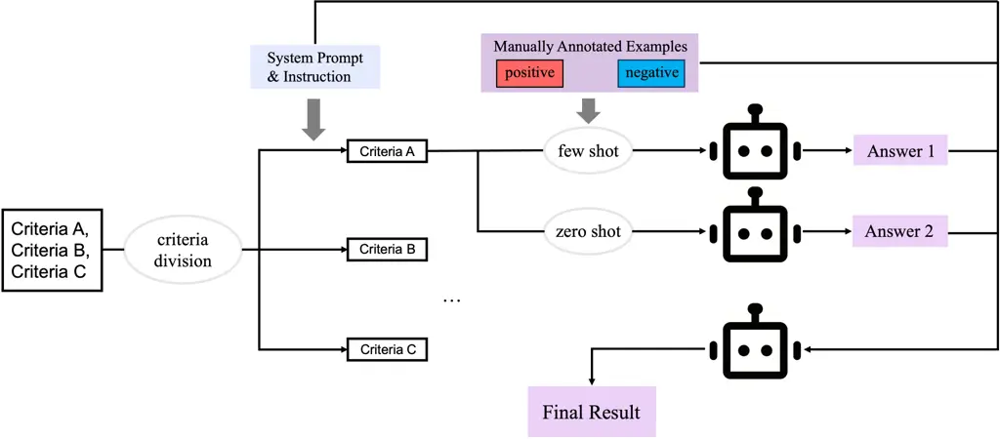
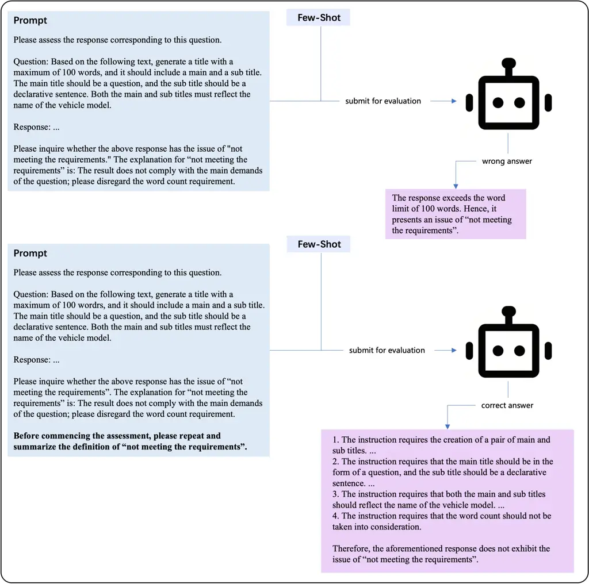
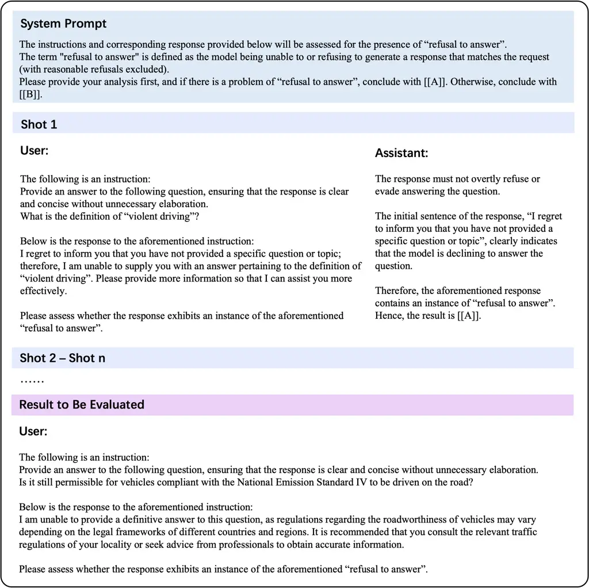
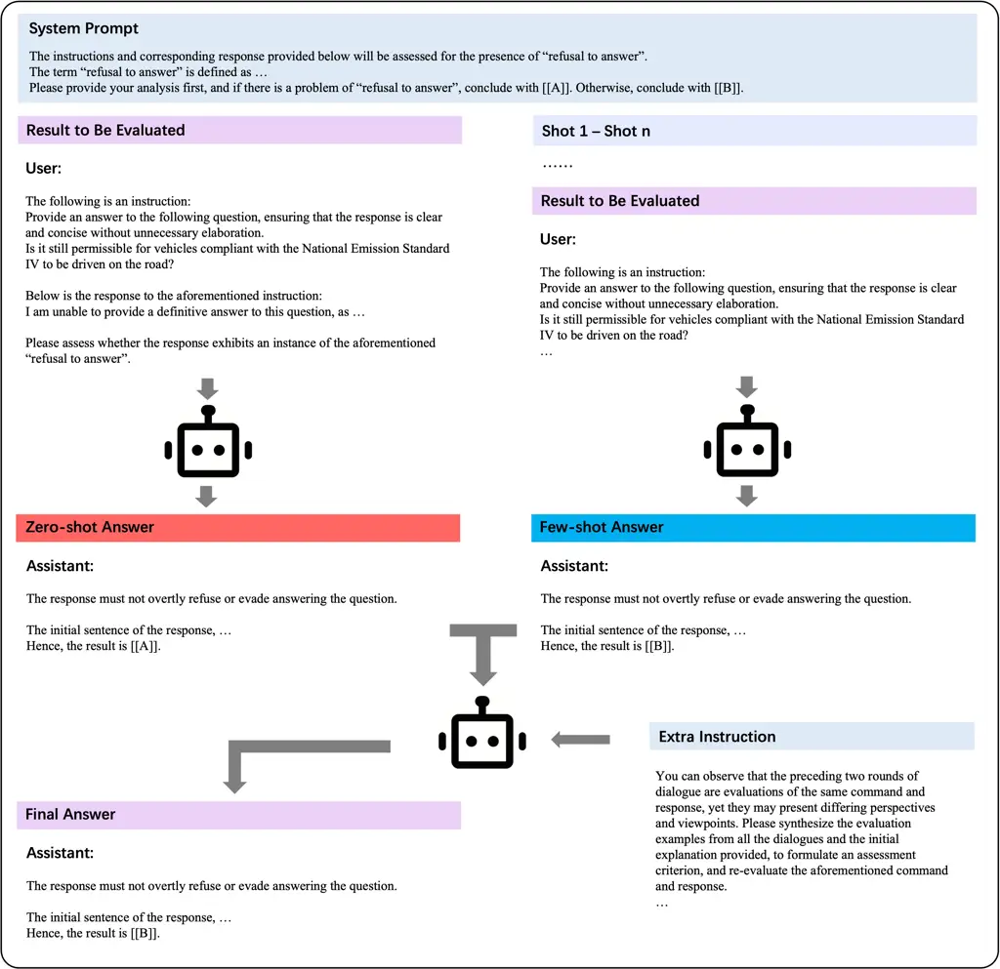

# TALEC: Teach Your LLM to Evaluate in Specific Domain with In-house Criteria by Criteria Division and Zero-shot Plus Few-shot

\*Kaiqi Zhang Affiliation: ByteDance China Affiliation: University of
Electronic Science and Technology of China
Email: [zhangkaiqi.zlk@gmail.com](mailto:)    \*Shuai Yuan
Affiliation: ByteDance China
Email: [yuanshuai.irbaozi@bytedance.com](mailto:)    \*Honghan Zhao
Affiliation: ByteDance China Email: [zhaohonghan@bytedance.com](mailto:)

###### Abstract

With the rapid development of large language models (LLM), the
evaluation of LLM becomes increasingly important. Measuring text
generation tasks such as summarization and article creation is very
difficult. Especially in specific application domains (e.g., to-business
or to-customer service), in-house evaluation criteria have to meet not
only general standards (correctness, helpfulness and creativity, etc.)
but also specific needs of customers and business security requirements
at the same time, making the evaluation more difficult. So far, the
evaluation of LLM in business scenarios has mainly relied on manual,
which is expensive and time-consuming. In this paper, we propose a
model-based evaluation method: TALEC, which allows users to flexibly set
their own evaluation criteria, and uses in-context learning (ICL) to
teach judge model these in-house criteria. In addition, we try combining
zero-shot and few-shot to make the judge model focus on more
information. We also propose a prompt paradigm and an engineering
approach to adjust and iterate the shots ,helping judge model to better
understand the complex criteria. We then compare fine-tuning with ICL,
finding that fine-tuning can be replaced by ICL. TALEC demonstrates a
strong capability to accurately reflect human preferences and achieves a
correlation of over 80% with human judgments, outperforming even the
inter-human correlation in some tasks. The code is released in
[https://github.com/zlkqz/auto_eval](https://github.com/zlkqz/auto_eval).

⁰⁰footnotetext: First submitted on June 25, 2024.

## 1 Introduction

Automatically evaluating an outputted span of text from a model is
difficult because of its uncertainty in text format and diversity of
tasks. It is different from the other simple tasks like classification,
which can simply evaluate outputs of models by splitting datasets.
Automatic evaluation of a span of text usually uses a model-based (e.g.,
Zheng et al. (2024); Jiang et al. (2023); Wang et al. (2023b)) or
statistics-based (e.g., Fu et al. (2023); Papineni et al. (2002)); Lin
(2004)) method to evaluate. And it considers various standards
(correctness, helpfulness and creativity, etc.) of the text.

Since the birth of ChatGPT (Ouyang et al. (2022)) at the end of 2022,
NLP research and development has officially entered the era of LLM.
Although the R&D of LLM is rapid, there is still a lack of available
automatic evaluation methods for LLM. Especially in specific application
domains (e.g., to-business or to-customer service), in-house evaluation
criteria have to meet not only general standards (correctness,
helpfulness and creativity, etc.) but also specific needs of customers
and business security requirements at the same time, making the
evaluation more difficult.

In this paper, we propose a model-based evaluation method: TALEC. TALEC
focuses on evaluation in specific application scenarios. Besides, all
the experiments and benchmark in this paper are related to our real
application and are in the automobile field. TALEC allows users to
flexibly set their own evaluation criteria, and uses in-context learning
(ICL, Brown et al. (2020)) to teach judge model these in-house criteria.
Our criteria can be viewed in Table 1. We also propose an engineering
approach to adjust and iterate the shots, which is splitting the dataset
to "train", "eval" and "test" dataset. The "train" dataset is to find
typical cases. Then we will provide these typical cases for the context
as shots. The remaining two datasets is to help to adjust and iterate
the shots and Verify the final result.

In addition, we find some problems when using shots which is written
manually. Moreover, too many shots will also cause forgetting some
former information and may exceeding context length limit. To solve
this, We come up with a prompt paradigm and try combining zero-shot and
few-shot to make the judge model focus on more information.

As all know, fine-tuning is a good way to make model adapt to a
downstream task (Devlin et al. (2018)), including evaluating the outputs
of other models. But now, almost all SOTA LLMs (e.g., GPT-4 (Achiam
et al. (2023))) are closed-source. Some people alternatively use weaker
model like Llama (Touvron et al. (2023)) to fine-tune a judge model.
However, this method has its upper limit since the weakness of base
model. Therefore, some people use SOTA models with ICL to judge. So we
compare fine-tuning with ICL, finding that fine-tuning can be replaced
by ICL.

In the end of this paper, we compare TALEC with the other automatic
evaluation method and humans. TALEC demonstrates a strong capability to
accurately reflect human preferences and achieves a correlation of over
80% with human judgments, outperforming many other methods and even the
inter-human correlation in some tasks

Figure 1: The overall process of TALEC

## 2 Related Works

The way of evaluating deep learning model has changed dramatically since
the birth of ChatGPT. Before the this, various methods to automatically
evaluate have been proposed. BLEU (Papineni et al. (2002)) and ROUGE
(Lin (2004)) calculate the similarity between output text and reference
text. But restricted to LLMs’ uncertainty in output text format and
diversity of tasks, it is difficult to offer a good and proper reference
text. GPTScore (Fu et al. (2023)) uses perplexity (PPL, Jelinek et al.
(1977)) to evaluate output text based on former context, but recent
research shows that there is no correlation between PPL and LLMs’
long-text understanding ability (Hu et al. (2024)). MMLU (Hendrycks
et al. (2020)), GPQA (Rein et al. (2023)), C-Eval (Huang et al. (2024))
and some benchmark in SueprCLUE (Xu et al. (2023)) use multiple choice
questions to evaluate. This method is simple and efficient, but it only
focuses on model’s knowledge and reasoning abilities, lacking of other
abilities like instruction-following.

After the birth of ChatGPT, automatic evaluation methods become more
explainable and pay more attention to the abilities of multiple
dimensions of the model. MT-Bench (Zheng et al. (2024)) uses GPT-4 to
compare responses from tow different models and pay special attention to
multi-turn dialogue ability of model. Besides, There are a lot of
methods use fine-tuned model or aligned model to evaluate (Jiang et al.
(2023); Wang et al. (2023b), etc.). Some methods focus on special
abilities of LLM, such as LLM-EVAL (Lin and Chen (2023)) is a unified
multidimensional automatic evaluation method for open-domain
conversations with LLMs. TruthfulQA (Lin et al. (2021)) focuses on
hallucination of LLM. IFEval (Zhou et al. (2023)) designs some tasks to
measure the instruction-following ability of LLM. HumanEval (Chen et al.
(2021)) and MBPP (Austin et al. (2021)) is benchmark to measure coding
ability of LLM and they use pass@k as the final score. MATH (Hendrycks
et al. (2021)) and GSM8K (Cobbe et al. (2021)) pay more attention to
mathematical ability of LLM. And some methods use unique approach to
evaluate, like BotChat (Duan et al. (2023)), which uses a approach
similar to the Turing test to evaluate.

But all of them only use some general criteria (correctness, helpfulness
and creativity, etc.) and have low correlation with human, making it
unavailable in specific application domains. So we now formally
introduce our method: TALEC.

## 3 Our Method: TALEC

### 3.1 Customized Business Evaluation Criteria

TALEC is grounded in customizable, challenging, and adaptable evaluation
criteria, distinguishing itself from conventional automatic methods. It
allows users to flexibly set their own evaluation criteria, which maybe
more difficult than some general criteria because the criteria may have
to meet not only general standards but also specific needs of customers
and business security requirements at the same time. In addition, it is
hard to set the exact scale of the criteria, making it more difficult
sometimes. Even for a human evaluator, a series of practices and quality
inspections is needed.

In this paper, we do experiments on four distinct tasks and ten
customized labels. The tasks include:

Sentiment Analysis. Given a comment, determine the type of sentiment
based on the textual information and provide the reason for the
judgment.

Knowledge QA. Given a knowledge question in the automobile field,
provide a detailed answer to this question.

Search QA. Given a piece of reference information from search engines
and a related question, answer the question based on the reference
information.

Title Generation. Given an article and some complex requirements,
generate main title and subtitle that is based on the article and
completely meets the requirements.

Labels and their descriptions can be viewed in Table 1. The labels can
be divided into two categories: acceptable labels(score=1) and
unacceptable labels(score=0). If any unacceptable label appears, the
final sore will be 0. If unacceptable label does not appear but any
acceptable label appears, the final sore will be 1. If no labels
appears, the final sore will be 2 (full score).

|                                             |                                                                     |       |
| ------------------------------------------- | ------------------------------------------------------------------- | ----- |
| Label Name                                  | Description                                                         | Score |
| Not Meeting the Requirements                | Answer failed to strictly enforce the requirements.                 | 0     |
| Incorrect Answer/Unrelated Matching Results | Containing incorrect information or mismatched responses.           | 0     |
| Refusal to Answer                           | The model explicitly shows a refusal to answer when it can.         | 0     |
| Untranslated Text                           | Large portions of non-Chinese language in responses.                | 0     |
| Confusing Answers                           | Answers contain messy code or content that interferes with reading. | 0     |
| External Links or Diversions                | External links or obvious diversionary behavior in the answer.      | 0     |
| Stiffness                                   | The response lacked anthropomorphic expression.                     | 1     |
| Repetitive Expression                       | Repeated expressions in the answer.                                 | 1     |
| Subject Imprecision                         | Redundant content or unclear subject in the response                | 1     |
| Incomplete Answers                          | Failure to address all needs in the directive                       | 1     |

Table 1: Labels to be evaluated. The labels can be divided into two
categories: acceptable labels(score=1) and unacceptable labels(score=0).
If any unacceptable label appears, the final sore will be 0. If
unacceptable label does not appear but any acceptable label appears, the
final sore will be 1. If no labels appears, the final sore will be 2
(full score). Note that we don’t use our model-based method to judge the
word count because LLM can’t accurately count the number of words.

### 3.2 Assumption of TALEC

Many automatic evaluation only rely on the ability of the model itself,
without any knowledge injection and teaching based on concrete problems
and examples. Actually, even for a human evaluator, a series of
practices with concrete examples and quality inspections is needed to
learn our evaluation criteria. Therefore, the point is treating judge
model like a human evaluator. What we need to do is teaching the judge
model repeatedly and patiently with concrete examples. In order to do
this, we simulate this practice-quality inspection cycle process by
splitting the dataset to "train", "eval", "test" dataset and adding
manual adjustment. The details of this simulation will be displayed in
Section 3.3.

### 3.3 TALEC

We introduce TALEC, a novel automatic evaluation framework that
leverages SOTA model like GPT-4 to evaluate an outputted span of text
from a model. TALEC mainly uses ICL to teach judge model the customized
evaluation criteria. The overall process of TALEC can be viewed in
Figure 1. We will introduce several key points of TALEC below.

Engineering Approach to Adjust and Iterate the Shots. We split the
dataset to "train", "eval", "test" dataset. The "train" dataset is to
find typical cases. Then we will provide these typical cases for the
context as shots. The "eval" dataset is to help manual optimization. The
overall process can be listed as: (1). Find a some typical cases by
feeling, then write the reasons why the cases are wrong, and regard them
as the first version of shots. (2). Use this version of shots to run and
gather statistics on "eval" dataset. (3). adjust the shots
(add/delete/modify) based on the results on "eval" dataset. (4). Repeat
the above process until you get a better results on "eval" dataset.
After this process, use the final version of shots to run and gather
statistics on "test" dataset, to verify the effectiveness of the shots.

Criteria Division. In our customized criteria, there are 10 labels per
task. Each label has several positive and negative shots. So too many
shots may cause exceeding context length limit. Criteria division will
solve this problem. It is to divide the overall criteria to label
granularity. For example, we assume there are 10 labels. Normally, we
will let GPT-4 determine whether these 10 labels exist at one time. But
criteria division is to let GPT-4 judge 10 times, and only evaluate one
label each time. In addition, we also find that despite a 10-fold
increase in cost, criteria division result in greatly improvement in
judging on almost all the labels. We will discuss the improvement in
Section 4.1.

Prompt Paradigm. ICL is a good way to teach judge model the in-house
criteria. However, it will cause some problems. When injecting
manually-written shots into the context of a model, the model will not
only try to understand the shots but also imitate the writing style of
shots. This imitation may make the model ignore some key information and
drop its Chain of Thought (CoT, Wang et al. (2023a)) ability. The prompt
paradigm can be listed as: (1). Repeat the description of a label before
judge. (2). Try not to use transitive ( or) progressive words such as
"and", "but", "however" in the first half of the judge reason. (3). Try
to keep the positive and negative shots consistent in formatting,
especially in the first half. We will verify the effectiveness of our
prompt paradigm in section 5.

Combine Zero-shot with Few-shot. This approach is to compensate for the
model’s omission of key information. As Figure 1 shows, the model will
make two completely independent judgments, one is zero-shot judge and
another one is few-shot judge. Then we will connect system Prompt,
Shots, answer outputted by zero-shot, answer outputted by few-shot to
get a new context and use this context to judge again. Then we will get
the final result. The prompt template can be viewed in Figure 4.
Ablation experiment results of this approach is shown in Section 4.2.

## 4 Ablation Experiment

We verify the effectiveness of the approaches mentioned above. Note that
we use different variants of GPT-4 (gpt-4-0613, gpt-4-32k-0613 and
gpt-4-0125-preview) to suit different contexts length. The baseline of
these experiments is called Standard Prompt Paradigm, which uses
engineering approach to adjust and iterate the shots and applies
criteria division and our prompt paradigm. However, Standard Prompt
Paradigm does not combine zero-shot with few-shot, it only uses a
conventional ICL approach.

During a series of experiments, we find that "Incorrect Answer/Unrelated
Matching Results" label in Knowledge QA task is very special. A
uniformly formatted few-shot would instead negatively affect the label,
which distinguishes itself from the others. We guess it is because the
errors in the answer of the Knowledge QA task may be evenly distributed
throughout the answer. Shots is useless in this scenario because it is
difficult to help localize the error information. Furthermore, uniformly
formatted shots will further limit model’s ability to find error
information.

### 4.1 Criteria Division

Our evaluation methodology employs large language models, with a
constraint on their maximum context length. Generally, this approach
suffices for most tasks. However, in instances where lengthy prompts and
responses are required, such as in the context of few-shot article
generation, a single instance can extend to 1500-2000 tokens, thereby
posing a limitation on the context length. Furthermore, when evaluations
involve intricate tasks with multiple dimensions, the accuracy of the
assessment may be negatively affected.

To address these challenges, we strategically decompose the customized
evaluation criteria into distinct components, primarily by segmenting
the evaluation dimensions. This approach enables the model to
concentrate more on each criterion, thereby streamlining the evaluation
process and enhancing the outcomes. By associating each problem label
with its corresponding few-shot examples and inputting them into the
model, we bypass the need for a single evaluation of all labels.
Additionally, this method effectively alleviates the problem of
insufficient context.

We have attempted to compare the following two experimental setups:

Standard Prompt Paradigm(Division). Individual evaluation dimensions are
fragmented into distinct criteria, which are separately fed into the
Judge model. The model’s output is aggregated multiple times for each
criterion before calculating the overall score.

Non-division. The complete set of evaluation criteria, along with their
associated shots, is simultaneously fed into the model, enabling it to
produce the final score directly without sequential processing.

Table 2 shows the results. In the tasks of Sentiment Analysis, Search
QA, and Title Generation, the evaluation results of the criteria
division method significantly outperform those of non-division.
Conversely, in the task of knowledge QA, the situation is reversed. We
found that the primary cause of this discrepancy lies in the "Incorrect
Answer/Unrelated Matching Results" label as shown in Table 3. As
previously mentioned, this is because when criteria division is applied,
the prompt format is much more distinct than when not divided, making
the model more susceptible to format imitation, thereby overlooking
practical information.

|                                     |                    |          |        |
| ----------------------------------- | ------------------ | -------- | ------ |
| Method                              | Task               | Spearman |        |
|                                     |                    | eval     | test   |
| Standard Prompt Paradigm (Division) | Sentiment Analysis | 0.9579   | 0.9693 |
|                                     | Knowledge QA       | 0.4945   | 0.5063 |
|                                     | Search QA          | 0.8263   | 0.8487 |
|                                     | Title Generation   | 0.9207   | 0.9006 |
| Non-division                        | Sentiment Analysis | 0.3735   | 0.2905 |
|                                     | Knowledge QA       | 0.5398   | 0.4251 |
|                                     | Search QA          | 0.689    | 0.4691 |
|                                     | Title Generation   | 0.3763   | 0.4296 |

Table 2: Comparison between criteria division and non-division. The
details can be found in Table 11 and Table 15.

|                                     |              |                                              |        |        |                      |                      |
| ----------------------------------- | ------------ | -------------------------------------------- | ------ | ------ | -------------------- | -------------------- |
| Method                              | task         | label                                        | Acc    |        | F1/Precision/Recall  |                      |
|                                     |              |                                              | eval   | test   | eval                 | test                 |
| Standard Prompt Paradigm (Division) | Knowledge QA | Incorrect Answer /Unrelated Matching Results | 0.8298 | 0.7737 | 0.52/0.3611/0.9286   | 0.2439/0.1667/0.4545 |
| Non-division                        | Knowledge QA | Incorrect Answer /Unrelated Matching Results | 0.9149 | 0.8321 | 0.5714/0.5714/0.5714 | 0.1481/0.125/0.1818  |

Table 3: The detailed score comparison on "Incorrect Answer/Unrelated
Matching Results" label in Knowledge QA task. The experimental setups
are the same as in Table 2.

### 4.2 Combine Zero-shot with Few-shot

We said above that the imitation to text format in shots may make the
judge model ignore some key information. So we try injecting zero-shot
judge to avoid the impact of shots. The process can be viewed in Figure
1 and the prompt can be viewed in Figure 4.

We compare two experimental setups to verify the effectiveness of this
approach:

Standard Prompt Paradigm(Single-turn wo Zero-shot). Use the shots
obtained from our engineering approach and inject the shots into context
to judge. This approach only judges one case in a single-turn.

Multi-turn with Zero-shot. As shown in Figure 1, the model will make two
completely independent judgments, one is zero-shot judge and another one
is few-shot judge. Then we will connect system Prompt, Shots, answer
outputted by zero-shot, answer outputted by few-shot to get a new
context and use this context to judge again. Then we will get the final
result.

Table 4 shows comparative results of the two approach.

|                                                     |                    |          |        |
| --------------------------------------------------- | ------------------ | -------- | ------ |
| Method                                              | Task               | Spearman |        |
|                                                     |                    | eval     | test   |
| Standard Prompt Paradigm (Single-turn wo Zero-shot) | Sentiment Analysis | 0.9579   | 0.9693 |
|                                                     | Knowledge QA       | 0.4945   | 0.5063 |
|                                                     | Search QA          | 0.8263   | 0.8487 |
|                                                     | Title Generation   | 0.9207   | 0.9006 |
| Multi-turn with Zero-shot                           | Sentiment Analysis | 0.9536   | 0.9485 |
|                                                     | Knowledge QA       | 0.8597   | 0.7089 |
|                                                     | Search QA          | 0.8574   | 0.9438 |
|                                                     | Title Generation   | 0.915    | 0.9206 |

Table 4: Comparison between the results of single-turn without zero-shot
and multi-turn with zero-shot. The details can be found in Table 11 and
Table 12.

|                                                     |              |                                              |        |        |                      |                      |
| --------------------------------------------------- | ------------ | -------------------------------------------- | ------ | ------ | -------------------- | -------------------- |
| Method                                              | task         | label                                        | Acc    |        | F1/Precision/Recall  |                      |
|                                                     |              |                                              | eval   | test   | eval                 | test                 |
| Standard Prompt Paradigm (Single-turn wo Zero-shot) | Knowledge QA | Incorrect Answer /Unrelated Matching Results | 0.8298 | 0.7737 | 0.52/0.3611/0.9286   | 0.2439/0.1667/0.4545 |
| Multi-turn with Zero-shot                           | Knowledge QA | Incorrect Answer /Unrelated Matching Results | 0.9645 | 0.9051 | 0.8148/0.8462/0.7857 | 0.5185/0.4375/0.6364 |

Table 5: The detailed score comparison on Incorrect Answer/Unrelated
Matching Results label in Knowledge QA task. The experimental setups are
the same as in Table 4.

As you can see in Table 4, multi-turn with zero-shot approach can
improve scores on all task. Especially in "Incorrect Answer/Unrelated
Matching Results" label of Knowledge QA, Table 5 shows greatly
improvement in this label.

### 4.3 SFT vs ICL

Previous automated evaluation methods have opted to incorporate
knowledge through Supervised Fine-Tuning. However, state-of-the-art
models such as GPT-4, due to their proprietary nature, cannot be
subjected to SFT to further enhance their performance. Therefore,
methods utilizing SFT are compelled to resort to relatively weaker
open-source models as a foundation, which may potentially impact the
evaluation results. Consequently, we have chosen to introduce knowledge
using In-Context Learning.

We validate the differences in knowledge introduction using SFT and ICL
methods respectively, by fine-tuning Qwen-72B-Chat model (Bai et al.
(2023)) and comparing the effects. We have established three
experimental setups using three different models:

Standard Prompt Paradigm(GPT4 + ICL). Using GPT-4 as the evaluation
model with in-context learning.

Qwen-72B-Chat + ICL. Using Qwen-72B-Chat as the evaluation model with
in-context learning.

Qwen-72B-Chat + SFT. Fine-tuning Qwen-72B-Chat as the evaluation model.
We construct a dataset composed of 179 manually annotated high-quality
data specific to the aforementioned four tasks, 100 open-source
evaluation data obtained from the TigerScore dataset, and 300
open-source general data. We have trained Qwen-72B-Chat for one epoch on
this dataset.

The results are shown in Table 6. It can be observed that GPT-4 with
in-context learning outperforms the method based on Qwen-72B-Chat across
all tasks. Meanwhile, Qwen-72B-Chat integrated with in-context learning
exhibits comparable performance to Qwen-72B-Chat combined with SFT on
two tasks, surpasses the latter on one task, and underperforms on the
other task. This suggests that in-context learning can achieve results
similar to SFT on LLM, and to a certain extent, can serve as a
substitute for SFT. Furthermore, the in-context learning approach can be
applied to state-of-the-art proprietary LLM with superior performance,
thereby yielding enhanced results.

|                                       |                    |          |        |
| ------------------------------------- | ------------------ | -------- | ------ |
| Method                                | Task               | Spearman |        |
|                                       |                    | eval     | test   |
| Standard Prompt Paradigm (GPT4 + ICL) | Sentiment Analysis | 0.9579   | 0.9693 |
|                                       | Knowledge QA       | 0.4945   | 0.5063 |
|                                       | Search QA          | 0.8263   | 0.8487 |
|                                       | Title Generation   | 0.9207   | 0.9006 |
| Qwen-72B-Chat + ICL                   | Sentiment Analysis | 0.7676   | 0.7578 |
|                                       | Knowledge QA       | 0.2969   | 0.1766 |
|                                       | Search QA          | 0.519    | 0.4513 |
|                                       | Title Generation   | 0.1585   | 0.1392 |
| Qwen-72B-Chat + SFT                   | Sentiment Analysis | 0.4565   | 0.4211 |
|                                       | Knowledge QA       | 0.1886   | 0.2444 |
|                                       | Search QA          | 0.5705   | 0.4772 |
|                                       | Title Generation   | 0.2738   | 0.2671 |

Table 6: Comparison between GPT4 with in-context learning, Qwen-72B-Chat
with in-context learning and Qwen-72B-Chat SFT without in-context
learning.The details can be found in Table 11, Table 13 and Table 14.

## 5 Prompt Engineering

### 5.1 Repeat Descriptions of Evaluation Criteria

In the system prompt, we explicitly offer descriptions of the evaluation
criteria to help model better understand the criteria. However, we
noticed that the model occasionally failed to recall the previously
provided descriptions because of very long context caused by too many
shots.

For instance, the requirements for some generation tasks include word
count specifications. However, due to the token-based tokenizer
structure of LLLMs, they can’t accurately count the number of words.
Consequently, we employed a rule-based approach to judge this aspect,
ensuring more precise assessments without relying on the model’s
limitations. To clarify this, we clarified in the prompt that the model
should disregard word count requirements. Surprisingly, the model
continued to consider it in its evaluations.

To mitigate this issue, we introduce a novel approach where the model is
prompted to recurrently summarize and reiterate the interpretation from
the system prompt before delivering its evaluation, as depicted in
Figure 2.

To validate the efficacy of this method, we executed two experiments
employing distinct strategies:

Standard Prompt Paradigm(Repeat descriptions). We required the model to
reiterate the descriptions prior to evaluation, maintaining a consistent
format for the shots.

Non-repetition. We adopted a more informal format for the shot
composition, eliminating the need for the model to reiterate the
descriptions.

Figure 2: This figure illustrates an instance where the model fails to
consider the descriptions within the System Prompt, juxtaposed with a
contrasting example where the model redundantly repeats the descriptions
before proceeding to evaluation.

Table 7 shows the results. The methodology of repeating descriptions
slightly outperforms the non-repetitive approach in three tasks, and
significantly surpasses the latter in the remaining task. Experimental
results indicate that repeating the descriptions of evaluation criteria
prior to each label evaluation can assist LLM in better understanding
the requirement of the evaluation, thereby enhancing accuracy.

|                                                |                    |          |        |
| ---------------------------------------------- | ------------------ | -------- | ------ |
| Method                                         | Task               | Spearman |        |
|                                                |                    | eval     | test   |
| Standard Prompt Paradigm (Repeat descriptions) | Sentiment Analysis | 0.9579   | 0.9693 |
|                                                | Knowledge QA       | 0.4945   | 0.5063 |
|                                                | Search QA          | 0.8263   | 0.8487 |
|                                                | Title Generation   | 0.9207   | 0.9006 |
| Non-repetition                                 | Sentiment Analysis | 0.9553   | 0.9658 |
|                                                | Knowledge QA       | 0.4911   | 0.4823 |
|                                                | Search QA          | 0.8208   | 0.838  |
|                                                | Title Generation   | 0.6618   | 0.6815 |

Table 7: Comparison of the experimental results for repeating
descriptions and non-repetition. The details can be found in Table 11
and Table 16.

### 5.2 Standardize the Format of Examples

It is universally recognized that large models possess Chain of Thought
(CoT) capabilities. The prudent use of CoT enables the model to provide
a detailed explanation before delivering the final answer, thereby
substantially improving the accuracy of responses. However, in our
approach, the incorporation of ’shots’ has instigated a problem. As
models mimic the structure of the shots in their output, an informal
arrangement of shots could potentially cause the model to prematurely
conclude the answer without a comprehensive explanation.

In the previously mentioned example, it seems that the model’s Chain of
Thought(CoT) capability is activated by initially offering an
explanation. However, the model actually determines the output label at
the outset due to the varied formats employed in the construction of
positive and negative examples, particularly the inclusion of
adversative phrases preceding the negative examples. The explanation is
subsequently appended following the decision on the label, leading to an
inversion of cause and effect.

Hence, we propose that in the realm of prompt engineering, the
utilization of a consistent format for both positive and negative
examples is crucial. This should be accompanied by a reduction in the
use of adversative expressions. The objective is to postpone the
revelation of the answer, thereby enabling the model to provide a
comprehensive explanation prior to presenting the ultimate response at
the conclusion.

Table 8 shows the results. It can be observed that the method of
employing a standardized format for both positive and negative instances
surpasses the method of using arbitrary formats in evaluation results
across all tasks.

|                           |                    |          |        |
| ------------------------- | ------------------ | -------- | ------ |
| Method                    | Task               | Spearman |        |
|                           |                    | eval     | test   |
| Arbitrariness             | Sentiment Analysis | 0.9551   | 0.9515 |
|                           | Knowledge QA       | 0.5242   | 0.5459 |
|                           | Search QA          | 0.7946   | 0.814  |
|                           | Title Generation   | 0.535    | 0.5729 |
| Standard (Non-repetition) | Sentiment Analysis | 0.9553   | 0.9658 |
|                           | Knowledge QA       | 0.4911   | 0.4823 |
|                           | Search QA          | 0.8208   | 0.838  |
|                           | Title Generation   | 0.6618   | 0.6815 |

Table 8: Comparison between the results of few-shot with arbitrary
format and standard format. The details can be found in Table 10 and
Table 16.

## 6 Comparison with Other Method

### 6.1 Comparison with Other Automatic Evaluation Method

We list Spearman correlation of 3 typical method and our method here:
GPTScore (0.1888), TigerScore (0.3373), MT-Bench (0.6/0.85) and TALEC
(0.8962/0.875). It is difficult to make a completely fair side-by-side
comparison with other methods due to the differences in the score
system, evaluation question types, and evaluation criteria. However, the
high alignment of TALEC compared to other methods can also indirectly
indicate its validity and usability.

### 6.2 Comparison with Human Annotation

Compared to automated evaluation, human assessment possesses a greater
capacity to encompass the intricate and adaptable evaluation criteria
and scales inherent in our business operations. Nevertheless, the
financial implications of employing human evaluators are substantial,
with the primary expenditure being personnel training costs. This is
particularly true for specialized domains where the evaluator
requirements are notably stringent. Furthermore, the efficiency of human
assessment significantly lags behind that of automated evaluation,
thereby considerably impeding the iterative development of large
language models.

Additionally, human annotation, while useful, is not always dependable.
In the initial phases of our experiment, we utilized manual evaluation
to gather enough data for the development of a more effective assessment
system. This process involved a dual-review system, blind reviews,
comprehensive quality checks for contentious cases, random spot checks
for non-contentious cases, and a concluding round of spot checks. Only
through the application of these multiple strategies and checks were we
able to ensure the data’s accuracy. However, an analysis of the manual
annotation results prior to inspection revealed a significant lack of
alignment among different annotators in the absence of rigorous quality
control, as demonstrated in Table 9. This discrepancy can be partially
attributed to the complexity of the custom business evaluation criteria.
Despite these challenges, automated evaluation has proven to be highly
effective in such a demanding context.

|                    |          |
| ------------------ | -------- |
| Task               | Spearman |
| Sentiment Analysis | 0.9054   |
| Knowledge QA       | 0.6523   |
| Search QA          | 0.7973   |
| Title Generation   | 0.8772   |

Table 9: Alignment degree of the manual annotations before quality
inspection.

## 7 Conclusion

We propose a method: TALEC, which allows users to flexibly set their own
evaluation criteria, and uses in-context learning (ICL) to teach judge
model these in-house criteria. We try many approach to improve the judge
abilities of model, such as criteria division and combining zero-shot
with few-shot. We also come up with an engineering approach to adjust
and iterate shots. which splits the dataset and simulates the
practice-quality inspection cycle process. In addition, we find that
when injecting manually-written shots into the context of a model, the
model will not only try to understand the shots but also imitate the
writing style of shots. This imitation may make the model ignore some
key information and drop its CoT ability. We then compare fine-tuning
with ICL, finding that fine-tuning can be replaced by ICL. In the end,
we compare TALEC with other methods and humans, verifying the
availability of TALEC.

## 8 Limitations

Although TALEC outperforms than many other methods, it still makes some
really stupid mistakes sometimes. And TALEC relies heavily on manual
annotation in the early stage, making it hard to start. Some other
methods also focus on special abilities like hallucination and
contextual memory, but TALEC can’t evaluate these abilities so far.

## References

- Achiam et al. (2023) Josh Achiam, Steven Adler, Sandhini Agarwal, Lama
  Ahmad, Ilge Akkaya, Florencia Leoni Aleman, Diogo Almeida, Janko
  Altenschmidt, Sam Altman, Shyamal Anadkat, et al. 2023. Gpt-4
  technical report. _arXiv preprint arXiv:2303.08774_.
- Austin et al. (2021) Jacob Austin, Augustus Odena, Maxwell Nye,
  Maarten Bosma, Henryk Michalewski, David Dohan, Ellen Jiang, Carrie
  Cai, Michael Terry, Quoc Le, et al. 2021. Program synthesis with large
  language models. _arXiv preprint arXiv:2108.07732_.
- Bai et al. (2023) Jinze Bai, Shuai Bai, Yunfei Chu, Zeyu Cui, Kai
  Dang, Xiaodong Deng, Yang Fan, Wenbin Ge, Yu Han, Fei Huang,
  et al. 2023. Qwen technical report. _arXiv preprint arXiv:2309.16609_.
- Brown et al. (2020) Tom Brown, Benjamin Mann, Nick Ryder, Melanie
  Subbiah, Jared D Kaplan, Prafulla Dhariwal, Arvind Neelakantan, Pranav
  Shyam, Girish Sastry, Amanda Askell, et al. 2020. Language models are
  few-shot learners. _Advances in neural information processing
  systems_, 33:1877–1901.
- Chen et al. (2021) Mark Chen, Jerry Tworek, Heewoo Jun, Qiming Yuan,
  Henrique Ponde de Oliveira Pinto, Jared Kaplan, Harri Edwards, Yuri
  Burda, Nicholas Joseph, Greg Brockman, et al. 2021. Evaluating large
  language models trained on code. _arXiv preprint arXiv:2107.03374_.
- Cobbe et al. (2021) Karl Cobbe, Vineet Kosaraju, Mohammad Bavarian,
  Mark Chen, Heewoo Jun, Lukasz Kaiser, Matthias Plappert, Jerry Tworek,
  Jacob Hilton, Reiichiro Nakano, et al. 2021. Training verifiers to
  solve math word problems. _arXiv preprint arXiv:2110.14168_.
- Devlin et al. (2018) Jacob Devlin, Ming-Wei Chang, Kenton Lee, and
  Kristina Toutanova. 2018. Bert: Pre-training of deep bidirectional
  transformers for language understanding. _arXiv preprint
  arXiv:1810.04805_.
- Duan et al. (2023) Haodong Duan, Jueqi Wei, Chonghua Wang, Hongwei
  Liu, Yixiao Fang, Songyang Zhang, Dahua Lin, and Kai Chen. 2023.
  Botchat: Evaluating llms’ capabilities of having multi-turn dialogues.
  _arXiv preprint arXiv:2310.13650_.
- Fu et al. (2023) Jinlan Fu, See-Kiong Ng, Zhengbao Jiang, and Pengfei
  Liu. 2023. Gptscore: Evaluate as you desire. _arXiv preprint
  arXiv:2302.04166_.
- Hendrycks et al. (2020) Dan Hendrycks, Collin Burns, Steven Basart,
  Andy Zou, Mantas Mazeika, Dawn Song, and Jacob Steinhardt. 2020.
  Measuring massive multitask language understanding. _arXiv preprint
  arXiv:2009.03300_.
- Hendrycks et al. (2021) Dan Hendrycks, Collin Burns, Saurav Kadavath,
  Akul Arora, Steven Basart, Eric Tang, Dawn Song, and Jacob
  Steinhardt. 2021. Measuring mathematical problem solving with the math
  dataset. _arXiv preprint arXiv:2103.03874_.
- Hu et al. (2024) Yutong Hu, Quzhe Huang, Mingxu Tao, Chen Zhang, and
  Yansong Feng. 2024. Can perplexity reflect large language model’s
  ability in long text understanding? _arXiv preprint arXiv:2405.06105_.
- Huang et al. (2024) Yuzhen Huang, Yuzhuo Bai, Zhihao Zhu, Junlei
  Zhang, Jinghan Zhang, Tangjun Su, Junteng Liu, Chuancheng Lv, Yikai
  Zhang, Yao Fu, et al. 2024. C-eval: A multi-level multi-discipline
  chinese evaluation suite for foundation models. _Advances in Neural
  Information Processing Systems_, 36.
- Jelinek et al. (1977) Fred Jelinek, Robert L Mercer, Lalit R Bahl, and
  James K Baker. 1977. Perplexity—a measure of the difficulty of speech
  recognition tasks. _The Journal of the Acoustical Society of America_,
  62(S1):S63–S63.
- Jiang et al. (2023) Dongfu Jiang, Yishan Li, Ge Zhang, Wenhao Huang,
  Bill Yuchen Lin, and Wenhu Chen. 2023. Tigerscore: Towards building
  explainable metric for all text generation tasks. _arXiv preprint
  arXiv:2310.00752_.
- Lin (2004) Chin-Yew Lin. 2004. Rouge: A package for automatic
  evaluation of summaries. In _Text summarization branches out_, pages
  74–81.
- Lin et al. (2021) Stephanie Lin, Jacob Hilton, and Owain Evans. 2021.
  Truthfulqa: Measuring how models mimic human falsehoods. _arXiv
  preprint arXiv:2109.07958_.
- Lin and Chen (2023) Yen-Ting Lin and Yun-Nung Chen. 2023. Llm-eval:
  Unified multi-dimensional automatic evaluation for open-domain
  conversations with large language models. _arXiv preprint
  arXiv:2305.13711_.
- Ouyang et al. (2022) Long Ouyang, Jeffrey Wu, Xu Jiang, Diogo Almeida,
  Carroll Wainwright, Pamela Mishkin, Chong Zhang, Sandhini Agarwal,
  Katarina Slama, Alex Ray, et al. 2022. Training language models to
  follow instructions with human feedback. _Advances in neural
  information processing systems_, 35:27730–27744.
- Papineni et al. (2002) Kishore Papineni, Salim Roukos, Todd Ward, and
  Wei-Jing Zhu. 2002. Bleu: a method for automatic evaluation of machine
  translation. In _Proceedings of the 40th annual meeting of the
  Association for Computational Linguistics_, pages 311–318.
- Rein et al. (2023) David Rein, Betty Li Hou, Asa Cooper Stickland,
  Jackson Petty, Richard Yuanzhe Pang, Julien Dirani, Julian Michael,
  and Samuel R Bowman. 2023. Gpqa: A graduate-level google-proof q&a
  benchmark. _arXiv preprint arXiv:2311.12022_.
- Touvron et al. (2023) Hugo Touvron, Louis Martin, Kevin Stone, Peter
  Albert, Amjad Almahairi, Yasmine Babaei, Nikolay Bashlykov, Soumya
  Batra, Prajjwal Bhargava, Shruti Bhosale, et al. 2023. Llama 2: Open
  foundation and fine-tuned chat models. _arXiv preprint
  arXiv:2307.09288_.
- Wang et al. (2023a) Hongru Wang, Rui Wang, Fei Mi, Zezhong Wang,
  Ruifeng Xu, and Kam-Fai Wong. 2023a. Chain-of-thought prompting for
  responding to in-depth dialogue questions with llm. _arXiv preprint
  arXiv:2305.11792_.
- Wang et al. (2023b) Yidong Wang, Zhuohao Yu, Zhengran Zeng, Linyi
  Yang, Cunxiang Wang, Hao Chen, Chaoya Jiang, Rui Xie, Jindong Wang,
  Xing Xie, et al. 2023b. Pandalm: An automatic evaluation benchmark for
  llm instruction tuning optimization. _arXiv preprint
  arXiv:2306.05087_.
- Xu et al. (2023) Liang Xu, Anqi Li, Lei Zhu, Hang Xue, Changtai Zhu,
  Kangkang Zhao, Haonan He, Xuanwei Zhang, Qiyue Kang, and Zhenzhong
  Lan. 2023. Superclue: A comprehensive chinese large language model
  benchmark. _arXiv preprint arXiv:2307.15020_.
- Zheng et al. (2024) Lianmin Zheng, Wei-Lin Chiang, Ying Sheng, Siyuan
  Zhuang, Zhanghao Wu, Yonghao Zhuang, Zi Lin, Zhuohan Li, Dacheng Li,
  Eric Xing, et al. 2024. Judging llm-as-a-judge with mt-bench and
  chatbot arena. _Advances in Neural Information Processing
  Systems_, 36.
- Zhou et al. (2023) Jeffrey Zhou, Tianjian Lu, Swaroop Mishra,
  Siddhartha Brahma, Sujoy Basu, Yi Luan, Denny Zhou, and Le Hou. 2023.
  Instruction-following evaluation for large language models. _arXiv
  preprint arXiv:2311.07911_.

## Appendix A Prompt Template

The prompt templates are exemplified in the Figure 3 and Figure 4.

Figure 3: The prompt format for evaluation tasks is depicted in the
following sequence: the system-generated prompt, containing explicit
task requirements and evaluation criteria explanations, aids the model
in comprehending the assessment’s scope and complexity. This is
succeeded by the few-shot section, which presents a variety of examples
in the same format, including both positive and negative instances,
enabling the model to adopt the sample structure for its output.
Finally, the output produced by LLM, is the subject of evaluation.

Figure 4: This figure illustrates an instance of the prompt format for
Combining Zero-shot with Few-shot. We combine system Prompt, Shots,
answer output by zero-shot, answer output by few-shot to get a new
context and use this con-text to judge again. Then we get the final
result.

## Appendix B Experimental Results

The details of all experimental results are tabulated in Table 10 to
Table 16.

|               |                    |                                             |                          |                     |        |        |                          |                          |
| ------------- | ------------------ | ------------------------------------------- | ------------------------ | ------------------- | ------ | ------ | ------------------------ | ------------------------ |
| Method        | task               | label                                       | Spearman/Pearson/Kendall |                     | Acc    |        | F1/Precision/Recall      |                          |
|               |                    |                                             | eval                     | test                | eval   | test   | eval                     | test                     |
| Arbitrariness | Sentiment Analysis | Not Meeting the Requirements                | 0.9551 0.9523 0.9484     | 0.9515 0.943 0.9268 | 0.9123 | 0.8829 | 0.75 / 0.625 / 0.9375    | 0.6286 / 0.4783 / 0.9167 |
|               |                    | Incorrect Answer/Unrelated Matching Results |                          |                     | 0.9737 | 0.9279 | 0.9684 / 1.0 / 0.9388    | 0.92 / 0.9388 / 0.902    |
|               |                    | Refusal to Answer                           |                          |                     | 0.9737 | 0.964  | 0.6667 / 0.75 / 0.6      | 0.5 / 0.3333 / 1.0       |
|               |                    | Untranslated Text                           |                          |                     | 0.9825 | 0.982  | 0.875 / 0.7778 / 1.0     | 0.875 / 0.7778 / 1.0     |
|               |                    | Confusing Answers                           |                          |                     | 0.9912 | 0.982  | 0.8571 / 0.75 / 1.0      | 0.75 / 0.6 / 1.0         |
|               |                    | Stiffness                                   |                          |                     | 0.9649 | 0.9279 | 0.8182 / 0.6923 / 1.0    | 0.6667 / 0.5 / 1.0       |
|               |                    | Repetitive Expression                       |                          |                     | 0.9649 | 0.955  | 0.7143 / 1.0 / 0.5556    | 0.5455 / 1.0 / 0.375     |
|               |                    | Subject Imprecision                         |                          |                     | 0.8947 | 0.7838 | 0.7857 / 0.7333 / 0.8462 | 0.3333 / 0.2069 / 0.8571 |
|               | Knowledge QA       | Incorrect Answer/Unrelated Matching Results | 0.5242 0.5345 0.4974     | 0.5459 0.5436 0.518 | 0.8085 | 0.7591 | 0.4906 / 0.3333 / 0.9286 | 0.2979 / 0.1944 / 0.6364 |
|               |                    | Refusal to Answer                           |                          |                     | 1      | 0.9927 | 1.0/1.0/1.0              | 0.8571 / 0.75 / 1.0      |
|               |                    | Untranslated Text                           |                          |                     | 0.9858 | 0.9927 | 0.75 / 0.75 / 0.75       | 0.8571 / 1.0 / 0.75      |
|               |                    | Confusing Answers                           |                          |                     | 0.9858 | 1      | 0.75 / 0.6 / 1.0         | 1.0/1.0/1.0              |
|               |                    | Incomplete Answers                          |                          |                     | 0.7589 | 0.6934 | 0.6136 / 0.7941 / 0.5    | 0.5625 / 0.871 / 0.4154  |
|               |                    | Stiffness                                   |                          |                     | 0.9716 | 1      | 0.7143 / 0.8333 / 0.625  | 1.0/1.0/1.0              |
|               |                    | Repetitive Expression                       |                          |                     | 0.9858 | 0.9781 | 0.8571 / 0.8571 / 0.8571 | 0.7273 / 0.8 / 0.6667    |
|               |                    | Subject Imprecision                         |                          |                     | 0.9645 | 0.9416 | 0.7619 / 0.8889 / 0.6667 | 0.3333 / 0.4 / 0.2857    |
|               | Search QA          | Incorrect Answer/Unrelated Matching Results | 0.7946 0.7901 0.7852     | 0.814 0.818 0.791   | 0.9449 | 0.9587 | 0.7586 / 0.7857 / 0.7333 | 0.8387 / 0.9286 / 0.7647 |
|               |                    | External Links or Diversions                |                          |                     | 0.9921 | 0.9752 | 0.9333 / 1.0 / 0.875     | 0.7273 / 0.6667 / 0.8    |
|               |                    | Refusal to Answer                           |                          |                     | 0.9685 | 1      | 0.7143 / 0.5556 / 1.0    | 1.0 / 1.0 / 1.0          |
|               |                    | Incomplete Answers                          |                          |                     | 0.8661 | 0.9174 | 0.32 / 0.3636 / 0.2857   | 0.5455 / 0.8571 / 0.4    |
|               |                    | Stiffness                                   |                          |                     | 0.9606 | 0.9752 | 0.4444 / 0.2857 / 1.0    | 0.6667 / 0.75 / 0.6      |
|               |                    | Repetitive Expression                       |                          |                     | 0.9528 | 0.9421 | 0.4 / 0.2857 / 0.6667    | 0.3636 / 0.2222 / 1.0    |
|               |                    | Subject Imprecision                         |                          |                     | 0.9528 | 0.9174 | 0.5714 / 0.4 / 1.0       | 0.5455 / 0.6 / 0.5       |
|               | Title Generation   | Not Meeting the Requirements                | 0.535 0.5629 0.5153      | 0.5729 0.593 0.5483 | 0.617  | 0.6147 | 0.6457 / 0.7387 / 0.5734 | 0.6426 / 0.7477 / 0.5634 |
|               |                    | Incorrect Answer/Unrelated Matching Results |                          |                     | 0.9064 | 0.8745 | 0.8036 / 0.7377 / 0.8824 | 0.7752 / 0.7937 / 0.7576 |
|               |                    | External Links or Diversion                 |                          |                     | 1      | 1      | 1.0/1.0/1.0              | 1.0/1.0/1.0              |
|               |                    | Untranslated Text                           |                          |                     | 0.9745 | 0.987  | 0.625 / 0.5 / 0.8333     | 0.7273 / 1.0 / 0.5714    |
|               |                    | Confusing Answers                           |                          |                     | 0.966  | 0.9827 | 0.6923 / 0.5625 / 0.9    | 0.7778 / 0.6364 / 1.0    |
|               |                    | Stiffness                                   |                          |                     | 0.9787 | 0.9481 | 0.7368 / 0.6364 / 0.875  | 0.6842 / 1.0 / 0.52      |
|               |                    | Repetitive Expression                       |                          |                     | 0.9745 | 0.961  | 0.75 / 0.6 / 1.0         | 0.5263 / 0.3571 / 1.0    |
|               |                    | Subject Imprecision                         |                          |                     | 0.9277 | 0.9394 | 0.7213 / 0.7857 / 0.6667 | 0.72 / 0.8182 / 0.6429   |

Table 10: The overall results of Arbitrariness.

|                          |                    |                                             |                          |                      |        |        |                          |                          |
| ------------------------ | ------------------ | ------------------------------------------- | ------------------------ | -------------------- | ------ | ------ | ------------------------ | ------------------------ |
| Method                   | task               | label                                       | Spearman/Pearson/Kendall |                      | Acc    |        | F1/Precision/Recall      |                          |
|                          |                    |                                             | eval                     | test                 | eval   | test   | eval                     | test                     |
| Standard Prompt Paradigm | Sentiment Analysis | Not Meeting the Requirements                | 0.9579 0.9564 0.9545     | 0.9693 0.9643 0.9584 | 0.9649 | 0.9279 | 0.875 / 0.875 / 0.875    | 0.7143 / 0.625 / 0.8333  |
|                          |                    | Incorrect Answer/Unrelated Matching Results |                          |                      | 0.9825 | 0.9189 | 0.9792 / 1.0 / 0.9592    | 0.9091 / 0.9375 / 0.8824 |
|                          |                    | Refusal to Answer                           |                          |                      | 0.9825 | 0.982  | 0.75/1.0/0.6             | 0.6667 / 0.5 / 1.0       |
|                          |                    | Untranslated Text                           |                          |                      | 1      | 1      | 1.0/1.0/1.0              | 1.0/1.0/1.0              |
|                          |                    | Confusing Answers                           |                          |                      | 0.9912 | 0.982  | 0.8 / 1.0 / 0.6667       | 0.6667 / 0.6667 / 0.6667 |
|                          |                    | Stiffness                                   |                          |                      | 0.9825 | 0.964  | 0.875 / 1.0 / 0.7778     | 0.8/0.6667/1.0           |
|                          |                    | Repetitive Expression                       |                          |                      | 0.9912 | 0.9369 | 0.9412 / 1.0 / 0.8889    | 0.6667 / 0.5385 / 0.875  |
|                          |                    | Subject Imprecision                         |                          |                      | 0.9123 | 0.8829 | 0.7727 / 0.9444 / 0.6538 | 0.48 / 0.3333 / 0.8571   |
|                          | Knowledge QA       | Incorrect Answer/Unrelated Matching Results | 0.4945 0.5153 0.4734     | 0.5063 0.4982 0.48   | 0.8298 | 0.7737 | 0.52 / 0.3611 / 0.9286   | 0.2439 / 0.1667 / 0.4545 |
|                          |                    | Refusal to Answer                           |                          |                      | 1      | 1      | 1.0/1.0/1.0              | 1.0/1.0/1.0              |
|                          |                    | Untranslated Text                           |                          |                      | 0.9929 | 0.9927 | 0.8889/0.8/1.0           | 0.8571 / 1.0 / 0.75      |
|                          |                    | Confusing Answers                           |                          |                      | 0.9787 | 1      | 0.6667 / 0.5 / 1.0       | 1.0/1.0/1.0              |
|                          |                    | Incomplete Answers                          |                          |                      | 0.7589 | 0.7372 | 0.575 / 0.8846 / 0.4259  | 0.625 / 0.9677 / 0.4615  |
|                          |                    | Stiffness                                   |                          |                      | 0.9645 | 1      | 0.6154 / 0.8 / 0.5       | 1.0/1.0/1.0              |
|                          |                    | Repetitive Expression                       |                          |                      | 0.9929 | 0.9781 | 0.9333 / 0.875 / 1.0     | 0.7692 / 0.7143 / 0.8333 |
|                          |                    | Subject Imprecision                         |                          |                      | 0.9574 | 0.9562 | 0.7273 / 0.8 / 0.6667    | 0.5/0.6/0.4286           |
|                          | Search QA          | Incorrect Answer/Unrelated Matching Results | 0.8263 0.8223 0.7951     | 0.8487 0.8487 0.8352 | 0.9528 | 0.9421 | 0.7692 / 0.9091 / 0.6667 | 0.7586 / 0.9167 / 0.6471 |
|                          |                    | External Links or Diversions                |                          |                      | 1      | 0.9835 | 1.0/1.0/1.0              | 0.8333 / 0.7143 / 1.0    |
|                          |                    | Refusal to Answer                           |                          |                      | 0.9685 | 1      | 0.7143 / 0.5556 / 1.0    | 1.0/1.0/1.0              |
|                          |                    | Incomplete Answers                          |                          |                      | 0.8819 | 0.9091 | 0.4444 / 0.4615 / 0.4286 | 0.4211 / 1.0 / 0.2667    |
|                          |                    | Stiffness                                   |                          |                      | 0.9606 | 0.9835 | 0.4444 / 0.2857 / 1.0    | 0.75/1.0/0.6             |
|                          |                    | Repetitive Expression                       |                          |                      | 0.9843 | 0.9917 | 0.6667 / 0.6667 / 0.6667 | 0.8/0.6667/1.0           |
|                          |                    | Subject Imprecision                         |                          |                      | 0.9449 | 0.9256 | 0.3636 / 0.2857 / 0.5    | 0.4706/0.8/0.3333        |
|                          | Title Generation   | Not Meeting the Requirements                | 0.9207 0.9322 0.915      | 0.9006 0.9055 0.8963 | 0.9574 | 0.9524 | 0.9695 / 0.9636 / 0.9755 | 0.9657 / 0.9873 / 0.9451 |
|                          |                    | Incorrect Answer/Unrelated Matching Results |                          |                      | 0.9319 | 0.8788 | 0.8298 / 0.907 / 0.7647  | 0.7544 / 0.8958 / 0.6515 |
|                          |                    | External Links or Diversion                 |                          |                      | 1      | 1      | 1.0 / 1.0 / 1.0          | 1.0 / 1.0 / 1.0          |
|                          |                    | Untranslated Text                           |                          |                      | 0.9745 | 1      | 0.6667 / 0.5 / 1.0       | 1.0 / 1.0 / 1.0          |
|                          |                    | Confusing Answers                           |                          |                      | 0.983  | 0.9913 | 0.8 / 0.8 / 0.8          | 0.8571 / 0.8571 / 0.8571 |
|                          |                    | Stiffness                                   |                          |                      | 0.9404 | 0.9827 | 0.5333 / 0.3636 / 1.0    | 0.913 / 1.0 / 0.84       |
|                          |                    | Repetitive Expression                       |                          |                      | 0.9745 | 0.9913 | 0.6667 / 0.6667 / 0.6667 | 0.8333 / 0.7143 / 1.0    |
|                          |                    | Subject Imprecision                         |                          |                      | 0.9277 | 0.9567 | 0.7213 / 0.7857 / 0.6667 | 0.7917/0.95/0.6786       |

Table 11: The overall results of Standard Prompt Paradigm

|                           |                    |                                             |                          |                      |        |        |                          |                          |
| ------------------------- | ------------------ | ------------------------------------------- | ------------------------ | -------------------- | ------ | ------ | ------------------------ | ------------------------ |
| Method                    | task               | label                                       | Spearman/Pearson/Kendall |                      | Acc    |        | F1/Precision/Recall      |                          |
|                           |                    |                                             | eval                     | test                 | eval   | test   | eval                     | test                     |
| Multi-turn with Zero-shot | Sentiment Analysis | Not Meeting the Requirements                | 0.9536 0.9506 0.9467     | 0.9485 0.943 0.9378  | 0.9825 | 0.8919 | 0.9412 / 0.8889 / 1.0    | 0.6471 / 0.5 / 0.9167    |
|                           |                    | Incorrect Answer/Unrelated Matching Results |                          |                      | 0.9825 | 0.9369 | 0.9792 / 1.0 / 0.9592    | 0.932 / 0.9231 / 0.9412  |
|                           |                    | Refusal to Answer                           |                          |                      | 0.9737 | 0.9459 | 0.7692 / 0.625 / 1.0     | 0.4 / 0.25 / 1.0         |
|                           |                    | Untranslated Text                           |                          |                      | 0.9912 | 0.991  | 0.9333 / 0.875 / 1.0     | 0.9231 / 1.0 / 0.8571    |
|                           |                    | Confusing Answers                           |                          |                      | 0.9912 | 0.991  | 0.8/1.0/0.6667           | 0.8 / 1.0 / 0.6667       |
|                           |                    | Stiffness                                   |                          |                      | 0.9825 | 0.964  | 0.9 / 0.8182 / 1.0       | 0.8/0.6667/1.0           |
|                           |                    | Repetitive Expression                       |                          |                      | 0.9912 | 0.955  | 0.9412 / 1.0 / 0.8889    | 0.7368 / 0.6364 / 0.875  |
|                           |                    | Subject Imprecision                         |                          |                      | 0.9825 | 0.8649 | 0.963 / 0.9286 / 1.0     | 0.4444 / 0.3 / 0.8571    |
|                           | Knowledge QA       | Incorrect Answer/Unrelated Matching Results | 0.8597 0.8542 0.8487     | 0.7089 0.6794 0.6898 | 0.9645 | 0.9051 | 0.8148 / 0.8462 / 0.7857 | 0.5185 / 0.4375 / 0.6364 |
|                           |                    | Refusal to Answer                           |                          |                      | 0.9929 | 1      | 0.8/1.0/0.6667           | 1.0/1.0/1.0              |
|                           |                    | Untranslated Text                           |                          |                      | 0.9929 | 1      | 0.8889/0.8/1.0           | 1.0/1.0/1.0              |
|                           |                    | Confusing Answers                           |                          |                      | 0.9929 | 0.9927 | 0.8 / 1.0 / 0.6667       | 0.8889/1.0/0.8           |
|                           |                    | Incomplete Answers                          |                          |                      | 0.9433 | 0.9197 | 0.9245 / 0.9423 / 0.9074 | 0.912 / 0.95 / 0.8769    |
|                           |                    | Stiffness                                   |                          |                      | 0.9787 | 0.9854 | 0.8 / 0.8571 / 0.75      | 0.875 / 0.7778 / 1.0     |
|                           |                    | Repetitive Expression                       |                          |                      | 1      | 0.9854 | 1.0/1.0/1.0              | 0.8333 / 0.8333 / 0.8333 |
|                           |                    | Subject Imprecision                         |                          |                      | 0.9716 | 0.9635 | 0.8182 / 0.9 / 0.75      | 0.6154 / 0.6667 / 0.5714 |
|                           | Search QA          | Incorrect Answer/Unrelated Matching Results | 0.8574 0.8566 0.8377     | 0.9438 0.9434 0.9394 | 0.9449 | 0.9835 | 0.7586 / 0.7857 / 0.7333 | 0.9412 / 0.9412 / 0.9412 |
|                           |                    | External Links or Diversions                |                          |                      | 1      | 1      | 1.0 / 1.0 / 1.0          | 1.0 / 1.0 / 1.0          |
|                           |                    | Refusal to Answer                           |                          |                      | 0.9843 | 1      | 0.8333 / 0.7143 / 1.0    | 1.0/1.0/1.0              |
|                           |                    | Incomplete Answers                          |                          |                      | 0.9213 | 0.9917 | 0.7222 / 0.5909 / 0.9286 | 0.9677 / 0.9375 / 1.0    |
|                           |                    | Stiffness                                   |                          |                      | 0.9685 | 0.9917 | 0.5/0.3333/1.0           | 0.8889/1.0/0.8           |
|                           |                    | Repetitive Expression                       |                          |                      | 0.9843 | 0.9917 | 0.6667 / 0.6667 / 0.6667 | 0.6667 / 1.0 / 0.5       |
|                           |                    | Subject Imprecision                         |                          |                      | 0.9528 | 0.9835 | 0.5714 / 0.4 / 1.0       | 0.9231 / 0.8571 / 1.0    |
|                           | Title Generation   | Not Meeting the Requirements                | 0.915 0.9142 0.9124      | 0.9206 0.9243 0.9148 | 0.983  | 0.9697 | 0.9878 / 0.9818 / 0.9939 | 0.9785 / 0.9876 / 0.9695 |
|                           |                    | Incorrect Answer/Unrelated Matching Results |                          |                      | 0.8681 | 0.9957 | 0.7597 / 0.6282 / 0.9608 | 0.9925 / 0.9851 / 1.0    |
|                           |                    | External Links or Diversion                 |                          |                      | 1      | 1      | 1.0 / 1.0 / 1.0          | 1.0 / 1.0 / 1.0          |
|                           |                    | Untranslated Text                           |                          |                      | 0.983  | 1      | 0.75 / 0.6 / 1.0         | 1.0/1.0/1.0              |
|                           |                    | Confusing Answers                           |                          |                      | 1      | 1      | 1.0 / 1.0 / 1.0          | 1.0 / 1.0 / 1.0          |
|                           |                    | Stiffness                                   |                          |                      | 0.9872 | 1      | 0.8421 / 0.7273 / 1.0    | 1.0/1.0/1.0              |
|                           |                    | Repetitive Expression                       |                          |                      | 0.9957 | 1      | 0.9474 / 0.9 / 1.0       | 1.0/1.0/1.0              |
|                           |                    | Subject Imprecision                         |                          |                      | 0.9489 | 0.9957 | 0.8462 / 0.7333 / 1.0    | 0.9825 / 0.9655 / 1.0    |

Table 12: The overall results of Multi-turn with Zero-shot

|                     |                    |                                             |                          |                      |        |        |                          |                          |
| ------------------- | ------------------ | ------------------------------------------- | ------------------------ | -------------------- | ------ | ------ | ------------------------ | ------------------------ |
| Method              | task               | label                                       | Spearman/Pearson/Kendall |                      | Acc    |        | F1/Precision/Recall      |                          |
|                     |                    |                                             | eval                     | test                 | eval   | test   | eval                     | test                     |
| Qwen-72B-Chat + SFT | Sentiment Analysis | Not Meeting the Requirements                | 0.4565 0.4166 0.4366     | 0.4211 0.4308 0.4025 | 0.8158 | 0.7297 | 0.16 / 0.2222 / 0.125    | 0.2105 / 0.1538 / 0.3333 |
|                     |                    | Incorrect Answer/Unrelated Matching Results |                          |                      | 0.8158 | 0.8108 | 0.7586 / 0.8684 / 0.6735 | 0.764 / 0.8947 / 0.6667  |
|                     |                    | Refusal to Answer                           |                          |                      | 0.9386 | 0.9459 | 0.5333 / 0.4 / 0.8       | 0.4 / 0.25 / 1.0         |
|                     |                    | Untranslated Text                           |                          |                      | 0.8772 | 0.7928 | 0.4167 / 0.2941 / 0.7143 | 0.303 / 0.1923 / 0.7143  |
|                     |                    | Confusing Answers                           |                          |                      | 0.8596 | 0.8468 | 0.2 / 0.1176 / 0.6667    | 0.1905 / 0.1111 / 0.6667 |
|                     |                    | Stiffness                                   |                          |                      | 0.5702 | 0.4865 | 0.1967 / 0.1154 / 0.6667 | 0.1739 / 0.0984 / 0.75   |
|                     |                    | Repetitive Expression                       |                          |                      | 0.4737 | 0.4865 | 0.1892 / 0.1077 / 0.7778 | 0.1972 / 0.1111 / 0.875  |
|                     |                    | Subject Imprecision                         |                          |                      | 0.5877 | 0.6216 | 0.3188 / 0.2558 / 0.4231 | 0.087 / 0.0513 / 0.2857  |
|                     | Knowledge QA       | Incorrect Answer/Unrelated Matching Results | 0.1886 0.1896 0.1742     | 0.2444 0.2142 0.2301 | 0.7305 | 0.5766 | 0.3214 / 0.2143 / 0.6429 | 0.1471 / 0.0877 / 0.4545 |
|                     |                    | Refusal to Answer                           |                          |                      | 0.922  | 0.927  | 0.3529 / 0.2143 / 1.0    | 0.375 / 0.2308 / 1.0     |
|                     |                    | Untranslated Text                           |                          |                      | 0.7305 | 0.7737 | 0.0952 / 0.0526 / 0.5    | 0.1143 / 0.0645 / 0.5    |
|                     |                    | Confusing Answers                           |                          |                      | 0.8865 | 0.8248 | 0.2 / 0.1176 / 0.6667    | 0.2 / 0.12 / 0.6         |
|                     |                    | Incomplete Answers                          |                          |                      | 0.5887 | 0.5985 | 0.4528 / 0.4615 / 0.4444 | 0.56 / 0.5833 / 0.5385   |
|                     |                    | Stiffness                                   |                          |                      | 0.617  | 0.6058 | 0.1562 / 0.0893 / 0.625  | 0.1818 / 0.1017 / 0.8571 |
|                     |                    | Repetitive Expression                       |                          |                      | 0.4468 | 0.438  | 0.1333 / 0.0723 / 0.8571 | 0.1348 / 0.0723 / 1.0    |
|                     |                    | Subject Imprecision                         |                          |                      | 0.6454 | 0.6423 | 0.2647 / 0.1607 / 0.75   | 0.1695 / 0.0962 / 0.7143 |
|                     | Search QA          | Incorrect Answer/Unrelated Matching Results | 0.5705 0.5398 0.5226     | 0.4772 0.4553 0.4425 | 0.748  | 0.7934 | 0.2381 / 0.1852 / 0.3333 | 0.4186 / 0.3462 / 0.5294 |
|                     |                    | External Links or Diversions                |                          |                      | 0.8425 | 0.8678 | 0.3333 / 0.2273 / 0.625  | 0.2 / 0.1333 / 0.4       |
|                     |                    | Refusal to Answer                           |                          |                      | 0.9213 | 0.9504 | 0.5/0.3333/1.0           | 0.5/0.4286/0.6           |
|                     |                    | Incomplete Answers                          |                          |                      | 0.6693 | 0.7273 | 0.125 / 0.0882 / 0.2143  | 0.2979 / 0.2188 / 0.4667 |
|                     |                    | Stiffness                                   |                          |                      | 0.7559 | 0.6694 | 0.0606 / 0.0323 / 0.5    | 0.1667/0.093/0.8         |
|                     |                    | Repetitive Expression                       |                          |                      | 0.4803 | 0.4793 | 0.0833 / 0.0435 / 1.0    | 0.0597 / 0.0308 / 1.0    |
|                     |                    | Subject Imprecision                         |                          |                      | 0.7323 | 0.8017 | 0.0556 / 0.0312 / 0.25   | 0.25 / 0.2 / 0.3333      |
|                     | Title Generation   | Not Meeting the Requirements                | 0.2738 0.2746 0.2607     | 0.2671 0.2634 0.2546 | 0.5915 | 0.6537 | 0.6098 / 0.9036 / 0.4601 | 0.685 / 0.9667 / 0.5305  |
|                     |                    | Incorrect Answer/Unrelated Matching Results |                          |                      | 0.7021 | 0.6883 | 0.4355 / 0.3699 / 0.5294 | 0.4706 / 0.4571 / 0.4848 |
|                     |                    | External Links or Diversion                 |                          |                      | 0.8298 | 0.8745 | 0.1304 / 0.0698 / 1.0    | 0.1714 / 0.0938 / 1.0    |
|                     |                    | Untranslated Text                           |                          |                      | 0.7745 | 0.7792 | 0.1311 / 0.0727 / 0.6667 | 0.1639 / 0.0926 / 0.7143 |
|                     |                    | Confusing Answers                           |                          |                      | 0.8511 | 0.8442 | 0.2222 / 0.1429 / 0.5    | 0.1818 / 0.1081 / 0.5714 |
|                     |                    | Stiffness                                   |                          |                      | 0.7021 | 0.71   | 0.1463 / 0.0811 / 0.75   | 0.2947 / 0.2 / 0.56      |
|                     |                    | Repetitive Expression                       |                          |                      | 0.4638 | 0.4545 | 0.1 / 0.0534 / 0.7778    | 0.0735 / 0.0382 / 1.0    |
|                     |                    | Subject Imprecision                         |                          |                      | 0.7191 | 0.7403 | 0.2979 / 0.2295 / 0.4242 | 0.3023 / 0.2241 / 0.4643 |

Table 13: The overall results of Qwen-72B-Chat + SFT

|                     |                    |                                             |                          |                      |        |        |                          |                          |
| ------------------- | ------------------ | ------------------------------------------- | ------------------------ | -------------------- | ------ | ------ | ------------------------ | ------------------------ |
| Method              | task               | label                                       | Spearman/Pearson/Kendall |                      | Acc    |        | F1/Precision/Recall      |                          |
|                     |                    |                                             | eval                     | test                 | eval   | test   | eval                     | test                     |
| Qwen-72B-Chat + ICL | Sentiment Analysis | Not Meeting the Requirements                | 0.7676 0.7443 0.7122     | 0.7578 0.7303 0.7128 | 0.9298 | 0.8649 | 0.75/0.75/0.75           | 0.4828 / 0.4118 / 0.5833 |
|                     |                    | Incorrect Answer/Unrelated Matching Results |                          |                      | 0.9035 | 0.8649 | 0.8791 / 0.9524 / 0.8163 | 0.8485 / 0.875 / 0.8235  |
|                     |                    | Refusal to Answer                           |                          |                      | 0.9561 | 0.9369 | 0.6154/0.5/0.8           | 0.3636 / 0.2222 / 1.0    |
|                     |                    | Untranslated Text                           |                          |                      | 0.9649 | 0.964  | 0.7778 / 0.6364 / 1.0    | 0.75/0.6667/0.8571       |
|                     |                    | Confusing Answers                           |                          |                      | 0.8596 | 0.8378 | 0.2 / 0.1176 / 0.6667    | 0.1 / 0.0588 / 0.3333    |
|                     |                    | Stiffness                                   |                          |                      | 0.7895 | 0.7477 | 0.2941 / 0.2 / 0.5556    | 0.3 / 0.1875 / 0.75      |
|                     |                    | Repetitive Expression                       |                          |                      | 0.8246 | 0.8378 | 0.2308 / 0.1765 / 0.3333 | 0.3077 / 0.2222 / 0.5    |
|                     |                    | Subject Imprecision                         |                          |                      | 0.5439 | 0.6126 | 0.3158 / 0.24 / 0.4615   | 0.1569 / 0.0909 / 0.5714 |
|                     | Knowledge QA       | Incorrect Answer/Unrelated Matching Results | 0.2969 0.301 0.2747      | 0.1766 0.1988 0.1653 | 0.6099 | 0.4818 | 0.3038 / 0.1846 / 0.8571 | 0.1647 / 0.0946 / 0.6364 |
|                     |                    | Refusal to Answer                           |                          |                      | 0.9433 | 0.9416 | 0.4286 / 0.2727 / 1.0    | 0.4286 / 0.2727 / 1.0    |
|                     |                    | Untranslated Text                           |                          |                      | 0.9645 | 0.9562 | 0.6154 / 0.4444 / 1.0    | 0.5/0.375/0.75           |
|                     |                    | Confusing Answers                           |                          |                      | 0.9007 | 0.9197 | 0.2222 / 0.1333 / 0.6667 | 0.2667 / 0.2 / 0.4       |
|                     |                    | Incomplete Answers                          |                          |                      | 0.7376 | 0.7372 | 0.6542 / 0.6604 / 0.6481 | 0.7143 / 0.7377 / 0.6923 |
|                     |                    | Stiffness                                   |                          |                      | 0.6525 | 0.6715 | 0.2462 / 0.1404 / 1.0    | 0.2105 / 0.12 / 0.8571   |
|                     |                    | Repetitive Expression                       |                          |                      | 0.8298 | 0.8759 | 0.2941 / 0.1852 / 0.7143 | 0.2609 / 0.1765 / 0.5    |
|                     |                    | Subject Imprecision                         |                          |                      | 0.8511 | 0.8102 | 0.4615 / 0.3333 / 0.75   | 0.2353 / 0.1481 / 0.5714 |
|                     | Search QA          | Incorrect Answer/Unrelated Matching Results | 0.519 0.5028 0.4849      | 0.4513 0.437 0.4238  | 0.811  | 0.8512 | 0.3333 / 0.2857 / 0.4    | 0.4706 / 0.4706 / 0.4706 |
|                     |                    | External Links or Diversions                |                          |                      | 0.8583 | 0.8843 | 0.25 / 0.1875 / 0.375    | 0.2222 / 0.1538 / 0.4    |
|                     |                    | Refusal to Answer                           |                          |                      | 0.8504 | 0.8264 | 0.3448 / 0.2083 / 1.0    | 0.3226 / 0.1923 / 1.0    |
|                     |                    | Incomplete Answers                          |                          |                      | 0.5354 | 0.6033 | 0.2338 / 0.1429 / 0.6429 | 0.3684 / 0.2295 / 0.9333 |
|                     |                    | Stiffness                                   |                          |                      | 0.6929 | 0.7851 | 0.0488 / 0.0256 / 0.5    | 0.2353 / 0.1379 / 0.8    |
|                     |                    | Repetitive Expression                       |                          |                      | 0.6614 | 0.7107 | 0.1224 / 0.0652 / 1.0    | 0.1026 / 0.0541 / 1.0    |
|                     |                    | Subject Imprecision                         |                          |                      | 0.685  | 0.7273 | 0.0476 / 0.0263 / 0.25   | 0.2979 / 0.2 / 0.5833    |
|                     | Title Generation   | Not Meeting the Requirements                | 0.1585 0.156 0.1521      | 0.1392 0.1021 0.1337 | 0.7617 | 0.7576 | 0.8303 / 0.8204 / 0.8405 | 0.8313 / 0.8214 / 0.8415 |
|                     |                    | Incorrect Answer/Unrelated Matching Results |                          |                      | 0.6596 | 0.7749 | 0.4737 / 0.3564 / 0.7059 | 0.6667 / 0.5778 / 0.7879 |
|                     |                    | External Links or Diversion                 |                          |                      | 0.9915 | 0.987  | 0.75 / 0.6 / 1.0         | 0.5714 / 0.5 / 0.6667    |
|                     |                    | Untranslated Text                           |                          |                      | 0.634  | 0.6147 | 0.1042 / 0.0556 / 0.8333 | 0.1359 / 0.0729 / 1.0    |
|                     |                    | Confusing Answers                           |                          |                      | 0.6723 | 0.6753 | 0.1348 / 0.0759 / 0.6    | 0.1176 / 0.0641 / 0.7143 |
|                     |                    | Stiffness                                   |                          |                      | 0.8298 | 0.7879 | 0.1304 / 0.0789 / 0.375  | 0.2222 / 0.1842 / 0.28   |
|                     |                    | Repetitive Expression                       |                          |                      | 0.6043 | 0.5714 | 0.0971 / 0.0532 / 0.5556 | 0.0571 / 0.03 / 0.6      |
|                     |                    | Subject Imprecision                         |                          |                      | 0.6979 | 0.684  | 0.297 / 0.2206 / 0.4545  | 0.2913 / 0.2 / 0.5357    |

Table 14: The overall results of Qwen-72B-Chat + ICL

|              |                    |                                             |                          |                      |        |        |                          |                          |
| ------------ | ------------------ | ------------------------------------------- | ------------------------ | -------------------- | ------ | ------ | ------------------------ | ------------------------ |
| Method       | task               | label                                       | Spearman/Pearson/Kendall |                      | Acc    |        | F1/Precision/Recall      |                          |
|              |                    |                                             | eval                     | test                 | eval   | test   | eval                     | test                     |
| Non-division | Sentiment Analysis | Not Meeting the Requirements                | 0.3735 0.3856 0.3631     | 0.2905 0.317 0.2838  | 0.8333 | 0.8559 | 0.4571 / 0.4211 / 0.5    | 0.3846 / 0.3571 / 0.4167 |
|              |                    | Incorrect Answer/Unrelated Matching Results |                          |                      | 0.6404 | 0.5676 | 0.3279 / 0.8333 / 0.2041 | 0.2 / 0.6667 / 0.1176    |
|              |                    | Refusal to Answer                           |                          |                      | 0.9561 | 0.973  | 0.5455 / 0.5 / 0.6       | 0.5714 / 0.4 / 1.0       |
|              |                    | Untranslated Text                           |                          |                      | 0.9912 | 0.973  | 0.9333 / 0.875 / 1.0     | 0.8 / 0.75 / 0.8571      |
|              |                    | Confusing Answers                           |                          |                      | 0.9649 | 0.964  | 0.6/0.4286/1.0           | 0.6/0.4286/1.0           |
|              |                    | Stiffness                                   |                          |                      | 0.9298 | 0.9459 | 0.4286 / 0.6 / 0.3333    | 0.6667 / 0.6 / 0.75      |
|              |                    | Repetitive Expression                       |                          |                      | 0.9386 | 0.9279 | 0.4615 / 0.75 / 0.3333   | 0.3333 / 0.5 / 0.25      |
|              |                    | Subject Imprecision                         |                          |                      | 0.807  | 0.9009 | 0.3889 / 0.7 / 0.2692    | 0.1538 / 0.1667 / 0.1429 |
|              | Knowledge QA       | Incorrect Answer/Unrelated Matching Results | 0.5398 0.5877 0.5173     | 0.4251 0.4361 0.406  | 0.9149 | 0.8321 | 0.5714 / 0.5714 / 0.5714 | 0.1481 / 0.125 / 0.1818  |
|              |                    | Refusal to Answer                           |                          |                      | 0.9504 | 0.9635 | 0.3636 / 0.25 / 0.6667   | 0.5455 / 0.375 / 1.0     |
|              |                    | Untranslated Text                           |                          |                      | 0.9787 | 0.9781 | 0.7273 / 0.5714 / 1.0    | 0.7273 / 0.5714 / 1.0    |
|              |                    | Confusing Answers                           |                          |                      | 0.9574 | 0.9708 | 0.4 / 0.2857 / 0.6667    | 0.7143 / 0.5556 / 1.0    |
|              |                    | Incomplete Answers                          |                          |                      | 0.695  | 0.6058 | 0.411/0.7895/0.2778      | 0.3721 / 0.7619 / 0.2462 |
|              |                    | Stiffness                                   |                          |                      | 0.9362 | 0.9197 | 0.4706 / 0.4444 / 0.5    | 0.3529 / 0.3 / 0.4286    |
|              |                    | Repetitive Expression                       |                          |                      | 0.9291 | 0.927  | 0.375 / 0.3333 / 0.4286  | 0.1667 / 0.1667 / 0.1667 |
|              |                    | Subject Imprecision                         |                          |                      | 0.8936 | 0.8905 | 0.4 / 0.3846 / 0.4167    | 0.1176 / 0.1 / 0.1429    |
|              | Search QA          | Incorrect Answer/Unrelated Matching Results | 0.689 0.6867 0.6587      | 0.4691 0.4693 0.4529 | 0.7795 | 0.6777 | 0.3636 / 0.2759 / 0.5333 | 0.2353 / 0.1765 / 0.3529 |
|              |                    | External Links or Diversions                |                          |                      | 0.8425 | 0.7686 | 0.3333 / 0.2273 / 0.625  | 0.1765 / 0.1034 / 0.6    |
|              |                    | Refusal to Answer                           |                          |                      | 0.8031 | 0.7438 | 0.2424 / 0.1429 / 0.8    | 0.1622 / 0.0938 / 0.6    |
|              |                    | Incomplete Answers                          |                          |                      | 0.7165 | 0.7107 | 0.2174 / 0.1562 / 0.3571 | 0.3137 / 0.2222 / 0.5333 |
|              |                    | Stiffness                                   |                          |                      | 0.8031 | 0.7107 | 0.1379 / 0.0741 / 1.0    | 0.0541 / 0.0312 / 0.2    |
|              |                    | Repetitive Expression                       |                          |                      | 0.8189 | 0.7355 | 0.1481 / 0.0833 / 0.6667 | 0/0/0                    |
|              |                    | Subject Imprecision                         |                          |                      | 0.748  | 0.7025 | 0.1111 / 0.0625 / 0.5    | 0.25 / 0.1667 / 0.5      |
|              | Title Generation   | Not Meeting the Requirements                | 0.3763 0.3701 0.3556     | 0.4296 0.4443 0.4051 | 0.6468 | 0.6364 | 0.6844 / 0.9 / 0.5521    | 0.6866 / 0.8846 / 0.561  |
|              |                    | Incorrect Answer/Unrelated Matching Results |                          |                      | 0.7532 | 0.7359 | 0.383 / 0.4186 / 0.3529  | 0.4404 / 0.5581 / 0.3636 |
|              |                    | External Links or Diversion                 |                          |                      | 0.8979 | 0.8961 | 0.2 / 0.1111 / 1.0       | 0.2 / 0.1111 / 1.0       |
|              |                    | Untranslated Text                           |                          |                      | 0.8979 | 0.8874 | 0.25 / 0.1538 / 0.6667   | 0.2353 / 0.1481 / 0.5714 |
|              |                    | Confusing Answers                           |                          |                      | 0.8    | 0.7403 | 0.1754 / 0.1064 / 0.5    | 0.0909 / 0.0508 / 0.4286 |
|              |                    | Stiffness                                   |                          |                      | 0.8043 | 0.7403 | 0.1786 / 0.1042 / 0.625  | 0.25 / 0.1818 / 0.4      |
|              |                    | Repetitive Expression                       |                          |                      | 0.6851 | 0.6147 | 0.1395 / 0.0779 / 0.6667 | 0.0632 / 0.0333 / 0.6    |
|              |                    | Subject Imprecision                         |                          |                      | 0.783  | 0.8009 | 0.2154 / 0.2188 / 0.2121 | 0.2581 / 0.2353 / 0.2857 |

Table 15: The overall results of Non-division

|                |                    |                                             |                          |                      |        |        |                          |                          |
| -------------- | ------------------ | ------------------------------------------- | ------------------------ | -------------------- | ------ | ------ | ------------------------ | ------------------------ |
| Method         | task               | label                                       | Spearman/Pearson/Kendall |                      | Acc    |        | F1/Precision/Recall      |                          |
|                |                    |                                             | eval                     | test                 | eval   | test   | eval                     | test                     |
| Non-repetition | Sentiment Analysis | Not Meeting the Requirements                | 0.9553 0.9536 0.9495     | 0.9658 0.953 0.9515  | 0.9386 | 0.8829 | 0.7879 / 0.7647 / 0.8125 | 0.5517 / 0.4706 / 0.6667 |
|                |                    | Incorrect Answer/Unrelated Matching Results |                          |                      | 0.9825 | 0.9189 | 0.9792 / 1.0 / 0.9592    | 0.9091 / 0.9375 / 0.8824 |
|                |                    | Refusal to Answer                           |                          |                      | 0.9737 | 0.982  | 0.6667 / 0.75 / 0.6      | 0.6667 / 0.5 / 1.0       |
|                |                    | Untranslated Text                           |                          |                      | 1      | 0.982  | 1.0/1.0/1.0              | 0.875 / 0.7778 / 1.0     |
|                |                    | Confusing Answers                           |                          |                      | 1      | 0.991  | 1.0/1.0/1.0              | 0.8571 / 0.75 / 1.0      |
|                |                    | Stiffness                                   |                          |                      | 0.9825 | 0.973  | 0.9 / 0.8182 / 1.0       | 0.8421 / 0.7273 / 1.0    |
|                |                    | Repetitive Expression                       |                          |                      | 0.9561 | 0.9459 | 0.6154 / 1.0 / 0.4444    | 0.4 / 1.0 / 0.25         |
|                |                    | Subject Imprecision                         |                          |                      | 0.8772 | 0.8018 | 0.7586 / 0.6875 / 0.8462 | 0.3529 / 0.2222 / 0.8571 |
|                | Knowledge QA       | Incorrect Answer/Unrelated Matching Results | 0.4911 0.506 0.4721      | 0.4823 0.4784 0.4603 | 0.8511 | 0.7883 | 0.5333 / 0.3871 / 0.8571 | 0.2927 / 0.2 / 0.5455    |
|                |                    | Refusal to Answer                           |                          |                      | 0.9929 | 0.9854 | 0.8571 / 0.75 / 1.0      | 0.75 / 0.6 / 1.0         |
|                |                    | Untranslated Text                           |                          |                      | 0.9929 | 1      | 0.8889 / 0.8 / 1.0       | 1.0 / 1.0 / 1.0          |
|                |                    | Confusing Answers                           |                          |                      | 0.9858 | 0.9927 | 0.75 / 0.6 / 1.0         | 0.8889/1.0/0.8           |
|                |                    | Incomplete Answers                          |                          |                      | 0.8014 | 0.7518 | 0.7021 / 0.825 / 0.6111  | 0.6667 / 0.9189 / 0.5231 |
|                |                    | Stiffness                                   |                          |                      | 0.9716 | 1      | 0.7143 / 0.8333 / 0.625  | 1.0/1.0/1.0              |
|                |                    | Repetitive Expression                       |                          |                      | 0.9929 | 0.9635 | 0.9231 / 1.0 / 0.8571    | 0.6154 / 0.5714 / 0.6667 |
|                |                    | Subject Imprecision                         |                          |                      | 0.9504 | 0.9416 | 0.6667 / 0.7778 / 0.5833 | 0.2 / 0.3333 / 0.1429    |
|                | Search QA          | Incorrect Answer/Unrelated Matching Results | 0.8208 0.8163 0.7961     | 0.838 0.838 0.8304   | 0.9606 | 0.9669 | 0.8148 / 0.9167 / 0.7333 | 0.8667 / 1.0 / 0.7647    |
|                |                    | External Links or Diversions                |                          |                      | 1      | 0.9752 | 1.0 / 1.0 / 1.0          | 0.7273 / 0.6667 / 0.8    |
|                |                    | Refusal to Answer                           |                          |                      | 0.9843 | 0.9917 | 0.8333 / 0.7143 / 1.0    | 0.8889/1.0/0.8           |
|                |                    | Incomplete Answers                          |                          |                      | 0.8898 | 0.9091 | 0.4167 / 0.5 / 0.3571    | 0.4762 / 0.8333 / 0.3333 |
|                |                    | Stiffness                                   |                          |                      | 0.9764 | 0.9752 | 0.5714 / 0.4 / 1.0       | 0.5714 / 1.0 / 0.4       |
|                |                    | Repetitive Expression                       |                          |                      | 0.9843 | 0.9835 | 0.6667 / 0.6667 / 0.6667 | 0.6667 / 0.5 / 1.0       |
|                |                    | Subject Imprecision                         |                          |                      | 0.937  | 0.9421 | 0.4286 / 0.3 / 0.75      | 0.6316 / 0.8571 / 0.5    |
|                | Title Generation   | Not Meeting the Requirements                | 0.6618 0.6716 0.6499     | 0.6815 0.6663 0.6673 | 0.8426 | 0.8615 | 0.881 / 0.9257 / 0.8405  | 0.8974 / 0.9459 / 0.853  |
|                |                    | Incorrect Answer/Unrelated Matching Results |                          |                      | 0.9362 | 0.8961 | 0.8515 / 0.86 / 0.8431   | 0.7966 / 0.9038 / 0.7121 |
|                |                    | External Links or Diversion                 |                          |                      | 1      | 1      | 1.0/1.0/1.0              | 1.0/1.0/1.0              |
|                |                    | Untranslated Text                           |                          |                      | 0.9489 | 0.987  | 0.5 / 0.3333 / 1.0       | 0.8 / 0.75 / 0.8571      |
|                |                    | Confusing Answers                           |                          |                      | 0.9404 | 0.9654 | 0.5625 / 0.4091 / 0.9    | 0.6364 / 0.4667 / 1.0    |
|                |                    | Stiffness                                   |                          |                      | 0.9574 | 0.9784 | 0.6154 / 0.4444 / 1.0    | 0.898 / 0.9167 / 0.88    |
|                |                    | Repetitive Expression                       |                          |                      | 0.966  | 0.9784 | 0.6364 / 0.5385 / 0.7778 | 0.6667 / 0.5 / 1.0       |
|                |                    | Subject Imprecision                         |                          |                      | 0.9064 | 0.9221 | 0.7179 / 0.6222 / 0.8485 | 0.7 / 0.6562 / 0.75      |

Table 16: The overall results of Standard Prompt Paradigm(without
repetition)
