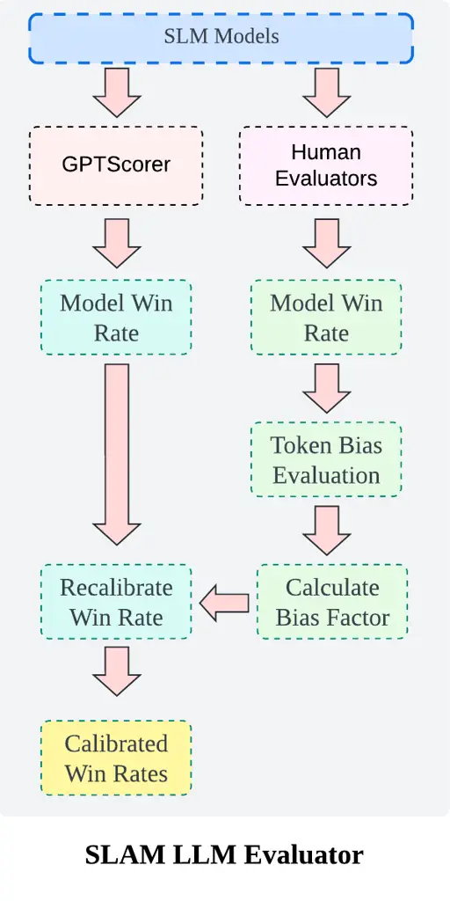

# Aligning Model Evaluations with Human Preferences: Mitigating Token Count Bias in Language Model Assessments

Roland Daynauth Affiliation: University of Michigan
Email: [daynauth@umich.edu](mailto:)    Jason Mars
Affiliation: University of Michigan Email: [profmars@umich.edu](mailto:)

###### Abstract

The SLAM paper demonstrated that on-device Small Language Models (SLMs)
are a viable and cost-effective alternative to API-based Large Language
Models (LLMs), such as OpenAI’s GPT-4, offering comparable performance
and stability. However, SLAM also identified discrepancies between human
preferences and traditional auto-evaluators. This follow-up paper
explores methods to align LLM evaluator preferences with human
evaluations by addressing biases, particularly toward higher token
counts. We employed Bayesian statistics and a t-test to quantify this
bias and developed a recalibration procedure to adjust the GPTScorer.
Our findings significantly improve aligning the recalibrated LLM
evaluator with human evaluations across multiple use cases. For
instance, spearman’s ranking correlation score in the Recommendation use
case improved from -27.27 to 44.55. These results highlight the
importance of accounting for biases in automated evaluations to ensure
fair and accurate model assessments. The recalibration process enhances
the reliability of automated evaluators, leading to better AI models
that align with human values and expectations. This study provides a
robust methodology for future research into bias correction and
emphasizes the feasibility and benefits of developing human-aligned AI
evaluation systems.

## 1 Introduction



Figure 1: Architecture of the SLAM LLM Evaluator

### 1.1 Background

The rapid advancement of Large Language Models (LLMs), such as OpenAI’s
GPT-4 ope (2023), has revolutionized natural language processing tasks
across various applications. These models have demonstrated exceptional
capabilities in generating human-like text, understanding context, and
performing multiple language tasks. However, deploying these models
often involves significant costs and dependency on external APIs, which
can be prohibitive for many organizations.

In contrast, on-device Small Language Models (SLMs) present a
cost-effective and stable alternativeTouvron et al. (2023); Jiang et al.
(2023); neu (2023); Wang et al. (2023); Mitra et al. (2023); sta (2023);
Zhu et al. (2023); Chiang et al. (2023); Tunstall et al. (2023). SLMs
can be deployed locally, reducing the reliance on external services and
offering comparable performance for specific use cases. The SLAM paper
explored this potential, demonstrating that SLMs could be viable
substitutes for API-based LLMs in production environments Irugalbandara
et al. (2023). Despite these promising results, SLAM highlighted a
critical issue: the misalignment between human preferences and the
evaluations provided by traditional automated evaluators.

Human evaluators often have different criteria and biases, such as a
preference for outputs with higher token counts, which are not
adequately captured by existing auto-evaluation metrics like SBERT and
BERTScore Reimers and Gurevych (2019); Zhang et al. (2020). This
discrepancy challenges ensuring that model performance evaluations are
fair and reflect human judgments. The need to bridge this gap between
human preferences and automated assessment is paramount for the reliable
deployment of AI models.

### 1.2 Objectives

The primary objective of this work is to address the misalignment
between LLM evaluator preferences and human evaluations by identifying
and correcting biases inherent in automated evaluation metrics.
Specifically, we hypothesize that human evaluators are biased toward
selecting models with higher token counts, which may distort the
perceived performance of different models. To investigate this, we
employ Bayesian statistics and statistical testing to measure and
quantify the bias in human evaluations.

Our approach involves the following key steps:

- •
  Identify and Quantify Bias: Utilize Bayesian statistics to compare the
  win probabilities of models with and without higher token counts and
  perform statistical tests to confirm the presence of bias.
- •
  Recalibrate Evaluator: Develop a recalibration procedure to adjust the
  GPTScorer, an LLM evaluator, to account for the identified bias,
  thereby improving its alignment with human preferences.
- •
  Evaluate and Validate: Conduct a comprehensive analysis of human
  evaluation data across four specific use cases: All Task (AT), First
  Task (FT), Peptalk (PT), and Recommendation (RE). Compare the original
  and recalibrated GPTScorer’s correlation with human rankings to
  demonstrate the effectiveness of our recalibration approach.

By achieving these objectives, we seek to enhance the practical
applicability of SLMs in production environments, ensuring that these
models perform well and align closely with user expectations and
preferences.

## 2 SLAM Evaluation Methodology

We conduct a case study of a real AI feature in a production application
with four distinct use cases. This study investigates the alignment
between human evaluations and automated evaluators in Small Language
Models (SLMs) versus Large Language Models (LLMs). First, we describe
the application and its key AI features. Subsequently, we present human
and automated evaluations for each use case, demonstrating that
traditional auto evaluators, such as SBERT and BERTScore, significantly
diverge from human preferences. This misalignment underscores the
necessity of recalibrating automated evaluators to reflect human
judgments better.

### 2.1 Use-Cases Introduction

The application in this case study is Myca, a personal task-management
and productivity application. In Myca, users create and manage their
plans and tasks across all aspects of their lives, such as work,
personal health, and finances, to stay organized, focused, and
productive. In addition, users can set their longer-term goals and daily
habits. Myca records the user’s daily accomplishments, progress toward
goals, habits, etc.

In this paper, we focus on five of its feedback features that help its
users improve their productivity:

- •
  First Task (FT): The "First Task" (FT) message is a personalized note
  provided to users when they create tasks on the Myca platform. It aims
  to commend and encourage users to take proactive steps in managing
  their responsibilities and offers motivation and support as they begin
  their journey with Myca.
- •
  All Task Completed (AT): The "All Task Completed" (AT) message is a
  commendatory note given to the user after they complete all their
  focused tasks for the day. It provides a high-level summary
  highlighting their accomplishments and offers encouragement and
  motivation in a natural, flowing narrative.
- •
  Daily Pep Talk (PT): At the beginning of every day, an encouraging
  message is presented to the user based on what they have accomplished
  the day before, what they plan to do today, and their progress toward
  their goals.
- •
  Recommendation (RE): The "Recommendation" (PT) message is a
  personalized suggestion provided to users on their first day using
  Myca, helping them organize their tasks into manageable categories.
  This message leverages an understanding of the created tasks to
  propose relevant categories to enhance the user’s productivity and
  organization. The recommendation is concise and avoids listing tasks
  individually, instead focusing on justifying the suggested categories.

### 2.2 Human Evaluation

During the evaluation process, each human evaluator is presented with
ten evaluation problems, each from one of four application use-case
scenarios, the original input prompt, and two candidate responses
generated by the SLMs. The human evaluator is asked to choose their
preferred response based on their judgment of its quality and relevance
to the original problem and intention described in the input prompt. If
the user is satisfied with neither response nor is deemed equal, they
may choose "About the Same" as their rating.

To prevent bias, a blind test is administered, in which the model that
generated the response is not disclosed to the evaluator. This ensures
ratings are based solely on the response quality, not preconceived
notions about a model’s capabilities or popularity. Responses are
presented in randomized order, which further helps reduce evaluation
bias. Each human evaluator must finish the set (all ten) of scorings
assigned to them for their response to qualify. This is designed mainly
for crowdsourcing to avoid inattentive and incomplete inputs from the
crowd workers. These incomplete responses are removed from the final
results as part of the aggregation and sanitation stage of the
evaluation pipeline.

#### 2.2.1 Ranking Human Evaluation

Evaluating SLMs involves ranking models based on their win rates derived
from human evaluations. This section outlines how to calculate win rates
and determine the models’ ranks.

The win rate of a model $`i`$, denoted as $`A_{i}`$, is defined as the
proportion of pairwise comparisons in which model $`i`$ is selected as
the winner, that is, the win rate $`A_{i}`$ is calculated as:

```math
A_{i}=\frac{W_{i}}{N_{i}}
```

where $`W_{i}`$ is the number of games won by model $`i`$ and $`N_{i}`$
is the number of games played by $`i`$.

In cases where two or more models have identical win rates, additional
criteria may be used to break ties. Possible tie-breaking methods
include considering the average score of the model outputs (if
available) or the total number of comparisons involving the model.
However, for simplicity, this study primarily focuses on win rates for
ranking.

Let $`R_{i}`$ denote the rank of model $`i`$. The model with the highest
win-rate $`A_{\max}`$ will have $`R=1`$, the second highest win-rate
will have $`R=2`$, and so forth.

This systematic approach accurately determines each model’s win rates
and subsequent ranks. This ranking methodology ensures a fair and
consistent evaluation of model performance based on human judgments. The
resulting ranks provide a transparent and interpretable measure of each
model’s relative performance.

### 2.3 SLAM Auto-Evaluators

#### 2.3.1 Traditional Similarity Evaluators

In the original paper, we utilized traditional evaluators such as SBERT
and USE-QA to assess the quality of model outputs. We expanded our
evaluation toolkit by including transformer-based metrics such as
BERTScore and BLUERTScore. Including these new scores aims to provide a
more comprehensive analysis and improve alignment with human
preferences.

Furthermore, we use the output from the latest version of ChatGPT-4 to
generate the reference output. Specifically, we provide ChatGPT-4 with
the same prompts as the LLM Evaluator and use its responses as the
reference answers. The automated evaluators then score each SLM output
by calculating how similar their answers are to these reference answers.
Each SLM is given a score based on the evaluator’s metric, and the
models are ranked by their respective scores for each evaluator.

- •
  SBERT: Sentence-BERT (SBERT) is a modification of the BERT network
  that uses Siamese and triplet network structures to derive
  semantically meaningful sentence embeddings that can be compared using
  cosine similarity Reimers and Gurevych (2019). This approach has been
  effective in capturing semantic similarity between sentences.
- •
  BERTScore: BERTScore evaluates text generation by aligning BERT
  embeddings of the candidate and reference sentences Zhang et al.
  (2020). It calculates the precision, recall, and F1 score based on the
  contextual embeddings from BERT, providing a robust semantic
  similarity measure.
- •
  USE: The Universal Sentence Encoder (USE) encodes sentences into
  high-dimensional vectors that capture their semantic content. These
  vectors can compute cosine similarity scores, offering a measure of
  semantic equivalence between sentences Cer et al. (2018). USE is
  included in SLAM2 to enhance the evaluation’s ability to capture
  diverse semantic nuances.
- •
  TF-IDF: Term Frequency-Inverse Document Frequency (TF-IDF) is a
  traditional information retrieval metric that assesses the importance
  of words in a document relative to a corpus. It compares the relevance
  of terms in model outputs to reference texts, providing a syntactic
  level of evaluation Rajaraman and Ullman (2011). Including TF-IDF in
  SLAM2 helps balance semantic evaluations with syntactic relevance.
- •
  BLEURTScore: BLEURT (Bilingual Evaluation Understudy with
  Representations from Transformers) leverages pre-trained transformers
  and a large amount of synthetic data to predict human judgments of
  text generation quality Sellam et al. (2020). BLEURTScore is
  introduced in SLAM2 to provide a sophisticated measure that combines
  the strengths of both traditional metrics and deep learning models.

#### 2.3.2 GPTScorer

GPTScorer is an evaluation tool designed to assess the performance of
language models by comparing their generated outputs to reference
outputs. It leverages the capabilities of GPT-4 to provide detailed and
nuanced evaluations. GPTScorer operates by judging the best model based
on its use case. Like the human evaluation, GPTScorer is given a prompt
from a randomly selected use case and response outputs from two SLMs. It
is prompted to choose the base response for that particular use case and
provide a reason for its selection. The prompt for GPTScorer is shown
below.

\[Use case\]

{usecase}

\[Response A\]

{response_a}

\[Response B\]

{response_b}

For the given use case, out of Response

A and Response B, Select the most

suitable output for the given usecase.

Provide Reasoning for the choice and

Output as a dictionary with a key

"overall". valueout of("Response A",

"Response B", "About the Same").

Follow the following template.

\[Reasoning\] \<Reason\>

\[Output\] \<Output\>

Listing 1: GPTScorer Prompt

### 2.4 Experimental Result

|             | AT     | FT    | PT     | RE     |
| ----------- | ------ | ----- | ------ | ------ |
| USE         | -30.91 | 39.09 | 13.64  | -43.64 |
| Tfidf       | 1.82   | 7.27  | 1.82   | 28.18  |
| Sbert       | -29.09 | -4.55 | 0.91   | -36.36 |
| BertScore   | 30.91  | 53.64 | -30.91 | -31.82 |
| BleurtScore | -23.64 | 18.18 | 24.55  | -44.55 |
| GPTScorer   | 25.45  | 7.27  | 43.64  | -27.27 |

Table 1: Ranking Correlation score between Human Rankings and Auto
Evaluators

Table  1 presents the ranking correlation scores between human rankings
and various automated evaluation methods. The evaluation results reveal
varied alignment between automatic and human evaluators across five use
cases. These results suggest that while BERTScore and GPTScore excel in
specific scenarios, no evaluator consistently matches human preferences
across all use cases, underscoring the need for tailored metrics.

## 3 Measuring human token count bias in pairwise evaluation

In exploring the alignment of LLM evaluator preferences with human
evaluations, we suspected that humans may inherently favor outputs with
higher token counts when evaluating SLMs. To investigate this potential
bias, we employed Bayesian statistics to measure and quantify the extent
of this preference.

Our starting point was the belief that when presented with two outputs
from different models, human reviewers are more likely to select the one
with a higher token count as the winner. As shown in Figure 2, a scatter
plot reveals a positive correlation between the human rankings of the
models and the number of tokens in their outputs. This positive
correlation suggests that human evaluators may indeed be influenced by
the length of the output, favoring models that produce more extended
responses.

If this bias is present, it could skew the evaluation results and
misalign automated evaluators with human preferences. Understanding and
addressing this bias is crucial to ensure that the evaluation process
fairly and accurately reflects the actual performance of the models
without undue influence from the length of their outputs.

(a) Token Count vs. human evaluation win rate for the peptalk use case

(b) Token Count vs. human evaluation win rate for the peptalk use case

Figure 2: Scatter plots showing the alignment between human SLM
preference and the length of their output

### 3.1 Measuring Token Bias with Bayesian Statistics

To measure this bias, we utilized Bayes’ Theorem, a foundational
principle in probability theory that allows us to update our beliefs
based on new evidence. In this context, Bayes’ Theorem helps us
calculate the probability that a model wins, given that it has a higher
token count than its competitor.

Bayes’ Theorem is expressed as follows:

```math
P(A_{i}\mid B_{i})=\frac{P(B_{i}\mid A_{i})\cdot P(A_{i})}{P(B_{i})}
```

Where:

- •
  $`P(A_{i}\mid B_{i})`$ is the probability that model $`i`$ wins given
  that it has a higher token count.
- •
  $`P(B_{i}\mid A_{i})`$ is the probability that model $`i`$ has a
  higher token count given that it wins.
- •
  $`P(A_{i})`$ is the prior probability that model $`i`$ wins.
- •
  $`P(B_{i})`$ is the overall probability that model $`i`$ has a higher
  token count.

To assess the bias, we need to determine if $`P(A_{i})`$ is
significantly higher when $`B_{i}`$ is high. Specifically, we compare
$`P(A_{i}\mid B_{i}>t)`$, where $`t`$ is a threshold indicating a higher
token count. If $`P(A_{i}\mid B_{i}>t)`$ is significantly higher than
$`P(A_{i})`$, it suggests a bias towards higher token counts.

#### 3.1.1 Statistical test for evaluation token bias

To determine whether human reviewers are biased towards selecting models
with higher token counts, we need to test the null hypothesis
($`H_{0}`$) that there is no bias. This can be done by comparing the
probabilities $`P(A_{i})`$ (the probability that model $`i`$ wins) and
$`P(A_{i}\mid B_{i}>t)`$ (the probability that model $`i`$ wins given it
has a higher token count). Here, we explain the statistical tests used
to determine whether the null hypothesis is accepted or rejected.

To rigorously test this hypothesis, we use the match outcome from the
human evaluation dataset. We calculated the overall win probability
$`P(A_{i})`$ as the proportion of matches won by model $`i`$ out of the
total matches $`N`$, and the conditional win probability
$`P(A_{i}\mid B_{i}>t)`$ as the proportion of matches won by model $`i`$
out of those where it had a higher token count $`T`$. We then computed
the variances and standard deviations for these probabilities.

The t-test was used to compare the means of these win probabilities. The
t-statistic was calculated as follows:

```math
t=\frac{\bar{X}_{1}-\bar{X}_{2}}{\sqrt{\frac{s_{1}^{2}}{N}+\frac{s_{2}^{2}}{T}}}
```

where $`\bar{X}_{1}`$ and $`\bar{X}_{2}`$ are the mean win
probabilities, and $`s_{1}`$ and $`s_{2}`$ are the standard deviations.
The degrees of freedom for the test were determined using:

```math
df=\frac{\left(\frac{s_{1}^{2}}{N}+\frac{s_{2}^{2}}{T}\right)^{2}}{\frac{\left(\frac{s_{1}^{2}}{N}\right)^{2}}{N-1}+\frac{\left(\frac{s_{2}^{2}}{T}\right)^{2}}{T-1}}
```

We calculated the p-value from the t-distribution with these degrees of
freedom. If the p-value was less than the significance level (e.g.,
$`\alpha=0.05`$), we rejected the null hypothesis ($`H_{0}`$) that there
is no bias, concluding that human reviewers do show a bias towards
selecting models with higher token counts. This statistical approach
allowed us to quantify and validate the hypothesized bias, ensuring our
evaluations align more closely with human preferences.

### 3.2 Calibrating LLM Evaluation for Token Bias

In our effort to align Large Language Model (LLM) evaluator preferences
with human evaluations, we identified a potential bias in human
reviewers favoring models with higher token counts. To address this bias
and ensure fairer evaluations, we developed a procedure to recalibrate
LLM evaluations, making them more consistent with human preferences.

Using Bayes’ Theorem, we calculated the conditional probability that a
model wins given that it has a higher token count
($`P(A_{i}\mid B_{i})`$), and compared this to the probability that a
model has a higher token count given that it wins
($`P(B_{i}\mid A_{i})`$). Specifically, the ratio
$`\frac{P(A_{i}\mid B_{i})}{P(B_{i}\mid A_{i})}`$ simplifies to
$`\frac{P(A_{i})}{P(B_{i})}`$, representing the relative likelihood of
winning versus having a higher token count. This ratio indicates bias,
with significant deviations suggesting an over- or under-influence of
token count on win probabilities.

We introduced an adjustment factor to account for the bias. The factor
was calculated based on the ratio of the human win-rate to the LLM
win-rate and the observed token count probability:

```math
\beta_{i}=\frac{P(A_{i}\mid B_{i})}{P(B_{i}\mid A_{i})}=\frac{P(A_{i})}{P(B_{i})}
```

Using the adjustment factor, we re-calibrated the LLM win rates:

```math
P(A_{i}^{Adjusted})=P(A_{i}^{LLM})\cdot\beta_{i}
```

## 4 Results and Discussion

In this section, we present and discuss the findings of our study on
recalibrating LLM evaluations to align more closely with human
preferences. The primary focus is on the impact of recalibrating the
GPTScorer to account for identified token count bias, thereby improving
its correlation with human rankings. The results are summarized in Table
2, which compares the correlation scores between human rankings and the
original and recalibrated GPTScorer.

### 4.1 Results

Table 2 shows the ranking correlation scores across four use cases: All
Task (AT), First Task (FT), Peptalk (PT), and Recommendation (RE). The
scores represent the correlation between human rankings and the
evaluations provided by the GPTScorer before and after recalibration.

The recalibrated GPTScorer demonstrates a moderate to significant
improvement in alignment with human evaluations across all use cases.

|                        | AT    | FT    | PT    | RE     |
| ---------------------- | ----- | ----- | ----- | ------ |
| GPTScorer              | 25.45 | 7.27  | 43.64 | -27.27 |
| Recalibrated GPTScorer | 44.55 | 20.00 | 44.55 | 44.55  |

Table 2: Ranking Correlation score between Human Rankings and the
Recalibrated GPTScorer and original GPTScorer showing moderate to
significant improvement in alignment between human and LLM evaluators.

### 4.2 Discussion

The results indicate that recalibrating the GPTScorer to account for
token count bias improves alignment with human preferences. This
improvement is particularly notable in the Recommendation (RE) use case,
where the correlation increased from a negative value to a significant
positive alignment. This suggests that the original GPTScorer may have
been substantially biased by token count, affecting its ability to align
with human judgments.

The improvements in the All Task (AT) and First Task (FT) use cases,
though moderate, are also significant. They highlight the effectiveness
of the recalibration process in enhancing the evaluator’s sensitivity to
human preferences. The slight improvement in the Peptalk (PT) use case
suggests that the original GPTScorer was already relatively well-aligned
with human evaluations, but recalibration still provided a minor
enhancement.

These findings underscore the importance of accounting for biases in
automated evaluators. By identifying and correcting for token count
bias, we can develop evaluators that provide more accurate and
human-aligned assessments of model performance. This improves the
reliability of automated evaluations and ensures that the models
selected for deployment truly reflect human preferences.

### 4.3 Implications for future research

The methodology and findings from this study provide a foundation for
further research into bias correction in LLM evaluators. Future work
could explore additional sources of bias and develop more sophisticated
recalibration techniques. Additionally, expanding the evaluation to
include a broader range of use cases and more diverse sets of human
evaluators could provide deeper insights into the generalizability of
the recalibration process.

This study demonstrates that recalibrating LLM evaluators to align with
human preferences is feasible and beneficial. The improved correlation
scores achieved through recalibration highlight the potential for
developing more accurate and fair evaluation systems, ultimately leading
to better AI models that align with human values and expectations.

## 5 Related Work

Language model evaluation has seen significant advancements with the
development of Large Language Models (LLMs) such as OpenAI’s GPT-3 and
GPT-4. These models have demonstrated exceptional capabilities in
various natural language processing tasks Brown et al. (2020). Despite
their success, the reliance on proprietary LLMs presents several
challenges, including high costs, performance variability, and lack of
control over the models.

Researchers have explored using SLMs as viable alternatives to address
these challenges. The SLAM study systematically evaluated the
feasibility of using on-device SLMs to replace API-based LLMs. It was
shown that SLMs could offer comparable performance, enhanced stability,
and significant cost savings Irugalbandara et al. (2023). However, the
study highlighted the gap in understanding human preferences for LLM
versus SLM outputs.

Traditional evaluators such as SBERT and BERTScore have been commonly
used for automated evaluation of model outputs Reimers and Gurevych
(2019); Zhang et al. (2020). These methods rely on comparisons to
reference responses, often failing to capture the nuances of human
preferences. As a result, there has been a growing interest in aligning
automated evaluators with human evaluations.

Numerous studies have investigated the alignment of Large Language
Models (LLMs) with human preferences, mainly focusing on evaluating LLM
performance through pairwise ranking. Damak et al. (2021) concentrated
on debiased explainable pairwise ranking from implicit feedback,
highlighting the Bayesian Personalized Ranking model’s capability to
handle implicit feedback. Nguyen et al. (2022) introduced a method for
interactive text summarization with preference feedback, integrating
preference learning to simulate human evaluation. Additionally, Song
(2024) proposed Preference Ranking Optimization (PRO) as a technique to
fine-tune LLMs for human alignment.

This study aims to address these challenges by recalibrating LLM
evaluators using statistical analysis of human evaluation data. Initial
results have shown promising improvements in alignment, suggesting that
better alignment can be achieved without expensive fine-tuning or
few-shot evaluations.

## 6 Conclusion

In this study, we addressed the critical issue of aligning large
language model (LLM) evaluations with human preferences by identifying
and mitigating biases inherent in automated evaluation metrics. Our
primary focus was on the bias toward higher token counts, which we
hypothesized would influence human evaluators when comparing Small
Language Models (SLMs). Through rigorous statistical analysis and
recalibration of the GPTScorer, we aimed to enhance the alignment
between LLM evaluators and human judgments.

Our findings reveal that the recalibrated GPTScorer showed significant
improvements in correlation with human evaluations across multiple use
cases. The most substantial improvement was observed in the
Recommendation (RE) use case, where the correlation score increased from
a negative value to a strong positive alignment. Other use cases, such
as All Task (AT) and First Task (FT), also demonstrated moderate
improvements, while the Peptalk (PT) use case saw a slight enhancement.

These results underscore the importance of accounting for biases in
automated evaluators to ensure fair and accurate assessments of model
performance. By implementing a bias adjustment factor based on the ratio
$`\frac{P(A\mid B)}{P(B\mid A)}`$, we successfully recalibrated the
GPTScorer, leading to better alignment with human preferences. This
recalibration process improves the reliability of automated evaluations
and ensures that the models selected for deployment genuinely reflect
human values and expectations.

Our study provides a foundational methodology for future research into
bias correction in LLM evaluators. Future work could extend this
approach to explore additional biases and develop more sophisticated
recalibration techniques. Moreover, expanding the evaluation to
encompass a broader range of use cases and a more diverse set of human
evaluators would provide deeper insights into the generalizability of
our findings.

In conclusion, recalibrating LLM evaluators to align with human
preferences is feasible and advantageous. The improved correlation
scores achieved through our recalibration process highlight the
potential for developing more accurate and fair evaluation systems,
ultimately leading to the deployment of better AI models that are
aligned with human judgments. This study represents a significant step
towards ensuring that AI systems are evaluated and selected to reflect
human values and preferences, paving the way for more trustworthy and
effective AI technologies.

## References

- neu (2023) 2023. neuralchat model listing.
  [https://huggingface.co/Intel/neural-chat-7b-v1-1](https://huggingface.co/Intel/neural-chat-7b-v1-1).
- ope (2023) 2023. OpenAI blog: ChatGPT.
  [https://openai.com/blog/chatgpt](https://openai.com/blog/chatgpt).
- sta (2023) 2023. Stabilitai: Stablelm.
  [https://github.com/Stability-AI/StableLM](https://github.com/Stability-AI/StableLM).
- Brown et al. (2020) Tom B Brown, Benjamin Mann, Nick Ryder, Melanie
  Subbiah, Jared D Kaplan, Prafulla Dhariwal, Arvind Neelakantan, Pranav
  Shyam, Girish Sastry, Amanda Askell, et al. 2020. Language models are
  few-shot learners. _Advances in neural information processing
  systems_, 33:1877–1901.
- Cer et al. (2018) Daniel Cer, Yinfei Yang, Sheng-yi Kong, Nan Hua,
  Nicole Limtiaco, Rhomni St. John, Noah Constant, Mario
  Guajardo-Cespedes, Steve Yuan, Chris Tar, et al. 2018. Universal
  sentence encoder. _arXiv preprint arXiv:1803.11175_.
- Chiang et al. (2023) Wei-Lin Chiang, Zhuohan Li, Zi Lin, Ying Sheng,
  Zhanghao Wu, Hao Zhang, Lianmin Zheng, Siyuan Zhuang, Yonghao Zhuang,
  Joseph E. Gonzalez, Ion Stoica, and Eric P. Xing. 2023. [Vicuna: An
  open-source chatbot impressing gpt-4 with 90%\* chatgpt
  quality](https://lmsys.org/blog/2023-03-30-vicuna/).
- Damak et al. (2021) Khalil Damak, Sami Khenissi, and Olfa
  Nasraoui. 2021. [Debiased explainable pairwise ranking from implicit
  feedback](https://doi.org/10.1145/3460231.3474274).
- Irugalbandara et al. (2023) Chandra Irugalbandara, Ashish Mahendra,
  Roland Daynauth, Tharuka Kasthuri Arachchige, Jayanaka Dantanarayana,
  Krisztian Flautner, Lingjia Tang, Yiping Kang, and Jason Mars. 2023.
  Scaling down to scale up: A cost-benefit analysis of replacing
  openai’s llm with open source slms in production.
- Jiang et al. (2023) Albert Q. Jiang, Alexandre Sablayrolles, Arthur
  Mensch, Chris Bamford, Devendra Singh Chaplot, Diego de las Casas,
  Florian Bressand, Gianna Lengyel, Guillaume Lample, Lucile Saulnier,
  Lélio Renard Lavaud, Marie-Anne Lachaux, Pierre Stock, Teven Le Scao,
  Thibaut Lavril, Thomas Wang, Timothée Lacroix, and William El
  Sayed. 2023. [Mistral 7b](https://arxiv.org/abs/2310.06825).
  _Preprint_, arXiv:2310.06825.
- Mitra et al. (2023) Arindam Mitra, Luciano Del Corro, Shweti Mahajan,
  Andres Codas, Clarisse Simoes, Sahaj Agarwal, Xuxi Chen, Anastasia
  Razdaibiedina, Erik Jones, Kriti Aggarwal, Hamid Palangi, Guoqing
  Zheng, Corby Rosset, Hamed Khanpour, and Ahmed Awadallah. 2023. [Orca
  2: Teaching small language models how to
  reason](https://arxiv.org/abs/2311.11045). _Preprint_,
  arXiv:2311.11045.
- Nguyen et al. (2022) Duy–Cuong Nguyen, Nguyen Viet Dung Nghiem,
  Bao-Sinh Nguyen, Dung Tien Le, Shahab Sabahi, Minh-Tien Nguyen, and
  Hung Lê. 2022. [Make the most of prior data: A solution for
  interactive text summarization with preference
  feedback](https://doi.org/10.18653/v1/2022.findings-naacl.147).
- Rajaraman and Ullman (2011) Anand Rajaraman and Jeffrey David
  Ullman. 2011. _Mining of Massive Datasets_. Cambridge University
  Press.
- Reimers and Gurevych (2019) Nils Reimers and Iryna Gurevych. 2019.
  Sentence-bert: Sentence embeddings using siamese bert-networks. _arXiv
  preprint arXiv:1908.10084_.
- Sellam et al. (2020) Thibault Sellam, Dipanjan Das, and Ankur P.
  Parikh. 2020. Bleurt: Learning robust metrics for text generation. In
  _Proceedings of the 58th Annual Meeting of the Association for
  Computational Linguistics_.
- Song (2024) Feifan Song. 2024. [Preference ranking optimization for
  human alignment](https://doi.org/10.1609/aaai.v38i17.29865).
  _Proceedings of the Aaai Conference on Artificial Intelligence_.
- Touvron et al. (2023) Hugo Touvron, Louis Martin, Kevin Stone, Peter
  Albert, Amjad Almahairi, Yasmine Babaei, Nikolay Bashlykov, Soumya
  Batra, Prajjwal Bhargava, Shruti Bhosale, et al. 2023. Llama 2: Open
  foundation and fine-tuned chat models. _arXiv preprint
  arXiv:2307.09288_.
- Tunstall et al. (2023) Lewis Tunstall, Edward Beeching, Nathan
  Lambert, Nazneen Rajani, Kashif Rasul, Younes Belkada, Shengyi Huang,
  Leandro von Werra, Clémentine Fourrier, Nathan Habib, Nathan Sarrazin,
  Omar Sanseviero, Alexander M. Rush, and Thomas Wolf. 2023. [Zephyr:
  Direct distillation of lm
  alignment](https://arxiv.org/abs/2310.16944). _Preprint_,
  arXiv:2310.16944.
- Wang et al. (2023) Guan Wang, Sijie Cheng, Qiying Yu, and Changling
  Liu. 2023. [OpenLLMs: Less is More for Open-source
  Models](https://doi.org/10.5281/zenodo.8105775).
- Zhang et al. (2020) Tianyi Zhang, Varsha Kishore, Felix Wu, Kilian Q
  Weinberger, and Yoav Artzi. 2020. Bertscore: Evaluating text
  generation with bert. _arXiv preprint arXiv:1904.09675_.
- Zhu et al. (2023) Banghua Zhu, Evan Frick, Tianhao Wu, Hanlin Zhu, and
  Jiantao Jiao. 2023. Starling-7b: Improving llm helpfulness and
  harmlessness with rlaif.
