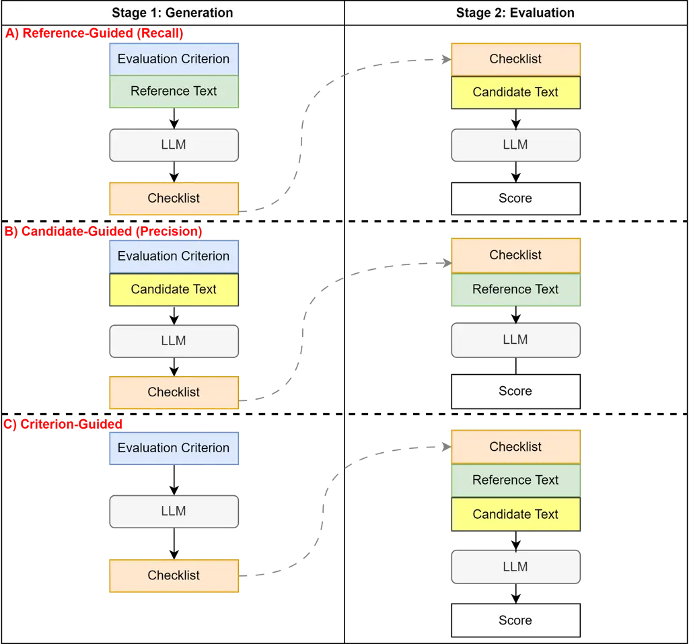

# Check-Eval: A Checklist-based Approach for Evaluating Text Quality

Jayr Pereira^(1,2)    Andre Assumpcao ³    Roberto Lotufo^(2,4)

###### Abstract

Evaluating the quality of text generated by large language models (LLMs)
remains a significant challenge. Traditional metrics often fail to align
well with human judgments, particularly in tasks requiring creativity
and nuance. In this paper, we propose Check-Eval, a novel evaluation
framework leveraging LLMs to assess the quality of generated text
through a checklist-based approach. Check-Eval can be employed as both a
reference-free and reference-dependent evaluation method, providing a
structured and interpretable assessment of text quality. The framework
consists of two main stages: checklist generation and checklist
evaluation. We validate Check-Eval on two benchmark datasets: Portuguese
Legal Semantic Textual Similarity and SummEval. Our results demonstrate
that Check-Eval achieves higher correlations with human judgments
compared to existing metrics, such as G-Eval and GPTScore, underscoring
its potential as a more reliable and effective evaluation framework for
natural language generation tasks. The code for our experiments is
available at https://anonymous.4open.science/r/check-eval-0DB4.

   

|                                                                                 |
| ------------------------------------------------------------------------------- |
| ¹Universidade Federal do Cariri (UFCA), Juazeiro do Norte-CE, Brazil            |
|                                                                                 |
| ²Universidade Estadual de Campinas (UNICAMP), Campinas-SP, Brazil               |
|                                                                                 |
| ³National Center for State Courts (NCSC), Williamsburg, Virginia, United States |
|                                                                                 |
| ⁴NeuralMind.ai, Brazil                                                          |
|                                                                                 |
| {jap2, snm, cz, rdnf}@cin.ufpe.br                                               |

 

## 1 Introduction

Evaluating the quality of text generated by large language models (LLMs)
remains an open problem within the field of natural language generation
(NLG). Traditional evaluation metrics, such as BLEU \[Papineni et al.
2002\], ROUGE \[Lin 2004\], and METEOR \[Banerjee and Lavie 2005\],
often show limited correlation with human judgments, especially in tasks
that require creativity and diversity, such as dialogue generation and
summarization. Despite advancements in LLMs, which can produce
high-quality, fluent texts that closely mirror human writing, the
challenge lies in accurately assessing these outputs quality.

Recent approaches utilizing LLMs as text quality evaluators have shown
promise, yet they still fall short in achieving reliable alignment with
human judgments \[Liu et al. 2023, Fu et al. 2023\]. This ongoing
challenge underscores the necessity for more effective and scalable
evaluation frameworks that can bridge the gap between automated metrics
and human evaluators, ensuring that the outputs of NLG systems meet the
desired standards of coherence, relevance, and overall quality \[Liu
et al. 2023\].

In this paper, we propose Check-Eval, a text evaluation framework that
leverages the strengths of LLMs to assess the quality of generated text.
The proposed method instructs the LLM to generate a checklist of key
points that should be present in a candidate text for it to be
considered high-quality. This checklist is derived from the source or
reference text, providing a structured and interpretable reference for
evaluating the candidate. By comparing the candidate text to the
generated checklist, Check-Eval can provide a nuanced and comprehensive
assessment of text quality, capturing essential elements such as content
consistency, coherence, and relevance.

We evaluate Check-Eval in two main scenarios, both based on human
judgments: (1) the Portuguese Legal Semantic Textual Similarity dataset
\[da Silva Junior et al. 2024\], a benchmark dataset for evaluating the
semantic similarity of legal texts in Portuguese, and (2) the SummEval
dataset \[Fabbri et al. 2021\], a benchmark dataset for text
summarization evaluation. Our experiments demonstrate that Check-Eval
achieves higher correlations with human judgments compared to existing
metrics, such as G-Eval and GPTScore, highlighting its potential as a
more reliable and effective evaluation framework for NLG tasks.
Additionally, we show that Check-Eval can identify specific areas of
improvement in the generated summaries, providing valuable feedback for
model development and refinement.

The main contributions of this paper are:

- •
  Introduction of Check-Eval: A novel evaluation framework leveraging
  LLMs for text quality assessment.
- •
  Comprehensive Evaluation: Demonstrating the superior performance of
  Check-Eval on two benchmark datasets.
- •
  Insightful Feedback: Highlighting the ability of Check-Eval to
  identify specific areas of improvement, aiding in model development
  and refinement.

The remainder of this paper is organized as follows: Section 2 provides
an overview of related work. Section 3 introduces the Check-Eval
framework, detailing the checklist generation and evaluation stages.
Section 4 describes the experimental settings and dataset used to
evaluate Check-Eval. Section 5 presents the results of the experiments,
comparing Check-Eval to existing metrics. Finally, Section 6 concludes
the paper and discusses future directions for research.

## 2 Related Work

The evaluation of automatically generated text has been a persistent
challenge in the NLG field. Traditional metrics such as BLEU, ROUGE, and
METEOR have been extensively used but have shown limitations in aligning
with human judgment, particularly in tasks requiring creativity and
nuance \[Fabbri et al. 2021\]. In recent years, more sophisticated
evaluation frameworks leveraging LLMs have been proposed to address
these shortcomings. Two recent methods are GPTScore \[Fu et al. 2023\]
and G-Eval \[Liu et al. 2023\].

GPTScore is a framework that utilizes generative pre-trained
transformers (GPTs) and other language models to evaluate NLG outputs
without relying on reference texts. The core idea is to assess the
probability that the LLM assigns to the generated text, under the
assumption that higher probabilities indicate higher quality. Fu et al.
(2023) \[Fu et al. 2023\] demonstrated that GPTScore could achieve
better correlations with human judgments compared to traditional
metrics, especially in open-ended tasks such as dialogue generation and
creative writing. However, despite its advancements, the method lacks
interpretability and may be biased towards texts similar to those seen
during the model’s training phase.

G-Eval is another recent approach that leverages the capabilities of
LLMs, specifically GPT-4, to improve NLG evaluation. Proposed by Liu et
al. (2023) \[Liu et al. 2023\], G-Eval introduces a chain-of-thought
(CoT) \[Wei et al. 2022\] paradigm where the evaluation process is
guided by detailed intermediate steps generated by the LLM. This method
has shown improvements in correlation with human evaluations,
particularly in tasks such as text summarization and dialogue
generation. To address issues with score distribution and variability,
G-Eval employs a self-consistency strategy. Specifically, it generates
multiple samples ($`n=20`$) using different decoding parameters and
averages the evaluation scores across these samples. This approach helps
mitigate two key problems: the dominance of a single score (such as 3 on
a 1-5 scale) and the tendency of LLMs to output integer scores, even
when decimal values are requested. By using self-consistency, G-Eval
captures more subtle differences between generated texts and provides a
more reliable assessment of text quality.

While both GPTScore and G-Eval represent significant advancements in
automatic text quality evaluation, Check-Eval aims to address their
limitations through a novel checklist-based approach. Unlike GPTScore,
which relies on the probabilistic output of LLMs, Check-Eval generates a
checklist of key points derived from the source text. This checklist
serves as a concrete reference against which the generated summary is
evaluated, providing a more structured and interpretable assessment of
content consistency, coherence, and relevance.

Furthermore, Check-Eval builds upon the structured evaluation paradigm
of G-Eval but simplifies the evaluation process by focusing on key
content points rather than generating comprehensive CoT steps. This
approach not only reduces the potential for bias towards LLM-generated
texts but also enhances the scalability and applicability of the
evaluation framework to a wider range of NLG tasks. By providing
actionable feedback, Check-Eval can more effectively guide model
improvement and refinement, ultimately leading to the generation of
higher-quality text.

## 3 Check-Eval

In this section, we introduce Check-Eval, an LLM-based evaluation
framework designed to assess the quality of automatically generated
text. Check-Eval leverages the capabilities of large language models
(LLMs) to generate and evaluate a checklist of key points derived from
the reference document and the candidate text. The primary aim of
Check-Eval is to provide a more structured, interpretable, and
comprehensive assessment of text quality.

The Check-Eval framework consists of two main stages: checklist
generation and checklist evaluation, as illustrated in Figure 1. The
framework has three main variations: (1) Reference-Guided, (2)
Candidate-Guided, and (3) Criterion-Guided evaluation. The
Reference-Guided variation uses a reference text to generate the
checklist, which is then used to evaluate the candidate text. The
Candidate-Guided variation works similarly, but the checklist is
generated from the candidate text and used to evaluate the reference
text. These two variations function as recall and precision evaluations,
respectively.

Figure 1: Illustration of the Check-Eval methodology.

The Criterion-Guided variation uses specific evaluation criteria to
generate the checklist, which is then used to evaluate the candidate
text against the reference text. It is useful when no reference text is
available, such as in the case of text summarization tasks. Deciding
which variation to use depends on the evaluation scenario and the
characteristics of the dataset. The following sections describe the
checklist generation and evaluation stages in detail.

### 3.1 Checklist Generation

The first stage of Check-Eval involves generating a checklist of key
points to evaluate the quality of the candidate text. Below, we describe
the checklist generation process for the framework’s variations.

#### 3.1.1 Reference-Guided and Candidate-Guided Checklist Generation

For this step, let’s consider the reference and the candidate text used
in the reference-guided and candidate-guided variations, respectively,
as the source document. The LLM is prompted to extract the essential
information from the source document and create an evaluation checklist
based on predefined evaluation criteria. The checklist serves as a
structured reference for the key points that should be present in the
text to be evaluated.

Figure 2: Prompt used to generate the checklist from a source text. The
blue text is the definition of the evaluation criteria, which is a
variable that can be changed according to the desired evaluation
criteria (e.g., consistency, coherence, relevance and fluency).

Figure 2 shows the prompt used to generate the checklist from a source
text given specific evaluation criteria. The criteria can be adjusted
according to the desired evaluation focus, such as consistency,
coherence, relevance, and fluency, which are generally used in text
summarization tasks. Defining the evaluation criteria is crucial to
ensure that the generated checklist captures the essential elements that
should be present in a high-quality summary. The checklist generation
process is repeated for each source document and each evaluation
criterion, resulting in a set of reference checklists that can be used
to evaluate candidate texts. The prompt is designed to guide the LLM in
generating a comprehensive and relevant checklist that captures the main
concepts and elements of the source document, avoiding redundancies and
minor details.

The output of the checklist generation stage is a list of yes/no
questions that represent the key points extracted from the source
document. Each question corresponds to a unique concept or element from
the text that should be present in a high-quality candidate text.

To illustrate the interpretability power of Check-Eval evaluation,
consider the example of a generated checklist based on a source document
about climate change shown in Figure 3. This example demonstrates how
Check-Eval generates a structured and interpretable checklist that
captures the key points of the source document that should be present in
a high-quality candidate text.

Figure 3: Example of a generated checklist based on a source document
about climate change. The checklist aims to capture the key points of
the source document and serves as a reference for evaluating the
candidate summary.

#### 3.1.2 Criterion-Guided Checklist Generation

In the criterion-guided variation, the checklist is generated based on
specific evaluation criteria, such as consistency, coherence, relevance,
and fluency. The LLM is prompted to create a checklist of key points to
consider when evaluating the quality of a text in comparison to the
reference text, based on the chosen evaluation criteria. The prompt used
for this variation is similar to the one used for the reference-guided
and candidate-guided variations, but it only includes the evaluation
criteria, as shown in Figure 4. The checklist generated in this
variation is used to evaluate the candidate text against the reference
text.

### 3.2 Checklist Evaluation

The second stage of the Check-Eval framework involves evaluating the
candidate text based on the generated checklist. The LLM is prompted to
compare the content of the candidate text to the key points in the
checklist and determine the presence or absence of each key point.

Figure 4: Prompt used to evaluate a candidate summary based on the
generated checklist. The checklist is specific to the evaluation
criteria, in this case, consistency.

Figure 4 shows the prompt used to evaluate a candidate text based on the
generated checklist for either the reference-guided or candidate-guided
variations. The prompt specifies the evaluation criteria—in this case,
consistency—which is an optional variable that can be changed according
to the desired evaluation focus. The LLM is instructed to assess the
defined criteria of the text by comparing its content to the key points
in the checklist and determining whether each key point is present. The
checklist ensures a structured and comprehensive assessment.

For the criterion-guided variation, the prompt is similar to the one
used for the reference-guided and candidate-guided variations, but the
reference and the candidate text are passed together with the checklist
generated based on the chosen evaluation criteria. The LLM is prompted
to evaluate the candidate text against the reference text based on the
checklist.

The output of the checklist evaluation stage is a score that reflects
the quality of the candidate text based on the presence or absence of
key points in the checklist. The score indicates how well the text
captures the essential elements of the source document according to
specific evaluation criteria. For example, in the case of evaluating
consistency, the score reflects the factual alignment between the
reference and the candidate text, considering the presence of entailed
statements and the absence of hallucinated facts. The final score is
calculated by counting the number of key points present in the text,
providing a quantitative measure of the text’s quality.

## 4 Experiments

In this section, we describe the experiments conducted to evaluate the
performance of Check-Eval. We begin by detailing the datasets used,
followed by the experimental settings.

### 4.1 Portuguese Legal Semantic Textual Similarity

We evaluated Check-Eval using the Portuguese Legal Semantic Textual
Similarity \[da Silva Junior et al. 2024\] dataset, a benchmark dataset
for evaluating the semantic similarity of legal texts in Portuguese. The
dataset consists of pairs of legal documents, each annotated with a
similarity score. The dataset provides two versions of the annotations:
one performed by legal experts on 32 pairs of legal documents and
another automated annotation using heuristics based on legal cases
metadata. The overall correlation between the human and automated
annotations is 0.45 (Pearson correlation coefficient) and 0.43 (Spearman
correlation coefficient). We experimented with the 32 pairs annotated by
legal experts and a subset of 100 pairs annotated by the automated
method randomly selected from the dataset.

#### 4.1.1 Experimental Settings

We evaluated the first two variations of Check-Eval (Reference-Guided
and Candidate-Guided) using the Portuguese Legal Semantic Textual
Similarity dataset. As we consider the reference-guided variation as the
recall evaluation and the candidate-guided variation as the precision
evaluation, we also computed the F1 score as the harmonic mean of the
recall and precision scores. We used OpenAI’s GPT-4-turbo model to
perform both checklist generation and checklist evaluation. The
following steps outline the experimental setup:

1.  1.  Checklist Generation: For each text pair (text 1 and text 2) in the
        dataset, we prompted the LLM to generate a checklist of key points
        based on the criteria of relevance, coherence, consistency, and
        fluency. For the reference-guided variation, the checklist was
        generated from text 1, and for the candidate-guided variation, the
        checklist was generated from text 2. The prompt used for checklist
        generation is a translation of the prompt used for the SummEval
        dataset, as shown in Figure 2.
2.  2.  Checklist Evaluation: Each text pair was evaluated based on the
        generated checklist. The LLM was prompted to assess the presence or
        absence of each key point in text 2 (candidate text) compared to
        text 1 (reference text). The prompt used for checklist evaluation is
        a translation of the prompt used for the SummEval dataset, as shown
        in Figure 4.
3.  3.  Scoring: The final score for each text pair was calculated by
        counting the number of key points present in text 2, providing a
        quantitative measure of its quality. The F1 score was computed as
        the harmonic mean of the recall and precision scores.

### 4.2 SummEval Dataset

We also evaluated Check-Eval in a reference-free evaluation scenario
using the SummEval dataset \[Fabbri et al. 2021\]. The SummEval dataset
consists of automatically generated summaries for news articles from the
CNN/DailyMail dataset, along with human annotations for the quality
dimensions of coherence, consistency, fluency, and relevance. This
dataset provides a comprehensive benchmark for comparing the performance
of different evaluation metrics against human judgments. In this case,
we evaluated the Criterion-Guided variation of Check-Eval using the
SummEval dataset.

#### 4.2.1 Experimental Settings

For our experiments, we used the GPT-4 model to perform both checklist
generation and checklist evaluation. We prompted GPT-4 to generate a
checklist of key points based on the evaluation criteria provided in the
SummEval paper \[Fabbri et al. 2021\]. The following steps outline the
experimental setup:

1.  1.  Checklist Generation: For each of the evaluation criteria
        (consistency, relevance, coherence, and fluency), we prompted GPT-4
        to generate a checklist of key points based on the criteria
        definitions provided in the SummEval paper \[Fabbri et al. 2021\].
2.  2.  Checklist Evaluation: Each candidate summary was evaluated against
        the generated checklist. GPT-4 was prompted to assess the presence
        or absence of each key point in the summary. The prompt used for
        checklist evaluation is shown in Figure 4.
3.  3.  Scoring: The final score for each candidate summary was calculated
        by counting the number of key points present in the summary,
        providing a quantitative measure of its quality.

## 5 Results

In this section, we present the results of our experiments evaluating
the performance of Check-Eval.

### 5.1 Portuguese Legal Semantic Textual Similarity

Table 1 summarizes the results of Check-Eval on the Portuguese Legal
Semantic Textual Similarity dataset. The table presents the Pearson
($`\rho`$) and Spearman ($`\rho_{s}`$) correlations for the
reference-guided and candidate-guided variations, as well as the F1
score, which is the harmonic mean of the recall (reference-guided) and
precision (candidate-guided) scores. The results demonstrate that
Check-Eval achieves correlation scores above the 0.45 (Pearson) and 0.43
(Spearman) of the automated annotations from the dataset, indicating
that Check-Eval provides a reliable and effective evaluation of text
similarity in the legal domain.

| Method           | Consistency |              | Relevance |              | Coherence |              | Fluency  |              | AVG      |              |
| ---------------- | ----------- | ------------ | --------- | ------------ | --------- | ------------ | -------- | ------------ | -------- | ------------ |
|                  | $`\rho`$    | $`\rho_{s}`$ | $`\rho`$  | $`\rho_{s}`$ | $`\rho`$  | $`\rho_{s}`$ | $`\rho`$ | $`\rho_{s}`$ | $`\rho`$ | $`\rho_{s}`$ |
| Reference-guided | 0.45        | 0.52         | 0.58      | 0.63         | 0.49      | 0.57         | 0.16     | 0.139        | 0.56     | 0.61         |
| Candidate-guided | 0.55        | 0.62         | 0.58      | 0.59         | 0.55      | 0.55         | 0.25     | 0.14         | 0.62     | 0.62         |
| F1               | 0.47        | 0.51         | 0.58      | 0.58         | 0.51      | 0.53         | 0.28     | 0.17         | 0.58     | 0.59         |

Table 1: Check-Eval results for Portuguese Legal Semantic Textual
Similarity. The table presents ($`\rho`$) Pearson and ($`\rho_{s}`$)
Spearman correlations.

We evaluated the performance of Check-Eval across four evaluation
criteria: consistency, relevance, coherence, and fluency. Additionally,
we computed the average correlation across all criteria to provide an
overall assessment of Check-Eval’s performance. The results show that
Check-Eval achieves competitive correlations with human judgments across
all criteria. The F1 score also demonstrates the effectiveness of
Check-Eval in capturing the essential elements of the source text in the
candidate summary.

The candidate-guided variation of Check-Eval achieves higher
correlations with human judgments compared to the reference-guided
variation. However, for this dataset, the F1 score provides a more
balanced evaluation of text quality, as both candidate and reference
texts are equally important. Overall, the results indicate that
Check-Eval is a reliable and effective evaluation framework for
assessing the quality of text similarity in the legal domain.

We also evaluated Check-Eval using the automated annotations from the
dataset. Table 2 presents the results for a sub-sample of 100 pairs
automatically annotated by the heuristics proposed in \[da Silva Junior
et al. 2024\]. The results show that Check-Eval achieves higher
correlations with the automated annotations compared to the human
annotations. For example, the reference-guided variation shows a Pearson
correlation of 0.53 for consistency with automated annotations, whereas
it shows 0.45 with human annotations. This suggests that the automated
annotations align more closely with the systematic evaluation approach
of Check-Eval.

| Method           | Consistency |              | Relevance |              | Coherence |              | AVG      |              |
| ---------------- | ----------- | ------------ | --------- | ------------ | --------- | ------------ | -------- | ------------ |
|                  | $`\rho`$    | $`\rho_{s}`$ | $`\rho`$  | $`\rho_{s}`$ | $`\rho`$  | $`\rho_{s}`$ | $`\rho`$ | $`\rho_{s}`$ |
| Reference-guided | 0,53        | 0,54         | 0,54      | 0,55         | 0,54      | 0,58         | 0,56     | 0,58         |
| Candidate-guided | 0,52        | 0,51         | 0,56      | 0,57         | 0,57      | 0,58         | 0,58     | 0,57         |
| F1               | 0,50        | 0,49         | 0,53      | 0,55         | 0,55      | 0,61         | 0,55     | 0,57         |

Table 2: Check-Eval results for Portuguese Legal Semantic Textual
Similarity. The table presents ($`\rho`$) Pearson and ($`\rho_{s}`$)
Spearman correlations computed for a sub-sample of 100 pairs
automatically annotated by the heuristics proposed in \[da Silva Junior
et al. 2024\].

The higher correlations with automated annotations could be attributed
to the nature of automated heuristics, which tend to be more consistent
and systematic compared to human annotations that can be subjective and
vary significantly between annotators. Automated annotations might
follow strict rules that closely match the checklist-based approach of
Check-Eval, resulting in higher alignment.

Moreover, the fluency criterion was excluded from the evaluation with
automated annotations as it showed negative correlations at early
evaluation stages. This exclusion might have contributed to the higher
average correlations observed with automated annotations, as fluency
tends to be more subjective and harder to evaluate consistently by both
automated methods and LLMs.

### 5.2 SummEval Dataset

We compare Check-Eval against existing reference-free evaluation
metrics, including G-Eval and GPTScore, using the SummEval dataset. The
primary evaluation metrics used are Spearman’s rank correlation
coefficient ($`\rho`$) and Kendall-Tau correlation coefficient
($`\tau`$), which measure the correlation between the automated
evaluation scores and human judgments. Table 3 summarizes the results of
Check-Eval compared to G-Eval and GPTScore across four evaluation
criteria: consistency, relevance, coherence, and fluency. Additionally,
we report the average correlation across all criteria.

| Method     | Consistency  |          | Relevance    |          | Coherence    |          | Fluency      |          | AVG          |          |
| ---------- | ------------ | -------- | ------------ | -------- | ------------ | -------- | ------------ | -------- | ------------ | -------- |
|            | $`\rho_{s}`$ | $`\tau`$ | $`\rho_{s}`$ | $`\tau`$ | $`\rho_{s}`$ | $`\tau`$ | $`\rho_{s}`$ | $`\tau`$ | $`\rho_{s}`$ | $`\tau`$ |
| G-eval     | 0.51         | 0.42     | 0.55         | 0.43     | 0.58         | 0.46     | 0.45         | 0.38     | 0.51         | 0.42     |
| GPTScore   | 0.45         |          | 0.38         |          | 0.43         |          | 0.40         |          | 0.41         |          |
| Check-Eval | 0.60         | 0.57     | 0.50         | 0.42     | 0.56         | 0.46     | 0.49         | 0.44     | 0.62         | 0.49     |

Table 3: Check-Eval results on SummEval. Summary-level ($`\rho_{s}`$)
Spearman and ($`\tau`$) Kendall-Tau correlations.

#### 5.2.1 Consistency

Check-Eval achieves a Spearman correlation of 0.605 and a Kendall-Tau
correlation of 0.570 for the consistency criterion, outperforming both
G-Eval (0.507, 0.425) and GPTScore (0.449, -) significantly. This
indicates that Check-Eval’s checklist-based approach provides a more
reliable assessment of the factual alignment between the generated
summaries and the source documents.

#### 5.2.2 Relevance

For relevance, Check-Eval achieves a Spearman correlation of 0.502 and a
Kendall-Tau correlation of 0.420. Although G-Eval slightly outperforms
Check-Eval in this criterion with a Spearman correlation of 0.547 and
Kendall-Tau correlation of 0.433, Check-Eval still shows competitive
performance, highlighting its robustness across different evaluation
dimensions.

#### 5.2.3 Coherence

Check-Eval demonstrates strong performance in coherence, with a Spearman
correlation of 0.563 and a Kendall-Tau correlation of 0.461, compared to
G-Eval’s 0.582 and 0.457. Although G-Eval slightly surpasses Check-Eval
in this criterion, the results indicate that Check-Eval’s structured
approach to evaluating the logical flow and clarity of summaries is
highly effective.

#### 5.2.4 Fluency

For fluency, Check-Eval achieves the highest Spearman and Kendall-Tau
correlations (0.490 and 0.446, respectively), outperforming G-Eval
(0.455, 0.378) and GPTScore (0.403). This suggests that Check-Eval is
particularly adept at assessing the grammatical and stylistic quality of
the generated text.

#### 5.2.5 Overall Performance

Overall, Check-Eval achieves the highest average correlations across all
criteria. These results were computed by averaging the human annotation
scores for each criterion and comparing them to the automated evaluation
scores generated by Check-Eval, G-Eval, and GPTScore. Check-Eval
demonstrates superior performance with an average Spearman correlation
of 0.623 and an average Kendall-Tau correlation of 0.493. These results
demonstrate that Check-Eval provides a more comprehensive and accurate
evaluation of generated text quality compared to existing metrics.

The superior performance of Check-Eval can be attributed to its
checklist-based approach, which allows for a more detailed and
structured evaluation of key content points. Traditional metrics often
struggle with subjective aspects of text quality, such as coherence and
relevance, due to their reliance on surface-level comparisons. In
contrast, Check-Eval systematically identifies and evaluates essential
elements within the text, ensuring that all critical aspects are
considered.

## 6 Conclusions

In this paper, we introduced Check-Eval, a novel evaluation framework
for assessing the quality of automatically generated text. Check-Eval
leverages large language models (LLMs) to generate and evaluate a
checklist of key points derived from the source document and the
candidate summary. Our experiments demonstrated that Check-Eval
significantly outperforms existing text evaluation metrics, such as
GPTScore and G-Eval, in terms of correlation with human judgments across
various dimensions of text quality, including consistency, relevance,
coherence, and fluency.

One of the key strengths of Check-Eval is its ability to provide a
structured and interpretable assessment of text quality. By focusing on
key points extracted from the source document, Check-Eval offers a
detailed evaluation framework that aligns with human judgment. The
checklist-based approach aims to ensure that all essential elements of
the source document are considered, leading to a more comprehensive and
focused evaluation. This way, this method tries to mitigate the
ambiguity and variability often associated with human judgment by
standardizing the evaluation criteria and providing a concrete framework
for assessment.

Additionally, Check-Eval reduces the potential for bias present in
probabilistic models like GPTScore, which may favor texts similar to
those seen during the model’s training phase. By concentrating on the
presence of specific content elements, Check-Eval provides a fairer and
more objective evaluation. This approach also offers actionable feedback
by pinpointing specific areas where the generated text deviates from
expected quality standards, thus aiding in targeted improvements and
refinements.

We evaluated Check-Eval using the Portuguese Legal Semantic Textual
Similarity dataset, where it demonstrated higher correlation scores with
human judgments compared to automated annotations, indicating its
reliability and effectiveness in the legal domain. We also evaluated our
method using the SummEval dataset. In this case, the results indicate
that Check-Eval achieves higher correlations with human judgments
compared to traditional metrics and other LLM-based evaluators. This
superior performance underscores the potential of Check-Eval as a
reliable and effective evaluation framework for NLG tasks.

Despite its strengths, our study has some limitations. Firstly, the
performance of Check-Eval is inherently tied to the capabilities of the
underlying LLM, which may introduce biases or errors in checklist
generation and evaluation. Secondly, the current implementation of
Check-Eval may require significant computational resources, making it
less accessible for researchers with limited resources. Lastly, while we
demonstrated the effectiveness of Check-Eval in the context of text
summarization and legal text similarity, its performance in other NLG
tasks remains to be thoroughly evaluated.

Future work should focus on addressing these limitations by exploring
ways to optimize the computational efficiency of Check-Eval and
extending its application to a broader range of NLG tasks. Additionally,
further research is needed to refine the checklist generation process to
minimize potential biases and improve the robustness of evaluations.

## Declaration of Generative AI and AI-assisted technologies in the writing process

During the preparation of this paper, the authors used ChatGPT to check
the grammar and semantics of the human written text. After using this
tool/service, the authors reviewed and edited the content as needed and
take full responsibility for the content of the publication.

## References

- \[Banerjee and Lavie 2005\] Banerjee, S. and Lavie, A. (2005). Meteor:
  An automatic metric for mt evaluation with improved correlation with
  human judgments. In Proceedings of the acl workshop on intrinsic and
  extrinsic evaluation measures for machine translation and/or
  summarization, pages 65–72.
- \[da Silva Junior et al. 2024\] da Silva Junior, D., dos
  Santos Corval, P. R., de Oliveira, D., and Paes, A. (2024). Datasets
  for portuguese legal semantic textual similarity. Journal of
  Information and Data Management, 15(1):206–215.
- \[Fabbri et al. 2021\] Fabbri, A. R., Kryściński, W., McCann, B.,
  Xiong, C., Socher, R., and Radev, D. (2021). SummEval: Re-evaluating
  Summarization Evaluation. Transactions of the Association for
  Computational Linguistics, 9:391–409.
- \[Fu et al. 2023\] Fu, J., Ng, S.-K., Jiang, Z., and Liu, P. (2023).
  Gptscore: Evaluate as you desire.
- \[Lin 2004\] Lin, C.-Y. (2004). Rouge: A package for automatic
  evaluation of summaries. In Text summarization branches out, pages
  74–81.
- \[Liu et al. 2023\] Liu, Y., Iter, D., Xu, Y., Wang, S., Xu, R., and
  Zhu, C. (2023). G-eval: Nlg evaluation using gpt-4 with better human
  alignment.
- \[Papineni et al. 2002\] Papineni, K., Roukos, S., Ward, T., and Zhu,
  W.-J. (2002). Bleu: a method for automatic evaluation of machine
  translation. In Proceedings of the 40th annual meeting of the
  Association for Computational Linguistics, pages 311–318.
- \[Wei et al. 2022\] Wei, J., Wang, X., Schuurmans, D., Bosma, M.,
  ichter, b., Xia, F., Chi, E., Le, Q. V., and Zhou, D. (2022).
  Chain-of-thought prompting elicits reasoning in large language models.
  In Koyejo, S., Mohamed, S., Agarwal, A., Belgrave, D., Cho, K., and
  Oh, A., editors, Advances in Neural Information Processing Systems,
  volume 35, pages 24824–24837. Curran Associates, Inc.
