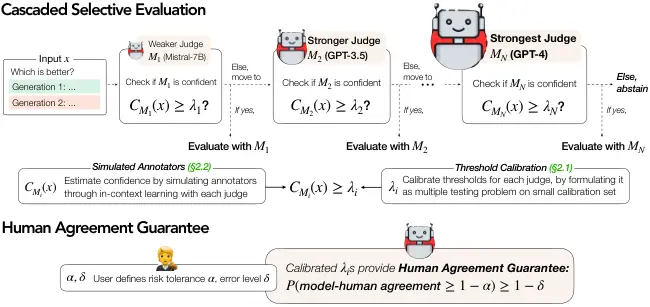
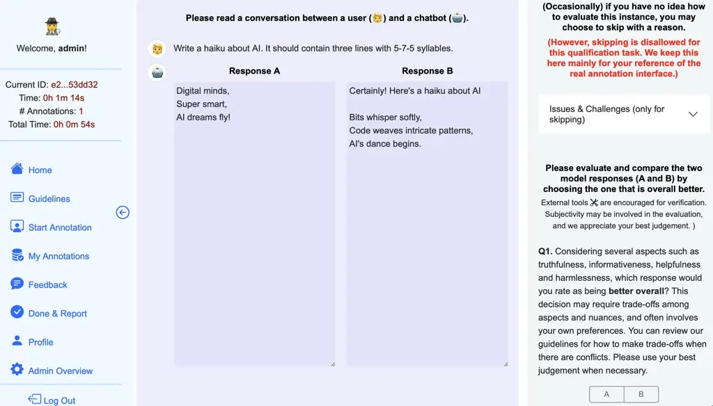
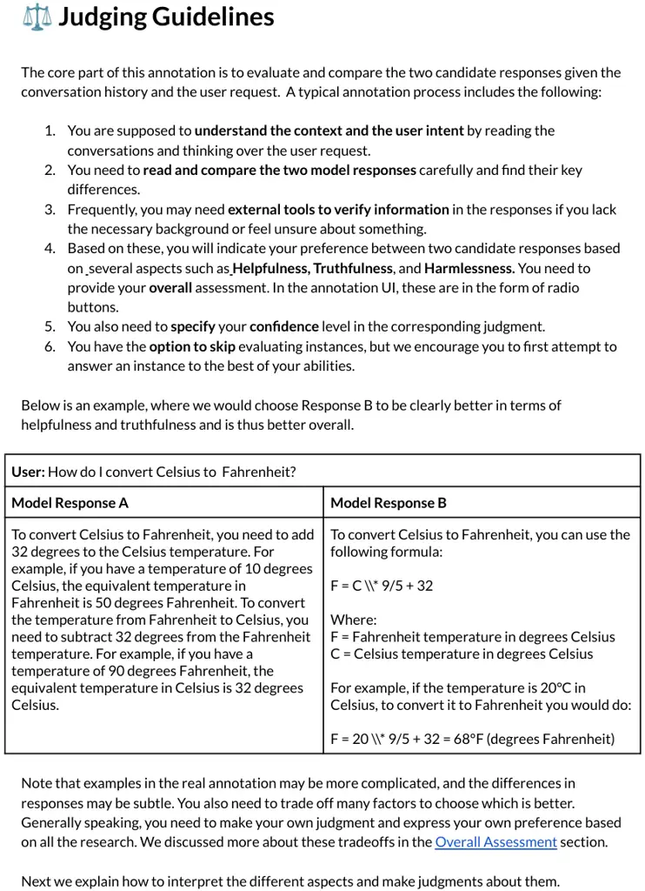

# Trust or Escalate: LLM Judges with Provable Guarantees for Human Agreement

Jaehun Jung Affiliation: University of Washington    Faeze Brahman   
Yejin Choi Affiliation: Allen Institute for Artificial Intelligence

###### Abstract

We present a principled approach to provide LLM-based evaluation with a
rigorous guarantee of human agreement. We first propose that a reliable
evaluation method should not uncritically rely on model preferences for
pairwise evaluation, but rather assess the confidence of judge models
and selectively decide when to trust its judgement. We then show that
under this selective evaluation framework, human agreement can be
provably guaranteed—such that the model evaluation aligns with that of
humans to a user-specified agreement level. As part of our framework, we
also introduce Simulated Annotators, a novel confidence estimation
method that significantly improves judge calibration and thus enables
high coverage of evaluated instances. Finally, we propose Cascaded
Selective Evaluation, where we use cheaper models as initial judges and
escalate to stronger models only when necessary—again, while still
providing a provable guarantee of human agreement. Experimental results
show that _Cascaded Selective Evaluation_ guarantees strong alignment
with humans, far beyond what LLM judges could achieve without selective
evaluation. For example, on a subset of Chatbot Arena where GPT-4 almost
never achieves 80% human agreement, our method, even while employing
substantially cost-effective models such as Mistral-7B, guarantees over
80% human agreement with almost 80% test coverage. [
](https://github.com/jaehunjung1/cascaded-selective-evaluation)

|     |
| --- |
|     |

## 1 Introduction

Imagine we need to evaluate 1 million pairs of model generations—a task
whose scale makes human annotation impractical, if not impossible.
Today, a commonly proposed solution is to ‘just ask GPT-4’(Zheng et al.,
2023; Dubois et al., 2023), realizing a tempting idea that large
language models (LLMs) may serve as a scalable substitute for manual
annotation (Chiang & Lee, 2023). However, this compelling prospect comes
with a crucial caveat—LLM-based evaluation would always remain, at best,
an approximation of human judgement. Without a provable guarantee of
reliability, it is no surprise that the judge model has to be chosen
heuristically, often times to be the strongest and the most expensive
model available (e.g., GPT-4). Yet, prior works show that even the
strongest judge models suffer from systematic biases (Wang et al., 2023;
Thakur et al., 2024) and over-confidence (Xiong et al., 2024), casting
doubt on the dependability of these models. This raises a fundamental
question: How can we guarantee the reliability of LLM-based evaluation?

In this work, we aim to improve the reliability of LLM-based evaluation
by providing a rigorous guarantee of human agreement. That is, given a
user-defined risk level $`\alpha`$, we provide a guarantee that, for an
unseen instance $`x`$,

```math
P(\textit{LLM preference on $x$ agrees with human}\,|\,\textit{LLM evaluates $x$})\geq 1-\alpha.
```

To provide this guarantee, we posit that a reliable evaluation framework
should not only consider the preference of a model, but also the
validity of the preference—i.e., how likely humans would agree with the
model judgement. When a model cannot confidently evaluate a given
instance, we should not rely on its evaluated result. This motivates
_selective evaluation_: we evaluate an instance with an LLM judge,
assess the confidence that humans would agree with its evaluation, then
decide whether or not to trust the evaluated result. We show that under
this framework, human agreement can indeed be guaranteed—both
theoretically and empirically—by choosing when to trust the model
through fixed sequence testing (Bauer, 1991) on a small calibration set.

The practicality of selective evaluation lies not only in achieving high
agreement with humans, but also in maximizing the coverage of evaluated
instances without abstention—a factor that depends on the quality of
confidence measure. We find that existing methods for confidence
estimation (e.g., predictive probability) are brittle even with the
strongest judge model, as they tend to overestimate human agreement. We
then propose Simulated Annotators, a novel method to simulate diverse
annotator preferences through in-context learning and estimate
confidence as an agreement ratio between the simulations. Without
relying on any external supervision, _Simulated Annotators_
significantly improves both the calibration and failure prediction of
LLM judges. As a result, selective evaluation can be done with high
coverage while satisfying the prescribed human agreement level.

Moreover, since our framework provides a model-agnostic guarantee of
human agreement, we no longer have to rely solely on GPT-4 for
evaluation. We propose Cascaded Selective Evaluation (Figure 1), where
we start from a substantially cheaper LM (e.g., Mistral-7B) as a judge,
and escalate to a stronger model only when the previous judge is not
sufficiently confident—all while guaranteeing high agreement with
humans. Importantly, users do not have to manually choose when to use
which judge model; given a user-specified risk tolerance, the abstention
policy is automatically decided to maintain risk control.

We test our method across preference domains including summarization and
real-world user-chatbot interaction, and find that Cascaded Selective
Evaluation significantly reduces the evaluation overhead while
guaranteeing high agreement. For example, our method can outperform
GPT-4 by achieving over $`80\%`$ human agreement in ChatArena (Li
et al., 2024a), while covering $`79.1\%`$ of all samples, among which
$`88.1\%`$ are evaluated by substantially cheaper Mistral-7B or GPT-3.5
instead of GPT-4. We also show that our abstention policy closely aligns
with the subjectivity perceived by humans, rather than relying on
shallow features such as length ratio or token overlap. Overall, our
work suggests a principled approach to make LLM-based evaluation more
reliable yet cost-effective, without exclusively counting on the
capabilities of the most advanced LLMs as judges.



Figure 1: Illustration of Cascaded Selective Evaluation. We start with a
small, cost-effective model as initial judge, estimate its confidence,
and escalate to a stronger model only when the previous judge is not
confident. By calibrating when to trust which judge model, our method
provides a rigorous guarantee of human agreement while employing
substantially cheaper judge models.

## 2 Cascaded Selective Evaluation

When performing pairwise evaluation with LLMs, we want a type of
guarantee that the model agrees with the majority of human annotators.
To realize this guarantee, we propose selective evaluation, a framework
that employs an abstention policy to decide whether an LLM is
sufficiently confident to evaluate an instance. More formally, let
$`f_{\textit{LM}}:\mathcal{X}\rightarrow\mathcal{Y}`$ denote the LLM
judge, where the input $`x\in\mathcal{X}`$ consists of a query $`q`$ and
a pair of generations $`(a_{1},a_{2})`$, and the output
$`y\in\mathcal{Y}`$ is a preference label between $`a_{1}`$ and
$`a_{2}`$ (e.g., $`a_{1}\succ a_{2}`$). Introducing a confidence measure
$`c_{\textit{LM}}:\mathcal{X}\rightarrow[0,1]`$, we define selective
evaluator as:

```math
(f_{\textit{LM}},c_{\textit{LM}})(x)=\begin{cases}f_{\textit{LM}}(x)&\text{if }c_{\textit{LM}}(x)\geq\lambda,\\
\quad\emptyset&\text{otherwise}.\end{cases} \tag{1}
```

An example of $`c_{\textit{LM}}`$ is the probability assigned by
$`f_{\textit{LM}}`$ to its predicted label (predictive probability), a
popular choice of confidence measure in selective classification
(Geifman & El-Yaniv, 2017). $`\lambda`$ is a hyperparameter that trades
off the precision (i.e., the accuracy of evaluator aligning with human
judgements) against the coverage (i.e., the ratio of instances evaluated
without abstention). The key advantage of selective evaluation is that
by calibrating $`\lambda`$ in a principled manner, we can provide a
rigorous guarantee of human agreement while maintaining high coverage.
That is, given a user-defined risk tolerance $`\alpha`$ and an error
level $`\delta`$, one can provably guarantee that

```math
P(f_{\textit{LM}}(x)=y_{\textit{human}}|c_{\textit{LM}}(x)\geq\lambda)\geq 1-\alpha \tag{2}
```

is satisfied with probability at least $`1-\delta`$. In the following
sections, we illustrate how to search for $`\widehat{\lambda}`$ that
satisfies this guarantee (§2.1), how to define a good confidence measure
$`c_{\textit{LM}}`$ (§2.2), and how to extend selective evaluation from
a single model to cascades of judge models (§2.3).

### 2.1 Providing Human Agreement Guarantee

Our human agreement guarantee can be satisfied by formulating selection
of $`\lambda`$ as a multiple hypothesis testing problem (Bates et al.,
2021; Angelopoulos et al., 2022). Specifically, given access to a small
calibration set $`D_{\textit{cal}}\sim P(x,y_{\textit{human}})`$ of
human preferences¹¹ 1 When we have multiple human annotation $`y_{i}`$s
per input $`x`$, we define
$`y_{\textit{human}}\coloneqq\argmax_{y}\sum_{i}\mathbbm{1}\{y_{i}=y\}`$.,
we can measure an empirical risk $`\widehat{R}(\lambda)`$ of disagreeing
with humans when using a threshold $`\lambda`$:

```math
\widehat{R}(\lambda)=\frac{1}{n(\lambda)}\sum_{(x,y_{\textit{human}})\in D_{\textit{cal}}}\mathbbm{1}\{f_{\textit{LM}}(x)\neq y_{\textit{human}}\land c_{\textit{LM}}(x)\geq\lambda\}, \tag{3}
```

where
$`n(\lambda)\coloneqq\sum_{(x,y_{\textit{human}})\in D_{\textit{cal}}}\mathbbm{1}\{c_{\textit{LM}}(x)\geq\lambda\}`$.
Since the empirical risk is a binomial random variable with
$`n(\lambda)`$ trials, we can compute the exact $`(1-\delta)`$ upper
confidence bound of the risk as:

```math
\widehat{R}^{+}(\lambda)=\sup\big\{R:P(\bin(n(\lambda),R)\leq\lceil n(\lambda)\widehat{R}(\lambda)\rceil)\geq\delta\big\}. \tag{4}
```

Note here that the risk is near-monotonic, i.e., it tends to increase as
$`\lambda`$ decreases. This allows us to use fixed sequence testing
(Bauer, 1991), wherein we test from the largest value of $`\lambda`$
(e.g., 0.999) to a progressively smaller value, and stop at the last
time $`\widehat{R}^{+}(\lambda)`$ is below the target risk $`\alpha`$.

```math
\widehat{\lambda}=\inf\big\{\lambda:\widehat{R}^{+}(\lambda^{\prime})\leq\alpha\text{ for }\forall\,\lambda^{\prime}\geq\lambda\big\}. \tag{5}
```

###### Theorem 1

Consider a threshold $`\widehat{\lambda}`$ chosen as above, and a
selective evaluator $`(f_{\textit{LM}},c_{\textit{LM}})`$ operating
based on $`\widehat{\lambda}`$. Then, Equation (2) is satisfied with
probability at least $`1-\delta`$.

We leave the proof in §A.1. Our test procedure resembles that of
selection with guaranteed risk (Geifman & El-Yaniv, 2017), but we adopt
fixed-sequence testing instead of Bonferroni correction, which may be
too conservative for a large hypothesis space. Compared to recent works
on risk control for LLMs, we provide exact, tighter bound on the
selective risk (instead of approximating it; Yadkori et al. 2024), and
guarantee with high probability that the risk is below $`\alpha`$
conditional on the calibration data (as opposed to being marginally
centered at $`\alpha`$; Gui et al. 2024).

### 2.2 Simulated Annotators

While human agreement guarantee can be met with any choice of
(near-monotonic) confidence measure, the coverage of selective
evaluation essentially depends on how good this measure is—i.e., whether
$`c_{\textit{LM}}`$ truly reflects if humans would agree with LLM
evaluation. In this section, we first test out popular confidence
estimation methods for LLMs and show that they fail to accurately
represent model uncertainty. We then introduce Simulated Annotators as a
promising alternative.

|                |                             |            |                    |       |       |       |                    |       |       |
| -------------- | --------------------------- | ---------- | ------------------ | ----- | ----- | ----- | ------------------ | ----- | ----- |
| Dataset        |                             | AlpacaEval |                    |       |       | TL;DR |                    |       |       |
| Method         |                             | Acc.       | ECE $`\downarrow`$ | AUROC | AUPRC | Acc.  | ECE $`\downarrow`$ | AUROC | AUPRC |
| GPT-4- turbo   | Predictive Probability      | 0.724      | 0.217              | 0.642 | 0.852 | 0.760 | 0.196              | 0.731 | 0.890 |
|                | Verbalized Confidence       | 0.724      | 0.215              | 0.550 | 0.774 | 0.760 | 0.194              | 0.548 | 0.792 |
|                | Randomized Annotators       | 0.720      | 0.113              | 0.705 | 0.866 | 0.779 | 0.079              | 0.734 | 0.905 |
|                | Simulated Annotators (Maj.) | 0.730      | 0.106              | 0.718 | 0.873 | 0.783 | 0.062              | 0.755 | 0.921 |
|                | Simulated Annotators (Ind.) | 0.734      | 0.095              | 0.723 | 0.877 | 0.788 | 0.039              | 0.755 | 0.921 |
| GPT-3.5- turbo | Predictive Probability      | 0.644      | 0.293              | 0.581 | 0.691 | 0.667 | 0.228              | 0.653 | 0.786 |
|                | Verbalized Confidence       | 0.644      | 0.306              | 0.505 | 0.595 | 0.667 | 0.211              | 0.607 | 0.716 |
|                | Simulated Annotators (Ind.) | 0.694      | 0.058              | 0.632 | 0.793 | 0.725 | 0.043              | 0.704 | 0.842 |
| Mistral- 7B-it | Predictive Probability      | 0.618      | 0.374              | 0.457 | 0.579 | 0.661 | 0.306              | 0.613 | 0.735 |
|                | Verbalized Confidence       | 0.618      | 0.414              | 0.490 | 0.627 | 0.661 | 0.335              | 0.578 | 0.680 |
|                | Simulated Annotators (Ind.) | 0.684      | 0.075              | 0.632 | 0.772 | 0.696 | 0.103              | 0.654 | 0.807 |

Table 1: Performance of confidence measures across judge models.
Simulated Annotators consistently outperforms baselines both in
calibration and failure prediction, especially improving the reliability
of weaker judge models (GPT-3.5-turbo and Mistral-7B).

Figure 2: Reliability plot for confidence estimation methods, using
GPT-4 as judge on AlpacaEval. Dashed lines denote perfect calibration,
and darker bars denote more samples in the corresponding bins. Simulated
Annotators reduces expected calibration error by 50% compared to the
baselines, mitigating over-confidence observed in predictive probability
and verbalized confidence.

#### Existing Methods.

We first consider two types of existing confidence measure²² 2 We also
consider more sophisticated methods (e.g., sampling chain-of-thoughts
and estimating their semantic entropy; Kuhn et al. 2023) in §B, but find
their performance to be mostly on-par with the above methods, despite
the increased cost.—(1) predictive probability: as the most
straightforward proxy of confidence, we use the likelihood of preference
label predicted by the LLM judge, i.e.,
$`c_{\textit{LM}}(x)=\max_{y}p_{\textit{LM}}(y|x)`$; (2) verbalized
confidence: following Tian et al. (2023b), we directly prompt the LLM
judge to express its confidence in a scalar value. We evaluate these
methods in terms of the expected calibration error (Naeini et al.,
2015), AUROC and AUPRC, using the non-tied instances in two standard
benchmarks: AlpacaEval (Dubois et al., 2023) for open-domain chat
assistant and TL;DR (Stiennon et al., 2020) for summarization.

#### Canonical methods overestimate human agreement.

The results are shown in Table 1 and Figure 2 (left, middle). Unlike
prior reports that the canonical methods work well for tasks with small
label space (Kadavath et al., 2022; Tian et al., 2023b), they
consistently lead to over-confidence when used for preference
evaluation. Notably, the results are pronounced even with the strongest
LLM judge GPT-4-turbo, although its agreement with human majority is
known to be comparable to an average human annotator (Sottana et al.,
2023; Zheng et al., 2023).

The above results suggest that simply achieving human-level performance
may not be sufficient for reliable evaluation: while an LLM judge can be
as accurate as a single human annotator, it tends to be over-confident
in estimating its agreement with the majority of annotators. This
contrasts with the standard practice in human evaluation, which involves
collecting multiple annotations per instance and assessing the level of
agreement between them; the evaluation is deemed reliable only when
there is high inter-annotator agreement. Motivated by this discrepancy,
we derive Simulated Annotators, a confidence measure that simulates
diverse annotator preferences with in-context learning. Concretely,
given $`K`$ (e.g., 3) examples of preference annotations per $`N`$
(e.g., 5) human annotators, we simulate annotators by $`K`$-shot
prompting the model for $`N`$ times and ensemble the results:

```math
c_{\textit{LM}}(x)=\max_{y}\frac{1}{N}\sum_{j=1}^{N}p_{\textit{LM}}(y|x;(x_{1,j},y_{1,j}),\cdots,(x_{K,j},y_{K,j})),
```

where $`(x_{i,j},y_{i,j})`$ is the $`i`$-th in-context example from the
$`j`$-th annotator. Likewise, the judge prediction
$`f_{\textit{LM}}(x)`$ is defined as
$`\argmax_{y}\sum_{j=1}^{N}p_{\textit{LM}}(y|x;(x_{1,j},y_{1,j}),\cdots,(x_{K,j},y_{K,j}))`$.
Intuitively, the confidence $`c_{\textit{LM}}`$ becomes low when
multiple simulated annotators disagree with each other. We typically set
$`K,N\leq 5`$, and ablate the effect of number of simulated annotators
in §3.5.

#### Simulated Annotators improves reliability, even for weaker judge models.

The results with $`K=N=5`$ are shown in Table 1 (Simulated Annotators
(Ind.)) and Figure 2 (right). Simulated Annotators significantly
outperforms popular confidence measures, reducing ECE by 50% and
improving AUROC by 13% for GPT-4. Surprisingly, our method improves the
reliability of even the weaker judge models—while they do underperform
GPT-4 in accuracy, their estimated confidence is on-par or even better
than GPT-4 when using the baseline confidence measures.

Despite the substantial performance gain in Simulated Annotators, it
remains unclear whether the gain truly comes from simulating diverse
human preferences. We analyze this using two ablations on the few-shot
examples given to the LLM judge: (1) randomized annotators: using the
same set of inputs $`x_{i,j}`$ but random-assigning labels
$`y_{i,j}\sim\ber(0.5)`$, and (2) simulated annotators (majority): using
$`(x_{i,j},y_{i,\textit{human}})`$ where $`y_{i,\textit{human}}`$ is the
majority preference of human annotators given input $`x_{i,j}`$.³³ 3
Here, as each input instance is associated with a single majority label
$`y_{\textit{human}}`$, we induce difference between simulations by
using different set of inputs $`x_{i,j}`$ per simulated annotator. We
fix $`K=5`$ and $`N=5`$ for all ablations. As shown in Table 1,
Simulated Annotators (Maj.) is consistently better than Randomized
Annotators, but slightly underperforms Simulated Annotators (Ind.) that
models individual preference. The performance of majority-based
Simulated Annotators, however, is encouraging, as the method can be
applied to cases where we do not have access to diverse human
annotations per each instance $`x`$. Overall, the result demonstrates
that simulating diverse annotator preferences is helpful, and even in
the absence of such data, our method improves the reliability of LLM
judges over the existing methods.

### 2.3 Cascading Selective Evaluators

A list of judges $`\mathcal{M}=(M_{1},\cdots,M_{|\mathcal{M}|})`$, a
calibration set $`D_{\textit{cal}}`$ and test set $`D_{\textit{test}}`$
to be evaluated, risk tolerance $`\alpha`$ and error level $`\delta`$

A set of evaluated results $`S`$

$`\Lambda\leftarrow\calibrate(\mathcal{M},D_{\textit{cal}},\alpha,\delta)`$
196.12387pt $`\triangleright`$ Calibrate thresholds
$`\lambda\in\Lambda`$ on $`D_{\textit{cal}}`$ (§A.2).

$`S\leftarrow\emptyset`$ 196.12387pt $`\triangleright`$ Initialize a set
of evaluation results.

for $`x\in D_{\textit{test}}`$ do

  for $`i=1\text{ to }|\mathcal{M}|`$ do 212.27815pt $`\triangleright`$
Iterate through the cascade of judge models.

   if $`c_{M_{i}}(x)\geq\lambda_{i}`$ then 236.64218pt
$`\triangleright`$ Evaluate $`x`$ only when $`M_{i}`$ is sufficiently
confident.

     $`S\leftarrow S\cup\{(x,f_{M_{i}}(x))\}`$

     break     return $`S`$ 236.64218pt $`\triangleright`$ Return the
evaluated results.

Algorithm 1 Cascaded Selective Evaluation

The strong performance of Simulated Annotators demonstrates that even
the weaker LLM judges—despite not as accurate as a larger judge—may
accurately predict when they are likely to agree with human annotators.
Leveraging this finding, we propose Cascaded Selective Evaluation, as
illustrated in Figure 1 and formalized in Algorithm 1. Given a list of
judge models $`\mathcal{M}`$, we start with a weaker yet cheaper model
as an evaluator, and only when the model is not sufficiently confident,
we iteratively move on to a stronger model. Notably, the confidence
threshold $`\lambda`$ for each judge model can be chosen following the
same process as in §2.1, providing the guarantee of risk control across
the cascades of models (see §A.2 for details). This way, selective
evaluation can operate at a significantly lower cost than using the
strongest model from the start, while still maintaining a rigorous
guarantee of human agreement.

## 3 Experimental Results

|                               |                           |               |             |              |                            |
| ----------------------------- | ------------------------- | ------------- | ----------- | ------------ | -------------------------- |
| Method                        | Evaluator Composition (%) |               |             | Coverage (%) | Guarantee Success Rate (%) |
|                               | Mistral-7B                | GPT-3.5-turbo | GPT-4-turbo |              |                            |
| No Selection                  | 0.0                       | 0.0           | 100.0       | 100.0        | 0.0                        |
| Heuristic Selection           | 0.0                       | 0.0           | 100.0       | 89.6         | 42.0                       |
| Cascaded Heuristic Selection  | 59.6                      | 15.0          | 25.5        | 64.6         | 0.0                        |
| Point-Estimate Calibration    | 100.0                     | 0.0           | 0.0         | 5.6          | 54.7                       |
|                               | 0.0                       | 100.0         | 0.0         | 9.4          | 79.0                       |
|                               | 0.0                       | 0.0           | 100.0       | 57.7         | 47.5                       |
| Cascaded Selective Evaluation | 28.3                      | 28.2          | 43.5        | 55.7         | 90.8                       |

Table 2: Comparison against baselines on TL;DR, with target agreement
level $`1-\alpha=0.9`$. The results are averaged across 1000 runs with
random data split. Guarantee Success Rate is defined as the ratio of
successful runs that achieve empirical human agreement larger than or
equal to $`1-\alpha`$. Cascaded Selective Evaluation is the only method
that achieves high guarantee success rate, while maintaining high
coverage.

Figure 3: TL;DR results. Cascaded Selective Evaluation guarantees human
agreement far beyond a level achievable by GPT-4 without abstention
(Left), while employing substantially weaker judge models (Right). Solid
blue line denotes average human agreement over 1000 runs on the dataset,
and the light blue region denotes the min / max agreement within the
1000 runs.

### 3.1 Evaluating Generated Summaries

#### Experimental Setup.

We first test our approach for evaluating summaries on TL;DR dataset
(Stiennon et al., 2020). We use a cascade of Mistral-7B-instruct-v0.2
(Jiang et al., 2023), GPT-3.5-turbo and GPT-4-turbo (Achiam et al., 2023) as judges. Observing that the dataset provides multiple human
annotations per input, we use Simulated Annotators (Ind.) with
$`K=N=5`$. We fix the size of calibration set $`|D_{\textit{cal}}|=500`$
and $`\delta=0.1`$, and run the experiments for 1000 random splits of
calibration and test set. For baselines, we consider: (1) Heuristic
Selection: using GPT-4 as a judge and setting $`\lambda=1-\alpha`$,
assuming perfect calibration; (2) Cascaded Heuristic Selection: a
variant of Heuristic Selection using the same cascades of judge models
as ours; (3) Point-Estimate Calibration: setting $`\lambda`$ as the
smallest value that satisfies $`\widehat{R}(\lambda)\leq\alpha`$ in
$`D_{\textit{cal}}`$, without hypothesis testing.

In Figure 3, we show that human agreement guarantee is satisfied with
our approach across all levels of target human agreement, far beyond
what GPT-4 can achieve without abstention. Notably, unlike prior works
(Gui et al., 2024; Mohri & Hashimoto, 2023) that only controls the risk
in expectation over calibration sets (solid blue line), our method
guarantees with high probability that each individual run would satisfy
the target agreement level (light blue region). Moreover, as shown in
right plot, the high agreements can be achieved while the majority of
evaluation are done with substantially smaller LLMs than GPT-4. For
example, our method can outperform GPT-4 with 80% human agreement, while
75% of the evaluations are done by Mistral-7B or GPT-3.5.

We also compare against selective baselines in Table 2, in terms of
their coverage and guarantee success rate. All baselines fail to provide
meaningful guarantee success rate without significantly sacrificing the
coverage. This includes Point-Estimate Calibration, which makes use of
the test statistics in calibration data. On the contrary, Cascaded
Selective Evaluation achieves over 90% success rate—just as expected by
setting $`\delta=0.1`$—attesting to its reliability.

|                               |                           |               |             |              |                            |
| ----------------------------- | ------------------------- | ------------- | ----------- | ------------ | -------------------------- |
| Method                        | Evaluator Composition (%) |               |             | Coverage (%) | Guarantee Success Rate (%) |
|                               | Mistral-7B                | GPT-3.5-turbo | GPT-4-turbo |              |                            |
| No Selection                  | 0.0                       | 0.0           | 100.0       | 100.0        | 0.0                        |
| Heuristic Selection           | 0.0                       | 0.0           | 100.0       | 95.2         | 0.1                        |
| Cascaded Heuristic Selection  | 57.1                      | 15.2          | 27.7        | 79.7         | 0.3                        |
| Point-Estimate Calibration    | 100.0                     | 0.0           | 0.0         | 0.0          | 0.0                        |
|                               | 0.0                       | 100.0         | 0.0         | 40.5         | 57.2                       |
|                               | 0.0                       | 0.0           | 100.0       | 60.9         | 54.4                       |
| Cascaded Selective Evaluation | 23.7                      | 58.8          | 17.5        | 63.2         | 91.0                       |

Table 3: Comparison to baselines on ChatArena, with target agreement
level $`1-\alpha=0.85`$. The results are averaged across 1000 runs with
random data split. Consistent with results on TL;DR, our method
successfully guarantees target agreement level while maintaining high
coverage.

Figure 4: ChatArena results. Our approach guarantees target human
agreement level (Left) while majority of evaluations are done with
weaker judge models, Mistral-7B and GPT-3.5 (Right).

### 3.2 Evaluating LLM-based Chat Assistants

#### Experimental Setup.

Next, we test our approach for evaluating general-purpose LLM assistants
on two datasets: Chat(bot) Arena (Zheng et al., 2023) with real-world
user-assistant interaction⁴⁴ 4 We use an evaluation set with 5.2k
instances sampled by Li et al. (2024a). and Auto-J (Li et al., 2023), a
curated benchmark for meta-evaluation of LLM judges. We employ the same
cascades of models as in §3.1, but this time we use Simulated Annotators
(Maj.), as both datasets only provide one human annotation per input
$`x`$. We set $`K=N=5`$ and $`|D_{\textit{cal}}|=500`$ for ChatArena,
and $`K=N=3`$, $`|D_{\textit{cal}}|=392`$ for Auto-J, considering the
small size of the benchmark.

The results are shown in Figure 4 and Table 3 for ChatArena, and in §C
for Auto-J. Again, we confirm that human agreement guarantee can be
achieved across all levels of $`\alpha`$. On ChatArena, unlike
Point-Estimate Calibration with GPT-4 whose guarantee success rate is
below 60%, our method achieves 91% guarantee success rate while only
using GPT-4 for 17.5% of the evaluations. The performance is
particularly pronounced in Auto-J where GPT-4 without abstention could
only achieve 63.2% agreement with humans (Figure 5), potentially due to
the fact that the dataset introduces additional tie label unlike the
other two datasets. In stark contrast, Cascaded Selective Evaluation
guarantees up to 80% human agreement with high probability.

Next, we conduct further ablations and analyses to better understand the
working of our method.

### 3.3 Understanding Abstention Policy

| Dimension     | Abstained Samples | Evaluated Samples |
| ------------- | ----------------- | ----------------- |
| Human IAA     | 0.815 (0.031)     | 0.902 (0.025)     |
| Length Ratio  | 0.242 (0.014)     | 0.245 (0.025)     |
| Token Overlap | 0.623 (0.049)     | 0.592 (0.054)     |

Table 4: Comparison between abstained vs. evaluated samples. Our
abstention policy aligns with how humans agree with each other (IAA),
exhibiting no significant reliance on shallow heuristics (length ratio,
token overlap).

One potential concern with selective evaluation is that its abstention
policy might not align with the human-perceived subjectivity of each
instance and instead rely on shallow heuristics, e.g., choosing to
abstain when the pair of generations have large token overlap. To
address this concern, we analyze whether there exists a significant
difference in human-perceived subjectivity between model-abstained
samples and evaluated samples. We first collect 3-5 human annotations
per each instance in ChatArena, and measure the inter-annotator
agreement⁵⁵ 5 As the label space is binary for preference evaluation, we
define inter-annotator agreement simply as the density of the majority
preference label assigned by human annotators. (IAA) as a proxy of
human-perceived subjectivity. Then, we compare the difference in IAA
between abstained and evaluated samples when the target agreement level
is set to 0.9. We also measure the difference in terms of shallow
features, specifically the pairwise length ratio and the token-overlap
(ROUGE-L) within each instance. For further details, see §E.2.

| Method                                  | Empirical Human Agreement (%) | Coverage (%) | Guarantee Success Rate (%) | Relative API Cost |
| --------------------------------------- | ----------------------------- | ------------ | -------------------------- | ----------------- |
| GPT-4 ($`N=1`$)                         | 77.8                          | 100.0        | 0.0                        | 1.000             |
| Cascaded Selective Evaluation ($`N=1`$) | 85.2                          | 60.9         | 90.3                       | 0.655             |
| GPT-4 ($`N=2`$)                         | 78.2                          | 100.0        | 0.0                        | 2.000             |
| Cascaded Selective Evaluation ($`N=2`$) | 85.7                          | 61.5         | 90.8                       | 1.288             |
| GPT-4 ($`N=3`$)                         | 78.1                          | 100.0        | 0.0                        | 3.000             |
| Cascaded Selective Evaluation ($`N=3`$) | 85.5                          | 62.1         | 90.3                       | 1.920             |
| GPT-4 ($`N=5`$)                         | 78.5                          | 100.0        | 0.0                        | 5.000             |
| Cascaded Selective Evaluation ($`N=5`$) | 85.8                          | 63.2         | 91.0                       | 2.849             |

Table 5: Impact of number of simulated annotators $`N`$ on ChatArena,
with $`1-\alpha=0.85`$. Larger number of simulations generally leads to
better coverage, while human agreement is guaranteed even with a small
$`N`$. For all values of $`N`$, Cascaded Selective Evaluation guarantees
high agreement with humans while reducing the API cost by 40% compared
to GPT-4 without abstention.

Table 3.3 presents the results. The average inter-annotator agreement is
0.815 ($`\sigma^{2}=0.031`$) for abstained samples and 0.902
($`\sigma^{2}=0.025`$) for evaluated samples, a statistically
significant difference in two-sample t-test with $`p<1e-8`$. This is in
contrast with both the length ratio and token overlap, for which the
differences between the two sets are not significant ($`p>0.10`$). In
fact, for token overlap, the abstained examples exhibit higher ROUGE-L
on average than the evaluated samples. Overall, these results show that
the instances abstained by LLM judges tend to be more subjective even
for humans (with no evidence of reliance on some spurious heuristics),
indicating that the confidence elicited by Simulated Annotators closely
aligns with that of human annotators.

### 3.4 Evaluation under Distribution Shift

Our test procedure in §2.1 assumes that the calibration set
$`D_{\textit{cal}}`$ is sampled i.i.d. from $`P(x,y_{\textit{human}})`$.
In real-world scenarios this may not be the case, because we often only
have access to generations from a set of known models for calibration,
while in the test time, we need to evaluate outputs from unknown models.
In §D, we empirically analyze whether our method provides risk control
even under this distribution shift. First, we randomly divide ChatArena
into two disjoint sets such that there is no overlap between the
evaluated models in each set. Then, we induce distribution shift by
sampling $`D_{\textit{cal}}`$ from one set and testing instances in
another set. We follow the same setup as §3.2, and run experiments for
1000 random splits. As shown in Table 9, despite a small degradation in
coverage, our method guarantees high human agreement for more than 90%
of the time, consistently across all tested levels of $`\alpha`$. The
result demonstrates that Cascaded Selective Evaluation maintains its
reliability even under the realistic distribution shift.

### 3.5 Impact of Number of Simulated Annotators

Next, we analyze the impact of number of simulated annotators for
Cascaded Selective Evaluation. In Table 5, we report the results on
ChatArena using Simulated Annotators as confidence measure with
$`N=5,3,2,1`$. We compare the result against using GPT-4 with the same
prompt, but without abstention. Along with the guarantee success rate
and coverage, we report relative API cost for calling OpenAI models,
where the cost for full evaluation with GPT-4 is set to 1. The results
suggest that (1) using larger number of simulated annotators leads to
consistently better coverage, but (2) even with a small number of
simulated annotators, our method can still achieve high human agreement
while reducing the evaluation cost by up to 40% compared to GPT-4
without abstention.

### 3.6 Impact of Judge Model Composition

We study whether Cascaded Selective Evaluation can be done entirely
without GPT-4. We use a substantially weaker cascades with
Mistral-7B-instruct-v0.2, Mixtral-8$`\times`$7b-instruct (Jiang et al.,
2024), and GPT-3.5 as judge models (weaker cascades). We compare the
result against (1) zero-shot GPT-4 without abstention, and (2) Cascaded
Selective Evaluation using the original cascades, with $`N=1`$ for
better cost (stronger cascades). We set the target agreement level
$`1-\alpha=0.8`$, a higher level than what is achievable by GPT-4
without abstention (Figure 4).

The results in Table 6 reveal an interesting finding: even the weaker
cascades of judge models ensure a satisfactory level of human agreement,
by balancing the the trade-off between the evaluation cost and coverage,
instead of compromising the precision. Unlike conventional LLM-based
evaluation, where one has to sacrifice accuracy by using a weaker judge,
our method allows practitioners to consistently achieve their target
level of human agreement. Depending on the requirements, one can opt for
stronger cascades for better coverage or weaker cascades for lower
costs, all while maintaining this guarantee. Additionally, both
configurations of Cascaded Selective Evaluation significantly reduce
evaluation costs compared to using GPT-4, achieving savings of up to
78.5% with stronger cascades and 87.4% with weaker cascades.

| Method                                   | Empirical Human Agreement (%) | Coverage (%) | Guarantee Success Rate (%) | Relative API Cost |
| ---------------------------------------- | ----------------------------- | ------------ | -------------------------- | ----------------- |
| GPT-4                                    | 77.8                          | 100.0        | 13.9                       | 1.000             |
| Cascaded Selective Evaluation (stronger) | 80.2                          | 77.6         | 90.5                       | 0.215             |
| Cascaded Selective Evaluation (weaker)   | 80.3                          | 68.3         | 90.8                       | 0.126             |

Table 6: Impact of judge model composition on ChatArena, with
$`1-\alpha=0.8`$. Weaker cascades use Mistral-7B, Mixtral-8$`\times`$7B,
and GPT-3.5 as judge models. Stronger cascades use GPT-4 instead of
Mixtral-8$`\times`$7B. Our method guarantees human agreement even with
the weaker cascades, while only using 12.6% of the evaluation cost for
GPT-4.

## 4 Related Works

LLM-based evaluation has emerged as a scalable alternative to human
evaluation (Zheng et al., 2023; Liu et al., 2023), with empirical
evidence suggesting that despite its cost, GPT-4 can be as accurate as
an average human annotator (Dubois et al., 2024; Li et al., 2024b).
Subsequent works attempt to reduce the dependency on the large judge
model by distilling a small expert judge (Kim et al., 2024; Zhu et al.,
2023), or by ensembling multiple agents through peer review and debate
(Verga et al., 2024; Chan et al., 2023). However, these methods often
lack a provable guarantee of their reliability. Recent research also
indicates that LLM judges are not as robust as previously assumed,
showing susceptibility to cognitive biases (Zeng et al., 2024; Koo
et al., 2023) and self-preference (Panickssery et al., 2024). Our goal
in this work is to enhance the reliability of LLM-based
evaluation—despite these inherent biases—as a better-aligned proxy of
human judgement.

Another line of works augment LLMs with a rigorous statistical
guarantee, controlling their risk in critical applications such as
hallucination rate in factual generation (Yadkori et al., 2024; Mohri &
Hashimoto, 2023) and FDR in medical decision making (Gui et al., 2024).
These approaches are often powered by conformal methods (Angelopoulos
et al., 2024), offering marginal control over the prescribed risks.
Other works study fine-tuning objective for LLMs, either to improve
their truthfulness (Kang et al., 2024; Tian et al., 2023a) or to abstain
when lacking relevant knowledge (Zhang et al., 2024). Our work builds
upon these prior works, but (1) focuses on LLM-based evaluation to
provide an exact upper bound on the disagreement risk conditional on the
sampling of calibration set, (2) proposes an unsupervised confidence
measure instead of a supervised estimator (Kapoor et al., 2024; Gupta
et al., 2024), and (3) derives a cascaded framework that significantly
reduces the inference cost while simultaneously guaranteeing the
reliability of evaluation.

## 5 Conclusion

We present Cascaded Selective Evaluation, a framework to provide
LLM-based evaluation with a robust guarantee of human agreement. As part
of our framework, we also propose Simulated Annotators, a novel method
that significantly improves confidence estimation for LLM judges without
resorting to external supervision. By dynamically selecting when to
trust which judge model, our method significantly reduces evaluation
overhead while still maintaining its reliability, often outperforming
the precision achievable by fully relying on the strongest judge model.

## 6 Acknowledgements

This work was funded in part by NSF through DMS-2134012 and ONR via
N00014-24-1-2207.

## References

- Achiam et al. (2023) Josh Achiam, Steven Adler, Sandhini Agarwal, Lama
  Ahmad, Ilge Akkaya, Florencia Leoni Aleman, Diogo Almeida, Janko
  Altenschmidt, Sam Altman, Shyamal Anadkat, et al. Gpt-4 technical
  report. _arXiv preprint arXiv:2303.08774_, 2023.
- Angelopoulos et al. (2022) Anastasios N. Angelopoulos, Stephen Bates,
  Emmanuel J. Candès, Michael I. Jordan, and Lihua Lei. Learn then test:
  Calibrating predictive algorithms to achieve risk control, 2022. URL
  [https://arxiv.org/abs/2110.01052](https://arxiv.org/abs/2110.01052).
- Angelopoulos et al. (2024) Anastasios Nikolas Angelopoulos, Stephen
  Bates, Adam Fisch, Lihua Lei, and Tal Schuster. Conformal risk
  control. In _The Twelfth International Conference on Learning
  Representations_, 2024. URL
  [https://openreview.net/forum?id=33XGfHLtZg](https://openreview.net/forum?id=33XGfHLtZg).
- Bates et al. (2021) Stephen Bates, Anastasios Angelopoulos, Lihua Lei,
  Jitendra Malik, and Michael Jordan. Distribution-free,
  risk-controlling prediction sets. _J. ACM_, 68(6), sep 2021. ISSN
  0004-5411. doi: 10.1145/3478535. URL
  [https://doi.org/10.1145/3478535](https://doi.org/10.1145/3478535).
- Bauer (1991) Peter Bauer. Multiple testing in clinical trials.
  _Statistics in medicine_, 10(6):871–890, 1991.
- Chan et al. (2023) Chi-Min Chan, Weize Chen, Yusheng Su, Jianxuan Yu,
  Wei Xue, Shanghang Zhang, Jie Fu, and Zhiyuan Liu. Chateval: Towards
  better llm-based evaluators through multi-agent debate, 2023. URL
  [https://arxiv.org/abs/2308.07201](https://arxiv.org/abs/2308.07201).
- Chiang & Lee (2023) Cheng-Han Chiang and Hung-yi Lee. Can large
  language models be an alternative to human evaluations? In Anna
  Rogers, Jordan Boyd-Graber, and Naoaki Okazaki (eds.), _Proceedings of
  the 61st Annual Meeting of the Association for Computational
  Linguistics (Volume 1: Long Papers)_, pp. 15607–15631, Toronto,
  Canada, July 2023. Association for Computational Linguistics. doi:
  10.18653/v1/2023.acl-long.870. URL
  [https://aclanthology.org/2023.acl-long.870](https://aclanthology.org/2023.acl-long.870).
- Dubois et al. (2023) Yann Dubois, Xuechen Li, Rohan Taori, Tianyi
  Zhang, Ishaan Gulrajani, Jimmy Ba, Carlos Guestrin, Percy Liang, and
  Tatsunori Hashimoto. Alpacafarm: A simulation framework for methods
  that learn from human feedback. In _Thirty-seventh Conference on
  Neural Information Processing Systems_, 2023. URL
  [https://openreview.net/forum?id=4hturzLcKX](https://openreview.net/forum?id=4hturzLcKX).
- Dubois et al. (2024) Yann Dubois, Balázs Galambosi, Percy Liang, and
  Tatsunori B. Hashimoto. Length-controlled alpacaeval: A simple way to
  debias automatic evaluators, 2024. URL
  [https://arxiv.org/abs/2404.04475](https://arxiv.org/abs/2404.04475).
- Geifman & El-Yaniv (2017) Yonatan Geifman and Ran El-Yaniv. Selective
  classification for deep neural networks, 2017. URL
  [https://arxiv.org/abs/1705.08500](https://arxiv.org/abs/1705.08500).
- Gui et al. (2024) Yu Gui, Ying Jin, and Zhimei Ren. Conformal
  alignment: Knowing when to trust foundation models with
  guarantees, 2024. URL
  [https://arxiv.org/abs/2405.10301](https://arxiv.org/abs/2405.10301).
- Gupta et al. (2024) Neha Gupta, Harikrishna Narasimhan, Wittawat
  Jitkrittum, Ankit Singh Rawat, Aditya Krishna Menon, and Sanjiv Kumar.
  Language model cascades: Token-level uncertainty and beyond. In _The
  Twelfth International Conference on Learning Representations_, 2024.
  URL
  [https://openreview.net/forum?id=KgaBScZ4VI](https://openreview.net/forum?id=KgaBScZ4VI).
- Jiang et al. (2023) Albert Q. Jiang, Alexandre Sablayrolles, Arthur
  Mensch, Chris Bamford, Devendra Singh Chaplot, Diego de las Casas,
  Florian Bressand, Gianna Lengyel, Guillaume Lample, Lucile Saulnier,
  Lélio Renard Lavaud, Marie-Anne Lachaux, Pierre Stock, Teven Le Scao,
  Thibaut Lavril, Thomas Wang, Timothée Lacroix, and William El Sayed.
  Mistral 7b, 2023. URL
  [https://arxiv.org/abs/2310.06825](https://arxiv.org/abs/2310.06825).
- Jiang et al. (2024) Albert Q. Jiang, Alexandre Sablayrolles, Antoine
  Roux, Arthur Mensch, Blanche Savary, Chris Bamford, Devendra Singh
  Chaplot, Diego de las Casas, Emma Bou Hanna, Florian Bressand, Gianna
  Lengyel, Guillaume Bour, Guillaume Lample, Lélio Renard Lavaud, Lucile
  Saulnier, Marie-Anne Lachaux, Pierre Stock, Sandeep Subramanian,
  Sophia Yang, Szymon Antoniak, Teven Le Scao, Théophile Gervet, Thibaut
  Lavril, Thomas Wang, Timothée Lacroix, and William El Sayed. Mixtral
  of experts, 2024. URL
  [https://arxiv.org/abs/2401.04088](https://arxiv.org/abs/2401.04088).
- Kadavath et al. (2022) Saurav Kadavath, Tom Conerly, Amanda Askell,
  Tom Henighan, Dawn Drain, Ethan Perez, Nicholas Schiefer, Zac
  Hatfield-Dodds, Nova DasSarma, Eli Tran-Johnson, Scott Johnston, Sheer
  El-Showk, Andy Jones, Nelson Elhage, Tristan Hume, Anna Chen, Yuntao
  Bai, Sam Bowman, Stanislav Fort, Deep Ganguli, Danny Hernandez, Josh
  Jacobson, Jackson Kernion, Shauna Kravec, Liane Lovitt, Kamal Ndousse,
  Catherine Olsson, Sam Ringer, Dario Amodei, Tom Brown, Jack Clark,
  Nicholas Joseph, Ben Mann, Sam McCandlish, Chris Olah, and Jared
  Kaplan. Language models (mostly) know what they know, 2022. URL
  [https://arxiv.org/abs/2207.05221](https://arxiv.org/abs/2207.05221).
- Kang et al. (2024) Katie Kang, Eric Wallace, Claire Tomlin, Aviral
  Kumar, and Sergey Levine. Unfamiliar finetuning examples control how
  language models hallucinate, 2024. URL
  [https://arxiv.org/abs/2403.05612](https://arxiv.org/abs/2403.05612).
- Kapoor et al. (2024) Sanyam Kapoor, Nate Gruver, Manley Roberts, Arka
  Pal, Samuel Dooley, Micah Goldblum, and Andrew Wilson.
  Calibration-tuning: Teaching large language models to know what they
  don’t know. In Raúl Vázquez, Hande Celikkanat, Dennis Ulmer, Jörg
  Tiedemann, Swabha Swayamdipta, Wilker Aziz, Barbara Plank, Joris Baan,
  and Marie-Catherine de Marneffe (eds.), _Proceedings of the 1st
  Workshop on Uncertainty-Aware NLP (UncertaiNLP 2024)_, pp. 1–14, St
  Julians, Malta, March 2024. Association for Computational Linguistics.
  URL
  [https://aclanthology.org/2024.uncertainlp-1.1](https://aclanthology.org/2024.uncertainlp-1.1).
- Kim et al. (2024) Seungone Kim, Juyoung Suk, Shayne Longpre,
  Bill Yuchen Lin, Jamin Shin, Sean Welleck, Graham Neubig, Moontae Lee,
  Kyungjae Lee, and Minjoon Seo. Prometheus 2: An open source language
  model specialized in evaluating other language models, 2024. URL
  [https://arxiv.org/abs/2405.01535](https://arxiv.org/abs/2405.01535).
- Koo et al. (2023) Ryan Koo, Minhwa Lee, Vipul Raheja, Jong Inn Park,
  Zae Myung Kim, and Dongyeop Kang. Benchmarking cognitive biases in
  large language models as evaluators, 2023. URL
  [https://arxiv.org/abs/2309.17012](https://arxiv.org/abs/2309.17012).
- Kuhn et al. (2023) Lorenz Kuhn, Yarin Gal, and Sebastian Farquhar.
  Semantic uncertainty: Linguistic invariances for uncertainty
  estimation in natural language generation. In _The Eleventh
  International Conference on Learning Representations_, 2023. URL
  [https://openreview.net/forum?id=VD-AYtP0dve](https://openreview.net/forum?id=VD-AYtP0dve).
- Li et al. (2023) Junlong Li, Shichao Sun, Weizhe Yuan, Run-Ze Fan, Hai
  Zhao, and Pengfei Liu. Generative judge for evaluating
  alignment, 2023. URL
  [https://arxiv.org/abs/2310.05470](https://arxiv.org/abs/2310.05470).
- Li et al. (2024a) Junlong Li, Fan Zhou, Shichao Sun, Yikai Zhang, Hai
  Zhao, and Pengfei Liu. Dissecting human and llm preferences, 2024a.
  URL
  [https://arxiv.org/abs/2402.11296](https://arxiv.org/abs/2402.11296).
- Li et al. (2024b) Tianle Li, Wei-Lin Chiang, Evan Frick, Lisa Dunlap,
  Tianhao Wu, Banghua Zhu, Joseph E. Gonzalez, and Ion Stoica. From
  crowdsourced data to high-quality benchmarks: Arena-hard and
  benchbuilder pipeline, 2024b.
- Lin et al. (2024) Zhen Lin, Shubhendu Trivedi, and Jimeng Sun.
  Generating with confidence: Uncertainty quantification for black-box
  large language models, 2024. URL
  [https://openreview.net/forum?id=XJiN1VkgA0](https://openreview.net/forum?id=XJiN1VkgA0).
- Liu et al. (2023) Yang Liu, Dan Iter, Yichong Xu, Shuohang Wang,
  Ruochen Xu, and Chenguang Zhu. G-eval: NLG evaluation using gpt-4 with
  better human alignment. In Houda Bouamor, Juan Pino, and Kalika Bali
  (eds.), _Proceedings of the 2023 Conference on Empirical Methods in
  Natural Language Processing_, pp. 2511–2522, Singapore, December 2023.
  Association for Computational Linguistics. doi:
  10.18653/v1/2023.emnlp-main.153. URL
  [https://aclanthology.org/2023.emnlp-main.153](https://aclanthology.org/2023.emnlp-main.153).
- Mohri & Hashimoto (2023) Christopher Mohri and Tatsunori Hashimoto.
  Language models with conformal factuality guarantees. In _Forty-first
  International Conference on Machine Learning_, 2023.
- Naeini et al. (2015) Mahdi Pakdaman Naeini, Gregory Cooper, and Milos
  Hauskrecht. Obtaining well calibrated probabilities using bayesian
  binning. In _Proceedings of the AAAI conference on artificial
  intelligence_, volume 29, 2015.
- Panickssery et al. (2024) Arjun Panickssery, Samuel R. Bowman, and Shi
  Feng. Llm evaluators recognize and favor their own generations, 2024.
  URL
  [https://arxiv.org/abs/2404.13076](https://arxiv.org/abs/2404.13076).
- Sottana et al. (2023) Andrea Sottana, Bin Liang, Kai Zou, and Zheng
  Yuan. Evaluation metrics in the era of GPT-4: Reliably evaluating
  large language models on sequence to sequence tasks. In _The 2023
  Conference on Empirical Methods in Natural Language Processing_, 2023.
  URL
  [https://openreview.net/forum?id=SyEwsV52Dk](https://openreview.net/forum?id=SyEwsV52Dk).
- Stiennon et al. (2020) Nisan Stiennon, Long Ouyang, Jeffrey Wu, Daniel
  Ziegler, Ryan Lowe, Chelsea Voss, Alec Radford, Dario Amodei, and
  Paul F Christiano. Learning to summarize with human feedback.
  _Advances in Neural Information Processing Systems_,
  33:3008–3021, 2020.
- Thakur et al. (2024) Aman Singh Thakur, Kartik Choudhary,
  Venkat Srinik Ramayapally, Sankaran Vaidyanathan, and Dieuwke Hupkes.
  Judging the judges: Evaluating alignment and vulnerabilities in
  llms-as-judges, 2024. URL
  [https://arxiv.org/abs/2406.12624](https://arxiv.org/abs/2406.12624).
- Tian et al. (2023a) Katherine Tian, Eric Mitchell, Huaxiu Yao,
  Christopher D. Manning, and Chelsea Finn. Fine-tuning language models
  for factuality, 2023a. URL
  [https://arxiv.org/abs/2311.08401](https://arxiv.org/abs/2311.08401).
- Tian et al. (2023b) Katherine Tian, Eric Mitchell, Allan Zhou, Archit
  Sharma, Rafael Rafailov, Huaxiu Yao, Chelsea Finn, and Christopher
  Manning. Just ask for calibration: Strategies for eliciting calibrated
  confidence scores from language models fine-tuned with human feedback.
  In Houda Bouamor, Juan Pino, and Kalika Bali (eds.), _Proceedings of
  the 2023 Conference on Empirical Methods in Natural Language
  Processing_, pp. 5433–5442, Singapore, December 2023b. Association for
  Computational Linguistics. doi: 10.18653/v1/2023.emnlp-main.330. URL
  [https://aclanthology.org/2023.emnlp-main.330](https://aclanthology.org/2023.emnlp-main.330).
- Verga et al. (2024) Pat Verga, Sebastian Hofstatter, Sophia Althammer,
  Yixuan Su, Aleksandra Piktus, Arkady Arkhangorodsky, Minjie Xu, Naomi
  White, and Patrick Lewis. Replacing judges with juries: Evaluating llm
  generations with a panel of diverse models, 2024. URL
  [https://arxiv.org/abs/2404.18796](https://arxiv.org/abs/2404.18796).
- Wang et al. (2023) Peiyi Wang, Lei Li, Liang Chen, Zefan Cai, Dawei
  Zhu, Binghuai Lin, Yunbo Cao, Qi Liu, Tianyu Liu, and Zhifang Sui.
  Large language models are not fair evaluators, 2023. URL
  [https://arxiv.org/abs/2305.17926](https://arxiv.org/abs/2305.17926).
- Xiong et al. (2024) Miao Xiong, Zhiyuan Hu, Xinyang Lu, YIFEI LI, Jie
  Fu, Junxian He, and Bryan Hooi. Can LLMs express their uncertainty? an
  empirical evaluation of confidence elicitation in LLMs. In _The
  Twelfth International Conference on Learning Representations_, 2024.
  URL
  [https://openreview.net/forum?id=gjeQKFxFpZ](https://openreview.net/forum?id=gjeQKFxFpZ).
- Yadkori et al. (2024) Yasin Abbasi Yadkori, Ilja Kuzborskij, David
  Stutz, András György, Adam Fisch, Arnaud Doucet, Iuliya Beloshapka,
  Wei-Hung Weng, Yao-Yuan Yang, Csaba Szepesvári, Ali Taylan Cemgil, and
  Nenad Tomasev. Mitigating llm hallucinations via conformal
  abstention, 2024. URL
  [https://arxiv.org/abs/2405.01563](https://arxiv.org/abs/2405.01563).
- Zeng et al. (2024) Zhiyuan Zeng, Jiatong Yu, Tianyu Gao, Yu Meng,
  Tanya Goyal, and Danqi Chen. Evaluating large language models at
  evaluating instruction following. In _The Twelfth International
  Conference on Learning Representations_, 2024.
- Zha et al. (2023) Yuheng Zha, Yichi Yang, Ruichen Li, and Zhiting Hu.
  AlignScore: Evaluating factual consistency with a unified alignment
  function. In Anna Rogers, Jordan Boyd-Graber, and Naoaki Okazaki
  (eds.), _Proceedings of the 61st Annual Meeting of the Association for
  Computational Linguistics (Volume 1: Long Papers)_, pp. 11328–11348,
  Toronto, Canada, July 2023. Association for Computational Linguistics.
  doi: 10.18653/v1/2023.acl-long.634. URL
  [https://aclanthology.org/2023.acl-long.634](https://aclanthology.org/2023.acl-long.634).
- Zhang et al. (2024) Hanning Zhang, Shizhe Diao, Yong Lin, Yi Fung,
  Qing Lian, Xingyao Wang, Yangyi Chen, Heng Ji, and Tong Zhang.
  R-tuning: Instructing large language models to say ‘I don’t know’. In
  Kevin Duh, Helena Gomez, and Steven Bethard (eds.), _Proceedings of
  the 2024 Conference of the North American Chapter of the Association
  for Computational Linguistics: Human Language Technologies (Volume 1:
  Long Papers)_, pp. 7113–7139, Mexico City, Mexico, June 2024.
  Association for Computational Linguistics. URL
  [https://aclanthology.org/2024.naacl-long.394](https://aclanthology.org/2024.naacl-long.394).
- Zheng et al. (2023) Lianmin Zheng, Wei-Lin Chiang, Ying Sheng, Siyuan
  Zhuang, Zhanghao Wu, Yonghao Zhuang, Zi Lin, Zhuohan Li, Dacheng Li,
  Eric Xing, Hao Zhang, Joseph E. Gonzalez, and Ion Stoica. Judging
  LLM-as-a-judge with MT-bench and chatbot arena. In _Thirty-seventh
  Conference on Neural Information Processing Systems Datasets and
  Benchmarks Track_, 2023. URL
  [https://openreview.net/forum?id=uccHPGDlao](https://openreview.net/forum?id=uccHPGDlao).
- Zhu et al. (2023) Lianghui Zhu, Xinggang Wang, and Xinlong Wang.
  Judgelm: Fine-tuned large language models are scalable judges, 2023.
  URL
  [https://arxiv.org/abs/2310.17631](https://arxiv.org/abs/2310.17631).

## Appendix A Validity of Human Agreement Guarantee

### A.1 Proof of Theorem 1

###### Theorem 1

Consider a threshold $`\widehat{\lambda}`$ chosen as in §2.1, and a
selective evaluator $`(f_{\textit{LM}},c_{\textit{LM}})`$ operating
based on $`\widehat{\lambda}`$. Then, Equation (2) is satisfied with
probability at least $`1-\delta`$.

The proof extends that of Theorem B.1 in Bates et al. (2021). Let
$`R(\lambda)`$ denote the true risk of disagreeing with humans at
threshold $`\lambda`$. It suffices to show that
$`P(R(\widehat{\lambda})\leq\alpha)\geq 1-\delta`$. We first note that
$`n(\lambda)\widehat{R}(\lambda)`$ is a binomial random variable, i.e.,

```math
n(\lambda)\widehat{R}(\lambda)\sim\bin(n(\lambda),R(\lambda)).
```

Thus, the lower tail bound for $`\widehat{R}(\lambda)`$ can be expressed
as a function $`g`$ of $`t\in\mathbb{R}`$ and $`R(\lambda)`$ as

```math
P(\widehat{R}(\lambda)\leq t)=P\big(\bin(n(\lambda),R(\lambda))\leq\lceil n(\lambda)t\rceil\big)\eqqcolon g(t;R(\lambda)).
```

Plugging this into the definition of $`\widehat{R}^{+}(\lambda)`$ in
Equation 4,

```math
\displaystyle\widehat{R}^{+}(\lambda) \displaystyle=\sup\left\{R(\lambda):P\big(\bin(n(\lambda),R(\lambda))\leq\lceil n(\lambda)\widehat{R}(\lambda)\rceil\big)\geq\delta\right\}
```

```math
\displaystyle=\sup\left\{R(\lambda):g(\widehat{R}(\lambda);R(\lambda))\geq\delta\right\}.
```

Here, let G denote the CDF of $`\widehat{R}(\lambda)`$ and
$`G^{-1}(\delta)=\sup\{x:G(x)\leq\delta\}`$. From above, we know that if
$`R(\lambda)>\widehat{R}^{+}(\lambda)`$, then
$`g(\widehat{R}(\lambda);R(\lambda))<\delta`$. Therefore,

```math
\displaystyle P(R(\lambda)>\widehat{R}^{+}(\lambda)) \displaystyle\leq P(g(\widehat{R}(\lambda);R(\lambda))<\delta)
```

```math
\displaystyle=P(G(\widehat{R}(\lambda))<\delta)
```

```math
\displaystyle\leq P(\widehat{R}(\lambda)<G^{-1}(\delta))
```

```math
\displaystyle\leq\delta.
```

Hence, $`P(R(\lambda)\leq\widehat{R}^{+}(\lambda))\geq 1-\delta`$,
implying that $`\widehat{R}^{+}(\lambda)`$ is the $`(1-\delta)`$ upper
confidence bound of $`R(\lambda)`$. Finally, since we have
$`\widehat{R}^{+}(\widehat{\lambda})\leq\alpha`$ from the definition of
$`\widehat{\lambda}`$, we obtain

```math
P(R(\widehat{\lambda})\leq\widehat{R}^{+}(\widehat{\lambda})\leq\alpha)\geq 1-\delta. \blacksquare
```

### A.2 Extension to Cascades of Judge Models

A list of judges $`\mathcal{M}=(M_{1},\cdots,M_{|\mathcal{M}|})`$, a
calibration set $`D_{\textit{cal}}`$ and test set $`D_{\textit{test}}`$
to be evaluated, risk tolerance $`\alpha`$ and error level $`\delta`$

A set of calibrated thresholds $`\Lambda`$

$`\Lambda\leftarrow\emptyset`$ 236.64218pt $`\triangleright`$ Initialize
the set of thresholds.

$`D\leftarrow D_{\textit{cal}}`$ 236.64218pt $`\triangleright`$
Initialize $`D`$ for calibrating each model.

for $`i=1\text{ to }|\mathcal{M}|`$ do

  $`\lambda_{i}\leftarrow\calibratesingle(M_{i},D,\alpha,\frac{\delta}{|\mathcal{M}|})`$
236.64218pt $`\triangleright`$ Calibrate $`\lambda_{i}`$ for each model
$`M_{i}`$.

  $`\Lambda\leftarrow\Lambda\cup\{\lambda_{i}\}`$

  $`D\leftarrow\{(x,y)\in D:c_{M_{i}}(x)<\lambda_{i}\}`$ 261.75188pt
$`\triangleright`$ Update $`D`$ with only the previously abstained
instances. return $`\Lambda`$ 261.75188pt $`\triangleright`$ Return the
set of calibrated thresholds.

Algorithm 2 $`\,\calibrate(\mathcal{M},D_{\textit{cal}},\alpha,\delta)`$

We illustrate the extension of our test procedure from a single model to
the cascades of judge models. For notational simplicity, we denote the
test procedure for a single judge model in §2.1 as a function
$`\calibratesingle`$. This function takes as input a model $`M`$, a
calibration set $`D`$, risk tolerance $`\alpha`$ and error level
$`\delta`$, and gives a calibrated threshold $`\widehat{\lambda}`$ as an
output.

The calibration procedure for cascades of judge models is shown in
Algorithm 2. The procedure sequentially applies $`\calibratesingle`$ to
each judge model. Specifically for each judge model $`M_{i}`$, we
calibrate $`\lambda_{i}`$ by testing over the set of instances $`D`$
that have been abstained by the previous models. This allows us to
ensure that for each $`M_{i}`$,

```math
P\left(f_{M_{i}}(x)=y_{\textit{human}}\Bigg|c_{M_{i}}(x)\geq\lambda_{i},\bigwedge_{j=1}^{i-1}c_{M_{j}}(x)<\lambda_{j}\right)\geq 1-\alpha
```

is satisfied with probability at least
$`1-\frac{\delta}{|\mathcal{M}|}`$. To provide the guarantee across all
judge models, define $`R_{i}`$ as the disagreement risk for each judge
model $`M_{i}`$:

```math
R_{i}\coloneqq P\left(f_{M_{i}}(x)\neq y_{\textit{human}}\Bigg|c_{M_{i}}(x)\geq\lambda_{i},\bigwedge_{j=1}^{i-1}c_{M_{j}}(x)<\lambda_{j}\right).
```

Also, define $`R_{\textit{cascades}}`$ as the risk of full cascaded
selective evaluation, i.e.,

```math
R_{\textit{cascades}}\coloneqq P(f_{\textit{cascades}}(x)\neq y_{\textit{human}}|\,x\textit{ not abstained by the cascades}).
```

It is easy to see that $`R_{\textit{cascades}}`$ is an interpolation
between all $`R_{i}`$s, thus $`R_{\textit{cascades}}\leq\max_{i}R_{i}`$.
Therefore,

```math
\displaystyle P\big(R_{\textit{cascades}}>\alpha\big) \displaystyle\leq P\big(\max_{i}R_{i}>\alpha\big)=P\bigg(\bigcup_{i}R_{i}>\alpha\bigg)\leq\sum_{i}P\big(R_{i}>\alpha\big),
```

where the last inequality comes from union bound. Since we know that
$`P(R_{i}>\alpha)\leq\frac{\delta}{|\mathcal{M}|}`$ for each judge model
$`M_{i}`$,

```math
\sum_{i}P\big(R_{i}>\alpha\big)\leq\frac{\delta}{|\mathcal{M}|}\cdot|\mathcal{M}|=\delta.
```

Thus, $`P(R_{\textit{cascades}}>\alpha)\leq\delta`$. In other words, the
risk of disagreement across all judge models is guaranteed to be at most
$`\alpha`$, with probability at least $`1-\delta`$.

## Appendix B Additional Results on Confidence Estimation

| Dataset        |                              | AlpacaEval |                    |       |       | TL;DR |                    |       |       |
| -------------- | ---------------------------- | ---------- | ------------------ | ----- | ----- | ----- | ------------------ | ----- | ----- |
| Method         |                              | Acc.       | ECE $`\downarrow`$ | AUROC | AUPRC | Acc.  | ECE $`\downarrow`$ | AUROC | AUPRC |
| Mistral- 7B-it | Predictive Probability (CoT) | 0.636      | 0.292              | 0.527 | 0.655 | 0.669 | 0.275              | 0.637 | 0.751 |
|                | Lexical Similarity           | 0.636      | 0.478              | 0.478 | 0.623 | 0.669 | 0.459              | 0.520 | 0.639 |
|                | Semantic Sets                | 0.636      | \-                 | 0.513 | 0.638 | 0.669 | \-                 | 0.545 | 0.665 |
|                | Semantic Entropy             | 0.636      | \-                 | 0.572 | 0.684 | 0.669 | \-                 | 0.650 | 0.762 |
|                | Simulated Annotators (Ind.)  | 0.684      | 0.075              | 0.632 | 0.772 | 0.696 | 0.103              | 0.654 | 0.807 |

Table 7: Additional results on confidence estimation with Mistral-7B. We
find that more sophisticated methods that measure the semantic variance
between chain-of-thoughts often underperform Simulated Annotators,
marking similar or worse performance with zero-shot predicted
probability.

In Table 7, we provide additional results for more sophisticated methods
for confidence estimation. Given an instance $`x`$, these methods first
generate $`M`$ chain-of-thoughts (CoTs) from an LLM judge prior to
inferring the preference label, then measure their variance either in
the label space or on the semantic-level:

- •
  Predictive Probability (CoT): We average the $`M`$ label predictive
  probabilities assigned by the LLM judge after generating
  chain-of-thoughts.
- •
  Lexical Similarity: As a simple proxy of semantic variance, we average
  ROUGE-L across all pairs of $`M`$ chain-of-thoughts. The intuition is
  that when the CoTs exhibit high lexical overlap with each other, the
  model is relatively confident about its generation.
- •
  Semantic Sets (Lin et al., 2024): We cluster the CoTs into
  semantically equivalent groups using a bidirectional entailment model
  (Zha et al., 2023), then use the number of clustered groups to
  represent model uncertainty.
- •
  Semantic Entropy (Kuhn et al., 2023): We additionally use the
  likelihood of each generated chain of thought, and measure the average
  sequence-level entropy across the semantically equivalent groups.

We follow Lin et al. (2024) to set $`M=20`$. For Semantics Sets and
Semantic Entropy, we exclude expected calibration error as the two
scores represent model uncertainty rather than the confidence score
calibrated in $`[0,1]`$. These methods incur significant overhead
compared to the methods discussed in §2.2, generating 20 sequences of
chain-of-thoughts for each input instance and employing a supervised
entailment model. Nonetheless, we find that their performance
consistently underperforms that of Simulated Annotators, with the best
method Predictive Probability (CoT) performing worse than our ablation
Randomized Annotators (Table 1).

## Appendix C Additional Results on Chat Assistant Evaluation

|                               |                           |               |             |              |                            |
| ----------------------------- | ------------------------- | ------------- | ----------- | ------------ | -------------------------- |
| Method                        | Evaluator Composition (%) |               |             | Coverage (%) | Guarantee Success Rate (%) |
|                               | Mistral-7B                | GPT-3.5-turbo | GPT-4-turbo |              |                            |
| No Selection                  | 0.0                       | 0.0           | 100.0       | 100.0        | 0.0                        |
| Heuristic Selection           | 0.0                       | 0.0           | 100.0       | 72.0         | 2.4                        |
| Cascaded Heuristic Selection  | 36.6                      | 40.2          | 23.2        | 84.4         | 0.8                        |
| Point-Estimate Calibration    | 100.0                     | 0.0           | 0.0         | 12.1         | 54.3                       |
|                               | 0.0                       | 100.0         | 0.0         | 27.9         | 52.1                       |
|                               | 0.0                       | 0.0           | 100.0       | 42.9         | 56.5                       |
| Cascaded Selective Evaluation | 49.3                      | 21.8          | 28.9        | 42.6         | 90.2                       |

Table 8: Comparison to baselines on Auto-J, with target agreement level
$`1-\alpha=0.8`$. The results are averaged across 1000 runs with random
data split.

Figure 5: Human Agreement Guarantee on Auto-J. GPT-4 without abstention
obtains only 63.2% agreement with humans, while Cascaded Selective
Evaluation guarantees target human agreement level of up to 80% with
high probability.

## Appendix D Evaluation under Distribution Shift

|                            |                               |              |                            |
| -------------------------- | ----------------------------- | ------------ | -------------------------- |
| Target Human Agreement (%) | Empirical Human Agreement (%) | Coverage (%) | Guarantee Success Rate (%) |
| 70.0                       | 73.4                          | 100.0        | 100.0                      |
| 75.0                       | 75.3                          | 91.4         | 92.5                       |
| 80.0                       | 80.8                          | 72.1         | 90.8                       |
| 85.0                       | 85.2                          | 55.4         | 91.0                       |
| 90.0                       | 90.1                          | 31.8         | 90.7                       |

Table 9: Evaluation under distribution shift on ChatArena. We induce
distribution shift by sampling the calibration and test set respectively
from two disjoint sets of instances with no overlap of evaluated models.
We iterate experiments for 1000 random splits and aggregate the results.
Cascaded Selective Evaluation guarantees high agreement even under the
realistic distribution shift.

## Appendix E Details on Experimental Setup

### E.1 Prompts


### E.2 Human Evaluation Details



Figure 6: Human Annotation Interface.

#### Annotator Recruitment.

We recruited annotators from Prolific⁶⁶ 6
[https://app.prolific.com](https://app.prolific.com) who have recorded
at least 99% approval rate, are fluent in English, and have completed a
Bachelor’s degree. In addition, we manually designed 10 qualification
examples based on our annotation guidelines. The purpose of the
qualification test is to find annotators who understand and carefully
follow our guidelines. Participants who scored more than 80% were
included in our actual human study. We qualified 21 annotators to do the
study and paid them \$15 per hour.

#### Annotation Task.

We randomly sample 600 examples from ChatArena (Zheng et al., 2023) each
consisting of a query and two model responses. Given each example, we
instruct the annotators to select the overall better response
considering several aspects such as helpfulness, truthfulness, and
harmlessness. Each instance is evaluated by 3-5 annotators. We also
allow annotators to occasionally skip an instance with a reason if they
have no idea how to evaluate it. We provide the screenshot of our
annotation guidelines and interface in Figure 6 and 7.



Figure 7: Human Annotation Guidelines.

## Appendix F Qualitative Examples


Summary A  
Ex-bf of 1.5 years went full blown confessional on me this weekend.
Should I pretend like it never happened and pretend like nothing ever
happened?

Summary B  
Ex-bf of 1.5 years confided in me. Called me twice in the morning and I
missed the calls. Doesnt answer my messages. Should I pretend to ignore
it?

Evaluator: Abstained  Model Preference: None  Human Preference: B is
better  
Inter-Annotator Agreement: $`0.75`$


Summary A  
18 y/o male wants to start building credit and wants a secure credit
card to do so. Willing to use anywhere, not worried about credit limit.
Best secured credit cards?

Summary B  
just turned 18 wanting to build credit. Talked to Dad about applying for
secured credit card or Best Buy store card. Best route?

Evaluator: Mistral-7B  Model Preference: A is better  Human Preference:
A is better  
Inter-Annotator Agreement: $`0.6`$


Assistant A  
A great electrical engineer

Assistant B  
Nicola Tesla was an electrical engineer, a physicist, and a futurist.
She was an early discoverer of electromagnetic radiation (EM) and the
first person to use radio waves to transmit information. Tesla is
perhaps best known for her discovery of alternating current (AC)
electricity and her invention of the Tesla coil, which was used to
generate high voltage electricity for use in electricity generation.
However, Tesla is also a controversial figure, with some historians and
scientists questioning her work and reputation.

Evaluator: Mistral-7B  Model Preference: B is better  Human Preference:
B is better  
Inter-Annotator Agreement: $`1.0`$


Assistant A  
If “aka blux fii” means “the cat is white”, “aka jorr fii” means “the
chicken is white”, “aka urf fii” means “the milk is white”, and “urf
blux orto” means “the cat likes milk”, then to say “the cat likes
chicken”, you would say “aka jorr fii.”

Assistant B  
To say “the cat likes chicken,” you would use “blux jorr orto.” Here’s
the breakdown: - “aka” means “the”

- “blux” means “cat”
- “jorr” means “chicken”
- “fii” means “is white”
- “urf” means “milk”
- “orto” means “likes”  
  So, “blux jorr orto” translates to “the cat likes chicken”.
  
  Evaluator: GPT-4  Model Preference: B is better  Human Preference: B is
  better  
  Inter-Annotator Agreement: $`1.0`$


Assistant A  
Privacy is not a universal right. From an international human rights
perspective, privacy is not a human right because it is not considered a
fundamental right. However, the American Civil Liberties Union (ACLU)
has highlighted that in the US, the right to privacy is considered a
fundamental right under the US Constitution’s Fourth Amendment.

Assistant B  
That statement is not entirely accurate. While some countries may not
have a specific constitutional guarantee of privacy, the right to
privacy is often recognized as a fundamental human right under
international law and is protected by various treaties and conventions,
such as the Universal Declaration of Human Rights and the European
Convention on Human Rights. Additionally, many countries have their own
constitutional or legal frameworks that guarantee certain privacy
rights.

Evaluator: GPT-3.5  Model Preference: B is better  Human Preference: B
is better  
Inter-Annotator Agreement: $`1.0`$


Assistant A  
Here is a list of the hottest temperatures recorded each year starting
from 1900 to the present: • 1900 - Death Valley, California at 134°F
(56.7°C) on July 10, 1913 • 1901 - Aziziyah, Libya at 136°F (58°C) on
September 13, 1922 • 1903 - Death Valley, California at 134°F (56.7°C)
on July 10, 1913 …(omitted) \[The list continues up to 2020\]

Assistant B  
I’m sorry, but as an AI language model, I don’t have access to real-time
data. However, I can provide you with a list of some of the most notable
hottest temperature records starting from 1900 to the present, based on
historical records and news reports:

1. 1936 - 134°F (57°C) in Death Valley, California
2. 1913 - 134°F (57°C) in Turkey
3. 2020 - 135°F (62.8°C) in Oman  
   …(omitted)
4. 2021 - 120.6°F (49.2°C) in Kuwait City, Kuwait
   
   Evaluator: Abstained  Model Preference: None  Human Preference: A is
   better  
   Inter-Annotator Agreement: $`0.75`$


Assistant A  
The US stock market has been in a bear market since February 2018. The
DJIA and S&P 500 have both made lows in that time. The S&P 500 has made
a low on March 1220 and the DJIA on February 24, 2019.

Assistant B  
As an AI, I am unable to predict future events, especially those related
to the stock market. Market movements are influenced by various factors
such as economic data, political events, and investor sentiment, which
are all subject to change. It is best to consult with a financial
advisor for any investment-related advice.

Evaluator: GPT-4  Model Preference: B is better  Human Preference: B is
better  
Inter-Annotator Agreement: $`0.83`$


Assistant A  
Why do programmers always mix up Christmas and Halloween?

Because Oct 31 == Dec 25!

Assistant B  
Sure, I can make a joke about programmers. Here’s a joke about
programmers:

Why did the programmer refuse to eat the two cookies he had been given
at lunch?

Because he wanted to save them for later!

Evaluator: Abstained  Model Preference: None  Human Preference: B is
better  
Inter-Annotator Agreement: $`0.75`$
