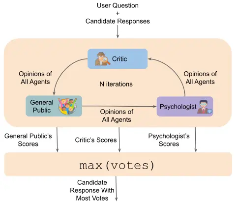
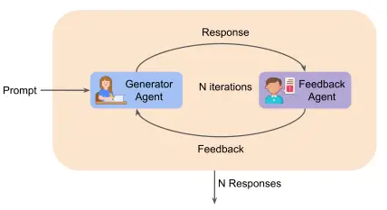
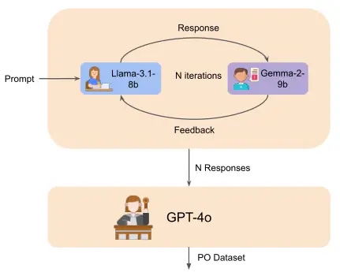

# The Fellowship of the LLMs: Multi-Model Workflows for Synthetic Preference Optimization Dataset Generation

Samee Arif^(\*) Affiliation: Lahore University of Management Sciences
Email: [samee.arif@lums.edu.pk](mailto:)    Sualeha Farid^(\*)
Affiliation: University of Michigan - Ann Arbor
Email: [abdul.azeemi@lums.edu.pk](mailto:)    Abdul Hameed Azeemi
Affiliation: Lahore University of Management Sciences
Email: [agha.ali.raza@lums.edu.pk](mailto:)    Awais Athar
Affiliation: EMBL European Bioinformatics Institute
Affiliation: Strategize Inc Email: <sualeha@umich.edu>    Agha Ali Raza
Affiliation: Lahore University of Management Sciences
Email: <awais@strategize.inc>

###### Abstract

This paper presents a novel methodology for generating synthetic
Preference Optimization (PO) datasets using multi-model workflows. We
evaluate the effectiveness and potential of these workflows in
automating and enhancing the dataset generation process. PO dataset
generation requires two modules: (1) response evaluation, and (2)
response generation. In the response evaluation module, the responses
from Large Language Models (LLMs) are evaluated and ranked - a task
typically carried out by human annotators that we automate using LLMs.
We assess the response evaluation module in a 2 step process. In step 1,
we assess LLMs as evaluators using three distinct prompting strategies.
In step 2, we apply the winning prompting strategy to compare the
performance of LLM-as-a-Judge, LLMs-as-a-Jury, and LLM Debate. Our
evaluation shows that GPT-4o-as-a-Judge is more consistent across all
datasets. For the response generation module, we use the identified LLM
evaluator configuration and compare different configurations of the LLM
Feedback Loop. We use the win rate to determine the best multi-model
configuration for generation. Experimenting with various configurations,
we find that the LLM Feedback Loop, with Llama as the generator and
Gemma as the reviewer, achieves a notable 71.8% and 73.8% win rate over
single-model Llama and Gemma, respectively. After identifying the best
configurations for both modules, we generate our PO datasets using the
above pipeline.

¹¹footnotetext: These authors contributed equally to this
work.¹¹footnotetext: Work done while at EMBL-EBI

## 1 Introduction

Large Language Models (LLMs) demonstrate a range of Natural Language
Processing (NLP) capabilities, including text generation, question
answering, and language understanding. However, LLMs can sometimes
deviate from user instructions and exhibit unintended behaviors Tamkin
et al. (2021). To mitigate this problem and align the LLM outputs more
closely with human preferences, techniques like Reinforcement Learning
from Human Feedback (RLHF) are used, which involves fine-tuning LLMs
using the reward signal from human preferences Christiano et al. (2017).
Improved methods like Direct Preference Optimization (DPO) Rafailov
et al. (2024) eliminate the need for fitting the reward model and are
more stable and performant. In DPO, the preference optimization dataset
requires a pair of accepted and rejected responses for each prompt. The
accepted response is one that better aligns with the desired human
preferences. Other techniques like Kahneman-Tversky Optimization (KTO)
(Ethayarajh et al., 2024) require each response to indicate whether it
is good or bad (i.e., as a binary classification task) instead of
pairwise preferences.

In the process of constructing the dataset of human preferences, the
evaluation and ranking of the outputs generated by LLMs are typically
done by human annotators, who assess these outputs based on various
criteria such as instruction following, helpfulness, relevance,
accuracy, depth, and creativity. The PO dataset generation process is
divided into two modules: response evaluation and response generation.
The response evaluation module involves assessing and ranking responses
generated by LLMs, while the response generation module focuses on
creating responses that align with the identified preferences. This
manual process, while effective, is labor-intensive, time-consuming,
inconsistent, and subject to human biases. In this work, we thus ask the
question, Can we use LLMs to automate and improve response evaluation
and generation for constructing preference optimization (PO) datasets?.

For the response evaluation step, we leverage LLMs as evaluators and
compare several configurations including LLM-as-a-Judge, LLMs-as-a-Jury,
and LLM Debate to pick the best evaluation strategy. The selected
response evaluation module is used to evaluate and identify the optimal
response generation module. Previously, single-models have been used to
generate the responses for PO datasets; however, we use a multi-model
framework for response generation, which allows us to generate more
refined, higher-quality responses. The multi-model approach uses the
collaboration between multiple LLMs, where one model can provide
suggestions for improvements, and the other can revise the response
based on the feedback. This iterative process leads to a thorough
refinement of the generated content, ensuring that the final output
better aligns with human preferences and expectations.

In this framework, the response generation module produces several
possible responses, and the response evaluation module selects the best
one from the list to create the PO dataset. We present multiple DPO and
KTO datasets with the focus is on generating datasets to improve the
performance of individual LLMs. The primary aim of the datasets is to
enhance the performance and capabilities of individual LLMs by providing
high-quality PO training data that better aligns with human judgment and
expectations. Our contributions can be summarized as follows:

## 2 Related Work

### 2.1 Preference Optimization

Preference Optimization has emerged as a pivotal technique for aligning
model outputs with human preferences. Rafailov et al. (2024) introduce
DPO, a method that simplifies solving the standard RLHF problem by
converting it into a classification task, enabling the extraction of the
optimal policy in a straightforward way. Hong et al. (2024) introduce
ORPO algorithm that combines the traditional supervised fine-tuning and
preference alignment stages into a single process. The dataset for DPO
and ORPO require annotated preference pairs, where each pair consists of
two model outputs labeled according to which one better aligns with
human preferences. Ethayarajh et al. (2024) introduce KTO, a
cost-effective approach to align Large Language Models (LLMs) with human
feedback, improving performance without the need for preference pairs.
Argilla Distilabel (Álvaro Bartolomé Del Canto et al., 2024) uses LLM to
judge between the responses of two models to create synthetic PO
datasets. The datasets are available on Hugging Face¹¹ 1
[https://huggingface.co/argilla](https://huggingface.co/argilla). To our
knowledge, no one has yet explored the use of multi-model workflows for
the generation of PO datasets.

### 2.2 Multi-Model Frameworks

Recently, there has been a growing interest in using LLM multi-model
frameworks for different tasks. Zheng et al. (2023a) presents an
evaluation of LLM-as-a-Judge on the MT-Bench (Zheng et al., 2023b) and
Chatbot Arena (Li et al., 2024). Their results reveal that strong LLM
judges like GPT-4 can match both controlled and crowd-sourced human
preferences well, achieving over 80% agreement, the same level of
agreement between humans. Additionally, they evaluate several variants
of Llama and Vicuna on the dataset. They study the limitations of
LLM-as-a-judge, including position, verbosity, and self-enhancement
biases, as well as limited reasoning ability. Verga et al. (2024)
explore the use of LLMs-as-a-Jury. Their approach, a Panel of LLM
evaluators (PoLL), composed of a larger number of smaller models
outperforms a single large judge. They also show that the PoLL approach
exhibits less intra-model bias as compared to LLM-as-a-Judge. They use
Command-R, GPT, Claude-3, and Mistral families for their study.
Additionally, they compare two prompting strategies: (1) reference-based
scoring where they provide the LLM with a reference answer, and (2)
candidate answer and pair-wise scoring where they ask the LLM to pick
the better response from the candidate responses. PoLL outperforms
single-models on KILT (Petroni et al., 2021) and Chatbot Arena.

Liang et al. (2024) introduce Multi-Agent Debate (MAD) to encourage
divergent thinking in LLMs. They mitigate the Degeneration-of-Thought
(DoT) problem, which is that once the LLM has established confidence in
its solutions, it is unable to generate novel thoughts. In their
approach, the affirmative LLM and the negative LLM debate on the answer
while the LLM judge evaluates both arguments after each round of debate.
They evaluate the approach on the Commonsense Machine Translation
Dataset (Chinese to English) (He et al., 2020) and their
Counter-Intuitive Arithmetic Reasoning (CIAR) dataset. MAD was able to
achieve a 37% accuracy on the CIAR dataset using GPT-3.5-Turbo which
outperforms Chain-of-Thought, Self-Consistency, and Self-Reflection
prompting. They also show that using the MAD approach decreases bias and
increases response diversity. Du et al. (2023) evaluates a different
variant of multi-model debate where multiple models generate their own
responses, and each model receives the opinions of the other models,
then updates its response if necessary. This is done for multiple
rounds. Du et al. (2023) evaluates the approach on the following tasks:
Biography generation, MMLU, Chess move validity and optimality,
Arithmetic, and Grade school math,. Their approach using ChatGPT and
Bard outperforms single-model on all the tasks. To evaluate LLM
responses Chan et al. (2023) presents another variant of multi-model
debate. Their architecture involves assigning models different roles
such as General Public, Critic, Psychologist, News Author, and
Scientist. They used ChatGPT and GPT-4 for their evaluation on FairEval
(Wang et al., 2023a) dataset and achieved a Cohen’s Kappa score of 0.40
using LLM Debate, 0.03 more than the single-model.

## 3 Methodology

### 3.1 Experimental Setup

In this study, we perform experiments on the three categories of LLMs
given in Table 1. For the evaluation module, we evaluate single-models
and multi-model frameworks on four datasets, Alpaca Eval (Li et al.,
2023), FairEval (Wang et al., 2023a), PandaLM-Eval (Wang et al., 2024;
Wang et al., 2023b) and MT-Bench (Zheng et al., 2023b). For the
generation module, we compare the multi-model frameworks using win
rate - the ratio of times a generation framework is selected as the best
by an LLM evaluator when comparing outputs from all generation
workflows. After the extensive evaluation of both modules, we used the
picked strategies to generate synthetic PO datasets. We set the
temperature to 0 in all our evaluations to ensure reproducibility.

| Category        | Models                   |
| --------------- | ------------------------ |
| Small-Scale LLM | Llama-3.1-8b             |
|                 | Gemma-2-9b               |
| Mid-Scale LLM   | Gemma-2-27b              |
|                 | Llama-3.1-70b            |
| Large-Scale LLM | GPT-4o-Mini (2024-07-18) |
|                 | GPT-4o (2024-05-13)      |

Table 1: Categories of LLMs used in the study.

### 3.2 LLM-as-Evaluator

With the aim of automating the evaluation component of PO dataset
generation, we assess the performance of LLMs in the role of evaluators
using the Alpaca Eval, FairEval, PandaLM-Eval, and MT-Bench datasets.
Our goal is to determine whether multi-model workflows work better than
a single-model for LLM evaluation. The system prompts for this task are
modified version of the prompts used by Zheng et al. (2023a) and are
given in Appendix A.

#### LLM-as-Judge.

We evaluate six different LLMs on the Alpaca Eval dataset, calculating
Cohen’s Kappa with the human annotations. Our evaluation involved three
distinct prompting strategies for the LLM-as-a-Judge:

1.  1.  Direct Comparison: The Judge-LLM is provided with the user question
        and the responses generated by different LLMs. It is asked to pick
        the best response among the given options.
2.  2.  Independent Scoring: The Judge-LLM is given the user question and
        each response in separate conversations. It is asked to score each
        response independently.
3.  3.  Combined Scoring: The Judge-LLM is provided with the user question
        and all the responses in a single conversation thread. It is asked
        to assign a score to each response within the same conversation
        context. To observe if the scoring range influences the LLM’s
        scoring consistency and its alignment with human annotations, we
        test three different scoring totals: 5, 10, and 100.

For each of these prompting strategy, we systematically analyze the
performance of the LLMs by calculating Cohen’s Kappa, against the human
annotations. The system prompts are given in Table 8 in Appendix A.

#### LLMs-as-Jury.

We extend the evaluation from the LLM-as-a-Judge approach by forming
juries composed of multiple LLMs. Specifically, we test all possible
combinations of the six LLM models when forming juries of sizes ranging
from 2 to 6. We use three datasets: FairEval, PandaLM-Eval and MT-Bench
datasets for a more comprehensive analysis. We systematically analyze
the performance of each jury configuration, focusing on how the size and
combination of the LLMs affect their judgment accuracy. The Combined
Scoring system prompt in Table 8 in Appendix A is used for all the
jurors because it performed the best in our previous evaluation.



Figure 1: LLM Debate for evaluation

#### LLM Debate.

We also evaluate the LLM Debate framework following the implementation
described by Chan et al. (2023). In this approach, we assign three
distinct roles—Psychologist, General Public, and Critic—and the three
models debate the scores that should be assigned to candidate responses.
After the debate, each model gives its final score which is used to
determine which candidate response they vote for. These votes are then
used to pick the best response. This strategy is evaluated using the
FairEval, PandaLM-Eval, and MT-Bench benchmarks. Figure 1 illustrates
the debate workflow employed in our study. The system prompt, the user
message structure and the prompts for the roles used are given in Table
9 and Table 10 in Appendix A.

### 3.3 LLM-as-Generator

To evaluate the LLM Feedback Loop workflow for the generation module, we
test different configurations using Llama-3.1-8b (Meta, 2024) and
Gemma-2-9b (Google, 2024) models. In this framework, a generator LLM
produces a response, which is then evaluated by a feedback LLM that
provides improvement suggestions as shown in Figure 2. The generator
revises the response based on these suggestions, and the process repeats
for multiple iterations. The system prompt for the generator and
reviewer is given in Table 11 and 12 in Appendix A. We calculate the win
rate against single-model GPT-4o (OpenAI, 2024), Llama-3.1-8b and
Gemma-2-9b baseline outputs on a subset of 500 prompts from the Argilla
Capybara DPO dataset²² 2
[https://huggingface.co/datasets/argilla/distilabel-capybara-dpo-7k-binarized](https://huggingface.co/datasets/argilla/distilabel-capybara-dpo-7k-binarized)
to identify the best configuration. We test the following configuration:

1.  1.  Same Model: Gemma-2-9b or Llama-3.1-8b as both the feedback and
        generation model.
2.  2.  Different Models: Gemma-2-9b as the feedback model and Llama-3.1-8b
        as the generation model, or vice versa.
3.  3.  Both Models for Feedback, One for Generation: Gemma-2-9b or
        Llama-3.1-8b as the generation model, with both models as feedback
        model.



Figure 2: LLM Feedback Loop for response generation

### 3.4 Preference Optimization Dataset

We use the best configurations of the generation and evaluation modules
to generate the DPO and KTO datasets. The generation module produces
$`N`$ responses (where $`N`$ is the number of feedback iterations),
which are then passed to the evaluation module. The evaluation module
sorts these responses into the accepted and rejected fields in the DPO
and KTO datasets. In this study, we use the prompts from the Argilla
Capybara DPO dataset. The prompt templates used for LLM improvement
dataset generation are given in Table 8, 11 and 12 in Appendix A. The
evaluation code, all the evaluation outputs and the generated datasets
are publicly available on GitHub³³ 3
[https://github.com/sameearif/Fellowship-of-The-LLMs](https://github.com/sameearif/Fellowship-of-The-LLMs).

## 4 Results and Discussion

### 4.1 LLM-as-Evaluator

#### Prompting Strategies.

Table 2 shows the results of LLM-as-a-Judge approach on the three
prompting strategies.

|               | Comp. | Ind.  | Combined |       |       |
| ------------- | ----- | ----- | -------- | ----- | ----- |
| Judge         |       | 10    | 5        | 10    | 100   |
| Gemma-2-9b    | 0.226 | 0.170 | 0.243    | 0.254 | 0.233 |
| Llama-3.1-8b  | 0.265 | 0.181 | 0.255    | 0.240 | 0.242 |
| Gemma-2-27b   | 0.233 | 0.173 | 0.284    | 0.266 | 0.252 |
| Llama-3.1-70b | 0.305 | 0.214 | 0.337    | 0.333 | 0.339 |
| GPT-4o-mini   | 0.342 | 0.254 | 0.374    | 0.382 | 0.347 |
| GPT-4o        | 0.372 | 0.249 | 0.393    | 0.382 | 0.401 |

Table 2: Performance comparison of LLM-as-a-Judge on Alpaca-Eval using
different prompting strategies. Direct Comparison (Comp.) vs.
Independent Scoring (Ind.) vs. Combined Scoring (Combined). The bold
values indicate the highest Cohen’s kappa values for a particular
strategy.

The Independent Scoring prompt strategy consistently under-performs
compared to the Direct Comparison and Combined Scoring approaches across
all evaluated LLMs. This result is reflected in lower Cohen’s Kappa
values ranging from only 0.170 to 0.254 in Table 2. In evaluating
responses in isolation the LLM has to re-calibrate its scoring mechanism
for every new response. This can lead to inconsistencies, especially
when multiple responses are closely matched in quality. Due to the low
Kappa values observed, we opted not to conduct experiments with the
scoring-out-of-5 and 100 scales for Independent Scoring.

The Direct Comparison Strategy performs better than the Independent
Scoring approach across most LLMs, with a notable improvement for GPT-4o
(0.372 vs. 0.249) and GPT-4o-mini (0.342 vs. 0.254). However, it
generally falls short when compared to the Combined Scoring method,
where GPT-4o achieves a score of 0.401 using the scoring-out-of-100
scale. The higher Cohen’s Kappa values indicate that the Direct
Comparison and Combined Scoring strategy benefits from providing the LLM
with a side-by-side evaluation of responses, allowing for more accurate
and consistent judgments.

The Combined Scoring strategy, as presented in Table 2, shows consistent
performance using all the scoring scales. It outperforms both the other
prompts. The scoring scales of 5, 10, and 100 show variability across
different models, with certain scales performing better for some models
than others. For example, GPT-4o performs the best in scoring-out-of-10
scale with a Kappa score of 0.382 while Gemma-2-9b performs best under
scoring-out-of-5 scale. Given these results, we selected the
scoring-out-of-10 scale as the most effective option for the Combined
Scoring approach. We use this prompt for all our further evaluations.

#### LLM-as-a-Judge.

The LLM-as-Judge evaluations, as shown in Table 2, indicate that GPT-4o
outperforms all the models on PandaLM-Eval and MT-Bench achieving a
Cohen’s Kappa score of 0.688 and 0.410 respectively. Additionally,
GPT-4o consistently ranks in second position across all three datasets.
This consistent top-tier performance underscores GPT’s effectiveness as
a reliable judge in evaluating LLM responses. Gemma-2-27b outperforms
all other models on the Fair-Eval dataset, achieving the highest score
in this particular evaluation. However, it’s important to note that the
Fair-Eval dataset is relatively small, consisting of only 80 samples.
Furthermore, the Fair-Eval dataset primarily compares GPT-3.5-Turbo with
Vicuna-13b, which might introduce a bias in favor of GPT models when GPT
is the evaluator.

|               | Fair-Eval | PandaLM | MT-Bench |
| ------------- | --------- | ------- | -------- |
| Judge         |           |         |          |
| Gemma-2-9b    | 0.279     | 0.595   | 0.354    |
| Llama-3.1-8b  | 0.206     | 0.523   | 0.339    |
| Gemma-2-27b   | 0.389     | 0.586   | 0.354    |
| Llama-3.1-70b | 0.257     | 0.597   | 0.387    |
| GPT-4o-mini   | 0.333     | 0.613   | 0.388    |
| GPT-4o        | 0.327     | 0.688   | 0.410    |

Table 3: Performance comparison of LLM-as-a-Judge on Alpaca-Eval using
different prompting strategies. Direct Comparison vs. Independent
Scoring (out of 10) vs. Combined Scoring (out of 5, 10 and 100).

We calculate the Agreement between the LLM evaluator and human evaluator
for Vicuna-13b and GPT-3.5-Turbo separately. In the formula below, the
numerator represents the number of instances where the LLM evaluator
picks model A’s response over model B, while the denominator represents
the total number of instances where humans labeled model A as the better
response.

```math
\text{Agreement\textsubscript{A}}=\frac{\text{{Count}(LLM Prefers A)}}{\text{{Count}(Human Prefers A)}}
```

The Bias Score, as given below, provides insight into potential bias in
the LLM evaluator. If the difference is positive with a high magnitude,
it indicates a bias toward Vicuna-13b, as the evaluator aligns more
closely with human preferences for Vicuna-13b. Conversely, if the
difference is negative with a high magnitude, it suggests a bias toward
GPT-3.5-Turbo. A small magnitude (close to zero) implies that the LLM
evaluator is relatively unbiased, showing similar levels of agreement
with human preferences for both models.

```math
\text{Bias Score}=\text{A\textsubscript{Vicuna-13b}}-\text{A\textsubscript{GPT-3.5-Turbo}}
```

The Bias Score highlights potential biases in the LLM evaluator’s
alignment with human preferences for Vicuna-13b and GPT-3.5-Turbo, as
shown in Table 4. Bias Score for Llama-3.1-8b (+0.51) and Llama-3.1-70b
(+0.37), indicates a strong bias toward Vicuna-13b, where the evaluator
more frequently favors Vicuna-13b over GPT-3.5-Turbo. Conversely, for
Gemma-2-9b (-0.05) and Gemma-2-27b (+0.02) the small magnitude of Bias
Score suggests that Gemma models are impartial. For GPT-4o-mini (+0.18)
and GPT-4o (+0.33), the Bias Score indicates a moderate bias toward
Vicuna-13b, as the evaluator shows a noticeable but less pronounced
preference for Vicuna-13b’s responses compared to GPT-3.5-Turbo.
Vicuna-13b is fine-tuned on the ShareGPT dataset, which contains
conversations from GPT-4 and GPT-3.5. This fine-tuning likely aligns
Vicuna-13b’s responses with GPT models, explaining the evaluator’s bias
toward it.

| Model         | Agreement  |               | Bias Score |
| ------------- | ---------- | ------------- | ---------- |
|               | Vicuna-13b | GPT-3.5-Turbo |            |
| Gemma-2-9b    | 0.68       | 0.73          | -0.05      |
| Llama-3.1-8b  | 0.92       | 0.41          | +0.51      |
| Gemma-2-27b   | 0.80       | 0.78          | +0.02      |
| Llama-3.1-70b | 0.88       | 0.51          | +0.37      |
| GPT-4o-mini   | 0.84       | 0.66          | +0.18      |
| GPT-4o        | 0.92       | 0.59          | +0.33      |

Table 4: Agreement between the LLM evaluator and human evaluator over
Vicuna-13b and GPT-3.5 separately.

|                                                    |           |              |          |
| -------------------------------------------------- | --------- | ------------ | -------- |
|                                                    | Fair-Eval | PandaLM-Eval | MT-Bench |
| Jury                                               |           |              |          |
| Gemma-2-9b, Gemma-2-27b, Llama-3.1-8b, GPT-4o-mini | 0.428     | 0.604        | 0.395    |
| Gemma-2-9b, Gemma-2-27b, GPT-4o-mini, GPT-4o       | 0.415     | 0.639        | 0.418    |
| Gemma-2-27b, Llama-3.1-70b, GPT-4o-mini, GPT-4o    | 0.412     | 0.637        | 0.410    |
| Gemma-2-27b, GPT-4o-mini, GPT-4o                   | 0.396     | 0.673        | 0.400    |
| Llama-3.1-70b, GPT-4o-mini, GPT-4o                 | 0.365     | 0.663        | 0.410    |
| Gemma-2-9b, GPT-4o-mini, GPT-4o                    | 0.375     | 0.662        | 0.416    |
| Llama-3.1-70b, GPT-4o                              | 0.273     | 0.636        | 0.429    |
| GPT-4o-mini, GPT-4o                                | 0.315     | 0.660        | 0.426    |
| Gemma-2-9b, GPT-4o                                 | 0.290     | 0.609        | 0.422    |

Table 5: Performance comparison of LLMs-as-a-Jury on the three datasets.
For each dataset, we pick the top 3 juries. The bold score is for the
best jury for the specific dataset and the underlined one is the second
best.

#### LLMs-as-a-Jury.

In evaluating of LLMs-as-a-Jury, we analyze the top three juries from
each dataset as shown in Table 5. Notably, the scores exhibit
considerable variation across the different datasets. On the Fair-Eval
and MT-Bench datasets, the jury approach outperformed the judge
approach, indicating a potential advantage in using multiple models for
evaluation. For instance, on Fair-Eval, the highest-performing jury
achieves a Cohen’s Kappa of 0.428 while the judge achieves Kappa of
0.389, suggesting a relatively strong agreement with human judgments
compared to individual judges. This configuration, however, shows a drop
in performance on other datasets with a kappa of 0.604 on PandaLM-Eval
and 0.395 on MT-Bench, underscoring the challenge of generalizing a
single jury setup across varied datasets. However, the judge approach
outperforms the jury on the PandaLM-Eval dataset, where the best judge
attained a kappa of 0.688, surpassing the top jury’s kappa of 0.673. The
best jury on MT-Bench, with a kappa of 0.429, also demonstrates
variability in its performance across datasets as well, with a kappa of
0.636 on PandaLM-Eval and only 0.273 on Fair-Eval.

The jury approach, by incorporating diverse models, mitigates the biases
that occur in LLM-as-a-Judge approach when bench-marking on the
Fair-Eval dataset. However while the jury approach can offer robustness
through diversity, in evaluation task, it does not universally
outperform single judges. The decision to employ a jury versus a judge
should consider whether the candidate responses being evaluated include
output from the judge itself, which can introduce bias in the results.
Additionally, scalability should be taken into account, as the jury
approach might require more computational resources. Another critical
consideration is the variability in performance across different
datasets, which poses a challenge for generalization.

#### LLM Debate.

The LLM Debate approach, as summarized in Table 6, showcases varying
degrees of effectiveness across three different datasets: Fair-Eval,
PandaLM-Eval, and MT-Bench.

|               | Fair-Eval | PandaLM | MT-Bench |
| ------------- | --------- | ------- | -------- |
| Debater       |           |         |          |
| Gemma-2-9b    | 0.323     | 0.520   | 0.326    |
| Llama-3.1-8b  | 0.080     | 0.440   | 0.309    |
| Gemma-2-27b   | 0.336     | 0.605   | 0.363    |
| Llama-3.1-70b | 0.292     | 0.547   | 0.381    |
| GPT-4o-mini   | 0.360     | 0.625   | 0.376    |
| GPT-4o        | 0.404     | 0.654   | 0.402    |

Table 6: Performance comparison of LLM Debate on the three datasets.

GPT-4o performs the best across all datasets, with Cohen’s Kappa scores
of 0.404, 0.654, and 0.402 respectively. LLM Debate outperforms
LLM-as-a-Judge on Fair-Eval only and does not surpass the LLMs-as-a-Jury
approach on any dataset. On Fair-Eval using the Debate framework
increases the Kappa score of GPT-4o from 0.327 to 0.404 and of
GPT-4o-mini from 0.333 to 0.360. It shows that the debate approach
decreases the bias of GPT-4o and GPT-4o-mini towards the responses of
it’s family.

There is a significant variance in the performance of LLM Debate across
the models and the datasets. For instance, as seen in Table 6
Gemma-2-27b in debate architecture outperforms Gemma-as-a-Judge on
PandaLM-Eval and MT-Bench but on Fair-Eval judge performers better.
Gemma-2-9b in debate architecture has a Kappa score of 0.323 on
Fair-Eval, outperforming 0.279 of Gemma-as-a-Judge. However on
PandaLM-Eval and MT-Bench Gemma-2-9b in debate framework achieves a
Kappa score of 0.520 and 0.326, repectively. Both scores lower as
compared to Gemma-as-a-Judge scores of 0.595 and 0.354. In case of
Llama, Llama-3.1-8b in judge configuration outperforms itself in debate
configuration. Llama-3.1-70b in debate framework only outperforms
Llama-as-a-judge on Fair-Eval. Figure 3 shows a comparison of Cohen’s
Kappa of LLM Debate and LLM-as-a-Judge across the three datasets and all
the models.

Figure 3: Comparison of LLM Debate and LLM-as-a-Judge across the three
datasets and different models.

#### Evaluation Framework for PO Dataset.

Based on the comparative evaluation scores across the three datasets and
the advantages and disadvantages associated with each multi-model
framework, we have chosen to use the LLM-as-a-Judge approach with GPT-4o
as our primary evaluator for generating the PO dataset. This decision is
driven by multiple factors:

1.  1.  In our context, the task involves generating a PO dataset using
        Llama-3.1-8b and Gemma-2-9b. Therefore there will be no bias in the
        evaluation when using GPT-4o as the judge.
2.  2.  The performance of GPT-4o-as-a-Judge has been consistently high
        across various evaluations, indicating its reliability as a judge.
        While the LLMs-as-a-Jury and LLM Debate approaches have a high
        variance in Cohen’s Kappa score across different datasets.
3.  3.  The computational resources required for managing the LLM Debate and
        LLM Jury frameworks are considerably higher than those needed for a
        single-judge setup. The LLM-as-a-Judge method is simpler to
        implement and scale.

### 4.2 LLM-as-Generator

We compare the performance of multi-model Feedback Loop with the
baseline single-models (GPT-4o, Llama-3.1-8b, Gemma-2-9b) using win rate
as shown in Table 7.

|           |          |                      |       |       |
| --------- | -------- | -------------------- | ----- | ----- |
|           |          | Win Rate (%) Against |       |       |
| Generator | Reviewer | GPT                  | Llama | Gemma |
| Gemma     | \-       | 38.6                 | 66.6  | \-    |
| Llama     | \-       | 39.2                 | \-    | 33.4  |
| Gemma     | Gemma    | 41.4                 | 64.8  | 52.6  |
|           | Llama    | 41.2                 | 61.8  | 47.8  |
|           | Both     | 42.0                 | 67.6  | 52.4  |
| Llama     | Gemma    | 49.0                 | 71.8  | 73.8  |
|           | Llama    | 47.8                 | 65.8  | 65.6  |
|           | Both     | 48.6                 | 68.2  | 69.4  |

Table 7: Win Rate of multi-model and single-model against GPT-4o,
Llama-3.1-8b and Gemma-2-9b

We utilize GPT-4o-as-a-judge in this evaluation process. For the
baseline we find the win rate of Gemma and Llama against GPT-4o and each
other. Both smaller models have similar win rate of 38.6% and 39.2%
against GPT, while Gemma has a win rate of 66.6% against Llama.

In the multi-model setting, all variations outperform the single-models
against GPT-4o, with the highest win rate of 49.0% for Llama as a
generator and Gemma as a reviewer. This configuration performs the best
against Llama and Gemma too, with 71.8% and 73.8% win rate respectively.
We observe that using Llama as the generator improves the performance as
compared to using Gemma as the generator because this configuration
leads to a better win rate against all three baselines.

Llama’s strengths in generating responses may be enhanced by Gemma’s
ability to fine-tune and correct the errors, leading to more polished
outputs. The results underscore the importance of assigning appropriate
roles based on the specific strengths of each model. Llama, when set as
the generator, appears to leverage its capabilities more effectively
than Gemma in this role. The use of diverse models in the feedback loop
likely helps mitigate biases that any single model might introduce. This
diversity ensures a broader range of perspectives while answer a
question. In conclusion, the demonstrated efficacy of the multi-model
Feedback Loop, especially with Llama as the generator and Gemma as the
reviewer, validates the concept of collaborative AI systems.

### 4.3 Preference Optimization Dataset



Figure 4: Multi-model framework for PO dataset generation.

We use GPT-4o-as-a-Judge in the evaluation module because of its
consistency and reliability as a judge across multiple datasets. In the
generation module, we use LLM Feedback Loop with Llama-3.1-8b as the
generator and Gemma-2-9b as the reviewer because of it’s highest
win-rate against other configurations. The framework is shown in Figure 4. For the dataset generation, we use $`N=3`$ feedback iterations. For
each prompt, we generate three responses using the generation module.
These responses are then evaluated by GPT-4o in the evaluation module.
The response judged to be the best by GPT-4o is labeled as accepted,
while the other two responses are labeled as rejected to form the DPO
and KTO datasets.

## 5 Conclusion

This paper presents PO datasets generated using multi-model frameworks,
and evaluates these frameworks by highlighting the advantages,
drawbacks, and challenges of each approach. In the response evaluation
module, our comparative analysis of LLM-as-a-Judge, LLMs-as-a-Jury, and
LLM Debate shows the suitability of each setup depending on the context
of use. For the response generation module, we evaluate the LLM Feedback
Loop using Llama-3.1-8b and Gemma-2-9b in various configurations.
LLM-as-a-Judge proved to be highly effective when candidate responses
don’t have a response from the Judge LLM. Whereas LLMs-as-a-Jury and LLM
Debate demonstrated robustness, particularly useful in reducing
evaluator bias. However, Cohen’s Kappa for both of these approaches has
a high variance making them less suitable for novel applications.

Our experiments with LLM Feedback Loop using Llama-3.1-8b and Gemma-2-9b
configurations show the potential of multi-model frameworks in refined
content generation. Configurations where Llama-3.1-8b served as the
generator and Gemma-2-9b as the reviewer consistently delivered better
results, demonstrating the benefits of leveraging complementary
strengths of different models to refine output quality. These findings
indicate the effectiveness of multi-model frameworks for varied AI
applications, showing promise for moving towards systems requiring
minimal human intervention - however, this method is computationally
expensive in comparison.

We also generate multiple DPO and KPO datasets using LLM Feedback Loop
with Llama-3.1-8b as the generator and Gemma-2-9b as the evaluator and
GPT-4o-as-a-Judge. The aim of these datasets is to improve single-model
capabilities for better response generation and multi-model capabilities
including better communication and improved feedback.

## 6 Future Work

In terms of future work, there are three avenues of investigation: (1)
Performance comparison of models fine-tuned on our PO dataset versus
widely-used LLMs to investigate the impact of our generated datasets
through a series of experiments. (2) Using larger models such as
Llama-3.1-70b and Gemma-2-27b for dataset generation as this may provide
more diverse and higher-quality training data, potentially leading to
further advancements in model performance and generalizability. (3)
Experimenting with the number of iterations used in the Feedback Loop
framework and including other LLM families in the dataset generation
process.

## Limitations

While our study demonstrates the potential of multi-model workflows in
automating the generation of PO datasets, several limitations should be
acknowledged. Firstly, the use of multi-model frameworks significantly
increases computational complexity and resource consumption compared to
single-model models. The iterative processes in both the response
generation and evaluation modules require more computational power and
time, which may not be feasible for practitioners with limited
resources. Additionally, GPT-4o is a proprietary model, which may not be
accessible to all researchers, potentially hindering reproducibility and
wider adoption of our methods.

## Ethical Considerations

The automation of response evaluation and generation in PO dataset
creation raises several ethical considerations that warrant careful
attention. Relying on LLMs to simulate human judgments may perpetuate
existing biases present in the training data of these models. If not
properly addressed, this could result in PO datasets that reinforce
stereotypes or unfairly represent certain groups, leading to biased
behaviors in models fine-tuned on these datasets. The potential
displacement of human annotators poses an ethical dilemma. While
automation can increase efficiency and scalability, it may reduce
opportunities for human involvement in the annotation process, affecting
those who rely on such tasks for employment. Balancing automation with
human oversight is essential to maintain ethical standards and ensure
diverse perspectives are included.

In conclusion, while our approach offers advancements in automating PO
dataset generation, it is imperative to remain vigilant about these
ethical concerns. Implementing strategies to mitigate biases,
maintaining transparency, involving human oversight, and adhering to
ethical guidelines are essential steps in responsible AI development.

## References

- Chan et al. (2023) Chi-Min Chan, Weize Chen, Yusheng Su, Jianxuan Yu,
  Wei Xue, Shanghang Zhang, Jie Fu, and Zhiyuan Liu. 2023. [Chateval:
  Towards better llm-based evaluators through multi-agent
  debate](https://arxiv.org/abs/2308.07201). _Preprint_,
  arXiv:2308.07201.
- Christiano et al. (2017) Paul F Christiano, Jan Leike, Tom Brown,
  Miljan Martic, Shane Legg, and Dario Amodei. 2017. Deep reinforcement
  learning from human preferences. _Advances in neural information
  processing systems_, 30.
- Du et al. (2023) Yilun Du, Shuang Li, Antonio Torralba, Joshua B.
  Tenenbaum, and Igor Mordatch. 2023. [Improving factuality and
  reasoning in language models through multiagent
  debate](https://arxiv.org/abs/2305.14325). _Preprint_,
  arXiv:2305.14325.
- Ethayarajh et al. (2024) Kawin Ethayarajh, Winnie Xu, Niklas
  Muennighoff, Dan Jurafsky, and Douwe Kiela. 2024. [Kto: Model
  alignment as prospect theoretic
  optimization](https://arxiv.org/abs/2402.01306). _Preprint_,
  arXiv:2402.01306.
- Google (2024) Google. 2024. Google gemma 2.
  [https://blog.google/technology/developers/google-gemma-2/](https://blog.google/technology/developers/google-gemma-2/).
  Accessed: 2024-08-16.
- He et al. (2020) Jie He, Tao Wang, Deyi Xiong, and Qun Liu. 2020. [The
  box is in the pen: Evaluating commonsense reasoning in neural machine
  translation](https://doi.org/10.18653/v1/2020.findings-emnlp.327). In
  _Findings of the Association for Computational Linguistics: EMNLP
  2020_, pages 3662–3672, Online. Association for Computational
  Linguistics.
- Hong et al. (2024) Jiwoo Hong, Noah Lee, and James Thorne. 2024.
  [Orpo: Monolithic preference optimization without reference
  model](https://arxiv.org/abs/2403.07691). _Preprint_,
  arXiv:2403.07691.
- Li et al. (2024) Tianle Li, Wei-Lin Chiang, Evan Frick, Lisa Dunlap,
  Tianhao Wu, Banghua Zhu, Joseph E. Gonzalez, and Ion Stoica. 2024.
  [From crowdsourced data to high-quality benchmarks: Arena-hard and
  benchbuilder pipeline](https://arxiv.org/abs/2406.11939). _Preprint_,
  arXiv:2406.11939.
- Li et al. (2023) Xuechen Li, Tianyi Zhang, Yann Dubois, Rohan Taori,
  Ishaan Gulrajani, Carlos Guestrin, Percy Liang, and Tatsunori B.
  Hashimoto. 2023. Alpacaeval: An automatic evaluator of
  instruction-following models.
  [https://github.com/tatsu-lab/alpaca_eval](https://github.com/tatsu-lab/alpaca_eval).
- Liang et al. (2024) Tian Liang, Zhiwei He, Wenxiang Jiao, Xing Wang,
  Rui Wang, Yujiu Yang, Zhaopeng Tu, and Shuming Shi. 2024. [Encouraging
  divergent thinking in large language models through multi-agent
  debate](https://arxiv.org/abs/2305.19118). _Preprint_,
  arXiv:2305.19118.
- Meta (2024) Meta. 2024. Meta llama 3.
  [https://ai.meta.com/blog/meta-llama-3/](https://ai.meta.com/blog/meta-llama-3/).
  Accessed: 2024-08-16.
- OpenAI (2024) OpenAI. 2024. [Gpt-4 technical
  report](https://arxiv.org/abs/2303.08774). _Preprint_,
  arXiv:2303.08774.
- Petroni et al. (2021) Fabio Petroni, Aleksandra Piktus, Angela Fan,
  Patrick Lewis, Majid Yazdani, Nicola De Cao, James Thorne, Yacine
  Jernite, Vladimir Karpukhin, Jean Maillard, Vassilis Plachouras, Tim
  Rocktäschel, and Sebastian Riedel. 2021. [Kilt: a benchmark for
  knowledge intensive language tasks](https://arxiv.org/abs/2009.02252).
  _Preprint_, arXiv:2009.02252.
- Rafailov et al. (2024) Rafael Rafailov, Archit Sharma, Eric Mitchell,
  Stefano Ermon, Christopher D. Manning, and Chelsea Finn. 2024. [Direct
  preference optimization: Your language model is secretly a reward
  model](https://arxiv.org/abs/2305.18290). _Preprint_,
  arXiv:2305.18290.
- Tamkin et al. (2021) Alex Tamkin, Miles Brundage, Jack Clark, and Deep
  Ganguli. 2021. Understanding the capabilities, limitations, and
  societal impact of large language models. _arXiv preprint
  arXiv:2102.02503_.
- Verga et al. (2024) Pat Verga, Sebastian Hofstatter, Sophia Althammer,
  Yixuan Su, Aleksandra Piktus, Arkady Arkhangorodsky, Minjie Xu, Naomi
  White, and Patrick Lewis. 2024. [Replacing judges with juries:
  Evaluating llm generations with a panel of diverse
  models](https://arxiv.org/abs/2404.18796). _Preprint_,
  arXiv:2404.18796.
- Wang et al. (2023a) Peiyi Wang, Lei Li, Liang Chen, Dawei Zhu,
  Binghuai Lin, Yunbo Cao, Qi Liu, Tianyu Liu, and Zhifang Sui. 2023a.
  Large language models are not fair evaluators. _ArXiv_,
  abs/2305.17926.
- Wang et al. (2023b) Yidong Wang, Zhuohao Yu, Zhengran Zeng, Linyi
  Yang, Qiang Heng, Cunxiang Wang, Hao Chen, Chaoya Jiang, Rui Xie,
  Jindong Wang, Xing Xie, Wei Ye, Shikun Zhang, and Yue Zhang. 2023b.
  Pandalm: Reproducible and automated language model assessment.
  [https://github.com/WeOpenML/PandaLM](https://github.com/WeOpenML/PandaLM).
- Wang et al. (2024) Yidong Wang, Zhuohao Yu, Zhengran Zeng, Linyi Yang,
  Cunxiang Wang, Hao Chen, Chaoya Jiang, Rui Xie, Jindong Wang, Xing
  Xie, Wei Ye, Shikun Zhang, and Yue Zhang. 2024. Pandalm: An automatic
  evaluation benchmark for llm instruction tuning optimization.
- Zheng et al. (2023a) Lianmin Zheng, Wei-Lin Chiang, Ying Sheng, Siyuan
  Zhuang, Zhanghao Wu, Yonghao Zhuang, Zi Lin, Zhuohan Li, Dacheng Li,
  Eric P. Xing, Hao Zhang, Joseph E. Gonzalez, and Ion Stoica. 2023a.
  [Judging llm-as-a-judge with mt-bench and chatbot
  arena](https://arxiv.org/abs/2306.05685). _Preprint_,
  arXiv:2306.05685.
- Zheng et al. (2023b) Lianmin Zheng, Wei-Lin Chiang, Ying Sheng, Siyuan
  Zhuang, Zhanghao Wu, Yonghao Zhuang, Zi Lin, Zhuohan Li, Dacheng Li,
  Eric. P Xing, Hao Zhang, Joseph E. Gonzalez, and Ion Stoica. 2023b.
  [Judging llm-as-a-judge with mt-bench and chatbot
  arena](https://arxiv.org/abs/2306.05685). _Preprint_,
  arXiv:2306.05685.
- Álvaro Bartolomé Del Canto et al. (2024) Álvaro Bartolomé Del Canto,
  Gabriel Martín Blázquez, Agustín Piqueres Lajarín, and Daniel Vila
  Suero. 2024. Distilabel: An ai feedback (aif) framework for building
  datasets with and for llms.
  [https://github.com/argilla-io/distilabel](https://github.com/argilla-io/distilabel).

## Appendix A System Prompts

Table 8 contains the three categories of system prompts tested for
LLM-as-a-Judge approach. The winning prompt with Combined Scoring was
used for LLMs-as-a-Jury. These prompts are modified versions of those
used by (Zheng et al., 2023a). Table 9 present the system prompt and
user message structure for LLM Debate and 10 shows the prompt for each
role in the debate. This is based on the system prompt and the input
structure used by (Chan et al., 2023). Table 11 shows the user message
structure for the generator LLM and Table 12 shows the system prompt and
user message for reviewer LLM in LLM Feedback Loop.

## Appendix B Code and Datasets

The evaluation code, all the evaluation outputs and the generated
datasets are publicly available on GitHub⁴⁴ 4
[https://github.com/sameearif/Fellowship-of-The-LLMs](https://github.com/sameearif/Fellowship-of-The-LLMs).
For evaluation of LLMs-as-Evaluators we used Alpaca-Eval⁵⁵ 5
[https://huggingface.co/datasets/tatsu-lab/alpaca_eval](https://huggingface.co/datasets/tatsu-lab/alpaca_eval),
Fair-Eval⁶⁶ 6
[https://github.com/i-Eval/FairEval](https://github.com/i-Eval/FairEval),
PandaLM-Eval⁷⁷ 7
[https://github.com/WeOpenML/PandaLM](https://github.com/WeOpenML/PandaLM)
and MT-Bench⁸⁸ 8
[https://huggingface.co/datasets/lmsys/mt_bench_human_judgments](https://huggingface.co/datasets/lmsys/mt_bench_human_judgments).
For evaluation of LLMs-as-Generators and single-model improvement
dataset generation we use the prompts from Argilla Capybara DPO
dataset⁹⁹ 9
[https://huggingface.co/datasets/argilla/distilabel-capybara-dpo-7k-binarized](https://huggingface.co/datasets/argilla/distilabel-capybara-dpo-7k-binarized).
For multi-model improvement dataset generation we use prompts from
No-Robots¹⁰¹⁰ 10
[https://huggingface.co/datasets/HuggingFaceH4/no_robots](https://huggingface.co/datasets/HuggingFaceH4/no_robots)
dataset. Alpaca-Eval and PandaLM-Eval are under Apache 2.0 license,
Fair-Eval dataset is under CC BY 4.0 license, Argilla Capybara DPO is
also under Apache 2.0 license. All datasets used in this paper comply
with their respective license.

## Appendix C Computing Infrastructure

We use the API for GPT-4o and GPT-4o-mini from OpenAI¹¹¹¹ 11
[https://platform.openai.com/docs/overview](https://platform.openai.com/docs/overview).
For Gemma and Llama models API from TogetherAI¹²¹² 12
[https://docs.together.ai/docs/introduction](https://docs.together.ai/docs/introduction)
was used. We use Python3 libraries for both APIs and the temperature for
the models was set to 0 for reproduciblity. For each evaluation, one run
of the code was done. OpenAI GPT-4o has a proprietary license. Llama-3.1
is under Llama-3.1 license and Gemma-2 is under Gemma license. All
models used in this paper comply with their respective license.

[TABLE]

Table 8: The three types of system prompts for LLM-as-a-Judge and
LLMs-as-a-Jury.

Table 8: The three types of system prompts for LLM-as-a-Judge and
LLMs-as-a-Jury (continued).

[TABLE]

Table 9: The system prompt and the user message structure for LLM
Debate.

Table 9: The system prompt and the user message structure for LLM Debate
(continued).

[TABLE]

Table 10: The prompt for each role used in LLM Debate.

Table 10: The prompt for each role used in LLM Debate (continued).

[TABLE]

Table 11: The user message structure for the generator in LLM Feedback.

Table 11: The user message structure for the generator in LLM Feedback
(continued).

[TABLE]

Table 12: The prompt and user message structure for the reviewer in LLM
Feedback.

Table 12: The prompt and user message structure for the reviewer in LLM
Feedback (continued).
