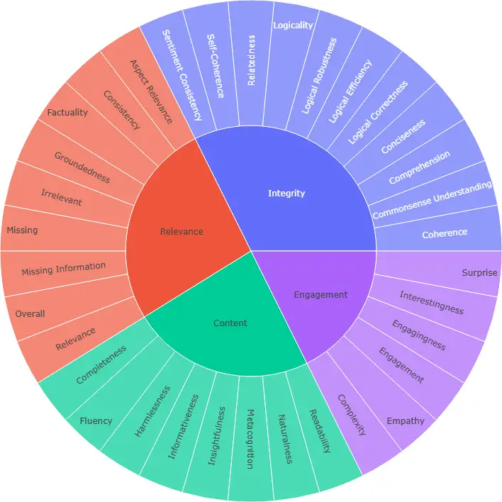
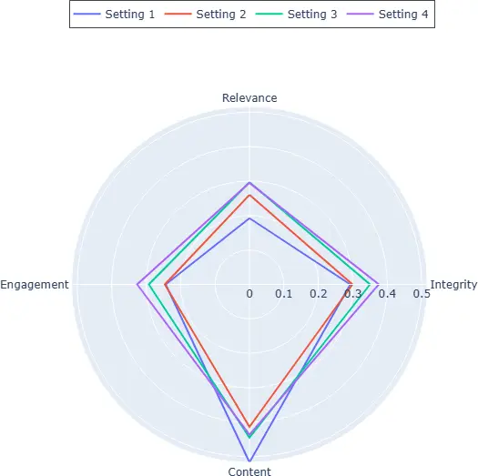
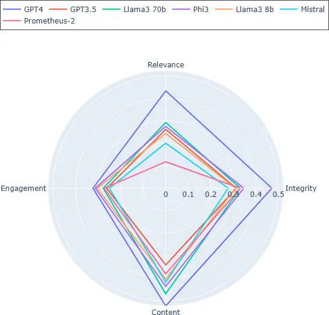
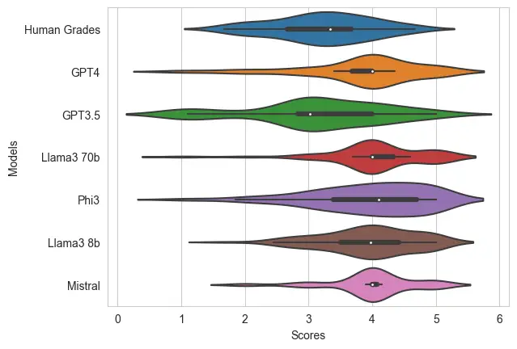
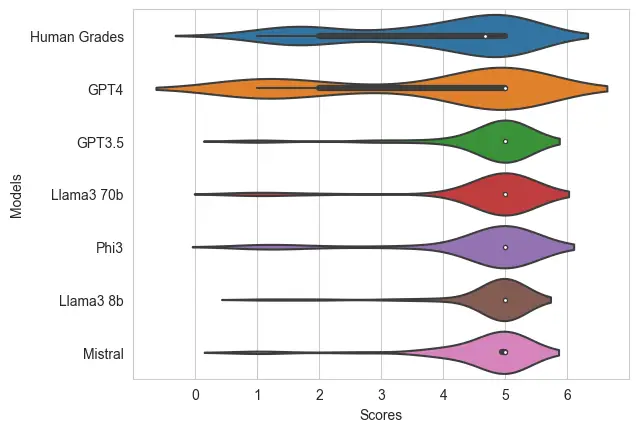

# Evaluating the Evaluator: Measuring LLMs’ Adherence to Task Evaluation Instructions

Bhuvanashree Murugadoss    Christian Poelitz    Ian Drosos    Vu Le   
Nick McKenna    Carina Suzana Negreanu    Chris Parnin    Advait Sarkar

###### Abstract

LLMs-as-a-judge is a recently popularized method which replaces human
judgements in task evaluation (Zheng et al. 2024) with automatic
evaluation using LLMs. Due to widespread use of RLHF (Reinforcement
Learning from Human Feedback), state-of-the-art LLMs like GPT4 and
Llama3 are expected to have strong alignment with human preferences when
prompted for a quality judgement, such as the coherence of a text. While
this seems beneficial, it is not clear whether the assessments by an
LLM-as-a-judge constitute only an evaluation based on the instructions
in the prompts, or reflect its preference for high-quality data similar
to its fine-tune data. To investigate how much influence prompting the
LLMs-as-a-judge has on the alignment of AI judgements to human
judgements, we analyze prompts with increasing levels of instructions
about the target quality of an evaluation, for several LLMs-as-a-judge.
Further, we compare to a prompt-free method using model perplexity as a
quality measure instead. We aggregate a taxonomy of quality criteria
commonly used across state-of-the-art evaluations with LLMs and provide
this as a rigorous benchmark of models as judges. Overall, we show that
the LLMs-as-a-judge benefit only little from highly detailed
instructions in prompts and that perplexity can sometimes align better
with human judgements than prompting, especially on textual quality.

¹Microsoft Research India ²Microsoft Research Cambridge UK

³Microsoft Redmond

cpoelitz@microsoft.com

## Introduction

Recently, new automatic evaluation approaches that rely on LLMs have
been proposed on several NLG tasks, such as summarization (Liu et al.
2023b) and machine translation (Kocmi and Federmann 2023). Previous
approaches (Siledar et al. 2024) show that for certain situations, such
as when assessing textual consistency or fluency, there is high
agreement between human judgements and LLM assessments, even without
detailed instructions like for example how to assign specific scores.
Most of these approaches prompt an LLM to give a judgement as Likert
score (Likert 1932) with only simple information about the scale, e.g.
“give a judgement between 1 (bad) and 5 (good).” More recently,
LLM-based evaluations on more fine-grained task-specific criteria (Ye
et al. 2024) have also reported high agreement with human judgement,
such as assessing the completeness of a solution for a question
answering task. For these evaluations, often more detailed instructions
are given about when to assign a specific score, similarly to rubric
scoring (Andrade 2005).

While these results are promising for the future of automatic
evaluation, it is less clear how the models achieve this agreement, and
in general, it is a challenge to identify for any given task, which LLM
is most appropriate to evaluate it, and with how much information,
respectively how much instructions about the evaluation. Alarmingly,
recent results show a clear bias in LLMs preferring their own output
over others (Panickssery, Bowman, and Feng 2024), and LLMs’ perplexity
has emerged as a possible quality criteria for filtering (Ankner et al. 2024) on textual quality. This raises the question of whether some of
the results on automatic evaluations with LMs reflect a model’s
preference for data similar to its own (high quality) fine-tuning data
instead of following the provided instructions on how to measure the
quality of an answer. Especially for fine-grained evaluations with
detailed rubric information, we expect the instructions about when to
assign a score to be adhered closely.

In this paper we report our findings when using LLMs-as-a-judge (Zheng
et al. 2024), where LLMs are used as surrogates for humans judgements to
evaluate several NLG and LLM-based tasks, in skill-specific settings
(e.g. completeness) and skill-unspecific (e.g. textual coherence). We
show the annotations for many of these quality criteria in
state-of-the-art benchmarks have a high correlation with the perplexity
of the LLMs, often higher than prompting the LLM for a score. We
identify which evaluation settings can benefit the most from more
detailed prompting and for which settings simple generic prompts, or
just using models’ perplexity as quality score, suffice.

In detail, we make the following three main contributions:

1.  1.  We propose a novel taxonomy of qualitative evaluation criteria
        useful for assessing the competence of automatic evaluation methods
        by LLMs-as-a-judge. Our taxonomy consists of 4 evaluation categories
        (Content, Relevance, Integrity, and Engagement) which encapsulate 34
        metrics as tested by 8 distinct state-of-the-art benchmark datasets.
2.  2.  We systematically evaluate the effectiveness of LLMs-as-a-judge
        using the taxonomy with several major LLM families including GPT4,
        Llama3, Mistral, and Phi3 across 4 levels of increasing prompt
        instruction. We find that, aggregated across the taxonomy,
        increasing instruction by including more granular evaluation rubrics
        only somewhat improves the Pearson correlation of models with human
        judgements, by only as much as 4%. However, some individual metrics
        may benefit.
3.  3.  We evaluate the potential of simple model perplexity as an
        alternative automatic evaluation to LLMs-as-a-judge. While
        perplexity often outperforms minimal prompting in terms of
        correlation with human judgements when detailed rubrics are not
        available, textual content-related metrics are the closest aligned
        category. For these metrics perplexity achieves a Pearson
        correlation of 0.51 in contrast to 0.44 when prompting the
        LLM-as-a-judge, suggesting it is the better choice for simple
        scenarios.

## Related Work

LLMs as evaluators for general NLG (Liu et al. 2023b), as well as for
knowledge and problem-solving tasks (Ye et al. 2024) have been widely
studied recently (Chiang and Lee 2023; Li et al. 2024; Gao et al. 2024).
Most previous approaches, either perform pair-wise evaluations (Ji
et al. 2023; Chen et al. 2023), measuring the preference of one of two
examples for a given criterion, or perform direct assessments for a
single given example and a evaluation criterion (Liu et al. 2023b; Ye
et al. 2024). Additionally, they distinguish between reference-free
evaluations, where the LLM is presented only an example and the
criterion for evaluation, and reference-based evaluations with given
annotated examples of different qualities or ground truth for each
example.

Generally, previous works use LLMs as evaluators by using simple
prompting strategies (Siledar et al. 2024), only few fine-tuned models
are available (Kim et al. 2023; Kim et al. 2024) for measuring for
specific quality criteria. Most other fine-tuning approaches concentrate
on scenario-specific quality feedbacks (Li et al. 2023; Wang et al. 2023) or on specific use-cases (McAleese et al. 2024).

Recently, there are several approaches (Liu, Moosavi, and Lin 2024; Liu
et al. 2024; Liu et al. 2023c; Stureborg, Alikaniotis, and Suhara 2024)
reporting biases and mismatches with human annotations, but our work is
the first to study whether the models’ perplexity can be a better
surrogate for quality then prompting the corresponding model and whether
instructions in the prompts are impacting the results across a number of
different LLMs-as-a-judge.

## Evaluating LLMs-as-a-judge

In this section we give a short definition of LLMs-as-a-judge and
automatic evaluation using AI. We define different settings of prompting
the LLMs-as-a-judge to measure the impact on the alignment of LLM
judgments with human judgements. We also evaluate a prompt-free metric
using simple model perplexity. This alternative approach requires no
prompt engineering and transparently measures alignment with training
data without bias from a prompt, so it is a compelling alternative for
evaluation. Finally, we introduce a new taxonomy, aggregating the
quality criteria most frequently used in state-of-the-art benchmarks for
automatic evaluation with LLMs. We categorize these into 4 groups
representing the major aspects of evaluating AI generated responses.

Figure 1: Our prompting settings. We measure how much influence the
information about the actual evaluation has for model performance as
LLM-as-a-judge. For setting 1, perplexity, we don’t prompt the models
but calculate the models’ perplexity for the task solution in the
example instead. The example prompts shown above are used for the
LLMs-as-a-judge to measure the quality for the criterion logicality as
defined in for the benchmark dataset TheNextChapter.

### LLMs-as-a-judge

As LLM-as-a-judge we refer to the definition introduced by (Zheng et al. 2024) as potential replacement for human annotations by prompting an LLM
for a judgement of an AI assistant response. We concentrate on judging
textual examples only e.g., AI generated summaries for news
articles (Fabbri et al. 2021) or step-by-step solution to mathematical
reasoning questions (Golovneva et al. 2023). We phrase the task to judge
an AI generated response as the following: Given a task A and an AI
generated solution B, judge the quality of the solution B considering
only the task A. In contrast to other previous approaches, we perform a
reference-free evaluation where we do not provide a possible correct
reference solution. We solely rely on the models’ ability to judge the
solution given only the task.

To measure the impact of prompting the LLM-as-a-judge, we study the
LLMs’ performance in 4 different settings:

1.  1.  Perplexity: We score each task solution by its perplexity under the
        corresponding LLM, given only the task description. This approach is
        unbiased by prompts, so it transparently measures alignment with
        model training data, providing a good comparison and alternative to
        prompt-based approaches.
2.  2.  Generic quality prompt: We prompt each LLM-as-a-judge with a basic
        instruction to measure the quality of the task solution, but give no
        specific criteria or instructions. In this case, we rely solely on
        the models’ prior knowledge about the quality for the task solution
        from the examples generated.
3.  3.  Criteria specific prompt: We prompt each LLM-as-a-judge with an
        instruction to measure the quality for a specific criteria e.g.,
        coherence. We only provide the name of the criteria, not a
        definition. We rely on the models’ prior knowledge of the specific
        quality criteria only.
4.  4.  Full rubric prompt: We prompt each LLM-as-a-judge with an
        instruction to measure the quality for a specific quality criterion,
        together with a definition of the criterion and instructions when to
        assign each rubric score e.g., “Score 1: Incoherent text with many
        logical flaws.”

We evaluate different LLMs-as-a-judge under the above settings on
several different benchmarks (as described in the next subsection). We
use the criteria as specified in the corresponding annotation guidelines
from the benchmark datasets. For setting 4, we use all available
annotation guidelines with information about the criteria and when to
assign each score. We extract this information directly from benchmarks
into a full rubric containing information about the criteria and the
scores. For our experiments, we structure the settings from least
instructive (Perplexity / no prompting) to most instructive (Full rubric
information with instructions when to assign a score). In Fig. 1 we show
the different setting of prompting for an example quality criterion.

### Datasets

We use 8 different open-source benchmark datasets commonly used for
LLM-based evaluations with human annotations for several evaluation
criteria per task. The datasets contain task which span several aspects
from coarse-grained NLG-quality evaluations, to fine-grained very task
specific evaluations with detailed information about how to score
examples.

Firstly, we leverage two of the most prominently used datasets for
coarse-grained NLG-quality evaluations: The SummEval (Fabbri et al. 2021) dataset contains news article summaries generated by different
models together with human annotations for 4 different quality criteria
e.g., fluency; and the TopicalChat (Gopalakrishnan et al. 2019) dataset
contains human conversations over 8 different topics annotated by humans
for 5 different quality criteria e.g., engagement. Further, we use two
more challenging benchmark datasets for coarse-grained NLG-evaluations:
the OpinSummEval (Shen and Wan 2023) dataset is a opinion summarization
dataset, which consists of review summaries annotated for aspects,
opinions and sentiments; the InstruSumm (Liu et al. 2023a) dataset,
consists of news article summaries following specific instructions with
human annotations for content specific quality-criteria e.g., amount of
missing information.

Second, we use two benchmark datasets for more fine-grained NLG
evaluations: the Hanna (Chhun et al. 2022) dataset and the
TheNextChapter (Xie, Cohn, and Lau 2023) dataset contain creative
stories generated for a given initial user prompt. Each story is
annotated by humans for NLG and style based criteria e.g., coherence,
but also for more unconventional criteria like surprise. Finally, we use
two task-specific evaluation benchmark datasets with quality-criteria
depending in task solution quality: Roscoe (Golovneva et al. 2023) is a
collection of datasets of reasoning tasks, together with GPT3 generated
with step-by-step solutions. The human annotations cover coarse-grained
task specific evaluation criteria like “missing step”; the Flask (Ye
et al. 2024) dataset contains several knowledge and problem solving
tasks with LLM generated solutions. The human annotations cover more
fine-grained task-specific criteria like completeness and factuality.
Most criteria need an understanding of the solution e.g., completeness.

### Criteria taxonomy

Figure 2: Taxonomy of quality criteria summarizing current
state-of-the-art benchmark datasets and criteria used for automatic
evaluations with LLMs. We group all 34 quality criteria as defined in
the 8 different benchmark datasets into 4 groups: Content-based,
Engagement-based, Integrity-based, Relevance-based criteria.

We introduce a simple taxonomy of quality evaluation criteria based on
current state-of-the-art benchmark datasets and quality criteria
commonly used for automatic evaluations by LLMs. We define 4 groups of
quality criteria, relevant for automatic evaluation:

1.  1.  Content-based criteria: Measure how well the solution is presented
        to the user, for example, whether a news article summary is fluent.
2.  2.  Engagement-based criteria: Measure how engaging the solution is, for
        example, whether a generated story contains an element of surprise.
3.  3.  Integrity-based criteria: Measure how consistent and logical
        coherent the solution is, for example, whether a math solution is
        correct.
4.  4.  Relevance-based criteria: Measure how relevant the solution is for
        the given task, for example, whether a legal advice answer contains
        irrelevant information.

We assign each of the criteria used in the benchmark datasets above to
these 4 groups (Fig. 2). For content-based criteria, we are interested
in how to measure the quality of the content as it is presented to the
user. This includes mainly criteria of the textual quality of the
solution. For example, the criterion fluency is used for measuring the
quality of the summaries in the SummEval dataset and hence is a
content-based criteria. The engagement-based criteria, combine criteria
of how the AI generated solution engages with the user. This includes
for example the empathy criterion used to measure the quality of the
generated stories in the Hanna dataset. The remaining two groups
concentrate on more task specific evaluation criteria. Integrity-based
criteria measure the coherence of task solution and whether it makes
sense logically. For example the criterion logical correctness, used for
measuring the quality of (mathematical) resonsning or coding task
solutions in the Flask dataset, is a integrity-based criterion. Finally,
relevance-based criteria measure the direct relevance of a task solution
to the actual task. This includes for example the criterion relevance,
used for measuring the connections of task solutions and initial task in
several of the benchmark datasets e.g., TheNextChapter dataset. The
separation of the quality criteria classes are not a 100% perfect and
there are overlaps, for example content-based criteria like readability,
can also be seen as engagement-based, since less legible solution are
also less engaging.

### Model Selection for LLM-as-a-judge

To understand how model size and finetuning affect performance across
the different quality criteria and settings of prompting, we test
several current LLMs: GPT4-Turbo (OpenAI et al. 2024)-0125 as large
closed-model baseline; Llama3 70b (Touvron et al. 2023; Dubey et al. 2024) as a medium size open-model; Llama3 8b, Mistral-v0.3 (Jiang et al. 2023) as small open-models, Phi3 (Abdin et al. 2024)-Medium-128k as
fine-tuned model for reasoning, and Prometheus-2 (Kim et al. 2024) as
fine-tuned models for evaluation tasks¹¹ 1 In all experiments, we
generate 20 responses with a temperature of 0.3 and use the average of
all generated scores, similar to (Liu et al. 2023b)..

## Results

In this section, we present the main results of the evaluations using
the different LLMs-as-a-judge under the different settings of prompting.
Analogous to previous work (Liu et al. 2023b), to measure the quality of
the evaluations we calculate the Pearson correlation of the generated
scores by the LLMs-as-a-judge, respectively the perplexity values, and
the human annotations given for each quality criteria from the benchmark
dataset. We split the results section into model level, dataset level
and criteria level results. In the model level results subsection, we
present the results comparing the different LLMs under the setting of
prompting, averaging over all criteria; the dataset level results
subsection presents the results when we compare the different datasets
under the setting of prompting average over all criteria; the criteria
level results subsection presents the results when we compare models and
setting of prompting under the different groups of criteria. Finally, we
present the results of a detailed analysis for each group of criteria
from the introduced taxonomy.

### Model level results

| Setting      | 1     | 2     | 3     | 4     |
| ------------ | ----- | ----- | ----- | ----- |
| GPT4-Turbo   | \-    | 0.414 | 0.468 | 0.469 |
| GPT3.5-Turbo | \-    | 0.269 | 0.310 | 0.313 |
| Llama3 70b   | 0.295 | 0.299 | 0.349 | 0.367 |
| Phi3-Medium  | 0.289 | 0.324 | 0.367 | 0.334 |
| Llama3 8b    | 0.288 | 0.256 | 0.294 | 0.352 |
| Mistral      | 0.324 | 0.261 | 0.259 | 0.311 |
| Prometheus-2 | 0.333 | \-    | \-    | 0.266 |

Table 1: Pearson correlations of the scores generated by different
LLMs-as-a-judge with the human annotations from the different datasets
for the different settings (1 - Perplexity / No Prompting, 2 - Generic
prompt, 3 - Specific prompt, 4 - Full rubric). Bold numbers show highest
agreement with human annotations under the setting for each model.

There is only small effect adding full rubric information. Providing the
LLMs-as-a-judge with more detailed rubric information of the quality
criteria, generally has only small influence on evaluation performance
for the large and mid-size models, and might even be disadvantageous in
certain situations (see Tab.1). For instance, Phi3’s performance
decreases when complete rubric details are provided compared to simple
prompts which only mention the criterion name in the prompt. Here,
Phi3’s prior knowledge about evaluating the criteria has higher
agreement with human annotators compared to when using full rubric
information. Only the smaller Llama3 8b and Mistral models see
improvements when given comprehensive rubric information for assessment.
Among the open models, Llama3, both the 70b and 8b versions, perform
best. Meanwhile, Mistral and Prometheus-2 do not show improvements when
the LLM is prompted, with models’ perplexity having higher correlation
then the generated scores. For Prometheus-2, we only report perplexity
and full rubric information in the prompts since this aligns with the
fine-tuning data for this model and both setting 2 and 3 did return very
poor results.

GPT4 performs best among all models. As may be expected, prompting
GPT4-as-a-judge, even for a generic quality judgement, results in the
highest performance in terms of agreement with human annotations
compared to all other models tested. Further, GPT4’s judgements do only
improve marginally from prompting setting 3 to 4, indicating that GPT4’s
prior knowledge about evaluating does already agree with the human
judgements to a high degree without the need to add more detailed rubric
information about the evaluation.

### Dataset level results

| Setting        | 1     | 2     | 3     | 4     |
| -------------- | ----- | ----- | ----- | ----- |
| Flask          | 0.448 | 0.365 | 0.409 | 0.408 |
| Hanna          | 0.237 | 0.232 | 0.262 | 0.318 |
| TheNextChapter | 0.275 | 0.193 | 0.273 | 0.340 |
| Summeval       | 0.408 | 0.345 | 0.369 | 0.376 |
| TopicalChat    | 0.189 | 0.421 | 0.426 | 0.426 |
| InstruSum      | 0.160 | 0.130 | 0.163 | 0.153 |
| OpinSummEval   | 0.179 | 0.316 | 0.342 | 0.328 |
| Roscoe         | 0.159 | 0.294 | 0.349 | 0.392 |

Table 2: Pearson correlations of the scores generated by different
LLMs-as-a-judge with human annotations from the InstruSum dataset for
each setting (1 - Perplexity / No Prompting, 2 - Generic prompt, 3 -
Specific prompt, 4 - Full rubric). Bold numbers show highest agreement
with human annotations in the setting for each dataset.

Perplexity correlates with text quality criteria. We observe (see
Tab. 2) that the quality criteria from datasets with simple textual
content creation tasks e.g., summarization in the SummEval dataset or
story generation in the Hanna dataset, show high agreement with models’
perplexity compared to simple prompting (setting 2 and 3). For more
complex NLG tasks, which depend on several aspects and multiple possible
steps, the human annotation correlate less strongly with perplexity
compared prompting the LLMs-as-a-judge with more information. For
example the opinion summary evaluations from the OpinSummEval dataset
uses criteria which depend on sentiment identification and extractions
of the key aspects, in these cases prompting the LLM seems necessary.

Full rubric information helps for non-default textual quality
evaluations. Unusual textual quality evaluation tasks which measure the
quality beyond simple textual criteria like fluency, can benefit from
more full rubric information about the the evaluation task. For example,
we observe that for the TheNextChapter dataset, full rubric information
in the prompts to the LLMs-as-a-judge leads to judgements with the
highest correlations with human annotations. Compared to other datasets
for textual quality evaluation, these two datasets contain much more
complex texts e.g., creative stories with non-default quality criteria
like relatedness which is difficult to estimate without additional
information by an LLM. Furthermore, evaluating more complex tasks which
include more than text quality, like the logical reasoning tasks,
benefit also from more detailed rubric information in the prompts. The
logical and mathematical reasoning tasks in the Roscoe datasets for
example do benefit from more information to effectively judge as shown
by the higher correlations with the human judgements compared to
prompting with less information or using perplexity.

Dataset level analysis can be misleading. Models’ perplexity on both the
Flask dataset and the SummEval dataset, outperforms simple prompting in
aligning to human judgements. While the quality criteria in the SummEval
dataset primarily focuses on textual quality where we expect perplexity
to perform well for example, the Flask dataset consist a variety of
different quality criteria which make it difficult to generalise and the
average correlations values might be biased the high values on the text
related criteria. In the next subsection, we investigate this issue by
using the previously introduced taxonomy to analyze results on a
per-criteria class basis rather than average results per dataset.

### Criteria level analysis

Figure 3: Radar chart of average Pearson correlations for the quality
criteria groups for each of different settings of prompting (1 -
Perplexity / No Prompting, 2 - Generic prompt, 3 - Specific prompt, 4 -
Full rubric) over all models.

Content-based quality criteria correlate the most with perplexity. When
evaluating quality with a focus on textual context, perplexity seems a
viable alternative to prompting LLMs-as-a-judge. We observe that on
average the agreement with human annotations is more then 20% higher
when using models’ perplexity to judge the quality compared to prompting
(Fig. 3). Further, there are only small differences between using a
simple generic quality prompt for evaluation compared to all other
settings of prompting, showing that models’ prior knowledge generates
judgements with high agreement with human judgements on textual quality.

Engagement-based quality criteria benefit the most from full rubric
information. These criteria are unconventional as they assess the
likelihood of a user feeling personally engaged, as opposed to merely
evaluating straightforward text quality. Access to full rubric
information can help judging with directives, particularly when the
evaluation is more unusual and different from the text quality alone.

Often, there is only little improvement of adding full rubric
information for most criteria groups. Except for the engagement-based
criteria, there is only limited effect on adding full rubrics
information to the prompts. Further, simple prompts for generic quality
judgements results in similar correlation values with the human
annotations than detailed information for content and relevance based
evaluation criteria. This confirms again that advanced models’ prior
knowledge of text quality or relevance already has a high agreement with
human judgements.

Figure 4: Radar chart of average Pearson correlations for the quality
criteria groups for each of the different LLMs-as-a-judge over all
setting of prompting.

GPT4 clearly outperforms all other models. GPT-4 particularly
outperforms in relevance and integrity quality criteria, surpassing
other models on these criteria (Fig. 4). Although Phi3 matches GPT-4’s
performance in engagement based criteria, it generally performs less
consistent with human annotations across other evaluative measures;
Mitral’s performance falls short in criteria associated with relevance
and integrity; LLamA3-70b exhibits a marginally improved performance
over Phi3 when it comes to content and relevance-based criteria.

### Details on content-based criteria results

| Setting        | 1     | 2     | 3     | 4     |
| -------------- | ----- | ----- | ----- | ----- |
| harmlessness   | 1.000 | 0.486 | 0.749 | 0.928 |
| completeness   | 0.764 | 0.708 | 0.707 | 0.707 |
| readability    | 0.731 | 0.256 | 0.329 | 0.341 |
| fluency        | 0.430 | 0.310 | 0.314 | 0.312 |
| metacognition  | 0.374 | 0.454 | 0.436 | 0.330 |
| insightfulness | 0.266 | 0.327 | 0.444 | 0.339 |
| naturalness    | 0.274 | 0.454 | 0.458 | 0.466 |

Table 3: Pearson correlations of scores generated by different
LLMs-as-a-judge with human annotations for content-based evaluation
criteria, from the benchmark dataset for respective settings (1 -
Perplexity (No Prompt), 2 - Generic prompt, 3 - Specific prompt, 4 -
Full rubric)

Drilling down the content-based evaluations criteria, we observe that
perplexity outperforms prompting mainly on structural text quality
criteria. For example, human annotations for fluency from the SummEval
dataset have much higher agreement with perplexity compared to all
prompting methods. This quality criterion judges grammar, spelling, and
sentence structure for example. On the other hand, evaluating for more
complex, specific and subjective content-based criteria like
naturalness, which measures how natural the task response sounds,
benefits from more instructions in the prompts for the LLMs-as-a-judge.
Here, instructions to judge how much the task solution resembles a human
answer improves agreement with human judgements.

Notably, we observe that model perplexity has 100% agreement with the
human annotations for harmlessness on Flask datasets. This might reflect
the strong influence fine-tuning has in inhibiting the generation of
harmful content (Dubey et al. 2024). Conversely, prompting for measuring
harmfulness performs much lower until we provide full rubric information
in the prompts.

### Details on engagement-based criteria results

Figure 5: Violin plot of the generated scores by the LLMs-as-a-judge for
the engagement-based criterion empathy, together with the corresponding
human annotations.

Engagement-based criteria are more challenging to judge since they are
often subjective. We observe that there are fewer performance
differences between the models compared to the results on the other
criteria e.g., GPT4 judgements have an agreement (by Pearson
correlation) of 0.32, Phi3 of 0.31 and Llama3 8b of 0.3. The overall
performance of all models on these criteria is lower and the scores
generated by the models have higher variance compared to other criteria.
Further, human annotations for these criteria have on average lower
scores with higher variance. For example, for the criterion empathy from
the Hanna dataset (Fig. 5), human annotations show a significant degree
of variation, and Phi3 notably generates scores with higher variability,
unlike most other models that tend to cluster around a singular score.
Hence, the distribution in engagement-based criteria may explain why
Phi3 outperforms other models.

### Details on relevance-based criteria results

| Setting      | 1     | 2     | 3     | 4     |
| ------------ | ----- | ----- | ----- | ----- |
| GPT4-Turbo   | \-    | 0.363 | 0.365 | 0.318 |
| GPT3.5-Turbo | \-    | 0.227 | 0.242 | 0.274 |
| Llama3 70b   | 0.084 | 0.301 | 0.288 | 0.301 |
| Phi3         | 0.011 | 0.260 | 0.263 | 0.249 |
| Llama3 8b    | 0.007 | 0.180 | 0.226 | 0.180 |
| Mistral      | 0.108 | 0.154 | 0.126 | 0.102 |

Table 4: Pearson correlations of the scores generated by different
LLMs-as-a-judge with the human annotations for groundedness for the
different setting (1 - Perplexity / No Prompting, 2 - Generic prompt,
3 - Specific prompt, 4 - Full rubric)

For relevance-based quality criteria, we assume that the models need
robust information about the problem to measure whether the information
in the task solution is relevant, and estimate to what degree. Models’
perplexity, but also generic prompts seem not sufficient for evaluation
since relevance is more specific to certain aspects of the task
solution. Still, we also observe that including a full rubric doesn’t
always appear necessary; instead the size of the models seem more
important. For the criterion groundedness from the TopicalChat dataset
for example (Tab. 4), we identify a clear trend of increasing agreement
with the human judgements with larger models as LLM-as-a-judge.

### Details on integrity-based criteria results

Figure 6: Violin plot of the generated scores by the LLMs-as-a-judge for
integrity-based criterion logical correctness from the Flask dataset,
together with human annotations.

Similar to the relevance-based quality criteria, we assume that to
measure the quality for integrity-based criteria the LLMs-as-a-judge
need to have an understanding of the task, but also the ability to solve
the task itself. We hypothesize that, for task-specific evaluations, the
underlying LLM-as-a-judge actually needs to be able to solve the task
itself to apply the correct score. As reported in  (Lin et al. 2024),
LLMs’ ability to critic a task solution correlates with its ability to
solve the task.

We exemplify this by the evaluations for the integrity-based evaluation
criterion on the criterion logical correctness from the Flask dataset.
This criterion reflects the correctness elements which are reflected in
human annotations, which are more clearly scored as high (for logically
correct) or low (for logically incorrect) scores. To select the
appropriate scores, the LLM-as-a-judges need to know what is correct and
what is wrong. Here, GPT-4 significantly outperforms all other models by
a wide margin with a Pearson correlation of 0.68 with the human
judgements in contrast to 0.34 for Llama3 70b and 0.33 for Phi3, for
example.

To illustrate this, we plot the generated scores of the LLMs-as-a-judge
(Fig. 6) and the human annotations. We observe that only GPT4 is able to
generate lower scores to judge a task solution as “bad.” All other
models predominantly give high scores, consistently grading bad
logically incorrect responses as “very good.”

## Conclusion

In this paper, we investigate how increasing levels of prompting impact
the automatic evaluations made by LLMs-as-a-judge in measuring the
quality of AI-generated text. We introduce a new taxonomy of quality
criteria, summarizing commonly used criteria in automatic evaluations
with LLMs into four broad categories: Content, Relevance, Integrity, and
Engagement. We systematically evaluated several LLMs, including GPT-4,
Llama-3, and others, across all settings of prompting to determine if
more detailed instructions enhance the LLMs’ alignment with human
judgements. Key findings include:

- •
  Detailed quality criteria information might not be necessary in the
  most powerful models; for instance, GPT-4 shows a high level of
  agreement with human judgements even without detailed instruction.
- •
  Simple perplexity values are very effective at estimating textual
  quality, often outperforming the results of prompting the
  LLMs-as-a-judge with basic instructions.
- •
  Judging task-specific quality criteria like relevance or logical
  correctness requires more capable, larger models, aligning with
  previous research on the necessary model capabilities for
  critiquing (Lin et al. 2024).

## References

- Abdin et al. (2024) Abdin, M.; Jacobs, S. A.; Awan, A. A.; Aneja, J.;
  Awadallah, A.; Awadalla, H.; Bach, N.; Bahree, A.; Bakhtiari, A.; Bao,
  J.; Behl, H.; Benhaim, A.; Bilenko, M.; Bjorck, J.; Bubeck, S.; Cai,
  Q.; Cai, M.; Mendes, C. C. T.; Chen, W.; Chaudhary, V.; Chen, D.;
  Chen, D.; Chen, Y.-C.; Chen, Y.-L.; Chopra, P.; Dai, X.; Giorno,
  A. D.; de Rosa, G.; Dixon, M.; Eldan, R.; Fragoso, V.; Iter, D.; Gao,
  M.; Gao, M.; Gao, J.; Garg, A.; Goswami, A.; Gunasekar, S.; Haider,
  E.; Hao, J.; Hewett, R. J.; Huynh, J.; Javaheripi, M.; Jin, X.;
  Kauffmann, P.; Karampatziakis, N.; Kim, D.; Khademi, M.; Kurilenko,
  L.; Lee, J. R.; Lee, Y. T.; Li, Y.; Li, Y.; Liang, C.; Liden, L.; Liu,
  C.; Liu, M.; Liu, W.; Lin, E.; Lin, Z.; Luo, C.; Madan, P.; Mazzola,
  M.; Mitra, A.; Modi, H.; Nguyen, A.; Norick, B.; Patra, B.;
  Perez-Becker, D.; Portet, T.; Pryzant, R.; Qin, H.; Radmilac, M.;
  Rosset, C.; Roy, S.; Ruwase, O.; Saarikivi, O.; Saied, A.; Salim, A.;
  Santacroce, M.; Shah, S.; Shang, N.; Sharma, H.; Shukla, S.; Song, X.;
  Tanaka, M.; Tupini, A.; Wang, X.; Wang, L.; Wang, C.; Wang, Y.; Ward,
  R.; Wang, G.; Witte, P.; Wu, H.; Wyatt, M.; Xiao, B.; Xu, C.; Xu, J.;
  Xu, W.; Yadav, S.; Yang, F.; Yang, J.; Yang, Z.; Yang, Y.; Yu, D.;
  Yuan, L.; Zhang, C.; Zhang, C.; Zhang, J.; Zhang, L. L.; Zhang, Y.;
  Zhang, Y.; Zhang, Y.; and Zhou, X. 2024. Phi-3 Technical Report: A
  Highly Capable Language Model Locally on Your Phone. arXiv:2404.14219.
- Andrade (2005) Andrade, H. G. 2005. Teaching With Rubrics: The Good,
  the Bad, and the Ugly. _College Teaching_, 53(1): 27–31.
- Ankner et al. (2024) Ankner, Z.; Blakeney, C.; Sreenivasan, K.;
  Marion, M.; Leavitt, M. L.; and Paul, M. 2024. Perplexed by
  Perplexity: Perplexity-Based Data Pruning With Small Reference Models.
  arXiv:2405.20541.
- Chen et al. (2023) Chen, Y.; Wang, R.; Jiang, H.; Shi, S.; and
  Xu, R. 2023. Exploring the Use of Large Language Models for
  Reference-Free Text Quality Evaluation: An Empirical Study.
  arXiv:2304.00723.
- Chhun et al. (2022) Chhun, C.; Colombo, P.; Suchanek, F. M.; and
  Clavel, C. 2022. Of Human Criteria and Automatic Metrics: A Benchmark
  of the Evaluation of Story Generation. In Calzolari, N.; Huang, C.-R.;
  Kim, H.; Pustejovsky, J.; Wanner, L.; Choi, K.-S.; Ryu, P.-M.; Chen,
  H.-H.; Donatelli, L.; Ji, H.; Kurohashi, S.; Paggio, P.; Xue, N.; Kim,
  S.; Hahm, Y.; He, Z.; Lee, T. K.; Santus, E.; Bond, F.; and Na, S.-H.,
  eds., _Proceedings of the 29th International Conference on
  Computational Linguistics_, 5794–5836. Gyeongju, Republic of Korea:
  International Committee on Computational Linguistics.
- Chiang and Lee (2023) Chiang, C.-H.; and Lee, H.-y. 2023. Can Large
  Language Models Be an Alternative to Human Evaluations? In Rogers, A.;
  Boyd-Graber, J.; and Okazaki, N., eds., _Proceedings of the 61st
  Annual Meeting of the Association for Computational Linguistics
  (Volume 1: Long Papers)_, 15607–15631. Toronto, Canada: Association
  for Computational Linguistics.
- Dubey et al. (2024) Dubey, A.; Jauhri, A.; Pandey, A.; Kadian, A.;
  Al-Dahle, A.; Letman, A.; Mathur, A.; Schelten, A.; Yang, A.; Fan, A.;
  Goyal, A.; Hartshorn, A.; Yang, A.; Mitra, A.; Sravankumar, A.;
  Korenev, A.; Hinsvark, A.; Rao, A.; Zhang, A.; Rodriguez, A.;
  Gregerson, A.; Spataru, A.; Roziere, B.; Biron, B.; Tang, B.; Chern,
  B.; Caucheteux, C.; Nayak, C.; Bi, C.; Marra, C.; McConnell, C.;
  Keller, C.; Touret, C.; Wu, C.; Wong, C.; Ferrer, C. C.; Nikolaidis,
  C.; Allonsius, D.; Song, D.; Pintz, D.; Livshits, D.; Esiobu, D.;
  Choudhary, D.; Mahajan, D.; Garcia-Olano, D.; Perino, D.; Hupkes, D.;
  Lakomkin, E.; AlBadawy, E.; Lobanova, E.; Dinan, E.; Smith, E. M.;
  Radenovic, F.; Zhang, F.; Synnaeve, G.; Lee, G.; Anderson, G. L.;
  Nail, G.; Mialon, G.; Pang, G.; Cucurell, G.; Nguyen, H.; Korevaar,
  H.; Xu, H.; Touvron, H.; Zarov, I.; Ibarra, I. A.; Kloumann, I.;
  Misra, I.; Evtimov, I.; Copet, J.; Lee, J.; Geffert, J.; Vranes, J.;
  Park, J.; Mahadeokar, J.; Shah, J.; van der Linde, J.; Billock, J.;
  Hong, J.; Lee, J.; Fu, J.; Chi, J.; Huang, J.; Liu, J.; Wang, J.; Yu,
  J.; Bitton, J.; Spisak, J.; Park, J.; Rocca, J.; Johnstun, J.; Saxe,
  J.; Jia, J.; Alwala, K. V.; Upasani, K.; Plawiak, K.; Li, K.;
  Heafield, K.; Stone, K.; El-Arini, K.; Iyer, K.; Malik, K.; Chiu, K.;
  Bhalla, K.; Rantala-Yeary, L.; van der Maaten, L.; Chen, L.; Tan, L.;
  Jenkins, L.; Martin, L.; Madaan, L.; Malo, L.; Blecher, L.; Landzaat,
  L.; de Oliveira, L.; Muzzi, M.; Pasupuleti, M.; Singh, M.; Paluri, M.;
  Kardas, M.; Oldham, M.; Rita, M.; Pavlova, M.; Kambadur, M.; Lewis,
  M.; Si, M.; Singh, M. K.; Hassan, M.; Goyal, N.; Torabi, N.;
  Bashlykov, N.; Bogoychev, N.; Chatterji, N.; Duchenne, O.; Çelebi, O.;
  Alrassy, P.; Zhang, P.; Li, P.; Vasic, P.; Weng, P.; Bhargava, P.;
  Dubal, P.; Krishnan, P.; Koura, P. S.; Xu, P.; He, Q.; Dong, Q.;
  Srinivasan, R.; Ganapathy, R.; Calderer, R.; Cabral, R. S.; Stojnic,
  R.; Raileanu, R.; Girdhar, R.; Patel, R.; Sauvestre, R.; Polidoro, R.;
  Sumbaly, R.; Taylor, R.; Silva, R.; Hou, R.; Wang, R.; Hosseini, S.;
  Chennabasappa, S.; Singh, S.; Bell, S.; Kim, S. S.; Edunov, S.; Nie,
  S.; Narang, S.; Raparthy, S.; Shen, S.; Wan, S.; Bhosale, S.; Zhang,
  S.; Vandenhende, S.; Batra, S.; Whitman, S.; Sootla, S.; Collot, S.;
  Gururangan, S.; Borodinsky, S.; Herman, T.; Fowler, T.; Sheasha, T.;
  Georgiou, T.; Scialom, T.; Speckbacher, T.; Mihaylov, T.; Xiao, T.;
  Karn, U.; Goswami, V.; Gupta, V.; Ramanathan, V.; Kerkez, V.; Gonguet,
  V.; Do, V.; Vogeti, V.; Petrovic, V.; Chu, W.; Xiong, W.; Fu, W.;
  Meers, W.; Martinet, X.; Wang, X.; Tan, X. E.; Xie, X.; Jia, X.; Wang,
  X.; Goldschlag, Y.; Gaur, Y.; Babaei, Y.; Wen, Y.; Song, Y.; Zhang,
  Y.; Li, Y.; Mao, Y.; Coudert, Z. D.; Yan, Z.; Chen, Z.; Papakipos, Z.;
  Singh, A.; Grattafiori, A.; Jain, A.; Kelsey, A.; Shajnfeld, A.;
  Gangidi, A.; Victoria, A.; Goldstand, A.; Menon, A.; Sharma, A.;
  Boesenberg, A.; Vaughan, A.; Baevski, A.; Feinstein, A.; Kallet, A.;
  Sangani, A.; Yunus, A.; Lupu, A.; Alvarado, A.; Caples, A.; Gu, A.;
  Ho, A.; Poulton, A.; Ryan, A.; Ramchandani, A.; Franco, A.; Saraf, A.;
  Chowdhury, A.; Gabriel, A.; Bharambe, A.; Eisenman, A.; Yazdan, A.;
  James, B.; Maurer, B.; Leonhardi, B.; Huang, B.; Loyd, B.; Paola,
  B. D.; Paranjape, B.; Liu, B.; Wu, B.; Ni, B.; Hancock, B.; Wasti, B.;
  Spence, B.; Stojkovic, B.; Gamido, B.; Montalvo, B.; Parker, C.;
  Burton, C.; Mejia, C.; Wang, C.; Kim, C.; Zhou, C.; Hu, C.; Chu,
  C.-H.; Cai, C.; Tindal, C.; Feichtenhofer, C.; Civin, D.; Beaty, D.;
  Kreymer, D.; Li, D.; Wyatt, D.; Adkins, D.; Xu, D.; Testuggine, D.;
  David, D.; Parikh, D.; Liskovich, D.; Foss, D.; Wang, D.; Le, D.;
  Holland, D.; Dowling, E.; Jamil, E.; Montgomery, E.; Presani, E.;
  Hahn, E.; Wood, E.; Brinkman, E.; Arcaute, E.; Dunbar, E.; Smothers,
  E.; Sun, F.; Kreuk, F.; Tian, F.; Ozgenel, F.; Caggioni, F.; Guzmán,
  F.; Kanayet, F.; Seide, F.; Florez, G. M.; Schwarz, G.; Badeer, G.;
  Swee, G.; Halpern, G.; Thattai, G.; Herman, G.; Sizov, G.; Guangyi;
  Zhang; Lakshminarayanan, G.; Shojanazeri, H.; Zou, H.; Wang, H.; Zha,
  H.; Habeeb, H.; Rudolph, H.; Suk, H.; Aspegren, H.; Goldman, H.;
  Molybog, I.; Tufanov, I.; Veliche, I.-E.; Gat, I.; Weissman, J.;
  Geboski, J.; Kohli, J.; Asher, J.; Gaya, J.-B.; Marcus, J.; Tang, J.;
  Chan, J.; Zhen, J.; Reizenstein, J.; Teboul, J.; Zhong, J.; Jin, J.;
  Yang, J.; Cummings, J.; Carvill, J.; Shepard, J.; McPhie, J.; Torres,
  J.; Ginsburg, J.; Wang, J.; Wu, K.; U, K. H.; Saxena, K.; Prasad, K.;
  Khandelwal, K.; Zand, K.; Matosich, K.; Veeraraghavan, K.; Michelena,
  K.; Li, K.; Huang, K.; Chawla, K.; Lakhotia, K.; Huang, K.; Chen, L.;
  Garg, L.; A, L.; Silva, L.; Bell, L.; Zhang, L.; Guo, L.; Yu, L.;
  Moshkovich, L.; Wehrstedt, L.; Khabsa, M.; Avalani, M.; Bhatt, M.;
  Tsimpoukelli, M.; Mankus, M.; Hasson, M.; Lennie, M.; Reso, M.;
  Groshev, M.; Naumov, M.; Lathi, M.; Keneally, M.; Seltzer, M. L.;
  Valko, M.; Restrepo, M.; Patel, M.; Vyatskov, M.; Samvelyan, M.;
  Clark, M.; Macey, M.; Wang, M.; Hermoso, M. J.; Metanat, M.;
  Rastegari, M.; Bansal, M.; Santhanam, N.; Parks, N.; White, N.; Bawa,
  N.; Singhal, N.; Egebo, N.; Usunier, N.; Laptev, N. P.; Dong, N.;
  Zhang, N.; Cheng, N.; Chernoguz, O.; Hart, O.; Salpekar, O.; Kalinli,
  O.; Kent, P.; Parekh, P.; Saab, P.; Balaji, P.; Rittner, P.;
  Bontrager, P.; Roux, P.; Dollar, P.; Zvyagina, P.; Ratanchandani, P.;
  Yuvraj, P.; Liang, Q.; Alao, R.; Rodriguez, R.; Ayub, R.; Murthy, R.;
  Nayani, R.; Mitra, R.; Li, R.; Hogan, R.; Battey, R.; Wang, R.;
  Maheswari, R.; Howes, R.; Rinott, R.; Bondu, S. J.; Datta, S.; Chugh,
  S.; Hunt, S.; Dhillon, S.; Sidorov, S.; Pan, S.; Verma, S.; Yamamoto,
  S.; Ramaswamy, S.; Lindsay, S.; Lindsay, S.; Feng, S.; Lin, S.; Zha,
  S. C.; Shankar, S.; Zhang, S.; Zhang, S.; Wang, S.; Agarwal, S.;
  Sajuyigbe, S.; Chintala, S.; Max, S.; Chen, S.; Kehoe, S.;
  Satterfield, S.; Govindaprasad, S.; Gupta, S.; Cho, S.; Virk, S.;
  Subramanian, S.; Choudhury, S.; Goldman, S.; Remez, T.; Glaser, T.;
  Best, T.; Kohler, T.; Robinson, T.; Li, T.; Zhang, T.; Matthews, T.;
  Chou, T.; Shaked, T.; Vontimitta, V.; Ajayi, V.; Montanez, V.; Mohan,
  V.; Kumar, V. S.; Mangla, V.; Ionescu, V.; Poenaru, V.; Mihailescu,
  V. T.; Ivanov, V.; Li, W.; Wang, W.; Jiang, W.; Bouaziz, W.;
  Constable, W.; Tang, X.; Wang, X.; Wu, X.; Wang, X.; Xia, X.; Wu, X.;
  Gao, X.; Chen, Y.; Hu, Y.; Jia, Y.; Qi, Y.; Li, Y.; Zhang, Y.; Zhang,
  Y.; Adi, Y.; Nam, Y.; Yu; Wang; Hao, Y.; Qian, Y.; He, Y.; Rait, Z.;
  DeVito, Z.; Rosnbrick, Z.; Wen, Z.; Yang, Z.; and Zhao, Z. 2024. The
  Llama 3 Herd of Models. arXiv:2407.21783.
- Fabbri et al. (2021) Fabbri, A. R.; Kryściński, W.; McCann, B.; Xiong,
  C.; Socher, R.; and Radev, D. 2021. SummEval: Re-evaluating
  Summarization Evaluation. arXiv:2007.12626.
- Gao et al. (2024) Gao, M.; Hu, X.; Ruan, J.; Pu, X.; and Wan, X. 2024.
  LLM-based NLG Evaluation: Current Status and Challenges.
  arXiv:2402.01383.
- Golovneva et al. (2023) Golovneva, O.; Chen, M.; Poff, S.; Corredor,
  M.; Zettlemoyer, L.; Fazel-Zarandi, M.; and Celikyilmaz, A. 2023.
  ROSCOE: A Suite of Metrics for Scoring Step-by-Step Reasoning.
  arXiv:2212.07919.
- Gopalakrishnan et al. (2019) Gopalakrishnan, K.; Hedayatnia, B.; Chen,
  Q.; Gottardi, A.; Kwatra, S.; Venkatesh, A.; Gabriel, R.; and
  Hakkani-Tür, D. 2019. Topical-Chat: Towards Knowledge-Grounded
  Open-Domain Conversations. In _Proc. Interspeech 2019_, 1891–1895.
- Ji et al. (2023) Ji, Y.; Gong, Y.; Peng, Y.; Ni, C.; Sun, P.; Pan, D.;
  Ma, B.; and Li, X. 2023. Exploring ChatGPT’s Ability to Rank Content:
  A Preliminary Study on Consistency with Human Preferences.
  arXiv:2303.07610.
- Jiang et al. (2023) Jiang, A. Q.; Sablayrolles, A.; Mensch, A.;
  Bamford, C.; Chaplot, D. S.; de las Casas, D.; Bressand, F.; Lengyel,
  G.; Lample, G.; Saulnier, L.; Lavaud, L. R.; Lachaux, M.-A.; Stock,
  P.; Scao, T. L.; Lavril, T.; Wang, T.; Lacroix, T.; and Sayed,
  W. E. 2023. Mistral 7B. arXiv:2310.06825.
- Kim et al. (2023) Kim, S.; Shin, J.; Cho, Y.; Jang, J.; Longpre, S.;
  Lee, H.; Yun, S.; Shin, S.; Kim, S.; Thorne, J.; et al. 2023.
  Prometheus: Inducing Fine-grained Evaluation Capability in Language
  Models. _arXiv preprint arXiv:2310.08491_.
- Kim et al. (2024) Kim, S.; Suk, J.; Longpre, S.; Lin, B. Y.; Shin, J.;
  Welleck, S.; Neubig, G.; Lee, M.; Lee, K.; and Seo, M. 2024.
  Prometheus 2: An Open Source Language Model Specialized in Evaluating
  Other Language Models. arXiv:2405.01535.
- Kocmi and Federmann (2023) Kocmi, T.; and Federmann, C. 2023. Large
  Language Models Are State-of-the-Art Evaluators of Translation
  Quality. arXiv:2302.14520.
- Li et al. (2023) Li, J.; Sun, S.; Yuan, W.; Fan, R.-Z.; Zhao, H.; and
  Liu, P. 2023. Generative Judge for Evaluating Alignment.
  arXiv:2310.05470.
- Li et al. (2024) Li, Z.; Xu, X.; Shen, T.; Xu, C.; Gu, J.-C.; and
  Tao, C. 2024. Leveraging Large Language Models for NLG Evaluation: A
  Survey. arXiv:2401.07103.
- Likert (1932) Likert, R. 1932. A technique for the measurement of
  attitudes. _Archives of psychology_.
- Lin et al. (2024) Lin, Z.; Gou, Z.; Liang, T.; Luo, R.; Liu, H.; and
  Yang, Y. 2024. CriticBench: Benchmarking LLMs for Critique-Correct
  Reasoning. arXiv:2402.14809.
- Liu et al. (2023a) Liu, Y.; Fabbri, A. R.; Chen, J.; Zhao, Y.; Han,
  S.; Joty, S.; Liu, P.; Radev, D.; Wu, C.-S.; and Cohan, A. 2023a.
  Benchmarking Generation and Evaluation Capabilities of Large Language
  Models for Instruction Controllable Summarization. arXiv:2311.09184.
- Liu et al. (2023b) Liu, Y.; Iter, D.; Xu, Y.; Wang, S.; Xu, R.; and
  Zhu, C. 2023b. G-Eval: NLG Evaluation using GPT-4 with Better Human
  Alignment. arXiv:2303.16634.
- Liu, Moosavi, and Lin (2024) Liu, Y.; Moosavi, N. S.; and
  Lin, C. 2024. LLMs as Narcissistic Evaluators: When Ego Inflates
  Evaluation Scores. arXiv:2311.09766.
- Liu et al. (2023c) Liu, Y.; Yang, T.; Huang, S.; Zhang, Z.; Huang, H.;
  Wei, F.; Deng, W.; Sun, F.; and Zhang, Q. 2023c. Calibrating LLM-Based
  Evaluator. arXiv:2309.13308.
- Liu et al. (2024) Liu, Y.; Zhou, H.; Guo, Z.; Shareghi, E.; Vulić, I.;
  Korhonen, A.; and Collier, N. 2024. Aligning with Human Judgement: The
  Role of Pairwise Preference in Large Language Model Evaluators.
  arXiv:2403.16950.
- McAleese et al. (2024) McAleese, N.; Pokorny, R. M.; Uribe, J. F. C.;
  Nitishinskaya, E.; Trebacz, M.; and Leike, J. 2024. LLM Critics Help
  Catch LLM Bugs. arXiv:2407.00215.
- OpenAI et al. (2024) OpenAI; Achiam, J.; Adler, S.; Agarwal, S.;
  Ahmad, L.; Akkaya, I.; Aleman, F. L.; Almeida, D.; Altenschmidt, J.;
  Altman, S.; Anadkat, S.; Avila, R.; Babuschkin, I.; Balaji, S.;
  Balcom, V.; Baltescu, P.; Bao, H.; Bavarian, M.; Belgum, J.; Bello,
  I.; Berdine, J.; Bernadett-Shapiro, G.; Berner, C.; Bogdonoff, L.;
  Boiko, O.; Boyd, M.; Brakman, A.-L.; Brockman, G.; Brooks, T.;
  Brundage, M.; Button, K.; Cai, T.; Campbell, R.; Cann, A.; Carey, B.;
  Carlson, C.; Carmichael, R.; Chan, B.; Chang, C.; Chantzis, F.; Chen,
  D.; Chen, S.; Chen, R.; Chen, J.; Chen, M.; Chess, B.; Cho, C.; Chu,
  C.; Chung, H. W.; Cummings, D.; Currier, J.; Dai, Y.; Decareaux, C.;
  Degry, T.; Deutsch, N.; Deville, D.; Dhar, A.; Dohan, D.; Dowling, S.;
  Dunning, S.; Ecoffet, A.; Eleti, A.; Eloundou, T.; Farhi, D.; Fedus,
  L.; Felix, N.; Fishman, S. P.; Forte, J.; Fulford, I.; Gao, L.;
  Georges, E.; Gibson, C.; Goel, V.; Gogineni, T.; Goh, G.;
  Gontijo-Lopes, R.; Gordon, J.; Grafstein, M.; Gray, S.; Greene, R.;
  Gross, J.; Gu, S. S.; Guo, Y.; Hallacy, C.; Han, J.; Harris, J.; He,
  Y.; Heaton, M.; Heidecke, J.; Hesse, C.; Hickey, A.; Hickey, W.;
  Hoeschele, P.; Houghton, B.; Hsu, K.; Hu, S.; Hu, X.; Huizinga, J.;
  Jain, S.; Jain, S.; Jang, J.; Jiang, A.; Jiang, R.; Jin, H.; Jin, D.;
  Jomoto, S.; Jonn, B.; Jun, H.; Kaftan, T.; Łukasz Kaiser; Kamali, A.;
  Kanitscheider, I.; Keskar, N. S.; Khan, T.; Kilpatrick, L.; Kim,
  J. W.; Kim, C.; Kim, Y.; Kirchner, J. H.; Kiros, J.; Knight, M.;
  Kokotajlo, D.; Łukasz Kondraciuk; Kondrich, A.; Konstantinidis, A.;
  Kosic, K.; Krueger, G.; Kuo, V.; Lampe, M.; Lan, I.; Lee, T.; Leike,
  J.; Leung, J.; Levy, D.; Li, C. M.; Lim, R.; Lin, M.; Lin, S.; Litwin,
  M.; Lopez, T.; Lowe, R.; Lue, P.; Makanju, A.; Malfacini, K.; Manning,
  S.; Markov, T.; Markovski, Y.; Martin, B.; Mayer, K.; Mayne, A.;
  McGrew, B.; McKinney, S. M.; McLeavey, C.; McMillan, P.; McNeil, J.;
  Medina, D.; Mehta, A.; Menick, J.; Metz, L.; Mishchenko, A.; Mishkin,
  P.; Monaco, V.; Morikawa, E.; Mossing, D.; Mu, T.; Murati, M.; Murk,
  O.; Mély, D.; Nair, A.; Nakano, R.; Nayak, R.; Neelakantan, A.; Ngo,
  R.; Noh, H.; Ouyang, L.; O’Keefe, C.; Pachocki, J.; Paino, A.;
  Palermo, J.; Pantuliano, A.; Parascandolo, G.; Parish, J.; Parparita,
  E.; Passos, A.; Pavlov, M.; Peng, A.; Perelman, A.; de Avila
  Belbute Peres, F.; Petrov, M.; de Oliveira Pinto, H. P.; Michael;
  Pokorny; Pokrass, M.; Pong, V. H.; Powell, T.; Power, A.; Power, B.;
  Proehl, E.; Puri, R.; Radford, A.; Rae, J.; Ramesh, A.; Raymond, C.;
  Real, F.; Rimbach, K.; Ross, C.; Rotsted, B.; Roussez, H.; Ryder, N.;
  Saltarelli, M.; Sanders, T.; Santurkar, S.; Sastry, G.; Schmidt, H.;
  Schnurr, D.; Schulman, J.; Selsam, D.; Sheppard, K.; Sherbakov, T.;
  Shieh, J.; Shoker, S.; Shyam, P.; Sidor, S.; Sigler, E.; Simens, M.;
  Sitkin, J.; Slama, K.; Sohl, I.; Sokolowsky, B.; Song, Y.; Staudacher,
  N.; Such, F. P.; Summers, N.; Sutskever, I.; Tang, J.; Tezak, N.;
  Thompson, M. B.; Tillet, P.; Tootoonchian, A.; Tseng, E.; Tuggle, P.;
  Turley, N.; Tworek, J.; Uribe, J. F. C.; Vallone, A.; Vijayvergiya,
  A.; Voss, C.; Wainwright, C.; Wang, J. J.; Wang, A.; Wang, B.; Ward,
  J.; Wei, J.; Weinmann, C.; Welihinda, A.; Welinder, P.; Weng, J.;
  Weng, L.; Wiethoff, M.; Willner, D.; Winter, C.; Wolrich, S.; Wong,
  H.; Workman, L.; Wu, S.; Wu, J.; Wu, M.; Xiao, K.; Xu, T.; Yoo, S.;
  Yu, K.; Yuan, Q.; Zaremba, W.; Zellers, R.; Zhang, C.; Zhang, M.;
  Zhao, S.; Zheng, T.; Zhuang, J.; Zhuk, W.; and Zoph, B. 2024. GPT-4
  Technical Report. arXiv:2303.08774.
- Panickssery, Bowman, and Feng (2024) Panickssery, A.; Bowman, S. R.;
  and Feng, S. 2024. LLM Evaluators Recognize and Favor Their Own
  Generations. arXiv:2404.13076.
- Shen and Wan (2023) Shen, Y.; and Wan, X. 2023. OpinSummEval:
  Revisiting Automated Evaluation for Opinion Summarization.
  arXiv:2310.18122.
- Siledar et al. (2024) Siledar, T.; Nath, S.; Muddu, S. S. R. R.;
  Rangaraju, R.; Nath, S.; Bhattacharyya, P.; Banerjee, S.; Patil, A.;
  Singh, S. S.; Chelliah, M.; and Garera, N. 2024. One Prompt To Rule
  Them All: LLMs for Opinion Summary Evaluation. arXiv:2402.11683.
- Stureborg, Alikaniotis, and Suhara (2024) Stureborg, R.; Alikaniotis,
  D.; and Suhara, Y. 2024. Large Language Models are Inconsistent and
  Biased Evaluators. arXiv:2405.01724.
- Touvron et al. (2023) Touvron, H.; Lavril, T.; Izacard, G.; Martinet,
  X.; Lachaux, M.-A.; Lacroix, T.; Rozière, B.; Goyal, N.; Hambro, E.;
  Azhar, F.; Rodriguez, A.; Joulin, A.; Grave, E.; and Lample, G. 2023.
  LLaMA: Open and Efficient Foundation Language Models.
  arXiv:2302.13971.
- Wang et al. (2023) Wang, T.; Yu, P.; Tan, X. E.; O’Brien, S.;
  Pasunuru, R.; Dwivedi-Yu, J.; Golovneva, O.; Zettlemoyer, L.;
  Fazel-Zarandi, M.; and Celikyilmaz, A. 2023. Shepherd: A Critic for
  Language Model Generation. arXiv:2308.04592.
- Xie, Cohn, and Lau (2023) Xie, Z.; Cohn, T.; and Lau, J. H. 2023. The
  Next Chapter: A Study of Large Language Models in Storytelling.
  arXiv:2301.09790.
- Ye et al. (2024) Ye, S.; Kim, D.; Kim, S.; Hwang, H.; Kim, S.; Jo, Y.;
  Thorne, J.; Kim, J.; and Seo, M. 2024. FLASK: Fine-grained Language
  Model Evaluation based on Alignment Skill Sets. arXiv:2307.10928.
- Zheng et al. (2024) Zheng, L.; Chiang, W.-L.; Sheng, Y.; Zhuang, S.;
  Wu, Z.; Zhuang, Y.; Lin, Z.; Li, Z.; Li, D.; Xing, E. P.; Zhang, H.;
  Gonzalez, J. E.; and Stoica, I. 2024. Judging LLM-as-a-judge with
  MT-bench and Chatbot Arena. In _Proceedings of the 37th International
  Conference on Neural Information Processing Systems_, NIPS ’23. Red
  Hook, NY, USA: Curran Associates Inc.
