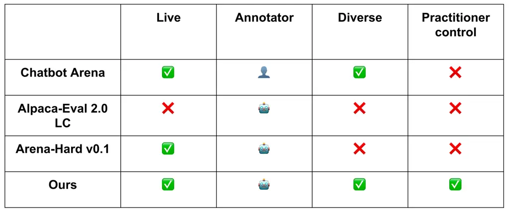
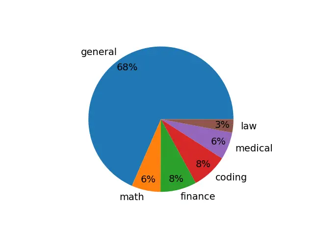
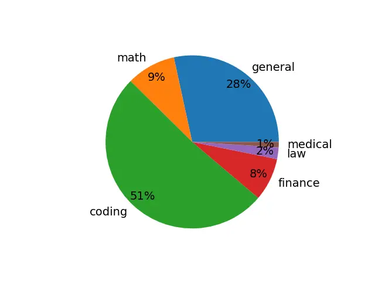
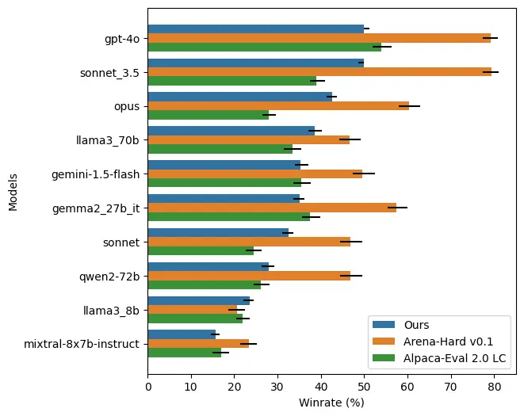
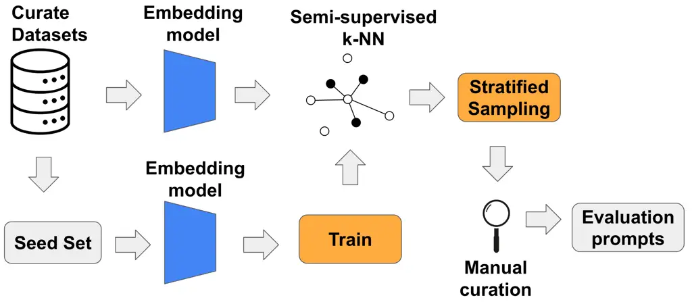
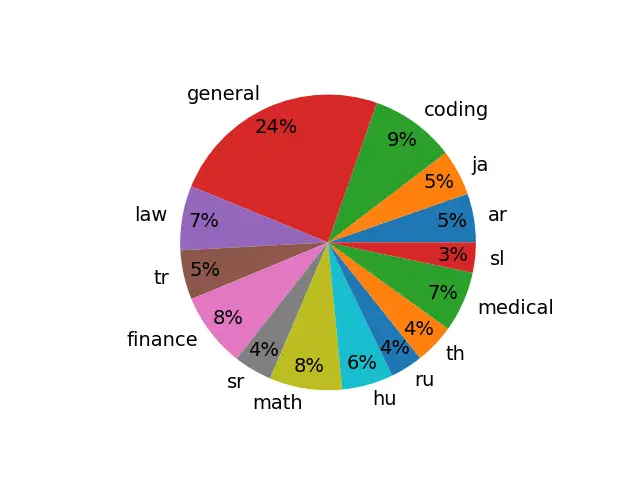
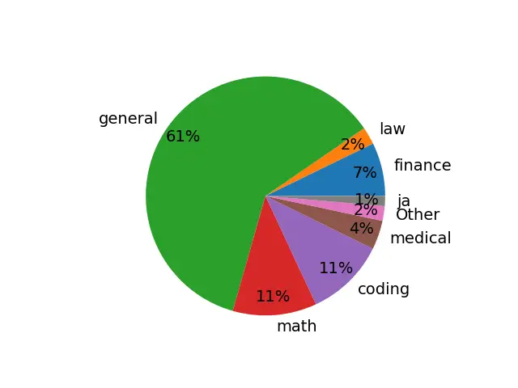
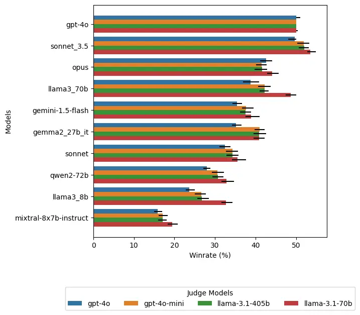
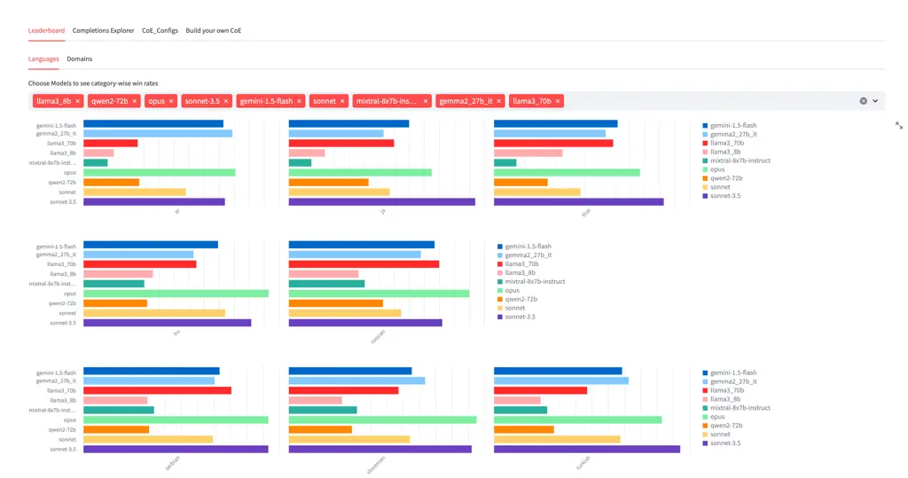

# Constructing Domain-Specific Evaluation Sets for LLM-as-a-judge

Ravi Raju Affiliation: SambaNova Systems Correspondence to:
<ravi.raju@sambanovasystems.com>    Swayambhoo Jain
Affiliation: SambaNova Systems    Bo Li Affiliation: SambaNova Systems
   Jonathan Li Affiliation: SambaNova Systems    Urmish Thakker
Affiliation: SambaNova Systems

###### Abstract

Large Language Models (LLMs) have revolutionized the landscape of
machine learning, yet current benchmarks often fall short in capturing
the diverse behavior of these models in real-world applications. A
benchmark’s usefulness is determined by its ability to clearly
differentiate between models of varying capabilities (separability) and
closely align with human preferences. Existing frameworks like
Alpaca-Eval 2.0 LC (Dubois et al., 2024a) and Arena-Hard v0.1 (Li
et al., 2024a) are limited by their focus on general-purpose queries and
lack of diversity across domains such as law, medicine, and multilingual
contexts. In this paper, we address these limitations by introducing a
novel data pipeline that curates diverse, domain-specific evaluation
sets tailored for LLM-as-a-Judge frameworks. Our approach leverages a
combination of manual curation, semi-supervised learning to generate
clusters, and stratified sampling to ensure balanced representation
across a wide range of domains and languages. The resulting evaluation
set, which includes 1573 samples across 14 categories, demonstrates high
separability (84%) across ten top-ranked models, and agreement (84%)
with Chatbot Arena and (0.915) Spearman correlation. The agreement
values are 9% better than Arena Hard and 20% better than AlpacaEval 2.0
LC, while the Spearman coefficient is 0.7 more than the next best
benchmark, showcasing a significant improvement in the usefulness of the
benchmark. We further provide an open-source evaluation tool that
enables fine-grained analysis of model performance across user-defined
categories, offering valuable insights for practitioners. This work
contributes to the ongoing effort to enhance the transparency,
diversity, and effectiveness of LLM evaluation methodologies.

###### Keywords: 

Machine Learning, Benchmarking LLMs

Figure 1: Compared to other benchmark frameworks our approach introduces
a data pipeline that curates unlabeled data into categories that contain
domains/capabilities that the practitioner cares about. It has the
capability to be refreshed with new data and is diverse compared to
alternatives.

## 1 Introduction

Large Language Models (LLMs) have dramatically changed the landscape of
machine learning research and have been incorporated in products for the
past few years. Along with their rise, a multitude of benchmarks and
frameworks (Liang et al., 2023) have been proposed to assess the
capabilities of LLMs which include knowledge tasks such as MMLU
(Hendrycks et al., 2021a), reasoning tasks like GSM8k (Cobbe et al., 2021) and more standard NLP tasks (Zellers et al., 2019; Narayan et al.,
2018). However, these benchmarks fail to capture the behavior that a
user experiences in a chat/generative applications. Typically, human
evaluations are seen as a gold standard to determining which LLM
responses are preferable over others in a chat setting but is
time-consuming and expensive to conduct (Chiang et al., 2024).

To address this shortcoming, Zheng _et al_. introduced the concept of
LLM as a judge as an automatic evaluator alternative, which uses another
LLM the judging of model completions to another LLM such as GPT-4 or
GPT-4o (Zheng et al., 2023b; OpenAI et al., 2024). Alpaca-Eval is
another benchmark designed under the paradigm of LLM as an evaluator
where a target LLM’s completions are compared against a reference LLM’s
output (the default being GPT-4 Turbo) and assigned a winrate against
the reference (Li et al., 2023). It has seen widespread adoption since
it is cheap, fast, and mitigates length bias (Chiang et al., 2024).
Similarly, Arena-Hard v0.1 is recent benchmark which focuses on
distilling the Hard category of Chatbot Arena into a smaller evaluation
set (Li et al., 2024a). They use a topic clustering pipeline to cluster
prompts with OpenAI’s embedding model (text-embedding-3-small) (OpenAI,
2024b) and score each cluster based on difficulty, creativity, and
reasoning ability with GPT-3.5 Turbo. They also introduce a notion of
separability (how well can a benchmark differentiate between models) and
agreement with human preferences (i.e. ChatBot Arena) as a measure of
benchmark quality.

Unfortunately, there are still some limitations with the current
open-source LLM-as-a-judge framework. Alpaca-Eval 2.0 LC is dominated by
general chat queries/instructions and has few prompts in domains such as
coding, medical, finance, law and mathematics as shown in Figure 2.
Arena-Hard v0.1 addresses some of these deficiencies by upweighting
coding and mathematics prompts and restricting the general chat queries
to 30% if the evaluation set. However, both evaluation sets are strictly
in English therefore not accessing the model’s multilingual capability
and have a smaller number of prompts in more niche categories like law
and medicine. As models are acquiring more capabilities across various
data types such as charts/tables, domains and languages, it becomes
crucial to determine how to evaluate each model’s ability in a scalable
manner.

Figure 2: Alpaca-Eval category breakdown

Figure 3: Arena-Hard v0.1 category breakdown

In this paper, we attempt to address challenges from Alpaca-Eval 2.0 LC
and Arena-Hard v0.1 by introducing more diversity across domain
knowledge and languages. To accomplish this, we introduce a simple data
pipeline methodology to create a new evaluation set designed for these
specific contexts. First, we source prompts from various open source
datasets (shown in Table 4) to ensure our evaluation set has high data
diversity. For the next step, we generate embeddings from a subsample of
each of these datasets using an embedding model. To label the
corresponding embeddings, we manually curate a seed set of prompts and
label them to human-defined specific categories, generate those
embeddings and train a k-NN classifier which we can use to classify the
unlabeled data that we sampled. In order to make sure that no
cluster/category dominates, we employ stratified sampling to ensure
balanced representation across all domains and languages in the
evaluation set. We further refine the quality of the prompts by manual
curation and ensure that each category has a sufficient number of
prompts to mitigate the inherent variability in LLM-as-a-judge and
ultimately end up with 1573 samples in the evaluation set.

There are several advantages to our approach as shown in Figure 1.
Similar to Arena-Hard v0.1, our approach is robust to contamination as
we can periodically run our data pipeline on the same data to get new
samples or potentially even a new data mixture. As mentioned earlier,
our methodology allows introduction of new datasets which enables
diversity rather than offered by Arena-Hard v0.1 and Alpaca-Eval. In
addition, our evaluation set more closely mirrors Chatbot Arena
rankings; Figure 4 shows a visual comparison of model rankings. In
particular, our evaluation set places Gemini-1.5-Flash (DeepMind, 2024)
over Gemma2 27B Instruct (Team, 2024) which aligns with ChatBot Arena
rankings whereas the others rank Gemma2 27B over Gemini-1.5-Flash.
Moreover, since we use open source models for the entire pipeline,
practitioners can mold the pipeline and generate evaluation sets to test
domains and capabilities they care about.

Figure 4: Visual comparison between our method, Arena-Hard v0.1, and
Alpaca-Eval 2.0 LC on 10 models on separability of winrates. Our method
has fewer overlaps of confidence intervals than the other baselines.

After we have obtained the evaluation set, we execute the same procedure
as LLM-as-a-Judge by generating the outputs completions from GPT-4o and
using them as reference to construct a leaderboard from ten various open
and closed-sourced models. With this labeling approach, we are able to
breakdown the composition of prompts into various categories and report
category win rates. We release an evaluation tool which displays the
category winrate for all models on the leaderboard and an explorer which
displays both the target model as well as the reference model’s
completions for a prompt and the reasoning given by the LLM judge. This
analysis tool allows users to obtain fine-grained insights on where
different models succeed and fail for their particular use-case.

Our main contributions can be summarized below:

- •
  We introduce a new methodology that enables creation of a benchmark
  that tests for diverse skill sets of models. We open-source our
  evaluation infrastructure so practitioners can view how different
  models perform on separate tasks according to how they define their
  categories. This fine-grained breakdown allows the practitioner to
  select models that work well for their particular use case.
- •
  Our benchmark creation methodology encourages more diversity and
  transparency to the practitioner compared to other alternatives. In
  comparison to other baselines like Alpaca-Eval and Arena-Hard v0.1,
  our benchmark has 84% separability, 84% agreement with confidence
  interval (95%) with respect to Chatbot Arena rankings, 0.915
  Spearman’s correlation coefficient with respect to Chatbot Arena
  rankings and 0.04 Brier Loss Score.
- •
  We also analyze the aforementioned metrics on our evaluation set with
  4 LLM judges: GPT-4o(OpenAI et al., 2024), GPT-4o-mini (OpenAI,
  2024a), Llama 3.1 405B Instruct and Llama 3.1 70B Instruct (Dubey
  et al., 2024). Our overall findings suggest that while open-source
  models can be used to separate between model rankings, agreement with
  Chatbot Arena model rankings is roughly 10% (405B) and 20% (70B) than
  GPT-4o.

## 2 Related Work

At their core, benchmarks are tool to estimate LLM capabilities. There
are many different flavors of benchmarks, spanning either across domains
or various tasks. Some popular benchmarks include: Boolq (Clark et al.,
2019), MMLU (Hendrycks et al., 2021a), GSM8k (Cobbe et al., 2021), MATH
(Hendrycks et al., 2021b), XSUM (Narayan et al., 2018), Hellaswag
(Zellers et al., 2019), and MGSM (Shi et al., 2022). An expanded
framework of static benchmark is AutoBencher which automatically creates
new benchmarks which finds holes in knowledge of current SOTA LLMs (Li
et al., 2024b).

These types of benchmarks have ground-truth references and compare how
closely the LLM’s completion aligns with those references. An inherent
limitation with static benchmarks is that they are hosted on the
internet and thus are susceptible test leakage contamination (Sainz
et al., 2023; Yang et al., 2023). The other style of benchmarking relies
on constructing a human evaluation trials on a set of evaluation
prompts. Due to the expensive nature of human evaluation, a recent,
cheaper alternative is to use SOTA LLMs to evaluate model completions
either through single score or pairwise comparison with a reference
answer, popularly referred to as LLM-as-a-Judge (Li et al., 2023; Zheng
et al., 2023b; Li et al., 2024a; Dubois et al., 2024b; Verga et al.,
2024).

This motivates the need for ”live, refreshable” benchmarks so that the
integrity of the benchmark can be maintained. LiveBench is a framework
which sources data from arXiv papers, news articles, and datasets to
periodically replace the stale prompts (White et al., 2024). Chatbot
arena is an open platform that allows online users to send prompts to
two different models and compare/contrast the models’ response (Chiang
et al., 2024). Users can then vote on which completion was superior.
Other live benchmarks include DynaBench (Kiela et al., 2021),
LiveCodeBench (Jain et al., 2024), and R2E (Jain et al., ). Our work
lies in the intersection between LLM-as-a-Judge and live benchmarks as
our data pipeline enables periodic refreshing of the evaluation set from
existing clusters. Furthermore, our data pipeline is fairly general as
it can consume a variety of diverse datasets (relative to Arena-Hard
v0.1 and Alpaca-Eval), consists of using open-source models, and is
flexible enough to work on the user’s desired data.

Figure 5: Data pipeline: After aggregating the prompts from datasets, we
generate embeddings using a text embedding model. We set aside a set of
prompts to use as a seed set for training the k-NN, label them into each
category we care about, and generate their corresponding embeddings to
train the k-NN with the embedding model. Subsequently, we classify the
unlabeled data with our trained k-NN to create clusters of categories.
We balance the clusters with stratified sampling and then manually
curate the remaining prompts by removing overly long prompts (greater
than 5000 words) and checking for low-quality content (nonsense prompts,
NSFW etc.) to obtain the final evaluation set.

## 3 Methodology

In this section, we describe our approach to creating novel evaluation
set using LLM-as-a judge. We enumerate the datasets that we source from
to create our unlabeled corpus and subsequently describe our data
pipeline for generating the evaluation set.

### 3.1 Data Sources

We use data sources from a variety of source to ensure we cover a
variety of domains as well as languages. The domains we target can be
broadly classified as the following: medical, law, finance, mathematics
and coding. The languages we cover are standard but also more esoteric:
Japanese (ja), Arabic (ar), Thai (th), Hungarian (hu), Russian (ru),
Serbian (sr), Slovenian (sl), and Turkish (tr). Prompts that don’t
neatly fit into these groups fall into a catch-all general category. A
complete list of all the data we use can be found in Table 4 in the
Appendix.

### 3.2 Data pipeline

Our data pipeline can be divided into 3 distinct steps, as shown in
Figure 5. We first take the data corpus and use an embedding model to
generate their corresponding embedding. Each embedding encapsulates some
level of semantic understanding of its associated prompt, and nearby
embeddings typically encode similar semantic information.

To generate the labels for the unlabeled data, we take inspiration from
semi-supervised learning (Hady & Schwenker, 2013). We manually define a
set of categories, curate a seed set of prompts which fall into those
categories (assigning them distinct labels) and embed those prompts with
the aforementioned embedding model. We train a $`k`$-NN model (Mucherino
et al., 2009) on top of those embeddings and use the $`k`$-NN to label
the larger unlabeled corpus.

The final step in our pipeline involves applying stratified sampling
(Parsons, 2017) to each cluster. The reason for this last step is that
we want our evaluation set to retain diversity of our larger data corpus
rather than uniform random sampling. For each category, we sub-sample
$`100`$ prompts from the aggregate clusters and disregard clusters which
have a lower count than the number of prompts we sampled. To obtain our
final evaluation set, we manually curate the remaining prompts to ensure
high quality, varied task capability and data diversity.

## 4 Experimental Setup

In this section, we discuss finer details about the data pipeline we
mentioned in the prior section. experimental setup on a set of ten
highly rated models¹¹ 1 gpt-4o-2024-05-13, claude-3-5-sonnet-20240620,
claude-3-opus-20240229, gemini-1.5-flash-latest, google/gemma-2-27b-it,
Meta-Llama-3-70B-Instruct, claude-3-sonnet-20240229,
Qwen/Qwen2-72B-Instruct, Meta-Llama-3-8B-Instruct,
Mixtral-8x7B-Instruct-v0.1 as well as defining the metrics which
determine the quality of the benchmark.

### 4.1 Data pipeline details

For the data pipeline, we use semi-supervised learning via a $`k`$-NN
classifier. We consider $`13`$ categories comprising of domains:
finance, law, medical, maths, coding and languages: Arabic, Russian,
Serbian, Hungarian, Japanese, Thai and Slovenian. We follow usual
supervised training and via hyperparameter sweep over validation set
yield $`k=40`$ as the best value of $`k`$.

To generate the embeddings of the unlabeled data collected, we use the
e5-mistral-7b-instruct embedding model(Wang et al., 2024) for its strong
performance on the Massive Text Embedding Benchmark (MTEB) Leaderboard
(Muennighoff et al., 2022) and multilingual capability. If the $`k`$-NN
encounters a sample which it is not familiar with or uncertain to label,
we want those samples to be classified as general prompts. We use
entropy of $`k`$-NN classifier probabilities of various categories for a
given prompt as the measure of uncertainty. If entropy if too high
entropy of the output of the classifier is too high, we bucket the
sample into the default/general category (Settles, 2010). We set the
entropy threshold to be $`1.5`$ based on careful error analysis on the
validation set.

After labeling with $`k`$-NN, we conducted stratified sampling within
each cluster, selecting $`100`$ samples for curation. We then filtered
out excessively long prompts (longer than $`5000`$ words) that could
overwhelm the judge’s context window. Additionally, we reviewed the
remaining prompts to eliminate those that were nonsensical or of low
quality. During the evaluation, we observed that categories with a small
number of examples had a significant impact on the category’s win rate.
The inherent variability of the LLM-as-a-Judge evaluation, even with a
fixed random seed and temperature set to 0.0, made it challenging to
discern which model performed better in those categories. To mitigate
this uncertainty, we ensured that any category with fewer than 90-100
examples was supplemented with additional data, enabling us to obtain
meaningful and interpretable results. Our final evaluation set comprises
$`1573`$ examples.

### 4.2 LLM-as-a-Judge Details

We follow a similar scoring setup as Arena-Hard (Li et al., 2024a) and
Alpaca-Eval (Dubois et al., 2024a) where we use GPT-4o as a judge model
and GPT-4o as a reference model as well. For each model we want to test,
we obtain the completions and ask GPT-4o to record which model responses
is better for the input prompt. In order to mitigate positional bias, we
swap the completions between the model we are evaluating and the
reference on a coin flip.

For the judge prompt, we used the default prompt from the MT-Bench work
with one notable change (Zheng et al., 2023b). When we evaluated
multilingual prompts with LLM-as-a-judge, the judge at times incorrectly
awards wins to models which don’t necessarily follow instructions. Given
the sentence ”Please respond ’How does the economy work?’ in Hungarian,”
two models might respond differently: 1) one provides a detailed English
response with bulleted lists, while 2) the other responds concisely in
Hungarian. The judge model will rate the model answering in the
incorrect language higher, which is clearly not a measure of the model’s
multilingual capability (Marchisio et al., 2024). In order to reduce
these incorrect decisions, we modified the judge prompt to specifically
penalize responses that respond to the prompt in the incorrect language.

In addition to issues with multilingual queries, we also note
specifically for coding that GPT-4o seems to prefer models which provide
detailed explanations to the code even if the code provided is of lower
quality compared to a model which has better code quality but is not as
verbose. This leads to scenarios where models that have chat but lower
benchmark performance (e.g. HumanEval (Chen et al., 2021)) obtain higher
winrate than models which are objectively better on coding prompts. To
circumvent this issue, we explicitly prompt GPT-4o that it should focus
on the correctness of the response as opposed to the style of the
response. Our judge template can be found in the Appendix.

### 4.3 Obtaining Confidence Intervals

We follow the setup outlined in Li et. al (Li et al., 2024a; Chiang
et al., 2024). We use the Bradley-Terry model in order to model the
preference distribution between models on the leaderboard and the
reference model (GPT-4o in our case). We aggregate preference pairs
between models and perform 100 rounds of bootstrapping to obtain 95%
confidence intervals for each model ranking.

We conduct the same analysis with annotations, denoting for each prompt
which model response was preferred, from the Alpaca-Eval repo to obtain
mean ELO rankings and 95% confidence intervals according to their
leaderboard. Since similar artifacts (model preference comparisons) are
not updated on Arena-Hard v0.1, we take the model winrates (ELO scores
not listed) and 95% confidence intervals from their repo²² 2 7/26/2024.
For Chatbot Arena, we do the same thing and took model winrates/ELO
scores as well as the confidence intervals from the website³³ 3
7/25/2024 as a source of ground truth.

|                         |               |                 |                    |        |
| ----------------------- | ------------- | --------------- | ------------------ | ------ |
|                         | Chatbot Arena | Arena Hard v0.1 | Alpaca-Eval 2.0 LC | Ours   |
| Separability            | 100%          | 80%             | 73.33%             | 84.44% |
| Agreement with CI (95%) | N/A           | 75.50%          | 64.44%             | 84.44% |
| Spearman’s Correlation  | N/A           | 0.187           | 0.2969             | 0.915  |
| Brier Score             | N/A           | N/A             | 0.0937             | 0.0417 |

Table 1: Main results comparing the various benchmarks.

### 4.4 Metrics

There are four different metrics we use to judge the efficacy of a
benchmark. The first of these is Spearman’s correlation coefficient,
which measures the rankings order between the two benchmarks. The other
metrics are: separability, agreement with Confidence Interval (CI), and
Brier Score. Separability refers to how well the benchmark can separate
various models with high confidence. In particular, if on benchmark A
model M1 has a higher ELO/winrate than model M2 and $`C_{M}`$ refers to
the confidence intervals of model M, $`S`$ is a binary variable
indicating if benchmark A is able to separate between model M1 and M2,
$`S=\mathbf{1}_{C_{M1}\cap C_{M_{2}}=\emptyset}`$. The separability is
then calculated as a ratio over all possible model pairs. Agreement with
CI measures how well benchmarks A and B confidently distinguish between
two models with the same ordering. The Brier Score evaluates an LLM
benchmark’s ability to predict the ranking of a pair of competing
models, rewarding confidence in accurate predictions and penalizing
confidence in incorrect ones. More details behind these metrics can be
found in (Li et al., 2024a). Ultimately, we want our benchmark to align
with Chatbot Arena as that is seen as an oracle for modeling human
preferences.

## 5 Results

### 5.1 Separability, Agreement with CI (95%), Pair Brier Score

Our main results can be found in Table 1. With the exception of Chatbot
Arena, our benchmark’s separability is 84.4% compared to other baselines
like Arena-Hard v0.1 (80%) and Alpaca-Eval 2.0 LC (73.33%), which shows
that our benchmark can better differentiate amongst different models.

One interesting datapoint regarding separability is Chatbot Arena’s
score of 100% which may be attributed to a combination of two
factors: 1) Chatbot Arena has more battles than any of the benchmarks
listed in Table 1 and 2) Chatbot Arena includes battles between many
different models rather than fixing a reference model like the other
benchmarks. By providing the Bradley-Terry model bootstrapping process
with more varied battles, Chatbot Arena is able to produce tighter
confidence intervals, suggesting a future avenue for investigation is
whether confidence estimation should include multiple reference answers
during judging to more closely simulate Chatbot Arena.

Our benchmark showed an 84.44% agreement with CI with respect to Chatbot
Arena, which is higher than Arena-Hard v0.1’s 75.50% and Alpaca-Eval 2.0
LC’s 64.44%. This demonstrates that our benchmark has higher alignment
with respect to Chatbot Arena which is supposed to be approximation of
human preferences. In addition, our benchmark has a Spearman’s
correlation coefficient of 0.915, indicating a strong correlation in
rankings order compared to Alpaca-Eval 2.0 LC’s 0.2969. While our
leaderboard ranking consists of 10 models, the pool of models we have
included are the latest SOTA models that have been released so as to
have the maximum amount of overlap possible. Finally, our benchmark
scored a Brier score of 0.0417, which is lower than Alpaca-Eval 2.0 LC’s
0.0937, demonstrating better confidence in accurate predictions.

### 5.2 Diversity

Due to our data sources being quite diverse rather than simply just
ChatBot Arena (Chiang et al., 2024), we are able to have more diversity
in our evaluation set. To demonstrate this, we label Arena-Hard v0.1
with our kNN model using the entropy threshold to get a distribution of
categories in that evaluation set. As shown in Figure 3, there is an
over-representation of coding prompts, which comes from a byproduct of
their data pipeline filtering for the hardest, highest quality which
skews towards coding. Similarly, Alpaca-Eval’s prompt distribution shown
in Figure 2 demonstrates that there is a large emphasis on general chat
queries, along with some coding and math prompts while medical and law
prompts are relatively underrepresented.

Our evaluation set breakdown in Figure 6(a) which covers more domains
than the baseline, such languages like Arabic, Japanese, Hungarian and
more. The close to equal distribution amongst the categories is likely
due to the effect stratified sampling. We compare how our evaluation set
category breakdown compared with LM-SYS Conversations (using our k-NN
labeling approach) (Zheng et al., 2023a) in Figure 6(b), which is a
snapshot of cleaned Chatbot Arena conversations from April to June 2023.
In Figure 6(b), ”Other” refers to the languages our k-NN classifier
recognizes but groups them together collectively. We note that this
distribution looks similar to Alpaca-Eval and the general category may
contain additional languages not recognized by the classifier so it may
have exceeded the entropy threshold.

(a) Our evaluation set category breakdown

(b) LMSys Conversations category breakdown

Figure 6: We look at the category breakdown on our evaluation set
(Figure 6(a)) compared to LM-SYS Conversations (Figure 6(b)). We can
clearly see that our evaluation set covers more languages and niche
domains such as law and medical categories are a higher percentage of
our evaluation set.

### 5.3 Category Separability

Due to our unique ability to categorize the prompts, we can compute
category separability for all the various categories in our evaluation
set. Across 14 different categories, we do the same bootstrapping
procedure on the category data to obtain the mean winrate/ELO and 95%
CI, shown in Table 2. In general, there is a drop in separability when
we look both at ELO ratings and winrate due to each category having a
lower number of samples and thus larger CIs as a result.

The category-wise separability can act as an indicator which categories
are superior at testing out the performance of models. Interestingly,
across ELO and winrate rankings, Hungarian has the best separability of
all categories, achieving 66.67% and 75.56% respectively. The medical
category seems to be lowest separability around 55.56% and 68.89%
respectively. The separability also indicates to use which categories we
may need to add more samples to improve the confidence intervals.

| Category | Ranking winrate | Ranking ELO |
| -------- | --------------- | ----------- |
| ar       | 73.33%          | 57.78%      |
| ru       | 71.11%          | 55.56%      |
| finance  | 75.56%          | 57.78%      |
| sr       | 71.11%          | 53.33%      |
| tr       | 73.33%          | 55.56%      |
| general  | 77.78%          | 55.78%      |
| hu       | 75.56%          | 66.67%      |
| ja       | 71.11%          | 57.78%      |
| medical  | 68.89%          | 55.56%      |
| law      | 73.33%          | 51.11%      |
| th       | 71.11%          | 57.78%      |
| coding   | 73.33%          | 55.56%      |
| sl       | 77.78%          | 53.33%      |
| math     | 73.33%          | 55.56%      |

Table 2: Winrate and ELO separability for different categories

### 5.4 Using different judges

|                         |        |             |                |               |
| ----------------------- | ------ | ----------- | -------------- | ------------- |
|                         | GPT-4o | GPT-4o-mini | Llama 3.1 405B | Llama 3.1 70B |
| Separability            | 84.44% | 82.22%      | 82.22%         | 84.44%        |
| Agreement with CI (95%) | 84.44% | 76.77%      | 75.55%         | 66.66%        |
| Spearman’s Correlation  | 0.915  | 0.0787      | 0.0787         | 0.0787        |
| Brier Score             | 0.0417 | 0.062       | 0.0603         | 0.0955        |

Table 3: Comparing various judges on our evaluation set.

We conduct an ablation of judge models on our evaluation, as we want to
understand the effect of judge models on separability, Agreement with CI
(95%) and Brier Score. We consider GPT-4o mini as one of the judges to
be a small-closed source foil to GPT-4o. The other judges that we
consider are open source models such as: Llama 3.1 405B instruct (using
SambaNova’s developer API)⁴⁴ 4 https://sambanova.ai/fast-api and Llama
3.1 70B Instruct-Turbo⁵⁵ 5
https://api.together.ai/models/meta-llama/Meta-Llama-3.1-70B-Instruct-Turbo.
We follow the same setup as gpt-4o with these other judge models.

Our results are shown in Table 3. In terms of separability, GPT-4o-mini
and 405B get 82.2% and 70B get 84% separability, comparable to GPT-4o’s
separability. 405B and GPT-4o-mini attain similar Agreement with CI
(95%) close to 76% while 70B is almost 10 points lower; GPT-4o is the
clear winner having the highest agreement with CI (95%). With the
exception of 70B, all models get similar Brier Scores indicating that
the Bradley-Terry models used to generate the rankings on confidence
intervals for each judge are similarly confident. 70B’s high Brier score
(relative to other judges), in addition to Agreement with CI, indicates
that it poor judge than the other listed in Table 3.

The Spearman’s correlation coefficient (with respect to ChatBot Arena
rankings) seems to indicate that GPT-4o-mini, Llama 3.1 405B, and 70B
are poor judges getting a correlation of only 0.0787 vs. GPT-4o’s 0.915.
Looking at Figure 7, it seems this aberration comes from both judges
rating Claude Sonnet 3.5 over GPT-4o, Llama 3 70b over Claude Opus and
Gemma2 27B over Gemini 1.5 Flash. Of course, Spearman’s correlation only
measures correlation the final rank order of models with respect to
ChatBot Arena and is a strictly weaker metric than Agreement with CI
(95%). This finding seems to suggest while weaker closed-source models
(like GPT-4o-mini) and open-source judge models seem to be able to
separate other models based on capability, they still lack the
preciseness that GPT-4o offers to align with rankings from Chatbot
Arena.

Figure 7: Visual comparison of different judge’s separability on our
benchmark.

## 6 Limitations/Future Work

There are certain limitations to our work. Currently, the categories we
enumerate in our data pipeline is manually specified by humans and
significant curation is done to ensure high quality prompts; for future
work, we want to expand to using LLMs as category generators as well as
quality checkers to automate the human effort out of this pipeline. For
improving our leaderboard, we wish to add more models to be more
representative of the entire spectrum of other leaderboards and futhur
increasing the quality of the Bradley-Terry models we use to obtain the
model’s confidence intervals. In order to improve category separability,
we look to creating a methodology on figuring out the minimum number of
samples required to improve separability.

The other aspect of future work relies to details regarding
LLM-as-a-judge evaluation. Typically, the judge models are ablated but
less explored is the quality of the reference answer and whether one can
use a weaker model instead of a stronger one to see if metrics are
maintained. Current metrics define how separable a benchmark is and how
much it aligns with human preferences but fails to account for the
composition and diversity of the underlying data. For future work, we
seek to quantify the diversity of each benchmark to understand how many
capabilities/domains it spans.

## 7 Conclusion

We introduce a data pipeline that leverages via semi-supervised learning
with a k-NN to enable practitioners to create benchmarks on their own
data for targeted domains. Through evaluations of ten various closed and
open-sourced models, we demonstrated that our benchmark achieves higher
separability and agreement with CI with respect to Chatbot Arena, nearly
5 and 10 percentage points higher than the next best baseline,
respectively. Our benchmark covers a wide variety of topics such as
finance, medicine, legal and different languages absent in other LLM as
a judge benchmarks. We hope that LLM developers can use our data
pipeline to create their own benchmarks to evaluate their models for
their particular use-case.

## References

- Amini et al. (2019) Amini, A., Gabriel, S., Lin, S.,
  Koncel-Kedziorski, R., Choi, Y., and Hajishirzi, H. MathQA: Towards
  interpretable math word problem solving with operation-based
  formalisms. In _Proceedings of the 2019 Conference of the North
  American Chapter of the Association for Computational Linguistics:
  Human Language Technologies, Volume 1 (Long and Short Papers)_, pp.
  2357–2367, Minneapolis, Minnesota, June 2019. Association for
  Computational Linguistics. doi: 10.18653/v1/N19-1245. URL
  [https://aclanthology.org/N19-1245](https://aclanthology.org/N19-1245).
- Chen et al. (2021) Chen, M., Tworek, J., Jun, H., Yuan, Q.,
  de Oliveira Pinto, H. P., Kaplan, J., Edwards, H., Burda, Y., Joseph,
  N., Brockman, G., Ray, A., Puri, R., Krueger, G., Petrov, M., Khlaaf,
  H., Sastry, G., Mishkin, P., Chan, B., Gray, S., Ryder, N., Pavlov,
  M., Power, A., Kaiser, L., Bavarian, M., Winter, C., Tillet, P., Such,
  F. P., Cummings, D., Plappert, M., Chantzis, F., Barnes, E.,
  Herbert-Voss, A., Guss, W. H., Nichol, A., Paino, A., Tezak, N., Tang,
  J., Babuschkin, I., Balaji, S., Jain, S., Saunders, W., Hesse, C.,
  Carr, A. N., Leike, J., Achiam, J., Misra, V., Morikawa, E., Radford,
  A., Knight, M., Brundage, M., Murati, M., Mayer, K., Welinder, P.,
  McGrew, B., Amodei, D., McCandlish, S., Sutskever, I., and Zaremba, W.
  Evaluating large language models trained on code, 2021.
- Chiang et al. (2024) Chiang, W.-L., Zheng, L., Sheng, Y.,
  Angelopoulos, A. N., Li, T., Li, D., Zhang, H., Zhu, B., Jordan, M.,
  Gonzalez, J. E., and Stoica, I. Chatbot arena: An open platform for
  evaluating llms by human preference, 2024. URL
  [https://arxiv.org/abs/2403.04132](https://arxiv.org/abs/2403.04132).
- Clark et al. (2019) Clark, C., Lee, K., Chang, M.-W., Kwiatkowski, T.,
  Collins, M., and Toutanova, K. Boolq: Exploring the surprising
  difficulty of natural yes/no questions, 2019. URL
  [https://arxiv.org/abs/1905.10044](https://arxiv.org/abs/1905.10044).
- Cobbe et al. (2021) Cobbe, K., Kosaraju, V., Bavarian, M., Chen, M.,
  Jun, H., Kaiser, L., Plappert, M., Tworek, J., Hilton, J., Nakano, R.,
  Hesse, C., and Schulman, J. Training verifiers to solve math word
  problems, 2021. URL
  [https://arxiv.org/abs/2110.14168](https://arxiv.org/abs/2110.14168).
- DeepMind (2024) DeepMind. Gemini flash, 2024. URL
  [https://deepmind.google/technologies/gemini/flash/](https://deepmind.google/technologies/gemini/flash/).
  Accessed: 2024-08-14.
- Dubey et al. (2024) Dubey, A., Jauhri, A., Pandey, A., Kadian, A.,
  Al-Dahle, A., Letman, A., Mathur, A., Schelten, A., Yang, A., Fan, A.,
  Goyal, A., Hartshorn, A., Yang, A., Mitra, A., Sravankumar, A.,
  Korenev, A., Hinsvark, A., Rao, A., Zhang, A., Rodriguez, A.,
  Gregerson, A., Spataru, A., Roziere, B., Biron, B., Tang, B., Chern,
  B., Caucheteux, C., Nayak, C., Bi, C., Marra, C., McConnell, C.,
  Keller, C., Touret, C., Wu, C., Wong, C., Ferrer, C. C., Nikolaidis,
  C., Allonsius, D., Song, D., Pintz, D., Livshits, D., Esiobu, D.,
  Choudhary, D., Mahajan, D., Garcia-Olano, D., Perino, D., Hupkes, D.,
  Lakomkin, E., AlBadawy, E., Lobanova, E., Dinan, E., Smith, E. M.,
  Radenovic, F., Zhang, F., Synnaeve, G., Lee, G., Anderson, G. L.,
  Nail, G., Mialon, G., Pang, G., Cucurell, G., Nguyen, H., Korevaar,
  H., Xu, H., Touvron, H., Zarov, I., Ibarra, I. A., Kloumann, I.,
  Misra, I., Evtimov, I., Copet, J., Lee, J., Geffert, J., Vranes, J.,
  Park, J., Mahadeokar, J., Shah, J., van der Linde, J., Billock, J.,
  Hong, J., Lee, J., Fu, J., Chi, J., Huang, J., Liu, J., Wang, J., Yu,
  J., Bitton, J., Spisak, J., Park, J., Rocca, J., Johnstun, J., Saxe,
  J., Jia, J., Alwala, K. V., Upasani, K., Plawiak, K., Li, K.,
  Heafield, K., Stone, K., El-Arini, K., Iyer, K., Malik, K., Chiu, K.,
  Bhalla, K., Rantala-Yeary, L., van der Maaten, L., Chen, L., Tan, L.,
  Jenkins, L., Martin, L., Madaan, L., Malo, L., Blecher, L., Landzaat,
  L., de Oliveira, L., Muzzi, M., Pasupuleti, M., Singh, M., Paluri, M.,
  Kardas, M., Oldham, M., Rita, M., Pavlova, M., Kambadur, M., Lewis,
  M., Si, M., Singh, M. K., Hassan, M., Goyal, N., Torabi, N.,
  Bashlykov, N., Bogoychev, N., Chatterji, N., Duchenne, O., Çelebi, O.,
  Alrassy, P., Zhang, P., Li, P., Vasic, P., Weng, P., Bhargava, P.,
  Dubal, P., Krishnan, P., Koura, P. S., Xu, P., He, Q., Dong, Q.,
  Srinivasan, R., Ganapathy, R., Calderer, R., Cabral, R. S., Stojnic,
  R., Raileanu, R., Girdhar, R., Patel, R., Sauvestre, R., Polidoro, R.,
  Sumbaly, R., Taylor, R., Silva, R., Hou, R., Wang, R., Hosseini, S.,
  Chennabasappa, S., Singh, S., Bell, S., Kim, S. S., Edunov, S., Nie,
  S., Narang, S., Raparthy, S., Shen, S., Wan, S., Bhosale, S., Zhang,
  S., Vandenhende, S., Batra, S., Whitman, S., Sootla, S., Collot, S.,
  Gururangan, S., Borodinsky, S., Herman, T., Fowler, T., Sheasha, T.,
  Georgiou, T., Scialom, T., Speckbacher, T., Mihaylov, T., Xiao, T.,
  Karn, U., Goswami, V., Gupta, V., Ramanathan, V., Kerkez, V., Gonguet,
  V., Do, V., Vogeti, V., Petrovic, V., Chu, W., Xiong, W., Fu, W.,
  Meers, W., Martinet, X., Wang, X., Tan, X. E., Xie, X., Jia, X., Wang,
  X., Goldschlag, Y., Gaur, Y., Babaei, Y., Wen, Y., Song, Y., Zhang,
  Y., Li, Y., Mao, Y., Coudert, Z. D., Yan, Z., Chen, Z., Papakipos, Z.,
  Singh, A., Grattafiori, A., Jain, A., Kelsey, A., Shajnfeld, A.,
  Gangidi, A., Victoria, A., Goldstand, A., Menon, A., Sharma, A.,
  Boesenberg, A., Vaughan, A., Baevski, A., Feinstein, A., Kallet, A.,
  Sangani, A., Yunus, A., Lupu, A., Alvarado, A., Caples, A., Gu, A.,
  Ho, A., Poulton, A., Ryan, A., Ramchandani, A., Franco, A., Saraf, A.,
  Chowdhury, A., Gabriel, A., Bharambe, A., Eisenman, A., Yazdan, A.,
  James, B., Maurer, B., Leonhardi, B., Huang, B., Loyd, B., Paola,
  B. D., Paranjape, B., Liu, B., Wu, B., Ni, B., Hancock, B., Wasti, B.,
  Spence, B., Stojkovic, B., Gamido, B., Montalvo, B., Parker, C.,
  Burton, C., Mejia, C., Wang, C., Kim, C., Zhou, C., Hu, C., Chu,
  C.-H., Cai, C., Tindal, C., Feichtenhofer, C., Civin, D., Beaty, D.,
  Kreymer, D., Li, D., Wyatt, D., Adkins, D., Xu, D., Testuggine, D.,
  David, D., Parikh, D., Liskovich, D., Foss, D., Wang, D., Le, D.,
  Holland, D., Dowling, E., Jamil, E., Montgomery, E., Presani, E.,
  Hahn, E., Wood, E., Brinkman, E., Arcaute, E., Dunbar, E., Smothers,
  E., Sun, F., Kreuk, F., Tian, F., Ozgenel, F., Caggioni, F., Guzmán,
  F., Kanayet, F., Seide, F., Florez, G. M., Schwarz, G., Badeer, G.,
  Swee, G., Halpern, G., Thattai, G., Herman, G., Sizov, G., Guangyi,
  Zhang, Lakshminarayanan, G., Shojanazeri, H., Zou, H., Wang, H., Zha,
  H., Habeeb, H., Rudolph, H., Suk, H., Aspegren, H., Goldman, H.,
  Molybog, I., Tufanov, I., Veliche, I.-E., Gat, I., Weissman, J.,
  Geboski, J., Kohli, J., Asher, J., Gaya, J.-B., Marcus, J., Tang, J.,
  Chan, J., Zhen, J., Reizenstein, J., Teboul, J., Zhong, J., Jin, J.,
  Yang, J., Cummings, J., Carvill, J., Shepard, J., McPhie, J., Torres,
  J., Ginsburg, J., Wang, J., Wu, K., U, K. H., Saxena, K., Prasad, K.,
  Khandelwal, K., Zand, K., Matosich, K., Veeraraghavan, K., Michelena,
  K., Li, K., Huang, K., Chawla, K., Lakhotia, K., Huang, K., Chen, L.,
  Garg, L., A, L., Silva, L., Bell, L., Zhang, L., Guo, L., Yu, L.,
  Moshkovich, L., Wehrstedt, L., Khabsa, M., Avalani, M., Bhatt, M.,
  Tsimpoukelli, M., Mankus, M., Hasson, M., Lennie, M., Reso, M.,
  Groshev, M., Naumov, M., Lathi, M., Keneally, M., Seltzer, M. L.,
  Valko, M., Restrepo, M., Patel, M., Vyatskov, M., Samvelyan, M.,
  Clark, M., Macey, M., Wang, M., Hermoso, M. J., Metanat, M.,
  Rastegari, M., Bansal, M., Santhanam, N., Parks, N., White, N., Bawa,
  N., Singhal, N., Egebo, N., Usunier, N., Laptev, N. P., Dong, N.,
  Zhang, N., Cheng, N., Chernoguz, O., Hart, O., Salpekar, O., Kalinli,
  O., Kent, P., Parekh, P., Saab, P., Balaji, P., Rittner, P.,
  Bontrager, P., Roux, P., Dollar, P., Zvyagina, P., Ratanchandani, P.,
  Yuvraj, P., Liang, Q., Alao, R., Rodriguez, R., Ayub, R., Murthy, R.,
  Nayani, R., Mitra, R., Li, R., Hogan, R., Battey, R., Wang, R.,
  Maheswari, R., Howes, R., Rinott, R., Bondu, S. J., Datta, S., Chugh,
  S., Hunt, S., Dhillon, S., Sidorov, S., Pan, S., Verma, S., Yamamoto,
  S., Ramaswamy, S., Lindsay, S., Lindsay, S., Feng, S., Lin, S., Zha,
  S. C., Shankar, S., Zhang, S., Zhang, S., Wang, S., Agarwal, S.,
  Sajuyigbe, S., Chintala, S., Max, S., Chen, S., Kehoe, S.,
  Satterfield, S., Govindaprasad, S., Gupta, S., Cho, S., Virk, S.,
  Subramanian, S., Choudhury, S., Goldman, S., Remez, T., Glaser, T.,
  Best, T., Kohler, T., Robinson, T., Li, T., Zhang, T., Matthews, T.,
  Chou, T., Shaked, T., Vontimitta, V., Ajayi, V., Montanez, V., Mohan,
  V., Kumar, V. S., Mangla, V., Ionescu, V., Poenaru, V., Mihailescu,
  V. T., Ivanov, V., Li, W., Wang, W., Jiang, W., Bouaziz, W.,
  Constable, W., Tang, X., Wang, X., Wu, X., Wang, X., Xia, X., Wu, X.,
  Gao, X., Chen, Y., Hu, Y., Jia, Y., Qi, Y., Li, Y., Zhang, Y., Zhang,
  Y., Adi, Y., Nam, Y., Yu, Wang, Hao, Y., Qian, Y., He, Y., Rait, Z.,
  DeVito, Z., Rosnbrick, Z., Wen, Z., Yang, Z., and Zhao, Z. The llama 3
  herd of models, 2024. URL
  [https://arxiv.org/abs/2407.21783](https://arxiv.org/abs/2407.21783).
- Dubois et al. (2024a) Dubois, Y., Galambosi, B., Liang, P., and
  Hashimoto, T. B. Length-controlled alpacaeval: A simple way to debias
  automatic evaluators, 2024a. URL
  [https://arxiv.org/abs/2404.04475](https://arxiv.org/abs/2404.04475).
- Dubois et al. (2024b) Dubois, Y., Li, X., Taori, R., Zhang, T.,
  Gulrajani, I., Ba, J., Guestrin, C., Liang, P., and Hashimoto, T. B.
  Alpacafarm: A simulation framework for methods that learn from human
  feedback, 2024b. URL
  [https://arxiv.org/abs/2305.14387](https://arxiv.org/abs/2305.14387).
- Gaurang Bharti (2024) Gaurang Bharti. finance-alpaca (revision
  51d16b6), 2024. URL
  [https://huggingface.co/datasets/gbharti/finance-alpaca](https://huggingface.co/datasets/gbharti/finance-alpaca).
- Hady & Schwenker (2013) Hady, M. F. A. and Schwenker, F.
  _Semi-supervised Learning_, pp. 215–239. Springer Berlin Heidelberg,
  Berlin, Heidelberg, 2013. ISBN 978-3-642-36657-4. doi:
  10.1007/978-3-642-36657-4_7. URL
  [https://doi.org/10.1007/978-3-642-36657-4_7](https://doi.org/10.1007/978-3-642-36657-4_7).
- Hendrycks et al. (2021a) Hendrycks, D., Burns, C., Basart, S., Zou,
  A., Mazeika, M., Song, D., and Steinhardt, J. Measuring massive
  multitask language understanding, 2021a. URL
  [https://arxiv.org/abs/2009.03300](https://arxiv.org/abs/2009.03300).
- Hendrycks et al. (2021b) Hendrycks, D., Burns, C., Kadavath, S.,
  Arora, A., Basart, S., Tang, E., Song, D., and Steinhardt, J.
  Measuring mathematical problem solving with the math dataset, 2021b.
  URL
  [https://arxiv.org/abs/2103.03874](https://arxiv.org/abs/2103.03874).
- (14) Jain, N., Shetty, M., Zhang, T., Han, K., Sen, K., and Stoica, I.
  R2e: Turning any github repository into a programming agent
  environment. In _ICML 2024_.
- Jain et al. (2024) Jain, N., Han, K., Gu, A., Li, W.-D., Yan, F.,
  Zhang, T., Wang, S., Solar-Lezama, A., Sen, K., and Stoica, I.
  Livecodebench: Holistic and contamination free evaluation of large
  language models for code, 2024. URL
  [https://arxiv.org/abs/2403.07974](https://arxiv.org/abs/2403.07974).
- Jin et al. (2019) Jin, Q., Dhingra, B., Liu, Z., Cohen, W., and Lu, X.
  Pubmedqa: A dataset for biomedical research question answering. In
  _Proceedings of the 2019 Conference on Empirical Methods in Natural
  Language Processing and the 9th International Joint Conference on
  Natural Language Processing (EMNLP-IJCNLP)_, pp. 2567–2577, 2019.
- Jon Durbin (2024) Jon Durbin. airoboros-gpt4-1.2, 2024. URL
  [https://huggingface.co/datasets/gbharti/finance-alpaca](https://huggingface.co/datasets/gbharti/finance-alpaca).
- Kiela et al. (2021) Kiela, D., Bartolo, M., Nie, Y., Kaushik, D.,
  Geiger, A., Wu, Z., Vidgen, B., Prasad, G., Singh, A., Ringshia, P.,
  Ma, Z., Thrush, T., Riedel, S., Waseem, Z., Stenetorp, P., Jia, R.,
  Bansal, M., Potts, C., and Williams, A. Dynabench: Rethinking
  benchmarking in nlp, 2021. URL
  [https://arxiv.org/abs/2104.14337](https://arxiv.org/abs/2104.14337).
- Kornilova & Eidelman (2019) Kornilova, A. and Eidelman, V. BillSum: A
  corpus for automatic summarization of US legislation. In Wang, L.,
  Cheung, J. C. K., Carenini, G., and Liu, F. (eds.), _Proceedings of
  the 2nd Workshop on New Frontiers in Summarization_, pp. 48–56, Hong
  Kong, China, November 2019. Association for Computational Linguistics.
  doi: 10.18653/v1/D19-5406. URL
  [https://aclanthology.org/D19-5406](https://aclanthology.org/D19-5406).
- Li et al. (2022) Li, J., Bhambhoria, R., and Zhu, X.
  Parameter-efficient legal domain adaptation. In _Proceedings of the
  Natural Legal Language Processing Workshop 2022_, pp. 119–129, Abu
  Dhabi, United Arab Emirates (Hybrid), December 2022. Association for
  Computational Linguistics. URL
  [https://aclanthology.org/2022.nllp-1.10](https://aclanthology.org/2022.nllp-1.10).
- Li et al. (2024a) Li, T., Chiang, W.-L., Frick, E., Dunlap, L., Wu,
  T., Zhu, B., Gonzalez, J. E., and Stoica, I. From crowdsourced data to
  high-quality benchmarks: Arena-hard and benchbuilder pipeline, 2024a.
- Li et al. (2023) Li, X., Zhang, T., Dubois, Y., Taori, R., Gulrajani,
  I., Guestrin, C., Liang, P., and Hashimoto, T. B. Alpacaeval: An
  automatic evaluator of instruction-following models.
  [https://github.com/tatsu-lab/alpaca_eval](https://github.com/tatsu-lab/alpaca_eval), 2023.
- Li et al. (2024b) Li, X. L., Liu, E. Z., Liang, P., and Hashimoto, T.
  Autobencher: Creating salient, novel, difficult datasets for language
  models, 2024b. URL
  [https://arxiv.org/abs/2407.08351](https://arxiv.org/abs/2407.08351).
- Liang et al. (2023) Liang, P., Bommasani, R., Lee, T., Tsipras, D.,
  Soylu, D., Yasunaga, M., Zhang, Y., Narayanan, D., Wu, Y., Kumar, A.,
  Newman, B., Yuan, B., Yan, B., Zhang, C., Cosgrove, C., Manning,
  C. D., Ré, C., Acosta-Navas, D., Hudson, D. A., Zelikman, E., Durmus,
  E., Ladhak, F., Rong, F., Ren, H., Yao, H., Wang, J., Santhanam, K.,
  Orr, L., Zheng, L., Yuksekgonul, M., Suzgun, M., Kim, N., Guha, N.,
  Chatterji, N., Khattab, O., Henderson, P., Huang, Q., Chi, R., Xie,
  S. M., Santurkar, S., Ganguli, S., Hashimoto, T., Icard, T., Zhang,
  T., Chaudhary, V., Wang, W., Li, X., Mai, Y., Zhang, Y., and
  Koreeda, Y. Holistic evaluation of language models, 2023. URL
  [https://arxiv.org/abs/2211.09110](https://arxiv.org/abs/2211.09110).
- Lin et al. (2022) Lin, S., Hilton, J., and Evans, O. Truthfulqa:
  Measuring how models mimic human falsehoods, 2022. URL
  [https://arxiv.org/abs/2109.07958](https://arxiv.org/abs/2109.07958).
- Marchisio et al. (2024) Marchisio, K., Ko, W.-Y., Bérard, A., Dehaze,
  T., and Ruder, S. Understanding and mitigating language confusion in
  llms, 2024. URL
  [https://arxiv.org/abs/2406.20052](https://arxiv.org/abs/2406.20052).
- Mucherino et al. (2009) Mucherino, A., Papajorgji, P. J., and
  Pardalos, P. M. _k-Nearest Neighbor Classification_, pp. 83–106.
  Springer New York, New York, NY, 2009. ISBN 978-0-387-88615-2. doi:
  10.1007/978-0-387-88615-2_4. URL
  [https://doi.org/10.1007/978-0-387-88615-2_4](https://doi.org/10.1007/978-0-387-88615-2_4).
- Muennighoff et al. (2022) Muennighoff, N., Tazi, N., Magne, L., and
  Reimers, N. Mteb: Massive text embedding benchmark. _arXiv preprint
  arXiv:2210.07316_, 2022. doi: 10.48550/ARXIV.2210.07316. URL
  [https://arxiv.org/abs/2210.07316](https://arxiv.org/abs/2210.07316).
- Narayan et al. (2018) Narayan, S., Cohen, S. B., and Lapata, M. Don’t
  give me the details, just the summary! topic-aware convolutional
  neural networks for extreme summarization, 2018. URL
  [https://arxiv.org/abs/1808.08745](https://arxiv.org/abs/1808.08745).
- OpenAI (2024a) OpenAI. Gpt-4o mini: Advancing cost-efficient
  intelligence, 2024a. URL
  [https://openai.com/index/gpt-4o-mini-advancing-cost-efficient-intelligence/](https://openai.com/index/gpt-4o-mini-advancing-cost-efficient-intelligence/).
  Accessed: 2024-08-14.
- OpenAI (2024b) OpenAI. New embedding models and api updates, 2024b.
  URL
  [https://openai.com/index/new-embedding-models-and-api-updates/](https://openai.com/index/new-embedding-models-and-api-updates/).
  Accessed: 2024-08-14.
- OpenAI et al. (2024) OpenAI, Achiam, J., Adler, S., Agarwal, S.,
  Ahmad, L., Akkaya, I., Aleman, F. L., Almeida, D., Altenschmidt, J.,
  Altman, S., Anadkat, S., Avila, R., Babuschkin, I., Balaji, S.,
  Balcom, V., Baltescu, P., Bao, H., Bavarian, M., Belgum, J., Bello,
  I., Berdine, J., Bernadett-Shapiro, G., Berner, C., Bogdonoff, L.,
  Boiko, O., Boyd, M., Brakman, A.-L., Brockman, G., Brooks, T.,
  Brundage, M., Button, K., Cai, T., Campbell, R., Cann, A., Carey, B.,
  Carlson, C., Carmichael, R., Chan, B., Chang, C., Chantzis, F., Chen,
  D., Chen, S., Chen, R., Chen, J., Chen, M., Chess, B., Cho, C., Chu,
  C., Chung, H. W., Cummings, D., Currier, J., Dai, Y., Decareaux, C.,
  Degry, T., Deutsch, N., Deville, D., Dhar, A., Dohan, D., Dowling, S.,
  Dunning, S., Ecoffet, A., Eleti, A., Eloundou, T., Farhi, D., Fedus,
  L., Felix, N., Fishman, S. P., Forte, J., Fulford, I., Gao, L.,
  Georges, E., Gibson, C., Goel, V., Gogineni, T., Goh, G.,
  Gontijo-Lopes, R., Gordon, J., Grafstein, M., Gray, S., Greene, R.,
  Gross, J., Gu, S. S., Guo, Y., Hallacy, C., Han, J., Harris, J., He,
  Y., Heaton, M., Heidecke, J., Hesse, C., Hickey, A., Hickey, W.,
  Hoeschele, P., Houghton, B., Hsu, K., Hu, S., Hu, X., Huizinga, J.,
  Jain, S., Jain, S., Jang, J., Jiang, A., Jiang, R., Jin, H., Jin, D.,
  Jomoto, S., Jonn, B., Jun, H., Kaftan, T., Łukasz Kaiser, Kamali, A.,
  Kanitscheider, I., Keskar, N. S., Khan, T., Kilpatrick, L., Kim,
  J. W., Kim, C., Kim, Y., Kirchner, J. H., Kiros, J., Knight, M.,
  Kokotajlo, D., Łukasz Kondraciuk, Kondrich, A., Konstantinidis, A.,
  Kosic, K., Krueger, G., Kuo, V., Lampe, M., Lan, I., Lee, T., Leike,
  J., Leung, J., Levy, D., Li, C. M., Lim, R., Lin, M., Lin, S., Litwin,
  M., Lopez, T., Lowe, R., Lue, P., Makanju, A., Malfacini, K., Manning,
  S., Markov, T., Markovski, Y., Martin, B., Mayer, K., Mayne, A.,
  McGrew, B., McKinney, S. M., McLeavey, C., McMillan, P., McNeil, J.,
  Medina, D., Mehta, A., Menick, J., Metz, L., Mishchenko, A., Mishkin,
  P., Monaco, V., Morikawa, E., Mossing, D., Mu, T., Murati, M., Murk,
  O., Mély, D., Nair, A., Nakano, R., Nayak, R., Neelakantan, A., Ngo,
  R., Noh, H., Ouyang, L., O’Keefe, C., Pachocki, J., Paino, A.,
  Palermo, J., Pantuliano, A., Parascandolo, G., Parish, J., Parparita,
  E., Passos, A., Pavlov, M., Peng, A., Perelman, A., de Avila
  Belbute Peres, F., Petrov, M., de Oliveira Pinto, H. P., Michael,
  Pokorny, Pokrass, M., Pong, V. H., Powell, T., Power, A., Power, B.,
  Proehl, E., Puri, R., Radford, A., Rae, J., Ramesh, A., Raymond, C.,
  Real, F., Rimbach, K., Ross, C., Rotsted, B., Roussez, H., Ryder, N.,
  Saltarelli, M., Sanders, T., Santurkar, S., Sastry, G., Schmidt, H.,
  Schnurr, D., Schulman, J., Selsam, D., Sheppard, K., Sherbakov, T.,
  Shieh, J., Shoker, S., Shyam, P., Sidor, S., Sigler, E., Simens, M.,
  Sitkin, J., Slama, K., Sohl, I., Sokolowsky, B., Song, Y., Staudacher,
  N., Such, F. P., Summers, N., Sutskever, I., Tang, J., Tezak, N.,
  Thompson, M. B., Tillet, P., Tootoonchian, A., Tseng, E., Tuggle, P.,
  Turley, N., Tworek, J., Uribe, J. F. C., Vallone, A., Vijayvergiya,
  A., Voss, C., Wainwright, C., Wang, J. J., Wang, A., Wang, B., Ward,
  J., Wei, J., Weinmann, C., Welihinda, A., Welinder, P., Weng, J.,
  Weng, L., Wiethoff, M., Willner, D., Winter, C., Wolrich, S., Wong,
  H., Workman, L., Wu, S., Wu, J., Wu, M., Xiao, K., Xu, T., Yoo, S.,
  Yu, K., Yuan, Q., Zaremba, W., Zellers, R., Zhang, C., Zhang, M.,
  Zhao, S., Zheng, T., Zhuang, J., Zhuk, W., and Zoph, B. Gpt-4
  technical report, 2024. URL
  [https://arxiv.org/abs/2303.08774](https://arxiv.org/abs/2303.08774).
- Parsons (2017) Parsons, V. _Stratified Sampling_. 02 2017.
  ISBN 9781118445112. doi: 10.1002/9781118445112.stat05999.pub2.
- Rajani et al. (2023) Rajani, N., Tunstall, L., Beeching, E., Lambert,
  N., Rush, A. M., and Wolf, T. No robots.
  [https://huggingface.co/datasets/HuggingFaceH4/no_robots](https://huggingface.co/datasets/HuggingFaceH4/no_robots), 2023.
- Sainz et al. (2023) Sainz, O., Campos, J., García-Ferrero, I.,
  Etxaniz, J., de Lacalle, O. L., and Agirre, E. NLP evaluation in
  trouble: On the need to measure LLM data contamination for each
  benchmark. In Bouamor, H., Pino, J., and Bali, K. (eds.), _Findings of
  the Association for Computational Linguistics: EMNLP 2023_, pp.
  10776–10787, Singapore, December 2023. Association for Computational
  Linguistics. doi: 10.18653/v1/2023.findings-emnlp.722. URL
  [https://aclanthology.org/2023.findings-emnlp.722](https://aclanthology.org/2023.findings-emnlp.722).
- Settles (2010) Settles, B. Active learning literature survey. 07 2010.
- Shi et al. (2022) Shi, F., Suzgun, M., Freitag, M., Wang, X., Srivats,
  S., Vosoughi, S., Chung, H. W., Tay, Y., Ruder, S., Zhou, D., Das, D.,
  and Wei, J. Language models are multilingual chain-of-thought
  reasoners, 2022. URL
  [https://arxiv.org/abs/2210.03057](https://arxiv.org/abs/2210.03057).
- Singh et al. (2024) Singh, S., Vargus, F., Dsouza, D., Karlsson,
  B. F., Mahendiran, A., Ko, W.-Y., Shandilya, H., Patel, J.,
  Mataciunas, D., OMahony, L., Zhang, M., Hettiarachchi, R., Wilson, J.,
  Machado, M., Moura, L. S., Krzemiński, D., Fadaei, H., Ergün, I.,
  Okoh, I., Alaagib, A., Mudannayake, O., Alyafeai, Z., Chien, V. M.,
  Ruder, S., Guthikonda, S., Alghamdi, E. A., Gehrmann, S., Muennighoff,
  N., Bartolo, M., Kreutzer, J., Üstün, A., Fadaee, M., and Hooker, S.
  Aya dataset: An open-access collection for multilingual instruction
  tuning, 2024. URL
  [https://arxiv.org/abs/2402.06619](https://arxiv.org/abs/2402.06619).
- Team (2024) Team, G. Gemma. 2024. doi: 10.34740/KAGGLE/M/3301. URL
  [https://www.kaggle.com/m/3301](https://www.kaggle.com/m/3301).
- Thakur et al. (2021) Thakur, N., Reimers, N., Rücklé, A., Srivastava,
  A., and Gurevych, I. BEIR: A heterogeneous benchmark for zero-shot
  evaluation of information retrieval models. In _Thirty-fifth
  Conference on Neural Information Processing Systems Datasets and
  Benchmarks Track (Round 2)_, 2021. URL
  [https://openreview.net/forum?id=wCu6T5xFjeJ](https://openreview.net/forum?id=wCu6T5xFjeJ).
- Verga et al. (2024) Verga, P., Hofstatter, S., Althammer, S., Su, Y.,
  Piktus, A., Arkhangorodsky, A., Xu, M., White, N., and Lewis, P.
  Replacing judges with juries: Evaluating llm generations with a panel
  of diverse models, 2024. URL
  [https://arxiv.org/abs/2404.18796](https://arxiv.org/abs/2404.18796).
- Wang et al. (2024) Wang, L., Yang, N., Huang, X., Yang, L., Majumder,
  R., and Wei, F. Improving text embeddings with large language
  models, 2024. URL
  [https://arxiv.org/abs/2401.00368](https://arxiv.org/abs/2401.00368).
- White et al. (2024) White, C., Dooley, S., Roberts, M., Pal, A.,
  Feuer, B., Jain, S., Shwartz-Ziv, R., Jain, N., Saifullah, K., Naidu,
  S., Hegde, C., LeCun, Y., Goldstein, T., Neiswanger, W., and
  Goldblum, M. Livebench: A challenging, contamination-free llm
  benchmark, 2024. URL
  [https://arxiv.org/abs/2406.19314](https://arxiv.org/abs/2406.19314).
- Yang et al. (2023) Yang, S., Chiang, W.-L., Zheng, L., Gonzalez,
  J. E., and Stoica, I. Rethinking benchmark and contamination for
  language models with rephrased samples, 2023. URL
  [https://arxiv.org/abs/2311.04850](https://arxiv.org/abs/2311.04850).
- Zellers et al. (2019) Zellers, R., Holtzman, A., Bisk, Y., Farhadi,
  A., and Choi, Y. Hellaswag: Can a machine really finish your
  sentence?, 2019. URL
  [https://arxiv.org/abs/1905.07830](https://arxiv.org/abs/1905.07830).
- Zheng et al. (2023a) Zheng, L., Chiang, W.-L., Sheng, Y., Zhuang, S.,
  Wu, Z., Zhuang, Y., Lin, Z., Li, Z., Li, D., Xing, E. P., Zhang, H.,
  Gonzalez, J. E., and Stoica, I. Judging llm-as-a-judge with mt-bench
  and chatbot arena, 2023a.
- Zheng et al. (2023b) Zheng, L., Chiang, W.-L., Sheng, Y., Zhuang, S.,
  Wu, Z., Zhuang, Y., Lin, Z., Li, Z., Li, D., Xing, E. P., Zhang, H.,
  Gonzalez, J. E., and Stoica, I. Judging llm-as-a-judge with mt-bench
  and chatbot arena, 2023b. URL
  [https://arxiv.org/abs/2306.05685](https://arxiv.org/abs/2306.05685).

## 8 Appendix

### 8.1 Data Sources

| Datasets                                         |
| ------------------------------------------------ |
| LMSys Chatbot Arena (Chiang et al., 2024)        |
| PubMedQA (Jin et al., 2019)                      |
| MathQA (Amini et al., 2019)                      |
| No Robots (Rajani et al., 2023)                  |
| Aya (Singh et al., 2024)                         |
| Legal reddit (Li et al., 2022)                   |
| Legal Summ. BillSum (Kornilova & Eidelman, 2019) |
| Airoboros-gpt4 (Jon Durbin, 2024)                |
| Finance Advisor (Gaurang Bharti, 2024)           |
| Finance Bier QA (Thakur et al., 2021)            |
| MMLU (Hendrycks et al., 2021a)                   |
| TruthfulQA (Lin et al., 2022)                    |
| GSM8K (Cobbe et al., 2021)                       |

Table 4: Dataset Sources used as input to the data pipeline in Figure 5.

Table 4 includes various datasets across multiple domains such as
medical, legal, financial, and multilingual categories. These sources
were selected to ensure a wide range of coverage, contributing to the
diversity of the evaluation set. The datasets listed here were crucial
for constructing the domain-specific evaluation sets, allowing for the
thorough testing of models across different contexts and languages.

### 8.2 Judge Template

Below is our judge template that we used for our LLM-as-a-judge
evaluation:

Please act as an impartial judge and evaluate the quality of the
responses provided by two AI assistants to the user question displayed
below. You should choose the assistant that follows the user’s
instructions and answers the user’s question better, as well as
answering in the desired language of the user. Your evaluation should
consider factors such as the helpfulness, relevance, accuracy, depth,
creativity, and level of detail of their responses. Begin your
evaluation by comparing the two responses and provide a short
explanation. Avoid any position biases and ensure that the order in
which the responses were presented does not influence your decision. Do
not allow the length of the responses to influence your evaluation. Do
not favor certain names of the assistants. Be as objective as possible.
Your evaluation should only focus on the correctness of the response.
After providing your explanation, output your final verdict by strictly
following this format: \[\[A\]\] if assistant A is better, \[\[B\]\] if
assistant B is better, and \[\[C\]\] for a tie.

### 8.3 Evaluation Tool

With the notion of self-defined categories and using the LLM-as-a-judge
framework, we create an evaluation tool which loads an internal
leaderboard from a csv file and breaks down the winrate into several
categories the user defined. The UI shows the leaderboard in a dataframe
and shows the winrates in set of bar plots across different categories.
A screenshot of the tool can be seen in Figure 8.

There is also a feature which enables the user to view completions on
the evaluation from both the model the user is interested in, the
reference model, and the judge model to examine its reasoning. This tool
enables the user to examine where the model they are developing is
performing better than other competitors and areas where improvement is
required.

Figure 8: A screenshot of our evaluation tool.
