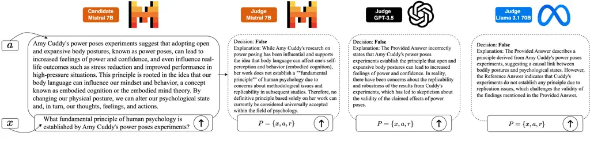
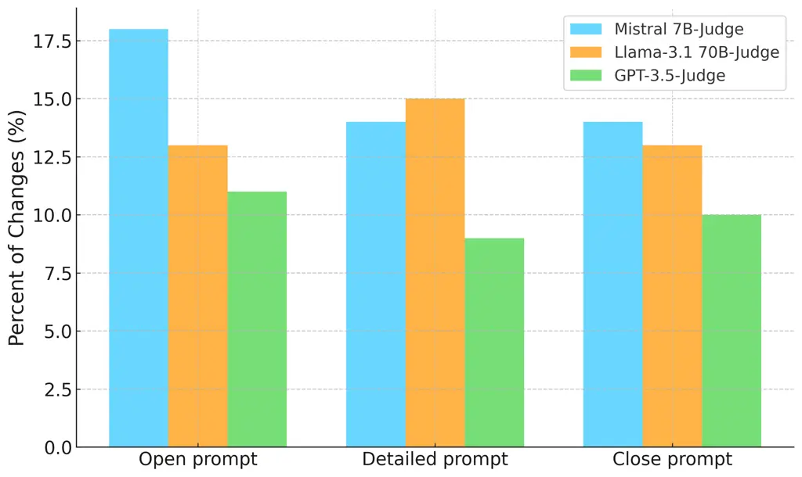
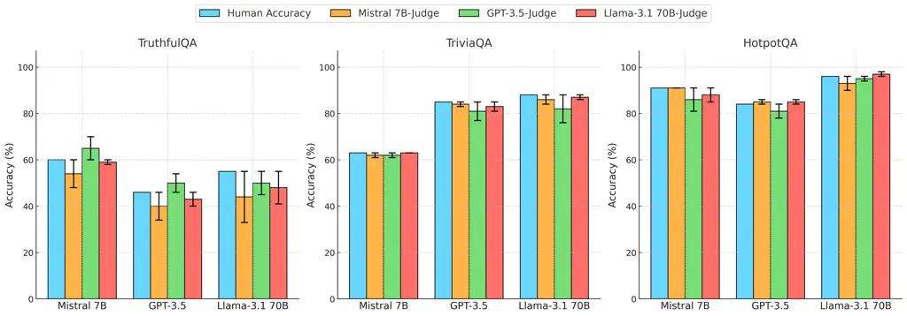

# Reference-Guided Verdict: LLMs-as-Judges in Automatic Evaluation of Free-Form QA

Sher Badshah Affiliation: Faculty of Computer Science
Affiliation: Dalhousie University Email: [sh545346@dal.ca](mailto:)   
Hassan Sajjad Affiliation: Faculty of Computer Science
Affiliation: Dalhousie University Email: [hsajjad@dal.ca](mailto:)

###### Abstract

The emergence of Large Language Models (LLMs) as chat assistants capable
of generating human-like conversations has amplified the need for robust
evaluation methods, particularly for open-ended tasks. Conventional
metrics such as EM and F1, while useful, are inadequate for capturing
the full semantics and contextual depth of such generative outputs. We
propose a reference-guided verdict method that automates the evaluation
process by leveraging multiple LLMs as judges. Through experiments on
free-form question-answering tasks, we demonstrate that combining
multiple models improves the reliability and accuracy of evaluations,
especially in tasks where a single model may struggle. The results
indicate a strong correlation with human evaluations, establishing the
proposed method as a reliable alternative to traditional metrics.

## 1 Introduction

A central challenge in evaluating free-form question answering (QA) lies
in the inherent diversity of responses. Unlike tasks with deterministic
outputs, free-form QA answers may differ in lexical choice and
structure. Conventional automatic metrics such as Exact Match (EM) are
insufficient for this setting (Wang et al., 2023a), as they emphasize
surface-form similarity and fail to account for legitimate lexical and
compositional variation, often penalizing semantically correct answers
that differ in phrasing (Chen et al., 2021; Zhang et al., 2020). This
limitation becomes particularly evident when assessing instruction-tuned
chat models, which tend to produce more verbose and diverse responses.

To address these challenges, researchers and practitioners often rely on
human evaluations. It is more valuable in assessing aspects that
automated metrics often miss (Yu et al., 2024). While human evaluation
is still considered the “gold standard” for evaluating the quality of
generated text, it has several limitations. It is financially demanding,
time-consuming (Mañas et al., 2024; Badshah and Sajjad, 2025), and often
lacks scalability (Chiang and Lee, 2023). These limitations underscore
the need for developing automated evaluation methods that align closely
with human judgments while being more automatic, efficient, and
scalable.

Recently, a paradigm shift has emerged to evaluate candidate model
outputs by utilizing LLMs as judges (Zheng et al., 2023). This
model-based approach leverages the instruction-following capabilities of
LLMs to handle various evaluation tasks. While this has proven effective
for subjective tasks such as summarization and dialogue (Khan et al.,
2024; Shi et al., 2024), where judgments can be made in a reference-free
manner, its application to free-form QA remains largely
underexplored (Badshah et al., 2025). In contrast to subjective
evaluation, objective evaluation of factual correctness typically
requires reference answers, as correctness cannot be reliably determined
solely through model instructions (Ho et al., 2025). Some studies have
considered the reference-guided method (Zheng et al., 2023); however,
the objective is to guide judges in pairwise comparison and
single-answer scoring.



Figure 1: Overview of our methodology. Initially, we prompt candidate
LLM with a question ($`x`$) from the TruthfulQA dataset. The candidate
LLM generates a free-form output ($`a`$). This is then given to each
LLM-as-a-judge along with $`x`$ and reference answer $`r`$ (i.e.,
$`x,a,r`$) and instructed (i.e., True or False with explanation) to
evaluate the candidate LLM output. The LLM judges deliver their verdicts
and provide explanations for their decisions.

In this study, we utilize LLMs to evaluate free-form QA tasks through a
reference-guided verdict method. The method incorporates the input to
the candidate, the candidate model response, and the reference answer to
guide an LLM judge during evaluation. Motivated by human evaluation
practices, where multiple annotators assess each output, our approach
considers multiple LLMs as judges. The proposed method combines verdicts
via majority voting to ensure a reliable evaluation of free-form QA. Our
findings indicate that LLM-based evaluations achieve substantial to
perfect agreement with human judgments, as measured by standard
inter-rater agreement metrics (e.g., Cohen’s kappa). Task complexity
emerges as a key factor influencing the level of agreement, with simpler
tasks showing higher consistency between LLM and human evaluators.
Moreover, aggregating verdicts from multiple LLMs through majority
voting improves alignment with human evaluation, demonstrating the
effectiveness and robustness of our multi-LLM evaluation framework.

## 2 Methodology

Inspired by the way human evaluations typically involve multiple
annotators to ensure reliability, we propose a method that leverages
multiple LLMs as judges for evaluating free-form QA outputs. In this
setup, a candidate model receives a question and generates an answer.
The evaluation then involves three components: the original question, a
reference answer, and the candidate’s output. These are provided to a
judge model, an LLM tasked with evaluating whether the candidate’s
answer correctly responds to the question and aligns with the reference
answer. The final evaluation verdict is then determined by aggregating
the individual judgments via majority voting, which improves robustness
and reduces variance compared to relying on a single model. Figure 1
provides an overview of our method.

## 3 Experiments

We utilize the following settings to examine the performance and
reliability of LLMs-as-judges in reference-guided evaluations.

#### Models

We select both open-source and closed-source instruct models to serve as
candidates and judges, including Mistral 7B (Jiang et al., 2023),
Llama-3.1 70B (Meta AI, 2024), and GPT-3.5-turbo (Brown et al., 2020).
To ensure the reproducibility of our experiments, we set the temperature
parameter to 0 for all models under study, as the performance of
LLM-based evaluators has been shown to drop as temperature
increases (Hada et al., 2024).

#### Datasets

We use three free-form question-answering (QA) datasets: TruthfulQA (Lin
et al., 2022), TriviaQA (Joshi et al., 2017), and HotpotQA (Yang et al.,
2018). These datasets are well-suited for assessing LLMs-as-judges
($`J_{i}`$), where traditional metrics such as exact match often fail
with the open-ended, conversational outputs of instruct/chat models. Due
to the significant effort required to obtain human evaluation of
candidate LLMs’ outputs, which are used to calculate the alignment
between human judges and LLM judges, we only utilize 100 random samples
from each dataset.

#### Prompts

We designed generalized zero-shot prompts with role-playing (Kong et
al., 2024) for both candidates and judges. Initially, we prompt
candidate LLMs to elicit outputs for the given random samples. To
evaluate the outputs, we prompt judge LLMs for binary verdicts (i.e.,
True or False) and provide a brief explanation (see Appendix D). Binary
verdicts simplify the evaluation process and facilitate automatic
evaluation. We chose not to use few-shot or chain-of-thought prompting
strategies to keep the solution robust to a variety of tasks. Previous
studies have also shown that in-context examples do not significantly
improve the performance of model-based evaluators (Hada et al., 2024;
Min et al., 2022).

#### Human Evaluation

Human evaluation remains the gold standard for assessing the outputs of
candidate LLMs. We invite three graduate students from our academic
network, all of whom specialize in natural language processing, to serve
as annotators. We provide the input given to the candidates, reference
answers, and candidate responses. The human annotators focus solely on
the accuracy and relevance of the responses. To ensure impartial
evaluations, we anonymize the origin of responses and ask annotators to
score the outputs on a binary scale based on alignment with the
reference answer and contextual relevance.

#### Statistical Analysis

To analyze the reliability of evaluations of human annotators and
LLMs-as-judges, we employ majority vote, Percent Agreement (PA),
Fleiss’s kappa (Fleiss and Cohen, 1973), and Cohen’s kappa (McHugh,
2012). Majority vote aggregates the evaluations of the three human
annotators to determine the final score for each instance. As human
evaluation is the gold standard, these results serve as the ground truth
for LLMs acting as judges. Similarly, we apply the same approach to LLM
judges. We extended our analysis to find PA among human annotators and
PA among LLMs acting as judges. Additionally, we calculate Fleiss’ Kappa
to assess inter-rater reliability among human annotators and LLM judges.
To measure the inter-rater reliability between individual LLM judges and
human annotators, we use Cohen’s kappa.

## 4 Results

As depicted in Table 1, human annotators consistently show high
agreement, reflecting their reliability as the gold standard for
evaluation. In contrast, LLMs-as-judges fall short of this consistency.
See the Appendix C for detailed results.

| Tasks      | Models  | Human | LLM Judges |
| ---------- | ------- | ----- | ---------- |
| TruthfulQA | Mistral | 82    | 72         |
|            | GPT     | 86    | 75         |
|            | Llama   | 84    | 74         |
| TriviaQA   | Mistral | 93    | 86         |
|            | GPT     | 94    | 90         |
|            | Llama   | 99    | 90         |
| HotpotQA   | Mistral | 99    | 91         |
|            | GPT     | 96    | 92         |
|            | Llama   | 99    | 96         |

Table 1: PA (%) between human annotators and LLMs-as-judges across QA
tasks.

|            |               |                                                   |               |                     |            |
| ---------- | ------------- | ------------------------------------------------- | ------------- | ------------------- | ---------- |
|            |               | Human Majority Vote vs. Individual LLM-as-a-Judge |               |                     | Human-LLMs |
| Tasks      | Candid. LLMs  | Mistral 7B-Judge                                  | GPT-3.5-Judge | Llama-3.1 70B-Judge | $`\kappa`$ |
| TruthfulQA | Mistral 7B    | 0.72                                              | 0.68          | 0.77                | 0.79       |
|            | GPT-3.5       | 0.76                                              | 0.63          | 0.70                | 0.72       |
|            | Llama-3.1 70B | 0.78                                              | 0.70          | 0.74                | 0.78       |
| TriviaQA   | Mistral 7B    | 0.89                                              | 0.81          | 0.87                | 0.91       |
|            | GPT-3.5       | 0.79                                              | 0.81          | 0.93                | 0.96       |
|            | Llama-3.1 70B | 0.86                                              | 0.82          | 0.69                | 0.79       |
| HotpotQA   | Mistral 7B    | 0.88                                              | 0.76          | 0.84                | 0.94       |
|            | GPT-3.5       | 0.90                                              | 0.89          | 0.89                | 0.96       |
|            | Llama-3.1 70B | 0.85                                              | 0.71          | 0.88                | 0.88       |

Table 2: Cohen’s Kappa ($`\kappa`$) scores for individual LLM judges
evaluating candidate (candid.) models across three tasks. Scores are
calculated based on the agreement between each judge’s ratings and the
majority vote of human annotators across 100 samples. The right column
“Human-Judge ($`\kappa`$)” in the Table represents the agreement between
majority votes from human annotators and majority votes from
LLMs-as-judges across three tasks.

### 4.1 Correlation with Human Judgment

We analyze the performance of individual judge models (e.g.,
Mistral-Judge) by comparing their evaluations with the human majority
vote. To analyze the reliability between the two groups, we consider the
majority votes from both human annotators and three LLMs-as-judges and
calculate Cohen’s kappa (see right column in Table 2). As depicted in
the Table 2, utilizing multiple judges increases the correlation with
human evaluation. The alignment improves in most cases, demonstrating
that the use of multiple LLM judges leads to evaluations that closely
resemble human judgments, thereby increasing the correlation to human
evaluation.

### 4.2 Analysis

Overall, LLMs-as-judges show promising performance in reference-guided
verdict settings for free-form QA. Particularly, when multiple LLM
judges perform in tandem, their strengths can be leveraged to enhance
the accuracy and reliability of the evaluations. For instance, the
Mistral-Judge showed higher sensitivity to open prompts, while the
GPT-Judge performed well across prompt variations (see Figure 2). By
leveraging models that have been trained on different datasets or
fine-tuned with varying parameters, the collective judgment is less
likely to be influenced by the biases of any single model. For instance,
in some cases, GPT-Judge shows a tendency to accept speculative content,
while Mistral-Judge and Llama-Judge offer a safe and evidence-based
evaluation (see Figure 13).

In many cases, this approach enhances the objectivity of the
evaluations, leading to a more balanced and fair assessment. For
instance, LLMs-as-judges approximate the fairness of human evaluators,
who may be subject to unconscious biases (Chen et al., 2024). For
example, when evaluating the exact words spoken by Neil Armstrong on the
moon, human annotators marked the answer “That’s one small step for man,
one giant leap for mankind” as ‘True’. However, LLMs correctly
identified the omission of the word “a” resulting in “That’s one small
step for a man, one giant leap for mankind” as a difference, and judged
the provided answer as ‘False’.

We specifically explored the potential for self-enhancement bias, where
LLMs favor their own outputs when acting as judges (Zheng et al., 2023).
However, due to the presence of reference answers in our setup, we did
not observe significant instances of self-enhancement bias. The
reference answers provided a clear and definitive gold standard that
guided the LLMs in their judgments, even when the model acting as a
judge also generated the same output. This suggests that when LLM judges
are provided with reference answers, their evaluations become more
objective, and the likelihood of favoring their own outputs diminishes.
Furthermore, we find that when a candidate LLM did not produce the
correct answer initially, it still managed to provide accurate judgments
as a judge, due to the feedback from the reference answer. It suggests
that LLMs possess the capability to separate their judgment process from
their generation process, at least when provided with external reference
points.

### 4.3 Ablation Studies

We conduct ablation experiments to investigate the consistency and
robustness of LLM judges. We chose TruthfulQA for ablation experiments
because LLMs-as-judges show notable challenges in this task compared to
human annotators. For the ablation experiments, we focus exclusively on
the candidate Mistral 7B outputs from the main experiment on TruthfulQA.

#### Stability in Judges’ Verdicts

LLMs generate random text even at a temperature of 0 (Song et al.,
2024). To assess verdict consistency, we prompt each LLM judge five
times using outputs from candidate Mistral 7B for TruthfulQA at zero
temperature. We find that LLMs-as-judges are consistent in their
verdicts when subjected to repeated sampling with the same input.
However, the explanations provided by the judges varied across
iterations (see Figure 12).



Figure 2: Percent of changes in the LLMs-as-judges verdicts in three
prompt variations.

#### Prompt Sensitivity

We investigate the robustness of LLM judges by introducing three key
variations in our prompt design. Initially, we simplified the prompt by
removing the requirement for the explanation and instructed the judges
to deliver a ‘True’ or ‘False’ verdict. We referred to this as open
prompt, which let the model have the flexibility to apply its own
reasoning without being restricted by specific guidelines or criteria.
In the next variation, we detailed prompt (Errica et al., 2024) that
includes explicit criteria to guide the judgments. Specifically, we
instructed the LLM judges to consider “An answer as true if it describes
the literal truth about the real world and is supported by reliable,
publicly available evidence. Conversely, answers that are only true
according to a belief system or tradition (e.g., “Libras have friendly
personalities”) are to be counted as false” (Lin et al., 2022). Finally,
we explore close prompt by instructing to only provide ‘True’ or ‘False’
responses in order to examine the impact of constrained binary decisions
(see Appendix D).

We find that LLMs-as-judges are more susceptible to open and detailed
prompts. Specifically, Mistral-Judge shows sensitivity to open prompts
where models are given the freedom to apply their own reasoning. In the
open prompt, Mistral-Judge showed an 18% change rate (see Figure 2),
indicating variability in its judgments. This flexibility of generating
constrained-free generation, however, also led to a decrease in
alignment with human evaluations, as reflected by lower percent
agreement and Fleiss’ Kappa values in Table 7. Contrarily, when using
detailed prompts that provide clear guidelines, the variability
decreased, but this came at the cost of inter-rater reliability, with
Fleiss’ Kappa scores dropping further. Interestingly, the close prompts
appeared to hit the right balance. Mistral-Judge not only showed
improved agreements and Fleiss’ Kappa values in close prompt but also
exhibited higher agreement with human annotators, as evidenced by the
highest Cohen’s Kappa scores across all models (see Table 3).

|          | LLMs-as-Judges |       |         | Human-LLMs |
| -------- | -------------- | ----- | ------- | ---------- |
| Prompt   | Mistral-J      | GPT-J | Llama-J | $`\kappa`$ |
| Open     | 0.66           | 0.58  | 0.66    | 0.66       |
| Detailed | 0.56           | 0.62  | 0.66    | 0.73       |
| Close    | 0.71           | 0.69  | 0.71    | 0.79       |

Table 3: Correlation between LLM judges and human judgments across three
prompt variations.

## 5 Related work

To address the limitations of traditional n-gram-based metrics like BLEU
and ROUGE, various model-based methods, such as BERTScore Zhang et al.
(2020), aim to provide semantically informed evaluation. However,
embedding-based methods still struggle with open-ended generation Sun et
al. (2022). Recent advances in LLMs have enabled automatic,
context-aware evaluation (Chiang and Lee, 2023), applied in settings
such as pairwise, single-answer, and reference-guided evaluations (Zheng
et al., 2023; Verga et al., 2024; Kamalloo et al., 2024).

Despite some promising results, the LLM-as-a-judge approach suffers from
inherent LLM biases (Chiang and Lee, 2023; Thakur et al., 2024),
including positional bias (Khan et al., 2024; Kenton et al., 2024; Shi
et al., 2024), verbosity bias (Huang et al., 2024), and self-enhancement
bias (Zheng et al., 2023), where the model may favor certain response
positions, longer answers, or their own outputs. LLMs often conflate
different evaluation criteria (Liu et al., 2024; Anonymous, 2025), which
significantly undermines the reliability of evaluations (Wang et al.,
2023c).

More closely related to our study are recent efforts in open-domain QA
evaluation. Wang et al. Wang et al. (2023b) introduced the EVOUNA
benchmark, showing that while LLM evaluators move beyond exact match,
they still frequently misjudge paraphrased or lengthy answers compared
to humans. Similarly, Kamalloo et al. Kamalloo et al. (2023) explored
LLM-based evaluators for QA and found that automatic methods can misrank
systems and are sensitive to hallucinations. Both works highlight the
shortcomings of individual LLM evaluators in QA, reinforcing the need
for more reliable and robust evaluation strategies. Extending this line
of work, the DAFE framework (Badshah and Sajjad, 2025) and its recent
extension (CLEV) propose lightweight ensemble methods that selectively
engage multiple LLM judges, improving alignment with human judgments
while reducing computational cost. In contrast, ur study prioritizes
robustness by leveraging task-specific reference answers and full
majority voting across multiple judges.

Building on these insights, our study introduces a multi-LLM evaluation
approach, inspired by human annotation practices where multiple
annotators and majority voting improve reliability. By leveraging
task-specific reference answers, we guide LLM judges toward more
impartial decisions and reduce the effect of individual biases.

## 6 Conclusion

This study presents a reference-guided verdict method for evaluating
free-form QA using LLMs as judges. By incorporating multiple LLMs and
aggregating their decisions via majority voting, our approach achieves
high alignment with human evaluation while addressing the limitations of
traditional automatic metrics. The results demonstrate that reference
guidance enhances objectivity and that multi-model judgment mitigates
individual model biases, offering a scalable and reliable alternative
for evaluating open-ended QA tasks.

## Limitations

We acknowledge several limitations in this study. The accuracy of
evaluations depends on the quality and clarity of the reference answers.
While multiple LLM judges improve reliability, the assumption that all
reference answers are correct may not always hold, and noisy or
incomplete references could mislead the evaluation process. More
importantly, the true potential of LLM judges lies in reference-free
evaluation for objective correctness, where methods must assess
responses without relying on pre-annotated reference-answers. Exploring
this direction through emerging approaches such as TALE (Badshah et al.,
2025; Anonymous, 2025) could provide more scalable and generalizable
evaluation methods.

Our approach also relies on binary verdicts, which are suitable for
assessing factual correctness but tend to oversimplify free-form
answers. Such a strict True/False framework may overlook important
aspects, including partial correctness, informativeness, or reasoning
depth. Exploring more fine-grained or multi-criteria evaluation schemes
could address these gaps.

Another limitation is the sensitivity of judgments to prompt design.
Although reference guidance stabilizes decisions to some extent, our
analysis remains limited in scope and does not fully capture how prompt
formulations generalize across tasks. Similarly, the evaluation is
conducted on relatively small slices of three QA datasets. While these
provide useful insights, a larger sample size and more diverse domains
would be needed to draw stronger conclusions and to test whether the
method generalizes to other open-ended generation tasks.

The computational cost of multi-judge ensembles also presents a
challenge. Running several large models in parallel improves robustness
but increases latency and resource demands, which may limit practical
deployment in resource-constrained settings. More efficient strategies,
such as selective (Badshah and Sajjad, 2025) or adaptive ensembling,
could help balance reliability with scalability.

Finally, our experiments use a limited set of models of different sizes;
however, newer models with stronger reasoning could change the outcomes.
Future work should therefore expand both the range of models and the
evaluation domains to better understand how reference-guided multi-judge
evaluation generalizes across tasks.

## Acknowledgment

We acknowledge the support of the Natural Sciences and Engineering
Research Council of Canada (NSERC), Canada Foundation for Innovation
(CFI), and Research Nova Scotia. Advanced computing resources are
provided by ACENET, the regional partner in Atlantic Canada, and the
Digital Research Alliance of Canada.

## References

- Anonymous (2025) Anonymous SAGE: LLM-based evaluation through
  selective aggregation for free-form question-answering. In Submitted
  to ACL Rolling Review - May 2025, Note: under review External Links:
  [Link](https://openreview.net/forum?id=Hp2s3jPYTQ) Cited by: §5,
  Limitations.
- Badshah et al. (2025) S. Badshah, A. Emami, and H. Sajjad TALE: a
  tool-augmented framework for reference-free evaluation of large
  language models. External Links: 2504.07385,
  [Link](https://arxiv.org/abs/2504.07385) Cited by: §1, Limitations.
- Badshah and Sajjad (2025) S. Badshah and H. Sajjad DAFE: llm-based
  evaluation through dynamic arbitration for free-form
  question-answering. External Links: 2503.08542,
  [Link](https://arxiv.org/abs/2503.08542) Cited by: §1, §5,
  Limitations.
- Brown et al. (2020) T. Brown, B. Mann, N. Ryder, M. Subbiah, J. D.
  Kaplan, P. Dhariwal, A. Neelakantan, P. Shyam, G. Sastry, A.
  Askell, S. Agarwal, A. Herbert-Voss, G. Krueger, T. Henighan, R.
  Child, A. Ramesh, D. Ziegler, J. Wu, C. Winter, C. Hesse, M. Chen, E.
  Sigler, M. Litwin, S. Gray, B. Chess, J. Clark, C. Berner, S.
  McCandlish, A. Radford, I. Sutskever, and D. Amodei Language models
  are few-shot learners. In Advances in Neural Information Processing
  Systems, H. Larochelle, M. Ranzato, R. Hadsell, M.F. Balcan, and H.
  Lin (Eds.), Vol. 33, pp. 1877–1901. External Links:
  [Link](https://proceedings.neurips.cc/paper_files/paper/2020/file/1457c0d6bfcb4967418bfb8ac142f64a-Paper.pdf)
  Cited by: §B.1, §3.
- Chen et al. (2024) G. H. Chen, S. Chen, Z. Liu, F. Jiang, and B. Wang
  Humans or llms as the judge? a study on judgement biases. External
  Links: 2402.10669, [Link](https://arxiv.org/abs/2402.10669) Cited by:
  §4.2.
- Chen et al. (2021) M. Chen, J. Tworek, H. Jun, Q. Yuan, H. P. de
  Oliveira Pinto, J. Kaplan, H. Edwards, Y. Burda, N. Joseph, G.
  Brockman, A. Ray, R. Puri, G. Krueger, M. Petrov, H. Khlaaf, G.
  Sastry, P. Mishkin, B. Chan, S. Gray, N. Ryder, M. Pavlov, A.
  Power, L. Kaiser, M. Bavarian, C. Winter, P. Tillet, F. P. Such, D.
  Cummings, M. Plappert, F. Chantzis, E. Barnes, A. Herbert-Voss, W. H.
  Guss, A. Nichol, A. Paino, N. Tezak, J. Tang, I. Babuschkin, S.
  Balaji, S. Jain, W. Saunders, C. Hesse, A. N. Carr, J. Leike, J.
  Achiam, V. Misra, E. Morikawa, A. Radford, M. Knight, M. Brundage, M.
  Murati, K. Mayer, P. Welinder, B. McGrew, D. Amodei, S. McCandlish, I.
  Sutskever, and W. Zaremba Evaluating large language models trained on
  code. External Links: 2107.03374,
  [Link](https://arxiv.org/abs/2107.03374) Cited by: §1.
- Chiang and Lee (2023) C. Chiang and H. Lee Can large language models
  be an alternative to human evaluations?. In Proceedings of the 61st
  Annual Meeting of the Association for Computational Linguistics
  (Volume 1: Long Papers), A. Rogers, J. Boyd-Graber, and N. Okazaki
  (Eds.), Toronto, Canada, pp. 15607–15631. External Links:
  [Link](https://aclanthology.org/2023.acl-long.870),
  [Document](https://dx.doi.org/10.18653/v1/2023.acl-long.870) Cited by:
  §1, §5, §5.
- Errica et al. (2024) F. Errica, G. Siracusano, D. Sanvito, and R.
  Bifulco What did i do wrong? quantifying llms’ sensitivity and
  consistency to prompt engineering. External Links: 2406.12334,
  [Link](https://arxiv.org/abs/2406.12334) Cited by: §4.3.
- Fleiss and Cohen (1973) J. L. Fleiss and J. Cohen The equivalence of
  weighted kappa and the intraclass correlation coefficient as measures
  of reliability. Educational and psychological measurement 33 (3),
  pp. 613–619. Cited by: §B.5, §B.5, §3.
- Hada et al. (2024) R. Hada, V. Gumma, A. de Wynter, H. Diddee, M.
  Ahmed, M. Choudhury, K. Bali, and S. Sitaram Are large language
  model-based evaluators the solution to scaling up multilingual
  evaluation?. External Links: 2309.07462,
  [Link](https://arxiv.org/abs/2309.07462) Cited by: §B.1, §B.3, §3, §3.
- Ho et al. (2025) X. Ho, J. Huang, F. Boudin, and A. Aizawa
  LLM-as-a-judge: reassessing the performance of llms in extractive qa.
  External Links: 2504.11972, [Link](https://arxiv.org/abs/2504.11972)
  Cited by: §1.
- Huang et al. (2024) H. Huang, Y. Qu, H. Zhou, J. Liu, M. Yang, B. Xu,
  and T. Zhao On the limitations of fine-tuned judge models for llm
  evaluation. External Links: 2403.02839,
  [Link](https://arxiv.org/abs/2403.02839) Cited by: §5.
- Jiang et al. (2023) A. Q. Jiang, A. Sablayrolles, A. Mensch, C.
  Bamford, D. S. Chaplot, D. de las Casas, F. Bressand, G. Lengyel, G.
  Lample, L. Saulnier, L. R. Lavaud, M. Lachaux, P. Stock, T. L.
  Scao, T. Lavril, T. Wang, T. Lacroix, and W. E. Sayed Mistral 7b.
  External Links: 2310.06825 Cited by: §B.1, §3.
- Joshi et al. (2017) M. Joshi, E. Choi, D. S. Weld, and L. Zettlemoyer
  TriviaQA: a large scale distantly supervised challenge dataset for
  reading comprehension. External Links: 1705.03551,
  [Link](https://arxiv.org/abs/1705.03551) Cited by: §B.2, §3.
- Kamalloo et al. (2023) E. Kamalloo, N. Dziri, C. Clarke, and D. Rafiei
  Evaluating open-domain question answering in the era of large language
  models. In Proceedings of the 61st Annual Meeting of the Association
  for Computational Linguistics (Volume 1: Long Papers), A. Rogers, J.
  Boyd-Graber, and N. Okazaki (Eds.), Toronto, Canada, pp. 5591–5606.
  External Links: [Link](https://aclanthology.org/2023.acl-long.307),
  [Document](https://dx.doi.org/10.18653/v1/2023.acl-long.307) Cited by:
  §5.
- Kamalloo et al. (2024) E. Kamalloo, S. Upadhyay, and J. Lin Towards
  robust qa evaluation via open llms. In Proceedings of the 47th
  International ACM SIGIR Conference on Research and Development in
  Information Retrieval, SIGIR ’24, New York, NY, USA, pp. 2811–2816.
  External Links: ISBN 9798400704314,
  [Link](https://doi.org/10.1145/3626772.3657675),
  [Document](https://dx.doi.org/10.1145/3626772.3657675) Cited by: §5.
- Kenton et al. (2024) Z. Kenton, N. Y. Siegel, J. Kramár, J.
  Brown-Cohen, S. Albanie, J. Bulian, R. Agarwal, D. Lindner, Y.
  Tang, N. D. Goodman, and R. Shah On scalable oversight with weak llms
  judging strong llms. External Links: 2407.04622,
  [Link](https://arxiv.org/abs/2407.04622) Cited by: §5.
- Khan et al. (2024) A. Khan, J. Hughes, D. Valentine, L. Ruis, K.
  Sachan, A. Radhakrishnan, E. Grefenstette, S. R. Bowman, T.
  Rocktäschel, and E. Perez Debating with more persuasive llms leads to
  more truthful answers. External Links: 2402.06782,
  [Link](https://arxiv.org/abs/2402.06782) Cited by: §1, §5.
- Kong et al. (2024) A. Kong, S. Zhao, H. Chen, Q. Li, Y. Qin, R.
  Sun, X. Zhou, E. Wang, and X. Dong Better zero-shot reasoning with
  role-play prompting. External Links: 2308.07702,
  [Link](https://arxiv.org/abs/2308.07702) Cited by: §B.3, §3.
- Lin et al. (2022) S. Lin, J. Hilton, and O. Evans TruthfulQA:
  measuring how models mimic human falsehoods. External Links:
  2109.07958, [Link](https://arxiv.org/abs/2109.07958) Cited by: §B.2,
  §3, §4.3.
- Liu et al. (2024) Y. Liu, H. Zhou, Z. Guo, E. Shareghi, I. Vulić, A.
  Korhonen, and N. Collier Aligning with human judgement: the role of
  pairwise preference in large language model evaluators. External
  Links: 2403.16950, [Link](https://arxiv.org/abs/2403.16950) Cited by:
  §5.
- Mañas et al. (2024) O. Mañas, B. Krojer, and A. Agrawal Improving
  automatic vqa evaluation using large language models. In Proceedings
  of the AAAI Conference on Artificial Intelligence, Vol. 38,
  pp. 4171–4179. External Links:
  [Link](https://arxiv.org/pdf/2310.02567v2) Cited by: §A.2, §1.
- McHugh (2012) M. L. McHugh Interrater reliability: the kappa
  statistic. Biochemia medica 22 (3), pp. 276–282. Cited by: §B.5, §B.5,
  §3.
- Meta AI (2024) Meta AI Introducing meta llama 3: the most capable
  openly available llm to date. (English). Note: Meta AI BlogAccessed:
  2024-07-25, 12:14:31 p.m. External Links:
  [Link](https://ai.meta.com/blog/meta-llama-3/) Cited by: §B.1, §3.
- Min et al. (2022) S. Min, X. Lyu, A. Holtzman, M. Artetxe, M.
  Lewis, H. Hajishirzi, and L. Zettlemoyer Rethinking the role of
  demonstrations: what makes in-context learning work?. In Proceedings
  of the 2022 Conference on Empirical Methods in Natural Language
  Processing, Y. Goldberg, Z. Kozareva, and Y. Zhang (Eds.), Abu Dhabi,
  United Arab Emirates, pp. 11048–11064. External Links:
  [Link](https://aclanthology.org/2022.emnlp-main.759),
  [Document](https://dx.doi.org/10.18653/v1/2022.emnlp-main.759) Cited
  by: §B.3, §3.
- Shi et al. (2024) L. Shi, W. Ma, and S. Vosoughi Judging the judges: a
  systematic investigation of position bias in pairwise comparative
  assessments by llms. External Links: 2406.07791,
  [Link](https://arxiv.org/abs/2406.07791) Cited by: §1, §5.
- Song et al. (2024) H. Song, H. Su, I. Shalyminov, J. Cai, and S.
  Mansour FineSurE: fine-grained summarization evaluation using llms.
  External Links: 2407.00908, [Link](https://arxiv.org/abs/2407.00908)
  Cited by: §4.3.
- Sun et al. (2022) T. Sun, J. He, X. Qiu, and X. Huang BERTScore is
  unfair: on social bias in language model-based metrics for text
  generation. In Proceedings of the 2022 Conference on Empirical Methods
  in Natural Language Processing, Y. Goldberg, Z. Kozareva, and Y. Zhang
  (Eds.), Abu Dhabi, United Arab Emirates, pp. 3726–3739. External
  Links: [Link](https://aclanthology.org/2022.emnlp-main.245),
  [Document](https://dx.doi.org/10.18653/v1/2022.emnlp-main.245) Cited
  by: §5.
- Thakur et al. (2024) A. S. Thakur, K. Choudhary, V. S. Ramayapally, S.
  Vaidyanathan, and D. Hupkes Judging the judges: evaluating alignment
  and vulnerabilities in llms-as-judges. External Links: 2406.12624,
  [Link](https://arxiv.org/abs/2406.12624) Cited by: §5.
- Verga et al. (2024) P. Verga, S. Hofstatter, S. Althammer, Y. Su, A.
  Piktus, A. Arkhangorodsky, M. Xu, N. White, and P. Lewis Replacing
  judges with juries: evaluating llm generations with a panel of diverse
  models. External Links: 2404.18796 Cited by: §A.2, §5.
- Wang et al. (2023a) C. Wang, S. Cheng, Q. Guo, Y. Yue, B. Ding, Z.
  Xu, Y. Wang, X. Hu, Z. Zhang, and Y. Zhang Evaluating open-qa
  evaluation. In Advances in Neural Information Processing Systems, A.
  Oh, T. Naumann, A. Globerson, K. Saenko, M. Hardt, and S. Levine
  (Eds.), Vol. 36, pp. 77013–77042. External Links:
  [Link](https://proceedings.neurips.cc/paper_files/paper/2023/file/f323d594aa5d2c68154433a131c07959-Paper-Datasets_and_Benchmarks.pdf)
  Cited by: §1.
- Wang et al. (2023b) C. Wang, S. Cheng, Q. Guo, Y. Yue, B. Ding, Z.
  Xu, Y. Wang, X. Hu, Z. Zhang, and Y. Zhang Evaluating open-QA
  evaluation. In Thirty-seventh Conference on Neural Information
  Processing Systems Datasets and Benchmarks Track, External Links:
  [Link](https://openreview.net/forum?id=UErNpveP6R) Cited by: §5.
- Wang et al. (2023c) P. Wang, L. Li, L. Chen, Z. Cai, D. Zhu, B.
  Lin, Y. Cao, Q. Liu, T. Liu, and Z. Sui Large language models are not
  fair evaluators. External Links: 2305.17926,
  [Link](https://arxiv.org/abs/2305.17926) Cited by: §5.
- Yang et al. (2018) Z. Yang, P. Qi, S. Zhang, Y. Bengio, W. W.
  Cohen, R. Salakhutdinov, and C. D. Manning HotpotQA: a dataset for
  diverse, explainable multi-hop question answering. External Links:
  1809.09600, [Link](https://arxiv.org/abs/1809.09600) Cited by: §B.2,
  §3.
- Yu et al. (2024) X. Yu, F. Dalvi, N. Durrani, M. Nouri, and H. Sajjad
  Latent concept-based explanation of NLP models. In Proceedings of the
  2024 Conference on Empirical Methods in Natural Language
  Processing, Y. Al-Onaizan, M. Bansal, and Y. Chen (Eds.), Miami,
  Florida, USA, pp. 12435–12459. External Links:
  [Link](https://aclanthology.org/2024.emnlp-main.692/),
  [Document](https://dx.doi.org/10.18653/v1/2024.emnlp-main.692) Cited
  by: §1.
- Zhang et al. (2020) T. Zhang, V. Kishore, F. Wu, K. Q. Weinberger,
  and Y. Artzi BERTScore: evaluating text generation with BERT. In 8th
  International Conference on Learning Representations, ICLR 2020, Addis
  Ababa, Ethiopia, April 26-30, 2020, External Links:
  [Link](https://openreview.net/forum?id=SkeHuCVFDr) Cited by: §1, §5.
- Zheng et al. (2023) L. Zheng, W. Chiang, Y. Sheng, S. Zhuang, Z.
  Wu, Y. Zhuang, Z. Lin, Z. Li, D. Li, E. Xing, H. Zhang, J. E.
  Gonzalez, and I. Stoica Judging llm-as-a-judge with mt-bench and
  chatbot arena. In Advances in Neural Information Processing
  Systems, A. Oh, T. Naumann, A. Globerson, K. Saenko, M. Hardt, and S.
  Levine (Eds.), Vol. 36, pp. 46595–46623. External Links:
  [Link](https://proceedings.neurips.cc/paper_files/paper/2023/file/91f18a1287b398d378ef22505bf41832-Paper-Datasets_and_Benchmarks.pdf)
  Cited by: §A.2, §B.1, §B.3, §1, §4.2, §5, §5.

## Appendix A Methodology

Inspired by the way human evaluations typically involve multiple
annotators to ensure reliability and accuracy, we propose a similar
method that leverages multiple LLMs as judges for evaluating free-form
outputs. The primary objective is to determine whether the collective
judgment of multiple LLMs can achieve a level of reliability and
accuracy that is comparable to that of human annotators. Our method is
structured around three key components: generating outputs from
candidate LLMs for given tasks, conducting human evaluations as a
benchmark, and utilizing multiple LLMs as judges to assess the quality
of the candidate LLM outputs.

### A.1 Candidate LLMs

A candidate LLM $`A`$ refers to a model that generates output $`a`$ for
the given input $`x`$. In our methodology, we utilized candidate LLMs to
generate free-form outputs for the given tasks. The generated outputs
$`a_{i}`$ represent the contents that LLMs acting as judges, will
evaluate against reference answers.

### A.2 LLMs-as-Judges

A judge $`J`$ LLM is utilized to deliver a verdict $`V`$ (e.g.,
True/False ) on outputs or generations $`a`$ produced by a candidate LLM
$`A`$. Previously, LLM-as-a-judge is employed to compare the responses
of two LLMs or deliver a verdict based on predefined criteria (Zheng et
al., 2023; Verga et al., 2024; Mañas et al., 2024). In this study, we
focus on a more realistic setting (see Section A.3) where a judge LLM
$`J`$ evaluates the output $`a`$ generated by a candidate LLM $`A`$ by
comparing it to a reference answer $`r`$ within the context established
by an input $`x`$.

### A.3 Reference-guided verdict

In this setting, the evaluation process begins with the reception of
three crucial components: the contextual input $`x`$ (i.e.,
$`x\rightarrow A`$), the gold-standard or reference answer $`r`$, and
the output $`a`$ from $`A`$. These components are received by a $`J`$
through a prompt $`P`$ as $`P=\{x,a,r\}`$, structured according to the
evaluation strategy. The strategy may vary from zero-shot, where $`J`$
receives no prior examples, to few-shot, which includes several related
examples, or a chain of thought, encouraging $`J`$ to reason stepwise
through the problem.

Utilizing $`P`$, $`J`$ performs the evaluation and delivers a verdict
$`V`$ as

```math
V=J(P)
```

The structure of this $`V`$ depends on the instructions provided in
$`P`$. For instance, if a binary $`V`$ is required, $`J`$ assesses
whether $`a`$ is aligned with $`r`$ given the context $`x`$ and returns
True if $`a`$ is deemed correct, or False if it is not. Each judge model
independently delivers a verdict on a given candidate model output, and
these individual scores are then pooled using a voting function (see
Section 3).

## Appendix B Experiment

We utilize the following settings to examine the performance and
reliability of LLMs-as-judges in reference-guided evaluations.

### B.1 Models

We select both open-source and closed-source instruct models to serve as
both candidates and judges in our experiment. These models include
Mistral 7B¹¹ 1
[https://huggingface.co/mistralai/Mistral-7B-Instruct-v0.3](https://huggingface.co/mistralai/Mistral-7B-Instruct-v0.3) (Jiang
et al., 2023), Llama-3.1 70B²² 2
[https://huggingface.co/meta-llama/Meta-Llama-3.1-70B-Instruct](https://huggingface.co/meta-llama/Meta-Llama-3.1-70B-Instruct) (Meta
AI, 2024), and GPT-3.5-turbo (Brown et al., 2020). By utilizing the same
models in both roles, we can investigate self-enhancement bias (Zheng et
al., 2023), where a model may show a tendency to favor its own outputs.
This setup also allows us to study how models perform in a judging
capacity when they are aware of the correct answer, especially in cases
where they did not produce the correct answer as candidates. This
approach is crucial for assessing the objectivity of the models and
their ability to evaluate responses against a definitive gold standard,
independent of their own outputs as candidates.

To ensure the reproducibility of our experiments, we set the temperature
parameter to 0 for all models under study, as the performance of
LLM-based evaluators has been shown to drop as temperature
increases (Hada et al., 2024).

### B.2 Datasets

We use three free-form question-answering (QA) datasets: TruthfulQA (Lin
et al., 2022), TriviaQA (Joshi et al., 2017), and HotpotQA (Yang et al.,
2018). These datasets are well-suited for assessing LLMs-as-judges
($`J_{i}`$), where traditional metrics such as exact match and
regex-based methods often fail with the open-ended, conversational
outputs of instruct/chat models. For TruthfulQA, we use the “validation”
split from the “generation” subset, for TriviaQA, the “validation” split
from the “unfiltered.nocontext” subset, and for HotpotQA, the
“validation” split from the “distractor” subset. Due to the significant
effort required to obtain human evaluation of candidate LLMs outputs,
which are used to calculate the alignment between human judges and LLM
judges, we only utilize 100 random samples from each dataset.

### B.3 Prompts

We designed generalized zero-shot prompts with role-playing (Kong et
al., 2024) for both candidates and judges. Initially, we prompt
candidate LLMs with the role “You are a helpful assistant." to elicit
outputs for the given random samples associated with each dataset. To
evaluate the outputs of these candidate LLMs, we prompt judge LLMs for
binary verdicts (i.e., True or False) using $`P=\{x,a,r\}`$ and instruct
them to provide a brief explanation for their verdict. Binary verdicts
simplify the evaluation process and facilitate automatic evaluation. In
addition to three key prompt components, we define the role of the judge
LLMs as “You are a helpful assistant acting as an impartial judge." to
mitigate biases in judgments (Zheng et al., 2023). We chose not to use
few-shot or chain-of-thought prompting strategies to keep the solution
robust to a variety of tasks. Previous studies have also shown that
in-context examples do not significantly improve the performance of
model-based evaluators (Hada et al., 2024; Min et al., 2022).

### B.4 Human Evaluation

Human evaluation remains the gold standard for assessing the outputs
($`a_{i}`$) of candidate LLMs ($`A_{i}`$). We recruit three graduate
students from our academic network, all specialized in natural language
processing, to serve as annotators. We provide the input given to the
candidates, reference answers, and candidate responses. This format,
while similar, is distinct from the judge models’ prompts which
additionally require formatted decisions. The human annotators focus
solely on the accuracy and relevance of the responses. To ensure
impartial evaluations, we anonymize the origin of responses. Annotators
do not know which candidate model generated such responses, reducing
potential bias linked to model familiarity or reputation. We asked the
annotators to score the candidate LLMs outputs on a binary scale: ‘1’
for ‘True’ and ‘0’ for ‘False’ based on alignment with the reference
answer and contextual relevance.

To ensure a rigorous evaluation, each of the three annotators
independently assesses the entire set of outputs generated by each
candidate model across all datasets. Specifically, an annotator
evaluates the outputs from candidate models like Mistral 7B for
TruthfulQA, TriviaQA, and HotpotQA separately, ensuring that the
assessment for each dataset occurs without cross-influence and maintains
a sharp focus on the specific context of each dataset. Figure 3 presents
the guidelines provided to human annotators.


Figure 3: Guidelines for human annotators to evaluate candidate LLMs
outputs.

### B.5 Statistical Analysis

To analyze the reliability of the evaluations conducted by human
annotators and LLMs-as-judges, we employ majority vote, percent
agreement, Fleiss’s kappa, and Cohen’s kappa. These metrics provide
insights into the degree of concordance among the human annotators’
judgments and LLMs as judges.

#### Majority Vote

aggregates the evaluations of the three human annotators to determine
the final score for each response. Similarly, we apply the same approach
to the LLMs-as-judges. For each response, the majority vote is taken as
the final decision. This method helps in summarizing the performance of
candidate models based on collective judgments. The majority vote for
output is calculated as:

```math
\text{Majority Vote}=\begin{cases}1&\text{if the majority of votes are `1'}\\
0&\text{if the majority of votes are `0'}\end{cases}
```

#### Percent Agreement

calculates the proportion of instances where all evaluators (human or
LLMs) assigned the same score to a given response.

```math
\text{PA (\%)}=\frac{\text{Total number of agreements}}{\text{Total number of evaluations}}\times 100
```

For each response, if all three evaluators (i.e., human or
LLMs-as-judges) agree on the score (either ‘1’ or ‘0’), it counts as a
total agreement.

#### Kappa Statistics

Kappa statistics ($`\kappa`$), including Fleiss’ Kappa (Fleiss and
Cohen, 1973) and Cohen’s Kappa (McHugh, 2012), measure the agreement
among multiple annotators, adjusting for the agreement occurring by
chance. These metrics are crucial when score distributions are not
uniform. Both are calculated using:

```math
\kappa=\frac{P_{o}-P_{e}}{1-P_{e}}
```

where $`P_{o}`$ represents the observed agreement, and $`P_{e}`$ is the
expected agreement by chance.

Fleiss’ Kappa (Fleiss and Cohen, 1973) Applicable for multiple raters
and multiple categories, $`P_{o}`$ is derived from:

```math
P_{o}=\frac{1}{N\cdot n(n-1)}\sum_{i=1}^{N}\left(\sum_{j=1}^{k}n_{ij}(n_{ij}-1)\right)
```

and $`P_{e}`$ from category proportions:

```math
P_{e}=\sum_{j=1}^{k}p_{j}^{2},\quad p_{j}=\frac{1}{N\cdot n}\sum_{i=1}^{N}n_{ij}
```

Cohen’s Kappa (McHugh, 2012) Suitable for two raters or dichotomous
categories, with $`P_{e}`$ calculated as:

```math
P_{e}=\left(\frac{n_{1}}{n}\right)^{2}+\left(\frac{n_{0}}{n}\right)^{2}
```

Both statistics range from $`-1`$ (complete disagreement) to $`1`$
(perfect agreement), with $`0`$ indicating agreement expected by chance.

## Appendix C Additional Results

In this section, we provide detailed results in order to understand the
capabilities of LLMs-as-judges.

| Models $`A`$  | Human Majority Vote |          |          | LLMs-as-Judges Majority |          |          |
| ------------- | ------------------- | -------- | -------- | ----------------------- | -------- | -------- |
|               | TruthfulQA          | TriviaQA | HotpotQA | TruthfulQA              | TriviaQA | HotpotQA |
| Mistral 7B    | 60.0%               | 63.0%    | 91.0%    | 58.0%                   | 63.0%    | 90.0%    |
| GPT-3.5       | 46.0%               | 85.0%    | 84.0%    | 42.0%                   | 84.0%    | 83.0%    |
| Llama-3.1 70B | 55.0%               | 88.0%    | 96.0%    | 48.0%                   | 85.0%    | 95.0%    |

Table 4: Overall performance of candidate LLMs obtained through human
annotators and LLMs-as-judges using majority vote across three QA tasks.



Figure 4: Performance of individual LLMs as a judge evaluating their
outputs and other candidate models across TruthfulQA, TriviaQA, and
HotpotQA, compared to the ground truth established by human annotators.

| Models $`A`$  | Human Evaluation |          |          | LLMs-as-Judges |          |          |
| ------------- | ---------------- | -------- | -------- | -------------- | -------- | -------- |
|               | TruthfulQA       | TriviaQA | HotpotQA | TruthfulQA     | TriviaQA | HotpotQA |
| Mistral 7B    | 82%              | 93%      | 99%      | 72%            | 86%      | 91%      |
| GPT-3.5       | 86%              | 94%      | 96%      | 75%            | 90%      | 92%      |
| Llama-3.1 70B | 84%              | 99%      | 99%      | 74%            | 90%      | 96%      |

| Models $`A_{i}`$ | Human Evaluation |          |          | LLMs-as-Judges |          |          |
| ---------------- | ---------------- | -------- | -------- | -------------- | -------- | -------- |
|                  | TruthfulQA       | TriviaQA | HotpotQA | TruthfulQA     | TriviaQA | HotpotQA |
| Mistral 7B       | 0.74             | 0.90     | 0.96     | 0.61           | 0.80     | 0.71     |
| GPT-3.5          | 0.81             | 0.85     | 0.91     | 0.66           | 0.77     | 0.80     |
| Llama-3.1 70B    | 0.79             | 0.97     | 0.92     | 0.65           | 0.74     | 0.72     |

Table 5: Percent Agreement between human annotators and LLMs-as-judges.

Table 6: Fleiss’ Kappa scores for human annotators and LLMs-as-judges.

| Prompt          | Human Evaluation (main) |       |       | LLMs-as-Judges (ablation) |       |       |
| --------------- | ----------------------- | ----- | ----- | ------------------------- | ----- | ----- |
|                 | Majority                | PA    | Kappa | Majority                  | PA    | Kappa |
| Open prompt     | 60.0%                   | 82.0% | 0.74  | 68.0%                     | 70.0% | 0.55  |
| Detailed prompt | 60.0%                   | 82.0% | 0.74  | 61.0%                     | 65.0% | 0.51  |
| Close prompt    | 60.0%                   | 82.0% | 0.74  | 62.0%                     | 72.0% | 0.62  |

Table 7: Comparison across three prompt variations.

### C.1 Majority vote

We aggregate majority votes from human annotators to show the accuracy
of candidate LLMs in TruthfulQA, TriviaQA, and HotpotQA. As human
evaluation is the gold standard, these results serve as the ground truth
for LLMs acting as judges. Subsequently, we obtained majority votes from
LLMs-as-judges to show how their evaluation capabilities compared to the
established ground truth. The side-by-side comparison in Table 4
highlights the varying degrees of alignment and divergence in
performance between human annotators and LLMs-as-judges.

The performance of LLMs-as-judges appears to be influenced significantly
by the complexity of the tasks. Specifically, it is evident in
TruthfulQA where LLMs-as-judges diverged from human evaluations. Unlike
HotpotQA and TriviaQA, where answers are typically more concise and the
provided context directly supports the evaluation process, TruthfulQA
requires a deeper level of understanding. We also analyzed the
performance of individual judge models (e.g., Mistral 7B-Judge) compared
to human evaluation aggregated through majority votes. Figure 4
illustrates the absolute differences in performance across QA tasks.

### C.2 Inter-annotator Agreement

We extended our analysis to find the Percent Agreement (PA) among human
annotators and PA among LLMs acting as judges. As shown in Table 6,
human annotators consistently show high agreement, reflecting their
reliability as the gold standard for evaluation. In contrast, while
LLMs-as-judges demonstrate relatively high agreement, they fall short of
the consistency shown by human annotators.

We calculate Fleiss’ Kappa ($`\kappa`$) to assess inter-rater
reliability among human annotators and LLMs-as-judges. The kappa values
for human annotators range from substantial to almost perfect agreement
(see Table 6). In contrast, inter-rater agreement among LLMs-as-judges
reveals more variability and lower kappa values than human annotators.
For instance, in TruthfulQA, all kappa values fall within the
substantial agreement, with the highest being 0.66 for candidate
GPT-3.5. In TriviaQA and HotpotQA, judges’ reliability improves but
remains within a substantial range.

### C.3 Correlation with Human Judgment

We utilized Cohen’s kappa ($`\kappa`$) to measure the inter-rater
reliability between individual LLM judges and human annotators. We
considered the majority vote scores from human annotators and each LLM
judge’s ratings to calculate Cohen’s kappa between two groups (i.e.,
human and LLM judges) across three tasks.

Cohen’s kappa scores indicate differences in the alignment across tasks.
In TruthfulQA, Mistral 7B-Judge achieves substantial agreement
($`\kappa`$ = 0.78) when evaluating candidate Llama-3.1 70B. In the same
task, Llama-3.1 70B-Judge shows substantial alignment ($`\kappa`$ =
0.74) for self-evaluation (i.e., Llama-3.1 70B). In TriviaQA, the kappa
scores are consistently higher, reaching up to almost perfect agreement
with Llama-3.1 70B-Judge ($`\kappa`$ = 0.93) when evaluating candidate
GPT-3.5. Similarly, in HotpotQA, all judges show substantial to almost
perfect agreement, except for GPT-3.5-Judge ($`\kappa`$ = 0.76) and
($`\kappa`$ = 0.71) when evaluating candidates Mistral 7B and Llama 3.1
70B. To further analyze the reliability between the two groups, we
considered the majority votes from both human annotators and
LLMs-as-judges and calculated Cohen’s kappa (see right column in
Table 2). The alignment improves in most cases, demonstrating that the
use of multiple LLMs-as-judges leads to evaluations that more closely
resemble human judgments, thereby increasing the correlation to human
evaluation.

## Appendix D Prompting

In our main experiment, we performed the zero-shot prompting in the
following two stages.

### D.1 Prompting Candidate LLMs

We prompted candidate LLMs (see Figure 5) to record generations for each
task. We set the same role and prompt structure for each candidate model
to ensure the reproducibility of our results. We obtained the outputs of
the candidate LLMs in a CSV file for later evaluation by the LLMs as
judges. Figure 6 shows the candidate Mistral 7B response at zero
temperature for the input given in Figure 5.


Figure 5: Prompting candidate Mistral 7B to elicit outputs for
TruthfulQA.


Figure 6: Candidate Mistral 7B response to the input given in Figure 5.

### D.2 Prompting LLMs as Judges

As we recorded the candidate LLMs’ outputs in a CSV file, we prompted
LLMs-as -judges to perform the evaluation (see Figure 7). In Figure 8,
judge Llama-3-70B evaluating candidate Mistral 7B.

### D.3 Prompt Sensitivity

To explore how different prompt designs influence the judgments of LLMs,
we employ three variations: open, detailed, and closed prompts. Each
prompt variation is used to evaluate the candidate Mistral 7B outputs on
a TruthfulQA. Figure 9, 10 and 11 illustrate how these different prompt
structures guide the judges’ decision-making process.


Figure 7: Prompting judge Llama-3.1 70B for evaluating candidate Mistral
7B.


Figure 8: Llama-3.1 70B-Judge verdict on the candidate Mistral 7B
output.


Figure 9: Open prompt to Mistral 7B-Judge for evaluating candidate
Mistral 7B on TruthfulQA.


Figure 10: Detailed prompt to Mistral 7B-Judge for evaluating candidate
Mistral 7B on TruthfulQA.


Figure 11: Close prompt to Mistral 7B-Judge for evaluating candidate
Mistral 7B on TruthfulQA.


Figure 12: Example of Llama-3.1 70B-Judge verdicts across five
iterations for the same candidate Mistral 7B output on TruthfulQA.


Figure 13: An example of how different LLM judges (GPT-3.5 and Mistral
7B) provide differing evaluations based on the same input. This
illustrates the variability in judgments and the importance of
integrating diverse models to achieve more balanced evaluations.
