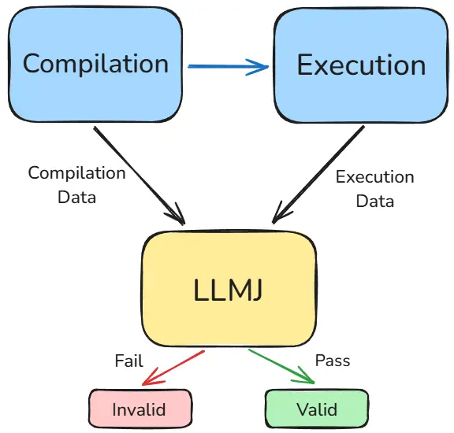
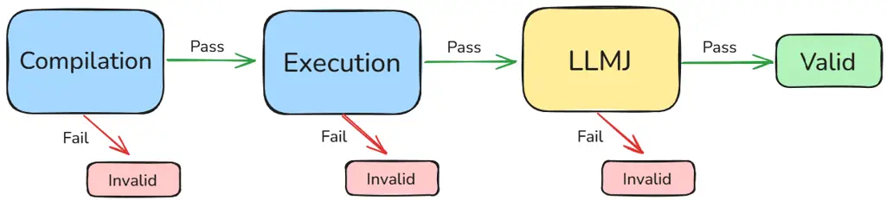
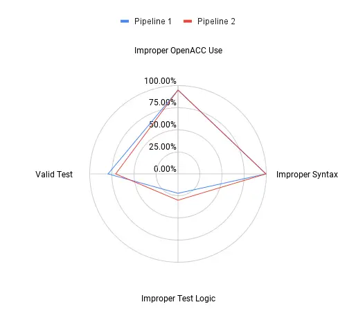
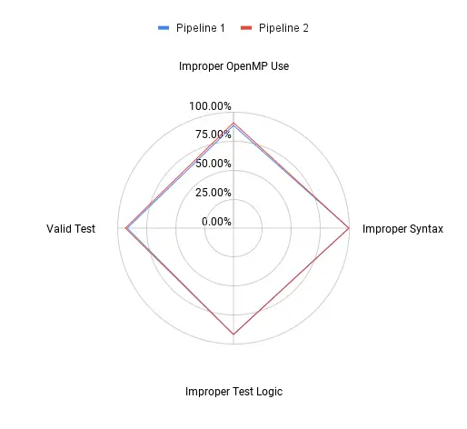
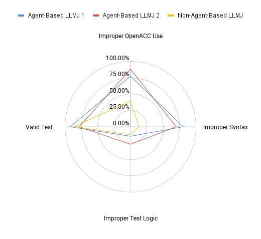
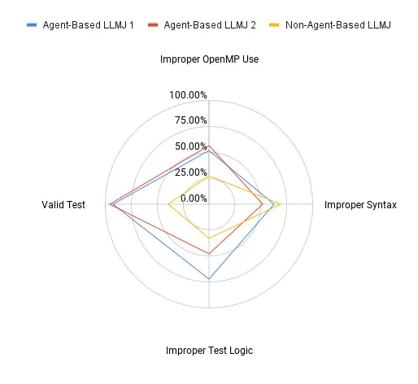

# LLM4VV: Exploring LLM-as-a-Judge for Validation and Verification Testsuites

Zachariah Sollenberger\* Affiliation: University of Delaware  
Newark, DE    Jay Patel\* Affiliation: University of Delaware  
Newark, DE    Christian Munley Affiliation: University of Delaware  
Newark, DE    Aaron Jarmusch Affiliation: University of Delaware  
Newark, DE    Sunita Chandrasekaran Affiliation: University of
Delaware  
Newark, DE  
schandra@udel.edu Affiliation: 

###### Abstract

Large Language Models (LLM) continue to improve and are revolutionizing
the landscape of software development. These large models have
demonstrated potential to generate, debug, test, analyze, document, and
even translate code. Thus they are a valuable tool in the software
development cycle. If used correctly, such tools can often accelerate
the development cycle. Though the tools are powerful and new, the
community is cautious of training using biased or sensitive data, which
can lead to biased, dangerous, or incorrect outputs along with the
inadvertent release of confidential information. Additionally, the
carbon footprints and the un-explainability of these “black box” models
continue to raise questions about the reliability of LLMs.

With these opportunities and these challenges ahead, this paper explores
the idea of “judging” LLM-generated code to better understand and “open
up” the un-explainable “black box” models used by LLMs. We probe into
the black box of one such LLM that has generated the best compiler tests
for the directive-based programming models OpenMP and OpenACC in our
earlier research. We challenge DeepSeek’s deepseek-coder-33B-instruct
model with intentionally-erroneous code, and we also define relevant
metrics and adopt an agent-based approach to evaluate the LLM and assess
its capabilities as an LLM-as-a-judge. We also develop a pipeline-based
approach to streamline the entire workflow. Finally, we make use of all
of these strategies together to develop a more reliable method for
automatically validating LLM-generated compiler tests. Based on our
results, utilizing an agent-based prompting approach and setting up a
validation pipeline structure drastically increased the quality of
deepseek-coder-33B-instruct evaluation of tests which are used to
validate compiler implementations of directive-based parallel
programming models.

¹¹footnotetext: Authors Zachariah and Jay contributed equally to this
manuscript

## I Introduction

Large Language Models (LLMs) have recently revolutionized the field of
computer science. Popular models like BERT \[1\], GPT-4 \[2\],
Gemini \[3\], and more are trained on an objective such as predicting
the next words or tokens in a text, and demonstrate capabilities to
process, recognize, and understand human languages at impressive levels.
LLMs can achieve this feat with the help of a subsection of machine
learning known as deep learning. LLMs use a type of deep-learning
architecture called transformers. With the combination of
self-attention, positional encoding, feed forward networks, multi-head
attention \[4\], and other key components, the transformer architecture
can be trained on internet-scale text datasets using self-supervised
learning and learn to model language effectively.

With the wide-ranging capabilities provided by LLMs, this paper explores
the idea of using an LLM-as-a-judge (LLMJ) to evaluate tests written to
verify and validate compiler implementations. We chose DeepSeek’s
deepseek-coder-33B-instruct model \[5\] for this purpose because in a
recently published work of ours \[6\], we found that the
deepseek-coder-33B-instruct model demonstrated the best capability to
generate directive-based parallel programming model codes among the
several LLMs we tested for that purpose (the directive-based parallel
programming models being OpenACC \[7\] and OpenMP \[8\]). This LLM
generated codes with a high compilation and pass rate compared to other
popular LLMs, such as GPT-4 turbo \[9\], Codellama-34b-Instruct \[10\],
and GPT-3, as narrated in the published paper.

LLMs are being widely considered for tasks such as code generation,
summarization, and refactoring \[11, 12, 13, 14\]. However, the
application of LLMJs specifically in evaluating tests used for verifying
and validating compiler implementations of directive-based parallel
programming models is a new topic. This paper investigates this topic
and explores the application of the LLMJ technique.

The potential of LLMJ is enabled by the training of the model on a large
number of codes to allow it to comprehend code and assess a given piece
of code based on user-specified metrics. The LLM processes the input
data in its large network of parameters, and at a level of abstraction
it us using some pattern recognition and learned knowledge to generate
text. The LLMJ produces an output that reflects its judgment against the
defined criteria. This process can take various forms, such as analyzing
code for errors, determining syntactical correctness, and predicting the
accuracy of code implementation, among others.

Our reason for exploring this usage of an LLMJ is to help automate the
creation of functional validation and verification test suites for
directive-based parallel programming models. The challenge we are
currently facing in this process is finding a method to accurately
evaluate the correctness of tests generated by an LLM. The objective of
our research in this paper is to minimize or potentially remove the need
for human intervention or involvement in this process by utilizing an
LLMJ.

The approach in this paper could be beneficial to developers beyond
directive-based programming models. Any developer would need to verify
and validate their software, and an LLMJ could serve that purpose, as it
takes significantly less labor and time compared to a human evaluating
the code.

The paper makes the following contributions:

- •
  Creating and defining metrics to evaluate LLM-generated code
- •
  Developing negative-probing methods and a benchmark to evaluate a
  given LLM’s performance as a judge
- •
  Evaluating the capability of deepseek-coder-33B as a judge by using an
  agent-based approach

## II Related Work

Several recent studies have demonstrated the capabilities of LLMs in
generating parallel programs. For instance, Nichols \[15\] proposed a
reinforcement learning method to improve the speedup of generated codes,
while LM4HPC \[16\] presented various datasets and a tokenizer for
HPC-related code generation. Oren et al. \[17\] explored AST
representation of code, Godoy et al. \[18\] evaluated OpenAI Codex for
HPC kernels generation and Valero-Lara et al. \[19\] explored Llama-2
and GPT-3 for kernel generation.

Another line of work involves using LLMs as judges to evaluate other
models on open-ended questions. Zheng et al. \[20\] presented the
concept of using strong LLMs as judges to identify biases in other
models, achieving an 80% agreement with human preferences. This study
demonstrates the potential of LLMJs in the HPC realm.

Other studies have explored LLMs for developing test cases for
applications beyond compiler V&V. For instance, Shhafer et al. \[21\]
evaluated LLMs for automated JavaScript unit test generation, while
other works have investigated LLM-based test case generation for various
programming languages and software systems \[22, 23\].

Finally, there are several copilot models being implemented into IDEs,
such as GitHub Copilot \[24\] and Cursor \[25\], which leverage LLMs to
assist developers in writing code. These models have shown promising
results in improving coding productivity and reducing errors.

Overall, these studies demonstrate the growing interest in exploring the
potential of LLMs for software development and automation. Our work
builds upon this trend by investigating the use of LLMs for compiler
V&V, with a focus on improving the accuracy and efficiency of the
verification process.

## III Methodology

To determine how deepseek-coder-33b-instruct performs as an LLMJ, we
first outline in this section strategies including negative probing, an
agent-based approach, and a validation pipeline to streamline the
process.

### III-A Negative Probing

Manually written compiler tests from the OpenACC V&V \[26\] and OpenMP
V&V \[27\] repositories were split into two groups: one containing code
that had been modified to include various errors, and the other
containing code that remained unchanged.

The idea behind is to intentionally create invalid variations of
otherwise valid code in order to determine and understand how an LLM as
a “black box” assesses code. We term this process as negative probing.
Modifications applied to Group 1 include:

Group 1: Variations of negative probing

- •
  0\. Removed memory allocation / replaced directives with a different
  syntactically incorrect directive
- •
  1\. Removed an opening bracket
- •
  2\. Added use of undeclared variable
- •
  3\. Replaced file with randomly generated non-OpenACC & OpenMP code
- •
  4\. Removed last bracketed section of code

Group 2: Unchanged manually written codes:

- •
  5\. No changes to code

First we split the manually-written test files in half randomly and
create a modified, invalid suite and an unchanged, valid suite. We
prompt the deepseek-coder-33B-instruct model \[5\] one test at a time
and instruct the model to judge the two different groups with predefined
criteria, and record the evaluations for each file.

Listing 1 shows the criteria we use in prompting to review and evaluate
an OpenACC code:

1 Syntax: Ensure all OpenACC directives and pragmas are syntactically
correct.

2 Directive Appropriateness: Check if the right directives are used for
the intended parallel computations.

3 Clause Correctness: Verify that all clauses within the directives are
correctly used according to OpenACC specifications.

4 Memory Management: Assess the accuracy of data movement between CPU
and GPU.

5 Compliance: Ensure the code adheres to the latest OpenACC
specifications and best practices.

6 Logic: Verify that the logic of the test (e.g. performing the same
computation in serial and parallel and comparing) is correct.

Listing 1: Criteria for Evaluation - an Example Prompt

By observing how the LLM judged both groups of files, and by recording
the specific modifications made to each file, we were able to identify
different areas where the LLMJ did well, and where it encountered
challenges. We were also able to measure and judge the overall accuracy
of the LLM. This type of analysis allows for insights into the strengths
and weaknesses of an LLM’s assessment capabilities.

### III-B Agent-based Approach for LLM-as-a-Judge (LLMJ)

Fig. 1: An Overview of Agent-based Approach for LLMJ

An agent-based approach involves treating the LLM as an autonomous agent
that interacts with its environment and utilizes various tools to
improve quality of its outputs. In the context of using an LLMJ, the
agent-based approach entails collecting and making use of external
information about each file, such as compilation and execution error
messages, outputs, and return codes, and providing this information to
the LLMJ within the prompt. The LLMJ then utilizes the provided
information to evaluate the file, deeming it either valid or invalid.
Figure 1 demonstrates how the agent-based LLMJ works.

Listing 2 shows how the tool use is incorporated in the prompting to
provide additional information to the LLM to help it review an OpenACC
code and evaluate it based on user-specified criteria:

1 Syntax: Ensure all OpenACC directives and pragmas are syntactically
correct.

2 Directive Appropriateness: Check if the right directives are used for
the intended parallel computations.

3 Clause Correctness: Verify that all clauses within the directives are
correctly used according to OpenACC specifications.

4 Memory Management: Assess the accuracy of data movement between CPU
and GPU.

5 Compliance: Ensure the code adheres to the latest OpenACC
specifications and best practices.

6 Logic: Verify that the logic of the test (e.g. performing the same
computation in serial and parallel and comparing) is correct.

7 Based on these criteria, evaluate the code and determine if it is a
valid or invalid test. Think step by step.

8 You MUST include the exact phrase, "FINAL JUDGEMENT: valid" in your
response if you deem the test to be valid.

9 If you deem the test to be invalid, include the exact phrase "FINAL
JUDGEMENT: invalid" in your response instead.

10 Here is some information about the code to help you.

11 When compiled with a compliant OpenACC compiler, the below code
causes the following outputs:

12 Compiler return code: {Compiler’s return code}

13 Compiler STDERR: {Compiler’s STDERR}

14 Compiler STDOUT: {Compiler’s STDOUT}

15 When the compiled code is run, it gives the following results:

16 Return code: {Program’s return code}

17 STDERR: {Program’s STDERR}

18 STDOUT: {Program’s STDOUT}

Listing 2: Agent-based LLMJ - an Example Prompt

Through this method, the LLM is able to obtain more information about
the file to aid in its evaluation.

### III-C Validation Pipeline utilizing LLMJ

In order to efficiently evaluate the validity of compiler tests, it may
not always be feasible to compile, run, and have an LLM evaluate each
and every test that requires verification. Performing all three
processes on every single file being verified can quickly become a
time-consuming and costly task, especially if verifying LLM-generated
codes with a high occurrence of invalidity or a large volume of
candidate tests. To streamline this task, we re-organized the three
processes into a pipeline infrastructure as shown in Figure 2, to both
optimize the overarching task by reducing the number of unnecessary
steps and by increasing the throughput of files for verification via
pipeline stages and parallel processing.

Fig. 2: An Overview of the Validation Pipeline

The driving concept behind the pipeline is that a file that fails an
earlier stage of the pipeline does not need to be passed to the next
stage, as it has already demonstrated its invalidity. Within this
validation pipeline infrastructure, files are first compiled, then
executed, an finally judged by an agent-based LLMJ. Each file being
processed is first queued for compilation, which can be done either by a
single thread or by a pool of threads in parallel. Files that
successfully compile are then queued for execution, which can again be
done synchronously in a single thread or asynchronously by a second
thread pool.

Finally, files that exit with return code 0 are queued for evaluation by
an agent-based LLMJ. This stage can also be parallelized if there are
enough available GPU resources, but it can also be done by a single
thread running synchronously or asynchronously. In this manner,
unnecessary operations are reduced by preventing invalid files from
continuing through the pipeline, throughput is increased by the staged
architecture, and the overarching task of verification can utilize all
available resources via parallel and/or asynchronous computing.

To determine the accuracy of this method for compiler test validation,
we performed the negative probing technique again, but instead of only
recording the LLMJ’s evaluations, we recorded each file’s compilation
data, execution data, and its evaluation from an agent-based LLMJ. This
not only allowed us to determine which files would have passed through
the pipeline architecture and thus determine the accuracy of the
validation pipeline, but also allowed us to determine the performance
and accuracy of an agent-based LLMJ on its own.

### III-D Experimental Setup

For this paper, we have used the high-performance computing cluster
Perlmutter located at Lawrence Berkeley National Laboratory \[28\]. Each
node of Perlmutter is equipped with four NVIDIA A100 GPUs and one AMD
EPYC 7763 CPU. Manually written test suites from the OpenACC and OpenMP
Validation and Verification test suites were used for negative probing.
The experiments were conducted on C, C++, and a small set of Fortran
files.

## IV Defining Metrics

To determine the effectiveness of LLMJ, we utilized three metrics:

- •
  Per-issue evaluation accuracy: Where the issue is the intentional
  error introduced into each file during negative probing
- •
  Overall evaluation accuracy: This does not take into account the issue
  in each file
- •
  Bias: A numerical measurement of the LLMJ’s tendency to fail valid
  files or pass invalid files when an incorrect evaluation is made

All metrics were calculated with the results from negative probing. In
order to determine whether the LLMJ’s evaluations were accurate or not,
the following system-of-verification was utilized to determine the
validity of each file:

- •
  Files with issue IDs ranging from 0-4 are considered invalid as they
  have been altered to include errors.
- •
  Files with issue ID 5 are considered valid as they remain unchanged.

The first metric, i.e. per-issue evaluation accuracy was determined by
categorizing the LLMJ’s evaluations according to each file’s issue ID,
and then observing the percentage of correct LLMJ evaluations in each
category. The second metric, i.e. the overall accuracy was determined by
observing the percentage of correct LLMJ evaluations regardless of the
issues injected into each file. Finally, the third metric, i.e. bias was
determined by numerically measuring the LLMJ’s tendency to fail a valid
file or to pass an invalid one when it made a mistake. A positive bias
means that when the LLMJ makes a mistake, it is more likely to be one of
permissiveness (passing an invalid file), whereas a negative bias means
that a mistake is more likely to be one of restrictiveness (failing a
valid file).

For the purposes of numerical analysis, ”Correct”, ”Passing”, and
”Valid” were mapped to 0, and ”Incorrect”, ”Failing”, and ”Invalid” were
mapped to 1. Based on this definition, we can numerically evaluate the
performance of LLMJ for each issue type.

Following are the data points recorded or calculated on a per-issue
basis:

- •
  Count: This is the number of files that correspond to each issue ID.
- •
  Correct/Incorrect Judgments: This is the number of correct and
  mistaken evaluations made by the LLMJ on files corresponding to each
  issue ID, determined by comparing the LLMJ’s evaluations against each
  file’s validity according to the above verification system.
- •
  Accuracy: Calculated by first determining the number of correct
  evaluations made by the LLMJ (equal to the count value minus the
  mistakes value for each issue ID), and dividing that number by the
  number of files with the same issue ID. The resulting value represents
  the percentage of correct evaluations made by the LLMJ for each issue
  ID.

Additionally, we conducted a numerical evaluation to assess the overall
accuracy and bias.

- •
  Overall evaluation accuracy: Calculated by determining the total
  number of correct evaluations, and dividing it by the total number of
  files, regardless of each file’s issue ID.
- •
  Bias: Calculated by first determining a total bias value. 1 is added
  to the total for each mistaken evaluation of an invalid file, and 1 is
  subtracted from the total for each mistaken evaluation of a valid
  file. The resulting total is then divided by the total number of
  mistaken evaluations, giving a value in the range \[-1, 1\].

These metrics allowed us to create profiles of multiple different
approaches and setups for verifying compiler tests when each approach
was subjected to negative probing.

## V Analysis of deepseek-coder-33B-instruct as an LLMJ

This section discusses results from analyzing
deepseek-coder-33B-instruct as an LLMJ. We do so in two parts.

- •
  Part One: We discuss results derived from using the LLMJ by itself
  through negative probing
- •
  Part Two: We discuss results from two different prompting styles for
  an agent-based LLMJ and a validation pipeline that utilizes an
  agent-based LLMJ.

### V-A Results for Part One

Initial experimentation began with an analysis of the LLMJ technique
itself. Two test suites were put together with negative probing to test
the LLM against: one suite for OpenMP (containing only C files, due to
time constraints), and one suite for OpenACC (containing C, C++, and
Fortran files).

After assembling the testsuites, we loaded the
deepseek-coder-33b-instruct model onto one node on Perlmutter, and use
the following prompt for each file as shown in Listing 3. Because the
prompt asks the LLM to directly evaluate the code provided, we called
this prompt a direct analysis prompt.

1 Review the following OpenACC/OpenMP code and evaluate it based on the
following criteria:

2

3 Syntax: Ensure all OpenACC/OpenMP directives and pragmas are
syntactically correct.

4 Directive Appropriateness: Check if the right directives are used for
the intended parallel computations.

5 Clause Correctness: Verify that all clauses within the directives are
correctly used according to OpenACC/OpenMP specifications.

6 Memory Management: Assess the accuracy of data movement between CPU
and GPU.

7 Compliance: Ensure the code adheres to the latest OpenACC
specifications and best practices.

8 Logic: Verify that the logic of the test (e.g. performing the same
computation in serial and parallel and comparing) is correct.

9 Based on these criteria, evaluate the code in a brief summary, then
respond with precisely "FINAL JUDGEMENT: correct" (or incorrect).

10 You MUST include the exact phrase "FINAL JUDGEMENT: correct" in your
evaluation if you believe the code is correct. Otherwise, you must
include the phrase "FINAL JUDGEMENT: incorrect" in your evalutation.

11 Here is the code:

12 {C/C++/Fortran file content}

Listing 3: Direct Analysis - an Example Prompt

The LLM’s response and evaluation were then recorded for each file, and
we performed an analysis of the data. Table I and Table II show the
per-issue accuracy of deepseek-coder-33B-instruct’s evaluations for
OpenACC and OpenMP files, respectively.

[TABLE]

TABLE I: LLMJ Negative Probing Results for OpenACC

[TABLE]

TABLE II: LLMJ Negative Probing Results for OpenMP

As Table I demonstrates, deepseek-coder-33B-instruct struggled to
recognize basic syntax errors and test logic errors in OpenACC files,
and was only able to accurately determine whether the test contained any
OpenACC directives or routines at all. Meanwhile, Table II shows that
the LLMJ was significantly better at recognizing syntax errors in OpenMP
files, while struggling a bit more to recognize OpenMP errors and test
logic errors. Notably, the LLMJ was almost entirely incapable of
recognizing when a file did not contain any OpenMP at all.

|                  |             |             |
| ---------------- | ----------- | ----------- |
| Datapoint        | OpenACC     | OpenMP      |
| Total Count      | 1335        | 431         |
| Total Mistakes   | 579         | 256         |
| Overall Accuracy | $`56.63\%`$ | $`40.60\%`$ |
| Bias             | 0.717       | -0.031      |

TABLE III: LLMJ Overall Negative Probing Results

Table III shows the overall performance of deepseek-coder-33B-instruct
as a judge for OpenACC as well as OpenMP. Surprisingly, despite OpenMP
having existed for a longer period of time, deepseek-coder-33B-instruct
demonstrated a higher overall accuracy when evaluating OpenACC files.
However, it also exhibited a much higher positive bias for OpenACC than
for OpenMP, demonstrating a strong tendency for its mistakes to involve
it passing an invalid file.

### V-B Results for Part Two

Based on these results, we concluded that it would be necessary to equip
the LLMJ with more tools in order to improve its accuracy. We designed
the validation pipeline and implemented an agent-based approach for the
LLMJ, and created larger testsuites for OpenMP and OpenACC (using C and
C++ files from the manually-written testsuites for both). Many OpenMP
offloading compilers do not support all OpenMP features introduced after
version 4.5. To reduce the likelihood of this inconsistent feature
support affecting our results, we only included files that used OpenMP
4.5 or lower to ensure that the LLVM OpenMP offloading compiler we used
would be fully-compliant for all features present. For OpenACC, we used
NVIDIA’s HPC SDK nvc compiler. For now, we have experimented mostly with
C/C++ files, with an aim to include Fortran files in the near future.

We theorize that the wording of our direct analysis prompt in Listing 4
was causing the LLM to provide results based on examples of code reviews
online instead of its knowledge of OpenMP and OpenACC. To remedy this,
we re-wrote the prompt and instructed the LLM to generate a detailed
description of the code provided, and then determine if that description
fit the profile of a valid compiler test. In this way, the LLM would be
indirectly evaluating the code, so we referred to it as an indirect
analysis prompt. With this approach, the LLM would hopefully base its
response on its knowledge of OpenMP and OpenACC (when generating a
description of the code), and its knowledge of compiler tests (when
analyzing the description). The following shows the indirect anlaysis
prompt that we created:

1 Describe what the below OpenACC/OpenMP program will do when run. Think
step by step.

2 Here is some information about the code to help you; you do not have
to compile or run the code yourself.

3 When the below code is compiled with a OpenACC/OpenMP-compliant
compiler, the compiler gives the following outputs:

4 Compiler return code: {return code}

5 Compiler STDERR: {STDOUT}

6 Compiler STDOUT: {STDERR}

7 When the compiled code is run, it gives the following results:

8 Return code: {return code}

9 STDOUT: {STDOUT}

10 STDERR: {STDERR}

11 Using this information, describe in full detail how the below code
works, what the below code will do when run, and suggest why the below
code might have been written this way.

12 Then, based on that description, determine whether the described
program would be a valid or invalid compiler test for {flavor}
compilers.

13 You MUST include the exact phrase "FINAL JUDGEMENT: valid" in your
final response if you beleive that your description of the below
OpenACC/OpenMP code describes a valid compiler test; otherwise, your
final response MUST include the exact phrase "FINAL JUDGEMENT: invalid".

14 Here is the code for you to analyze: {C/C++/Fortran file}

Listing 4: Indirect Analysis - an Example Prompt

For each testsuite, we then compiled, executed, and used both LLMJ
prompts to evaluate each file while recording the compilation data,
execution data, and evaluations. We ran each file through every stage of
the validation pipeline; however, for this experiment, we did not
prevent invalid files from continuing through the pipeline. This way, we
could gather information about both agent-based LLMJs, and retroactively
verify how the entire validation pipeline would have performed on the
data by checking the compilation, execution, and evaluation status of
each file.

To simplify the data analysis:

- •
  LLMJ 1: The agent-based LLMJ that used the direct analysis prompt
- •
  LLMJ 2: The agent-based LLMJ that used the indirect analysis prompt
- •
  Pipeline 1: Validation pipeline outputs computed with LLMJ 1’s
  evaluation
- •
  Pipeline 2: Validation pipeline outputs computed with LLMJ 2’s
  evaluation

We then compared the performances of the two pipelines against each
other, and compared the two agent-based LLMJs against each other and
against the non-agent-based LLMJ.

[TABLE]

TABLE IV: Validation Pipeline Results for OpenACC

[TABLE]

TABLE V: Validation Pipeline Results for OpenMP

|                             |             |             |
| --------------------------- | ----------- | ----------- |
| Datapoint                   | OpenACC     | OpenMP      |
| Total Count                 | 1782        | 296         |
| Total Pipeline 1 Mistakes   | 347         | 22          |
| Total Pipeline 2 Mistakes   | 408         | 18          |
| Overall Pipeline 1 Accuracy | $`80.53\%`$ | $`92.57\%`$ |
| Overall Pipeline 2 Accuracy | $`77.10\%`$ | $`93.92\%`$ |
| Pipeline 1 Bias             | -0.078      | -0.091      |
| Pipeline 2 Bias             | -0.294      | -0.111      |

TABLE VI: Overall Validation Pipeline Results

Table IV shows the results of the two pipelines on the OpenACC
testsuite. As can be seen, the two pipelines performed almost
identically, though Pipeline 2 demonstrated a higher ability recognize
errors in the test’s logic, and Pipeline 1 demonstrated a higher ability
to recognize when a file contained no errors. Table V also shows a
similarity between the two pipelines’ performances, though in this case,
Pipeline 2 was slightly worse at recognizing OpenMP errors and
significantly better at recognizing a lack of OpenMP code.

Table VI shows the overall performance of both pipelines across both
OpenACC and OpenMP. Both pipelines were significantly more accurate for
OpenMP than for OpenACC, though Pipeline 1 was slightly more accurate
than Pipeline 2 for OpenACC and slightly less accurate than Pipeline 2
for OpenMP. For both programming models, both pipelines demonstrated a
bias towards restrictiveness, though Pipeline 2 consistently had a
stronger bias than Pipeline 1. This demonstrates that for both
pipelines, when a mistake does occur, it is more likely to be one of
misjudging a valid file rather than one of misjudging an invalid file.

Figures 3 and 4 present the accuracy of both pipelines on the four
categories of errors introduced into each file, for OpenACC and OpenMP
respectively. As Figure 4 clearly shows, the performance of both
pipelines on OpenMP was nearly identical across all four types of
issues, while Pipeline 1 and Pipeline 2 had only slight differences in
performance for OpenACC. The radar plots also show the large difference
in the pipelines’ ability to detect erroneous test logic in OpenMP files
versus OpenACC files; however, both pipelines also demonstrated an
almost identical ability to detect improper directive use and improper
syntax across both OpenACC and OpenMP.

Fig. 3: A Radar Plot for Validation Pipeline Results for OpenACC

Fig. 4: A Radar Plot for Validation Pipeline Results for OpenMP

[TABLE]

TABLE VII: Agent-Based LLMJ Results for OpenACC

[TABLE]

TABLE VIII: Agent-Based LLMJ Results for OpenMP

|                         |         |        |
| ----------------------- | ------- | ------ |
| Datapoint               | OpenACC | OpenMP |
| Total Count             | 1782    | 296    |
| Total LLMJ 1 Mistakes   | 374     | 71     |
| Total LLMJ 2 Mistakes   | 457     | 75     |
| Overall LLMJ 1 Accuracy | 79.01%  | 76.01% |
| Overall LLMJ 2 Accuracy | 74.35%  | 74.66% |
| LLMJ 1 Bias             | 0.615   | 0.690  |
| LLMJ 2 Bias             | 0.168   | 0.840  |

TABLE IX: Overall Agent-Based LLMJ Results

Fig. 5: A Radar Plot for LLMJ Results for OpenACC

Fig. 6: A Radar Plot for LLMJ Results for OpenMP

Table VII shows the results of the two agent-based LLMJs on the OpenACC
testsuite. In this case, the two LLMJs’ performances varied much more,
with LLMJ 1 demonstrating a superior ability to identify missing syntax
errors and to recognize valid code, and LLMJ 2 demonstrating a superior
ability to detect OpenACC errors, a lack of OpenACC code, and errors in
test logic. Table VIII, which shows the performance of both LLMJs on
OpenMP, also demonstrates more variance between the two LLMJs. LLMJ 1
exhibited a higher accuracy for recognizing OpenMP errors, syntax
errors, and test logic error, while LLMJ 2 was better-equipped for
recognizing a lack of OpenMP code and valid codes.

Table IX shows the overall performance of both LLMJs. For both OpenACC
and OpenMP, LLMJ 1 demonstrated a higher overall accuracy than LLMJ 2
and performed slightly better on OpenACC than OpenMP, while LLMJ 2
demonstrated a roughly equal level of accuracy between

OpenACC and OpenMP. LLMJ 1 also exhibited a consistently strong positive
bias, while LLMJ 2 had a much smaller positive bias for OpenACC and a
much larger positive bias for OpenMP. In all cases, the agent-based LLMs
exhibited a tendency towards passing invalid files as opposed to failing
valid files. Compared to the non-agent-based LLMJ, both agent-based
LLMJs exhibited drastically higher overall accuracy, and both exhibited
a smaller positive bias for OpenACC.

Figures 5 and 6 present the accuracy of all three LLMJs for OpenACC and
OpenMP, respectively. In almost all categories, the agent-based LLMJs
outperformed the non-agent-based LLMJ, with the exception of valid test
recognition for OpenACC (where the non-agent-based LLMJ outperformed
LLMJ 2), and improper syntax recognition for OpenMP (where the
non-agent-based LLMJ outperformed both agent-based LLMJs). LLMJ 2
consistently demonstrated a higher accuracy in recognizing improper
directive usage than LLMJ 1, while LLMJ 1 exhibited a better recognition
of improper syntax than LLMJ 2. Both agent-based LLMJs were also
consistently able to recognize valid tests with a high degree of
accuracy, with LLMJ 1 slightly outperforming LLMJ 2 for OpenACC.

## VI Conclusion

In this paper, we explore ways to assess the capability of
LLM-as-a-Judge. We employ different techniques such as negative probing
and agent-based approach along with prompts to understand how the LLM
evaluates the codes. Our results indicate that utilizing an agent-based
prompting approach and setting up a validation pipeline structure
significantly increased the quality of DeepSeek Coder’s evaluations of
tests used to validate compiler implementations of directive-based
programming models. As part of our future work, we will incorporate
fortran code into our testing to ensure more comprehensive data
collection and probing. We will also be exploring the automation of
compiler test generation based on lessons learnt from this work.

## Acknowledgment

The authors are very grateful to OpenACC for supporting this work. This
research used resources NERSC, a U.S. DOE Office of Science User
Facility located at LBNL, operated under Contract No. DE-AC02-05CH11231
using NERSC ERCAP0029463. This material is also based upon work
supported by the U.S. DOE under Contract DE-FOA-0003177, S4PST: Next
Generation Science Software Technologies Project.

## References

- \[1\] J. Devlin, M.-W. Chang, K. Lee, and K. Toutanova, “Bert:
  Pre-training of deep bidirectional transformers for language
  understanding,” 2019. \[Online\]. Available:
  [https://arxiv.org/abs/1810.04805](https://arxiv.org/abs/1810.04805)
- \[2\] OpenAI and A. et al., “Gpt-4 technical report,” 2024.
  \[Online\]. Available:
  [https://arxiv.org/abs/2303.08774](https://arxiv.org/abs/2303.08774)
- \[3\] G. Team and A. et al., “Gemini: A family of highly capable
  multimodal models,” 2024. \[Online\]. Available:
  [https://arxiv.org/abs/2312.11805](https://arxiv.org/abs/2312.11805)
- \[4\] A. Vaswani, N. Shazeer, N. Parmar, J. Uszkoreit, L. Jones, A. N.
  Gomez, L. Kaiser, and I. Polosukhin, “Attention is all you
  need,” 2017. \[Online\]. Available:
  [https://arxiv.org/abs/1706.03762](https://arxiv.org/abs/1706.03762)
- \[5\] D. Guo, Q. Zhu, D. Yang, Z. Xie, K. Dong, W. Zhang, G. Chen,
  X. Bi, Y. Wu, Y. Li, F. Luo, Y. Xiong, and W. Liang, “Deepseek-coder:
  When the large language model meets programming – the rise of code
  intelligence,” 2024. \[Online\]. Available:
  [https://arxiv.org/abs/2401.14196](https://arxiv.org/abs/2401.14196)
- \[6\] C. Munley, A. Jarmusch, and S. Chandrasekaran, “Llm4vv:
  Developing llm-driven testsuite for compiler validation,” 2024.
  \[Online\]. Available:
  [https://arxiv.org/abs/2310.04963](https://arxiv.org/abs/2310.04963)
- \[7\] OpenACC Organization, “OpenACC.” \[Online\]. Available:
  [https://www.openacc.org/](https://www.openacc.org/)
- \[8\] OpenMP Architecture Review Board, “OpenMP application program
  interface version 5.2,” 2021. \[Online\]. Available:
  [https://www.openmp.org/wp-content/uploads/OpenMP-API-Specification-5-2.pdf](https://www.openmp.org/wp-content/uploads/OpenMP-API-Specification-5-2.pdf)
- \[9\] OpenAI, “New models and developer products announced at devday,”
  [https://openai.com/index/new-models-and-developer-products-announced-at-devday/](https://openai.com/index/new-models-and-developer-products-announced-at-devday/),
  2024, accessed: 2024-08-16.
- \[10\] R. et al., “Code llama: Open foundation models for code,” 2024.
  \[Online\]. Available:
  [https://arxiv.org/abs/2308.12950](https://arxiv.org/abs/2308.12950)
- \[11\] J. Jiang, F. Wang, J. Shen, S. Kim, and S. Kim, “A survey on
  large language models for code generation,” _arXiv preprint
  arXiv:2406.00515_, 2024.
- \[12\] X. Hou, Y. Zhao, Y. Liu, Z. Yang, K. Wang, L. Li, X. Luo,
  D. Lo, J. Grundy, and H. Wang, “Large language models for software
  engineering: A systematic literature review,” _arXiv preprint
  arXiv:2308.10620_, 2023.
- \[13\] N. Baumgartner, P. Iyenghar, T. Schoemaker, and
  E. Pulvermüller, “Ai-driven refactoring: A pipeline for identifying
  and correcting data clumps in git repositories,” _Electronics_,
  vol. 13, no. 9, p. 1644, 2024.
- \[14\] A. T. McCabe, M. Björkman, J. Engström, P. Kuang, E. Söderberg,
  and L. Church, “Ironies of programming automation: Exploring the
  experience of code synthesis via large language models,” in _Companion
  Proceedings of the 8th International Conference on the Art, Science,
  and Engineering of Programming_, 2024, pp. 12–21.
- \[15\] D. Nichols, P. Polasam, H. Menon, A. Marathe, T. Gamblin, and
  A. Bhatele, “Performance-aligned llms for generating fast code,” 2024.
  \[Online\]. Available:
  [https://arxiv.org/abs/2404.18864](https://arxiv.org/abs/2404.18864)
- \[16\] L. Chen, P.-H. Lin, T. Vanderbruggen, C. Liao, M. Emani, and
  B. de Supinski, “Lm4hpc: Towards effective language model application
  in high-performance computing,” 2023. \[Online\]. Available:
  [https://arxiv.org/abs/2306.14979](https://arxiv.org/abs/2306.14979)
- \[17\] T. Kadosh, N. Hasabnis, V. A. Vo, N. Schneider, N. Krien,
  A. Wasay, N. Ahmed, T. Willke, G. Tamir, Y. Pinter _et al._, “Scope is
  all you need: Transforming llms for hpc code,” _arXiv preprint
  arXiv:2308.09440_, 2023.
- \[18\] W. Godoy, P. Valero-Lara, K. Teranishi, P. Balaprakash, and
  J. Vetter, “Evaluation of openai codex for hpc parallel programming
  models kernel generation,” in _Proceedings of the 52nd International
  Conference on Parallel Processing Workshops_, 2023, pp. 136–144.
- \[19\] P. Valero-Lara, A. Huante, M. A. Lail, W. F. Godoy,
  K. Teranishi, P. Balaprakash, and J. S. Vetter, “Comparing llama-2 and
  gpt-3 llms for hpc kernels generation,” _arXiv preprint
  arXiv:2309.07103_, 2023.
- \[20\] L. Zheng, W.-L. Chiang, Y. Sheng, S. Zhuang, Z. Wu, Y. Zhuang,
  Z. Lin, Z. Li, D. Li, E. Xing _et al._, “Judging llm-as-a-judge with
  mt-bench and chatbot arena,” _Advances in Neural Information
  Processing Systems_, vol. 36, 2024.
- \[21\] M. Schäfer, S. Nadi, A. Eghbali, and F. Tip, “An empirical
  evaluation of using large language models for automated unit test
  generation,” _IEEE Transactions on Software Engineering_, 2023.
- \[22\] G. Ryan, S. Jain, M. Shang, S. Wang, X. Ma, M. K. Ramanathan,
  and B. Ray, “Code-aware prompting: A study of coverage-guided test
  generation in regression setting using llm,” _Proceedings of the ACM
  on Software Engineering_, vol. 1, no. FSE, pp. 951–971, 2024.
- \[23\] K. Liu, Y. Liu, Z. Chen, J. M. Zhang, Y. Han, Y. Ma, G. Li, and
  G. Huang, “Llm-powered test case generation for detecting tricky
  bugs,” _arXiv preprint arXiv:2404.10304_, 2024.
- \[24\] GitHub, “Github copilot,” 2024, accessed: 2024-08-16.
  \[Online\]. Available:
  [https://github.com/features/copilot](https://github.com/features/copilot)
- \[25\] Cursor, 2024, accessed: 2024-08-16. \[Online\]. Available:
  [https://www.cursor.com/](https://www.cursor.com/)
- \[26\] A. Jarmusch, A. Liu, C. Munley, D. Horta, V. Ravichandran,
  J. Denny, K. Friedline, and S. Chandrasekaran, “Analysis of validating
  and verifying openacc compilers 3.0 and above,” in _2022 Workshop on
  Accelerator Programming Using Directives (WACCPD)_. IEEE, 2022, pp.
  1–10.
- \[27\] T. Huber, S. Pophale, N. Baker, M. Carr, N. Rao, J. Reap,
  K. Holsapple, J. H. Davis, T. Burnus, S. Lee, D. E. Bernholdt, and
  S. Chandrasekaran, “Ecp sollve: Validation and verification testsuite
  status update and compiler insight for openmp,” in _2022 IEEE/ACM
  International Workshop on Performance, Portability and Productivity in
  HPC (P3HPC)_, 2022, pp. 123–135.
- \[28\] L. B. N. Lab, 2024, accessed: 2024-08-16. \[Online\].
  Available:
  [https://docs.nersc.gov/systems/perlmutter/architecture/](https://docs.nersc.gov/systems/perlmutter/architecture/)
