# Systematic Evaluation of LLM-as-a-Judge in LLM Alignment Tasks: Explainable Metrics and Diverse Prompt Templates

Hui Wei^(†) Affiliation: UC Merced    Shenghua He Affiliation: PAII Inc.
   Tian Xia Affiliation: PAII Inc.    Fei Liu Affiliation: Emory
University    Andy Wong^(†) Affiliation: Inflection AI    Jingyang
Lin^(†) Affiliation: University of Rochester              Code:
[https://github.com/shenghh2015/llm-judge-eval](https://github.com/shenghh2015/llm-judge-eval)
   Mei Han Affiliation: PAII Inc.

###### Abstract

LLM-as-a-Judge has been widely applied to evaluate and compare different
LLM alignmnet approaches (e.g., RLHF and DPO). However, concerns
regarding its reliability have emerged, due to LLM judges’ biases and
inconsistent decision-making. Previous research has developed evaluation
frameworks to assess reliability of LLM judges and their alignment with
human preferences. However, the employed evaluation metrics often lack
adequate explainability and fail to address LLM internal inconsistency.
Additionally, existing studies inadequately explore the impact of
various prompt templates when applying LLM-as-a-Judge methods, leading
to potentially inconsistent comparisons between different alignment
algorithms. In this work, we systematically evaluate LLM-as-a-Judge on
_alignment tasks_ by defining more theoretically interpretable
evaluation metrics and explicitly mitigating LLM internal inconsistency
from reliability metrics. We develop an open-source framework to
evaluate, compare, and visualize the reliability and alignment of LLM
judges, which facilitates practitioners to choose LLM judges for
alignment tasks. In the experiments, we examine effects of diverse
prompt templates on LLM-judge reliability and also demonstrate our
developed framework by comparing various LLM judges on two common
alignment datasets (i.e., TL;DR Summarization and HH-RLHF-Helpfulness).
Our results indicate _a significant impact of prompt templates on LLM
judge performance_, as well as _a mediocre alignment level between the
tested LLM judges and human evaluators_.

|     |
| --- |
|     |

^(\*)^(\*)footnotetext: Equal contributions & Corresponding
authors: 🖂 [huiwei2@ucmerced.edu](mailto:huiwei2@ucmerced.edu), 🖂 [shenghh2015@gmail.com](mailto:shenghh2015@gmail.com)^(\$\dagger\$)^(\$\dagger\$)footnotetext:
Work was done when H. Wei, J. Lin, and A. Wong were at PAII Inc.

## 1 Introduction

Commercial LLMs (e.g., GPT-4 (Achiam et al., 2023))have been widely used
as the surrogates for human evaluators, referred to as LLM-as-a-Judge
(Gu et al., 2024; Li et al., 2024a; Li et al., 2024b), to perform
pairwise evaluation on numerous LLM alignment tasks, such as
summarization and multiturn conversations. Since these commercial models
have already been extensively trained with advanced alignment techniques
(Achiam et al., 2023; Touvron et al., 2023), they are capable of
approximating human preferences (Rafailov et al., 2024b; Zheng et al.,
2024).

While it is plausible to utilize these models as surrogates for human
judges, biases and inconsistencies are frequently observed in their
judgment results, despite the application of various bias-mitigation
techniques (Rafailov et al., 2024a; Rafailov et al., 2024b). This
necessitates a systematic investigation of LLM judge reliability and
alignment with human preferences in the context of LLM alignment tasks.

Previous studies have evaluated LLM-as-a-Judge methods on various
language generation tasks (Wang et al., 2023b; Saito et al., 2023;
Dubois et al., 2024a; Panickssery et al., 2024; Shi et al., 2024; Thakur
et al., 2024; Chiang & Lee, 2023; Liu et al., 2023; Wang et al., 2023a;
Zhu et al., ; Wang et al., 2023c; Li et al., 2023; Zheng et al., 2024;
Li et al., 2024c; Chiang et al., 2024; Dubois et al., 2024b). However,
these studies encounter three main limitations:

- •
  Lacking theoretical interpretability for bias definitions (e.g.
  position bias and length bias).
- •
  Not considering internal inconsistencies (i.e., system noise) by
  assuming LLM judges make deterministic decisions across identical
  experiments.
- •
  Focusing on evaluating various LLMs, while the effects of prompt
  templates have been insufficiently examined.

In this study, we aim to address these limitations and advance the
systematic evaluation of LLM-as-a-Judge on LLM alignment tasks. Our main
contributions in this work are:

- •
  We improve the theoretical explainability of evaluation metrics for
  assessing LLM-judge position and length bias, by (1) defining them
  within a unified accuracy-based framework, (2) explicitly defining the
  LLM internal self-inconsistency as _flipping noise_ and mitigating its
  impact, as well as (3) formally analyzing the relationship between
  position and length bias after mitigation.
- •
  We develop a open-sourced framework to evaluate, compare, and
  visualize the alignment and reliability of LLM judges, allowing for a
  wide range of LLMs and user-defined prompt templates. In the
  experiments, we leverage the developed framework to test _a wide range
  of prompt templates with diverse formats_ and investigate their impact
  on LLM judge performance.
- •
  Our results indicate _a significant impact of prompt templates on LLM
  judge performance_, underscoring the need for a thorough and careful
  comparison of various LLMs and prompt templates before employing the
  LLM-as-a-Judge methodology.

## 2 Background and Related Work

In this section, we define the pairwise evaluation task conducted by
both human and LLM judges, and examine self-inconsistency and biases
inherent in LLM judges. Additionally, we review relevant literature on
position bias and length bias.

Human-based Pairwise Evaluation Given a set of $`N`$ questions, each
paired with responses generated by separate LLMs, the human judge is
asked to select the better response based on predefined criteria, such
as coherence and helpfulness. Let $`N_{1}`$ and $`N_{2}`$ be the numbers
that the first and second answer are chosen. The win rate of the first
and the second LLM is defined as $`w_{1,2}\!=\!\frac{N_{1}}{N}`$ and
$`w_{2,1}\!=\!1\!-\!w_{1,2}\!=\frac{N_{2}}{N}`$.

LLM-based Pairwise Evaluation LLM judges are subjected to the same
evaluation procedures as human judges. However, compared with humans,
LLMs are more sensitive to instructions (i.e., prompt templates)
(Stureborg et al., 2024; Zhu et al., ). Thus, in this study, we define
an LLM-judge as _the combination of a specific LLM and a particular
prompt template_.

LLM-Judge Self-Inconsistency Previous studies have observed that LLM
judges (Shi et al., 2024; Stureborg et al., 2024) may produce
inconsistent judgments even when presented with identical prompts. This
is caused by non-greedy decoding strategies leveraged by LLMs, such as
top-p and top-k, which generate non-deterministic outputs. The
non-deterministic level is controlled by the _temperature_ parameter. In
this work, we refer to these inconsistencies as self-inconsistency or
system noise in LLM judges and model and quantify them using the term
_flipping noise_ (Section 4).

LLM-Judge Position and Length Bias Positioin bias refers to LLM-judge’s
systematic preference for a specific response position (the first or the
second in the pairwise evaluation task). Wang et al. (2023b) and Lee
et al. (2023) observed the position bias when using GPT-4 (Achiam
et al., 2023) and PaLM 2 (Anil et al., 2023) as the judge for the
pairwise comparison between candidate LLMs. They measured the position
bias by the ratio of inconsistent decisions made by LLM judges after
swapping response positions. Differently, Liusie et al. (2023) and Zheng
et al. (2024) defined the position bias as the disparity of selection
probabilities after reversing the response order. Length bias refers to
LLM judge’s systematic preference for longer responses even when their
qualities are similar to shorter versions. Saito et al. (2023) observed
a discrepancy between LLMs and human preferences regarding response
length. They employed accuracy parity—related to human preferences for
longer responses and shorter responses—to measure relative length bias.

In contrast to above studies, our work theorectically examines the
impact of LLM judge self-inconsistency on position bias and length bias
metrics, and provides practical methods to mitigate this effect. We also
provide a theoretical analysis and validation of our defined metrics to
enhance their interpretability. Additionally, we investigate the
relationship between these biases and accuracy, revealing significant
insights. Finally, our study includes an extensive evaluation of
position and length bias across a diverse set of LLM judges with various
prompt templates.

## 3 Notation

Let $`\mathcal{D}\!=\!\{h_{n}|n\!=\!1\!\ldots\!N\}`$ be a
human-preference dataset containing $`N`$ data cases. An individual data
case $`h_{n}\!=\!(x^{(n)},y^{(n)}_{c},y^{(n)}_{r})`$ represents a
prompt-responses pair with a human preference label, where $`x^{(n)}`$
is a prompt (e.g., a post for summarization), $`y^{(n)}_{c}`$ is the
preferred LLM response and $`y^{(n)}_{r}`$ is the less preferred
response, both by human evaluators. We assume each case is drawn from
the distribution $`h_{n}\!\sim\!p(h|\theta)`$, where $`\theta`$
represents the underlying human preferences depending on human
annotators helping construct the dataset. We drop the data case index
$`n`$ for brevity when the context is clear.

## 4 Explainable Evaluation Metrics and Flipping Noise

Accuracy Accuracy measures the alignment level of LLM judges with human
preferences. Formally, we denote $`\theta_{l}`$ as the underlying
preference by some LLM-judge $`l`$, and accuracy evaluates how closely
$`\theta_{l}`$ is to $`\theta`$, where $`\theta`$ is the human
preference defined in Section 3.

There are two versions of the accuracy metric:
$`\text{Acc}_{\text{both}}`$ and $`\text{Acc}_{\text{random}}`$. We
assume the LLM judge decides on each data case by considering two
response orders: $`h\!=\!(x,y_{c},y_{r})`$ and
$`h^{\prime}\!=\!(x,y_{r},y_{c})`$. The LLM judge then selects the
preferred response $`y`$ and $`y^{\prime}`$ from each order $`h`$ and
$`h^{\prime}`$, where $`y,y^{\prime}\!\in\!\{y_{c},y_{r}\}`$. Broadly,
we denote the set of LLM judging results as
$`J\!=\!\{s_{n}|n=1\ldots N\}`$, where each result
$`s_{n}\!=\!(y^{(n)},y^{\prime(n)})`$ represents the selection outcome
from both response orders across all the data cases in the dataset
$`\mathcal{D}`$. Then the accuracy metrics $`\text{Acc}_{\text{both}}`$
and $`\text{Acc}_{\text{random}}`$ can be defined over the judging set
$`J`$ as follows:

```math
\displaystyle\text{Acc}_{\text{both}} \displaystyle=\frac{1}{N}\sum_{n=1}^{N}\mathds{1}\left(y^{(n)}=y^{(n)}_{c}\land y^{\prime(n)}=y^{(n)}_{c}\right), \displaystyle\text{Acc}_{\text{random}} \displaystyle=\frac{1}{N}\sum_{n=1}^{N}\mathds{1}\left(y^{(n)}_{\text{random}}=y^{(n)}_{c}\right)
```

where $`y_{\text{random}}`$ is randomly chosen from $`\{y,y^{\prime}\}`$
with the probability of 0.5.

Flipping Noise As mentioned in Section 2, LLM outputs are generally
non-deterministic, which can lead to inconsistent judgments even when
the _same_ LLM judge is presented with the _identical_ data case
$`h\!=\!(x,y_{c},y_{r})`$. To better model this behavior, we first
assume the LLM judge’s outputs are always _deterministic_ (i.e., no
self-inconsistency), representing its decision as a binary variable
$`X\!\in\{0,1\}`$, where $`X\!=\!1`$ indicates LLM judge’s selection of
the human-preferred response $`y_{c}`$ and $`X\!=\!0`$ indicates
otherwise. Under this assumption, re-evaluating the same case $`h`$
would always yield the same decision (e.g., selecting $`y_{c}`$ with
$`X\!=\!1`$).

However, if we _consider_ self-inconsistency, the LLM judge may instead
select the alternative response $`y_{r}`$ upon re-evaluation. We refer
to this as “flipping” its original decision. We define the discrepancy
between the LLM judge’s actual decision (considering self-inconsistency)
and its original decision (assuming no self-inconsistency) as _flipping
noise_, which quantifies the impact of self-inconsistency. We introduce
another binary variable, $`Z\!\in\{0,1\}`$, to represent the LLM judge’s
actual decision, which may differ from its original value $`X`$ due to
flipping noise. In real-world scenarios where self-inconsistency is
_unavoidable_, _we can only observe the noisy decision $`Z`$, not the
idealized $`X`$_.

Formally, we can represent the relationship between LLM judge’s original
decision and actual decision as follows:

```math
\displaystyle Z \displaystyle=\begin{cases}1-X,&p\left[1-X|X\right]=q\\
X,&p\left[X|X\right]=1-q\end{cases} \tag{1}
```

where $`q`$ is the probability that the LLM judge’s decision is flipped.
For a completely deterministic LLM judge, $`q\!=\!0`$.

Position Bias (PB) As a reminder, we define accuracy based on two sets
of responses with reversed orders, namely $`(y_{c},y_{r})`$ and
$`(y_{r},y_{c})`$, for the same prompt $`x`$. To assess accuracy, we
require the LLM judge to be evaluated in both orders. Here, we employ
the same setting to define position bias.

First of all, we define $`p\left[X=1|(y_{c},y_{r})\right]`$ as the
probability that the LLM-judge’s _original_ result aligns with the human
selection for the response order $`(y_{c},y_{r})`$, and
$`p\left[X=1|(y_{r},y_{c})\right]`$ as the probability that the
LLM-judge’s result aligns with the human selection when the order is
reversed. It is important to note these two probabilities are
essentially _accuracy_ metrics for the two response positions.

We first consider a special case where the LLM judge makes a _fully
consistent decision_ (i.e. $`q=0`$, $`Z=X`$), and is _completely
insensitive to the response position order_ (i.e. exhibits no position
bias). This implies that accuracy should be invariant regarding response
positions:
$`p\left[X=1|(y_{c},y_{r})\right]-p\left[X=1|(y_{r},y_{c})\right]=0`$.

Additionally, if the LLM-judge _exhibits position bias favoring the
first position over the second_, it will select $`y_{c}`$ more
frequently in $`(y_{c},y_{r})`$ and $`y_{r}`$ more frequently in
$`(y_{r},y_{c})`$, compared to the scenario with no position bias. Thus,
the accuracy $`p\left[X=1|(y_{c},y_{r})\right]`$ will increase and
$`p\left[X\!=\!1|(y_{r},y_{c})\right]`$ will decrease, resulting in
$`p\left[X\!=\!1|(y_{c},y_{r})\right]-p\left[X\!=\!1|(y_{r},y_{c})\right]>0`$.
The same rationale applies when the second position is preferred.

Based on these intuitions, we define position bias as:

```math
\displaystyle\text{PB}=p\left[X=1|(y_{c},y_{r})\right]-p\left[X=1|(y_{r},y_{c})\right] \tag{2}
```

where the absolute value $`\left|\text{PB}\right|`$ measures the degree
of position bias, with positive and negative values indicating
preferences for the first and second positions, respectively.

Finally, we address the general case in which the LLM-judge _makes
non-deterministic decisions and exhibits position bias_. Here, only
noisy observation $`Z`$ defined in Eq. 1 is observable, instead of
$`X`$. Thus, to mitigate the impact of self-inconsistency and determine
the original underlying position bias as defined by Eq. 2, we first
compute the accuracy of both positions based on $`Z`$, and then apply
the de-noise process according to the following relationships between
accuracy based on $`X`$ and accuracy based on $`Z`$.

```math
\displaystyle p\left[X=1|(y_{c},y_{r})\right] \displaystyle=\frac{p\left[Z=1|(y_{c},y_{r})\right]-q_{cr}}{1-2\cdot q_{cr}},~q_{cr}=p\left[1-X|X,(y_{c},y_{r})\right]
```

```math
\displaystyle p\left[X=1|(y_{r},y_{c})\right] \displaystyle=\frac{p\left[Z=1|(y_{r},y_{c})\right]-q_{rc}}{1-2\cdot q_{rc}},~q_{rc}=p\left[1-X|X,(y_{r},y_{c})\right]
```

where $`q_{cr}`$ and $`q_{rc}`$ are the probabilities that the LLM
judge’s decision is flipped for response order $`(y_{c},y_{r})`$ and
$`(y_{r},y_{c})`$, respectively. In the appendix A.4, we derive the
above relationships, validate the position bias measurement based on
de-noised accuracies, and provide a practical method for their
computation.

Length Bias (LB) Previous studies have indicated that human evaluators
exhibit the length bias when assessing responses (Zheng et al., 2024;
Saito et al., 2023). If LLM judges are employed as surrogates for human
judges, it is expected they have the same length bias in general. Thus,
this study aims to measure the _relative_ length bias of LLM-judges
compared with human evaluators, rather than their absolute length bias.
For brevity, we use “length bias” to refer to the _relative_ length bias
in the paper.

For each data case $`(x,y_{c},y_{r})`$, we denote
$`\Delta l\!=\!l_{c}\!-l_{r}`$ as the length difference between
$`y_{c}`$ and $`y_{r}`$, where $`l_{c}`$ and $`l_{r}`$ are the length of
$`y_{c}`$ and $`y_{r}`$, respectively. Additionally, we denote
$`p\left[X\!=\!1|\Delta l\!>0\right]`$ as the probability that the
LLM-judge’s result aligns with the human selection when the human
selected response $`y_{c}`$ is longer than $`y_{r}`$, and
$`p\left[X\!=\!1|\Delta l\!\leq 0\right]`$ as the probability that the
LLM-judge’s result align when the length relationship is reversed.
Moreover, these two probabilities are defined within the same accuracy
framework, analogous to the definition of position bias.

Following the same rationale as in the position bias section, we define
length bias as

```math
\displaystyle\text{LB}\!=p\left[X\!=\!1|\Delta l\!>0\right]\!-p\left[X\!=\!1|\Delta l\!\leq 0\right] \tag{3}
```

where $`|\text{LB}|`$ measures how significantly the LLM judge exhibits
different length bias compared to human judges and the sign of LB
indicates it biases more towards longer response or shorter responses
than human judges, respectively.

In cases where _flipping noise cannot be neglected_, analogous to the
approach for position bias, we first compute accuracies from noisy
observations $`Z`$: $`p\left[Z\!=\!1|\Delta l\!>0\right]`$ and
$`p\left[Z\!=\!1|\Delta l\!\leq 0\right]`$. We then apply a de-noising
process to mitigate the impact of self-inconsistency based on the
relationships between accuracy derived from $`X`$ and accuracy derived
from $`Z`$ as follows:

```math
\displaystyle p\left[X=1|\Delta l>0\right] \displaystyle=\frac{p\left[Z=1|\Delta l\!>0\right]-q_{\Delta l>0}}{1-2\cdot q_{\Delta l>0}},~q_{\Delta l>0}=p\left[1-X|X,\Delta l\!>0\right]
```

```math
\displaystyle p\left[X=1|\Delta l\leq 0\right] \displaystyle=\frac{p\left[Z=1|\Delta l\!\leq 0\right]-q_{\Delta l\leq 0}}{1-2\cdot q_{\Delta l\leq 0}},~q_{\Delta l\leq 0}=p\left[1-X|X,\Delta l\!\leq 0\right]
```

where $`q_{\Delta l>0}`$ and $`q_{\Delta l\leq 0}`$ are the
probabilities that the LLM judge’s decision is flipped for the
conditions $`\Delta l>0`$ and $`\Delta l\leq 0`$, respectively. In the
appendix A.4, we derive the above relationships, validate the length
bias measurement based on de-noised accuracies, and provide a practical
method for their computation.

Further Analysis To enhance the interpretability of the position and
length bias metrics, we further analyze their inter-relationship
theoretically. Our findings are summarized below and formally proven in
the appendix A.4.

Finding 1 Position bias definition in Eq. 2 is intrinsically length
bias-mitigated.

Finding 2 Length bias measurement in Eq. 3 is entangled with position
bias. Employing $`A_{\text{both}}`$ for accuracy helps mitigate the
influence of positional bias in the assessment of length bias.

## 5 Evaluation Framework

In this study, we introduce an evaluation framework that integrates our
proposed methods for computing metrics, including accuracy
($`\text{Acc}_{\text{both}}`$, $`\text{Acc}_{\text{random}}`$), position
bias and length bias. The framework is developed and open-sourced to
help researchers and practitioners select either predefined or
user-customized LLM judges for alignment tasks based on aforementioned
evaluation metrics and their specific needs.

The pipeline of the framework, as depicted in Fig. 1, is structured into
four modular components: 1) _Data Sampler_, 2) _LLM Judges_, 3) _Metrics
Computation_, and 4) _Metrics Visualization_. The functionality of each
component is detailed as follows.

Figure 1: LLM-as-a-Judge Evaluation Framework

Data Sampler: When dealing with a large human preference dataset and a
limited budget for using commercial LLM models, it becomes necessary to
sample a manageable-size subset from the full dataset for LLM judge
evaluation. Our framework employs a _stratified sampling strategy_ to
ensure that the subset maintains the same proportion of different
conditions (e.g. length difference distribution) as the original
dataset.

LLM Judges: As defined in Section 2, an LLM judge refers to the
combination of a particular LLM and a specific prompt template. Given an
LLM judge, this module is responsible for generating textual judging
decisions for each sampled data case and subsequently converting them
into a binary outcome for metrics computation. This module allows the
flexible creation of varied LLM judges by configuring different LLMs and
prompt templates for evaluation.

Metrics Computation: This module computes alignment and reliability
evaluation metrics (i.e. accuracy, position bias, and length bias) using
the judging results from the LLM Judge module and the human preference
labels provided by the dataset, based on the computational methods
described in the Method section.

Metrics Visualization: This module visualizes both the _individual_
computed metrics and their _inter-relationships_, providing
comprehensive insights for comparing LLM judges and aiding in the
selection of the most suitable LLM judge for specific LLM-alignment
tasks.

## 6 Experiments

Data Selection We demonstrate our evaluation framework using two
datasets that are commonly used to evaluate LLM alignment algorithms:
TL;DR summarization dataset (Völske et al., 2017; Stiennon et al., 2020)
and HH-RLHF-Helpfulness dataset (Bai et al., 2022). Both datasets
contain a prompt (a post for the summarization dataset; a conversation
history between humans and LLM assistants for HH-RLHF dataset) with two
responses generated by distinct LLMs for each sample. Also, human
preference labels are available to indicate which response is more
aligned with human preference. Both datasets have already been
partitioned into train and test sets by the authors in the original
studies.

In our experiments, it is highly time-consuming and expensive to
evaluate LLM judges on all the data cases of both datasets (143,356 for
summarization and 124,243 for HH-RLHF-Helpfulness), so we randomly
sample a subset from each dataset to perform all the evaluation
experiments. Compared with the summarization dataset, the
HH-RLHF-Helpfulness dataset has a much smaller test set (6,240 vs.
70,228), thus, we select a subset from the TL;DR summarization _test_
set following the previous study (Rafailov et al., 2024b) and a subset
from the _entire_ HH-RLHF-Helpfulness dataset. Moreover, multiple data
cases may share the same prompt (post or conversation history) with
distinct response pairs. To make our collected datasets as diverse as
possible, only one pair is kept for this prompt and others are removed.
After this step, each unique prompt corresponds to only one unique
answer pair. Then we randomly sample the prompts and their associated
responses five times without replacement, resulting in five
non-overlapping splits. Since measuring length bias requires dividing
all the data cases into two conditions: whether longer responses are
preferred by humans or not, we leverage the stratified sampling to
preserve the same ratio of these two conditions as in the entire
dataset.

Overall, both datasets used in our experiments contain 200 distinct
samples for each split, which results in 1000 samples in total. The
summarization and HH-RLHF-Helpfulness datasets have a stratified ratio
(# of humans prefer longer responses: \# of humans prefer shorter
responses) of 115:85 and 111:89 respectively.

LLM Judges Our LLM judges integrate a range of varied commercial large
language models and prompt templates. Particularly, we assess GPT-4o,
GPT-4o-mini and GPT-3.5-turbo with 8 templates on the summarization
dataset and 10 templates on the HH-RLHF-Helpfulness dataset. Thus, there
are $`3\!\times\!8\!=\!24`$ LLM judges for the summarization dataset and
$`3\!\times\!10\!=\!30`$ LLM judges for the HH-RLHF-Helpfulness dataset.

GPT-4o is one of the most advanced models which has the latest
checkpoint on 08/06/2024, GPT-4o-mini is the most cost-efficient model,
while GPT-3.5-turbo is from the last OpenAI model generation and serves
as the baseline in our experiments. Our preliminary studies suggest that
GPT-4o exhibits comparable performance to GPT-4 in judging
decision-making, but at a cost that is 4 to 6 times lower. Due to
limited budget, we select GPT-4o for evaluation over GPT-4 from the list
of _commercial_ LLMs, despite GPT-4 being the most widely-used model in
LLM alignment studies before the release of GPT-4o.

All the considered templates were actually used in the pairwise
comparison tasks to evaluate different LLM alignment algorithms by
papers of year 2023 and 2024, and we make sure they all have
_dissimilar_ prompt formats. Furthermore, since our evaluation datasets
have no “tied” labels from human annotations, which indicate two
responses are equally preferred, we remove sentences from the prompt
templates which allow LLM judges to select “tied” labels. Please refer
to the appendix A.1 for template examples of each dataset, as well as a
complete list of the papers from which all the templates in this study
are derived.

Temperature Parameter Selection Temperature parameter determines how
deterministic LLM outputs are, which might affect the performance of
LLM-judges. However, few previous studies that use LLMs as judges
explicitly explain how and why they choose the temperature in their
experiments. In this study, we assess the impact of the temperature
parameter on the self-consistency (i.e. 1-flipping probability $`q`$)
and accuracies of the large language models, which helps to select the
temperature before evaluating LLM-judge performance using other metrics.

In detail, we investigate five temperature settings: $`0.0`$, $`0.1`$,
$`0.3`$, $`0.5`$, and $`0.7`$. For each temperature setting, we
concatenate data samples in all 5 splits (1000 samples in total) and
repeatedly ask LLM judges to select the better response $`K\!=\!5`$
times for each sample. We compute the self-consistency for both response
positions ($`y_{c}`$, $`y_{r}`$) and ($`y_{r}`$, $`y_{c}`$) separately,
as well as $`\text{Acc}_{\text{both}}`$ across all the samples.

Through preliminary experiments, we found the impact of different
temperatures is the same to the _same_ LLM with _different_ prompt
templates, so in the large-scale experiments, only the prompt templates
from DPO paper (Rafailov et al., 2024b) are utilized for both datasets.

Metrics Computation To compute the flipping probability, same as
selecting the temperature parameter, we let LLM judges select their
preferred response from each sample repeatedly for $`K=5`$ times.
However, since we need to compute this probability for every LLM judge
(24 for the summarization dataset and 30 for the HH-RLHF-Helpfulness
dataset), we only leverage _the first split_ of each dataset due to
limited budget and assume they remain consistent on all five splits. For
each sample, the flipping probabilities $`q_{cr}`$ and $`q_{rc}`$ for
both positions $`(y_{c},y_{r})`$ and $`(y_{r},y_{c})`$ are computed
separately to estimate de-noised position bias, and the flipping
probabilities $`q_{\Delta l>0}`$ and $`q_{\Delta l\leq 0}`$ are computed
as well to calculate de-noised length bias. To compute accuracy,
position bias, and length bias, we compute each metric on _all the
splits ($`S=5`$)_. In the result, we report the mean and standard
deviation of LLM judge performances across these five splits.

## 7 Results

Temperature Table 1 contains the results of self-consistent rate (SCR)
and accuracy with various temperatures. The self-consistent rate, given
by $`1-q`$ as defined in Eq. 1, measures the probability that the LLM’s
judgments are consistent across identical inputs. Since different LLMs
show the same trend on both datasets, we only include GPT-4o here for
the demonstration. Results regarding other LLMs are included in the
appendix A.3.

From the table, we observe that _higher temperatures result in lower
self-consistency for both positions, while accuracy is not significantly
affected by temperatures_. Specifically, even when the temperature is
set to 0.0, complete self-consistency (i.e. SCR=1.0) remains
unachievable. Furthermore, _self-consistency varies with different
positions_, thereby necessitating the separate measurement of flipping
probabilities related to flipping noise associated with each position.

Finally, we aim to demonstrate the generalizability of our evaluation
framework by employing a value that is not a special case, such as 0.0.
Thus, _we select 0.1 as the temperature in all of our experiments_,
which has the highest level of self-consistency compared with higher
temperatures.

[TABLE]

Table 1: Self-consistent rate (SCR) and accuracy (Acc) of tested
temperatures for the TL;DR summarization and HH-RLHF-Helpfulness
datasets. Results are demonstrated using GPT-4o and prompt templates
from the DPO paper Rafailov et al. (2024b).

Accuracy Figure 2(a) and Figure 2(b) show accuracies
($`\text{Acc}_{\text{both}}`$) of LLM judges on both datasets, where
identical colors represent the same prompt template within the same
dataset (the same coloring rule is applied to all the result figures
except for Figure 4). As we can see, different LLM judges have distinct
accuracy, which means they have varied alignment levels with human
preferences. Also, it demonstrates _the performance of an LLM judge is
highly sensitive to prompt templates._

Notably, several LLM judges have very low accuracies
($`\text{Acc}_{\text{both}}\!<\!0.2`$). Thus, it is significantly
important to carefully evaluate and compare different LLM judges before
actually using them to evaluate LLM alignment algorithms. Moreover, we
find that all the accuracies on both datasets are below 0.7, which shows
the mediocre alignment level and demonstrates that human evaluation is
necessary to precisely compare different LLM alignment systems.

Compared with GPT-3.5-turbo, both GPT-4o and GPT-4o-mini have higher
accuracies no matter which prompt template is used. It demonstrates that
the superior internal capacities of recent LLMs, compared to older
versions, are independent of the prompt templates used.

Figure 2(c) and Figure 2(d) show accuracy
($`\text{Acc}_{\text{random}}`$) of LLM judges on both datasets.
Compared with Figure 2(a) and 2(b) (i.e. $`\text{Acc}_{\text{both}}`$),
the gap between GPT-3.5-turbo and the others shrinks. This is because
$`\text{Acc}_{\text{random}}`$ involves randomly selecting a position
when LLM judge selection is inconsistent across two positions, thereby
not reflecting the internal capabilities of LLM judges. Consequently,
_$`\text{Acc}_{\text{random}}`$ is a less effective metric for assessing
LLM judge performance compared to $`\text{Acc}_{\text{both}}`$_. Based
on this, only $`\text{Acc}_{\text{both}}`$ is used to demonstrate the
relationship between accuracy and position bias as well as length bias
in the following sections.

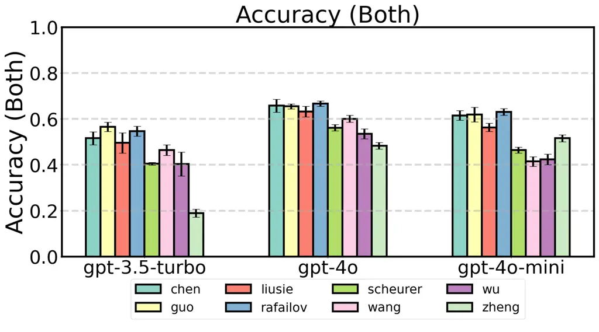

(a) TL;DR

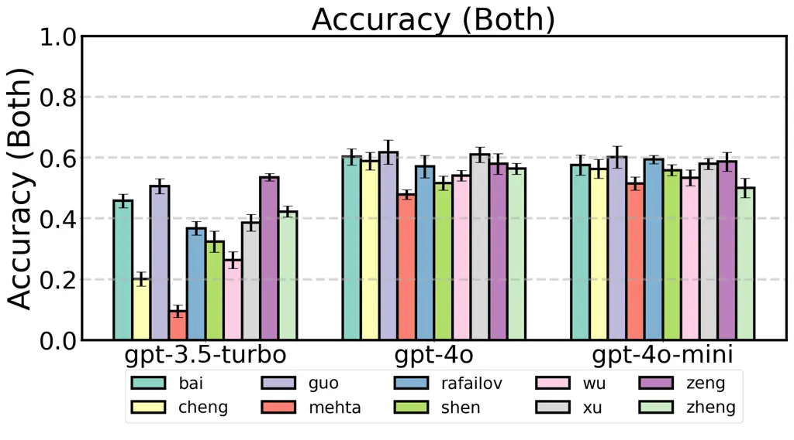

(b) HH-RLHF

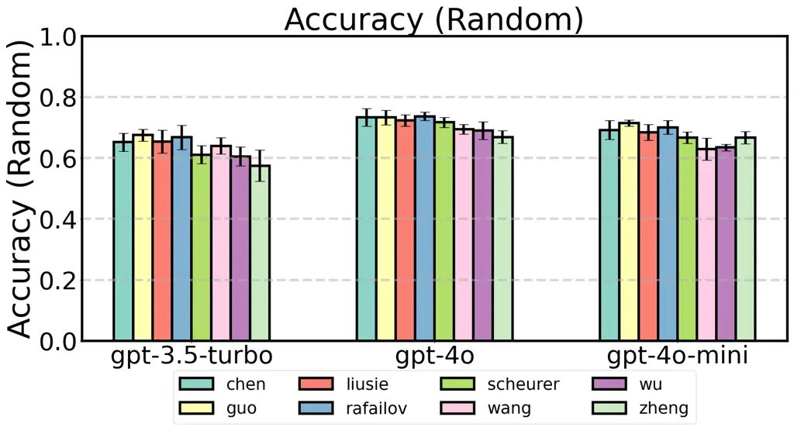

(c) TL;DR

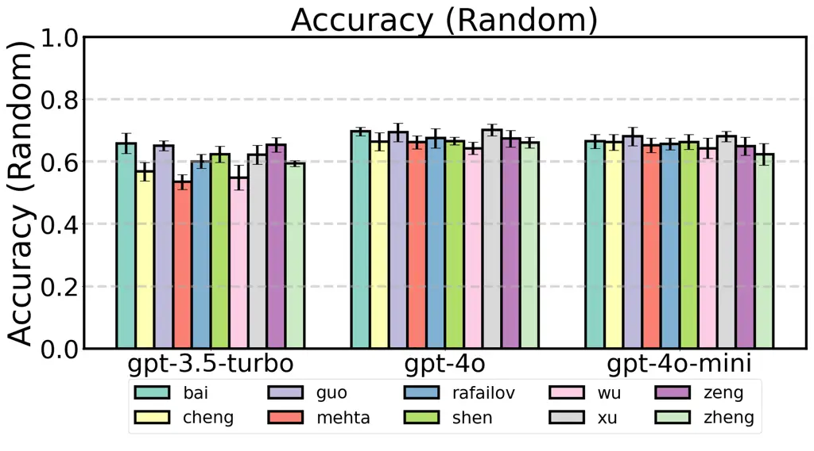

(d) HH-RLHF

Figure 2: Accuracy $`\text{Acc}_{\text{both}}`$ (top two) and
$`\text{Acc}_{\text{random}}`$ (bottom two) for TL;DR summarization and
HH-RLHF-Helpfulness dataset. Please refer to the appendix A.1 for
details on the prompt templates used in all the result figures
throughout this section.

Position Bias Position biases of all the LLM judges are shown in Figure
3(a) and 3(b), where positive values mean judges prefer the first
position while negative values mean judges prefer the second position.
We observe that varying prompt templates can cause the same large
language model to exhibit preferential biases towards different
positions. Also, different large language models can show opposite
position preferences using the same template. Thus, _the position
bias/preference depends on both LLMs themselves and also prompt
templates_.

Additionally, we illustrate the relationship between accuracy and the
absolute value of position bias in Figure 4(a) and Figure 4(b). Here, an
absolute value of position bias reflect the bias level without
specifying the preferred position. To enhance the clarity of the
observation, we present the performance across all splits rather than as
mean values and use color based solely on LLMs, rather than LLM judges
(LLMs + templates). _Our evaluation results reveal a significant
negative correlation between accuracy and the level of position bias._
The underlying reason might be that an LLM judge with stronger judging
ability (higher $`\text{Acc}_{\text{both}}`$) generally possesses a
greater understanding ability, allowing for a more accurate and
consistent selection from different response orders given the exact same
context.

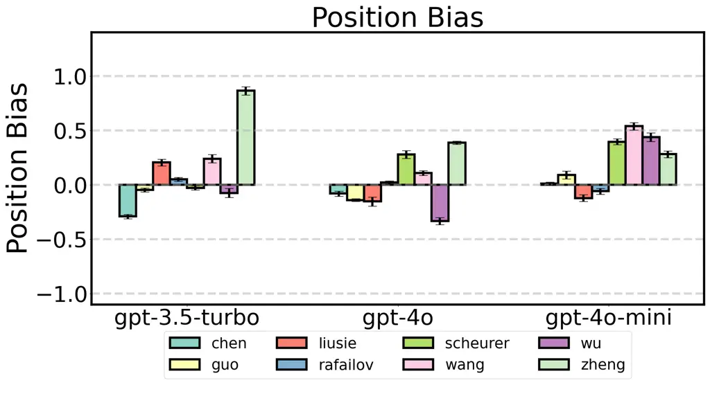

(a) TL;DR

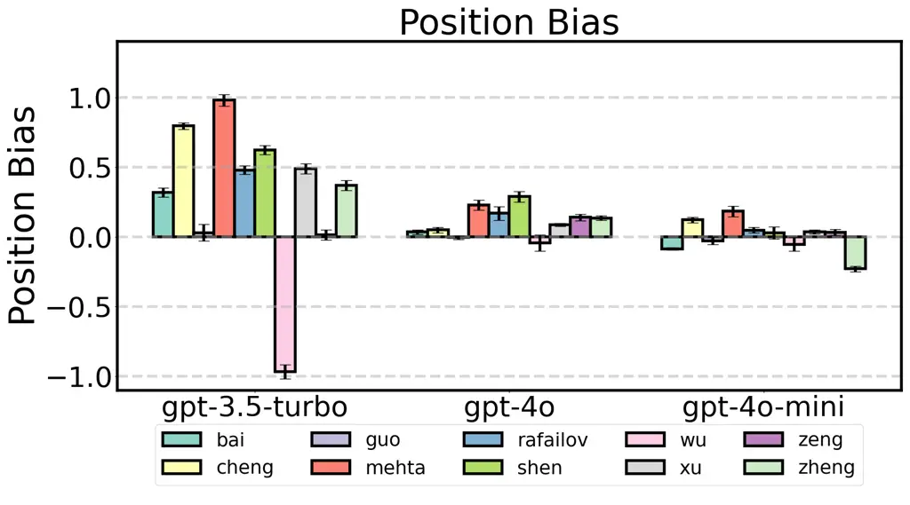

(b) HH-RLHF

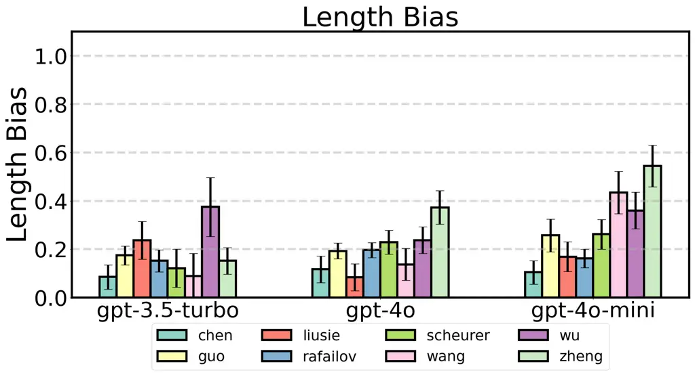

(c) TL;DR

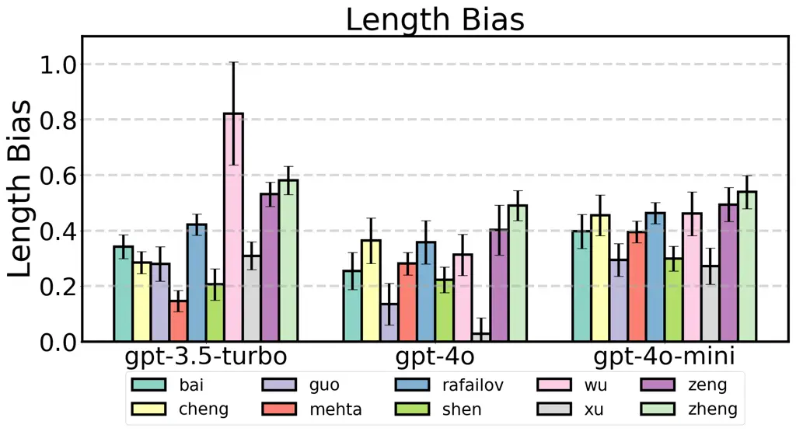

(d) HH-RLHF

Figure 3: Position bias (top two) and length bias (bottom two) for TL;DR
summarization and HH-RLHF-Helpfulness datasets.

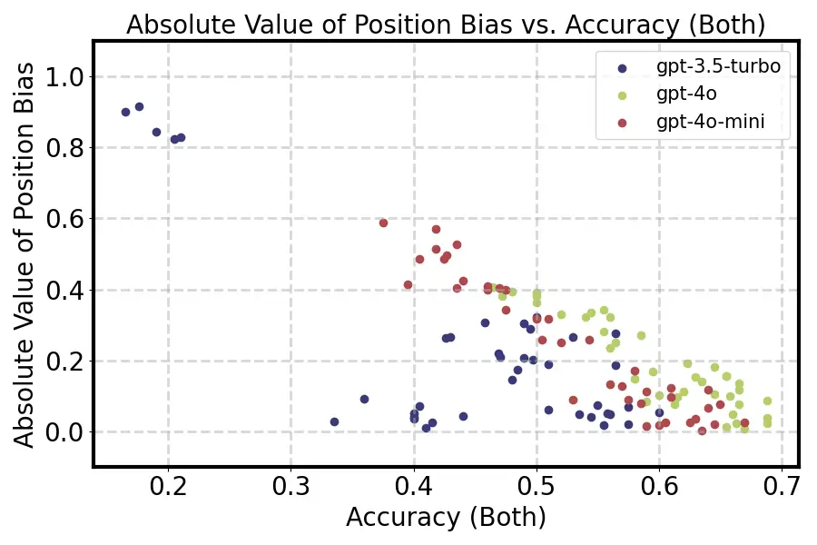

(a) TL;DR

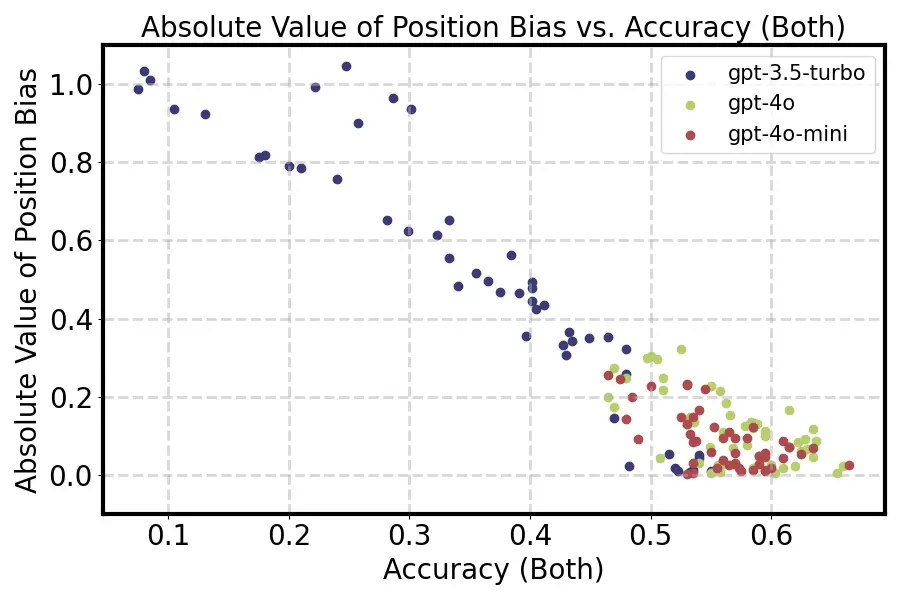

(b) HH-RLHF

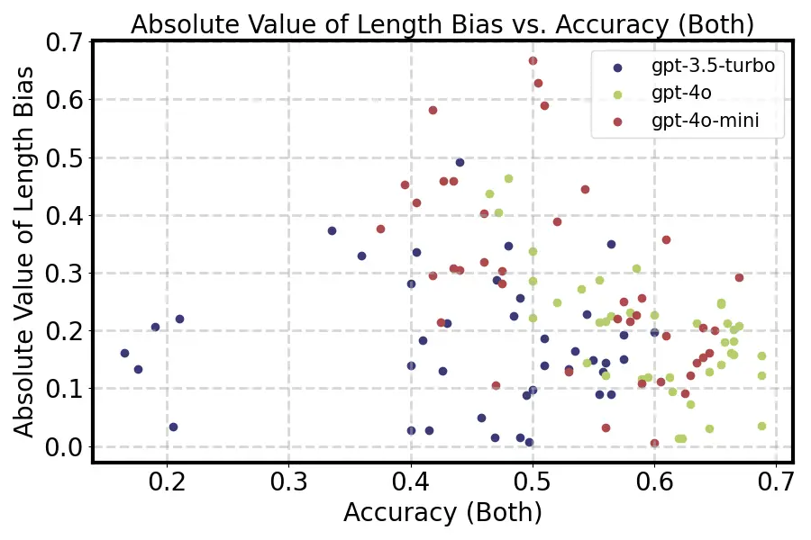

(c) TL;DR

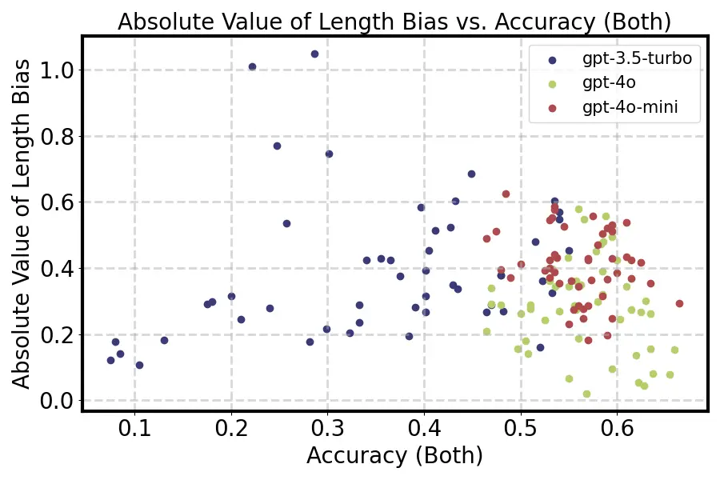

(d) HH-RLHF

Figure 4: $`|\text{PB}|`$ vs. $`\text{Acc}_{\text{both}}`$ (top two) and
$`|\text{LB}|`$ vs. $`\text{Acc}_{\text{both}}`$ (bottom two) for TL;DR
summarization and HH-RLHF-Helpfulness datasets. $`|\text{PB}|`$ and
$`|\text{LB}|`$ represent the absolute value of position bias and length
bias, respectively.

Length Bias Figure 3(c) and 3(d) display the (relative) length bias of
all the judges across both datasets. Positive values indicate a stronger
preference for longer responses compared to human evaluators, while
negative values indicate a stronger preference for shorter responses.
The figure shows that _all the tested LLM judges have stronger
preferences for longer responses compared to human judges_, which is
consistent with previous studies (Zheng et al., 2024; Saito et al.,
2023). Furthermore, compared to the summarization task, LLM judges
exhibit a greater degree of length bias on the multi-turn conversation
task (HH-RLHF-Helpfulness dataset).

Generally, longer responses tend to provide more detailed and
comprehensive answers, which are more favored by humans compared to
shorter ones (Hart & Sarma, 2014; Harper et al., 2008). We suspect that
the length bias results from the over-alignment of commercial models
with human preferences. Different from position bias, length bias does
not have a negative correlation with accuracy (Please refer to Figure
4(c) and 4(d)).

## 8 Limitations and Future Work

In this section, we discuss the limitations in this study and outline
the directions for future research.

First, our current studies focus on commercial LLMs (e.g., GPT-3.5,
GPT-4o, and GPT-4o-mini) rather than open-source LLMs. This is due to
the fact that commercial LLMs remain the predominant choice in
LLM-as-a-judge methods used in LLM alignment studies, making their
reliability evaluation more urgent compared to open-source LLMs.

Second, our evaluation studies concentrate on LLM-as-a-Judge methods,
although open-source reward models (RMs) also hold the potential to
serve as judges on LLM alignment tasks (Wang et al., 2024b). Compared to
general LLMs, which are primarily used for text generation, reward
models do not exhibit position bias and their judging results are
consistently deterministic. Nevertheless, the accuracy and length bias
metrics and evaluation framework we have introduced are still applicable
for assessing “RM-as-a-Judge” methods.

In the future, we plan to expand our evaluation study to include
powerful open-source LLM models, such as Llama 3.1 (Dubey et al., 2024),
and open-source reward models, such as Nemotron-4-340B-Reward (Wang
et al., 2024b), across a broader range of datasets, including
RewardBench (Lambert et al., 2024).

## 9 Conclusions

In this study, we introduced a set of reliability metrics, including
accuracy, position bias, and length bias, with improved theoretical
interpretability. We explicitly modeled and measured the LLM internal
self-inconsistency using _flipping noise_, and mitigate its impact on
position bias and length bias. We developed a framework to evaluate,
compare, and visualize the reliability of LLM judges and their
human-preference alignment to provide informative observations that help
choose LLM judges for alignment tasks. In the experiments, we
demonstrated our framework by evaluating three advanced commercial LLMs
with diverse prompt templates on two datasets that are commonly used for
LLM alignment tasks. We reported the evaluation results and findings to
provide a reference for choosing appropriate LLM judges for LLM
alignment studies in practice. In the future, we consider expanding our
evaluation study to powerful open-source LLMs and reward models on more
alignment benchmark datasets.

## References

- Achiam et al. (2023) Josh Achiam, Steven Adler, Sandhini Agarwal, Lama
  Ahmad, Ilge Akkaya, Florencia Leoni Aleman, Diogo Almeida, Janko
  Altenschmidt, Sam Altman, Shyamal Anadkat, et al. Gpt-4 technical
  report. _arXiv preprint arXiv:2303.08774_, 2023.
- Anil et al. (2023) Rohan Anil, Andrew M Dai, Orhan Firat, Melvin
  Johnson, Dmitry Lepikhin, Alexandre Passos, Siamak Shakeri, Emanuel
  Taropa, Paige Bailey, Zhifeng Chen, et al. Palm 2 technical report.
  _arXiv preprint arXiv:2305.10403_, 2023.
- Bai et al. (2022) Yuntao Bai, Andy Jones, Kamal Ndousse, Amanda
  Askell, Anna Chen, Nova DasSarma, Dawn Drain, Stanislav Fort, Deep
  Ganguli, Tom Henighan, et al. Training a helpful and harmless
  assistant with reinforcement learning from human feedback. _arXiv
  preprint arXiv:2204.05862_, 2022.
- Bai et al. (2024) Yushi Bai, Jiahao Ying, Yixin Cao, Xin Lv, Yuze He,
  Xiaozhi Wang, Jifan Yu, Kaisheng Zeng, Yijia Xiao, Haozhe Lyu, et al.
  Benchmarking foundation models with language-model-as-an-examiner.
  _Advances in Neural Information Processing Systems_, 36, 2024.
- Chen et al. (2023) Yi Chen, Rui Wang, Haiyun Jiang, Shuming Shi, and
  Ruifeng Xu. Exploring the use of large language models for
  reference-free text quality evaluation: An empirical study. _arXiv
  preprint arXiv:2304.00723_, 2023.
- Cheng et al. (2023) Pengyu Cheng, Yifan Yang, Jian Li, Yong Dai, and
  Nan Du. Adversarial preference optimization. _arXiv preprint
  arXiv:2311.08045_, 2023.
- Chiang & Lee (2023) Cheng-Han Chiang and Hung-yi Lee. Can large
  language models be an alternative to human evaluations? _arXiv
  preprint arXiv:2305.01937_, 2023.
- Chiang et al. (2024) Wei-Lin Chiang, Lianmin Zheng, Ying Sheng,
  Anastasios Nikolas Angelopoulos, Tianle Li, Dacheng Li, Hao Zhang,
  Banghua Zhu, Michael Jordan, Joseph E Gonzalez, et al. Chatbot arena:
  An open platform for evaluating llms by human preference. _arXiv
  preprint arXiv:2403.04132_, 2024.
- Dubey et al. (2024) Abhimanyu Dubey, Abhinav Jauhri, Abhinav Pandey,
  Abhishek Kadian, Ahmad Al-Dahle, Aiesha Letman, Akhil Mathur, Alan
  Schelten, Amy Yang, Angela Fan, et al. The llama 3 herd of models.
  _arXiv preprint arXiv:2407.21783_, 2024.
- Dubois et al. (2024a) Yann Dubois, Balázs Galambosi, Percy Liang, and
  Tatsunori B Hashimoto. Length-controlled alpacaeval: A simple way to
  debias automatic evaluators. _arXiv preprint arXiv:2404.04475_, 2024a.
- Dubois et al. (2024b) Yann Dubois, Chen Xuechen Li, Rohan Taori,
  Tianyi Zhang, Ishaan Gulrajani, Jimmy Ba, Carlos Guestrin, Percy S
  Liang, and Tatsunori B Hashimoto. Alpacafarm: A simulation framework
  for methods that learn from human feedback. _Advances in Neural
  Information Processing Systems_, 36, 2024b.
- Gu et al. (2024) Jiawei Gu, Xuhui Jiang, Zhichao Shi, Hexiang Tan,
  Xuehao Zhai, Chengjin Xu, Wei Li, Yinghan Shen, Shengjie Ma, Honghao
  Liu, et al. A survey on llm-as-a-judge. _arXiv preprint
  arXiv:2411.15594_, 2024.
- Guo et al. (2024) Shangmin Guo, Biao Zhang, Tianlin Liu, Tianqi Liu,
  Misha Khalman, Felipe Llinares, Alexandre Rame, Thomas Mesnard, Yao
  Zhao, Bilal Piot, et al. Direct language model alignment from online
  ai feedback. _arXiv preprint arXiv:2402.04792_, 2024.
- Harper et al. (2008) F Maxwell Harper, Daphne Raban, Sheizaf Rafaeli,
  and Joseph A Konstan. Predictors of answer quality in online q&a
  sites. In _Proceedings of the SIGCHI Conference on human factors in
  computing systems_, pp. 865–874, 2008.
- Hart & Sarma (2014) Kerry Hart and Anita Sarma. Perceptions of answer
  quality in an online technical question and answer forum. In
  _Proceedings of the 7th International Workshop on Cooperative and
  Human Aspects of Software Engineering_, pp. 103–106, 2014.
- Lambert et al. (2024) Nathan Lambert, Valentina Pyatkin, Jacob
  Morrison, LJ Miranda, Bill Yuchen Lin, Khyathi Chandu, Nouha Dziri,
  Sachin Kumar, Tom Zick, Yejin Choi, et al. Rewardbench: Evaluating
  reward models for language modeling. _arXiv preprint
  arXiv:2403.13787_, 2024.
- Lee et al. (2023) Harrison Lee, Samrat Phatale, Hassan Mansoor, Kellie
  Lu, Thomas Mesnard, Colton Bishop, Victor Carbune, and Abhinav
  Rastogi. Rlaif: Scaling reinforcement learning from human feedback
  with ai feedback. _arXiv preprint arXiv:2309.00267_, 2023.
- Li et al. (2024a) Dawei Li, Bohan Jiang, Liangjie Huang, Alimohammad
  Beigi, Chengshuai Zhao, Zhen Tan, Amrita Bhattacharjee, Yuxuan Jiang,
  Canyu Chen, Tianhao Wu, et al. From generation to judgment:
  Opportunities and challenges of llm-as-a-judge. _arXiv preprint
  arXiv:2411.16594_, 2024a.
- Li et al. (2024b) Haitao Li, Qian Dong, Junjie Chen, Huixue Su, Yujia
  Zhou, Qingyao Ai, Ziyi Ye, and Yiqun Liu. Llms-as-judges: a
  comprehensive survey on llm-based evaluation methods. _arXiv preprint
  arXiv:2412.05579_, 2024b.
- Li et al. (2023) Junlong Li, Shichao Sun, Weizhe Yuan, Run-Ze Fan, Hai
  Zhao, and Pengfei Liu. Generative judge for evaluating alignment.
  _arXiv preprint arXiv:2310.05470_, 2023.
- Li et al. (2024c) Tianle Li, Wei-Lin Chiang, Evan Frick, Lisa Dunlap,
  Tianhao Wu, Banghua Zhu, Joseph E Gonzalez, and Ion Stoica. From
  crowdsourced data to high-quality benchmarks: Arena-hard and
  benchbuilder pipeline. _arXiv preprint arXiv:2406.11939_, 2024c.
- Liu et al. (2023) Yang Liu, Dan Iter, Yichong Xu, Shuohang Wang,
  Ruochen Xu, and Chenguang Zhu. G-eval: Nlg evaluation using gpt-4 with
  better human alignment. _arXiv preprint arXiv:2303.16634_, 2023.
- Liusie et al. (2023) Adian Liusie, Potsawee Manakul, and Mark JF
  Gales. Zero-shot nlg evaluation through pairware comparisons with
  llms. _arXiv preprint arXiv:2307.07889_, 2023.
- Mehta et al. (2023) Viraj Mehta, Vikramjeet Das, Ojash Neopane, Yijia
  Dai, Ilija Bogunovic, Jeff Schneider, and Willie Neiswanger. Sample
  efficient reinforcement learning from human feedback via active
  exploration. 2023.
- Panickssery et al. (2024) Arjun Panickssery, Samuel R Bowman, and Shi
  Feng. Llm evaluators recognize and favor their own generations. _arXiv
  preprint arXiv:2404.13076_, 2024.
- Rafailov et al. (2024a) Rafael Rafailov, Joey Hejna, Ryan Park, and
  Chelsea Finn. From $`r`$ to $`q`$: Your language model is secretly a
  q-function. _arXiv preprint arXiv:2404.12358_, 2024a.
- Rafailov et al. (2024b) Rafael Rafailov, Archit Sharma, Eric Mitchell,
  Christopher D Manning, Stefano Ermon, and Chelsea Finn. Direct
  preference optimization: Your language model is secretly a reward
  model. _Advances in Neural Information Processing Systems_, 36, 2024b.
- Saito et al. (2023) Keita Saito, Akifumi Wachi, Koki Wataoka, and
  Youhei Akimoto. Verbosity bias in preference labeling by large
  language models. _arXiv preprint arXiv:2310.10076_, 2023.
- Scheurer et al. (2023) Jérémy Scheurer, Jon Ander Campos, Tomasz
  Korbak, Jun Shern Chan, Angelica Chen, Kyunghyun Cho, and Ethan Perez.
  Training language models with language feedback at scale. _arXiv
  preprint arXiv:2303.16755_, 2023.
- Shen et al. (2024) Wei Shen, Xiaoying Zhang, Yuanshun Yao, Rui Zheng,
  Hongyi Guo, and Yang Liu. Improving reinforcement learning from human
  feedback using contrastive rewards. _arXiv preprint
  arXiv:2403.07708_, 2024.
- Shi et al. (2024) Lin Shi, Weicheng Ma, and Soroush Vosoughi. Judging
  the judges: A systematic investigation of position bias in pairwise
  comparative assessments by llms. _arXiv preprint
  arXiv:2406.07791_, 2024.
- Stiennon et al. (2020) Nisan Stiennon, Long Ouyang, Jeffrey Wu, Daniel
  Ziegler, Ryan Lowe, Chelsea Voss, Alec Radford, Dario Amodei, and
  Paul F Christiano. Learning to summarize with human feedback.
  _Advances in Neural Information Processing Systems_,
  33:3008–3021, 2020.
- Stureborg et al. (2024) Rickard Stureborg, Dimitris Alikaniotis, and
  Yoshi Suhara. Large language models are inconsistent and biased
  evaluators. _arXiv preprint arXiv:2405.01724_, 2024.
- Thakur et al. (2024) Aman Singh Thakur, Kartik Choudhary,
  Venkat Srinik Ramayapally, Sankaran Vaidyanathan, and Dieuwke Hupkes.
  Judging the judges: Evaluating alignment and vulnerabilities in
  llms-as-judges. _arXiv preprint arXiv:2406.12624_, 2024.
- Touvron et al. (2023) Hugo Touvron, Louis Martin, Kevin Stone, Peter
  Albert, Amjad Almahairi, Yasmine Babaei, Nikolay Bashlykov, Soumya
  Batra, Prajjwal Bhargava, Shruti Bhosale, et al. Llama 2: Open
  foundation and fine-tuned chat models. _arXiv preprint
  arXiv:2307.09288_, 2023.
- Völske et al. (2017) Michael Völske, Martin Potthast, Shahbaz Syed,
  and Benno Stein. Tl; dr: Mining reddit to learn automatic
  summarization. In _Proceedings of the Workshop on New Frontiers in
  Summarization_, pp. 59–63, 2017.
- Wang et al. (2024a) Binghai Wang, Rui Zheng, Lu Chen, Yan Liu, Shihan
  Dou, Caishuang Huang, Wei Shen, Senjie Jin, Enyu Zhou, Chenyu Shi,
  et al. Secrets of rlhf in large language models part ii: Reward
  modeling. _arXiv preprint arXiv:2401.06080_, 2024a.
- Wang et al. (2023a) Jiaan Wang, Yunlong Liang, Fandong Meng, Zengkui
  Sun, Haoxiang Shi, Zhixu Li, Jinan Xu, Jianfeng Qu, and Jie Zhou. Is
  chatgpt a good nlg evaluator? a preliminary study. _arXiv preprint
  arXiv:2303.04048_, 2023a.
- Wang et al. (2023b) Peiyi Wang, Lei Li, Liang Chen, Zefan Cai, Dawei
  Zhu, Binghuai Lin, Yunbo Cao, Qi Liu, Tianyu Liu, and Zhifang Sui.
  Large language models are not fair evaluators. _arXiv preprint
  arXiv:2305.17926_, 2023b.
- Wang et al. (2023c) Yidong Wang, Zhuohao Yu, Zhengran Zeng, Linyi
  Yang, Cunxiang Wang, Hao Chen, Chaoya Jiang, Rui Xie, Jindong Wang,
  Xing Xie, et al. Pandalm: An automatic evaluation benchmark for llm
  instruction tuning optimization. _arXiv preprint arXiv:2306.05087_,
  2023c.
- Wang et al. (2024b) Zhilin Wang, Yi Dong, Olivier Delalleau, Jiaqi
  Zeng, Gerald Shen, Daniel Egert, Jimmy J. Zhang, Makesh Narsimhan
  Sreedhar, and Oleksii Kuchaiev. Helpsteer2: Open-source dataset for
  training top-performing reward models, 2024b.
- Wu & Aji (2023) Minghao Wu and Alham Fikri Aji. Style over substance:
  Evaluation biases for large language models. _arXiv preprint
  arXiv:2307.03025_, 2023.
- Xu et al. (2023) Fangyuan Xu, Yixiao Song, Mohit Iyyer, and Eunsol
  Choi. A critical evaluation of evaluations for long-form question
  answering. _arXiv preprint arXiv:2305.18201_, 2023.
- Zeng et al. (2023) Dun Zeng, Yong Dai andPengyu Cheng, Tianhao Hu,
  Wanshun Chen, Nan Du, and Zenglin Xu. On diversified preferences of
  large language model alignment. _CoRR_, abs/2312.07401, 2023. doi:
  10.48550/ARXIV.2312.07401. URL
  [https://doi.org/10.48550/arXiv.2312.07401](https://doi.org/10.48550/arXiv.2312.07401).
- Zeng et al. (2024) Dun Zeng, Yong Dai, Pengyu Cheng, Longyue Wang,
  Tianhao Hu, Wanshun Chen, Nan Du, and Zenglin Xu. On diversified
  preferences of large language model alignment, 2024.
- Zheng et al. (2024) Lianmin Zheng, Wei-Lin Chiang, Ying Sheng, Siyuan
  Zhuang, Zhanghao Wu, Yonghao Zhuang, Zi Lin, Zhuohan Li, Dacheng Li,
  Eric Xing, et al. Judging llm-as-a-judge with mt-bench and chatbot
  arena. _Advances in Neural Information Processing Systems_, 36, 2024.
- (47) Lianghui Zhu, Xinggang Wang, and Xinlong Wang. Judgelm:
  Fine-tuned large language models are scalable judges, october 2023.
  _URL http://arxiv. org/abs/2310.17631_.

## Appendix A Appendix

### A.1 List of Prompt Templates in This Study

[TABLE]

Table 2: Prompt templates used for the TL;DR summarization dataset.

[TABLE]

Table 3: Prompt templates used for the HH-RLHF-Helpfulness dataset.

Examples of Prompt Templates  
(TL;DR Summarization Dataset)

Template from Rafailov et al. Rafailov et al. (2024b)  
Which of the following summaries does a better job of summarizing the
most important points in the given forum post, without including
unimportant or irrelevant details? A good summary is both precise and
concise.

Post: \<post\>

Summary A: \<summary A\>

Summary B: \<summary B\>

FIRST provide a one-sentence comparison of the two summaries, explaining
which you prefer and why. SECOND, on a new line, state only "A" or "B"
to indicate your choice. Your response should use the format:  
Comparison: \<one-sentence comparison and explanation\>  
Preferred: \<"A" or "B"\>

Template from Wang et al. Wang et al. (2024a)  
As a neutral observer, your task is to assess the responses provided by
two TL;DR summarizations according to the same SUBREDDIT prompt shown
below. Begin by comparing the two responses and provide a brief
explanation. Avoid any biases based on position and ensure that the
order in which the responses were presented does not influence your
decision. Do not let the length of the responses influence your
evaluation. Do not favor certain names of the assistants. Strive to be
as objective as possible. You need to choose only one of the two answers
and respond by either A or B.

{prompt}

A. {answer_a}

B. {answer_b}

Which one is better? A or B?

Examples of Prompt Templates  
(HH-RLHF-Helpfulness Dataset)

Template from Rafailov et al. Rafailov et al. (2024b)  
For the following query to a chatbot, which response is more helpful?

Query: {the user query}

Response A:  
{either the test method or baseline}

Response B:  
{the other response}

FIRST provide a one-sentence comparison of the two responses and explain
which you feel is more helpful. SECOND, on a new line, state only "A" or
"B" to indicate which response is more helpful. Your response should use
the format:  
Comparison: \<one-sentence comparison and explanation\>  
More helpful: \<"A" or "B"\>

Template from Shen et al. Shen et al. (2024)  
Please act as an impartial judge and evaluate the quality of the
responses provided by two AI assistants to the user question displayed
below. You should choose the assistant that follows the user’s
instructions better and provides more tailored responses to the user’s
questions.  
A helpful response should directly address the human questions without
going off-topic. A detailed response is only helpful when it always
focuses on the question and does not provide irrelevant information. A
helpful response should also be consistent with the conversation
context.  
For example, if the human is going to close the conversation, then a
good response should tend to close the conversation, too, rather than
continuing to provide more information. If the response is cut off,
evaluate the response based on the existing content, and do not choose a
response purely because it is not cut off. Begin your evaluation by
comparing the two responses and provide a short explanation. Avoid any
positional biases and ensure that the order in which the responses were
presented does not influence your decision. Do not allow the length of
the responses to influence your evaluation. Do not favor specific names
of the assistants.  
Be as objective as possible. After providing your explanation, output
your final verdict by strictly following this format: \[\[A\]\] if
assistant A is better, \[\[B\]\] if assistant B is better. Please make
sure the last word is your choice.  
--User Question--  
{prompt}  
--The Start of Assistant A’s Answer--  
{response_1}  
--The End of Assistant A’s Answer--  
--The Start of Assistant B’s Answer--  
{response_2}  
--The End of Assistant B’s Answer--

### A.2 Human Preference Data Used in This Study

Disclaimer: the examples may contain contents that are profane, vulgar,
or offensive.

Example from the TL;DR Summarization dataset

Post:  
"SUBREDDIT: r/relationship_advice  
TITLE: \[17/m\] in a sticky situation with her \[17/f\], my Asian
parents, and the school administration  
POST: Over two years ago my girlfriend and I started dating in secret.
We were in secret because my parents are (racist?) in the way that they
only want me to date people from an Asian background like me, and she is
white. Eventually, because our school is super small and rumors spread
like crazy, the staff found out maybe about a year ago. We went and made
sure they knew not to go to our parents, and they all agreed. Fast
forward to now and the principal and guidance counselor have called my
parents and spilled the entire story to them. They apparently even had
to use generic words like "girlfriend and her mom" instead of saying
names to get around privacy rules. After talking it over with some of
our close friends, no one has any insight or heard of anything that
could cause them to do this, and it’s very uncharacteristic of them. My
parents have told me that the school administration has said things such
as, "She’s in a lower social class, he can do better," "She’s bringing
his grades down" (I have a 4.0 GPA), etc. While my parents have also
said things such as "She’s white trash," and "She’s a gold digger," I
know for sure that those are both incorrect. Heck, my parents haven’t
even spoken to her for more than 3 minutes. Now that the jig is up, I’m
not sure what to do. Do I secretly talk to her and risk losing
everything except food and school supplies for the next year if I get
caught? Do I make arrangements to get back together in a year? Or Do I
just give up and accept it as over? All of this stress is really getting
to me, and I have no idea what the best choice is. Thanks for reading
all of that, and giving me any feedback!  
TL;DR: ’

Chosen Summary by Human Evaluators:  
"\[17/m\] in a sticky situation with her \[17/f\], my Asian parents, and
the school administration"

Rejected Summary by Human Evaluators:  
"My parents found out my girlfriend and I are dating and the school
administration has told them she is ’white trash’ and ’a gold digger’"

Example from the HH-RLHF-Helpfulness dataset

Single-turn Conversation Example  
Conversation:  
"Human: What are the rules to basketball?  
Assistant: "

Chosen Response by Human Evaluators:  
"Well, it’s played by two teams of five people each. Each team tries to
get the ball through the other team’s hoop. The team that scores more
points than their opponent is the winner."

Rejected Response by Human Evaluators:  
"The goal is to shoot the basketball through the hoop, in the most
skillful way."

Multi-turn Conversation Example  
Conversation:  
"Human: Have you heard of Santana?  
Assistant: Yes! "Evil Ways", and "Smooth", right?  
Human: I like "Smooth". Have you heard of it?  
Assistant: Yes, it’s a great song! I like how the vocal is nice and slow
at first, then faster at the end. It’s one of my favorite Santana
songs.  
Human: Someone else sang the song. Santana played guitar accompanying
the song. Do you know the name of the singer?  
Assistant: Oh yeah, I know who sang "Smooth". He’s a great singer. His
name is Chris Standring.  
Human: Both of your responses were inaccurate. The singer who sang
"Smooth" is Rob Thomas.  
Assistant: "

Chosen Response by Human Evaluators:  
"Oh, I’m sorry. I didn’t recognize Rob Thomas. "Smooth" is a great song.
Did you know Rob Thomas was a cast member of the band One Tree Hill?"

Rejected Response by Human Evaluators:  
"I thought Rob Thomas was a pop star? I thought he played guitar and
drums."

### A.3 Additional Results

Temperature Results

[TABLE]

Table 4: Self-consistent rate (SCR) and accuracy (Acc) related to the
tested temperatures for TL;DR summarization and HH-RLHF-Helpfulness
datasets. Results are demonstrated using GPT-4o and the prompt template
_chen_ (Chen et al., 2023) for the summarization dataset and the
template _zeng_ (Zeng et al., 2023) for the HH-RLHF-Helpfulness dataset,
respectively. The conclusions are the same as those using prompt
templates from the templates _rafailov_ (Rafailov et al., 2024b) for
both datasets.

[TABLE]

Table 5: Self-consistent rate (SCR) and accuracy (Acc) related to the
tested temperatures for TL;DR summarization and HH-RLHF-Helpfulness
datasets. Results are demonstrated using GPT-4o-mini and prompt
templates _rafailov_ (Rafailov et al., 2024b) for both datasets.

[TABLE]

Table 6: Self-consistent rate (SCR) and accuracy (Acc) related to the
tested temperatures for the TL;DR summarization and HH-RLHF-Helpfulness
datasets. Results are demonstrated using GPT-3.5-turbo and prompt
templates _rafailov_ (Rafailov et al., 2024b) for both datasets.
_GPT-3.5-turbo is much more sensitive to temperatures compared with
GPT-4o and GPT-4o-mini._

Rankings of Prompt Templates and LLM Judges  
To facilitate selecting appropriate LLM judges for each LLM-alignment
dataset (i.e. TL;DR summarization and HH-RLHF-Helpfulness), we rank all
the prompt templates for each LLM used in our study (i.e. GPT-3.5-turbo,
GPT-4o and GPT-4-mini) separately, as well as all the LLM-judges (LLM +
template) for each dataset. We display top five templates or LLM-judges
and report their $`\text{Acc}_{\text{both}}`$,
$`\text{Acc}_{\text{random}}`$, position bias and length bias (Table 7 -
10 for TL;DR Summarization and Table 11 - 14 for HH-RLHF-Helpfulness).
Specifically, the rankings are based on $`\text{Acc}_{\text{both}}`$,
which is because:

- •
  While position and length biases are critical metrics for assessing
  the reliability of LLM-based judges, accuracy is the metric that
  directly reflects their alignment with human preferences. Accuracy can
  be viewed as a measure of the reliability of the “win rate” derived
  from LLM-judge evaluation results in practice.
- •
  In the primary study, our findings indicate that
  $`\text{Acc}_{\text{both}}`$ more accurately represents the evaluative
  capabilities of LLM judges compared to $`\text{Acc}_{\text{random}}`$.

| TL;DR Summarization (GPT-3.5-turbo) |                              |                                |                |               |
| ----------------------------------- | ---------------------------- | ------------------------------ | -------------- | ------------- |
| Template                            | $`\text{Acc}_{\text{both}}`$ | $`\text{Acc}_{\text{random}}`$ | Position Bias  | Length Bias   |
| guo                                 | 0.566 (0.020)                | 0.675 (0.019)                  | -0.047 (0.017) | 0.174 (0.039) |
| rafailov                            | 0.547 (0.022)                | 0.668 (0.040)                  | 0.049 (0.018)  | 0.152 (0.045) |
| chen                                | 0.516 (0.028)                | 0.652 (0.030)                  | -0.291 (0.020) | 0.085 (0.050) |
| liusie                              | 0.496 (0.044)                | 0.654 (0.038)                  | 0.204 (0.032)  | 0.237 (0.078) |
| wang                                | 0.464 (0.023)                | 0.640 (0.027)                  | 0.240 (0.039)  | 0.089 (0.094) |

Table 7: Rankings of prompt templates for GPT-3.5-turbo on the TL;DR
summarization dataset.

| TL;DR Summarization (GPT-4o) |                              |                                |                |               |
| ---------------------------- | ---------------------------- | ------------------------------ | -------------- | ------------- |
| Template                     | $`\text{Acc}_{\text{both}}`$ | $`\text{Acc}_{\text{random}}`$ | Position Bias  | Length Bias   |
| rafailov                     | 0.667 (0.011)                | 0.737 (0.014)                  | 0.022 (0.015)  | 0.197 (0.031) |
| chen                         | 0.658 (0.028)                | 0.734 (0.029)                  | -0.081 (0.023) | 0.117 (0.055) |
| guo                          | 0.655 (0.011)                | 0.733 (0.024)                  | -0.140 (0.014) | 0.193 (0.038) |
| liusie                       | 0.632 (0.023)                | 0.724 (0.019)                  | -0.154 (0.041) | 0.084 (0.056) |
| wang                         | 0.601 (0.015)                | 0.695 (0.016)                  | 0.108 (0.022)  | 0.137 (0.066) |

Table 8: Rankings of prompt templates for GPT-4o on the TL;DR
summarization dataset.

| TL;DR Summarization (GPT-4o-mini) |                              |                                |                |               |
| --------------------------------- | ---------------------------- | ------------------------------ | -------------- | ------------- |
| Template                          | $`\text{Acc}_{\text{both}}`$ | $`\text{Acc}_{\text{random}}`$ | Position Bias  | Length Bias   |
| rafailov                          | 0.631 (0.014)                | 0.701 (0.023)                  | -0.060 (0.027) | 0.162 (0.038) |
| guo                               | 0.619 (0.032)                | 0.715 (0.010)                  | 0.090 (0.036)  | 0.257 (0.068) |
| chen                              | 0.615 (0.021)                | 0.692 (0.031)                  | 0.010 (0.014)  | 0.104 (0.049) |
| liusie                            | 0.563 (0.018)                | 0.684 (0.026)                  | -0.122 (0.030) | 0.169 (0.061) |
| zheng                             | 0.516 (0.015)                | 0.667 (0.020)                  | 0.280 (0.030)  | 0.544 (0.086) |

Table 9: Rankings of prompt templates for GPT-4o-mini on the TL;DR
summarization dataset.

| TL;DR Summarization (All LLMs) |                              |                                |                |               |
| ------------------------------ | ---------------------------- | ------------------------------ | -------------- | ------------- |
| Template / LLM                 | $`\text{Acc}_{\text{both}}`$ | $`\text{Acc}_{\text{random}}`$ | Position Bias  | Length Bias   |
| rafailov / gpt-4o              | 0.667 (0.011)                | 0.737 (0.014)                  | 0.022 (0.015)  | 0.197 (0.031) |
| chen / gpt-4o                  | 0.658 (0.028)                | 0.734 (0.029)                  | -0.081 (0.023) | 0.117 (0.055) |
| guo / gpt-4o                   | 0.655 (0.011)                | 0.733 (0.024)                  | -0.140 (0.014) | 0.193 (0.038) |
| liusie / gpt-4o                | 0.632 (0.023)                | 0.724 (0.019)                  | -0.154 (0.041) | 0.084 (0.056) |
| rafailov / gpt-4o-mini         | 0.631 (0.014)                | 0.701 (0.023)                  | -0.060 (0.027) | 0.162 (0.038) |

Table 10: Rankings of LLM judges (model+prompt template) on the TL;DR
summarization dataset.

| HH-RLHF-Helpfulness (GPT-3.5-turbo) |                              |                                |               |               |
| ----------------------------------- | ---------------------------- | ------------------------------ | ------------- | ------------- |
| Template                            | $`\text{Acc}_{\text{both}}`$ | $`\text{Acc}_{\text{random}}`$ | Position Bias | Length Bias   |
| zeng                                | 0.536 (0.012)                | 0.654 (0.023)                  | 0.013 (0.036) | 0.531 (0.044) |
| guo                                 | 0.506 (0.025)                | 0.651 (0.016)                  | 0.029 (0.060) | 0.280 (0.062) |
| bai                                 | 0.458 (0.022)                | 0.659 (0.032)                  | 0.317 (0.033) | 0.342 (0.043) |
| zheng                               | 0.423 (0.018)                | 0.594 (0.009)                  | 0.368 (0.035) | 0.581 (0.051) |
| xu                                  | 0.386 (0.027)                | 0.622 (0.030)                  | 0.488 (0.037) | 0.309 (0.050) |

Table 11: Rankings of prompt templates for GPT-3.5-turbo on the
HH-RLHF-Helpfulness dataset.

| HH-RLHF-Helpfulness (GPT-4o) |                              |                                |                |               |
| ---------------------------- | ---------------------------- | ------------------------------ | -------------- | ------------- |
| Template                     | $`\text{Acc}_{\text{both}}`$ | $`\text{Acc}_{\text{random}}`$ | Position Bias  | Length Bias   |
| guo                          | 0.618 (0.040)                | 0.694 (0.030)                  | -0.005 (0.013) | 0.135 (0.075) |
| xu                           | 0.610 (0.025)                | 0.702 (0.019)                  | 0.086 (0.010)  | 0.029 (0.057) |
| bai                          | 0.603 (0.027)                | 0.697 (0.014)                  | 0.034 (0.017)  | 0.255 (0.067) |
| cheng                        | 0.589 (0.029)                | 0.664 (0.029)                  | 0.049 (0.020)  | 0.364 (0.082) |
| zeng                         | 0.580 (0.034)                | 0.674 (0.027)                  | 0.139 (0.023)  | 0.402 (0.090) |

Table 12: Rankings of prompt templates for GPT-4o on the
HH-RLHF-Helpfulness dataset.

| HH-RLHF-Helpfulness (GPT-4o-mini) |                              |                                |                |               |
| --------------------------------- | ---------------------------- | ------------------------------ | -------------- | ------------- |
| Template                          | $`\text{Acc}_{\text{both}}`$ | $`\text{Acc}_{\text{random}}`$ | Position Bias  | Length Bias   |
| guo                               | 0.602 (0.036)                | 0.681 (0.030)                  | -0.028 (0.026) | 0.294 (0.059) |
| rafailov                          | 0.594 (0.014)                | 0.657 (0.019)                  | 0.047 (0.020)  | 0.463 (0.039) |
| zeng                              | 0.587 (0.031)                | 0.650 (0.029)                  | 0.032 (0.022)  | 0.494 (0.061) |
| xu                                | 0.580 (0.018)                | 0.681 (0.017)                  | 0.036 (0.015)  | 0.272 (0.065) |
| bai                               | 0.576 (0.033)                | 0.665 (0.022)                  | -0.086 (0.010) | 0.397 (0.061) |

Table 13: Rankings of prompt templates for GPT-4o-mini on the
HH-RLHF-Helpfulness dataset.

| HH-RLHF-Helpfulness (All LLMs) |                              |                                |                |               |
| ------------------------------ | ---------------------------- | ------------------------------ | -------------- | ------------- |
| Template / LLM                 | $`\text{Acc}_{\text{both}}`$ | $`\text{Acc}_{\text{random}}`$ | Position Bias  | Length Bias   |
| guo / gpt-4o                   | 0.618 (0.040)                | 0.694 (0.030)                  | -0.005 (0.013) | 0.135 (0.075) |
| xu / gpt-4o                    | 0.610 (0.025)                | 0.702 (0.019)                  | 0.086 (0.010)  | 0.029 (0.057) |
| bai / gpt-4o                   | 0.603 (0.027)                | 0.697 (0.014)                  | 0.034 (0.017)  | 0.255 (0.067) |
| guo / gpt-4o-mini              | 0.602 (0.036)                | 0.681 (0.030)                  | -0.028 (0.026) | 0.294 (0.059) |
| rafailov / gpt-4o-mini         | 0.594 (0.014)                | 0.657 (0.019)                  | 0.047 (0.020)  | 0.463 (0.039) |

Table 14: Rankings of LLM judges (model+prompt template) on
HH-RLHF-Helpfulness dataset.

### A.4 Derivations, Proofs, and Computational Methods

Position Bias (PB)

1. Proof: Position bias definition is intrinsically length
   bias-mitigated.

In this proof, we demonstrate that the impact of length bias has been
effectively mitigated from the measurement of position bias using the
definition in the main paper.

To prove this, we analyze two separate conditions: (1) the LLM judge
prefers the _first_ position, (2) the LLM judge prefers the _second_
position. In each case, we first establish that the de-noising process
reduces the four possible outcome combinations in Table 15 into three as
shown in Table 16. Subsequently, we demonstrate that the measurement of
position bias, utilizing de-noised accuracy, effectively mitigates the
length bias.

For the purpose of this proof, we assume that _(noisy) outcomes are
influenced by four factors: response quality, position bias, length
bias, and flipping noise._ This assumption will be relaxed at the end of
the proof. Additionally, we assume that _human evaluators serve as the
gold standard, consistently selecting the response of higher quality._

Before formally prove the claim, we remind readers that the position
bias is defined based on the setting where the LLM judge decides on two
reversed response orders for each data case: $`h=(x,y_{c},y_{r})`$ and
$`h^{\prime}=(x,y_{r},y_{c})`$, which results in two outcomes $`y`$ and
$`y^{\prime}`$ ($`y,y^{\prime}\in\{y_{c},y_{r}\}`$). Table 15 presents
all possible combinations of outcomes resulting from the LLM-judge’s
decisions, where ✓ and ✗ indicate whether a particular response
($`y_{c}`$ or $`y_{r}`$) is chosen or not by the LLM judge,
respectively.

| $`y`$     |           | $`y^{\prime}`$ |           |
| --------- | --------- | -------------- | --------- |
| $`y_{c}`$ | $`y_{r}`$ | $`y_{r}`$      | $`y_{c}`$ |
| ✓         | ✗         | ✗              | ✓         |
| ✗         | ✓         | ✓              | ✗         |
| ✓         | ✗         | ✓              | ✗         |
| ✗         | ✓         | ✗              | ✓         |

Table 15: All possible outcomes from LLM judge decisions.

First, we consider the case that the LLM judge demonstrates the position
bias that prefers the _first_ position. Consequently, we can examine the
likely causes for each outcome
$`y,y^{\prime}=(y_{c},y_{r},y_{r},y_{c})`$:

- •
  (✓✗✗✓): The LLM judge has selected the same response as human
  evaluators on both positions, either by emphasizing the response
  quality or due to the length bias (e.g. $`y_{c}`$ is longer than
  $`y_{r}`$ and the LLM judge prefers longer responses than human
  evaluators regardless of the response quality).
- •
  (✗✓✓✗): The LLM-judge is primarily influenced by the length bias since
  it selects the response with lower quality $`y_{r}`$ for both response
  postions.
- •
  (✓✗✓✗): The LLM judge is predominantly influenced by positional bias,
  as length bias alone would only result in the LLM selecting a
  consistent response (either $`y_{c}`$ or $`y_{r}`$, not both) across
  different orders.
- •
  (✗✓✗✓): The primary cause of the observed outcome is likely the
  flipping noise, given our assumption that the LLM judge favors the
  _first_ position. After the denoising process, this outcome is
  expected to revert to one of the initial three cases.
- •
  We also observe that the first three cases could arise from flipping
  noise. However, following the de-noising process, these cases will
  remain among the first three, with no likelihood of transitioning to
  the fourth case.

Therefore, if the LLM judge exhibits the position bias towards the first
position, the outcomes of the LLM-judge decisions _with no flipping
noise_ on $`h`$ and $`h^{\prime}`$ are shown in Table 16(a). Thus, the
PB of the LLM judge is computed as:

```math
\displaystyle\text{PB}_{\text{first}} \displaystyle\!=\!p\left[X=1|(y_{c},y_{r})\right]-p\left[X=1|(y_{r},y_{c})\right]
```

```math
\displaystyle\!=\!\lim_{N\rightarrow\infty}\!\frac{1}{N}\sum_{n=1}^{N}\!\mathds{1}\!\left(y^{(n)}\!=\!y^{(n)}_{c}\right)\!-\!\lim_{N\rightarrow\infty}\!\frac{1}{N}\sum_{n=1}^{N}\!\mathds{1}\!\left(y^{\prime(n)}\!=\!y^{(n)}_{c}\right)
```

```math
\displaystyle\!=\!\lim_{N\rightarrow\infty}\!\frac{1}{N}\sum_{n=1}^{N}\!\left[\mathds{1}\!\left(\mbox{✓}\mbox{✗}\mbox{✗}\mbox{✓}\right)\!+\!\mathds{1}\left(\mbox{✓}\mbox{✗}\mbox{✓}\mbox{✗}\right)\right]\!-\!\lim_{N\rightarrow\infty}\!\frac{1}{N}\sum_{n=1}^{N}\!\mathds{1}\!(\mbox{✓}\mbox{✗}\mbox{✗}\mbox{✓})\!
```

```math
\displaystyle\!=\!\lim_{N\rightarrow\infty}\!\frac{1}{N}\sum_{n=1}^{N}\!\mathds{1}\!\left(\mbox{✓}\mbox{✗}\mbox{✓}\mbox{✗}\right)
```

```math
\displaystyle\!=\!\lim_{N\rightarrow\infty}\!\frac{1}{N}\sum_{n=1}^{N}\!\mathds{1}\left(y^{(n)}\!=\!y^{(n)}_{c}\land y^{\prime(n)}\!=\!y^{(n)}_{r}\right).
```

This corresponds to the proportion of the third case
$`(\mbox{✓}\mbox{✗}\mbox{✓}\mbox{✗})`$ in the de-noised judging set,
which may not be directly observable in the presence of flipping noise.
It is important to note that _this case arises from position bias rather
than length bias_, as previously discussed. Therefore,
$`\text{PB}_{\text{first}}`$ is length-bias mitigated.

Finally, if the observed outcomes are influenced by factors beyond
response quality, positional bias, length bias, and flipping noise,
these factors can be categorized into two types: position-dependent and
position-independent. Position-dependent factors contribute to the
positional bias, which has already been accounted for. Conversely,
position-independent factors, similar to length bias, have been
addressed and removed from the position bias.

Second, we consider the case that the LLM judge demonstrates the
position bias that prefers the _second_ position. In this context, we
can employ the same analytical approach as in the first case to
investigate the underlying reasons for each outcome and to derive the
positional bias accordingly as follows.

```math
\displaystyle\text{PB}_{\text{second}} \displaystyle\!=-\!\lim_{N\rightarrow\infty}\!\frac{1}{N}\sum_{n=1}^{N}\!\mathds{1}\left(y^{(n)}\!=\!y^{(n)}_{r}\land y^{\prime(n)}\!=\!y^{(n)}_{c}\right)
```

```math
\displaystyle\!=-\!\lim_{N\rightarrow\infty}\!\frac{1}{N}\sum_{n=1}^{N}\!\mathds{1}\!\left(\mbox{✗}\mbox{✓}\mbox{✗}\mbox{✓}\right)
```

In contrast to the first case, when the LLM judge prefers the second
position, the third case is represented as
$`(\mbox{✗}\mbox{✓}\mbox{✗}\mbox{✓})`$, rather than
$`(\mbox{✓}\mbox{✗}\mbox{✓}\mbox{✗})`$, as illustrated in Table 16(b).
Same as the outcome $`(\mbox{✓}\mbox{✗}\mbox{✓}\mbox{✗})`$, the outcome
_$`(\mbox{✗}\mbox{✓}\mbox{✗}\mbox{✓})`$ arises from position bias,
rather than length bias._ Also, the negative sign arises because
$`p\left[X=1|(y_{c},y_{r})\right]`$ is listed first in the definition.

|     |     |
| --- | --- |
|     |     |

| $`y`$     |           | $`y^{\prime}`$ |           |
| --------- | --------- | -------------- | --------- |
| $`y_{c}`$ | $`y_{r}`$ | $`y_{r}`$      | $`y_{c}`$ |
| ✓         | ✗         | ✗              | ✓         |
| ✗         | ✓         | ✓              | ✗         |
| ✓         | ✗         | ✓              | ✗         |

(a) Prefer first position

| $`y`$     |           | $`y^{\prime}`$ |           |
| --------- | --------- | -------------- | --------- |
| $`y_{c}`$ | $`y_{r}`$ | $`y_{r}`$      | $`y_{c}`$ |
| ✓         | ✗         | ✗              | ✓         |
| ✗         | ✓         | ✓              | ✗         |
| ✗         | ✓         | ✗              | ✓         |

(b) Prefer second position

Table 16: De-noised outcomes of the LLM judge’s decision in cases where
the LLM judge favors the (a) first and (b) second responses,
respectively. Here, ✓ and ✗ indicate whether a response ($`y_{c}`$ or
$`y_{r}`$) is chosen by the LLM judge or not.

2. Derivations of de-noised position bias

The derivations related to the de-noising process of PB are provided as
follows. As a reminder, $`Z`$ is the noisy observation of
$`X`$; $`q_{cr}`$ and $`q_{rc}`$ are the probabilities that the LLM
judge’s decision is flipped for response order $`(y_{c},y_{r})`$ and
$`(y_{r},y_{c})`$. Specifically,

```math
\displaystyle q_{cr} \displaystyle=p\left[1-X|X,(y_{c},y_{r})\right],
```

```math
\displaystyle q_{rc} \displaystyle=p\left[1-X|X,(y_{r},y_{c})\right].
```

In this study, we assume _the flipping probability does not depend on
the value of $`X`$_, which needs further investigation. Based on this
assumption, the relationship between the accuracy
$`p\left[X=1|(y_{c},y_{r})\right]`$ and
$`p\left[Z=1|(y_{c},y_{r})\right]`$ is derived as follows:

```math
\displaystyle p\left[Z=1|(y_{c},y_{r})\right] \displaystyle=\overset{X~\text{is not flipped}}{\overbrace{p\left[X|X,(y_{c},y_{r})\right]\cdot p\left[X=1|(y_{c},y_{r})\right]}}
```

```math
\displaystyle~~~~+\underset{X~\text{is flipped}}{\underbrace{p\left[1-X|X,(y_{c},y_{r})\right]\cdot p\left[X=0|(y_{c},y_{r})\right]}}
```

```math
\displaystyle=(1\!-\!q_{cr})\!\cdot\!p\left[X\!=\!1|(y_{c},y_{r})\right]\!
```

```math
\displaystyle~~~~~+\!q_{cr}\!\cdot\!(1\!-p\left[X\!=\!1|(y_{c},y_{r})\right])
```

```math
\displaystyle=(1-2\cdot q_{cr})\cdot p\left[X=1|(y_{c},y_{r})\right]+q_{cr}
```

Therefore,

```math
\displaystyle p\left[X=1|(y_{c},y_{r})\right]=\frac{p\left[Z=1|(y_{c},y_{r})\right]-q_{cr}}{1-2\cdot q_{cr}}
```

Accordingly, the relationship between
$`p\left[X=1|(y_{r},y_{c})\right]`$ and
$`p\left[Z=1|(y_{r},y_{c})\right]`$ is:

```math
\displaystyle p\left[X=1|(y_{r},y_{c})\right]=\frac{p\left[Z=1|(y_{r},y_{c})\right]-q_{rc}}{1-2\cdot q_{rc}}
```

3. Position bias computation procedure

Given a dataset $`\mathcal{D}\!=\!\{h_{n}|n\!=\!1\!\ldots\!N\}`$, a
practical method for computing the PB related to an LLM judge is
described as follows:

_Step 1: Accuracy (based on $`Z`$) Computation_

Since LLM judge evaluation results consistently contain flipping noise,
even with the temperature parameter set to 0.0, we first calculate the
accuracy for both response positions $`(y_{c},y_{r})`$ and
$`(y_{r},y_{c})`$.

In order to achieve this, we employ the LLM judge to generate judging
result on each data in $`\mathcal{D}`$ by considering two response
orders: $`h\!=\!(x,y_{c},y_{r})`$ and
$`h^{\prime}\!=\!(x,y_{r},y_{c})`$. The judge then selects the preferred
response $`y`$ and $`y^{\prime}`$ from each order $`h`$ and
$`h^{\prime}`$, where $`y,y^{\prime}\!\in\!\{y_{c},y_{r}\}`$.

Broadly, we denote the set of judging results as
$`\mathcal{J}\!=\!\{s_{n}|n=1\ldots N\}`$, where each result
$`s_{n}\!=\!(y^{(n)},y^{\prime(n)})`$ represents the selection outcome
from both response orders, respectively, across all the data cases in
the dataset $`\mathcal{D}`$. Then the accuracy for each position can be
computed as follows:

```math
\displaystyle\hat{p}\left[Z\!=\!1|(y_{c},y_{r})\right]\! \displaystyle=\!\frac{1}{N}\sum_{n=1}^{N}\mathds{1}\left(y^{(n)}\!=\!y_{c}^{(n)}\right),
```

```math
\displaystyle\hat{p}\left[Z\!=\!1|(y_{r},y_{c})\right]\! \displaystyle=\!\frac{1}{N}\sum_{n=1}^{N}\mathds{1}\left(y^{\prime(n)}\!=\!y_{c}^{(n)}\right).
```

_Step 2: Flipping Probability Estimation_

Repeat the identical judging experiments in the _Step 1_ for extra
$`K\!-\!1`$ times. These $`K`$ repetitions of identical judging
experiments result in an extended judging result set
$`\mathcal{J}^{\prime}\!=\!\{s^{\prime}_{n}|n=1\ldots N\}`$, where
$`s^{\prime}_{n}=\left(y^{(n)}_{1},y^{(n)}_{2},...,y^{(n)}_{K},y^{\prime(n)}_{1},y^{\prime(n)}_{2},...,y^{\prime(n)}_{K}\!\right)`$.
The flipping probabilities $`q_{cr}`$ and $`q_{rc}`$ for the position
orders $`(y_{c},y_{r})`$ and $`(y_{r},y_{c})`$ are then computed by:

```math
\displaystyle\hat{q}_{cr}\! \displaystyle=1\!-\!\frac{1}{N}\!\sum_{n=1}^{N}\!\left\{\!\frac{k^{(n)}_{cr}}{K}\cdot\frac{k^{(n)}_{cr}\!-\!1}{K\!-\!1}\!+\!\frac{K\!-\!k^{(n)}_{cr}}{K}\cdot\frac{\!K\!-\!k^{(n)}_{cr}\!-\!1}{K\!-\!1}\right\},
```

```math
\displaystyle\hat{q}_{rc}\! \displaystyle=1\!-\!\frac{1}{N}\!\sum_{n=1}^{N}\!\left\{\!\frac{k^{(n)}_{rc}}{K}\cdot\frac{k^{(n)}_{rc}\!-\!1}{K\!-\!1}\!+\!\frac{K\!-\!k^{(n)}_{rc}}{K}\cdot\frac{\!K\!-\!k^{(n)}_{rc}\!-\!1}{K\!-\!1}\right\}.
```

where
$`k^{(n)}_{cr}\!=\!\sum^{K}_{k=1}\mathds{1}\!(y^{(n)}_{k}\!=\!y^{(n)}_{c})`$
and
$`k^{(n)}_{rc}\!=\!\sum^{K}_{k=1}\mathds{1}\!(y^{\prime(n)}_{k}\!=\!y^{(n)}_{r})`$
are the numbers of choosing the first response in $`s^{\prime(n)}`$ for
the orders $`(y_{c}^{(n)},y_{r}^{(n)}\!)`$ and
$`(y_{r}^{(n)},y_{c}^{(n)})`$, respectively.

_Step 3: De-noising Process_

The position bias is computed as follows:

```math
\displaystyle\text{PB}=\frac{\hat{p}\left[Z=1|(y_{c},y_{r})\right]-\hat{q}_{cr}}{1-2\cdot\hat{q}_{cr}}-\frac{\hat{p}\left[Z=1|(y_{r},y_{c})\right]-\hat{q}_{rc}}{1-2\cdot\hat{q}_{rc}}
```

Length Bias (LB)

1. Proof: Length bias measurement is entangled with position bias

Here we demonstrate the entanglement between length bias (LB) and
position bias (PB) in LB measurements.

Assume the LLM judge exhibits position bias, namely
$`\text{PB}=p\left[X\!=\!1|(y_{c},y_{r})\right]-p\left[X\!=\!1|(y_{r},y_{c})\right]\!\neq\!0`$.
Let $`\text{LB}_{\text{cr}}`$ and $`\text{LB}_{\text{rc}}`$ be length
biases measured for response order $`(y_{c},y_{r})`$ and
$`(y_{r},y_{c})`$ in all the data cases. Mathematically, they can be
formulated as follows:

```math
\displaystyle\text{LB}_{cr}\!= \displaystyle p\left[X\!=\!1|\Delta l\!>0,(y_{c},y_{r})\right]\!-p\left[X\!=\!1|\Delta l\!\leq 0,(y_{c},y_{r})\right],
```

```math
\displaystyle\text{LB}_{rc}\!= \displaystyle p\left[X\!=\!1|\Delta l\!>0,(y_{r},y_{c})\right]\!-p\left[X\!=\!1|\Delta l\!\leq 0,(y_{r},y_{c})\right].
```

Due to the position bias,
$`p\left[X\!=\!1|\Delta l\!>0,(y_{c},y_{r})\right]\!\neq\!p\left[X\!=\!1|\Delta l\!>0,(y_{r},y_{c})\right]`$
and
$`p\left[X\!=\!1|\Delta l\!\leq 0,(y_{c},y_{r})\right]\!\neq\!p\left[X\!=\!1|\Delta l\!\leq 0,(y_{r},y_{c})\right]`$.
Thus, generally $`\text{LB}_{cr}\!\neq\!\text{LB}_{rc}`$, and LB is
dependent on the response order. The analysis above demonstrates that LB
is generally entangled with PB in its measurement. In the next part, we
introduce a method to approximate accuracies
$`p\left[X\!=\!1|\Delta l\!>0)\right]`$ and
$`p\left[X\!=\!1|\Delta l\!\leq 0)\right]`$ by mitigating the effect of
PB.

2. Accuracy defintion selection

Previous work Zheng et al. (2024); Wang et al. (2023b) suggests both
$`\text{Acc}_{\text{both}}`$ and $`\text{Acc}_{\text{random}}`$ (refer
to the main paper for the definitions) can effectively mitigate the
position bias in accuracy measurement. Here, we demonstrate that
$`\text{Acc}_{\text{both}}`$ is the better choice than
$`\text{Acc}_{\text{random}}`$ in terms of mitigating the influence of
position bias for length bias measurement.

Without loss of generality, we assume _the LLM judge has the position
bias favoring the first response_. The possible outcomes of
$`y^{\prime}`$ and $`y^{\prime}`$ after the de-noising process can be
thus found in Table 16(a).

When $`\text{Acc}_{\text{both}}`$ is used for accuracy, it only depends
on the proportion of the first case
$`(\mbox{✓}\mbox{✗}\mbox{✗}\mbox{✓})`$ in Table 16(a). As discussed
previously in the proof section of position bias , this case is not
affected by the position bias. Consequently, employing this measure for
accuracy helps mitigate the influence of positional bias in the
assessment of length bias.

When $`\text{Acc}_{\text{random}}`$ is used for accuracy, it depends on
the proportion of both the first and the third case in Table 16(a) (the
second case is not considered as it does not contribute to accuracy).
This is because $`\text{Acc}_{\text{random}}`$ randomly selects $`y`$
and $`y^{\prime}`$ with a 50% probability, giving the third case a 50%
chance of contributing to the correct selection for accuracy.

As previously discussed, the third case is primarily attributed to
position bias and thus cannot fully mitigate the influence of positional
bias, unlike $`\text{Acc}_{\text{both}}`$. Thus, in our study,
$`\text{Acc}_{\text{both}}`$ is used to compute accuracy
$`p\left[X\!=\!1|\Delta l\!>0)\right]`$ and
$`p\left[X\!=\!1|\Delta l\!\leq 0)\right]`$ in our length bias
computation procedures.

3. Length bias computation procedure

Given a dataset $`\mathcal{D}\!=\!\{h_{n}|n\!=\!1\!\ldots\!N\}`$, a
practical method for computing LB related to an LLM judge is described
as follows:

_Step 1: Accuracy (based on $`Z`$) Estimation_

First, we use the same way as for computing position bias to generate
the judging result set $`\mathcal{J}`$. Then in order to compute the
length bias, we divide the dataset $`\mathcal{D}`$ into two subsets of
$`\mathcal{D}`$:
$`\mathcal{D}_{\Delta l>0}=\!\{h|\Delta l>0,h\in\mathcal{D}\}`$, and
$`\mathcal{D}_{\Delta l\leq 0}=\!\{h|\Delta l\leq 0,h\in\mathcal{D}\}`$
and also divide the judging result set $`\mathcal{J}`$ into two subsets
of $`\mathcal{J}`$:
$`\mathcal{J}_{\Delta l>0}=\!\{s|\Delta l>0,s\in\mathcal{J}\}`$ and
$`\mathcal{J}_{\Delta l\leq 0}=\!\{s|\Delta l\leq 0,s\in\mathcal{J}\}`$.
The accuracy based on $`Z`$ can then be computed as follows:

```math
\displaystyle\hat{p}\left[Z\!=\!1|\Delta l\!>\!0\right]\! \displaystyle=\!\frac{1}{\left|\mathcal{J}_{\Delta_{l}>0}\right|}\!\sum_{s\in\mathcal{J}_{\Delta_{l}>0}}\!\mathds{1}\!\left(y\!=\!y_{c}\!\land\!y^{\prime}\!=\!y_{c}\right),
```

```math
\displaystyle\hat{p}\left[Z\!=\!1|\Delta l\!\leq\!0\right]\! \displaystyle=\!\frac{1}{\left|\mathcal{J}_{\Delta_{l}\leq 0}\right|}\!\sum_{s\in\mathcal{J}_{\Delta_{l}\leq 0}}\!\mathds{1}\!\left(y\!=\!y_{c}\!\land\!y^{\prime}\!=\!y_{c}\right).
```

_Step 2: Flipping Probability Estimation_

Analogous to the PB computation procedure, we repeat the identical
judging experiments for extra $`K\!-\!1`$ times to get the extended
judging set $`\mathcal{J}^{\prime}\!=\!\{s^{\prime}_{n}|n=1\ldots N\}`$,
where
$`s^{\prime}_{n}=\left(y^{(n)}_{1},y^{(n)}_{2},...,y^{(n)}_{K},y^{\prime(n)}_{1},y^{\prime(n)}_{2},...,y^{\prime(n)}_{K}\!\right)`$.
Subsequently, we divide $`\mathcal{J}^{\prime}`$ into two subsets:
$`\mathcal{J}^{\prime}_{\Delta l>0}=\!\{s^{\prime}|\Delta l>0,s^{\prime}\in\mathcal{J}^{\prime}\}`$
and
$`\mathcal{J}^{\prime}_{\Delta l\leq 0}=\!\{s^{\prime}|\Delta l\leq 0,s^{\prime}\in\mathcal{J}^{\prime}\}`$.
The flipping probabilities $`q_{\Delta l>0}`$ and $`q_{\Delta l\leq 0}`$
is then computed as follows:

```math
\displaystyle\hat{q}_{\Delta>0}\! \displaystyle=1\!-\!\frac{1}{N_{+}}\!\sum_{s^{\prime}\in\mathcal{J}^{\prime}_{\Delta_{l}>0}}\left\{\!\frac{k_{s^{\prime}}}{K}\!\cdot\!\frac{k_{s^{\prime}}\!-\!1}{K\!-\!1}\!+\!\frac{K\!-\!k_{s^{\prime}}}{K}\!\cdot\!\frac{\!K\!-\!k_{s^{\prime}}\!-\!1}{K\!-\!1}\right\},
```

```math
\displaystyle\hat{q}_{\Delta\leq 0}\! \displaystyle=1\!-\!\frac{1}{N_{-}}\!\sum_{s^{\prime}\in\mathcal{J}^{\prime}_{\Delta_{l}\leq 0}}\left\{\!\frac{k_{s^{\prime}}}{K}\!\cdot\!\frac{k_{s^{\prime}}\!-\!1}{K\!-\!1}\!+\!\frac{K\!-\!k_{s^{\prime}}}{K}\!\cdot\!\frac{\!K\!-\!k_{s^{\prime}}\!-\!1}{K\!-\!1}\right\},
```

where $`N_{+}\!=\!|\mathcal{J}^{\prime}_{\Delta_{l}>0}|`$ and
$`N_{-}\!=\!\left|\mathcal{J}^{\prime}_{\Delta_{l}\leq 0}\right|`$.
Additionally,
$`k_{s^{\prime}}=\!\sum^{K}_{k=1}\mathds{1}\left(y_{k}\!=\!y_{c}\!\land\!y^{\prime}_{k}\!=\!y_{c}\right)`$
represents the number of times that the LLM judge chooses $`y_{c}`$ in
both position orders for any $`s^{\prime}\in\mathcal{J}^{\prime}`$,
respectively.

_Step 3: De-noising Process_

The length bias is computed as follows:

```math
\displaystyle\text{LB}=\frac{\hat{p}\left[Z=1|\Delta l\!>0\right]-\hat{q}_{\Delta l>0}}{1-2\cdot\hat{q}_{\Delta l>0}}-\frac{\hat{p}\left[Z=1|\Delta l\!\leq 0\right]-\hat{q}_{\Delta l\leq 0}}{1-2\cdot\hat{q}_{\Delta l\leq 0}}
```
