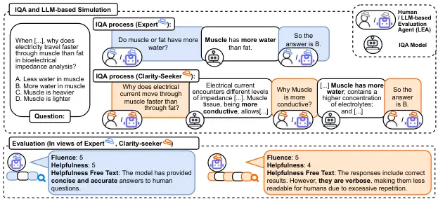

# IQA-Eval: Automatic Evaluation of Human-Model Interactive Question Answering

Ruosen Li Affiliation: Department of Computer Science, University of
Texas at Dallas Affiliation: {ruosen.li, ruochen.li,
xinya.du}@utdallas.edu    Ruochen Li Affiliation: Department of Computer
Science, University of Texas at Dallas Affiliation: {ruosen.li,
ruochen.li, xinya.du}@utdallas.edu    Barry Wang ^(†)^(†)thanks: Work
done while at the Department of Computer Science, Cornell University.
Affiliation: Department of Computer Science, Carnegie Mellon University
Affiliation: barryw@cs.cmu.edu    Xinya Du Affiliation: Department of
Computer Science, University of Texas at Dallas Affiliation: {ruosen.li,
ruochen.li, xinya.du}@utdallas.edu

###### Abstract

To evaluate Large Language Models (LLMs) for question answering (QA),
traditional methods typically focus on assessing single-turn responses
to given questions. However, this approach doesn’t capture the dynamic
nature of human-AI interactions, where humans actively seek information
through conversation¹¹ 1 Details are in Appendix F. Recent works in
human-computer interaction (HCI) have employed human evaluators to
conduct interactions and evaluations, but they are often prohibitively
expensive and time-consuming to scale. We introduce an automatic
evaluation framework IQA-Eval to achieve Interactive Question Answering
Evaluations²² 2
[https://github.com/du-nlp-lab/IQA-Eval](https://github.com/du-nlp-lab/IQA-Eval),
more specifically, we introduce a LLM-based Evaluation Agent (LEA) that
can: (1) simulate human behaviors to generate interactions with IQA
models; (2) automatically evaluate the generated interactions. Moreover,
we propose assigning personas to LEAs to better simulate groups of real
human evaluators. We show that: (1) our evaluation framework with GPT-4
(or Claude) as the backbone model achieves a high correlation with human
evaluations on the IQA task; (2) assigning personas to LEA to better
represent the crowd further significantly improves correlations.
Finally, we use our automatic metric to evaluate five recent
representative LLMs with over 1000 questions from complex and ambiguous
question answering tasks, which comes with a substantial cost of \$5k if
evaluated by humans.

## 1 Introduction

The advent of Large Language Models (LLMs) has significantly advanced
the field of natural language processing (NLP), enabling systems to
perform a wide range of tasks with remarkable proficiency 65, 56, 63,
14, 26. Among these tasks, question answering (QA) has emerged as a
critical and representative goal-oriented application, demonstrating the
potential of LLMs to generate informative responses as an assistant 4.
Multiple methods have been proposed to enhance the faithfulness and
explainability of generated information 57, 39, 32, 13. Beyond
developing these methods, rigorous evaluation of the generated outputs
is also crucial.



Figure 1: An example of human-model interactive question answering (IQA)
and our automatic evaluation (IQA-Eval). The two interactions occur with
two types of personas in humans (or LLM-based evaluation agents): Expert
and Clarity-seeker, and are evaluated by humans or agents with
corresponding personas. The IQA model only responds to the immediately
preceding prompt without further contexts like the question itself
(leftmost in the Figure).

Accurate and consistent evaluation helps researchers understand existing
LLM’s capacities and emerging human-LLM QA interactions 7, 35, 7.
Traditionally, automatic metrics such as accuracy have been used to
evaluate models based on the _quality_ of their direct answers to
specific questions. However, as _interactions_ between humans and LLMs
grow more complex and nuanced, these traditional metrics often fail to
capture the full spectrum of a model’s capabilities (e.g. helpfulness
and fluency), particularly in interactive QA settings 36, 11, whereas
interactions are crucial for user experience and system effectiveness,
yet remains overlooked in traditional evaluation paradigms. Recent works
such as 29 evaluated human-LLM interactions, a process that involves
human participation and annotation. Although human evaluations for these
interactions provide a closer approximation to real-world use cases,
this approach is significantly costly and time-consuming. Recognizing
the need for automatic evaluation, works like G-Eval 38, LLM-Eval 35,
FaithScore 25, and PRD 33 proposed to automate the assessment of
non-interactive LLM responses using LLMs as evaluators.

Drawing insights from (a) using LLM for automatic evaluation and (b)
literature of LLM-agents research ^(54, 12), we propose IQA-Eval
framework to auto-evaluate the performance of IQA models (i.e. LLMs)
with LLM-based Evaluation Agent (LEA) to simulate and then evaluate
interactions. By additionally incorporating personas, our experiments on
a well-annotated dataset show that our methods align well with human
judgments and provide a more comprehensive evaluation of LLMs in
interactive settings than traditional metrics. Finally, we benchmark
recent LLMs with new complex and ambiguous questions, and demonstrate
that the accuracy of answers does not always transfer to the
corresponding ranking of models on their capability of achieving good
human-model interactions. See an overview of our system in Figure 1.

Our contributions are as follows:

- •
  We propose the first LLM agent-based automatic evaluation framework
  IQA-Eval  designed specifically to generate and then evaluate
  interactions in IQA. Our results demonstrate a strong correlation with
  human evaluations.
- •
  We propose persona-based LLM evaluation agents to better assess how
  models adapt to different user preferences and interaction styles.
- •
  We experiment with IQA-Eval framework to benchmark the most recent
  LLMs on the IQA task, demonstrating the strength and general
  effectiveness of our framework on fully automated evaluation.

## 2 Related Work

##### Evaluating Interactions

Traditional methods for human-model dialogue evaluation have often been
centered around single-turn pairwise evaluation 52, 30. Some methods
with multi-turn Likert scores emerge 51, 64, 48 but require
time-consuming and costly collection of human-model conversations. In
response, ¹⁹ suggests a self-play scenario where a dialog system engages
in conversation with itself, employing a set of proxy measures for
evaluation.

Acute-eval 31 and LLM-Eval 35 have advanced multi-turn evaluation
frameworks, reflecting the increasing demand for sophisticated
techniques that holistically capture human-AI interactions. Further
studies in specific interaction domains like task completion 37, code
generation 61, and collaborative problem-solving 29, 22, 15 emphasize
the need for evaluations that consider both environmental and human
elements 55. Our work differs from these methods by introducing an
automated approach that emphasizes interaction quality and significantly
reduces the reliance on human annotations.

##### LLM-based Agent for Simulation

Recently, LLMs rises to demonstrate human-like intelligence, as
evidenced in various studies 60, 47, 34, 24, 3, 5, 50, 9. The
integration of LLMs into agents that simulate complex human behaviors
and social interactions is an area of growing research interest 41, 58, 59. For example, Park et al. Super and Gao et al. Super employ these
agents to simulate human emotions, attitudes, and behaviors in social
networks, while Park et al. Super leverages in-context learning to
simulate human behaviors in sandbox world. Moreover, Argyle et al. Super
utilizes “algorithmic bias" inherent in GPT-3 to reflect the response
patterns of different human subgroups. Horton Super utilize LLMs in
experimental setups of behavioral economics experiments to facilitate
pilot studies. Additionally, Hämäläinen et al. Super and Wang et al.
Super investigate LLM-based agents in recommender systems to simulate
and collect data on user behavior. These studies show the broad
applicability and potential of LLM-based agents in simulating human
behaviors and interactions across diverse applications. Our work
utilizes LLM-based evaluation agents (LEAs) to fully automate
interactive quality assessments, handling both interaction generation
and evaluation, to enhance the evaluation of IQA models in realistic
scenarios.

##### Personas in NLP

Personas are constructed profile prompts that represent key traits of a
group of users, as defined in the HCI field, reflecting their
characteristics, behaviors, and goals to guide the design of
technologies that are well-suited to user needs 10. This approach
enhances relevance and personalization in NLP applications 43, 2, 49,
68, offering significant potential for customizing engagement and
improving the effectiveness of conversational agents 30, 64, 6, 40, 67.
Li et al. Super introduces a persona-based neural conversation model to
enhance dialogue personalization and coherence. Zhang et al. Super
develops personalized dialogue agents that incorporate user-specific
details to enhance interaction. In our work, persona settings enable our
framework to tailor interactions and assessments, aligning more closely
with the specific characteristics and preferences of different user
groups.

## 3 IQA-Eval: Evaluating Interactive Question Answering (IQA)

In this section, we introduce our IQA-Eval framework for automatically
evaluating Interaction Question Answering Models (IQA models) with
LLM-based Evaluation Agents (LEA). LEAs are used to simulate humans in
the following two stages: (1) generating interactions with IQA models;
and (2) evaluating interactions. Lastly, we discuss the use of personas
to for LEAs.

### 3.1 Interaction Generation with LEA (Stage 1)

Inspired by peer discussions ^(29, 54), we prompt LEAs to simulate human
behaviors for effective interaction generation with IQA models. The
structured prompt includes three key components: (1) a role description;
(2) a task description; and (3) instructions for the discussion.

Role Description outlines the people that the LEA model will simulate
during interactions. For example, the description for a standard persona
could be: You are mimicking a human.

Task Description briefly describes the action that LEA model needs to
perform in the task. For example, in a multi-choice question answering
task, the prompt could be structured as follows: You are trying to
choose the correct answer for the given question. Both role and task
descriptions can be adjusted based on the persona, as discussed in
Section 3.3.

Discussion instruction guides LEAs on their subsequent steps by
providing detailed descriptions to facilitate progress in interactions.
It comprises two essential components: (1) the actions to take; and (2)
the detailed procedures to follow. For example, in a question answering
task, the prompt specifies: You can ask an assistant questions for help.
Please ask sub-questions to approach answers. In each turn, please only
ask one sub-question to interact with the assistant.

In the sub-question, please include all necessary information in the
original question, such as the question and all options. If you know the
answer, please output "So, the answer is: A, B, C, or D".

At the start of an interaction, the LEA receives a system prompt that
includes all three components above, along with the specific question to
be addressed. As the LEA interacts with the IQA model, it generates
sub-questions to request clarification of unknown entities, definitions,
or particular aspects of the original question. Then, the IQA Model
takes the questions as the input and output responses. After receiving
responses, the LEA continues to pose further questions until it
determines the final answer. The full prompt structure and interaction
details are provided in Appendix C.2.

### 3.2 Interaction Evaluation with LEA (Stage 2)

Inspired by G-eval 38, which demonstrates that evaluations by GPT models
align closely with human assessments in NLG tasks, we propose utilizing
LEAs for interaction evaluation. LEAs assess interactions generated by
LEAs and IQAs in Stage 1. The module takes task details, such as
questions or articles, and interactions as the input, and output
evaluation scores. The prompt contains three parts: (1) role and task
description; (2) metrics definition; and (3) evaluation instruction.

Role and task description instructs LEA to conduct evaluation. The role
description acts the same as the role description in the previous stage.
Moreover, it briefly describes the evaluation task. The general prompt
looks like: You are a helpful and precise evaluator who checks the
quality of the AI assistant’s responses in interactions.

Metrics definitions describes the criterion that LEA needs to follow in
the evaluation process. They can customized for different tasks. For the
question answering task, we add the following prompt to define the
“helpfulness” metric:

Both the aforementioned parts can be tailored according to the persona
that the LEA simulates in Stage 1, as detailed in Section 3.3.

Evaluation instruction outlines the specifics of the evaluation task and
the required output format. This section may appear as a separate part
of the prompt. For example, the instruction within the prompt might be
structured as follows:

Finally, all evaluation scores for metrics are calculated by averaging
the results of multiple runs. The complete prompt is available in
Appendix C.1, and further details about our implementation can be found
in Section 4.

### 3.3 Assigning the Personas to LEA

Both aforementioned evaluation stages typically use a default persona.
While this constitutes a somewhat neutral baseline in knowledge,
language proficiency, and beliefs to bo baseline, individual users often
exhibit diverse personal preferences and characteristics, making a
one-size-fits-all evaluation less effective. Moreover, the persona
distribution of the target user group significantly impacts the
performance of IQA models in real-world applications. For instance, if
20% of human users prefer brief interactions and 70% prefer detailed
information, applying a general LEA to simulate this group of persons is
likely to result in poor correlation with downstream users.

To better simulate the diversity of the groups of people and provide
individualized evaluations, we assign personas to LEAs. This affects
prompts of both interaction generation and interaction evaluation
processes.

For example, when the LEA is assigned with the “Critical-Seeker” persona
(definition in C.3) for interaction generation, we adapt the default
role and task description (in Stage 1) to:  
You prefer interactions rich in critical information. You need help from
an assistant and try to get critical information from it to answer the
following questions. For interaction evaluation, the default role and
task description prompt changes to The AI Assistant should provide
straightforward, simple, and concise answers to aid users in deducing
solutions. Additionally, the definition of metrics is also adjusted to
align with this persona, with further details available in Appendix C.3.

## 4 Meta-Evaluation of IQA-Eval Framework

To measure how our framework provides trustworthy IQA evaluations that
align with human preferences, we conduct meta-evaluations experiments
and report correlation scores.

### 4.1 Experiment Settings

##### Dataset and Evaluation Metrics

We apply our evaluation method on the annotated dataset from the study
by Lee et al. Super. This dataset consists of 3641 interactions from 331
annotators. Questions in the dataset are multi-choice and are derived
from the MMLU dataset 20 (example question in Figure 1). The
construction of MMLU requires each worker to participate in 11 random
conversations with one of the following three IQA models: TextDavinci
(text-davinci-001), TextBabbage (text-babbage-001), and Davinci
(davinci-001). At the end of conversations, fluency and helpfulness
scores are annotated by annotators. The number of queries and accuracy
for each IQA model can be easily deduced from annotations. In this work,
We adjust the four metrics to evaluate generated interactions:

- •
  Fluency (5-point Likert): How clear (or fluent) were the responses
  from the AI Assistant?
- •
  Helpfulness (5-point Likert): Independent of its fluency, how helpful
  was having access to the AI Assistant compared to not having access?
- •
  Number of Queries: Counts the number of interaction turns in the
  conversation. This metric helps assess the efficiency of the AI in
  resolving queries within a minimal number of interactions.
- •
  Accuracy: Quantifies how accurately the AI’s responses match the
  golden answers. This is critical for evaluating the correctness of the
  AI’s knowledge and its application in practical scenarios.

##### LEA Models

To evaluate the effectiveness of IQA-Eval framework, we experiment with
different LEA models on the above-mentioned three LLMs IQA models in
MMLU. For LEA that conducts both interaction generation and interaction
evaluation, we use ChatGPT (GPT-3.5-turbo-1106), GPT4
(GPT-4-1106-preview), Claude (Claude-1).

##### Evaluation of IQA-Eval Framework

We report Pearson correlations as the measrue of agreement between the
Human evaluations and LEA evaluations of IQA models.

### 4.2 Experiment Results

According to Table 2, all models, including GPT4, GPT3.5, and Claude,
show high correlation with human evaluations. GPT4 aligns most closely
with human judgments in both “Helpfulness” and “Fluency" metrics and the
highest overall correlation score. This indicates that these models are
capable of effectively performing IQA-Eval framework as LEA models.

|                 | Helpfulness |      |      | Fluency |      |      | \# Queries |      |      | Accuracy |      |      |
| --------------- | ----------- | ---- | ---- | ------- | ---- | ---- | ---------- | ---- | ---- | -------- | ---- | ---- |
| Evaluator       | TDA         | TB   | DA   | TDA     | TB   | DA   | TDA        | TB   | DA   | TDA      | TB   | DA   |
| Human           | 4.60        | 3.84 | 3.52 | 4.35    | 3.84 | 3.22 | 1.78       | 2.57 | 2.66 | 0.69     | 0.52 | 0.48 |
| IQA-Eval-GPT4   | 3.67        | 2.30 | 2.10 | 4.77    | 3.87 | 3.03 | 1.57       | 2.27 | 2.37 | 0.87     | 0.83 | 0.67 |
| IQA-Eval-Claude | 4.13        | 3.03 | 3.00 | 4.47    | 3.47 | 3.23 | 2.20       | 2.67 | 2.07 | 0.67     | 0.53 | 0.57 |
| IQA-Eval-GPT3.5 | 4.30        | 3.87 | 3.93 | 4.47    | 3.67 | 3.97 | 1.57       | 1.77 | 2.00 | 0.63     | 0.47 | 0.53 |

Table 1: IQA-Eval evaluation results of IQA models (TDA: TextDavinci;
TB: TextBabbage; DA: Davinci). Bold numbers indicate they are the most
close to human results. The empty set symbol (Ø) indicates the number
cannot be calculated due to the model’s inability to follow instructions
and produce a gradable answer.

|                 | Helpfulness | Fluency | Overall |
| --------------- | ----------- | ------- | ------- |
| IQA-Eval-GPT4   | 0.652       | 0.591   | 0.613   |
| IQA-Eval-Claude | 0.640       | 0.552   | 0.551   |
| IQA-Eval-GPT3.5 | 0.621       | 0.523   | 0.510   |

Table 2: Pearson Correlation ($`\rho`$) between IQA-Eval evaluations and
human judgments.

In Table 1, ChatGPT scores closest to human judgments, particularly in
the "Helpfulness" metric. Conversely, GPT4 and Claude score lower on
"Helpfulness" than human evaluations, because they tend to produce
inaccurate and repetitive responses that lack coherence and do not
directly address user queries, as indicated by their generated
explanations. IQA-Eval scores on “Fluency” are close and highly
correlated to human judgments. Both scores given by humans and LEA
models show that IQA models provide fluent outputs. Furthermore,
according to the "# Queries" metric, most models conclude conversations
more quickly than humans, except for Claude, which requires more turns,
potentially due to its non-OpenAI origins that it needs more turns to
adapt the conversational style and understand responses. Notably, GPT4
achieves the highest accuracy among all models. Moreover, we consider
the impact of self-enhancement bias and conduct more experiments.
Details are in Section 6.4.

##### Analysis of LEA for Stage 2 (Evaluating Interactions)

For Stage 2 itself, we measure the LEA’s capability of evaluating
interactions, based on real human-generated interactions from Stage 1.

(a) Helpfulness

(b) Fluency

Figure 2: Interaction evaluation results evaluated by human and two LEA
models on interactions between real human and IQA Models. All scores are
on a scale of 5.

Results are in shown Figures 2(a) and 2(b). The Pearson correlation
coefficients for fluency and helpfulness between human judgments and LEA
evaluations show distinct patterns. ChatGPT demonstrates a stronger
correlation with human ratings, recording a correlation score of 0.424
for fluency and a correlation score of 0.306 for helpfulness. In
contrast, Claude shows slightly lower correlations (0.281 for fluency
and 0.287 for helpfulness). This shows that ChatGPT aligns better with
human compared to Claude in these specific metrics.

Moreover, for interactions between humans and IQA models (Figure 2), LEA
evaluations moderately correlate with human evaluations. However, for
interactions between LEAs and IQA models (Table 2), which is the main
focus of our paper, LEA evaluations highly correlate (around 0.6) with
human evaluations. This indicates that LEA models are helpful when
participating in the whole evaluation process, including both the
interaction and evaluation. However, when evaluating interactions
between humans and IQA models, LEAs focus differently from humans, which
causes moderate correlations.

Thus, the results show that (1) both models’ evaluations moderately
correlate with human evaluation; (2) ChatGPT’s evaluation is closer and
related to human evaluation than Claude’s.

### 4.3 Further Analysis for Free-form Feedback

Apart from the metrics above, we also prompt LLM-based Evaluation Agent
(LEA) to explain the reason for generating scores in the free-form text
format. We find that: 1) ChatGPT Generates more human-like, positive
reviews: ChatGPT evaluations are generally more positive, frequently
using terms like “helpful”, “relevant”, and “useful” – words not always
noted by workers in their annotations. Despite this, ChatGPT often
identifies similar issues as human raters, such as the provision of
irrelevant and repetitive information. Overall, ChatGPT’s assessments
align well with human evaluations; 2) Claude flags more Issues: Claude
is more strict and critical to IQA models in interactions. In the
free-text feedback, Claude tends to highlight more issues with model
responses rather than acknowledging positive aspects, especially for
Davinci. For one question, after interacting with the IQA
model/assistant (ChatGPT in this case), human and two LEAs provide the
following feedback:

## 5 Effect of Assigning Persona to LLM Evaluation Agent (LEA)

### 5.1 Persona Definitions

As discussed in Section 3.3, we assign personas to LEAs to simulate
different groups of humans for diverse human alignments. We investigate
assigning the following personas to LEAs, which are defined based on the
crowdworker survey results in Lee et al. Super.

- •
  Expert: knowledgeable; quickly learns new concepts and applies them in
  the reasoning process to answer questions.
- •
  Critical-Thinker: people who prefer critical information rather than
  redundant or detailed responses.
- •
  Adaptability-Seeker: people who prefer assistants can understand their
  questions even if they are not precise.
- •
  Clarity-Seeker: people who prefer clear explanations from assistants.

Based on the survey results on the distributions of personas of
workers ²⁹, for each persona $`P`$, we split the crowdworkers into two
groups: “persons with persona $`P`$”, and “normal persons without
specific persona $`P`$”. For the first group, we initialize the role
prompt in Section 3.3 and use it for the LEAs. For the second group, we
utilize default prompting for LEAs. The LEA model in this section is
ChatGPT(GPT-3.5-turbo-1106).

### 5.2 Experimental Results

|                                |            |      |      |          |      |      |
| ------------------------------ | ---------- | ---- | ---- | -------- | ---- | ---- |
|                                | \# Queries |      |      | Accuracy |      |      |
| Evaluator                      | TDA        | TB   | TD   | TDA      | TB   | TD   |
| Human                          | 1.78       | 2.57 | 2.66 | 0.69     | 0.52 | 0.48 |
| IQA-Eval                       | 1.57       | 1.77 | 2.00 | 0.63     | 0.47 | 0.53 |
| IQA-Eval (Expert)              | 1.20       | 1.49 | 2.20 | 0.73     | 0.56 | 0.53 |
| IQA-Eval (Critical-Thinker)    | 1.55       | 1.80 | 1.99 | 0.68     | 0.54 | 0.55 |
| IQA-Eval (Adaptability-Seeker) | 1.50       | 1.75 | 2.10 | 0.66     | 0.52 | 0.55 |
| IQA-Eval (Clarity-Seeker)      | 1.64       | 2.10 | 2.34 | 0.63     | 0.57 | 0.57 |

|                                |              |              |              |          |              |              |              |          |          |
| ------------------------------ | ------------ | ------------ | ------------ | -------- | ------------ | ------------ | ------------ | -------- | -------- |
|                                | Helpfulness  |              |              |          | Fluency      |              |              |          | Overall  |
| Evaluator                      | TDA          | TB           | TD           | $`\rho`$ | TDA          | TB           | TD           | $`\rho`$ | $`\rho`$ |
| Human                          | 4.60         | 3.84         | 3.52         | -        | 4.35         | 3.84         | 3.22         | -        | -        |
| IQA-Eval                       | 4.30 (±0.06) | 3.87 (±0.11) | 3.93 (±0.13) | 0.621    | 4.47 (±0.05) | 3.67 (±0.08) | 3.97 (±0.06) | 0.523    | 0.510    |
| IQA-Eval (Expert)              | 4.17 (±0.08) | 3.08 (±0.09) | 3.12 (±0.11) | 0.756    | 4.47 (±0.02) | 3.84 (±0.04) | 3.40 (±0.04) | 0.787    | 0.670    |
| IQA-Eval (Critical-Thinker)    | 4.44 (±0.08) | 4.02 (±0.13) | 4.08 (±0.17) | 0.711    | 4.64 (±0.06) | 3.97 (±0.08) | 4.10 (±0.08) | 0.624    | 0.634    |
| IQA-Eval (Adaptability-Seeker) | 4.24 (±0.05) | 3.67 (±0.11) | 3.75 (±0.11) | 0.713    | 4.52 (±0.08) | 3.84 (±0.07) | 3.84 (±0.09) | 0.637    | 0.650    |
| IQA-Eval (Clarity-Seeker)      | 4.45 (±0.07) | 3.77 (±0.15) | 3.80 (±0.12) | 0.747    | 4.60 (±0.04) | 3.85 (±0.04) | 3.94 (±0.06) | 0.676    | 0.690    |

Table 3: IQA-Eval evaluation results of IQA models (TDA: TextDavinci;
TB: TextBabbage; DA: Davinci). LEAs, based on GPT3.5, are assigned
specific personas when representing specific groups of workers.

Table 4: IQA-Eval evaluation results (helpfulness and fluency) of IQA
models. Correlations are between the LEA evaluation in each row and
human evaluations.

In Table 4, we show the results of model (with personas) evaluations. To
accurately simulate persona distribution, each interaction is executed
multiple times, with different personas (including the standard one)
assigned to LEA based on their distribution proportions. This method
ensures that each persona’s influence and characteristics are
proportionally represented in the simulation, reflecting their
respective prevalence within the overall distribution. The final score
for a persona is an average of all experiment results.

The “Expert” persona decrease LEA query counts as “Expert” already
possesses relevant knowledge and only needs key explanations. The
“Clarity-Seeker” requires the most interaction turns among all personas
for comprehension, but achieves the highest accuracy with TextBabbage
and Davinci through detailed understanding of questions.

“Critic-Thinker” and “Adapability-Seeker” in Tables 4 and 4 rarely
surpass upon the standard persona’s human-preference aligment. We
hypothesize that these personas are less reflected within the overall
distributions of human preferences. In Table 4, the varying “# Queries”
across personas reveals their significant influence on LEA interaction
strategies. Accuracy remains consistent after adding personas, showing
no performance degradation.

Together, these results indicate that assigning specific personas steer
LEAs to perform IQA-Eval in a more fine-grained and human-aligned way.

It is worth nothing that our analysis of persona reassignment shows
IQA-Eval is sensitive to incorrect assignments (see Appendix E).
Moreover, further analyses about bias evaluation, as well as measuring
complementary metrics like offensiveness, are in Appendix G.

## 6 Benchmarking LLMs with IQA-Eval on more Types of Questions

### 6.1 Datasets

To evaluate the robustness and generalizability of our evaluation
framework, we conduct benchmarking across different models on two
distinct question answering datasets, each offering unique challenges
and complexities requiring advanced reasoning. AmbigQA ⁴² is a
collection of 14,042 annotated questions sourced from the NQ-OPEN
benchmarks ²⁷, an open-domain QA dataset. It focuses on questions with
inherent ambiguities, reflecting the complexity encountered in
real-world queries. These ambiguities often involve diverse aspects such
as events, entity references, and answer types, resulting in multiple
plausible answers for each question. HotpotQA ⁶² comprises 113,000
question-answer pairs sourced from Wikipedia, which require multi-hop
reasoning spanning multiple documents. It contains a rich array of
intricate questions that demand the synthesis of information from
various texts to determine accurate answers. In this benchmark, we
select 500 questions from each dataset to form a dataset containing
1,000 complex multi-hop and ambiguous questions.

### 6.2 LLMs to Benchmark

|             |                          |                     |                          |                      |             |         |            |          |
| ----------- | ------------------------ | ------------------- | ------------------------ | -------------------- | ----------- | ------- | ---------- | -------- |
| IQA Models  | HotpotQA                 |                     |                          |                      | AmbigQA     |         |            |          |
|             | Helpfulness $`\uparrow`$ | Fluency$`\uparrow`$ | \# Queries$`\downarrow`$ | Accuracy$`\uparrow`$ | Helpfulness | Fluency | \# Queries | Accuracy |
| TextDavinci | 4.72                     | 4.87                | 1.22                     | 0.45                 | \-          | \-      | \-         | \-       |
| TextBabbage | 4.70                     | 4.88                | 1.74                     | 0.37                 | \-          | \-      | \-         | \-       |
| Davinci     | 4.27                     | 4.52                | 1.68                     | 0.32                 | \-          | \-      | \-         | \-       |
| GPT3.5      | 4.72                     | 4.95                | 1.49                     | 0.63                 | 4.91        | 4.97    | 1.89       | 0.60     |
| GPT4        | 4.78                     | 4.96                | 1.12                     | 0.66                 | 4.89        | 4.95    | 1.06       | 0.72     |
| Claude      | 4.82                     | 4.99                | 1.26                     | 0.58                 | 4.89        | 4.94    | 1.36       | 0.62     |
| Llama2      | 4.70                     | 4.95                | 1.32                     | 0.55                 | 4.96        | 4.94    | 1.79       | 0.52     |
| Zephyr      | 4.64                     | 4.88                | 1.01                     | 0.40                 | 4.38        | 4.66    | 1.03       | 0.45     |

Table 5: IQA-Eval benchmarking results on HotpotQA and AmbigQA datasets.

Apart from TextDavinci, TextBabbage and Davinci we benchmark more LLMs:
GPT3.5, GPT4, Claude, Llama2 and Zephyr. The checkpoints for Llama2 and
Zephyr are Llama-2-7B and Zephyr-alpha, respectively. GPT3.5 is used as
LEA in our experiments.

### 6.3 Benchmarking Results

The IQA evaluation benchmarks are presented in Table 5. We divide IQA
Models into two categories: weak IQA Models (TextDavinci, TextBabbage,
and Davinci) and strong IQA Models (GPT3.5, GPT4, Claude, Llama2, and
Zephyr). Weak IQA Models can assist the LEA with answering HotpotQA
questions, but due to their knowledge limitations, they cannot help much
with AmbigQA questions. Zephyr achieves the lowest performance compared
to other strong IQA Models. On the HotpotQA dataset, Zephyr’s accuracy
performance is only comparable to the strongest one among weak IQA
Models, TextDavinci.

Most “Helpfulness” and “Fluency” scores are high (exceeding 3 out of 5),
especially for strong IQA Models like GPT4. For the “# of queries”, it
is uncommon for interactions to extend beyond two turns. As on HotpotQA,
most interactions conclude at the beginning of the second turn, as IQA
models have effectively guided users to reach the answers. For AmbigQA,
some conversations last longer whereas LEA spends additional turns on
clarifying ambiguous entities before approaching the final answer.
Additional benchmarking results on the Natural Question dataset are in
Appendix D.

### 6.4 Self-Enhancement Bias

LLMs are shown to demonstrate self-favouring behaviours 44, and no
verified or accessible mitigations to this issue exist to the best of
our knowledge. This issue is particularly concerning when the LEA models
evaluating the IQA models share the same underlying model. In this
section, we discuss our two of our attempts to assess the effects of
this bias.

Following ⁶⁶ and ¹⁶, we included some empirically useful debiasing
instructions as follows:

|                             | Helpfulness |      |      | Fluency |      |      | Accuracy |      |      |
| --------------------------- | ----------- | ---- | ---- | ------- | ---- | ---- | -------- | ---- | ---- |
| LEA models                  | TDA         | TB   | DA   | TDA     | TB   | DA   | TDA      | TB   | DA   |
| Human                       | 4.60        | 3.84 | 3.52 | 4.35    | 3.84 | 3.22 | 0.69     | 0.52 | 0.48 |
| IQA-EVAL-GPT4 (Our Prompts) | 3.67        | 2.30 | 2.10 | 4.77    | 3.87 | 3.03 | 0.87     | 0.83 | 0.67 |
| IQA-EVAL-GPT4 (New Prompts) | 3.50        | 2.23 | 2.10 | 4.40    | 4.07 | 3.53 | 0.87     | 0.83 | 0.67 |

Table 6: Comparison between new prompts and our prompts used in Table 1.
The new prompts are more complex and include effective debiasing
instructions.

In Table 5, scores on the row of GPT3.5 is vulnerable to
self-enhancement bias. However, with the above debiasing prompt, in
Table 7 shows that the results of new prompts are highly similar to the
original prompts. Similarly, Table 6 shows that the results of modified
and original prompts are differ only lightly.

| LEA models                    | Helpfulness | Fluency | \# Queries | Accuracy |
| ----------------------------- | ----------- | ------- | ---------- | -------- |
| IQA-EVAL-GPT3.5 (Our Prompts) | 4.72        | 4.95    | 1.49       | 0.63     |
| IQA-EVAL-GPT3.5 (New Prompts) | 4.68        | 4.91    | 1.35       | 0.60     |

Table 7: Comparison between new prompts and our prompts used in Table 5
on benchmarking LLMs with IQA-Eval .

We also designed a second methodology to mitigate self-enhancement bias.
In this experiment, multiple LEA models evaluate the performance of IQA
models during each interaction (“Multi-perspective”). In other words, we
introduced third-party evaluations, where various LEA models assess the
IQA models’ performance instead of relying solely on the LEA model
itself involved in the interaction. After evaluation, we use the average
score from all LEA models as the final score. The results of
IQA-Eval-Multi-perspective look as in Table 8. The correlations between
IQA-Eval-Multi-perspective and human evaluations are in Table 9.

We believe that that the self-preference bias has limited impact on
IQA-Eval.

|                    | Helpfulness |      |      | Fluency |      |      | \# Queries |      |      | Accuracy |      |      |
| ------------------ | ----------- | ---- | ---- | ------- | ---- | ---- | ---------- | ---- | ---- | -------- | ---- | ---- |
| LEA models         | TDA         | TB   | DA   | TDA     | TB   | DA   | TDA        | TB   | DA   | TDA      | TB   | DA   |
| Human              | 4.60        | 3.84 | 3.52 | 4.35    | 3.84 | 3.22 | 1.78       | 2.57 | 2.66 | 0.69     | 0.52 | 0.48 |
| IQA-EVAL-GPT4-MP   | 4.32        | 3.70 | 3.53 | 4.57    | 3.74 | 3.68 | 1.57       | 2.27 | 2.37 | 0.87     | 0.83 | 0.67 |
| IQA-EVAL-Claude-MP | 3.96        | 3.13 | 3.10 | 4.29    | 3.51 | 3.22 | 2.20       | 2.67 | 2.07 | 0.67     | 0.53 | 0.57 |
| IQA-EVAL-GPT3.5-MP | 3.98        | 3.23 | 3.04 | 4.41    | 3.67 | 3.59 | 1.57       | 1.77 | 2.00 | 0.63     | 0.47 | 0.53 |

Table 8: IQA-EVAL-Multi-Perspective Results of IQA Models. MP indicates
“Multi-Perspective”. Bold numbers indicate they are the closest to human
results.

| LEA models         | Helpfulness | Fluency | Overall |
| ------------------ | ----------- | ------- | ------- |
| IQA-EVAL-GPT4-MP   | 0.702       | 0.601   | 0.624   |
| IQA-EVAL-Claude-MP | 0.663       | 0.613   | 0.602   |
| IQA-EVAL-GPT3.5-MP | 0.641       | 0.552   | 0.533   |

Table 9: Pearson Correlation ($`\rho`$) between
IQA-EVAL-Multi-Persepctive evaluations and human judgments.

### 6.5 Analysis

| IQA Models | HotpotQA | AmbigQA |
| ---------- | -------- | ------- |
| GPT3.5     | 0.43     | 0.62    |
| GPT4       | 0.46     | 0.63    |
| Claude     | 0.28     | 0.5     |
| Llama2     | 0.24     | 0.29    |
| Zephyr     | 0.25     | 0.31    |

Table 10: Accuracy of IQA Models (recent LLMs) on two datasets
(Non-interactive setting).

##### Stronger IQA models require fewer turns in interactions.

On the more challenging AmbigQA, the stronger model, GPT4, typically
requires only one turn to assist LEA in solving questions with high
accuracy. In contrast, less capable models like Llama2 and GPT3.5 need
more turns to clarify ambiguous entities and have lower QA accuracies. A
similar trend is observed on the HotpotQA.

##### We obtain a similar model ranking with a much lower cost.

Compared to Chatbot Arena ³³ 3
[https://huggingface.co/spaces/lmsys/chatbot-arena-leaderboard](https://huggingface.co/spaces/lmsys/chatbot-arena-leaderboard),
our accuracy-based ranking of IQA Models follows a similar trend: GPT4
\> Claude \> GPT3.5 \> Llama2 \> Zephyr. In addition, our evaluation
method, IQA-Eval, is fully automated. Our method makes it a
cost-effective alternative for large-scale evaluations.

##### Evaluation of interaction performance does not always match Non-Interaction performance.

In interaction evaluations, accuracy on final results is not the only
metric to show IQA Models’ performance. The quality of intermediate
responses is a significant aspect. On both “helpfulness” and “fluency”
metrics, Claude is always the best IQA Model on HotpotQA questions,
while on AmbigQA, Llama2 and GPT3.5 outperform GPT4. IQA Model rankings
on these two aspects differ from those in Chatbot Arena
(non-interaction).

##### The performance of IQA Models largely affects the final performance.

The accuracies in both Table 5 and Table 10 show a consistent trend. The
Pearson correlations of the accuracy between the tables are 0.77 and
0.87 on both datasets, respectively. A strong IQA model, such as GPT4,
can lead the LEA to finish tasks and largely improve the LEA’s
performance on those tasks. Weak assistants may drag down the LEA’s
performance, such as the performance of the LEA on both datasets
decreases after interacting with Zephyr.

## 7 Conclusion

To conclude, we introduced IQA-Eval, a novel approach for evaluating
interactive question-answering systems using large language models. Our
methodology achieves automatic interaction generation and evaluation
with LEA, and enhances the evaluation process by assigning personas to
LEA for better matching diverse groups of people. We show that our
approach aligns closely with real human interactions and judgment,
indicating that a scalable, automatic IQA-Eval process can be achieved.
We providing insights on recent LLM’s capability in conducting IQA with
IQA-Eval  which would cost \$5,000 for human evaluations.

## Acknowledgement

We thank the anonymous reviewers for valuable and insightful feedback.
This research is supported in part by the National Science Foundation
CAREER Grant IIS-2340435, Amazon Research Award and Cisco Research
Award. Any opinions, findings, and conclusions or recommendations
expressed herein are those of the authors and do not necessarily
represent the views, either expressed or implied, of the U.S.
Government.

## References

- \[1\] L. P. Argyle, E. C. Busby, N. Fulda, J. Gubler, C. Rytting, and
  D. Wingate. Out of One, Many: Using Language Models to Simulate Human
  Samples. In _Proceedings of the 60th Annual Meeting of the Association
  for Computational Linguistics (Volume 1: Long Papers)_, pages
  819–862, 2022. doi: 10.18653/v1/2022.acl-long.60. URL
  [http://arxiv.org/abs/2209.06899](http://arxiv.org/abs/2209.06899).
  arXiv:2209.06899 \[cs\].
- \[2\] D. Bamman. People-centric natural language processing. _PhD
  diss., PhD thesis, Carnegie Mellon University_, 2015.
- \[3\] B. bench authors. Beyond the imitation game: Quantifying and
  extrapolating the capabilities of language models. _Transactions on
  Machine Learning Research_, 2023. ISSN 2835-8856. URL
  [https://openreview.net/forum?id=uyTL5Bvosj](https://openreview.net/forum?id=uyTL5Bvosj).
- \[4\] G. M. Biancofiore, Y. Deldjoo, T. D. Noia, E. Di Sciascio, and
  F. Narducci. Interactive question answering systems: Literature
  review. _ACM Computing Surveys_, 56(9):1–38, 2024.
- \[5\] T. Brown, B. Mann, N. Ryder, M. Subbiah, J. D. Kaplan,
  P. Dhariwal, A. Neelakantan, P. Shyam, G. Sastry, A. Askell, et al.
  Language models are few-shot learners. _Advances in neural information
  processing systems_, 33:1877–1901, 2020.
- \[6\] Z. Chan, J. Li, X. Yang, X. Chen, W. Hu, D. Zhao, and R. Yan.
  Modeling personalization in continuous space for response generation
  via augmented wasserstein autoencoders. In _Proceedings of the 2019
  Conference on Empirical Methods in Natural Language Processing and the
  9th International Joint Conference on Natural Language Processing
  (EMNLP-IJCNLP)_, pages 1931–1940, 2019.
- \[7\] Y. Chang, X. Wang, J. Wang, Y. Wu, L. Yang, K. Zhu, H. Chen,
  X. Yi, C. Wang, Y. Wang, W. Ye, Y. Zhang, Y. Chang, P. S. Yu, Q. Yang,
  and X. Xie. A survey on evaluation of large language models, 2023.
- \[8\] E. Choi, H. He, M. Iyyer, M. Yatskar, W.-t. Yih, Y. Choi,
  P. Liang, and L. Zettlemoyer. QuAC: Question answering in context. In
  E. Riloff, D. Chiang, J. Hockenmaier, and J. Tsujii, editors,
  _Proceedings of the 2018 Conference on Empirical Methods in Natural
  Language Processing_, pages 2174–2184, Brussels, Belgium,
  Oct.-Nov. 2018. Association for Computational Linguistics. doi:
  10.18653/v1/D18-1241. URL
  [https://aclanthology.org/D18-1241](https://aclanthology.org/D18-1241).
- \[9\] A. Chowdhery, S. Narang, J. Devlin, M. Bosma, G. Mishra,
  A. Roberts, P. Barham, H. W. Chung, C. Sutton, S. Gehrmann, P. Schuh,
  K. Shi, S. Tsvyashchenko, J. Maynez, A. Rao, P. Barnes, Y. Tay,
  N. Shazeer, V. Prabhakaran, E. Reif, N. Du, B. Hutchinson, R. Pope,
  J. Bradbury, J. Austin, M. Isard, G. Gur-Ari, P. Yin, T. Duke,
  A. Levskaya, S. Ghemawat, S. Dev, H. Michalewski, X. Garcia, V. Misra,
  K. Robinson, L. Fedus, D. Zhou, D. Ippolito, D. Luan, H. Lim, B. Zoph,
  A. Spiridonov, R. Sepassi, D. Dohan, S. Agrawal, M. Omernick, A. M.
  Dai, T. S. Pillai, M. Pellat, A. Lewkowycz, E. Moreira, R. Child,
  O. Polozov, K. Lee, Z. Zhou, X. Wang, B. Saeta, M. Diaz, O. Firat,
  M. Catasta, J. Wei, K. Meier-Hellstern, D. Eck, J. Dean, S. Petrov,
  and N. Fiedel. PaLM: Scaling Language Modeling with Pathways,
  Oct. 2022. URL
  [http://arxiv.org/abs/2204.02311](http://arxiv.org/abs/2204.02311).
  arXiv:2204.02311 \[cs\].
- \[10\] A. Cooper, R. Reimann, D. Cronin, and C. Noessel. About face 2:
  The essentials of interaction design, 2014.
- \[11\] J. Deriu, Á. Rodrigo, A. Otegi, G. Echegoyen, S. Rosset,
  E. Agirre, and M. Cieliebak. Survey on evaluation methods for dialogue
  systems. _Artificial Intelligence Review_, 54(1):755–810, 2021.
- \[12\] A. Deshpande, V. Murahari, T. Rajpurohit, A. Kalyan, and
  K. Narasimhan. Toxicity in chatgpt: Analyzing persona-assigned
  language models. _arXiv preprint arXiv:2304.05335_, 2023.
- \[13\] X. Du. Making natural language reasoning explainable and
  faithful. _Proceedings of the AAAI Conference on Artificial
  Intelligence_, 38(20):22664–22664, Mar. 2024a. doi:
  10.1609/aaai.v38i20.30280. URL
  [https://ojs.aaai.org/index.php/AAAI/article/view/30280](https://ojs.aaai.org/index.php/AAAI/article/view/30280).
- \[14\] X. Du. Making natural language reasoning explainable and
  faithful. In _Proceedings of the AAAI Conference on Artificial
  Intelligence_, volume 38, pages 22664–22664, 2024b.
- \[15\] Y. Fu, H. Peng, T. Khot, and M. Lapata. Improving language
  model negotiation with self-play and in-context learning from ai
  feedback, 2023. Manuscript submitted for publication.
- \[16\] S. Furniturewala, S. Jandial, A. Java, P. Banerjee, S. Shahid,
  S. Bhatia, and K. Jaidka. Thinking fair and slow: On the efficacy of
  structured prompts for debiasing language models. _arXiv preprint
  arXiv:2405.10431_, 2024.
- \[17\] C. Gao, X. Lan, Z. Lu, J. Mao, J. Piao, H. Wang, D. Jin, and
  Y. Li. S\$^3\$: Social-network Simulation System with Large Language
  Model-Empowered Agents, July 2023. URL
  [http://arxiv.org/abs/2307.14984](http://arxiv.org/abs/2307.14984).
  arXiv:2307.14984 \[cs\].
- \[18\] S. Gehman, S. Gururangan, M. Sap, Y. Choi, and N. A. Smith.
  Realtoxicityprompts: Evaluating neural toxic degeneration in language
  models. _arXiv preprint arXiv:2009.11462_, 2020.
- \[19\] A. Ghandeharioun, J. H. Shen, N. Jaques, C. Ferguson, N. Jones,
  A. Lapedriza, and R. Picard. Approximating interactive human
  evaluation with self-play for open-domain dialog systems. _Advances in
  Neural Information Processing Systems_, 32, 2019.
- \[20\] D. Hendrycks, C. Burns, S. Basart, A. Zou, M. Mazeika, D. Song,
  and J. Steinhardt. Measuring massive multitask language understanding.
  _arXiv preprint arXiv:2009.03300_, 2020.
- \[21\] J. J. Horton. Large language models as simulated economic
  agents: What can we learn from homo silicus? Technical report,
  National Bureau of Economic Research, 2023.
- \[22\] S. Huang, S. Ma, Y. Li, M. Huang, W. Zou, W. Zhang, and H.-T.
  Zheng. Lateval: An interactive llms evaluation benchmark with
  incomplete information from lateral thinking puzzles. _arXiv preprint
  arXiv:2308.10855_, 2023.
- \[23\] P. Hämäläinen, M. Tavast, and A. Kunnari. Evaluating Large
  Language Models in Generating Synthetic HCI Research Data: a Case
  Study. In _Proceedings of the 2023 CHI Conference on Human Factors in
  Computing Systems_, pages 1–19, Hamburg Germany, Apr. 2023. ACM. ISBN
  978-1-4503-9421-5. doi: 10.1145/3544548.3580688. URL
  [https://dl.acm.org/doi/10.1145/3544548.3580688](https://dl.acm.org/doi/10.1145/3544548.3580688).
- \[24\] H. Jiang, X. Zhang, X. Cao, and J. Kabbara. PersonaLLM:
  Investigating the Ability of GPT-3.5 to Express Personality Traits and
  Gender Differences, May 2023. URL
  [http://arxiv.org/abs/2305.02547](http://arxiv.org/abs/2305.02547).
  arXiv:2305.02547 \[cs\].
- \[25\] L. Jing, R. Li, Y. Chen, M. Jia, and X. Du. Faithscore:
  Evaluating hallucinations in large vision-language models. _arXiv
  preprint arXiv:2311.01477_, 2023.
- \[26\] L. Jing, Z. Huang, X. Wang, W. Yao, W. Yu, K. Ma, H. Zhang,
  X. Du, and D. Yu. Dsbench: How far are data science agents to becoming
  data science experts?, 2024. URL
  [https://arxiv.org/abs/2409.07703](https://arxiv.org/abs/2409.07703).
- \[27\] T. Kwiatkowski, J. Palomaki, O. Redfield, M. Collins,
  A. Parikh, C. Alberti, D. Epstein, I. Polosukhin, J. Devlin, K. Lee,
  K. Toutanova, L. Jones, M. Kelcey, M.-W. Chang, A. M. Dai,
  J. Uszkoreit, Q. Le, and S. Petrov. Natural Questions: A Benchmark for
  Question Answering Research. _Transactions of the Association for
  Computational Linguistics_, 7:453–466, 08 2019a. ISSN 2307-387X. doi:
  10.1162/tacl_a_00276. URL
  [https://doi.org/10.1162/tacl_a_00276](https://doi.org/10.1162/tacl_a_00276).
- \[28\] T. Kwiatkowski, J. Palomaki, O. Redfield, M. Collins,
  A. Parikh, C. Alberti, D. Epstein, I. Polosukhin, J. Devlin, K. Lee,
  K. Toutanova, L. Jones, M. Kelcey, M.-W. Chang, A. M. Dai,
  J. Uszkoreit, Q. Le, and S. Petrov. Natural questions: A benchmark for
  question answering research. _Transactions of the Association for
  Computational Linguistics_, 7:452–466, 2019b. doi:
  10.1162/tacl_a_00276. URL
  [https://aclanthology.org/Q19-1026](https://aclanthology.org/Q19-1026).
- \[29\] M. Lee, M. Srivastava, A. Hardy, J. Thickstun, E. Durmus,
  A. Paranjape, I. Gerard-Ursin, X. L. Li, F. Ladhak, F. Rong, et al.
  Evaluating human-language model interaction. _Transactions on Machine
  Learning Research_, 2023.
- \[30\] J. Li, M. Galley, C. Brockett, G. P. Spithourakis, J. Gao, and
  B. Dolan. A persona-based neural conversation model. In _Proceedings
  of the 54th Annual Meeting of the Association for Computational
  Linguistics_, pages 994–1003, ACL, 2016. Association for Computational
  Linguistics.
- \[31\] M. Li, J. Weston, and S. Roller. Acute-eval: Improved dialogue
  evaluation with optimized questions and multi-turn comparisons. _arXiv
  preprint arXiv:1909.03087_, 2019.
- \[32\] R. Li and X. Du. Leveraging structured information for
  explainable multi-hop question answering and reasoning. _arXiv
  preprint arXiv:2311.03734_, 2023.
- \[33\] R. Li, T. Patel, and X. Du. PRD: Peer rank and discussion
  improve large language model based evaluations. _Transactions on
  Machine Learning Research_, 2024. ISSN 2835-8856. URL
  [https://openreview.net/forum?id=YVD1QqWRaj](https://openreview.net/forum?id=YVD1QqWRaj).
- \[34\] X. Li, Y. Li, S. Joty, L. Liu, F. Huang, L. Qiu, and L. Bing.
  Does GPT-3 Demonstrate Psychopathy? Evaluating Large Language Models
  from a Psychological Perspective, May 2023. URL
  [http://arxiv.org/abs/2212.10529](http://arxiv.org/abs/2212.10529).
  arXiv:2212.10529 \[cs\].
- \[35\] Y.-T. Lin and Y.-N. Chen. Llm-eval: Unified multi-dimensional
  automatic evaluation for open-domain conversations with large language
  models. _arXiv preprint arXiv:2305.13711_, 2023.
- \[36\] C.-W. Liu, R. Lowe, I. Serban, M. Noseworthy, L. Charlin, and
  J. Pineau. How not to evaluate your dialogue system: An empirical
  study of unsupervised evaluation metrics for dialogue response
  generation. In _Proceedings of the 2016 Conference on Empirical
  Methods in Natural Language Processing_, pages 2122–2132, Austin,
  Texas, 2016. Association for Computational Linguistics.
- \[37\] X. Liu, H. Yu, H. Zhang, Y. Xu, X. Lei, H. Lai, Y. Gu, H. Ding,
  K. Men, K. Yang, S. Zhang, X. Deng, A. Zeng, Z. Du, C. Zhang, S. Shen,
  T. Zhang, Y. Su, H. Sun, M. Huang, Y. Dong, and J. Tang. Agentbench:
  Evaluating llms as agents. _CoRR_, abs/2308.03688, 2023a. doi:
  10.48550/arXiv.2308.03688. URL
  [https://doi.org/10.48550/arXiv.2308.03688](https://doi.org/10.48550/arXiv.2308.03688).
- \[38\] Y. Liu, D. Iter, Y. Xu, S. Wang, R. Xu, and C. Zhu. G-eval: Nlg
  evaluation using gpt-4 with better human alignment. _CoRR_,
  abs/2303.16634, 2023b.
- \[39\] J. Long. Large language model guided tree-of-thought. _arXiv
  preprint arXiv:2305.08291_, 2023.
- \[40\] A. Madotto, Z. Lin, C.-S. Wu, and P. Fung. Personalizing
  dialogue agents via meta-learning. In _Proceedings of the 57th Annual
  Meeting of the Association for Computational Linguistics_, pages
  5454–5459, 2019.
- \[41\] P. Maes. Artificial life meets entertainment: lifelike
  autonomous agents. _Communications of the ACM_, 38(11):108–114,
  Nov. 1995. ISSN 0001-0782, 1557-7317. doi: 10.1145/219717.219808. URL
  [https://dl.acm.org/doi/10.1145/219717.219808](https://dl.acm.org/doi/10.1145/219717.219808).
- \[42\] S. Min, J. Michael, H. Hajishirzi, and L. Zettlemoyer. AmbigQA:
  Answering ambiguous open-domain questions. In B. Webber, T. Cohn,
  Y. He, and Y. Liu, editors, _Proceedings of the 2020 Conference on
  Empirical Methods in Natural Language Processing (EMNLP)_, pages
  5783–5797, Online, Nov. 2020. Association for Computational
  Linguistics. doi: 10.18653/v1/2020.emnlp-main.466. URL
  [https://aclanthology.org/2020.emnlp-main.466](https://aclanthology.org/2020.emnlp-main.466).
- \[43\] A. Nargund, S. Pandey, and J. Ham. Par: Persona aware response
  in conversational systems. In _Proceedings of the 19th International
  Conference on Natural Language Processing (ICON)_, pages 50–54, 2022.
- \[44\] A. Panickssery, S. R. Bowman, and S. Feng. Llm evaluators
  recognize and favor their own generations, 2024. URL
  [https://arxiv.org/abs/2404.13076](https://arxiv.org/abs/2404.13076).
- \[45\] J. S. Park, L. Popowski, C. Cai, M. R. Morris, P. Liang, and
  M. S. Bernstein. Social Simulacra: Creating Populated Prototypes for
  Social Computing Systems. In _Proceedings of the 35th Annual ACM
  Symposium on User Interface Software and Technology_, UIST ’22, pages
  1–18, New York, NY, USA, Oct. 2022. Association for Computing
  Machinery. ISBN 978-1-4503-9320-1. doi: 10.1145/3526113.3545616. URL
  [https://dl.acm.org/doi/10.1145/3526113.3545616](https://dl.acm.org/doi/10.1145/3526113.3545616).
- \[46\] J. S. Park, J. C. O’Brien, C. J. Cai, M. R. Morris, P. Liang,
  and M. S. Bernstein. Generative agents: Interactive simulacra of human
  behavior. In _In the 36th Annual ACM Symposium on User Interface
  Software and Technology (UIST ’23)_, UIST ’23, New York, NY,
  USA, 2023. Association for Computing Machinery.
- \[47\] H. Rao, C. Leung, and C. Miao. Can ChatGPT Assess Human
  Personalities? A General Evaluation Framework, Mar. 2023. URL
  [http://arxiv.org/abs/2303.01248](http://arxiv.org/abs/2303.01248).
  arXiv:2303.01248 \[cs\].
- \[48\] A. See, S. Roller, D. Kiela, and J. Weston. What makes a good
  conversation? how controllable attributes affect human judgments. In
  _Proceedings of the 2019 Conference of the North American Chapter of
  the Association for Computational Linguistics_, pages 1702–1723,
  ACL, 2019. Association for Computational Linguistics.
- \[49\] E. Sheng, J. Arnold, Z. Yu, K.-W. Chang, and N. Peng. Revealing
  persona biases in dialogue systems. _arXiv preprint
  arXiv:2104.08728_, 2021.
- \[50\] H. Touvron, T. Lavril, G. Izacard, X. Martinet, M.-A. Lachaux,
  T. Lacroix, B. Rozière, N. Goyal, E. Hambro, F. Azhar, A. Rodriguez,
  A. Joulin, E. Grave, and G. Lample. LLaMA: Open and Efficient
  Foundation Language Models, Feb. 2023. URL
  [http://arxiv.org/abs/2302.13971](http://arxiv.org/abs/2302.13971).
  arXiv:2302.13971 \[cs\].
- \[51\] A. Venkatesh, C. Khatri, A. Ram, F. Guo, R. Gabriel, A. Nagar,
  R. Prasad, M. Cheng, B. Hedayatnia, A. Metallinou, et al. On
  evaluating and comparing conversational agents. In _Advances in Neural
  Information Processing Systems, Conversational AI Workshop_, 2017.
- \[52\] O. Vinyals and Q. V. Le. A neural conversational model. _arXiv
  preprint arXiv:1506.05869_, 2015.
- \[53\] L. Wang, J. Zhang, H. Yang, Z. Chen, J. Tang, Z. Zhang,
  X. Chen, Y. Lin, R. Song, W. X. Zhao, J. Xu, Z. Dou, J. Wang, and
  J.-R. Wen. When Large Language Model based Agent Meets User Behavior
  Analysis: A Novel User Simulation Paradigm, Sept. 2023a. URL
  [http://arxiv.org/abs/2306.02552](http://arxiv.org/abs/2306.02552).
  arXiv:2306.02552 \[cs\].
- \[54\] L. Wang, C. Ma, X. Feng, Z. Zhang, H. Yang, J. Zhang, Z. Chen,
  J. Tang, X. Chen, Y. Lin, et al. A survey on large language model
  based autonomous agents. _Frontiers of Computer Science_,
  18(6):1–26, 2024.
- \[55\] X. Wang, Z. Wang, J. Liu, Y. Chen, L. Yuan, H. Peng, and H. Ji.
  Mint: Evaluating llms in multi-turn interaction with tools and
  language feedback, 2023b.
- \[56\] J. Wei, Y. Tay, R. Bommasani, C. Raffel, B. Zoph, S. Borgeaud,
  D. Yogatama, M. Bosma, D. Zhou, D. Metzler, et al. Emergent abilities
  of large language models. _arXiv preprint arXiv:2206.07682_, 2022a.
- \[57\] J. Wei, X. Wang, D. Schuurmans, M. Bosma, F. Xia, E. Chi, Q. V.
  Le, D. Zhou, et al. Chain-of-thought prompting elicits reasoning in
  large language models. _Advances in Neural Information Processing
  Systems_, 35:24824–24837, 2022b.
- \[58\] M. Wooldridge and N. R. Jennings. Intelligent agents: theory
  and practice. _The Knowledge Engineering Review_, 10(2):115–152,
  June 1995. ISSN 0269-8889, 1469-8005. doi: 10.1017/S0269888900008122.
  URL
  [https://www.cambridge.org/core/product/identifier/S0269888900008122/type/journal_article](https://www.cambridge.org/core/product/identifier/S0269888900008122/type/journal_article).
- \[59\] Z. Xi, W. Chen, X. Guo, W. He, Y. Ding, B. Hong, M. Zhang,
  J. Wang, S. Jin, E. Zhou, R. Zheng, X. Fan, X. Wang, L. Xiong, Q. Liu,
  Y. Zhou, W. Wang, C. Jiang, Y. Zou, X. Liu, Z. Yin, S. Dou, R. Weng,
  W. Cheng, Q. Zhang, W. Qin, Y. Zheng, X. Qiu, X. Huan, and T. Gui. The
  Rise and Potential of Large Language Model Based Agents: A Survey,
  Sept. 2023. URL
  [http://arxiv.org/abs/2309.07864](http://arxiv.org/abs/2309.07864).
  arXiv:2309.07864 \[cs\] version: 1.
- \[60\] Y. Xiao, Y. Cheng, J. Fu, J. Wang, W. Li, and P. Liu. How far
  are we from believable ai agents? a framework for evaluating the
  believability of human behavior simulation. _arXiv preprint
  arXiv:2312.17115_, 2023.
- \[61\] J. Yang, A. Prabhakar, K. Narasimhan, and S. Yao. Intercode:
  Standardizing and benchmarking interactive coding with execution
  feedback. _arXiv preprint arXiv:2306.14898_, 2023.
- \[62\] Z. Yang, P. Qi, S. Zhang, Y. Bengio, W. W. Cohen,
  R. Salakhutdinov, and C. D. Manning. Hotpotqa: A dataset for diverse,
  explainable multi-hop question answering. _arXiv preprint
  arXiv:1809.09600_, 2018.
- \[63\] Z. Yang, X. Du, R. Mao, J. Ni, and E. Cambria. Logical
  reasoning over natural language as knowledge representation: A
  survey, 2024. URL
  [https://arxiv.org/abs/2303.12023](https://arxiv.org/abs/2303.12023).
- \[64\] S. Zhang, E. Dinan, J. Urbanek, A. Szlam, D. Kiela, and
  J. Weston. Personalizing dialogue agents: I have a dog, do you have
  pets too? In _Proceedings of the 56th Annual Meeting of the
  Association for Computational Linguistics_, pages 2204–2213,
  ACL, 2018. Association for Computational Linguistics.
- \[65\] W. X. Zhao, K. Zhou, J. Li, T. Tang, X. Wang, Y. Hou, Y. Min,
  B. Zhang, J. Zhang, Z. Dong, et al. A survey of large language models.
  _arXiv preprint arXiv:2303.18223_, 2023.
- \[66\] L. Zheng, W.-L. Chiang, Y. Sheng, S. Zhuang, Z. Wu, Y. Zhuang,
  Z. Lin, Z. Li, D. Li, E. Xing, et al. Judging llm-as-a-judge with
  mt-bench and chatbot arena. _Advances in Neural Information Processing
  Systems_, 36:46595–46623, 2023.
- \[67\] Y. Zheng, R. Zhang, X. Mao, and M. Huang. A pre-training based
  personalized dialogue generation model with persona-sparse data.
  _arXiv preprint arXiv:1911.04700_, 2019.
- \[68\] P. Zhong, C. Zhang, H. Wang, Y. Liu, and C. Miao. Towards
  persona-based empathetic conversational models. _arXiv preprint
  arXiv:2004.12316_, 2020.

## Appendix A Limitations

In conducting this study, certain limitations have influenced our scope
and findings. First and foremost, LLMs are shown to demonstrate
self-favouring behaviours \[Panickssery et al., 2024\], and no verified
or accessible mitigations to this issue exist to the best of our
knowledge. We discuss some of our attempts to address this in Section
6.4, but this limitation necessitates future research.

Our methodology was applied exclusively to multi-choice
question-answering tasks due to constraints imposed by the datasets
used. Moreover, we do not investigate how allowing prompt editing could
affect the results. This choice limits the generalizability of our
findings across the wider array of question answering formats that exist
in both academic research and practical applications.

We advocate for subsequent research efforts to extend the application of
our proposed evaluation strategies to a more diverse set of question
answering tasks, beyond the multi-choice format.

Furthermore, there is a significant opportunity to test these methods
with a broader spectrum of LLMs, including those at the cutting edge of
the field. Such expansions would not only validate the versatility and
robustness of our approaches but also potentially uncover additional
insights into the nuances of LLM interaction and performance in varied
contexts.

## Appendix B Ethics Statement

In our study, we meticulously crafted each persona to mitigate bias,
ensuring they do not adversely impact the IQA-Eval process, as evidenced
by the results presented in the table above. However, our personas
represent only a limited range. There exists the potential for negative
effects from other personas that may be inadequately designed or
deliberately biased to achieve specific outcomes. Thus, we oppose
irresponsible persona designs that result in biased evaluation results.
The principle of persona definition and design should be thoroughly
studied in future works. We hope our work will help facilitate future
research into better automatic interaction evaluations aligning with
crowds.

## Appendix C Prompts

Both C.1 and C.2 are adapted from Lee et al. \[2023\]. All the following
prompts are from the view of LEA in interactions.

### C.1 Interaction Evaluation Prompt

We follow the setting in the data and evaluate conversations
worker-wise. In other words, we combine conversations for each worker
and send all of them to evaluators. The prompt we send to APIs follows
the following format:

```math
\displaystyle\cdots
```

```math
n
```

```math
n
```

```math
n
```

```math
n
```

### C.2 Interaction Generation Prompt

Since this is a multi-choice question answering task, the full prompt
for models is as follows:

```math
\displaystyle\cdots
```

```math
n
```

```math
n
```

If the current turn reaches the maximum number we set, the system prompt
before “{Question}” looks as follows:

#### C.2.1 QA Question and choices format

The question prompt for multi-choice questions in MMLU is as follows:

For HotpotQA and AmbigQA datasets, the question prompt only contains a
question, such as: \<question\>

### C.3 Persona Prompts

We design distinct prompts for each persona. Both prompts in
meta-evaluation and model interaction modules change with personas.

In model interaction prompts, we only modify the first sentence based on
personas. See all persona prompts in Table 11.

| Persona             | Persona Interaction Description                                                                                                                                                                 | Persona Evaluation Description                                                                                                                                                                            |
| ------------------- | ----------------------------------------------------------------------------------------------------------------------------------------------------------------------------------------------- | --------------------------------------------------------------------------------------------------------------------------------------------------------------------------------------------------------- |
| Expert              | You are mimicking a knowledgeable human who can quickly understand new concepts. You need help from an assistant to learn and answer questions.                                                 | The AI Assistant helps a knowledgeable human to answer a question. The assistant should provide straightforward, informative, and in-depth answers to human questions.                                    |
| Critical-Thinker    | You are mimicking a human who prefers interactions rich in critical information. You need help from an assistant and try to get critical information from it to answer the following questions. | The AI Assistant should provide clear, non-vague, and precise information or options and help user deduce answers. (Detailed evaluation criteria were indicated but not fully transcribed due to length.) |
| Adaptability-Seeker | You are mimicking a human who prefers an adaptable assistant who can always understand his questions. You need help from an assistant to answer questions.                                      | The AI Assistant helps a human who prefers an adaptable assistant. The assistant should understand user’s questions, provide related options, and help user deduce answers.                               |
| Clarity-Seeker      | You are mimicking a human who prefers clear information in conversations. You need help from an assistant and want to get clear information from it to answer questions.                        | The AI Assistant helps a human who prefers clear information in conversations. The AI should provide non-vague, precise information to help user deduce answers.                                          |

Table 11: Persona Interaction and Evaluation Descriptions

## Appendix D Additional Experiments on Natural Questions

We benchmark IQA models in another dataset called Natural Questions
(Kwiatkowski et al. \[2019b\]). This dataset comprises authentic
questions posed by users about Wikipedia articles, demanding true
multi-turn dialogues for resolution, akin to the setup in multi-turn
conversational QA dataset QuAC (Choi et al. \[2018\]). The experiment
results are as in Tables 14 and 14. All numbers of queries in the two
tables are around 3, and each response to a query from IQA models
contains an average of 2 sentences.

Given the number of sentences in each IQA model’s response in Table 14,
the non-interactive outputs are roughly equivalent to about two
interaction turns, less than three turns in interactive outputs. Thus,
The interaction process of IQA-Eval involves not only reasoning
processes but also simulating genuine interactive multi-turn
conversations. This suggests that the performances shown in tables 14
and 14 above are driven more by multi-turn interactions than by
reasoning processes. Furthermore, these interactions lead to enhanced
accuracy, as demonstrated by the superior results in the first two
tables compared to those in the last table (non-interactive).

| IQA models | Helpfulness | Fluency | \# Queries | Accuracy |
| ---------- | ----------- | ------- | ---------- | -------- |
| GPT3.5     | 4.86        | 4.88    | 2.82       | 0.42     |
| Claude     | 4.88        | 4.90    | 3.02       | 0.38     |
| Llama2     | 4.90        | 4.84    | 3.18       | 0.34     |
| Zephyr     | 4.84        | 4.90    | 3.02       | 0.28     |

| IQA models | Helpfulness | Fluency | \# Queries | Accuracy |
| ---------- | ----------- | ------- | ---------- | -------- |
| GPT3.5     | 4.12        | 5.00    | 2.76       | 0.44     |
| Claude     | 4.02        | 5.00    | 2.76       | 0.40     |
| Llama2     | 3.20        | 4.84    | 3.08       | 0.32     |
| Zephyr     | 3.30        | 4.86    | 2.92       | 0.36     |

| IQA models | \# Sentences | Accuracy |
| ---------- | ------------ | -------- |
| GPT3.5     | 4.66         | 0.38     |
| Claude     | 3.16         | 0.34     |
| Llama2     | 5.21         | 0.30     |
| Zephyr     | 4.68         | 0.24     |

Table 12: IQA-Eval benchmarking results on the Natural Questions by
Claude-3

Table 13: IQA-Eval benchmarking results on the Natural Question by GPT-4

Table 14: Average number of sentences and accuracy scores of IQA Models
(non-interactive setting)

## Appendix E Sensitive to Persona Distributions

We conduct two new experiments to study the effects of changing persona
assignments. Results indicate that IQA-Eval is sensitive to incorrect
persona assignments. When the persona distribution is incorrect (such as
20% Expert in Table 15), the performance of IQA-Eval shows a lower
correlation with human evaluations.

Moreover, the last two lines in Table 15 describe the correlation
between human evaluations and IQA-Eval within a sub-group only
containing pure experts. The correlation results in line “IQA-Eval (Pure
Expert)” represent that (1) our personas accurately represent the pure
expert group, as its correlation with the line “Human (Pure Expert)”
remains nearly consistent with those in line “IQA-Eval (Expert)” and (2)
given this completely correct persona distribution, our IQA-Eval
correlates well with human evaluations.

|                        |             |      |      |          |         |      |      |          |
| ---------------------- | ----------- | ---- | ---- | -------- | ------- | ---- | ---- | -------- |
|                        | Helpfulness |      |      |          | Fluency |      |      |          |
| LEA models             | TDA         | TB   | DA   | $`\rho`$ | TDA     | TB   | DA   | $`\rho`$ |
| Human                  | 4.60        | 3.84 | 3.52 |          | 4.35    | 3.84 | 3.22 |          |
| IQA-EVAL (Expert)      | 4.17        | 3.08 | 3.12 | 0.756    | 4.47    | 3.84 | 3.40 | 0.787    |
| IQA-EVAL (20% Expert)  | 4.31        | 3.26 | 3.44 | 0.708    | 4.62    | 4.09 | 3.65 | 0.741    |
| IQA-EVAL (40% Expert)  | 4.21        | 3.14 | 3.23 | 0.751    | 4.49    | 3.88 | 3.44 | 0.779    |
| IQA-EVAL (60% Expert)  | 4.11        | 3.01 | 3.00 | 0.725    | 4.43    | 3.77 | 3.34 | 0.734    |
| IQA-EVAL (80% Expert)  | 4.02        | 2.90 | 2.79 | 0.680    | 4.30    | 3.56 | 3.12 | 0.703    |
| Human (Pure Expert)    | 4.69        | 4.00 | 3.73 |          | 4.36    | 3.96 | 3.26 |          |
| IQA-EVAL (Pure Expert) | 4.37        | 3.57 | 3.33 | 0.778    | 4.20    | 3.40 | 2.97 | 0.786    |

Table 15: IQA-EVAL results under different persona distribution on the
expert persona.

## Appendix F Accurate QA models are preferred by humans in IQA-EVAL

The quote from our cited paper Lee et al. \[2023\] is “\[…\] perception
of helpfulness is not necessarily reflected in the overall interaction
accuracy.” It describes the conclusion of multiple tasks in that paper
(e.g. text summarization, social dialogue, QA). However, in the QA
settings, Table 3 in Lee et al. \[2023\] shows that humans prefer
accurate models on the QA task.

We also conducted experiments (1) using LEA to evaluate interactions
between LEAs and IQA models (interactive) and (2) using LEA to evaluate
direct answers generated by IQA models (non-interactive). Our
experiments in Tables 17 and 17 show that LEA models prefer accurate
models, which aligns well with the conclusion from human annotations.

[TABLE]

[TABLE]

Table 16: Evaluation results of interactions between LEA and IQA models.

Table 17: Evaluation results of non-interactions (direct answers)
between LEA and IQA models.

## Appendix G Bias Evaluation

We follow the method proposed by Sheng et al. \[2021\] and conduct a new
experiment to evaluate the offensiveness and harmfulness of our personas
using the RealToxicityPrompts dataset (Gehman et al. \[2020\]) on our
LEA models. The results are in the table 18. The values in the table
above represent the success rates (higher is better) for each bias
metric, persona, and LEA model (GPT3.5 and Claude). Scores labeled
"None" are consistently lower than those for all personas, indicating
that our personas do not increase offensiveness or harmfulness in
conversations.

|                     | Offensiveness   |                 | Harmful         |                 |
| ------------------- | --------------- | --------------- | --------------- | --------------- |
| Persona             | IQA-EVAL-GPT3.5 | IQA-EVAL-Claude | IQA-EVAL-GPT3.5 | IQA-EVAL-Claude |
| None                | 89.5            | 91.7            | 62.5            | 72.5            |
| Expert              | 95.5            | 97.3            | 67.8            | 75.5            |
| Critical-Thinker    | 93.3            | 95.5            | 65.4            | 73.7            |
| Adaptability-Seeker | 94.5            | 95.5            | 62.8            | 74.6            |
| Clarity-Seeker      | 95.0            | 94.0            | 62.5            | 73.0            |

Table 18: Evaluating persona biases on offensiveness and harmful
metrics. A high score indicates better results.
